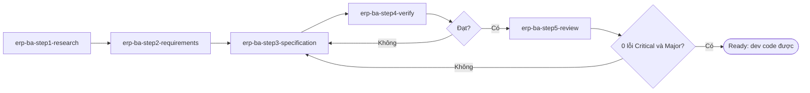

# ERP BA Core — nền tảng dùng chung của bộ skill BA ERP

Bộ skill biến việc viết tài liệu BA cho ERP thành dây chuyền có kiểm soát: mỗi bước là **một skill riêng** có **template** để điền (không để AI tự bịa cấu trúc) và **checklist Yes/No** để nghiệm thu; skill này giữ phần dùng chung để mọi bước nói cùng một ngôn ngữ — **quy ước**, **công cụ** đo khách quan (`scripts/ba.py`), **kho kiến thức ERP** và **workspace mẫu**.

| Lỗi thường gặp | Cơ chế chặn trong bộ skill |
|---|---|
| Tài liệu lệch khỏi yêu cầu ban đầu | Mỗi yêu cầu có trích nguyên văn + nguồn; mỗi vòng kiểm đọc lại nguồn gốc; review độc lập đóng vai khách hàng |
| Thừa chức năng | Nội dung không có nguồn khách hàng phải mang `[ĐỀ XUẤT → Q-…]`; `ba.py trace` báo chức năng không nguồn |
| Thiếu chức năng | Truy vết REQ → FN; kiểm 5 thành phần ERP cho mỗi module; thư viện quy trình chuẩn |
| Mâu thuẫn | Vai trò, tham số, danh mục, chứng từ, trạng thái định nghĩa **một lần** trong catalog; lint bắt ID trùng, trạng thái/vai trò lệch catalog |
| Mơ hồ, chưa đủ để code | Template đặc tả 21 mục; lint bắt từ mơ hồ, thiếu nguồn/AC/sơ đồ; phép thử "dev có code được ngay không?" |
| BA chưa hiểu ERP | Kho kiến thức dưới đây + 4 skill sách ERP |

## Năm bước — năm skill

| Bước | Skill | Làm gì | Đầu ra trong workspace | Nghiệm thu |
|---|---|---|---|---|
| 1 | `erp-ba-step1-research` | Research ngành, luật, đối thủ → danh mục tính năng, phạm vi đề xuất, câu hỏi khảo sát | `01-research/` | C1 |
| 2 | `erp-ba-step2-requirements` | Biên bản họp → sổ yêu cầu có trích dẫn, tài liệu & quy trình tổng quan TO-BE, câu hỏi/mâu thuẫn | `00-inputs/`, `02-requirements/` | C2 |
| 3 | `erp-ba-step3-specification` | Phân rã module → chức năng; catalog; đặc tả từng chức năng/báo cáo đủ để code | `03-specification/` | C3, C3F, C3R |
| 4 | `erp-ba-step4-verify` | Tự kiểm: lint, truy vết, checklist có bằng chứng, 4 câu hỏi bắt buộc; điều phối vòng lặp | `04-verification/` | C4 (+ chạy lại C1–C3R) |
| 5 | `erp-ba-step5-review` | Review độc lập bằng agent khác theo 6 góc nhìn; vòng sửa → kiểm → review lại | `05-review/` | C5 |

Các skill bước tìm skill này ở thư mục cạnh chúng (`../erp-ba-core`). Cài đặt: đặt cả 6 thư mục (và 4 skill sách) trong cùng một thư mục skill (ví dụ `~/.claude/skills/` hoặc `.claude/skills/` của dự án).

## Chạy trọn quy trình (khi người dùng muốn "làm từ đầu" hoặc chưa rõ đang ở bước nào)

1. **Tìm workspace** (thư mục tài liệu dự án có `00-inputs/`, `02-requirements/`…). Chưa có → hỏi tên dự án và nơi lưu (mặc định `docs/ba/<mã-dự-án>/`), rồi `python3 <core>/scripts/ba.py init <root> --project "<Tên dự án>"`.
2. **Xác định bước** và đọc SKILL.md của skill bước đó trước khi làm:

| Người dùng nói / có trong tay | Bắt đầu từ |
|---|---|
| "research ngành…", "tìm hiểu đối thủ", "làm demo cho khách", chưa có buổi họp nào | `erp-ba-step1-research` |
| Có biên bản/ghi âm/ghi chú buổi họp, file khách hàng gửi | `erp-ba-step2-requirements` (ngành lạ, chưa research → làm nhanh bước 1 trước) |
| "viết đặc tả / SRS / user story cho chức năng X" | `erp-ba-step3-specification` (chưa có sổ yêu cầu → bước 2 tối thiểu cho phạm vi X trước) |
| "kiểm tra lại tài liệu", "còn thiếu gì không", "checklist xong chưa" | `erp-ba-step4-verify` |
| "review khách quan", "nhờ agent khác review" | `erp-ba-step5-review` |
| Khách hàng trả lời câu hỏi / đổi yêu cầu | Cập nhật issue-log → sửa tài liệu (bước 3) → bước 4 |

3. **Vòng lặp 3 → 4 → 5** tới khi đạt: lint 0 Error; trace 0 lỗi; checklist PASS; review 0 Critical/Major; 0 marker `[CẦN XÁC NHẬN]`/`[ĐỀ XUẤT]` còn mở → mới đặt `status: Ready`. **Tối đa 3 vòng**; sau đó báo người dùng phần còn lại (thường là câu hỏi chỉ khách hàng trả lời được) kèm danh sách câu hỏi — không "làm cho đạt" bằng cách hạ tiêu chuẩn hay tự trả lời thay khách hàng.

## Nguyên tắc vàng (áp dụng cho mọi bước)

1. **Không có nguồn thì không viết.** Mỗi yêu cầu, quy tắc, con số truy được về biên bản/tài liệu khách hàng (REQ, MTG, SRC), quyết định đã chốt (DEC), hoặc chuẩn/luật cụ thể. AI rất giỏi viết thứ "nghe hợp lý"; chỉ cột Nguồn phân biệt được cái khách hàng cần với cái AI tưởng tượng.
2. **Hỏi thay vì đoán.** Thiếu thông tin → `[CẦN XÁC NHẬN: Q-…]` + câu hỏi trong `issue-log.md`. Một chỗ trống được đánh dấu rẻ hơn nhiều so với một quy tắc bịa mà dev code theo.
3. **Đề xuất phải lộ diện.** Được (và nên) đề xuất theo chuẩn ERP hoặc từ research — nhưng gắn `[ĐỀ XUẤT → Q-…]` để khách hàng quyết.
4. **Định nghĩa một lần, tham chiếu bằng ID.** Vai trò, tham số, danh mục, chứng từ, trạng thái, thuật ngữ nằm trong `catalogs/`; file chức năng chỉ dùng ID.
5. **Chuẩn ERP trước, tùy biến sau.** Đọc file chuẩn trong kho kiến thức trước khi đặc tả; chỗ khác chuẩn phải có REQ/DEC.
6. **Không xóa mục template.** Mục không áp dụng ghi `N/A – <lý do>`.
7. **Công cụ trước, cảm nhận sau.** Chạy `ba.py lint`/`trace` trước khi tự đánh giá; "Yes" trong checklist phải kèm bằng chứng.

Quy ước định dạng (ID, marker, nơi định nghĩa, trạng thái chuẩn, quy tắc viết yêu cầu): `references/conventions.md`.

## Kho kiến thức ERP — đọc khi nào

| Cần | Đọc |
|---|---|
| ERP là gì, 5 thành phần, nguyên lý chứng từ/ghi sổ/tích hợp, sai lầm BA hay mắc | `references/erp-foundations.md` |
| Module chuẩn và chức năng con của từng module | `references/erp-modules-catalog.md` |
| Quy trình chuẩn (vai trò, chứng từ, bước, trạng thái, quy tắc, hạch toán, tham số, báo cáo, câu hỏi khảo sát) | `references/processes/` — p2p-procure-to-pay, o2c-order-to-cash, inventory-warehouse, manufacturing-mrp, project-management, crm-service, r2r-general-ledger, ap-accounts-payable, ar-accounts-receivable, cash-bank, fixed-assets, tax-einvoice, costing, budgeting, hr-payroll |
| Đặc thù ngành | `references/industries/` — construction, logistics, trading-distribution (thêm ngành mới: `industries/README.md`) |
| Luật Việt Nam (kế toán, thuế, hóa đơn điện tử, lao động – bảo hiểm – thuế TNCN) | `references/regulations/` — luôn kiểm tra lại hiệu lực khi dùng |
| Pattern chức năng chuẩn (danh mục, chứng từ, duyệt nhiều cấp, ghi sổ/đảo, đánh số, khóa kỳ, import, audit…) | `references/design-patterns.md` |
| Phân quyền, SoD, hạn mức duyệt, catalog tham số hệ thống | `references/security-and-parameters.md` |
| Yêu cầu phi chức năng đo được | `references/nfr-catalog.md` |
| Báo cáo chuẩn theo module và báo cáo bắt buộc | `references/reports-catalog.md` |
| Thuật ngữ ERP Việt – Anh | `references/glossary.md` |
| Viết yêu cầu tốt, user story, AC, BPMN/UML, elicitation, kỹ thuật review | `references/ba-standards.md` |
| Cú pháp & mẫu sơ đồ Mermaid | `references/diagram-conventions.md` |
| Câu hỏi khảo sát & câu hỏi tự kiểm | `references/question-bank.md` |
| Tri thức từ 4 cuốn sách ERP | `references/book-insights.md`; chi tiết trong các skill `wallace-erp-implementation`, `oleary-erp-systems-lifecycle`, `parthasarathy-erp-fundamentals`, `elbardan-erp-governance-audit` |
| Mẫu tài liệu đã hoàn chỉnh (biên bản → REQ → Q/DEC → đặc tả) | `assets/examples/sample-workspace/` |

File tham chiếu dài có mục lục ở đầu — đọc mục lục rồi nhảy tới phần cần. Mã trong thư viện (ví dụ `PRM-PUR-004`, `BR-PUR-04`) là mã minh họa, không phải ID dự án (xem conventions).

## Công cụ `scripts/ba.py` (Python 3.8+, không cần thư viện ngoài)

| Lệnh | Dùng khi |
|---|---|
| `init <root> --project "<tên>"` | Tạo workspace từ template của cả 5 skill bước |
| `new-meeting <root> [--date YYYY-MM-DD]` | Tạo biên bản họp MTG kế tiếp (bước 2) |
| `new-function <root> --id FN-PUR-03 --name "<tên>" [--type …]` | Tạo file đặc tả chức năng/báo cáo (bước 3) |
| `lint <root>` | Placeholder, TODO, marker, ID trùng/chưa định nghĩa, cấu trúc theo template, sơ đồ bắt buộc & cú pháp Mermaid, từ mơ hồ, thiếu nguồn/AC/MSG, trạng thái & vai trò lệch catalog |
| `trace <root>` | REQ chưa phủ (thiếu), FN không nguồn (thừa), FR/US thiếu AC, dòng biên bản chưa xử lý; ghi `traceability.md` |
| `checklist <root> --step 1\|2\|3\|3F\|3R\|4\|5\|all --round N --out <file>` | Sinh bảng checklist (lấy từ skill bước tương ứng) để điền |
| `status <report.md>` | PASS/FAIL của báo cáo kiểm/review |
| `node scripts/mermaid_check.mjs <root>` (tùy chọn) | Render thử mọi sơ đồ bằng Mermaid thật (cần Node.js, Chrome, `@mermaid-js/mermaid-cli` — xem đầu file) |
| `python3 scripts/selftest.py` | Kiểm tra chính công cụ (người bảo trì) |

Công cụ tìm template và checklist trong các skill bước nằm cạnh (`../erp-ba-step*`); đặt biến `ERP_BA_SUITE_ROOT` nếu bộ skill nằm chỗ khác.

## Trả lời câu hỏi kiến thức ERP

Khi người dùng hỏi kiến thức (không viết tài liệu): trả lời từ kho kiến thức, nêu file nguồn; với luật, nói rõ ngày cập nhật của file và khuyên kiểm tra lại hiệu lực; không bịa số hiệu văn bản hay tỷ lệ.

## Thay đổi yêu cầu & xuất bản

- **Thay đổi:** ghi câu trả lời/CHG vào `issue-log.md` kèm nguồn → tìm ảnh hưởng (`grep` ID, `ba.py trace`) → sửa, giữ nguyên ID, tăng `version`, ghi lịch sử → chạy lại bước 4. Không xóa REQ cũ — đổi trạng thái "Đã thay đổi"/"Bị loại".
- **Xuất bản:** Markdown trong workspace là bản gốc. Gửi khách hàng: `pandoc` sang Word (render sơ đồ Mermaid thành ảnh trước), hoặc đăng Confluence nếu có công cụ — luôn sửa ở Markdown rồi xuất lại.
