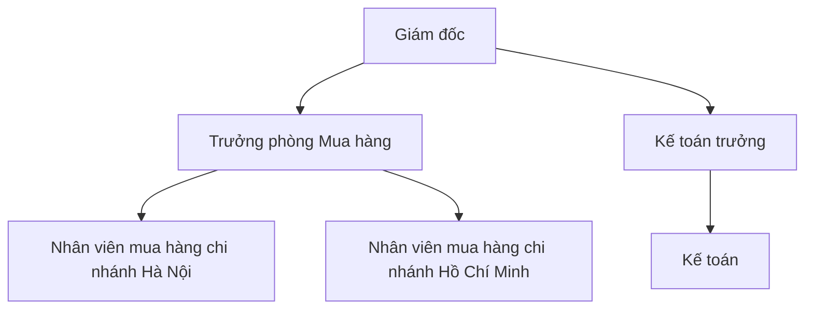
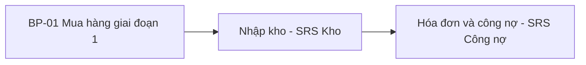
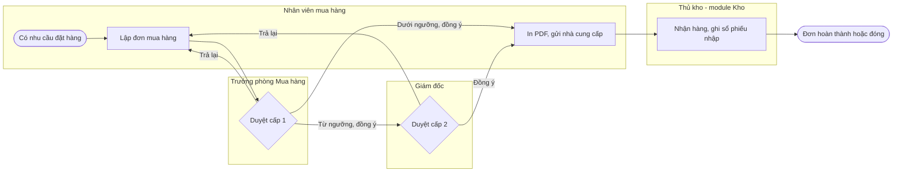

# Tài liệu tổng quan yêu cầu & quy trình tổng quan — Minh An ERP

## 0. Thông tin tài liệu

| Mục | Nội dung |
|---|---|
| Khách hàng | Công ty CP Thiết bị Điện Minh An — phân phối thiết bị điện; 1 pháp nhân, 2 chi nhánh (Hà Nội, Hồ Chí Minh), mỗi chi nhánh 1 kho (REQ-022) |
| Nguồn đã tổng hợp | MTG-001, SRC-001, SRC-002, SRC-003 |
| Kết quả research dùng kèm | Không thực hiện bước 1 cho phạm vi này — khách hàng đã xác định nhu cầu cụ thể |
| Phiên bản / ngày | 1.0 – 20/10/2026 |

## 1. Bối cảnh & mục tiêu kinh doanh

| ID | Mục tiêu (đo được) | Chỉ số đo | Nguồn |
|---|---|---|---|
| BO-01 | Kiểm soát toàn bộ đơn mua hàng trên một hệ thống thay cho Excel và email | 100% đơn mua phát sinh từ ngày vận hành được lập trên hệ thống | REQ-001 |
| BO-02 | Biết tức thời đơn nào đã giao, chưa giao, sắp đến hạn | Báo cáo đơn sắp đến hạn chạy được vào cuối mỗi ngày | REQ-002, REQ-016 |

## 2. Phạm vi

### 2.1 Trong phạm vi
| Hạng mục | Chi tiết | Nguồn |
|---|---|---|
| Module | Mua hàng giai đoạn 1: danh mục nhà cung cấp, đơn mua hàng có duyệt 2 cấp, báo cáo tình hình thực hiện đơn mua | REQ-001 đến REQ-017 |
| Đơn vị tổ chức áp dụng | Chi nhánh Hà Nội, chi nhánh Hồ Chí Minh | REQ-022 |
| Người dùng | Nhân viên mua hàng hai chi nhánh, Trưởng phòng Mua hàng, Giám đốc, Kế toán | MTG-001 L03, L04, L07 |

### 2.2 Ngoài phạm vi
| Hạng mục | Lý do | Nguồn |
|---|---|---|
| Đề nghị mua hàng | Giai đoạn 1 lập đơn mua trực tiếp | DEC-001 |
| Phiếu nhập kho, hóa đơn mua hàng, thanh toán | Thuộc SRS module Kho và module Công nợ (tài liệu riêng); đơn mua chỉ nhận cập nhật số lượng đã nhận | DEC-014 |
| Kết nối phần mềm kế toán hiện tại | Khách hàng dùng tiếp phần mềm kế toán đến hết năm, chưa cần kết nối | MTG-001 L18 |
| Ứng dụng di động riêng | Duyệt trên trình duyệt điện thoại | DEC-005 |

### 2.3 Giai đoạn
| Giai đoạn | Nội dung | Mốc |
|---|---|---|
| Giai đoạn 1 | Phạm vi mục 2.1 | Theo kế hoạch dự án |

## 3. Các bên liên quan & cơ cấu tổ chức

| Bên liên quan | Phòng ban | Vai trò trong quy trình | Mức ảnh hưởng/quyền quyết định | Người đại diện |
|---|---|---|---|---|
| Trưởng phòng Mua hàng | Mua hàng | Duyệt cấp 1, đóng và hủy đơn | Duyệt phạm vi module Mua hàng | Trần Văn Hùng |
| Kế toán trưởng | Kế toán | Xem đơn để đối chiếu công nợ; quyết định nội dung liên quan kế toán | Duyệt nội dung kế toán | Nguyễn Thị Lan |
| Giám đốc | Ban giám đốc | Duyệt cấp 2 đơn từ ngưỡng trở lên | Người dùng duyệt | — |
| Nhân viên mua hàng | Mua hàng | Lập và theo dõi đơn của chi nhánh | Người dùng chính | — |

## 4. Hiện trạng (AS-IS) & vấn đề

| # | Hiện trạng / hệ thống đang dùng | Vấn đề | Nguồn |
|---|---|---|---|
| 1 | Lập đơn mua bằng Excel (mẫu SRC-001), gửi email cho nhà cung cấp | Không kiểm soát được đơn đã giao, chưa giao | MTG-001 L01 |
| 2 | Danh sách nhà cung cấp trong Excel (SRC-002) | Gõ tay trên đơn, dễ sai | MTG-001 L02 |

## 5. Danh sách luồng tổng quan (TO-BE)

| ID | Luồng tổng quan | Module | Chuẩn tham chiếu | Luồng chi tiết | REQ được phủ |
|---|---|---|---|---|---|
| BP-01 | Đặt hàng nhà cung cấp và theo dõi giao hàng | PUR | `erp-ba-core/references/processes/p2p-procure-to-pay.md` | FL-01-01, FL-01-02, FL-01-03, FL-01-04 | REQ-001 đến REQ-022 |

## 6. Luồng tổng quan và các luồng chi tiết

### 6.1 BP-01 — Đặt hàng nhà cung cấp và theo dõi giao hàng

| Mục | Nội dung |
|---|---|
| Mục đích | Lập, duyệt, gửi đơn mua cho nhà cung cấp và theo dõi đến khi nhận đủ hoặc đóng đơn |
| Sự kiện bắt đầu / kết thúc | Bắt đầu: nhân viên có nhu cầu đặt hàng. Kết thúc: đơn hoàn thành, đóng hoặc hủy |
| Vai trò tham gia | Nhân viên mua hàng, Trưởng phòng Mua hàng, Giám đốc, Kế toán (xem), Thủ kho (nhận hàng ở module Kho) |
| Chứng từ chính | Đơn mua hàng; Phiếu nhập kho (module Kho) |
| REQ được phủ | REQ-001 đến REQ-022 |
| Khác biệt so với chuẩn ERP & lý do | Không có bước đề nghị mua hàng trước đơn mua (DEC-001); không kiểm tra ngân sách vì khách hàng không yêu cầu quản lý ngân sách ở giai đoạn 1 (MTG-001 không đề cập, phạm vi 2.1) |

**Các luồng chi tiết của BP-01:**

| ID | Luồng chi tiết | Vai trò thực hiện | Bắt đầu → Kết thúc | Chứng từ / dữ liệu | Module | REQ | Khác chuẩn (nguồn) |
|---|---|---|---|---|---|---|---|
| FL-01-01 | Quản lý nhà cung cấp | Nhân viên mua hàng (tạo, sửa); Trưởng phòng Mua hàng (khóa, mở khóa) | Có nhà cung cấp mới hoặc phát sinh tranh chấp → nhà cung cấp Đang dùng hoặc Khóa | Danh mục nhà cung cấp | PUR | REQ-003, REQ-008, REQ-009, REQ-010 | Không |
| FL-01-02 | Lập và duyệt đơn mua hàng | Nhân viên mua hàng; Trưởng phòng Mua hàng; Giám đốc; Kế toán (xem) | Có nhu cầu đặt hàng → đơn Đã duyệt hoặc Từ chối | Đơn mua hàng | PUR | REQ-001, REQ-003, REQ-004, REQ-005, REQ-006, REQ-007, REQ-011, REQ-012, REQ-015 | Không có bước đề nghị mua hàng trước đơn (DEC-001) |
| FL-01-03 | Gửi đơn cho nhà cung cấp | Nhân viên mua hàng | Đơn Đã duyệt → file PDF gửi nhà cung cấp | Đơn đặt hàng PDF | PUR | REQ-017 | Không |
| FL-01-04 | Theo dõi giao hàng và đóng đơn | Thủ kho (module Kho); Hệ thống; Trưởng phòng Mua hàng; Nhân viên mua hàng | Phiếu nhập kho từ đơn được ghi sổ → đơn Hoàn thành hoặc Đã đóng | Phiếu nhập kho, đơn mua hàng, báo cáo tình hình thực hiện | PUR, INV | REQ-002, REQ-013, REQ-014, REQ-016 | Không |

## 7. Module & phạm vi chức năng sơ bộ

| Module | Mục đích | Danh mục chính | Nghiệp vụ chính | Báo cáo chính | REQ |
|---|---|---|---|---|---|
| PUR | Đặt hàng nhà cung cấp | Nhà cung cấp | Đơn mua hàng | Tình hình thực hiện đơn mua | REQ-001 đến REQ-018, REQ-020, REQ-021 |

## 8. Tổng hợp theo 5 thành phần của sản phẩm ERP

| Module | Hệ thống / nền tảng | Danh mục | Nghiệp vụ | Phân quyền & tham số | Báo cáo |
|---|---|---|---|---|---|
| PUR | REQ-021 (duyệt trên điện thoại), REQ-022 (hai chi nhánh) | REQ-003, REQ-004, REQ-008, REQ-009, REQ-010 | REQ-001, REQ-002, REQ-012 đến REQ-015, REQ-017 | REQ-005, REQ-006, REQ-007, REQ-011 | REQ-016 |

## 9. Yêu cầu phi chức năng tổng quan

| Nhóm | Yêu cầu / thông tin đã biết | Nguồn |
|---|---|---|
| Quy mô người dùng & dữ liệu | Khoảng 300 đơn/tháng, đơn lớn nhất khoảng 80 dòng; 30 người dùng đồng thời | REQ-020, DEC-010 |
| Hạ tầng, thiết bị | Duyệt trên trình duyệt điện thoại | REQ-021, DEC-005 |
| Bảo mật, phân quyền, kiểm toán | Phân quyền dữ liệu theo chi nhánh; kế toán chỉ xem; không tự duyệt đơn của mình | REQ-007, REQ-011, DEC-012 |
| Khả dụng, sao lưu | Theo NFR chung của nền tảng (srs-overview §11) | DEC-010 |
| Pháp lý | Chế độ kế toán theo Thông tư 99/2025/TT-BTC | REQ-019 |

## 10. Tích hợp & chuyển đổi dữ liệu

| Hạng mục | Nội dung | Nguồn |
|---|---|---|
| Hệ thống cần tích hợp | Không tích hợp hệ thống ngoài ở giai đoạn 1 | MTG-001 L18 |
| Dữ liệu cần chuyển đổi | 312 nhà cung cấp từ SRC-002 | SRC-002 |

## 11. Ràng buộc, giả định, rủi ro

| Loại | Nội dung | Nguồn / ID |
|---|---|---|
| Ràng buộc | Chế độ kế toán TT99/2025 | REQ-019 |
| Giả định | Phiếu nhập kho cập nhật số đã nhận về đơn mua — đã xác nhận | ASM-001, DEC-014 |
| Rủi ro | Danh sách nhà cung cấp cũ có thể trùng mã số thuế, phải làm sạch trước khi nhập | SRC-002 |

## 12. Mâu thuẫn & câu hỏi mở

Xem `02-requirements/issue-log.md`. Không còn mục chặn: CFL-001 đã có DEC-002; Q-001 đến Q-013 đã được trả lời.

## 13. Thuật ngữ

Xem `03-specification/catalogs/glossary.md`.

## Phụ lục A — Ma trận REQ → BP → Module

| REQ | BP | Module |
|---|---|---|
| REQ-001 đến REQ-018, REQ-020, REQ-021 | BP-01 | PUR |
| REQ-019 | BP-01 | GL |
| REQ-022 | BP-01 | SYS |
