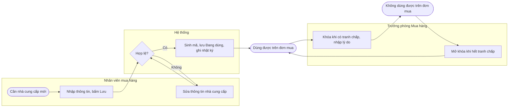
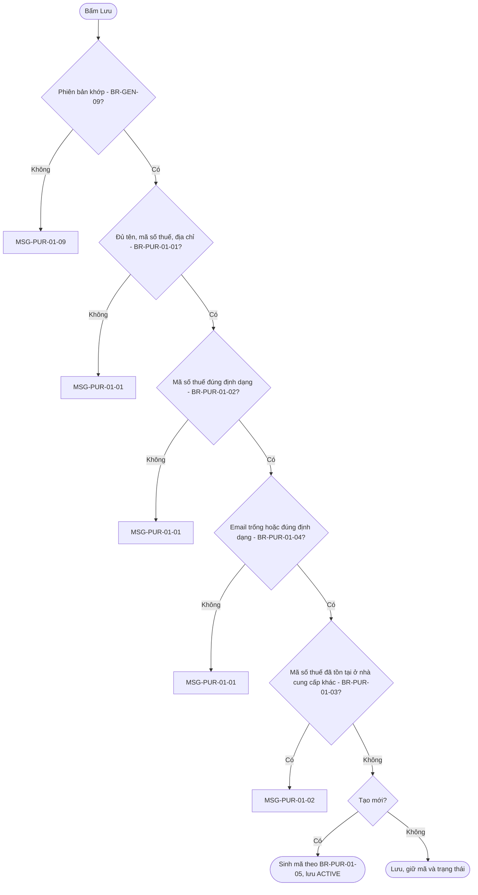
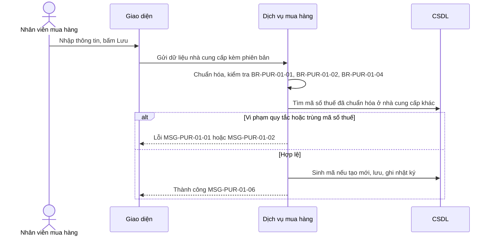
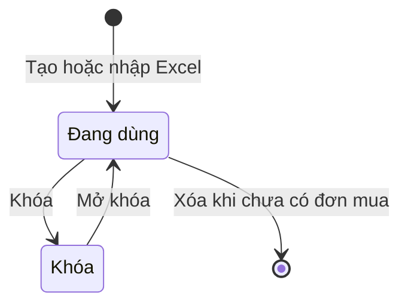
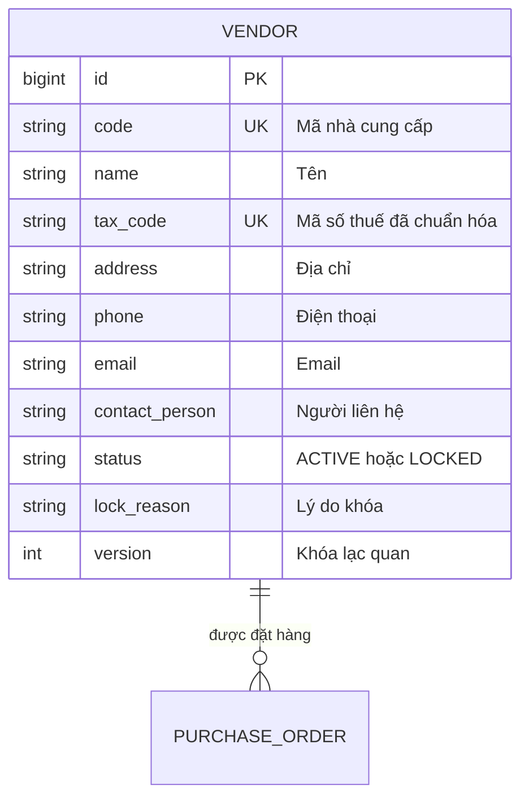

# FN-PUR-01 — Danh mục nhà cung cấp

## 0. Thông tin & truy vết

| Mục | Giá trị |
|---|---|
| Nguồn yêu cầu | REQ-003 chọn nhà cung cấp từ danh mục · REQ-008 bắt buộc mã số thuế · REQ-009 không trùng mã số thuế · REQ-010 khóa nhà cung cấp tranh chấp · DEC-017 ai tạo, sửa, khóa · SRC-002 các cột dữ liệu hiện có |
| Quy trình đầu-cuối | BP-01 |
| Pattern ERP áp dụng | P01 Danh mục, P12 Nhập Excel, P13 Danh sách & tìm kiếm, P14 Nhật ký (`erp-ba-core/references/design-patterns.md`) |
| Tham chiếu chuẩn | `erp-ba-core/references/processes/p2p-procure-to-pay.md` §3 |
| Chức năng đứng trước (upstream) | Không có |
| Chức năng đứng sau (downstream) | FN-PUR-02 dùng nhà cung cấp Đang dùng |
| Loại chứng từ | N/A – danh mục, không phải chứng từ giao dịch |
| Danh mục sử dụng | MD-VENDOR |
| Tham số sử dụng | Không có |
| Báo cáo liên quan | RPT-PUR-01 hiển thị nhà cung cấp |
| Tích hợp / thông báo | Không có |

## 1. Mô tả & mục tiêu

- **Mục đích nghiệp vụ:** quản lý một danh sách nhà cung cấp dùng chung toàn công ty, có mã số thuế duy nhất, để đơn mua chọn từ danh mục thay vì gõ tay, và chặn đặt hàng với nhà cung cấp đang tranh chấp.
- **Trong phạm vi:** xem, tạo, sửa, xóa (khi chưa dùng), khóa, mở khóa, nhập từ Excel, xem nhật ký thay đổi.
- **Ngoài phạm vi:** công nợ nhà cung cấp, tài khoản ngân hàng, điều khoản thanh toán (SRS module Công nợ); đánh giá nhà cung cấp (không có yêu cầu).
- **Sự kiện kích hoạt:** cần đặt hàng với nhà cung cấp mới; nhà cung cấp phát sinh tranh chấp hoặc hết tranh chấp; chuyển đổi dữ liệu ban đầu (srs-overview §13).
- **Tiền điều kiện:** người dùng có vai trò theo mục 2.
- **Hậu điều kiện:** nhà cung cấp Đang dùng xuất hiện trong ô chọn của FN-PUR-02; nhà cung cấp Khóa không chọn được và chặn lưu, gửi duyệt, duyệt đơn đang dùng nó (FN-PUR-02 BR-PUR-02-03).

## 2. Vai trò & phân quyền

### 2.1 Vai trò tham gia

| Vai trò | Mức tham gia | Được làm gì trong chức năng này |
|---|---|---|
| ROLE-PUR-STAFF | Chính | Xem, tạo, sửa, xóa nhà cung cấp chưa dùng, nhập Excel |
| ROLE-PUR-MGR | Chính | Toàn bộ quyền của nhân viên; khóa, mở khóa |
| ROLE-DIRECTOR | Chỉ xem | Xem danh sách và chi tiết |
| ROLE-ACC | Chỉ xem | Xem danh sách và chi tiết để đối chiếu công nợ |

### 2.2 Ma trận quyền theo hành động

| Hành động | ROLE-PUR-STAFF | ROLE-PUR-MGR | ROLE-DIRECTOR | ROLE-ACC |
|---|---|---|---|---|
| Xem | ✔ Toàn hệ thống | ✔ Toàn hệ thống | ✔ Toàn hệ thống | ✔ Toàn hệ thống |
| Tạo | ✔ | ✔ | ✖ | ✖ |
| Sửa | ✔ | ✔ | ✖ | ✖ |
| Xóa | ✔ khi chưa có đơn mua tham chiếu | ✔ khi chưa có đơn mua tham chiếu | ✖ | ✖ |
| Khóa / Mở khóa | ✖ | ✔ | ✖ | ✖ |
| Nhập file | ✔ | ✔ | ✖ | ✖ |

### 2.3 Phân quyền trường dữ liệu & phạm vi dữ liệu đặc biệt

| Trường / nhóm dữ liệu | Vai trò | Quyền (ẩn / chỉ xem / sửa) | Điều kiện |
|---|---|---|---|
| Trạng thái, Lý do khóa | ROLE-PUR-STAFF | Chỉ xem | Chỉ ROLE-PUR-MGR đổi qua hành động Khóa / Mở khóa (DEC-017) |

### 2.4 Phân tách nhiệm vụ & hạn mức

N/A – khách hàng không yêu cầu duyệt khi tạo hoặc sửa nhà cung cấp (MTG-001, DEC-017); mọi thay đổi được ghi nhật ký (BR-GEN-06).

## 3. User stories & tiêu chí nghiệm thu

| ID | User story | Vai trò | Ưu tiên | Nguồn | AC |
|---|---|---|---|---|---|
| US-PUR-01-01 | Là nhân viên mua hàng, tôi muốn tạo nhà cung cấp có mã số thuế duy nhất, để đơn mua chọn đúng đối tác | ROLE-PUR-STAFF | Must | REQ-003, REQ-008, REQ-009 | AC-PUR-01-01, AC-PUR-01-02, AC-PUR-01-03 |
| US-PUR-01-02 | Là Trưởng phòng Mua hàng, tôi muốn khóa nhà cung cấp đang tranh chấp, để không ai đặt hàng với họ | ROLE-PUR-MGR | Must | REQ-010, DEC-017 | AC-PUR-01-04, AC-PUR-01-05 |
| US-PUR-01-03 | Là nhân viên mua hàng, tôi muốn nhập danh sách nhà cung cấp hiện có từ Excel, để không phải gõ lại 312 dòng | ROLE-PUR-STAFF | Must | SRC-002 | AC-PUR-01-06 |
| US-PUR-01-04 | Là nhân viên mua hàng, tôi muốn xóa nhà cung cấp tạo nhầm khi chưa dùng, để danh mục sạch | ROLE-PUR-STAFF | Should | REQ-003 | AC-PUR-01-07 |

#### AC-PUR-01-01 — Tạo nhà cung cấp hợp lệ (US-PUR-01-01, FR-PUR-01-01)
- **Cho trước** chưa có nhà cung cấp nào mang mã số thuế 0101234567
- **Khi** nhân viên nhập tên "Công ty TNHH Điện Sáng", mã số thuế 0101234567, địa chỉ, rồi bấm Lưu
- **Thì** nhà cung cấp được tạo với mã tự sinh dạng NCC-00313, trạng thái Đang dùng, hiển thị MSG-PUR-01-06

#### AC-PUR-01-02 — Chặn trùng mã số thuế (US-PUR-01-01, FR-PUR-01-02)
- **Cho trước** đã có NCC-00012 mang mã số thuế 0101234567 (kể cả khi NCC-00012 đang Khóa)
- **Khi** nhân viên tạo hoặc sửa một nhà cung cấp khác với mã số thuế "0101234567" hoặc " 0101234567 "
- **Thì** hệ thống chặn với MSG-PUR-01-02 nêu mã NCC-00012

#### AC-PUR-01-03 — Mã số thuế sai định dạng (US-PUR-01-01, FR-PUR-01-02)
- **Cho trước** biểu mẫu tạo nhà cung cấp
- **Khi** nhập mã số thuế "01012345" (8 chữ số) hoặc "0101234567-01" và bấm Lưu
- **Thì** hệ thống chặn với MSG-PUR-01-01; các giá trị "0101234567" và "0101234567-001" được chấp nhận

#### AC-PUR-01-04 — Khóa nhà cung cấp (US-PUR-01-02, FR-PUR-01-03)
- **Cho trước** NCC-00020 Đang dùng và đang có 1 đơn mua DRAFT chọn NCC-00020
- **Khi** Trưởng phòng bấm Khóa, nhập lý do "Đang tranh chấp hợp đồng số 15/2026"
- **Thì** NCC-00020 chuyển Khóa; không còn trong ô chọn nhà cung cấp của đơn mua; đơn DRAFT nói trên bị chặn khi Lưu với MSG-PUR-02-03; nếu để trống lý do thì bị chặn với MSG-PUR-01-03

#### AC-PUR-01-05 — Nhân viên không khóa được (US-PUR-01-02, FR-PUR-01-03)
- **Cho trước** người dùng chỉ có vai trò ROLE-PUR-STAFF
- **Khi** mở chi tiết nhà cung cấp
- **Thì** không có nút Khóa, Mở khóa; gọi trực tiếp hành động trả về MSG-PUR-01-05

#### AC-PUR-01-06 — Nhập Excel (US-PUR-01-03, FR-PUR-01-04)
- **Cho trước** file theo mẫu nhập có 312 dòng, trong đó dòng 15 và dòng 200 trùng mã số thuế với nhau
- **Khi** nhân viên chọn file và bấm Nhập
- **Thì** không dòng nào được nhập; hệ thống trả file lỗi có thêm cột "Lỗi" ở dòng 15 và 200 với nội dung MSG-PUR-01-02; sau khi sửa file và nhập lại, 312 nhà cung cấp được tạo và hiển thị MSG-PUR-01-07

#### AC-PUR-01-07 — Xóa nhà cung cấp (US-PUR-01-04, FR-PUR-01-05)
- **Cho trước** NCC-00313 chưa có đơn mua nào tham chiếu, NCC-00012 đã có đơn mua
- **Khi** nhân viên xóa NCC-00313 rồi xóa NCC-00012
- **Thì** NCC-00313 bị xóa sau khi xác nhận MSG-PUR-01-08; xóa NCC-00012 bị chặn với MSG-PUR-01-04

## 4. Luồng nghiệp vụ

### 4.1 Sơ đồ luồng nghiệp vụ (swimlane)

### 4.2 Luồng chính

| Bước | Vai trò | Hành động người dùng | Xử lý của hệ thống | Quy tắc áp dụng | Trạng thái sau bước |
|---|---|---|---|---|---|
| 1 | ROLE-PUR-STAFF | Bấm Tạo mới | Mở biểu mẫu trống | — | — |
| 2 | ROLE-PUR-STAFF | Nhập tên, mã số thuế, địa chỉ, điện thoại, email, người liên hệ; bấm Lưu | Chuẩn hóa dữ liệu (bỏ khoảng trắng đầu cuối); kiểm tra quy tắc; sinh mã; lưu; ghi nhật ký | BR-PUR-01-01 đến BR-PUR-01-05 | ACTIVE |
| 3 | ROLE-PUR-MGR | Bấm Khóa, nhập lý do | Đổi trạng thái; ghi nhật ký | BR-PUR-01-07 | LOCKED |
| 4 | ROLE-PUR-MGR | Bấm Mở khóa | Đổi trạng thái; xóa lý do khóa hiện hành (giữ trong nhật ký) | BR-PUR-01-07 | ACTIVE |

### 4.3 Luồng thay thế

| ID | Tại bước | Điều kiện | Diễn biến | Quay lại bước |
|---|---|---|---|---|
| A1 | 1 | Nhập hàng loạt | Tải mẫu Excel, điền, chọn file, bấm Nhập; kiểm tra toàn bộ file theo BR-PUR-01-08 | — |
| A2 | Sau 2 | Sửa nhà cung cấp | Mở chi tiết, sửa, Lưu; mã không đổi | 2 |
| A3 | Sau 2 | Xóa nhà cung cấp chưa dùng | Xác nhận MSG-PUR-01-08; xóa | — |

### 4.4 Luồng ngoại lệ

| ID | Tại bước | Tình huống lỗi | Hệ thống xử lý | Thông báo |
|---|---|---|---|---|
| E1 | 2 | Thiếu trường bắt buộc, sai định dạng mã số thuế hoặc email | Chặn, tô đỏ trường | MSG-PUR-01-01 |
| E2 | 2 | Trùng mã số thuế | Chặn | MSG-PUR-01-02 |
| E3 | 3 | Khóa không có lý do | Chặn | MSG-PUR-01-03 |
| E4 | A3 | Xóa nhà cung cấp đã có đơn mua | Chặn | MSG-PUR-01-04 |
| E5 | Mọi bước | Không có quyền | Chặn | MSG-PUR-01-05 |
| E6 | 2, A2 | Người khác vừa sửa (sai phiên bản) | Chặn, yêu cầu tải lại | MSG-PUR-01-09 |

## 5. Sơ đồ quyết định (logic rẽ nhánh)

## 6. Sơ đồ tuần tự (sequence)

## 7. Trạng thái chứng từ

Danh mục dùng trạng thái bản ghi (không phải bộ trạng thái chứng từ): ACTIVE "Đang dùng", LOCKED "Khóa".

### 7.1 Sơ đồ trạng thái

### 7.2 Bảng chuyển trạng thái

| Từ | Hành động | Đến | Vai trò | Điều kiện (BR) | Tác động hệ thống (kho / công nợ / sổ cái / ngân sách / thông báo) |
|---|---|---|---|---|---|
| (mới) | Tạo, Nhập file | ACTIVE | ROLE-PUR-STAFF, ROLE-PUR-MGR | BR-PUR-01-01 đến BR-PUR-01-05, BR-PUR-01-08 | Xuất hiện trong ô chọn của FN-PUR-02 |
| ACTIVE | Khóa | LOCKED | ROLE-PUR-MGR | BR-PUR-01-07 | Không chọn được trên đơn mua; chặn lưu, gửi duyệt, duyệt đơn đang dùng |
| LOCKED | Mở khóa | ACTIVE | ROLE-PUR-MGR | BR-PUR-01-07 | Chọn lại được trên đơn mua |
| ACTIVE | Xóa | (không còn) | ROLE-PUR-STAFF, ROLE-PUR-MGR | BR-PUR-01-06 | — |

### 7.3 Quyền sửa trường theo trạng thái

| Trường / nhóm trường | ACTIVE | LOCKED |
|---|---|---|
| Tên, mã số thuế, địa chỉ, điện thoại, email, người liên hệ | Sửa | Sửa |
| Mã nhà cung cấp | Khóa | Khóa |
| Trạng thái, lý do khóa | Chỉ qua hành động Khóa | Chỉ qua hành động Mở khóa |

## 8. Yêu cầu chức năng (FR)

| ID | Yêu cầu (Hệ thống PHẢI …) | Ưu tiên | Nguồn | AC kiểm chứng |
|---|---|---|---|---|
| FR-PUR-01-01 | Hệ thống PHẢI cho ROLE-PUR-STAFF và ROLE-PUR-MGR tạo, sửa nhà cung cấp trong một danh mục dùng chung toàn công ty, mã tự sinh | Must | REQ-003, DEC-017 | AC-PUR-01-01 |
| FR-PUR-01-02 | Hệ thống PHẢI bắt buộc mã số thuế đúng định dạng và KHÔNG ĐƯỢC cho hai nhà cung cấp trùng mã số thuế | Must | REQ-008, REQ-009 | AC-PUR-01-02, AC-PUR-01-03 |
| FR-PUR-01-03 | Hệ thống PHẢI cho ROLE-PUR-MGR khóa (bắt buộc lý do) và mở khóa nhà cung cấp; nhà cung cấp Khóa không được chọn trên đơn mua | Must | REQ-010, DEC-017 | AC-PUR-01-04, AC-PUR-01-05 |
| FR-PUR-01-04 | Hệ thống PHẢI cho nhập nhà cung cấp từ file Excel theo mẫu, kiểm tra toàn bộ file trước khi nhập | Must | SRC-002 | AC-PUR-01-06 |
| FR-PUR-01-05 | Hệ thống PHẢI cho xóa nhà cung cấp chưa có đơn mua tham chiếu và chặn xóa khi đã có | Should | REQ-003, `erp-ba-core/references/design-patterns.md` P01 | AC-PUR-01-07 |

## 9. Quy tắc nghiệp vụ (BR)

| ID | Quy tắc (điều kiện → kết quả) | Loại | Nguồn | Thông báo |
|---|---|---|---|---|
| BR-PUR-01-01 | Tên nhà cung cấp, mã số thuế, địa chỉ bắt buộc; bỏ khoảng trắng đầu cuối trước khi kiểm tra | Validation | REQ-008, SRC-001 | MSG-PUR-01-01 |
| BR-PUR-01-02 | Mã số thuế gồm đúng 10 chữ số, hoặc 10 chữ số + dấu gạch ngang + 3 chữ số (mã chi nhánh) | Validation | REQ-008 | MSG-PUR-01-01 |
| BR-PUR-01-03 | Mã số thuế sau chuẩn hóa không được trùng với nhà cung cấp khác ở bất kỳ trạng thái nào | Validation | REQ-009 | MSG-PUR-01-02 |
| BR-PUR-01-04 | Email nếu nhập phải đúng định dạng địa chỉ email (có một ký tự @ và tên miền có dấu chấm) | Validation | SRC-002 | MSG-PUR-01-01 |
| BR-PUR-01-05 | Mã nhà cung cấp tự sinh dạng NCC-{5 chữ số} tăng dần toàn công ty, không sửa, không dùng lại | Mặc định | MD-VENDOR, BR-GEN-04 | — |
| BR-PUR-01-06 | Xóa chỉ khi không có đơn mua nào (mọi trạng thái) tham chiếu nhà cung cấp | Ràng buộc | `erp-ba-core/references/design-patterns.md` P01 | MSG-PUR-01-04 |
| BR-PUR-01-07 | Khóa bắt buộc lý do 5–500 ký tự; chỉ ROLE-PUR-MGR khóa, mở khóa | Phân quyền | REQ-010, DEC-017 | MSG-PUR-01-03 |
| BR-PUR-01-08 | Nhập Excel: áp dụng BR-PUR-01-01 đến BR-PUR-01-04 cho từng dòng và kiểm tra trùng mã số thuế giữa các dòng trong file; có bất kỳ dòng lỗi thì không nhập dòng nào và trả file lỗi | Validation | SRC-002, `erp-ba-core/references/design-patterns.md` P12 | MSG-PUR-01-02 |

**Công thức:** N/A – chức năng không có tính toán.

## 10. Dữ liệu

### 10.1 Mô hình dữ liệu

### 10.2 Đặc tả trường dữ liệu

**Bảng: VENDOR**

| # | Tên trường | Tên kỹ thuật | Kiểu | Độ dài / độ chính xác | Bắt buộc | Mặc định | Nguồn dữ liệu / lookup | Kiểm tra (BR) | Sửa được ở trạng thái | Ghi chú |
|---|---|---|---|---|---|---|---|---|---|---|
| 1 | Mã nhà cung cấp | code | Chuỗi | 9 | Có | Tự sinh | — | BR-PUR-01-05 | Không | NCC-00001 |
| 2 | Tên nhà cung cấp | name | Chuỗi | 255 | Có | Trống | — | BR-PUR-01-01 | ACTIVE, LOCKED | — |
| 3 | Mã số thuế | tax_code | Chuỗi | 14 | Có | Trống | — | BR-PUR-01-01, BR-PUR-01-02, BR-PUR-01-03 | ACTIVE, LOCKED | Duy nhất |
| 4 | Địa chỉ | address | Chuỗi | 500 | Có | Trống | — | BR-PUR-01-01 | ACTIVE, LOCKED | In trên đơn đặt hàng |
| 5 | Điện thoại | phone | Chuỗi | 20 | Không | Trống | — | — | ACTIVE, LOCKED | — |
| 6 | Email | email | Chuỗi | 255 | Không | Trống | — | BR-PUR-01-04 | ACTIVE, LOCKED | — |
| 7 | Người liên hệ | contact_person | Chuỗi | 255 | Không | Trống | — | — | ACTIVE, LOCKED | — |
| 8 | Trạng thái | status | Chuỗi | 10 | Có | ACTIVE | — | BR-PUR-01-07 | Chỉ qua Khóa / Mở khóa | — |
| 9 | Lý do khóa | lock_reason | Chuỗi | 500 | Khi LOCKED | Trống | — | BR-PUR-01-07 | Chỉ qua Khóa | — |
| 10 | Người tạo, thời điểm tạo, người sửa cuối, thời điểm sửa cuối | created_by, created_at, updated_by, updated_at | Khóa ngoại, Ngày giờ | — | Có | Hệ thống | Người dùng | — | Không | — |
| 11 | Phiên bản | version | Số nguyên | — | Có | 1 | — | BR-GEN-09 | Không | — |

### 10.3 Dữ liệu sinh ra / ảnh hưởng ở module khác

| Thời điểm | Dữ liệu / sổ bị ảnh hưởng | Nội dung ghi | Hoàn tác khi hủy / đảo |
|---|---|---|---|
| Khóa / Mở khóa | Ô chọn nhà cung cấp và kiểm tra của FN-PUR-02 | Nhà cung cấp ẩn hoặc hiện trong ô chọn; đơn đang dùng bị chặn theo BR-PUR-02-03 | Mở khóa khôi phục |
| Sửa tên, địa chỉ | Đơn mua đã lập | Đơn hiển thị và in thông tin hiện hành của nhà cung cấp | Không áp dụng – danh mục không có thao tác hủy hay đảo |

## 11. Giao diện

### 11.1 Màn hình danh sách

| Thành phần | Đặc tả |
|---|---|
| Cột hiển thị (thứ tự) | Mã · Tên · Mã số thuế · Điện thoại · Email · Trạng thái |
| Bộ lọc mặc định | Trạng thái = Đang dùng |
| Tìm kiếm | Mã, tên, mã số thuế (chứa chuỗi, không phân biệt hoa thường và dấu) |
| Sắp xếp mặc định | Mã tăng dần |
| Phân trang | Theo chuẩn danh sách của nền tảng (`erp-ba-core/references/design-patterns.md` P13) |
| Hành động trên dòng / hàng loạt | Trên dòng: Xem, Sửa. Hàng loạt: N/A – khách hàng không yêu cầu |
| Xuất file | N/A – khách hàng chưa yêu cầu xuất danh sách nhà cung cấp |

### 11.2 Màn hình chi tiết / biểu mẫu

| Vùng / tab | Trường (thứ tự) | Ghi chú hiển thị |
|---|---|---|
| Thông tin chung | Mã · Tên · Mã số thuế · Địa chỉ · Điện thoại · Email · Người liên hệ · Trạng thái · Lý do khóa | Lý do khóa chỉ hiện khi LOCKED |
| Nhật ký thay đổi | Thời điểm · Người · Trường · Giá trị cũ · Giá trị mới | Theo BR-GEN-06 |

**Nút theo trạng thái và vai trò:**

| Nút | Hiển thị khi (trạng thái) | Vai trò | Hành vi |
|---|---|---|---|
| Lưu | ACTIVE, LOCKED | ROLE-PUR-STAFF, ROLE-PUR-MGR | Theo mục 5 |
| Xóa | ACTIVE | ROLE-PUR-STAFF, ROLE-PUR-MGR | Xác nhận MSG-PUR-01-08; kiểm tra BR-PUR-01-06 |
| Khóa | ACTIVE | ROLE-PUR-MGR | Hộp thoại nhập lý do |
| Mở khóa | LOCKED | ROLE-PUR-MGR | Xác nhận MSG-PUR-01-08 |
| Tải mẫu nhập, Nhập file | Màn hình danh sách | ROLE-PUR-STAFF, ROLE-PUR-MGR | Mẫu Excel có các cột: Tên, Mã số thuế, Địa chỉ, Điện thoại, Email, Người liên hệ |

### 11.3 Phác thảo màn hình

N/A – dùng khung biểu mẫu danh mục chuẩn của nền tảng; bố cục trường theo mục 11.2.

### 11.4 Mẫu in

N/A – khách hàng không yêu cầu in danh mục nhà cung cấp.

## 12. Tham số hệ thống áp dụng

N/A – chức năng không dùng tham số hệ thống.

## 13. Hạch toán & tác động sổ sách

N/A – danh mục không phát sinh bút toán; tài khoản công nợ nhà cung cấp thuộc SRS module Công nợ.

## 14. Tích hợp, API & thông báo

### 14.1 Tác động liên chức năng / sự kiện

| Sự kiện | Chức năng / module nhận | Dữ liệu truyền | Đồng bộ hay bất đồng bộ | Khi lỗi |
|---|---|---|---|---|
| Khóa, mở khóa nhà cung cấp | FN-PUR-02 | Trạng thái nhà cung cấp (đọc trực tiếp khi kiểm tra) | Đồng bộ (đọc tại thời điểm thao tác) | Không áp dụng – FN-PUR-02 chỉ đọc, không có bước ghi có thể lỗi |

### 14.2 Giao tiếp với hệ thống ngoài / API

N/A – không trao đổi với hệ thống ngoài (requirements-overview §10).

### 14.3 Thông báo

N/A – khách hàng không yêu cầu thông báo khi thay đổi nhà cung cấp.

## 15. Báo cáo / truy vấn liên quan

RPT-PUR-01 (FN-PUR-03) hiển thị mã và tên nhà cung cấp của từng đơn.

## 16. Yêu cầu phi chức năng riêng

N/A – không có yêu cầu riêng; áp dụng NFR chung ở srs-overview §11. Nhập file chỉ dùng một lần khi chuyển đổi dữ liệu (312 dòng, SRC-002).

## 17. Thông báo & lỗi (MSG)

| ID | Điều kiện xuất hiện | Nội dung hiển thị | Loại | Hành vi |
|---|---|---|---|---|
| MSG-PUR-01-01 | Vi phạm BR-PUR-01-01, BR-PUR-01-02, BR-PUR-01-04 | "Thông tin chưa hợp lệ: {danh sách trường và lý do}." | Lỗi | Chặn |
| MSG-PUR-01-02 | Vi phạm BR-PUR-01-03, BR-PUR-01-08 | "Mã số thuế {mã số thuế} đã được dùng cho nhà cung cấp {mã} – {tên}." | Lỗi | Chặn |
| MSG-PUR-01-03 | Vi phạm BR-PUR-01-07 | "Vui lòng nhập lý do khóa (từ 5 đến 500 ký tự)." | Lỗi | Chặn |
| MSG-PUR-01-04 | Vi phạm BR-PUR-01-06 | "Nhà cung cấp {mã} đã có đơn mua hàng, không thể xóa. Dùng Khóa nếu không muốn đặt hàng tiếp." | Lỗi | Chặn |
| MSG-PUR-01-05 | Không có quyền | "Bạn không có quyền {hành động} nhà cung cấp." | Lỗi | Chặn |
| MSG-PUR-01-06 | Lưu thành công | "Đã lưu nhà cung cấp {mã} – {tên}." | Thông tin | Không chặn |
| MSG-PUR-01-07 | Nhập file thành công | "Đã nhập {số dòng} nhà cung cấp." | Thông tin | Không chặn |
| MSG-PUR-01-08 | Trước Xóa, Mở khóa | "Bạn có chắc muốn {hành động} nhà cung cấp {mã} – {tên}?" | Xác nhận | Chờ xác nhận |
| MSG-PUR-01-09 | Sai phiên bản (BR-GEN-09) | "Nhà cung cấp {mã} vừa được {người sửa} cập nhật. Vui lòng tải lại." | Lỗi | Chặn |

## 18. Tình huống biên & kịch bản kiểm thử

### 18.1 Tình huống biên

| # | Tình huống | Kết quả mong đợi | Quy tắc |
|---|---|---|---|
| 1 | Mã số thuế có khoảng trắng đầu cuối | Được chuẩn hóa trước khi kiểm tra trùng | BR-PUR-01-01, BR-PUR-01-03 |
| 2 | Trùng mã số thuế với nhà cung cấp đang Khóa | Vẫn chặn | BR-PUR-01-03 |
| 3 | Khóa nhà cung cấp đang có đơn PENDING | Người duyệt không Duyệt được (MSG-PUR-02-03), vẫn Trả lại hoặc Từ chối được | BR-PUR-02-03 |
| 4 | Sửa mã số thuế của nhà cung cấp đã có đơn | Được phép nếu không trùng; nhật ký ghi giá trị cũ, mới | BR-PUR-01-03, BR-GEN-06 |
| 5 | File nhập rỗng hoặc sai mẫu cột | Không nhập, báo MSG-PUR-01-01 với lý do "sai mẫu" | BR-PUR-01-08 |

### 18.2 Kịch bản kiểm thử chính

| # | Kịch bản | Dữ liệu vào | Kết quả mong đợi | AC |
|---|---|---|---|---|
| 1 | Tạo hợp lệ | MST 0101234567 | NCC mới ACTIVE | AC-PUR-01-01 |
| 2 | Trùng, sai định dạng MST | 0101234567 lần 2; 01012345 | Chặn MSG-PUR-01-02; MSG-PUR-01-01 | AC-PUR-01-02, AC-PUR-01-03 |
| 3 | Khóa, phân quyền khóa | Trưởng phòng; nhân viên | LOCKED; không có nút | AC-PUR-01-04, AC-PUR-01-05 |
| 4 | Nhập Excel có lỗi rồi sửa | 312 dòng, 2 dòng trùng | Không nhập; sau sửa nhập 312 | AC-PUR-01-06 |
| 5 | Xóa | NCC chưa dùng; NCC đã dùng | Xóa được; chặn | AC-PUR-01-07 |

## 19. Câu hỏi mở, giả định, quyết định liên quan

| ID | Nội dung | Trạng thái |
|---|---|---|
| DEC-017 | Danh mục dùng chung; nhân viên tạo, sửa; Trưởng phòng khóa, mở khóa | Đã chốt |

## 20. Lịch sử thay đổi

| Phiên bản | Ngày | Người sửa | Nội dung | CHG / vòng review |
|---|---|---|---|---|
| 0.1 | 14/10/2026 | BA | Tạo mới | — |
| 1.0 | 20/10/2026 | BA | Chuyển trạng thái Ready | — |
