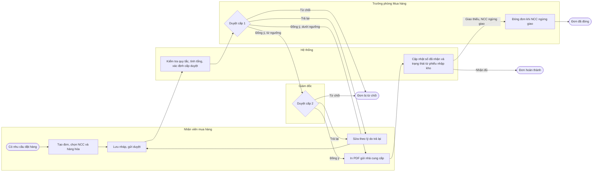
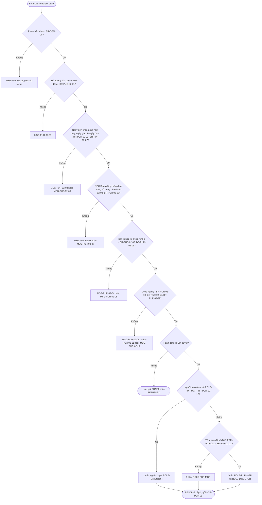
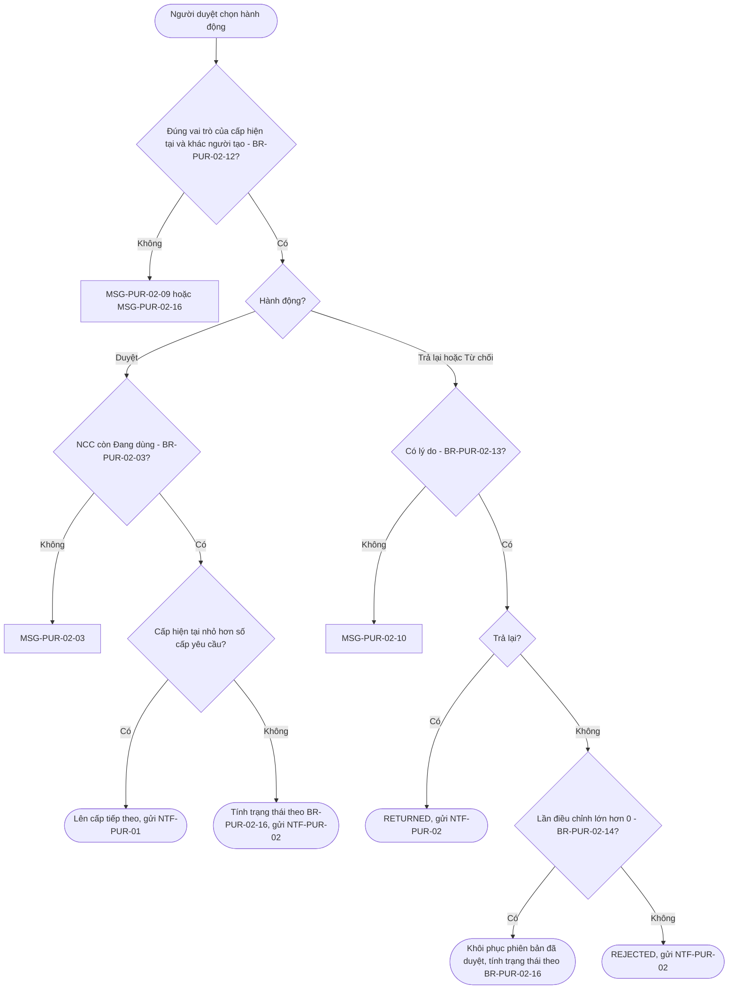
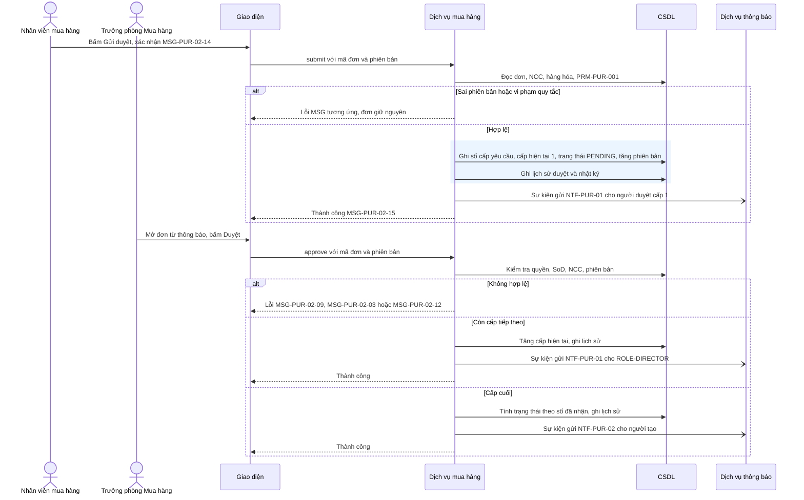
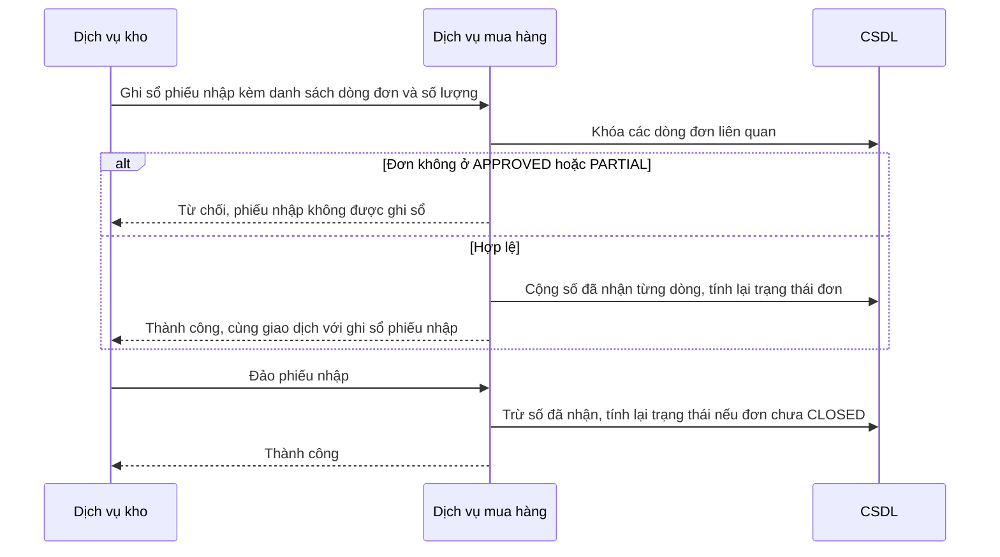
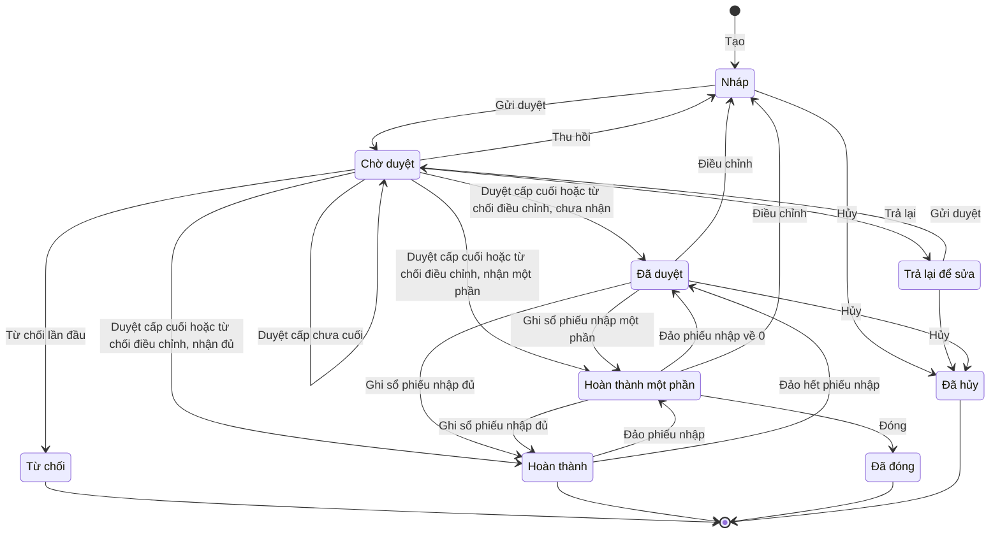
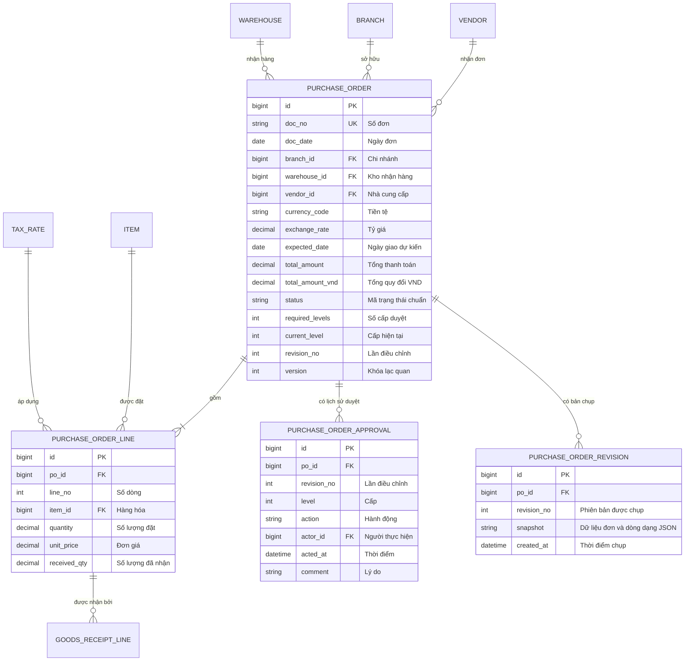

# FN-PUR-02 — Đơn mua hàng

## 0. Thông tin & truy vết

| Mục | Giá trị |
|---|---|
| Nguồn yêu cầu | REQ-001 lập đơn trên hệ thống · REQ-002 biết đơn đã giao/chưa giao · REQ-003, REQ-004 chọn nhà cung cấp, hàng hóa từ danh mục · REQ-005, REQ-006 duyệt theo ngưỡng 100 triệu · REQ-007 kế toán chỉ xem · REQ-010 chặn nhà cung cấp bị khóa · REQ-011 phạm vi chi nhánh · REQ-012 ngoại tệ có tỷ giá · REQ-013, REQ-014 giao thiếu và đóng đơn · REQ-015 sửa sau duyệt phải duyệt lại · REQ-017 in PDF · REQ-018, REQ-020, REQ-021 NFR |
| Luồng tổng quan / luồng chi tiết | BP-01 / FL-01-02, FL-01-03, FL-01-04 |
| Pattern ERP áp dụng | P02 Chứng từ giao dịch, P03 Duyệt nhiều cấp, P04 Luồng chứng từ, P06 Đánh số, P10 Thông báo, P11 Mẫu in (`erp-ba-core/references/design-patterns.md`) |
| Tham chiếu chuẩn | `erp-ba-core/references/processes/p2p-procure-to-pay.md` §5–§7 |
| Chức năng đứng trước (upstream) | Không có — đơn lập trực tiếp (DEC-001); dùng danh mục từ FN-PUR-01 |
| Chức năng đứng sau (downstream) | Phiếu nhập kho DOC-GRN (SRS module Kho) tạo từ đơn ở trạng thái APPROVED, PARTIAL |
| Loại chứng từ | DOC-PO |
| Danh mục sử dụng | MD-VENDOR, MD-ITEM, MD-BRANCH, MD-WAREHOUSE, MD-TAXRATE |
| Tham số sử dụng | PRM-PUR-001, PRM-PUR-003 |
| Báo cáo liên quan | RPT-PUR-01 |
| Tích hợp / thông báo | NTF-PUR-01, NTF-PUR-02; nhận cập nhật số đã nhận từ DOC-GRN (DEC-014) |

## 1. Mô tả & mục tiêu

- **Mục đích nghiệp vụ:** nhân viên mua hàng lập đơn đặt hàng nhà cung cấp trên hệ thống, đơn được duyệt theo hạn mức rồi in gửi nhà cung cấp; hệ thống theo dõi số lượng đã nhận để biết đơn nào đã giao đủ, giao thiếu hay chưa giao.
- **Trong phạm vi:** tạo, sửa, xóa, gửi duyệt, thu hồi, duyệt 1–2 cấp, trả lại, từ chối, điều chỉnh sau duyệt, cập nhật ngày giao dự kiến và ghi chú sau duyệt, đóng, hủy, in PDF, xem lịch sử; nhận cập nhật số lượng đã nhận từ phiếu nhập kho.
- **Ngoài phạm vi:** lập phiếu nhập kho và kiểm tra dung sai nhận hàng (SRS module Kho); hóa đơn mua hàng và thanh toán (SRS module Công nợ); đề nghị mua hàng (DEC-001); thiết lập tham số (SRS Hệ thống).
- **Sự kiện kích hoạt:** nhân viên mua hàng có nhu cầu đặt hàng một nhà cung cấp.
- **Tiền điều kiện:** nhà cung cấp ở trạng thái Đang dùng trong MD-VENDOR; hàng hóa đang sử dụng trong MD-ITEM; người dùng có vai trò ROLE-PUR-STAFF và thuộc một chi nhánh; PRM-PUR-001 và PRM-PUR-003 đã có giá trị.
- **Hậu điều kiện:** đơn ở một trạng thái của bộ trạng thái DOC-PO; đơn APPROVED hoặc PARTIAL xuất hiện để module Kho tạo phiếu nhập; mọi thao tác có bản ghi lịch sử (BR-GEN-06). Đơn mua không ghi sổ kế toán và không làm thay đổi tồn kho.

## 2. Vai trò & phân quyền

### 2.1 Vai trò tham gia

| Vai trò | Mức tham gia | Được làm gì trong chức năng này |
|---|---|---|
| ROLE-PUR-STAFF | Chính | Tạo đơn của chi nhánh mình; với đơn do mình tạo: sửa, xóa, gửi duyệt, thu hồi, hủy khi Nháp/Trả lại, điều chỉnh sau duyệt, cập nhật ngày giao và ghi chú; xem và in đơn của chi nhánh |
| ROLE-PUR-MGR | Duyệt | Duyệt cấp 1, trả lại, từ chối; đóng đơn PARTIAL; hủy đơn APPROVED chưa nhận hàng; xem và in mọi đơn |
| ROLE-DIRECTOR | Duyệt | Duyệt cấp 2 (và cấp 1 thay Trưởng phòng khi Trưởng phòng là người tạo đơn), trả lại, từ chối; xem và in mọi đơn |
| ROLE-ACC | Chỉ xem | Xem và in mọi đơn, không sửa bất kỳ dữ liệu nào |
| Hệ thống | Hệ thống | Sinh số đơn; tính tổng tiền; xác định cấp duyệt; cập nhật số đã nhận và trạng thái khi phiếu nhập kho được ghi sổ hoặc đảo; gửi thông báo |

### 2.2 Ma trận quyền theo hành động

| Hành động | ROLE-PUR-STAFF | ROLE-PUR-MGR | ROLE-DIRECTOR | ROLE-ACC |
|---|---|---|---|---|
| Xem | ✔ Chi nhánh | ✔ Công ty | ✔ Công ty | ✔ Công ty |
| Tạo | ✔ Chi nhánh của mình | ✖ | ✖ | ✖ |
| Sửa | ✔ Của mình, khi DRAFT, RETURNED | ✖ | ✖ | ✖ |
| Xóa | ✔ Của mình, khi DRAFT và chưa từng gửi duyệt | ✖ | ✖ | ✖ |
| Gửi duyệt | ✔ Của mình, khi DRAFT, RETURNED | ✖ | ✖ | ✖ |
| Thu hồi | ✔ Của mình, khi PENDING | ✖ | ✖ | ✖ |
| Duyệt | ✖ | ✔ Công ty, khi PENDING ở cấp 1 | ✔ Công ty, khi PENDING ở cấp được giao | ✖ |
| Từ chối | ✖ | ✔ Như Duyệt | ✔ Như Duyệt | ✖ |
| Trả lại | ✖ | ✔ Như Duyệt | ✔ Như Duyệt | ✖ |
| Hủy | ✔ Của mình, khi DRAFT hoặc RETURNED đã từng gửi duyệt và chưa nhận hàng | ✔ Công ty, khi APPROVED và chưa nhận hàng | ✖ | ✖ |
| Đóng | ✖ | ✔ Công ty, khi PARTIAL | ✖ | ✖ |
| Sửa — Điều chỉnh sau duyệt | ✔ Của mình, khi APPROVED, PARTIAL | ✖ | ✖ | ✖ |
| Sửa — Ngày giao dự kiến và ghi chú sau duyệt | ✔ Của mình, khi APPROVED, PARTIAL | ✖ | ✖ | ✖ |
| In | ✔ Chi nhánh, khi APPROVED, PARTIAL, COMPLETED, CLOSED | ✔ Công ty, cùng trạng thái | ✔ Công ty, cùng trạng thái | ✔ Công ty, cùng trạng thái |

### 2.3 Phân quyền trường dữ liệu & phạm vi dữ liệu đặc biệt

| Trường / nhóm dữ liệu | Vai trò | Quyền (ẩn / chỉ xem / sửa) | Điều kiện |
|---|---|---|---|
| Số lượng đã nhận | Mọi vai trò | Chỉ xem | Chỉ hệ thống cập nhật từ phiếu nhập kho (BR-PUR-02-17) |
| Chi nhánh, Kho nhận hàng | Mọi vai trò | Chỉ xem | Lấy theo chi nhánh của người tạo (BR-GEN-08, BR-PUR-02-04) |

### 2.4 Phân tách nhiệm vụ & hạn mức

Người duyệt ở mọi cấp KHÔNG ĐƯỢC là người tạo đơn (SOD-01, BR-PUR-02-12). Số cấp duyệt theo PRM-PUR-001 (BR-PUR-02-11) và hạn mức ở `catalogs/roles-permissions.md` §4.

## 3. User stories & tiêu chí nghiệm thu

| ID | User story | Vai trò | Ưu tiên | Nguồn | AC |
|---|---|---|---|---|---|
| US-PUR-02-01 | Là nhân viên mua hàng, tôi muốn lập đơn mua bằng cách chọn nhà cung cấp và hàng hóa từ danh mục, để không phải gõ tay và tránh sai sót | ROLE-PUR-STAFF | Must | REQ-001, REQ-003, REQ-004 | AC-PUR-02-01, AC-PUR-02-02, AC-PUR-02-03 |
| US-PUR-02-02 | Là nhân viên mua hàng, tôi muốn gửi đơn đi duyệt và hệ thống tự chọn đúng cấp duyệt, để đơn được duyệt theo đúng hạn mức | ROLE-PUR-STAFF | Must | REQ-005, REQ-006 | AC-PUR-02-04, AC-PUR-02-05, AC-PUR-02-10 |
| US-PUR-02-03 | Là Trưởng phòng Mua hàng, tôi muốn duyệt, trả lại hoặc từ chối đơn, để kiểm soát việc đặt hàng | ROLE-PUR-MGR | Must | REQ-005, DEC-009 | AC-PUR-02-06, AC-PUR-02-07, AC-PUR-02-08 |
| US-PUR-02-04 | Là Giám đốc, tôi muốn duyệt cấp 2 các đơn từ ngưỡng trở lên, kể cả trên điện thoại, để kiểm soát các khoản chi lớn khi đi công tác | ROLE-DIRECTOR | Must | REQ-006, REQ-021 | AC-PUR-02-09 |
| US-PUR-02-05 | Là nhân viên mua hàng, tôi muốn điều chỉnh đơn đã duyệt và gửi duyệt lại, hoặc chỉ cập nhật ngày giao dự kiến mà không phải duyệt lại, để phản ánh thay đổi từ nhà cung cấp | ROLE-PUR-STAFF | Must | REQ-015, DEC-013 | AC-PUR-02-11, AC-PUR-02-12, AC-PUR-02-13 |
| US-PUR-02-06 | Là nhân viên mua hàng, tôi muốn thấy số lượng đã nhận và trạng thái giao hàng của đơn, để biết đơn nào đã giao đủ, giao thiếu hay chưa giao | ROLE-PUR-STAFF | Must | REQ-002, REQ-013 | AC-PUR-02-14 |
| US-PUR-02-07 | Là Trưởng phòng Mua hàng, tôi muốn đóng đơn đang giao thiếu khi nhà cung cấp báo không giao nữa, và hủy đơn đã duyệt chưa nhận hàng, để đơn không treo | ROLE-PUR-MGR | Must | REQ-014, DEC-003, DEC-007 | AC-PUR-02-15, AC-PUR-02-16 |
| US-PUR-02-08 | Là kế toán, tôi muốn xem mọi đơn mua của công ty nhưng không sửa được, để đối chiếu công nợ | ROLE-ACC | Must | REQ-007 | AC-PUR-02-17 |
| US-PUR-02-09 | Là nhân viên mua hàng, tôi chỉ thấy đơn của chi nhánh mình | ROLE-PUR-STAFF | Must | REQ-011 | AC-PUR-02-18 |
| US-PUR-02-10 | Là nhân viên mua hàng, tôi muốn in đơn đã duyệt ra PDF có logo công ty, để gửi nhà cung cấp | ROLE-PUR-STAFF | Must | REQ-017 | AC-PUR-02-19 |

#### AC-PUR-02-01 — Tạo và lưu đơn nháp (US-PUR-02-01, FR-PUR-02-01, FR-PUR-02-03)
- **Cho trước** người dùng thuộc chi nhánh HN có vai trò ROLE-PUR-STAFF, nhà cung cấp NCC-00012 Đang dùng, hàng hóa TB-001 đang sử dụng
- **Khi** tạo đơn, chọn NCC-00012, tiền tệ VND, ngày giao dự kiến là ngày mai, thêm 1 dòng TB-001 số lượng 10 đơn giá 1.500.000 thuế suất 10% rồi bấm Lưu
- **Thì** đơn được lưu ở trạng thái DRAFT với số đơn dạng PO-HN-2026-00001, chi nhánh HN, kho nhận hàng là kho của chi nhánh HN, thành tiền trước thuế 15.000.000, tiền thuế 1.500.000, tổng thanh toán 16.500.000; hiển thị MSG-PUR-02-15

#### AC-PUR-02-02 — Không chọn được nhà cung cấp bị khóa (US-PUR-02-01, FR-PUR-02-02)
- **Cho trước** nhà cung cấp NCC-00020 ở trạng thái Khóa
- **Khi** nhân viên tìm NCC-00020 trong ô Nhà cung cấp của đơn
- **Thì** NCC-00020 không xuất hiện trong danh sách chọn; nếu đơn DRAFT đã chọn NCC-00020 trước khi bị khóa thì Lưu hoặc Gửi duyệt bị chặn với MSG-PUR-02-03

#### AC-PUR-02-03 — Đơn ngoại tệ bắt buộc tỷ giá (US-PUR-02-01, FR-PUR-02-04, FR-PUR-02-05)
- **Cho trước** PRM-PUR-003 = VND, USD
- **Khi** nhân viên chọn tiền tệ USD, để trống tỷ giá và bấm Lưu
- **Thì** hệ thống chặn với MSG-PUR-02-05; khi nhập tỷ giá 25.400 và 1 dòng 100 cái × 12,50 USD thuế suất 10% rồi Lưu, tổng thanh toán là 1.375,00 USD và tổng thanh toán quy đổi là 34.925.000 VND

#### AC-PUR-02-04 — Đơn dưới ngưỡng duyệt 1 cấp (US-PUR-02-02, FR-PUR-02-06, FR-PUR-02-19)
- **Cho trước** PRM-PUR-001 = 100.000.000 và đơn DRAFT có tổng thanh toán quy đổi 99.999.999 VND
- **Khi** người tạo bấm Gửi duyệt và xác nhận MSG-PUR-02-14
- **Thì** đơn chuyển PENDING, cấp duyệt yêu cầu = 1, cấp hiện tại = 1, người dùng có vai trò ROLE-PUR-MGR nhận NTF-PUR-01

#### AC-PUR-02-05 — Đơn từ ngưỡng duyệt 2 cấp (US-PUR-02-02, FR-PUR-02-06)
- **Cho trước** PRM-PUR-001 = 100.000.000 và đơn DRAFT có tổng thanh toán quy đổi 100.000.000 VND
- **Khi** người tạo gửi duyệt
- **Thì** đơn chuyển PENDING với cấp duyệt yêu cầu = 2 và cấp hiện tại = 1

#### AC-PUR-02-06 — Duyệt cấp 1 (US-PUR-02-03, FR-PUR-02-07)
- **Cho trước** đơn PENDING cấp hiện tại 1, cấp yêu cầu 2, người tạo là nhân viên A
- **Khi** Trưởng phòng bấm Duyệt
- **Thì** đơn vẫn PENDING, cấp hiện tại = 2, lịch sử duyệt có dòng "Duyệt – cấp 1", ROLE-DIRECTOR nhận NTF-PUR-01; nếu cấp yêu cầu là 1 thì đơn chuyển APPROVED và người tạo nhận NTF-PUR-02

#### AC-PUR-02-07 — Trả lại và từ chối bắt buộc lý do (US-PUR-02-03, FR-PUR-02-07)
- **Cho trước** đơn PENDING (lần điều chỉnh = 0)
- **Khi** người duyệt bấm Trả lại hoặc Từ chối mà để trống lý do
- **Thì** hệ thống chặn với MSG-PUR-02-10; khi có lý do, Trả lại chuyển đơn sang RETURNED, Từ chối chuyển đơn sang REJECTED, người tạo nhận NTF-PUR-02 kèm lý do

#### AC-PUR-02-08 — Không tự duyệt đơn của mình (US-PUR-02-03, FR-PUR-02-08)
- **Cho trước** người dùng B có cả vai trò ROLE-PUR-STAFF và ROLE-PUR-MGR, B tạo đơn và gửi duyệt
- **Khi** hệ thống xác định người duyệt
- **Thì** đơn được giao cho ROLE-DIRECTOR duyệt (một cấp duy nhất, bất kể tổng tiền); nếu B mở đơn, nút Duyệt không hiển thị và gọi trực tiếp hành động Duyệt trả về MSG-PUR-02-09

#### AC-PUR-02-09 — Giám đốc duyệt cấp 2 trên điện thoại (US-PUR-02-04, FR-PUR-02-09)
- **Cho trước** đơn PENDING cấp hiện tại 2, Giám đốc mở link trong email NTF-PUR-01 bằng Chrome trên điện thoại màn hình 390 px
- **Khi** Giám đốc xem đơn và bấm Duyệt
- **Thì** đơn chuyển APPROVED, người tạo nhận NTF-PUR-02; màn hình hiển thị đủ thông tin chung, tổng tiền và các nút Duyệt/Trả lại/Từ chối mà không cần cuộn ngang

#### AC-PUR-02-10 — Thu hồi đơn đang chờ duyệt (US-PUR-02-02, FR-PUR-02-10)
- **Cho trước** đơn PENDING ở cấp hiện tại 2 (cấp 1 đã duyệt)
- **Khi** người tạo bấm Thu hồi
- **Thì** đơn về DRAFT, cấp hiện tại về 0, các lượt duyệt của lần gửi này hết hiệu lực (vẫn giữ trong lịch sử), người tạo sửa được đơn

#### AC-PUR-02-11 — Điều chỉnh đơn đã duyệt phải duyệt lại từ đầu (US-PUR-02-05, FR-PUR-02-11)
- **Cho trước** đơn APPROVED, lần điều chỉnh = 0, chưa nhận hàng
- **Khi** người tạo bấm Điều chỉnh, đổi đơn giá dòng 1 từ 1.500.000 thành 1.450.000 và gửi duyệt
- **Thì** khi bấm Điều chỉnh đơn chuyển DRAFT với lần điều chỉnh = 1 và hệ thống lưu bản chụp phiên bản 0; khi gửi duyệt, cấp duyệt được tính lại từ tổng mới và quy trình duyệt bắt đầu lại từ cấp 1

#### AC-PUR-02-12 — Từ chối điều chỉnh thì quay về phiên bản trước (US-PUR-02-05, FR-PUR-02-11)
- **Cho trước** đơn PENDING với lần điều chỉnh = 1, phiên bản 0 đã duyệt có đơn giá dòng 1 là 1.500.000, đơn đã nhận 4/10
- **Khi** người duyệt bấm Từ chối và nhập lý do
- **Thì** đơn khôi phục toàn bộ dữ liệu của phiên bản 0, trạng thái tính lại là PARTIAL, lần điều chỉnh giữ = 1, lịch sử ghi "Từ chối điều chỉnh"

#### AC-PUR-02-13 — Cập nhật ngày giao dự kiến không cần duyệt lại (US-PUR-02-05, FR-PUR-02-12)
- **Cho trước** đơn PARTIAL
- **Khi** người tạo đổi ngày giao dự kiến từ 25/10/2026 sang 28/10/2026 và bấm Lưu
- **Thì** đơn vẫn PARTIAL, không phát sinh lượt duyệt, nhật ký ghi giá trị cũ và mới; mọi trường khác bị khóa trong chế độ này

#### AC-PUR-02-14 — Cập nhật số đã nhận từ phiếu nhập kho (US-PUR-02-06, FR-PUR-02-13)
- **Cho trước** đơn APPROVED có dòng 1 đặt 10 cái, dòng 2 đặt 5 cái
- **Khi** phiếu nhập kho nhận dòng 1: 4 cái được ghi sổ; sau đó phiếu thứ hai nhận dòng 1: 6 cái và dòng 2: 5 cái được ghi sổ; sau đó phiếu thứ hai bị đảo
- **Thì** sau phiếu thứ nhất: đã nhận dòng 1 = 4, đơn PARTIAL; sau phiếu thứ hai: đơn COMPLETED; sau khi đảo phiếu thứ hai: dòng 1 = 4, dòng 2 = 0, đơn PARTIAL

#### AC-PUR-02-15 — Đóng đơn giao thiếu (US-PUR-02-07, FR-PUR-02-14)
- **Cho trước** đơn PARTIAL
- **Khi** Trưởng phòng bấm Đóng, nhập lý do "Nhà cung cấp ngừng sản xuất mã hàng" và xác nhận
- **Thì** đơn chuyển CLOSED, module Kho không tạo được phiếu nhập từ đơn này nữa, người tạo nhận NTF-PUR-02; nếu để trống lý do thì bị chặn với MSG-PUR-02-10

#### AC-PUR-02-16 — Hủy đơn (US-PUR-02-07, FR-PUR-02-15)
- **Cho trước** đơn APPROVED chưa có số lượng đã nhận
- **Khi** Trưởng phòng bấm Hủy và nhập lý do
- **Thì** đơn chuyển CANCELLED; với đơn đã có số lượng đã nhận lớn hơn 0, hành động Hủy bị chặn với MSG-PUR-02-13

#### AC-PUR-02-17 — Kế toán chỉ xem (US-PUR-02-08, FR-PUR-02-16)
- **Cho trước** người dùng chỉ có vai trò ROLE-ACC
- **Khi** mở danh sách đơn mua
- **Thì** thấy đơn của cả hai chi nhánh; màn hình chi tiết không có nút Sửa, Gửi duyệt, Duyệt, Đóng, Hủy, Điều chỉnh; gọi trực tiếp các hành động này trả về MSG-PUR-02-16

#### AC-PUR-02-18 — Nhân viên chỉ thấy đơn chi nhánh mình (US-PUR-02-09, FR-PUR-02-17)
- **Cho trước** nhân viên thuộc chi nhánh HCM, có đơn PO-HN-2026-00001 của chi nhánh HN
- **Khi** tìm theo số PO-HN-2026-00001 hoặc mở đường dẫn trực tiếp tới đơn
- **Thì** danh sách không có kết quả và đường dẫn trực tiếp trả về MSG-PUR-02-16

#### AC-PUR-02-19 — In đơn PDF (US-PUR-02-10, FR-PUR-02-18)
- **Cho trước** đơn APPROVED có 3 dòng
- **Khi** người dùng có quyền In bấm In
- **Thì** hệ thống tạo file PDF tên `PO-HN-2026-00001.pdf` theo bố cục mục 11.4 có logo công ty; với đơn DRAFT, PENDING, RETURNED, REJECTED, CANCELLED nút In không hiển thị

## 4. Luồng nghiệp vụ

### 4.1 Sơ đồ luồng nghiệp vụ (swimlane)



### 4.2 Luồng chính

| Bước | Vai trò | Hành động người dùng | Xử lý của hệ thống | Quy tắc áp dụng | Trạng thái sau bước |
|---|---|---|---|---|---|
| 1 | ROLE-PUR-STAFF | Bấm Tạo mới | Mở biểu mẫu; gán chi nhánh, kho nhận hàng, ngày đơn = hôm nay, tiền tệ VND | BR-GEN-08, BR-PUR-02-04 | — |
| 2 | ROLE-PUR-STAFF | Chọn nhà cung cấp, đổi tiền tệ nếu đơn ngoại tệ và nhập tỷ giá | Chỉ liệt kê NCC Đang dùng; tiền tệ mặc định VND với tỷ giá = 1 và khóa; tiền tệ khác VND mở ô tỷ giá | BR-PUR-02-03, BR-PUR-02-05, BR-PUR-02-06 | — |
| 3 | ROLE-PUR-STAFF | Thêm dòng: tìm hàng theo mã hoặc tên, nhập số lượng, đơn giá, chiết khấu | Điền đơn vị tính, thuế suất mặc định của hàng; tính thành tiền và tổng ngay khi nhập | BR-PUR-02-08, BR-PUR-02-09, BR-PUR-02-10 | — |
| 4 | ROLE-PUR-STAFF | Nhập ngày giao dự kiến, ghi chú; bấm Lưu | Kiểm tra quy tắc; sinh số đơn lần đầu; lưu; ghi nhật ký | BR-PUR-02-01, BR-PUR-02-02, BR-PUR-02-07, BR-GEN-04 | DRAFT |
| 5 | ROLE-PUR-STAFF | Bấm Gửi duyệt, xác nhận | Kiểm tra lại toàn bộ quy tắc; xác định số cấp và người duyệt; ghi lịch sử; gửi NTF-PUR-01 | BR-PUR-02-11, BR-PUR-02-12 | PENDING |
| 6 | ROLE-PUR-MGR | Mở đơn từ thông báo hoặc danh sách chờ duyệt, bấm Duyệt | Kiểm tra quyền và SoD; kiểm tra lại NCC; nếu còn cấp 2 thì chuyển cấp, gửi NTF-PUR-01 cho ROLE-DIRECTOR | BR-PUR-02-03, BR-PUR-02-12, BR-PUR-02-13 | PENDING (cấp 2) hoặc APPROVED |
| 7 | ROLE-DIRECTOR | Bấm Duyệt (cấp 2) | Như bước 6; duyệt cấp cuối thì tính trạng thái theo số đã nhận và gửi NTF-PUR-02 | BR-PUR-02-16 | APPROVED |
| 8 | ROLE-PUR-STAFF | Bấm In, gửi PDF cho nhà cung cấp | Sinh PDF theo mục 11.4 | BR-PUR-02-19 | APPROVED |
| 9 | Hệ thống | — | Khi phiếu nhập kho từ đơn được ghi sổ: cộng số đã nhận, tính lại trạng thái | BR-PUR-02-16, BR-PUR-02-17 | PARTIAL hoặc COMPLETED |

### 4.3 Luồng thay thế

| ID | Tại bước | Điều kiện | Diễn biến | Quay lại bước |
|---|---|---|---|---|
| A1 | 6, 7 | Người duyệt bấm Trả lại (có lý do) | Đơn sang RETURNED; người tạo nhận NTF-PUR-02, sửa và gửi duyệt lại; duyệt lại từ cấp 1 | 4 |
| A2 | 6, 7 | Người duyệt bấm Từ chối (có lý do), lần điều chỉnh = 0 | Đơn sang REJECTED, kết thúc; người tạo nhận NTF-PUR-02 | — |
| A3 | 5–7 | Người tạo bấm Thu hồi khi PENDING | Đơn về DRAFT, lượt duyệt của lần gửi hết hiệu lực | 4 |
| A4 | Sau 7 | Người tạo bấm Điều chỉnh khi APPROVED hoặc PARTIAL | Lưu bản chụp phiên bản; tăng lần điều chỉnh; đơn về DRAFT; sửa trong giới hạn BR-PUR-02-15 rồi gửi duyệt lại từ đầu | 4 |
| A5 | 6, 7 của lần điều chỉnh | Người duyệt Từ chối khi lần điều chỉnh > 0 | Khôi phục phiên bản đã duyệt gần nhất; trạng thái tính lại theo BR-PUR-02-16 | 9 |
| A6 | Sau 7 | Người tạo bấm Cập nhật ngày giao và ghi chú khi APPROVED hoặc PARTIAL | Chỉ 2 trường này sửa được; lưu không đổi trạng thái | 9 |
| A7 | 9 | Đơn PARTIAL, nhà cung cấp báo không giao nữa | Trưởng phòng bấm Đóng, nhập lý do; đơn sang CLOSED | — |
| A8 | 4 hoặc sau 7 | Hủy đơn theo BR-PUR-02-18 | Đơn sang CANCELLED; người tạo nhận NTF-PUR-02 khi người hủy là Trưởng phòng | — |
| A9 | 4 | Đơn DRAFT chưa từng gửi duyệt, người tạo bấm Xóa | Xóa hẳn đơn; số đơn không cấp lại (BR-GEN-04) | — |
| A10 | Sau 9 | Phiếu nhập kho liên quan bị đảo | Trừ số đã nhận, tính lại trạng thái (đơn CLOSED giữ CLOSED) | 9 |

### 4.4 Luồng ngoại lệ

| ID | Tại bước | Tình huống lỗi | Hệ thống xử lý | Thông báo |
|---|---|---|---|---|
| E1 | 4, 5 | Thiếu trường bắt buộc hoặc không có dòng | Chặn, giữ nguyên trạng thái, tô đỏ trường thiếu | MSG-PUR-02-01 |
| E2 | 4, 5, 6, 7 | NCC bị khóa sau khi đã chọn | Chặn lưu, gửi duyệt và duyệt | MSG-PUR-02-03 |
| E3 | 4, 5 | Hàng hóa ngừng sử dụng | Chặn | MSG-PUR-02-07 |
| E4 | Mọi bước có ghi dữ liệu | Người khác vừa cập nhật đơn (sai phiên bản) | Chặn, yêu cầu tải lại | MSG-PUR-02-12 |
| E5 | 6, 7 | Người duyệt là người tạo đơn | Chặn | MSG-PUR-02-09 |
| E6 | A8 | Hủy đơn đã có số đã nhận | Chặn | MSG-PUR-02-13 |
| E7 | Mọi bước | Người dùng không có quyền hoặc ngoài phạm vi dữ liệu | Chặn | MSG-PUR-02-16 |
| E8 | A4 | Điều chỉnh vi phạm giới hạn dòng đã nhận | Chặn | MSG-PUR-02-11 |

## 5. Sơ đồ quyết định (logic rẽ nhánh)

### 5.1 Lưu và gửi duyệt



### 5.2 Xử lý của người duyệt



## 6. Sơ đồ tuần tự (sequence)

### 6.1 Gửi duyệt và duyệt



### 6.2 Cập nhật từ phiếu nhập kho



## 7. Trạng thái chứng từ

### 7.1 Sơ đồ trạng thái



### 7.2 Bảng chuyển trạng thái

| Từ | Hành động | Đến | Vai trò | Điều kiện (BR) | Tác động hệ thống (kho / công nợ / sổ cái / ngân sách / thông báo) |
|---|---|---|---|---|---|
| (mới) | Tạo + Lưu | DRAFT | ROLE-PUR-STAFF | BR-PUR-02-01 đến BR-PUR-02-10 | Sinh số đơn; không ảnh hưởng kho, công nợ, sổ cái |
| DRAFT, RETURNED | Gửi duyệt | PENDING | ROLE-PUR-STAFF (người tạo) | BR-PUR-02-11, BR-PUR-02-12; nếu lần điều chỉnh > 0 thêm BR-PUR-02-15 | Đánh dấu đã từng gửi duyệt; NTF-PUR-01 |
| PENDING | Duyệt (chưa phải cấp cuối) | PENDING | Vai trò của cấp hiện tại | BR-PUR-02-03, BR-PUR-02-12 | Tăng cấp hiện tại; NTF-PUR-01 |
| PENDING | Duyệt (cấp cuối) | APPROVED, PARTIAL hoặc COMPLETED | Vai trò của cấp cuối | BR-PUR-02-03, BR-PUR-02-12, BR-PUR-02-16 | Đơn nhận được phiếu nhập kho nếu APPROVED, PARTIAL; NTF-PUR-02 |
| PENDING | Thu hồi | DRAFT | ROLE-PUR-STAFF (người tạo) | BR-PUR-02-20 | Hủy hiệu lực lượt duyệt của lần gửi |
| PENDING | Trả lại | RETURNED | Vai trò của cấp hiện tại | BR-PUR-02-13 | NTF-PUR-02 |
| PENDING | Từ chối (lần điều chỉnh = 0) | REJECTED | Vai trò của cấp hiện tại | BR-PUR-02-13 | NTF-PUR-02 |
| PENDING | Từ chối (lần điều chỉnh > 0) | APPROVED, PARTIAL hoặc COMPLETED | Vai trò của cấp hiện tại | BR-PUR-02-13, BR-PUR-02-14, BR-PUR-02-16 | Khôi phục phiên bản đã duyệt gần nhất; NTF-PUR-02 |
| APPROVED, PARTIAL | Ghi sổ phiếu nhập kho | PARTIAL hoặc COMPLETED | Hệ thống | BR-PUR-02-16, BR-PUR-02-17 | Cộng số đã nhận |
| PARTIAL, COMPLETED | Đảo phiếu nhập kho | APPROVED hoặc PARTIAL | Hệ thống | BR-PUR-02-16, BR-PUR-02-17 | Trừ số đã nhận |
| APPROVED, PARTIAL | Điều chỉnh | DRAFT | ROLE-PUR-STAFF (người tạo) | BR-PUR-02-14 | Lưu bản chụp phiên bản; tăng lần điều chỉnh; module Kho không nhận thêm cho tới khi duyệt lại |
| PARTIAL | Đóng | CLOSED | ROLE-PUR-MGR | BR-PUR-02-13, BR-PUR-02-18 | Phần chưa nhận không nhận được nữa; NTF-PUR-02 |
| DRAFT, RETURNED | Hủy | CANCELLED | ROLE-PUR-STAFF (người tạo) | BR-PUR-02-18 | — |
| APPROVED | Hủy | CANCELLED | ROLE-PUR-MGR | BR-PUR-02-13, BR-PUR-02-18 | NTF-PUR-02 |
| DRAFT | Xóa | (không còn) | ROLE-PUR-STAFF (người tạo) | BR-PUR-02-18 | Xóa dữ liệu đơn; số đơn không cấp lại |

### 7.3 Quyền sửa trường theo trạng thái

| Trường / nhóm trường | DRAFT | PENDING | RETURNED | REJECTED | APPROVED | PARTIAL | COMPLETED | CLOSED | CANCELLED |
|---|---|---|---|---|---|---|---|---|---|
| Ngày đơn, Nhà cung cấp, Tiền tệ, Tỷ giá | Sửa | Khóa | Sửa | Khóa | Khóa | Khóa | Khóa | Khóa | Khóa |
| Dòng hàng (thêm, xóa, sửa) | Sửa (giới hạn BR-PUR-02-15 khi lần điều chỉnh > 0) | Khóa | Sửa (giới hạn BR-PUR-02-15) | Khóa | Khóa | Khóa | Khóa | Khóa | Khóa |
| Ngày giao dự kiến, Ghi chú | Sửa | Khóa | Sửa | Khóa | Sửa (không duyệt lại) | Sửa (không duyệt lại) | Khóa | Khóa | Khóa |
| Lý do đóng/hủy | Khóa | Khóa | Khóa | Khóa | Nhập khi Hủy | Nhập khi Đóng | Khóa | Khóa | Khóa |
| Số lượng đã nhận | Khóa | Khóa | Khóa | Khóa | Khóa | Khóa | Khóa | Khóa | Khóa |

## 8. Yêu cầu chức năng (FR)

| ID | Yêu cầu (Hệ thống PHẢI …) | Ưu tiên | Nguồn | AC kiểm chứng |
|---|---|---|---|---|
| FR-PUR-02-01 | Hệ thống PHẢI cho người dùng ROLE-PUR-STAFF tạo đơn mua gồm thông tin chung và tối thiểu 1 dòng hàng, lưu ở trạng thái DRAFT | Must | REQ-001 | AC-PUR-02-01 |
| FR-PUR-02-02 | Hệ thống PHẢI chỉ cho chọn nhà cung cấp từ MD-VENDOR ở trạng thái Đang dùng | Must | REQ-003, REQ-010 | AC-PUR-02-02 |
| FR-PUR-02-03 | Hệ thống PHẢI chỉ cho chọn hàng hóa đang sử dụng từ MD-ITEM, tìm theo mã hoặc tên (chứa chuỗi, không phân biệt hoa thường và dấu) | Must | REQ-004, DEC-004 | AC-PUR-02-01 |
| FR-PUR-02-04 | Hệ thống PHẢI cho chọn tiền tệ trong PRM-PUR-003 và bắt buộc nhập tỷ giá lớn hơn 0 khi tiền tệ khác VND | Must | REQ-012, DEC-006 | AC-PUR-02-03 |
| FR-PUR-02-05 | Hệ thống PHẢI tự tính thành tiền dòng, tổng tiền hàng, tổng thuế, tổng thanh toán và tổng thanh toán quy đổi VND theo bảng công thức mục 9 | Must | REQ-005, REQ-006, REQ-012, DEC-002 | AC-PUR-02-01, AC-PUR-02-03 |
| FR-PUR-02-06 | Khi gửi duyệt, hệ thống PHẢI xác định số cấp duyệt theo PRM-PUR-001 so với tổng thanh toán quy đổi VND | Must | REQ-005, REQ-006, DEC-002 | AC-PUR-02-04, AC-PUR-02-05 |
| FR-PUR-02-07 | Hệ thống PHẢI cho người duyệt của cấp hiện tại Duyệt, Trả lại hoặc Từ chối; Trả lại và Từ chối bắt buộc lý do | Must | REQ-005, DEC-009 | AC-PUR-02-06, AC-PUR-02-07 |
| FR-PUR-02-08 | Hệ thống KHÔNG ĐƯỢC cho người tạo đơn duyệt đơn đó ở bất kỳ cấp nào; đơn do người có vai trò ROLE-PUR-MGR tạo được giao cho ROLE-DIRECTOR duyệt một cấp | Must | DEC-012 | AC-PUR-02-08 |
| FR-PUR-02-09 | Hệ thống PHẢI cho ROLE-DIRECTOR duyệt cấp 2 các đơn có tổng thanh toán quy đổi từ PRM-PUR-001 trở lên, thao tác được trên trình duyệt điện thoại | Must | REQ-006, REQ-021, DEC-005 | AC-PUR-02-09 |
| FR-PUR-02-10 | Hệ thống PHẢI cho người tạo thu hồi đơn đang PENDING về DRAFT | Must | DEC-011 | AC-PUR-02-10 |
| FR-PUR-02-11 | Hệ thống PHẢI cho người tạo điều chỉnh đơn APPROVED hoặc PARTIAL; đơn điều chỉnh phải được duyệt lại từ cấp 1; nếu bị từ chối thì khôi phục phiên bản đã duyệt gần nhất | Must | REQ-015, DEC-013, DEC-016 | AC-PUR-02-11, AC-PUR-02-12 |
| FR-PUR-02-12 | Hệ thống PHẢI cho người tạo cập nhật ngày giao dự kiến và ghi chú của đơn APPROVED hoặc PARTIAL mà không cần duyệt lại | Must | DEC-013 | AC-PUR-02-13 |
| FR-PUR-02-13 | Hệ thống PHẢI cập nhật số lượng đã nhận từng dòng và trạng thái đơn khi phiếu nhập kho từ đơn được ghi sổ hoặc bị đảo | Must | REQ-002, REQ-013, DEC-014 | AC-PUR-02-14 |
| FR-PUR-02-14 | Hệ thống PHẢI cho ROLE-PUR-MGR đóng đơn PARTIAL với lý do bắt buộc | Must | REQ-014, DEC-003 | AC-PUR-02-15 |
| FR-PUR-02-15 | Hệ thống PHẢI cho hủy đơn theo BR-PUR-02-18 và chặn hủy đơn đã có số lượng đã nhận | Must | DEC-007, BR-GEN-05 | AC-PUR-02-16 |
| FR-PUR-02-16 | Hệ thống PHẢI cho ROLE-ACC xem và in mọi đơn của công ty và KHÔNG ĐƯỢC cho vai trò này thực hiện hành động ghi dữ liệu | Must | REQ-007 | AC-PUR-02-17 |
| FR-PUR-02-17 | Hệ thống PHẢI giới hạn dữ liệu đơn mua của ROLE-PUR-STAFF trong chi nhánh của người dùng, ở danh sách, tìm kiếm và đường dẫn trực tiếp | Must | REQ-011 | AC-PUR-02-18 |
| FR-PUR-02-18 | Hệ thống PHẢI in đơn ở trạng thái APPROVED, PARTIAL, COMPLETED, CLOSED ra file PDF có logo công ty theo bố cục mục 11.4 | Must | REQ-017, SRC-001 | AC-PUR-02-19 |
| FR-PUR-02-19 | Hệ thống PHẢI gửi NTF-PUR-01 cho người duyệt và NTF-PUR-02 cho người tạo theo các sự kiện ở mục 14.3 | Must | DEC-015 | AC-PUR-02-04, AC-PUR-02-07 |
| FR-PUR-02-20 | Hệ thống PHẢI hiển thị trên đơn: lịch sử duyệt (cấp, hành động, người, thời điểm, lý do) và nhật ký thay đổi trường (giá trị cũ, mới) | Must | BR-GEN-06, REQ-015 | AC-PUR-02-11, AC-PUR-02-13 |

## 9. Quy tắc nghiệp vụ (BR)

| ID | Quy tắc (điều kiện → kết quả) | Loại | Nguồn | Thông báo |
|---|---|---|---|---|
| BR-PUR-02-01 | Khi Lưu hoặc Gửi duyệt, mọi trường "Bắt buộc = Có" ở mục 10.2 phải có giá trị và đơn có ít nhất 1 dòng; nếu không → chặn | Validation | REQ-001 | MSG-PUR-02-01 |
| BR-PUR-02-02 | Ngày đơn KHÔNG ĐƯỢC lớn hơn ngày hiện tại | Validation | `erp-ba-core/references/design-patterns.md` P02 | MSG-PUR-02-02 |
| BR-PUR-02-03 | Khi Lưu, Gửi duyệt và Duyệt, nhà cung cấp phải ở trạng thái Đang dùng; nếu Khóa → chặn | Validation | REQ-010 | MSG-PUR-02-03 |
| BR-PUR-02-04 | Kho nhận hàng = kho của chi nhánh của đơn, không sửa được | Mặc định | REQ-022 | — |
| BR-PUR-02-05 | Tiền tệ phải thuộc PRM-PUR-003; mặc định VND | Validation | REQ-012 | MSG-PUR-02-04 |
| BR-PUR-02-06 | Tiền tệ VND → tỷ giá = 1 và khóa; tiền tệ khác VND → tỷ giá bắt buộc, lớn hơn 0, tối đa 4 chữ số thập phân | Validation | REQ-012, DEC-006, BR-GEN-03 | MSG-PUR-02-05 |
| BR-PUR-02-07 | Ngày giao dự kiến phải từ ngày đơn trở đi | Validation | `erp-ba-core/references/design-patterns.md` P02 | MSG-PUR-02-06 |
| BR-PUR-02-08 | Hàng hóa phải đang sử dụng; một hàng hóa được xuất hiện trên hai dòng trở lên của cùng đơn | Validation | REQ-004, `erp-ba-core/references/design-patterns.md` P02 | MSG-PUR-02-07 |
| BR-PUR-02-09 | Thành tiền và tổng tính theo bảng công thức dưới đây, làm tròn theo BR-GEN-01 | Tính toán | REQ-005, REQ-012, BR-GEN-01 | — |
| BR-PUR-02-10 | Mỗi dòng: số lượng lớn hơn 0; đơn giá từ 0 trở lên; tỷ lệ chiết khấu từ 0 đến 100 | Validation | `erp-ba-core/references/processes/p2p-procure-to-pay.md` §7 | MSG-PUR-02-08 |
| BR-PUR-02-11 | Khi Gửi duyệt: tổng thanh toán quy đổi VND từ PRM-PUR-001 trở lên → 2 cấp (ROLE-PUR-MGR, rồi ROLE-DIRECTOR); nhỏ hơn → 1 cấp (ROLE-PUR-MGR). Số cấp chốt tại thời điểm gửi, không tính lại khi PRM-PUR-001 thay đổi trong lúc chờ duyệt | Luồng | REQ-005, REQ-006, DEC-002 | — |
| BR-PUR-02-12 | Người thực hiện Duyệt/Trả lại/Từ chối phải có vai trò của cấp hiện tại và KHÔNG ĐƯỢC là người tạo đơn; nếu người tạo có vai trò ROLE-PUR-MGR thì luồng duyệt chỉ có 1 cấp do ROLE-DIRECTOR. Khi từ hai người trở lên cùng có vai trò của cấp hiện tại, thao tác hợp lệ đầu tiên có hiệu lực | Phân quyền | DEC-012, SOD-01 | MSG-PUR-02-09 |
| BR-PUR-02-13 | Trả lại, Từ chối, Đóng, Hủy bắt buộc nhập lý do 5–500 ký tự | Validation | DEC-003, DEC-007, DEC-009 | MSG-PUR-02-10 |
| BR-PUR-02-14 | Điều chỉnh chỉ khi APPROVED hoặc PARTIAL: lưu bản chụp toàn bộ đơn (phiên bản đã duyệt), tăng lần điều chỉnh thêm 1, chuyển DRAFT. Nếu lần duyệt lại bị Từ chối → khôi phục bản chụp gần nhất và tính trạng thái theo BR-PUR-02-16 | Luồng | REQ-015, DEC-013, DEC-016 | — |
| BR-PUR-02-15 | Khi lần điều chỉnh lớn hơn 0, với dòng có số lượng đã nhận lớn hơn 0: không được xóa dòng; không đổi hàng hóa, đơn giá, chiết khấu, thuế suất; số lượng đặt mới phải từ số lượng đã nhận trở lên. Nếu đơn có bất kỳ số lượng đã nhận lớn hơn 0: không đổi nhà cung cấp, tiền tệ, tỷ giá | Validation | DEC-014, `erp-ba-core/references/processes/p2p-procure-to-pay.md` §7 | MSG-PUR-02-11 |
| BR-PUR-02-16 | Trạng thái sau duyệt cấp cuối, sau từ chối điều chỉnh, và sau mỗi lần cập nhật số đã nhận (đơn không ở CLOSED): tổng số đã nhận = 0 → APPROVED; mọi dòng có số đã nhận từ số lượng đặt trở lên → COMPLETED; còn lại → PARTIAL | Luồng | REQ-002, REQ-013, DEC-014 | — |
| BR-PUR-02-17 | Số lượng đã nhận chỉ do hệ thống cập nhật: cộng khi phiếu nhập kho được ghi sổ, trừ khi phiếu bị đảo; module Kho chỉ tạo phiếu nhập từ đơn APPROVED hoặc PARTIAL | Ràng buộc | DEC-014 | — |
| BR-PUR-02-18 | Xóa: chỉ đơn DRAFT chưa từng gửi duyệt, bởi người tạo. Hủy: đơn DRAFT/RETURNED đã từng gửi duyệt (người tạo) hoặc APPROVED (ROLE-PUR-MGR), và tổng số lượng đã nhận = 0. Đóng: chỉ đơn PARTIAL, bởi ROLE-PUR-MGR | Luồng | BR-GEN-05, DEC-003, DEC-007 | MSG-PUR-02-13 |
| BR-PUR-02-19 | Nút In chỉ hiển thị và hành động In chỉ thực hiện khi đơn ở APPROVED, PARTIAL, COMPLETED, CLOSED | Luồng | REQ-017 | — |
| BR-PUR-02-20 | Thu hồi chỉ khi PENDING, bởi người tạo; các lượt duyệt của lần gửi đó hết hiệu lực nhưng giữ trong lịch sử | Luồng | DEC-011 | — |
| BR-PUR-02-21 | Ở APPROVED hoặc PARTIAL, người tạo chỉ sửa được ngày giao dự kiến và ghi chú bằng hành động Cập nhật ngày giao và ghi chú; không phát sinh lượt duyệt | Luồng | DEC-013 | — |
| BR-PUR-02-22 | Một đơn có tối đa 200 dòng; thêm dòng thứ 201 bị chặn | Validation | REQ-020, DEC-010 | MSG-PUR-02-17 |

**Công thức:**

| Đại lượng | Công thức | Làm tròn | Ghi chú |
|---|---|---|---|
| Thành tiền trước thuế dòng | Số lượng × Đơn giá × (1 − Tỷ lệ chiết khấu / 100) | VND: 0 chữ số; ngoại tệ: 2 chữ số (BR-GEN-01) | Làm tròn tại dòng |
| Tiền thuế dòng | Thành tiền trước thuế dòng × Thuế suất | Như trên | Thuế suất lấy theo MD-TAXRATE có hiệu lực tại ngày đơn |
| Thành tiền sau thuế dòng | Thành tiền trước thuế dòng + Tiền thuế dòng | Đã làm tròn | — |
| Tổng tiền hàng | Σ Thành tiền trước thuế dòng | Không làm tròn thêm | — |
| Tổng thuế | Σ Tiền thuế dòng | Không làm tròn thêm | — |
| Tổng thanh toán | Tổng tiền hàng + Tổng thuế | Không làm tròn thêm | Dùng để so ngưỡng sau khi quy đổi (DEC-002) |
| Tổng thanh toán quy đổi VND | Tổng thanh toán × Tỷ giá | 0 chữ số | VND: bằng Tổng thanh toán |
| Số lượng còn lại dòng | max(Số lượng đặt − Số lượng đã nhận, 0) | 3 chữ số | Dùng cho RPT-PUR-01 |

## 10. Dữ liệu

### 10.1 Mô hình dữ liệu



### 10.2 Đặc tả trường dữ liệu

**Bảng: PURCHASE_ORDER (thông tin chung)**

| # | Tên trường | Tên kỹ thuật | Kiểu | Độ dài / độ chính xác | Bắt buộc | Mặc định | Nguồn dữ liệu / lookup | Kiểm tra (BR) | Sửa được ở trạng thái | Ghi chú |
|---|---|---|---|---|---|---|---|---|---|---|
| 1 | Số đơn | doc_no | Chuỗi | 30 | Có | Tự sinh khi lưu lần đầu theo DOC-PO | — | Duy nhất (BR-GEN-04) | Không | Ví dụ PO-HN-2026-00001 |
| 2 | Ngày đơn | doc_date | Ngày | — | Có | Ngày hiện tại | — | BR-PUR-02-02 | DRAFT, RETURNED | — |
| 3 | Chi nhánh | branch_id | Khóa ngoại | — | Có | Chi nhánh của người tạo | MD-BRANCH | BR-GEN-08 | Không | — |
| 4 | Kho nhận hàng | warehouse_id | Khóa ngoại | — | Có | Kho của chi nhánh | MD-WAREHOUSE | BR-PUR-02-04 | Không | — |
| 5 | Nhà cung cấp | vendor_id | Khóa ngoại | — | Có | Trống | MD-VENDOR, chỉ Đang dùng | BR-PUR-02-03 | DRAFT, RETURNED | Ô chọn tìm theo mã, tên, mã số thuế |
| 6 | Tiền tệ | currency_code | Chuỗi | 3 | Có | VND | PRM-PUR-003 | BR-PUR-02-05 | DRAFT, RETURNED | Mã ISO 4217 |
| 7 | Tỷ giá | exchange_rate | Số thập phân | 18,4 | Có | 1 khi VND | Nhập tay | BR-PUR-02-06 | DRAFT, RETURNED (khi khác VND) | — |
| 8 | Ngày giao dự kiến | expected_date | Ngày | — | Có | Trống | — | BR-PUR-02-07 | DRAFT, RETURNED, APPROVED, PARTIAL | Sửa ở APPROVED, PARTIAL không duyệt lại (BR-PUR-02-21) |
| 9 | Ghi chú | note | Chuỗi | 1000 | Không | Trống | — | — | DRAFT, RETURNED, APPROVED, PARTIAL | In trên PDF |
| 10 | Tổng tiền hàng | subtotal | Số thập phân | 18,2 | Có | Tự tính | — | BR-PUR-02-09 | Không | — |
| 11 | Tổng thuế | total_tax | Số thập phân | 18,2 | Có | Tự tính | — | BR-PUR-02-09 | Không | — |
| 12 | Tổng thanh toán | total_amount | Số thập phân | 18,2 | Có | Tự tính | — | BR-PUR-02-09 | Không | — |
| 13 | Tổng thanh toán quy đổi VND | total_amount_vnd | Số thập phân | 18,0 | Có | Tự tính | — | BR-PUR-02-09 | Không | So với PRM-PUR-001 |
| 14 | Trạng thái | status | Chuỗi | 20 | Có | DRAFT | Bộ trạng thái DOC-PO | Mục 7 | Không | — |
| 15 | Số cấp duyệt yêu cầu | required_levels | Số nguyên | — | Có | 0 | — | BR-PUR-02-11, BR-PUR-02-12 | Không | Tính khi gửi duyệt |
| 16 | Cấp duyệt hiện tại | current_level | Số nguyên | — | Có | 0 | — | — | Không | 0 khi không ở PENDING |
| 17 | Lần điều chỉnh | revision_no | Số nguyên | — | Có | 0 | — | BR-PUR-02-14 | Không | — |
| 18 | Đã từng gửi duyệt | submitted_once | Logic | — | Có | Không | — | BR-PUR-02-18 | Không | — |
| 19 | Lý do đóng/hủy | close_cancel_reason | Chuỗi | 500 | Khi Đóng, Hủy | Trống | — | BR-PUR-02-13 | Nhập trong hộp thoại Đóng, Hủy | — |
| 20 | Người tạo, thời điểm tạo | created_by, created_at | Khóa ngoại, Ngày giờ | — | Có | Hệ thống | Người dùng | — | Không | — |
| 21 | Người sửa cuối, thời điểm sửa cuối | updated_by, updated_at | Khóa ngoại, Ngày giờ | — | Có | Hệ thống | Người dùng | — | Không | — |
| 22 | Phiên bản | version | Số nguyên | — | Có | 1 | — | BR-GEN-09 | Không | Tăng sau mỗi lần ghi |

**Bảng: PURCHASE_ORDER_LINE (dòng hàng)**

| # | Tên trường | Tên kỹ thuật | Kiểu | Độ dài / độ chính xác | Bắt buộc | Mặc định | Nguồn dữ liệu / lookup | Kiểm tra (BR) | Sửa được ở trạng thái | Ghi chú |
|---|---|---|---|---|---|---|---|---|---|---|
| 1 | Số dòng | line_no | Số nguyên | — | Có | Tăng dần từ 1 | — | — | Không | Đánh lại khi xóa dòng ở DRAFT chưa duyệt lần nào |
| 2 | Hàng hóa | item_id | Khóa ngoại | — | Có | Trống | MD-ITEM, đang sử dụng | BR-PUR-02-08, BR-PUR-02-15 | DRAFT, RETURNED | Tìm theo mã hoặc tên |
| 3 | Đơn vị tính | uom | Chuỗi | 20 | Có | Đơn vị tính của hàng | MD-ITEM | — | Không | — |
| 4 | Số lượng đặt | quantity | Số thập phân | 18,3 | Có | Trống | — | BR-PUR-02-10, BR-PUR-02-15 | DRAFT, RETURNED | — |
| 5 | Đơn giá | unit_price | Số thập phân | 18,4 | Có | Trống | Nhập tay | BR-PUR-02-10, BR-PUR-02-15 | DRAFT, RETURNED | Theo tiền tệ của đơn |
| 6 | Tỷ lệ chiết khấu (%) | discount_pct | Số thập phân | 5,2 | Có | 0 | — | BR-PUR-02-10 | DRAFT, RETURNED | — |
| 7 | Thuế suất GTGT | tax_rate_id | Khóa ngoại | — | Có | Thuế suất mặc định của hàng | MD-TAXRATE có hiệu lực tại ngày đơn | BR-PUR-02-15 | DRAFT, RETURNED | — |
| 8 | Thành tiền trước thuế | line_amount | Số thập phân | 18,2 | Có | Tự tính | — | BR-PUR-02-09 | Không | — |
| 9 | Tiền thuế | line_tax | Số thập phân | 18,2 | Có | Tự tính | — | BR-PUR-02-09 | Không | — |
| 10 | Thành tiền sau thuế | line_total | Số thập phân | 18,2 | Có | Tự tính | — | BR-PUR-02-09 | Không | — |
| 11 | Số lượng đã nhận | received_qty | Số thập phân | 18,3 | Có | 0 | Phiếu nhập kho | BR-PUR-02-17 | Không | — |
| 12 | Ghi chú dòng | line_note | Chuỗi | 255 | Không | Trống | — | — | DRAFT, RETURNED | In trên PDF |

**Bảng: PURCHASE_ORDER_APPROVAL (lịch sử duyệt)** — ghi một dòng cho mỗi hành động Gửi duyệt, Thu hồi, Duyệt, Trả lại, Từ chối, Điều chỉnh, Đóng, Hủy

| # | Tên trường | Tên kỹ thuật | Kiểu | Độ dài / độ chính xác | Bắt buộc | Mặc định | Nguồn dữ liệu / lookup | Kiểm tra (BR) | Sửa được ở trạng thái | Ghi chú |
|---|---|---|---|---|---|---|---|---|---|---|
| 1 | Lần điều chỉnh | revision_no | Số nguyên | — | Có | revision_no của đơn | — | — | Không | — |
| 2 | Cấp | level | Số nguyên | — | Có | Cấp hiện tại | — | — | Không | 0 với hành động không phải duyệt |
| 3 | Hành động | action | Chuỗi | 20 | Có | — | Danh sách hành động ở mô tả bảng | — | Không | — |
| 4 | Người thực hiện | actor_id | Khóa ngoại | — | Có | Người dùng hiện tại | — | BR-PUR-02-12 | Không | — |
| 5 | Thời điểm | acted_at | Ngày giờ | — | Có | Hiện tại | — | — | Không | — |
| 6 | Lý do | comment | Chuỗi | 500 | Khi Trả lại, Từ chối, Đóng, Hủy | Trống | — | BR-PUR-02-13 | Không | — |
| 7 | Còn hiệu lực | is_active | Logic | — | Có | Có | — | BR-PUR-02-20 | Không | Đặt Không khi thu hồi |

**Bảng: PURCHASE_ORDER_REVISION (bản chụp phiên bản)**

| # | Tên trường | Tên kỹ thuật | Kiểu | Độ dài / độ chính xác | Bắt buộc | Mặc định | Nguồn dữ liệu / lookup | Kiểm tra (BR) | Sửa được ở trạng thái | Ghi chú |
|---|---|---|---|---|---|---|---|---|---|---|
| 1 | Phiên bản được chụp | revision_no | Số nguyên | — | Có | revision_no trước khi tăng | — | BR-PUR-02-14 | Không | — |
| 2 | Dữ liệu | snapshot | JSON | — | Có | Toàn bộ đơn và dòng | — | — | Không | Dùng để khôi phục khi từ chối điều chỉnh |
| 3 | Thời điểm chụp | created_at | Ngày giờ | — | Có | Hiện tại | — | — | Không | — |

### 10.3 Dữ liệu sinh ra / ảnh hưởng ở module khác

| Thời điểm | Dữ liệu / sổ bị ảnh hưởng | Nội dung ghi | Hoàn tác khi hủy / đảo |
|---|---|---|---|
| Mọi trạng thái | Kho, công nợ, sổ cái | Không ghi — đơn mua không ghi sổ và không thay đổi tồn kho | Không áp dụng – không có dữ liệu được ghi |
| APPROVED, PARTIAL | Module Kho (DOC-GRN) | Dòng đơn còn lại xuất hiện để tạo phiếu nhập | Đóng, hủy, điều chỉnh: module Kho không tạo phiếu nhập mới từ đơn |
| Phiếu nhập ghi sổ hoặc đảo | received_qty của dòng đơn | Cộng hoặc trừ số lượng | Đảo phiếu nhập trừ lại (BR-PUR-02-17) |

## 11. Giao diện

### 11.1 Màn hình danh sách

| Thành phần | Đặc tả |
|---|---|
| Cột hiển thị (thứ tự) | Số đơn · Ngày đơn · Chi nhánh · Nhà cung cấp (mã – tên) · Tiền tệ · Tổng thanh toán · Ngày giao dự kiến · Trạng thái · Cấp duyệt hiện tại · Người tạo |
| Bộ lọc mặc định | Trạng thái thuộc DRAFT, PENDING, RETURNED, APPROVED, PARTIAL |
| Bộ lọc khác | Khoảng ngày đơn, chi nhánh (vai trò phạm vi Công ty), nhà cung cấp, trạng thái (chọn nhiều), "Chờ tôi duyệt" |
| Tìm kiếm | Số đơn (chứa chuỗi), mã hoặc tên nhà cung cấp (chứa chuỗi, không phân biệt hoa thường và dấu) |
| Sắp xếp mặc định | Ngày đơn giảm dần, rồi số đơn giảm dần |
| Phân trang | Theo chuẩn danh sách của nền tảng (`erp-ba-core/references/design-patterns.md` P13) |
| Hành động trên dòng / hàng loạt | Trên dòng: Xem, In (theo BR-PUR-02-19). Hàng loạt: N/A – khách hàng không yêu cầu thao tác hàng loạt |
| Xuất file | N/A – khách hàng chưa yêu cầu xuất danh sách đơn mua (MTG-001) |

### 11.2 Màn hình chi tiết / biểu mẫu

| Vùng / tab | Trường (thứ tự) | Ghi chú hiển thị |
|---|---|---|
| Thông tin chung | Số đơn · Ngày đơn · Chi nhánh · Kho nhận hàng · Nhà cung cấp · Tiền tệ · Tỷ giá · Ngày giao dự kiến · Ghi chú · Trạng thái · Lần điều chỉnh | Tỷ giá ẩn khi tiền tệ là VND |
| Dòng hàng | STT · Mã hàng · Tên hàng · Đơn vị tính · Số lượng đặt · Đơn giá · Chiết khấu % · Thuế suất · Thành tiền trước thuế · Tiền thuế · Thành tiền sau thuế · Đã nhận · Còn lại · Ghi chú dòng | Trên điện thoại hiển thị dạng thẻ: mã, tên, số lượng, thành tiền sau thuế, đã nhận |
| Tổng cộng | Tổng tiền hàng · Tổng thuế · Tổng thanh toán · Tổng quy đổi VND | Tổng quy đổi chỉ hiện khi khác VND |
| Lịch sử duyệt | Lần điều chỉnh · Cấp · Hành động · Người · Thời điểm · Lý do | Dòng hết hiệu lực hiển thị mờ |
| Nhật ký thay đổi | Thời điểm · Người · Trường · Giá trị cũ · Giá trị mới | Theo BR-GEN-06 |

**Nút theo trạng thái và vai trò:**

| Nút | Hiển thị khi (trạng thái) | Vai trò | Hành vi |
|---|---|---|---|
| Lưu | DRAFT, RETURNED | Người tạo | Chạy kiểm tra mục 5.1 (nhánh Lưu); giữ trạng thái |
| Gửi duyệt | DRAFT, RETURNED | Người tạo | Hỏi xác nhận MSG-PUR-02-14; chạy mục 5.1 |
| Xóa | DRAFT chưa từng gửi duyệt | Người tạo | Hỏi xác nhận; xóa đơn |
| Thu hồi | PENDING | Người tạo | Hỏi xác nhận; về DRAFT |
| Duyệt / Trả lại / Từ chối | PENDING | Người có vai trò của cấp hiện tại, khác người tạo | Theo mục 5.2; Trả lại, Từ chối mở hộp thoại nhập lý do |
| Điều chỉnh | APPROVED, PARTIAL | Người tạo | Hỏi xác nhận; theo BR-PUR-02-14 |
| Cập nhật ngày giao và ghi chú | APPROVED, PARTIAL | Người tạo | Mở hộp thoại chỉ có 2 trường; lưu không đổi trạng thái |
| Đóng | PARTIAL | ROLE-PUR-MGR | Hộp thoại nhập lý do; sang CLOSED |
| Hủy | DRAFT, RETURNED đã từng gửi duyệt (người tạo); APPROVED (ROLE-PUR-MGR); và chưa nhận hàng | Theo cột Hiển thị | Hộp thoại nhập lý do; sang CANCELLED |
| In | APPROVED, PARTIAL, COMPLETED, CLOSED | Mọi vai trò có quyền Xem đơn | Tải PDF theo mục 11.4 |

### 11.3 Phác thảo màn hình

```
+--------------------------------------------------------------------------------+
| Đơn mua hàng PO-HN-2026-00001         [Chờ duyệt - cấp 1/2]   [Duyệt][Trả lại]  |
|                                                                     [Từ chối]  |
| Ngày đơn [20/10/2026]  Chi nhánh: Hà Nội   Kho nhận: Kho Hà Nội                 |
| Nhà cung cấp [NCC-00012 - Cty Điện Sáng]   Tiền tệ [VND]   Ngày giao [25/10/26] |
| Ghi chú [..........................................................]           |
|--------------------------------------------------------------------------------|
| STT | Mã hàng | Tên hàng     | ĐVT | SL  | Đơn giá   | CK% | Thuế | Thành tiền  |
|  1  | TB-001  | Aptomat 32A  | Cái | 10  | 1.500.000 | 0   | 10%  | 16.500.000  |
|--------------------------------------------------------------------------------|
|                       Tổng tiền hàng 15.000.000  Thuế 1.500.000  Tổng 16.500.000 |
| [Tab: Lịch sử duyệt] [Tab: Nhật ký thay đổi]                                    |
+--------------------------------------------------------------------------------+
```

### 11.4 Mẫu in

Bố cục theo mẫu khách hàng SRC-001: logo và thông tin công ty (tên, địa chỉ, mã số thuế) · tiêu đề "ĐƠN ĐẶT HÀNG" · số đơn, ngày đơn · thông tin nhà cung cấp (tên, địa chỉ, mã số thuế, điện thoại) · kho nhận hàng, ngày giao dự kiến · bảng dòng hàng (STT, mã hàng, tên hàng, đơn vị tính, số lượng, đơn giá, chiết khấu %, thành tiền trước thuế, thuế suất, tiền thuế) · tổng tiền hàng, tổng thuế, tổng thanh toán, tiền tệ · ghi chú · ba ô ký: Người lập, Trưởng phòng Mua hàng, Giám đốc (ô Giám đốc chỉ in khi đơn duyệt 2 cấp). Khổ A4 dọc; tên file `<số đơn>.pdf`.

## 12. Tham số hệ thống áp dụng

| Tham số | Giá trị mặc định | Hành vi của chức năng theo từng giá trị |
|---|---|---|
| PRM-PUR-001 | 100.000.000 | Tổng thanh toán quy đổi VND nhỏ hơn giá trị → 1 cấp; từ giá trị trở lên → 2 cấp. Chốt khi gửi duyệt (BR-PUR-02-11) |
| PRM-PUR-003 | VND, USD | Chỉ các mã trong danh sách được chọn ở ô Tiền tệ; xóa một mã khỏi danh sách không ảnh hưởng đơn đã lưu, nhưng đơn DRAFT/RETURNED dùng mã đó bị chặn khi Lưu/Gửi duyệt (MSG-PUR-02-04) |

## 13. Hạch toán & tác động sổ sách

N/A – Đơn mua hàng không phát sinh bút toán và không ghi sổ kế toán; bút toán phát sinh ở phiếu nhập kho (DOC-GRN) và hóa đơn mua hàng (DOC-APINV) thuộc SRS module Kho và module Công nợ (requirements-overview §2.2).

## 14. Tích hợp, API & thông báo

### 14.1 Tác động liên chức năng / sự kiện

| Sự kiện | Chức năng / module nhận | Dữ liệu truyền | Đồng bộ hay bất đồng bộ | Khi lỗi |
|---|---|---|---|---|
| Phiếu nhập kho từ đơn được ghi sổ (module Kho gọi) | FN-PUR-02 | Mã đơn, danh sách (mã dòng đơn, số lượng nhận) | Đồng bộ, cùng giao dịch CSDL với ghi sổ phiếu nhập | Lỗi cập nhật đơn → phiếu nhập không được ghi sổ, module Kho hiển thị lỗi |
| Phiếu nhập kho bị đảo (module Kho gọi) | FN-PUR-02 | Mã đơn, danh sách (mã dòng đơn, số lượng trừ) | Đồng bộ, cùng giao dịch | Như trên |
| Đơn đổi trạng thái theo mục 14.3 | Dịch vụ thông báo | Mã đơn, số đơn, người nhận, nội dung | Bất đồng bộ | Gửi lỗi không hoàn tác thao tác trên đơn; ghi log gửi thông báo của nền tảng |

### 14.2 Giao tiếp với hệ thống ngoài / API

N/A – không trao đổi với hệ thống ngoài ở giai đoạn 1 (requirements-overview §10). Giao tiếp với module Kho là nội bộ, mô tả ở mục 14.1.

### 14.3 Thông báo

| Thông báo | Sự kiện | Người nhận | Kênh |
|---|---|---|---|
| NTF-PUR-01 | Gửi duyệt; duyệt xong một cấp chưa phải cấp cuối | Người dùng có vai trò của cấp duyệt tiếp theo | Trong ứng dụng và email |
| NTF-PUR-02 | Duyệt cấp cuối; Trả lại; Từ chối; Đóng; Hủy bởi ROLE-PUR-MGR | Người tạo đơn | Trong ứng dụng và email |

## 15. Báo cáo / truy vấn liên quan

RPT-PUR-01 (FN-PUR-03) dùng số lượng đặt, số lượng đã nhận, ngày giao dự kiến và trạng thái của đơn để liệt kê đơn sắp đến hạn, quá hạn, giao thiếu.

## 16. Yêu cầu phi chức năng riêng

| ID | Nhóm | Yêu cầu đo được | Nguồn |
|---|---|---|---|
| NFR-PUR-02-01 | Đồng thời | Hai người cùng thao tác trên một đơn: thao tác ghi sau với phiên bản cũ bị từ chối với MSG-PUR-02-12; không mất dữ liệu của thao tác trước (100% trường hợp trong kiểm thử đồng thời 2 phiên) | BR-GEN-09 |
| NFR-PUR-02-02 | Khối lượng | Đơn tối đa 200 dòng (BR-PUR-02-22); lưu đơn 200 dòng ≤ 3 giây ở p95 | REQ-020, NFR-PERF-02 |
| NFR-PUR-02-03 | Tương thích | Màn hình chi tiết và các nút Duyệt, Trả lại, Từ chối dùng được trên trình duyệt điện thoại theo NFR-COMP-01 (từ 360 px, không cuộn ngang ở vùng thông tin chung và tổng cộng) | REQ-021, NFR-COMP-01 |

## 17. Thông báo & lỗi (MSG)

| ID | Điều kiện xuất hiện | Nội dung hiển thị | Loại | Hành vi |
|---|---|---|---|---|
| MSG-PUR-02-01 | Vi phạm BR-PUR-02-01 | "Chưa nhập đủ thông tin bắt buộc: {danh sách trường}. Đơn mua hàng phải có ít nhất 1 dòng hàng." | Lỗi | Chặn |
| MSG-PUR-02-02 | Vi phạm BR-PUR-02-02 | "Ngày đơn không được lớn hơn ngày hiện tại ({ngày hiện tại})." | Lỗi | Chặn |
| MSG-PUR-02-03 | Vi phạm BR-PUR-02-03 | "Nhà cung cấp {mã} – {tên} đang bị khóa, không thể đặt hàng." | Lỗi | Chặn |
| MSG-PUR-02-04 | Vi phạm BR-PUR-02-05 | "Tiền tệ {mã tiền tệ} không nằm trong danh sách tiền tệ được phép." | Lỗi | Chặn |
| MSG-PUR-02-05 | Vi phạm BR-PUR-02-06 | "Tỷ giá phải lớn hơn 0 với đơn bằng {mã tiền tệ}." | Lỗi | Chặn |
| MSG-PUR-02-06 | Vi phạm BR-PUR-02-07 | "Ngày giao dự kiến phải từ ngày đơn ({ngày đơn}) trở đi." | Lỗi | Chặn |
| MSG-PUR-02-07 | Vi phạm BR-PUR-02-08 | "Hàng hóa {mã hàng} đang ngừng sử dụng, không thể đặt hàng." | Lỗi | Chặn |
| MSG-PUR-02-08 | Vi phạm BR-PUR-02-10 | "Dòng {số dòng}: số lượng phải lớn hơn 0, đơn giá không âm, chiết khấu từ 0 đến 100%." | Lỗi | Chặn |
| MSG-PUR-02-09 | Vi phạm BR-PUR-02-12 do người duyệt là người tạo | "Bạn không thể duyệt, trả lại hoặc từ chối đơn mua hàng do chính mình tạo." | Lỗi | Chặn |
| MSG-PUR-02-10 | Vi phạm BR-PUR-02-13 | "Vui lòng nhập lý do {trả lại / từ chối / đóng / hủy} (từ 5 đến 500 ký tự)." | Lỗi | Chặn |
| MSG-PUR-02-11 | Vi phạm BR-PUR-02-15 | "Dòng {số dòng} đã nhận {số lượng đã nhận} {đơn vị tính}: không được xóa dòng, đổi hàng hóa, đơn giá, chiết khấu, thuế suất; số lượng đặt không được nhỏ hơn số đã nhận. Đơn đã nhận hàng không được đổi nhà cung cấp, tiền tệ, tỷ giá." | Lỗi | Chặn |
| MSG-PUR-02-12 | Sai phiên bản (BR-GEN-09) | "Đơn mua hàng {số đơn} vừa được {người sửa} cập nhật lúc {thời điểm}. Vui lòng tải lại trước khi thao tác." | Lỗi | Chặn |
| MSG-PUR-02-13 | Hủy đơn đã có số lượng đã nhận (BR-PUR-02-18) | "Đơn mua hàng {số đơn} đã có hàng nhập kho, không thể hủy. Dùng Đóng nếu nhà cung cấp không giao tiếp." | Lỗi | Chặn |
| MSG-PUR-02-14 | Trước Gửi duyệt, Thu hồi, Điều chỉnh, Đóng, Hủy, Xóa | "Bạn có chắc muốn {hành động} đơn mua hàng {số đơn}?" | Xác nhận | Chờ người dùng xác nhận |
| MSG-PUR-02-15 | Thao tác ghi thành công | "Đã {hành động} đơn mua hàng {số đơn}." | Thông tin | Không chặn |
| MSG-PUR-02-16 | Không có quyền hoặc đơn ngoài phạm vi dữ liệu | "Bạn không có quyền {hành động} đơn mua hàng này." | Lỗi | Chặn |
| MSG-PUR-02-17 | Vi phạm BR-PUR-02-22 | "Đơn mua hàng tối đa 200 dòng. Vui lòng tách thành đơn khác." | Lỗi | Chặn |

## 18. Tình huống biên & kịch bản kiểm thử

### 18.1 Tình huống biên

| # | Tình huống | Kết quả mong đợi | Quy tắc |
|---|---|---|---|
| 1 | Số lượng 0 hoặc âm, đơn giá âm, chiết khấu 101% | Chặn với MSG-PUR-02-08 | BR-PUR-02-10 |
| 2 | Tổng quy đổi đúng bằng PRM-PUR-001 | 2 cấp duyệt | BR-PUR-02-11 |
| 3 | PRM-PUR-001 đổi trong khi đơn đang PENDING | Số cấp của đơn giữ nguyên | BR-PUR-02-11 |
| 4 | Nhà cung cấp bị khóa khi đơn đang PENDING | Người duyệt bấm Duyệt bị chặn với MSG-PUR-02-03; Trả lại, Từ chối vẫn thực hiện được | BR-PUR-02-03 |
| 5 | Hai Trưởng phòng cùng bấm Duyệt một đơn | Người thứ hai nhận MSG-PUR-02-12 | BR-PUR-02-12, BR-GEN-09 |
| 6 | Người duyệt mất vai trò trong lúc đơn chờ | Quyền kiểm tra tại thời điểm thao tác; người dùng mới được gán vai trò thấy đơn trong "Chờ tôi duyệt" | BR-PUR-02-12 |
| 7 | Phiếu nhập kho bị đảo khi đơn đã CLOSED | Số đã nhận giảm; trạng thái giữ CLOSED | BR-PUR-02-16, BR-PUR-02-17 |
| 8 | Điều chỉnh giảm số lượng đúng bằng số đã nhận ở mọi dòng | Sau duyệt lại đơn thành COMPLETED | BR-PUR-02-15, BR-PUR-02-16 |
| 9 | Đơn USD tỷ giá 25.400,1234 | Lưu đủ 4 chữ số thập phân; tổng quy đổi làm tròn 0 chữ số | BR-PUR-02-06, BR-GEN-03 |
| 10 | Đơn 200 dòng; thêm dòng thứ 201 | Đơn 200 dòng lưu trong ≤ 3 giây; dòng thứ 201 bị chặn với MSG-PUR-02-17 | BR-PUR-02-22, NFR-PUR-02-02 |
| 11 | Nhân viên đổi chi nhánh sau khi tạo đơn | Đơn giữ chi nhánh cũ; nhân viên chỉ thấy đơn của chi nhánh mới | BR-GEN-08, FR-PUR-02-17 |

### 18.2 Kịch bản kiểm thử chính

| # | Kịch bản | Dữ liệu vào | Kết quả mong đợi | AC |
|---|---|---|---|---|
| 1 | Tạo đơn VND 1 dòng | NCC-00012, TB-001 × 10 × 1.500.000, thuế 10% | DRAFT, tổng 16.500.000 | AC-PUR-02-01 |
| 2 | Đơn USD | 100 × 12,50 USD, thuế 10%, tỷ giá 25.400 | Tổng 1.375,00 USD, quy đổi 34.925.000 | AC-PUR-02-03 |
| 3 | Ngưỡng duyệt | Tổng 99.999.999 và 100.000.000 | 1 cấp và 2 cấp | AC-PUR-02-04, AC-PUR-02-05 |
| 4 | Duyệt 2 cấp đầy đủ | Đơn 150.000.000 | PENDING cấp 2 sau Trưởng phòng; APPROVED sau Giám đốc | AC-PUR-02-06, AC-PUR-02-09 |
| 5 | SoD | Trưởng phòng tự tạo đơn | Giao Giám đốc duyệt 1 cấp | AC-PUR-02-08 |
| 6 | Điều chỉnh và từ chối điều chỉnh | Đơn PARTIAL 4/10 | Từ chối → khôi phục phiên bản 0, PARTIAL | AC-PUR-02-12 |
| 7 | Nhận hàng nhiều lần và đảo | 4 rồi 6 + 5, đảo phiếu 2 | PARTIAL → COMPLETED → PARTIAL | AC-PUR-02-14 |
| 8 | Đóng, hủy | Đơn PARTIAL; đơn APPROVED chưa nhận; đơn APPROVED đã nhận | CLOSED; CANCELLED; chặn MSG-PUR-02-13 | AC-PUR-02-15, AC-PUR-02-16 |
| 9 | Phân quyền | ROLE-ACC; nhân viên HCM mở đơn HN | Không có nút ghi; MSG-PUR-02-16 | AC-PUR-02-17, AC-PUR-02-18 |

## 19. Câu hỏi mở, giả định, quyết định liên quan

| ID | Nội dung | Trạng thái |
|---|---|---|
| DEC-001, DEC-002, DEC-003, DEC-005, DEC-006, DEC-007, DEC-009 | Lập đơn trực tiếp; ngưỡng theo tổng thanh toán quy đổi; Trưởng phòng đóng đơn; duyệt trên trình duyệt điện thoại; tỷ giá nhập tay; Trưởng phòng hủy đơn đã duyệt chưa nhận; có cả Trả lại và Từ chối | Đã chốt |
| DEC-011, DEC-012, DEC-013, DEC-014, DEC-015, DEC-016 | Chỉ người tạo thao tác đơn của mình; không tự duyệt; sửa sau duyệt; cập nhật số đã nhận từ phiếu nhập; thông báo; từ chối điều chỉnh quay về phiên bản trước | Đã chốt |

## 20. Lịch sử thay đổi

| Phiên bản | Ngày | Người sửa | Nội dung | CHG / vòng review |
|---|---|---|---|---|
| 0.1 | 14/10/2026 | BA | Tạo mới | — |
| 0.2 | 16/10/2026 | BA | Sửa theo tự kiểm vòng 1 và review vòng 1 | Vòng 1 |
| 1.0 | 20/10/2026 | BA | Chuyển trạng thái Ready | — |
