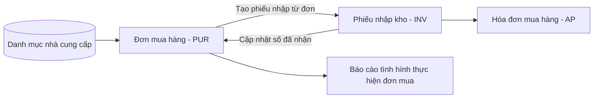

# Đặc tả yêu cầu phần mềm (SRS) — tổng quan — Minh An ERP

## 1. Giới thiệu

| Mục | Nội dung |
|---|---|
| Mục đích tài liệu | Đặc tả đủ chi tiết để đội phát triển lập trình và đội kiểm thử viết test case mà không cần hỏi lại BA |
| Phạm vi | Module Mua hàng giai đoạn 1 |
| Đối tượng đọc | Dev, QA, PM, khách hàng (PO) |
| Tài liệu liên quan | `02-requirements/requirements-overview.md`, `02-requirements/requirement-register.md`, `02-requirements/issue-log.md` |
| Quy ước | ID, marker, trạng thái: theo `erp-ba-core/references/conventions.md` của skill erp-ba-core |

## 2. Kiến trúc nghiệp vụ

### 2.1 Danh sách module

| ID | Mã | Tên module | Mục đích | REQ chính |
|---|---|---|---|---|
| MOD-PUR | PUR | Mua hàng | Danh mục nhà cung cấp, đơn mua hàng, báo cáo thực hiện đơn mua | REQ-001, REQ-016 |

### 2.2 Bản đồ module & luồng chứng từ liên module

## 3. Danh sách chức năng (Function breakdown)

| FN | Tên chức năng | Module | Loại | Pattern ERP | Nguồn (REQ/FEAT/DEC) | Ưu tiên | Trạng thái đặc tả | File |
|---|---|---|---|---|---|---|---|---|
| FN-PUR-01 | Danh mục nhà cung cấp | PUR | Danh mục | P01 | REQ-003, REQ-008, REQ-009, REQ-010 | Must | Ready | `functions/PUR/FN-PUR-01-danh-muc-nha-cung-cap.md` |
| FN-PUR-02 | Đơn mua hàng | PUR | Chứng từ | P02, P03, P04, P06 | REQ-001, REQ-002, REQ-005, REQ-006, REQ-015 | Must | Ready | `functions/PUR/FN-PUR-02-don-mua-hang.md` |
| FN-PUR-03 | Báo cáo tình hình thực hiện đơn mua hàng | PUR | Báo cáo | P13 | REQ-002, REQ-016 | Must | Ready | `functions/PUR/FN-PUR-03-bao-cao-tinh-hinh-thuc-hien-don-mua.md` |

### 3.1 Kiểm tra độ phủ 5 thành phần theo module

| Module | Hệ thống / cấu hình | Danh mục | Nghiệp vụ | Phân quyền & tham số | Báo cáo | Tiện ích / tích hợp |
|---|---|---|---|---|---|---|
| PUR | Tham số PRM-PUR-001 đến PRM-PUR-003 thiết lập trong chức năng tham số dùng chung của nền tảng (SRS Hệ thống); đánh số theo DOC-PO | FN-PUR-01 | FN-PUR-02 | catalogs/roles-permissions.md, PRM-PUR-001 đến PRM-PUR-003 | FN-PUR-03 | In PDF trong FN-PUR-02; nhập Excel danh mục trong FN-PUR-01; không có tích hợp ngoài (requirements-overview §10) |

## 4. Danh mục dùng chung

Định nghĩa: `catalogs/master-data.md`.

## 5. Loại chứng từ & trạng thái

Định nghĩa: `catalogs/document-types.md`.

## 6. Vai trò & phân quyền

Định nghĩa: `catalogs/roles-permissions.md`.

## 7. Tham số hệ thống

Định nghĩa: `catalogs/system-parameters.md`.

## 8. Báo cáo

Định nghĩa: `catalogs/reports.md`.

## 9. Tích hợp & thông báo

Định nghĩa: `catalogs/integrations-notifications.md`.

## 10. Quy tắc nghiệp vụ toàn hệ thống (BR-GEN)

| ID | Quy tắc | Nhóm | Nguồn |
|---|---|---|---|
| BR-GEN-01 | Số tiền VND làm tròn đến đơn vị đồng tại từng dòng (làm tròn nửa lên); tổng chứng từ bằng tổng các dòng đã làm tròn. Số tiền ngoại tệ làm tròn 2 chữ số thập phân theo cùng cách | Làm tròn | `erp-ba-core/references/design-patterns.md` P02 |
| BR-GEN-02 | Đơn giá lưu tối đa 4 chữ số thập phân; số lượng tối đa 3 chữ số thập phân | Làm tròn | `erp-ba-core/references/design-patterns.md` P02 |
| BR-GEN-03 | Mỗi chứng từ có một đồng tiền; tiền tệ khác VND bắt buộc có tỷ giá lớn hơn 0; giá trị quy đổi VND = giá trị ngoại tệ × tỷ giá, làm tròn theo BR-GEN-01 | Tiền tệ & tỷ giá | REQ-012, DEC-006 |
| BR-GEN-04 | Số chứng từ do hệ thống sinh khi lưu lần đầu theo mẫu của từng loại chứng từ (document-types.md), duy nhất toàn công ty, không cho sửa; số đã cấp không dùng lại kể cả khi chứng từ bị xóa | Đánh số | `erp-ba-core/references/design-patterns.md` P06 |
| BR-GEN-05 | Chứng từ chưa từng gửi duyệt được xóa; chứng từ đã gửi duyệt ít nhất một lần chỉ được hủy (CANCELLED) và giữ lịch sử | Xóa/hủy | `erp-ba-core/references/design-patterns.md` P02, P03 |
| BR-GEN-06 | Mọi thao tác tạo, sửa, đổi trạng thái được ghi nhật ký: người thực hiện, thời điểm, trường thay đổi, giá trị cũ và mới | Lưu vết | `erp-ba-core/references/regulations/vn-accounting.md` |
| BR-GEN-07 | Thời gian lưu và hiển thị theo múi giờ Asia/Ho_Chi_Minh; ngày dạng dd/MM/yyyy | Múi giờ & định dạng | `erp-ba-core/references/conventions.md` §8 |
| BR-GEN-08 | Mỗi chứng từ thuộc đúng một chi nhánh (lấy từ chi nhánh của người tạo, không sửa được); phạm vi dữ liệu theo chi nhánh áp dụng theo ma trận quyền | Đa chi nhánh | REQ-011, REQ-022 |
| BR-GEN-09 | Mỗi chứng từ có trường phiên bản (version) tăng sau mỗi lần lưu; lưu với phiên bản cũ bị từ chối (khóa lạc quan) | Đồng thời | `erp-ba-core/references/design-patterns.md` P02 |

## 11. Yêu cầu phi chức năng (NFR)

| ID | Nhóm | Yêu cầu | Chỉ số / ngưỡng | Cách kiểm chứng | Nguồn |
|---|---|---|---|---|---|
| NFR-PERF-01 | Hiệu năng | Màn hình danh sách đơn mua trả trang đầu tiên | ≤ 2 giây ở p95 với 50.000 đơn trong CSDL và 30 người dùng đồng thời | Kiểm thử tải | REQ-020, DEC-010 |
| NFR-PERF-02 | Hiệu năng | Lưu một đơn mua 200 dòng | ≤ 3 giây ở p95 | Kiểm thử tải | REQ-020, DEC-010 |
| NFR-USAB-01 | Khả dụng | Người dùng đã đào tạo tạo xong đơn 20 dòng | ≤ 5 phút; tìm hàng theo mã hoặc tên trong ô chọn hàng | Kiểm thử người dùng với 3 nhân viên | REQ-018, DEC-004 |
| NFR-COMP-01 | Tương thích | Màn hình danh sách và chi tiết đơn mua thao tác duyệt được trên trình duyệt điện thoại | Chrome và Safari 2 phiên bản mới nhất, màn hình rộng từ 360 px | Kiểm thử trên thiết bị thật | REQ-021, DEC-005 |
| NFR-AUDIT-01 | Kiểm toán | Nhật ký thao tác (BR-GEN-06) không sửa, không xóa được qua giao diện | 100% thao tác đổi trạng thái có bản ghi nhật ký | Kiểm thử | `erp-ba-core/references/regulations/vn-accounting.md` |

## 12. Chế độ kế toán & quy định áp dụng

| Hạng mục | Lựa chọn của dự án | Nguồn |
|---|---|---|
| Chế độ kế toán | Thông tư 99/2025/TT-BTC (SRC-101) | REQ-019 |
| Phương pháp tính giá xuất kho | N/A – thuộc SRS module Kho, không ảnh hưởng đơn mua | requirements-overview §2.2 |
| Hóa đơn điện tử | N/A – đơn mua hàng không phát hành hóa đơn | requirements-overview §2.2 |
| Đồng tiền hạch toán | VND | REQ-019 |

## 13. Chuyển đổi dữ liệu

| Dữ liệu | Nguồn hiện tại | Thời điểm chốt | Quy tắc chuyển đổi | FN nhập liệu |
|---|---|---|---|---|
| Nhà cung cấp (312 dòng) | SRC-002 | Trước ngày vận hành 3 ngày làm việc | Làm sạch trùng mã số thuế trước; nhập bằng chức năng nhập Excel của FN-PUR-01 | FN-PUR-01 |

## 14. Thuật ngữ

Xem `catalogs/glossary.md`.

## 15. Truy vết

Ma trận truy vết sinh tự động: `traceability.md` (lệnh `python3 scripts/ba.py trace <root>`).
