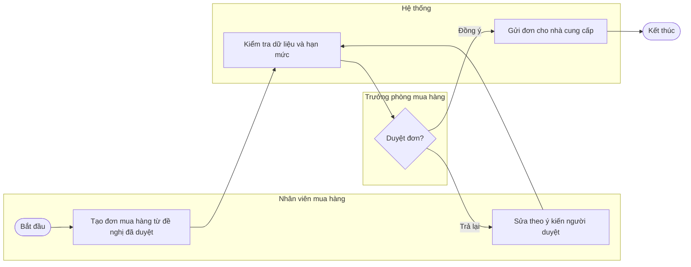
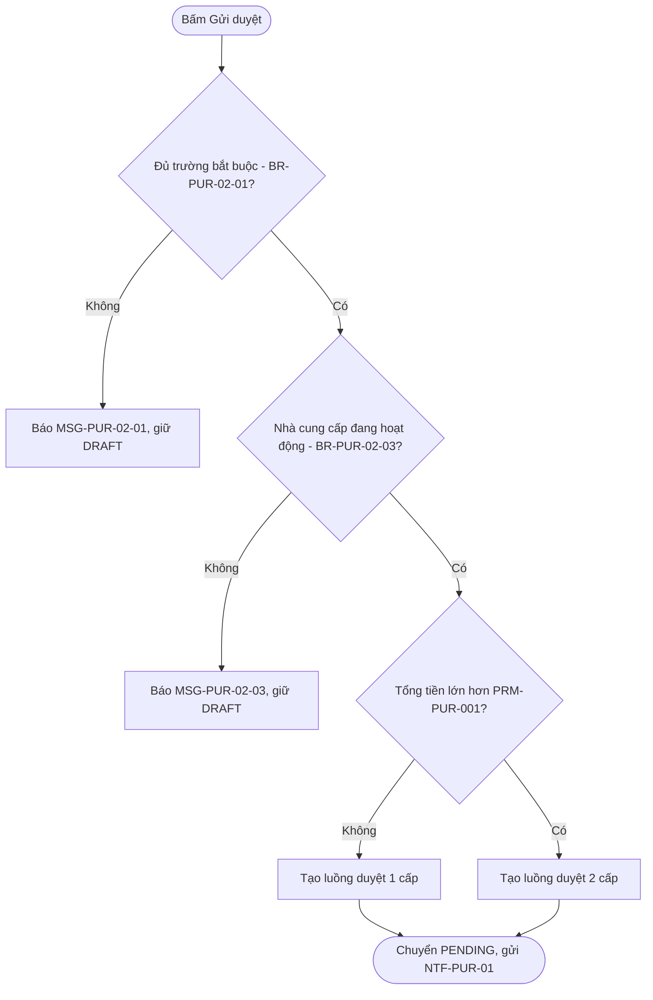
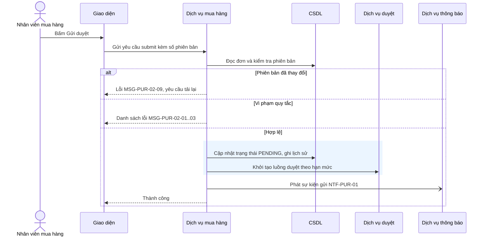
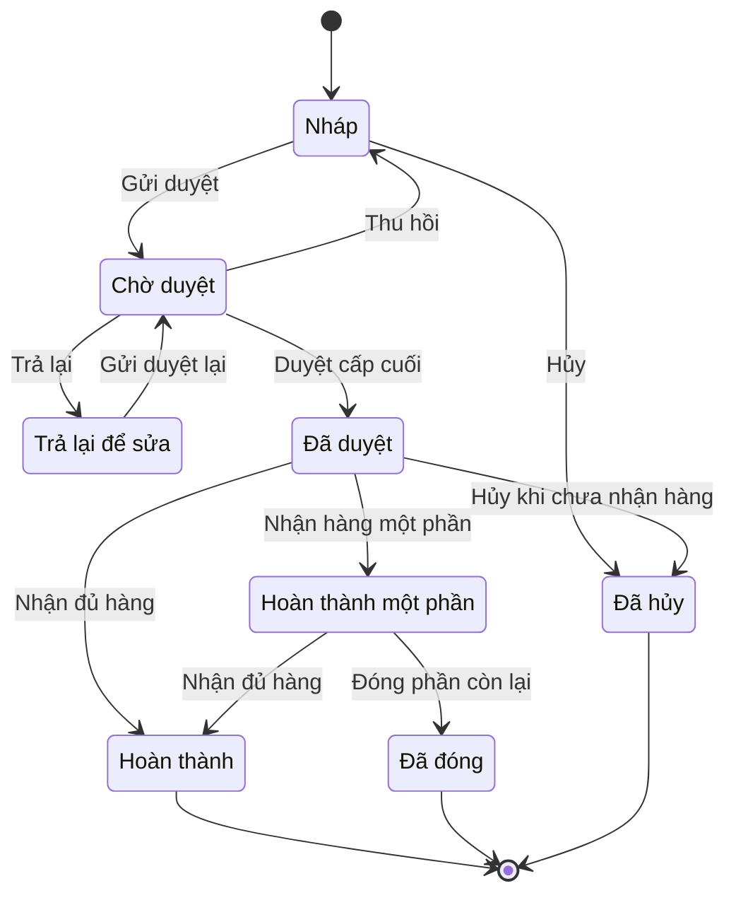
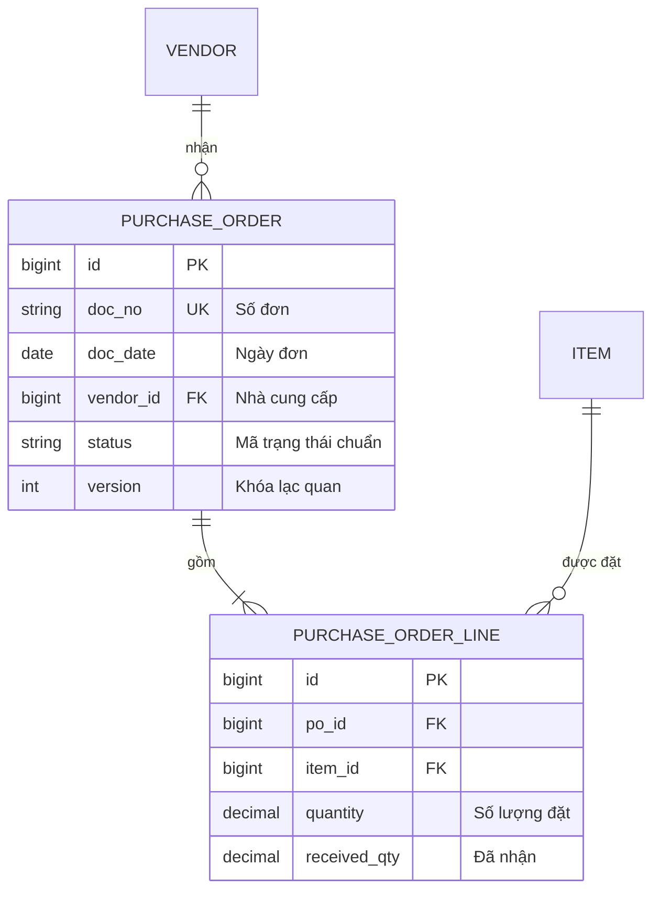
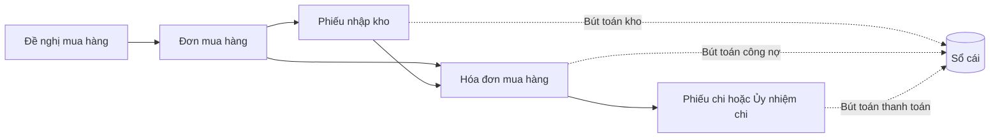
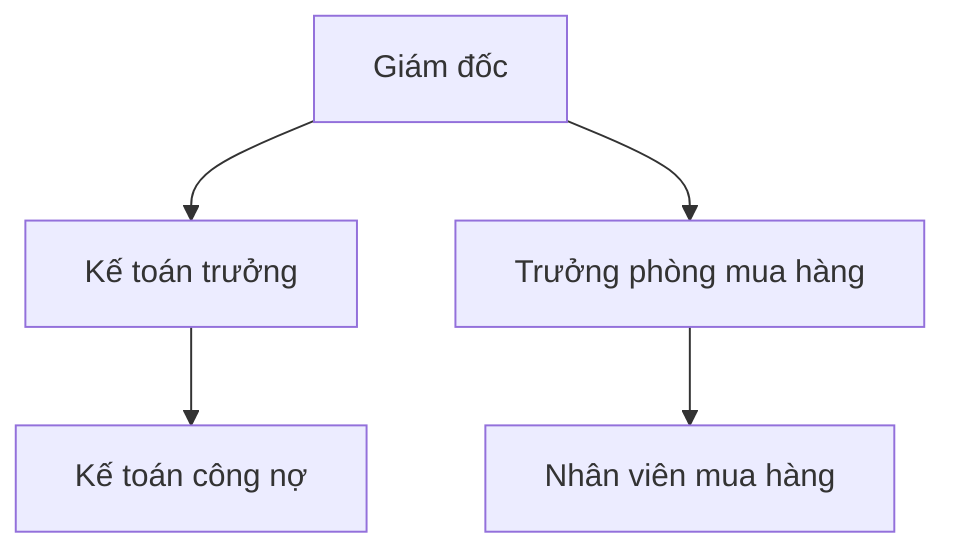

# Quy ước & mẫu sơ đồ (Mermaid)

## Mục lục
1. Quy tắc chung (để sơ đồ luôn render được)
2. Sơ đồ luồng nghiệp vụ swimlane
3. Sơ đồ quyết định (if-else, hình thoi)
4. Sơ đồ tuần tự (sequence)
5. Sơ đồ trạng thái (state)
6. Sơ đồ dữ liệu (ER)
7. Luồng chứng từ liên module & sơ đồ tổ chức
8. Lỗi cú pháp hay gặp
9. Kiểm tra sơ đồ

---

## 1. Quy tắc chung

- Viết trong khối ```` ```mermaid ````. Mỗi sơ đồ ≤ ~25 nút; lớn hơn thì tách theo giai đoạn.
- **ID nút**: chữ ASCII không dấu, không khoảng trắng (`A1`, `KT_DUYET`). **Nhãn** đặt trong ngoặc kép: `A1["Tạo đơn mua hàng (PO)"]`.
- Trong nhãn **không** dùng dấu ngoặc kép `"`, dấu `;`, ký tự `#`. Cần nhấn mạnh thì dùng chữ, không dùng ký hiệu.
- Nhãn cạnh: `-->|"Có"|`. Nhánh của hình thoi luôn có nhãn.
- Không dùng `end` (chữ thường) làm ID nút; không đặt ID nút bắt đầu bằng `o` hoặc `x` ngay sau mũi tên (Mermaid hiểu thành kiểu mũi tên tròn/chéo) — viết hoa hoặc thêm khoảng trắng.
- Hình dạng: `(["Bắt đầu"])` bắt đầu/kết thúc · `["Hành động"]` bước xử lý · `{"Điều kiện?"}` quyết định · `[("Dữ liệu")]` lưu trữ · `[["Chức năng khác"]]` chức năng con/được gọi.
- Ngôn ngữ nhãn: tiếng Việt, ngắn (≤ 8 từ), dùng đúng thuật ngữ trong glossary và ID (BR-…, MSG-…, trạng thái chuẩn).

## 2. Sơ đồ luồng nghiệp vụ swimlane

Mỗi vai trò (và "Hệ thống") là một `subgraph`. Khai báo nút bên trong subgraph; cạnh nối giữa các làn khai báo bên ngoài, sau các subgraph.



Ở mức quy trình đầu-cuối (BP), mỗi nút là một chức năng/chứng từ; ở mức chức năng (FN), mỗi nút là một bước thao tác. Bảng luồng chính (mục 4.2) và sơ đồ phải mô tả cùng một luồng.

## 3. Sơ đồ quyết định (if-else)

Mỗi quy tắc nghiệp vụ có điều kiện là một hình thoi; mọi nhánh có nhãn; mỗi lá là một kết quả cụ thể (thông báo MSG, trạng thái, hành động). Đặt mã BR trong nhãn để dev đối chiếu.



Thứ tự hình thoi = thứ tự kiểm tra trong code. Nếu các kiểm tra độc lập và phải báo tất cả lỗi một lần, ghi rõ trong BR ("kiểm tra tất cả, hiển thị danh sách lỗi") thay vì vẽ chuỗi.

## 4. Sơ đồ tuần tự (sequence)

Thành phần chuẩn: người dùng (actor), Giao diện, Dịch vụ của module, CSDL, dịch vụ module khác/duyệt/thông báo, hệ thống ngoài. Luôn có nhánh lỗi bằng `alt`. Dùng `rect` để thể hiện phạm vi một giao dịch CSDL khi quan trọng.



Ký hiệu: `->>` gọi đồng bộ, `-->>` phản hồi, `-)` gửi bất đồng bộ (sự kiện). Không dùng `;` hay `#` trong nội dung thông điệp.

## 5. Sơ đồ trạng thái

ID trạng thái là **mã chuẩn** (conventions §6), nhãn tiếng Việt khai báo bằng `state "Nhãn" as MÃ`. Nhãn chuyển trạng thái là **hành động** (tên hành động chuẩn).



Kiểm tra: mọi trạng thái có đường vào và (trừ trạng thái kết thúc) đường ra; trạng thái kết thúc nối `[*]`; mọi mã có trong bộ trạng thái của chứng từ ở `document-types.md`.

## 6. Sơ đồ dữ liệu (ER)

Tên thực thể ASCII viết hoa (tên bảng nghiệp vụ), thuộc tính dạng `kiểu tên_cột [PK|FK|UK] "mô tả"`; nhãn quan hệ trong ngoặc kép.



Ký hiệu quan hệ: `||--||` một-một, `||--o{` một-không hoặc nhiều, `||--|{` một-một hoặc nhiều, `}o--o{` nhiều-nhiều.

## 7. Luồng chứng từ liên module & sơ đồ tổ chức





## 8. Lỗi cú pháp hay gặp

| Sai | Đúng | Vì sao |
|---|---|---|
| `A[Tạo đơn (PO)]` | `A["Tạo đơn (PO)"]` | Ngoặc đơn trong nhãn không trích dẫn làm vỡ cú pháp |
| `B{Tổng > 50tr?}` | `B{"Tổng lớn hơn PRM-PUR-001?"}` | Ký tự `>` và không trích dẫn |
| `end[Kết thúc]` | `E(["Kết thúc"])` | `end` là từ khóa |
| `U->>UI: Lưu; gửi duyệt` | `U->>UI: Lưu và gửi duyệt` | `;` trong sequence bị hiểu là xuống dòng |
| `Nháp --> Chờ duyệt` | `DRAFT --> PENDING : Gửi duyệt` | ID trạng thái phải ASCII; dùng `state "Nhãn" as ID` |
| `A ||--o{ B : gồm nhiều` | `A ||--o{ B : "gồm nhiều"` | Nhãn quan hệ có khoảng trắng phải trích dẫn |
| Thiếu `end` của `subgraph` / `alt` | Đếm cặp mở-đóng | Lỗi phổ biến nhất khi sửa sơ đồ |
| Nhãn có `"` bên trong | Bỏ dấu ngoặc kép bên trong | Không thoát được an toàn |

## 9. Kiểm tra sơ đồ

- `python3 erp-ba-core/scripts/ba.py lint <root>` kiểm cú pháp cơ bản (loại sơ đồ, cặp subgraph/end và alt/end, nhãn chưa trích dẫn, ID trạng thái, nhãn quan hệ ER) và sự có mặt của 5 sơ đồ bắt buộc trong mỗi đặc tả chức năng.
- Nếu môi trường có mermaid-cli (`mmdc`), render thử từng khối để chắc chắn: tách khối ra file `.mmd` và chạy `mmdc -i x.mmd -o x.svg`.
