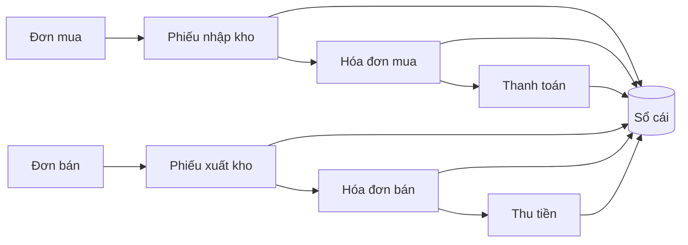

# Nền tảng ERP cho BA

Đọc file này khi chưa quen ERP. Chi tiết từng chủ đề nằm ở các file tham chiếu được trỏ tới và trong 4 skill sách (`book-insights.md`).

## 1. ERP là gì

ERP (Enterprise Resource Planning — hoạch định nguồn lực doanh nghiệp) là **một hệ thống tích hợp trên một cơ sở dữ liệu chung**: một nghiệp vụ nhập một lần sẽ tự cập nhật mọi bộ phận liên quan (kho, công nợ, sổ cái, ngân sách, báo cáo) — "một bộ số duy nhất" cho cả công ty. Khác với phần mềm rời rạc (mỗi phòng một file/một phần mềm), giá trị của ERP nằm ở **luồng chứng từ xuyên module** và **kiểm soát**. Lịch sử: MRP (hoạch định nhu cầu vật tư) → MRP II (thêm năng lực, tài chính) → ERP (toàn doanh nghiệp) → ERP II (cộng tác với đối tác). Xem `parthasarathy-erp-fundamentals` ch01–ch02.

## 2. Năm thành phần của một sản phẩm ERP (kiểm cho từng module)

| Thành phần | Là gì | BA phải đặc tả |
|---|---|---|
| Hệ thống / nền tảng | Người dùng, cơ cấu tổ chức, đánh số, luồng duyệt, mẫu in, nhập/xuất, nhật ký | Cấu hình module, đánh số, cấu hình duyệt, nhật ký |
| Danh mục (master data) | Dữ liệu dùng lại: khách hàng, nhà cung cấp, hàng hóa, kho, tài khoản, nhân viên… | Mỗi danh mục một chức năng: mã, trường, ngừng dùng thay vì xóa khi đã phát sinh |
| Nghiệp vụ (chứng từ) | Giao dịch: đơn mua, phiếu nhập, hóa đơn, phiếu chi… | Mỗi loại chứng từ một chức năng trọn vòng đời: trạng thái, duyệt, ghi sổ, hủy/đảo |
| Phân quyền & tham số | Ai được làm gì trên dữ liệu nào; giá trị cấu hình được (ngưỡng, tỷ lệ, bật/tắt bước) | Ma trận vai trò × hành động × phạm vi dữ liệu; SoD; hạn mức duyệt; tham số có ảnh hưởng theo từng giá trị |
| Báo cáo | Báo cáo vận hành, quản trị, bắt buộc theo luật | Bộ lọc, cột, công thức, chứng từ/trạng thái được tính, ngày lọc |

## 3. Cơ cấu tổ chức trong ERP

Pháp nhân (công ty) → chi nhánh → kho / nhà máy / công trường → phòng ban, trung tâm chi phí, dự án. Xác định sớm ở bước 2 vì nó quyết định phân quyền dữ liệu, đánh số chứng từ, hạch toán theo đối tượng và báo cáo hợp nhất.

## 4. Ba loại dữ liệu

- **Danh mục (master data):** ít đổi, dùng lại nhiều; chất lượng quyết định mọi thứ (Wallace: độ chính xác tồn kho ≥ 95%, BOM/routing ≥ 98% trước khi chạy hoạch định — `wallace-erp-implementation` ch10).
- **Giao dịch (transaction):** chứng từ phát sinh hằng ngày.
- **Cấu hình (configuration/tham số):** quy định hành vi hệ thống; thay đổi được mà không sửa code.

## 5. Nguyên lý chứng từ

Header + dòng; số chứng từ tự sinh theo mẫu; **ngày chứng từ** khác **ngày ghi sổ**; trạng thái chuẩn (Nháp → Chờ duyệt → Đã duyệt → Thực hiện một phần/Hoàn thành/Đã ghi sổ → Đóng; Từ chối, Hủy, Đảo — `conventions.md` §6); **luồng chứng từ** (đơn mua → phiếu nhập → hóa đơn → thanh toán) với "tạo từ chứng từ nguồn" và theo dõi số đã thực hiện. Mẫu: `design-patterns.md` P02, P04.

## 6. Nguyên lý ghi sổ

Chứng từ nghiệp vụ sinh bút toán sổ cái tự động qua quy tắc xác định tài khoản; **chứng từ đã ghi sổ không xóa — chỉ đảo**; kỳ đã khóa không ghi sổ được; mọi thay đổi có lưu vết. Chế độ kế toán từ 01/01/2026: Thông tư 99/2025/TT-BTC (doanh nghiệp nhỏ và vừa có thể dùng TT133/2016) — `regulations/vn-accounting.md`. Mẫu: `design-patterns.md` P05, P07, P14.

## 7. Kiểm soát nội bộ

Phân tách nhiệm vụ (người tạo ≠ người duyệt ≠ người chi), hạn mức duyệt theo giá trị, quyền tối thiểu, kiểm soát tự động thay kiểm soát thủ công, nhật ký kiểm toán — `security-and-parameters.md`; góc nhìn kiểm toán nội bộ: `elbardan-erp-governance-audit`.

## 8. Quy trình đầu-cuối chuẩn

| Quy trình | Module | Tham chiếu |
|---|---|---|
| Mua hàng – thanh toán (P2P) | PUR, INV, AP, CB | `processes/p2p-procure-to-pay.md` |
| Bán hàng – thu tiền (O2C) | SAL, INV, AR, CB, TAX | `processes/o2c-order-to-cash.md` |
| Kho | INV, COST | `processes/inventory-warehouse.md`, `processes/costing.md` |
| Sản xuất – hoạch định | MFG, INV, COST | `processes/manufacturing-mrp.md` |
| Ghi sổ – báo cáo (R2R) | GL, FA, TAX | `processes/r2r-general-ledger.md`, `fixed-assets.md`, `tax-einvoice.md` |
| Nhân sự – tiền lương | HR, PAY | `processes/hr-payroll.md` |
| Dự án | PRJ | `processes/project-management.md`; xây dựng: `industries/construction.md` |

## 9. Chuẩn hóa hay tùy biến

Ưu tiên quy trình chuẩn (best practice) của ERP; chỉ khác chuẩn khi khách hàng có lý do nghiệp vụ — ghi DEC. Tùy biến nhiều làm tăng chi phí và rủi ro (`oleary-erp-systems-lifecycle` ch09–ch10, `parthasarathy-erp-fundamentals` ch05).

## 10. Sai lầm BA hay mắc

| Sai lầm | Hậu quả | Cách tránh |
|---|---|---|
| Đặc tả như màn hình CRUD rời rạc | Mất luồng chứng từ, ghi sổ, kiểm soát | Đi theo quy trình đầu-cuối và pattern chứng từ |
| Cho xóa chứng từ đã ghi sổ | Sai luật, mất vết | Chỉ đảo; khóa kỳ |
| Viết cứng ngưỡng, tỷ lệ | Mỗi lần đổi phải sửa code | Tham số có ảnh hưởng theo từng giá trị |
| Quên vai trò thao tác một phần (kế toán, thủ kho) | Phân quyền thiếu | Liệt kê mọi vai trò chạm vào chức năng |
| Bỏ qua danh mục, báo cáo | Thiếu chức năng | Kiểm 5 thành phần cho từng module |
| Tự quyết thay khách hàng | Lệch yêu cầu | Ghi câu hỏi (Q), đánh dấu đề xuất |
