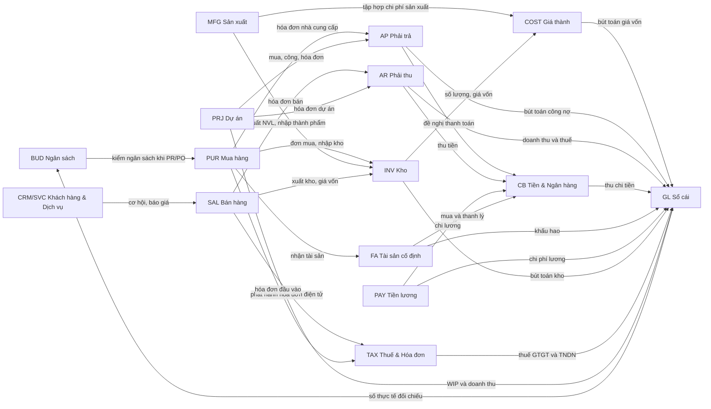

# Danh mục module ERP chuẩn (Standard ERP Module Catalog)

> **Cập nhật đến: 2026-10-20 — quy định thay đổi thường xuyên; BA phải kiểm tra lại hiệu lực khi dùng cho dự án.**
> File tra cứu trong skill `erp-ba-docs`. Mục tiêu: để BA ở **bước 3** phân rã một module thành chức năng **không thiếu, không thừa**, bằng cách soát đủ **5 thành phần ERP** cho mỗi module. Mỗi chức năng liệt kê ở đây đều là **chức năng ERP chuẩn** có trong thư viện quy trình (`references/processes/*`, `references/industries/*`) hoặc là chuẩn phổ biến của SAP / Oracle / Odoo / Microsoft Dynamics — **không bịa chức năng lạ**.
> Quy ước ID / trạng thái / hành động phân quyền: `references/conventions.md`. Pattern thiết kế P01–P18: `references/design-patterns.md`. Phân quyền & tham số: `references/security-and-parameters.md`. Bút toán & số hiệu tài khoản: `references/regulations/vn-accounting.md`. Báo cáo chi tiết: `references/reports-catalog.md` (sẽ bổ sung; hiện báo cáo tiêu biểu nêu ngay trong từng module, dẫn nguồn file quy trình).
> **Chế độ kế toán đang hiệu lực (2026-10-20):** **Thông tư 99/2025/TT-BTC** (hiệu lực 01/01/2026, thay Thông tư 200/2014/TT-BTC); doanh nghiệp nhỏ và vừa (DNNVV) được chọn tiếp tục **Thông tư 133/2016/TT-BTC**; doanh nghiệp siêu nhỏ **TT132/2018** (⚠️ có thông tin TT58/2026 thay TT132 từ 01/07/2026 — kiểm chứng khi dùng). Số hiệu tài khoản trong file theo TT99/2025.

## Mục lục
- [Cách dùng file này (bước 3)](#cách-dùng-file-này-bước-3)
- [Quy ước đọc bảng chức năng](#quy-ước-đọc-bảng-chức-năng)
- [Bản đồ module & luồng tích hợp](#bản-đồ-module--luồng-tích-hợp)
- **Module lõi (core):** [SYS](#sys--hệ-thống--an-ninh-system--security) · [GL](#gl--kế-toán-tổng-hợp-general-ledger) · [AP](#ap--công-nợ-phải-trả-accounts-payable) · [AR](#ar--công-nợ-phải-thu-accounts-receivable) · [CB](#cb--tiền-mặt--ngân-hàng-cash--bank) · [FA](#fa--tài-sản-cố-định-công-cụ-dụng-cụ--chi-phí-trả-trước-fixed-assets) · [TAX](#tax--thuế--hóa-đơn-điện-tử-tax--e-invoicing) · [COST](#cost--tính-giá-thành--định-giá-tồn-kho-costing--inventory-valuation) · [BUD](#bud--lập--kiểm-soát-ngân-sách-budgeting) · [PUR](#pur--mua-hàng-procure-to-pay) · [SAL](#sal--bán-hàng-order-to-cash) · [INV](#inv--kho--quản-lý-kho-inventory--warehouse) · [MFG](#mfg--sản-xuất--mrp-manufacturing--mrp) · [QC](#qc--quản-lý-chất-lượng-quality-management) · [PRJ](#prj--quản-lý-dự-án--kế-toán-dự-án-project-management) · [HR](#hr--quản-lý-nhân-sự-human-resources) · [PAY](#pay--tiền-lương--bảo-hiểm--thuế-tncn-payroll) · [CRM](#crm--quản-lý-quan-hệ-khách-hàng-customer-relationship-management) · [SVC](#svc--dịch-vụ-sau-bán-hàng-after-sales-service)
- **Mở rộng ngành xây dựng:** [EST](#est--dự-toán--đấu-thầu) · [CTR](#ctr--hợp-đồng-chủ-đầu-tư--bảo-lãnh) · [SITE](#site--vật-tư--kho-công-trường) · [EQP](#eqp--thiết-bị--ca-máy-thi-công) · [SUB](#sub--thầu-phụ--giao-khoán) · [PROG](#prog--nghiệm-thu-khối-lượng--thanh-toán) · [QHSE / DCTRL](#qhse--dctrl--chất-lượng-an-toàn-nhật-ký--tài-liệu) · [STL](#stl--bàn-giao-bảo-hành--quyết-toán) · (PRJ-XD, COST-XD: xem ghi chú)
- **Mở rộng ngành logistics:** [FWD](#fwd--giao-nhận--hồ-sơ-lô-hàng-freight-forwarding) · [CUS](#cus--dịch-vụ-khai-báo-hải-quan-customs-brokerage) · [TMS](#tms--vận-tải-đường-bộ--đội-xe-transport-management) · [WMS](#wms--kho-bãi--3pl-warehouse-management--3pl) · [BIL](#bil--billing-job-costing--quyết-toán-logistics)
- **Mở rộng ngành thương mại – phân phối:** [PRICE](#price--giá--khuyến-mãi-pricing--promotion) · [DMS](#dms--quản-lý-phân-phối-thị-trường-distribution-management) · [POS](#pos--bán-lẻ-point-of-sale) · [ECM](#ecm--thương-mại-điện-tử--sàn-e-commerce--marketplace) · (SAL-PP, INV-PP, AR-PP: xem ghi chú)
- [Nguồn & lưu ý mâu thuẫn giữa các file](#nguồn--lưu-ý-mâu-thuẫn-giữa-các-file)

---

## Cách dùng file này (bước 3)

Dùng khi lập **danh sách module & chức năng** trong `03-specification/srs-overview.md` §2–§3 (hướng dẫn: `references/step3-specification.md` §3). Catalog này là **điểm xuất phát chuẩn**, không phải phạm vi bắt buộc: chỉ đưa vào spec những chức năng **có nguồn khách hàng (REQ/DEC)**; chức năng chuẩn mà khách hàng chưa yêu cầu đưa vào **dưới dạng đề xuất** `[ĐỀ XUẤT → Q-NNN]` (`references/conventions.md` §4).

**Kiểm "5 thành phần ERP" cho mỗi module** (soát đủ 5 nhóm, ô trống phải giải thích — `step3-specification.md` §3.1):

| Thành phần | Loại chức năng trong bảng | Soát hỏi |
|---|---|---|
| 1. Hệ thống / cấu hình | Cấu hình, Tác vụ nền (thiết lập), Tiện ích nền | Đánh số? Luồng duyệt? Tham số? Khóa kỳ? Mẫu in? |
| 2. Danh mục (master data) | Danh mục | Mỗi danh mục module dùng có một chức năng quản lý? |
| 3. Nghiệp vụ / chứng từ | Chứng từ, Phê duyệt, Tác vụ nền (nghiệp vụ), Tiện ích | Mỗi loại chứng từ có một chức năng trọn vòng đời? Có kiểm kê/đối chiếu/đảo? |
| 4. Phân quyền & tham số | (tham chiếu `roles-permissions.md`, `system-parameters.md`) | Vai trò? Ma trận quyền? SoD? Hạn mức duyệt? Tham số? |
| 5. Báo cáo | Báo cáo | Mỗi chứng từ/danh mục quan trọng có báo cáo theo dõi? Báo cáo luật định? |

**Nguyên tắc độ mịn (`step3-specification.md` §3.2):** một **loại chứng từ = một chức năng** (trọn vòng đời: tạo → gửi duyệt → duyệt → ghi sổ → hủy/đảo/đóng), không tách "Tạo"/"Sửa"; một **danh mục = một chức năng** (danh mục rất đơn giản, cùng cấu trúc, có thể gộp); mỗi **tác vụ nền** (tính giá, khấu hao, MRP, kết chuyển, đồng bộ HĐĐT) là một chức năng; mỗi **báo cáo** (hoặc nhóm báo cáo cùng nguồn) là một chức năng; mỗi **tích hợp** (INT) là một chức năng loại Tích hợp. Mã `FN-<MOD>-NN` đánh theo **thứ tự quy trình** và **định nghĩa tại `03-specification/functions/**`** — catalog này **không cố định số FN** (xem lưu ý mâu thuẫn ở cuối), BA tự đánh số theo dự án.

---

## Quy ước đọc bảng chức năng

Mỗi module có một **Bảng chức năng chuẩn** với các cột:

- **Loại** — một trong 8 loại: **Danh mục** (master data CRUD) · **Chứng từ** (giao dịch có vòng đời trạng thái) · **Phê duyệt** (hộp duyệt / định tuyến) · **Cấu hình** (thiết lập, tham số, đánh số, luồng) · **Tích hợp** (API/File/Event với hệ ngoài) · **Tác vụ nền** (job định kỳ / chạy theo lô) · **Tiện ích** (công cụ hỗ trợ: import, đính kèm, đối chiếu…) · **Báo cáo**.
- **Pattern** — mã mẫu thiết kế áp dụng (gắn nhãn để spec trả lời đủ checklist pattern), lấy từ `references/design-patterns.md`:
  P01 Danh mục/dữ liệu chủ · P02 Chứng từ header–lines · P03 Duyệt nhiều cấp · P04 Luồng chứng từ/tạo-từ-nguồn · P05 Ghi sổ & đảo bút toán · P06 Đánh số chứng từ · P07 Khóa sổ/đóng kỳ · P08 Đa công ty/tiền tệ/ngôn ngữ · P09 Đính kèm/bình luận/lịch sử · P10 Thông báo & nhắc việc · P11 Mẫu in · P12 Nhập/Xuất Excel · P13 Màn hình danh sách & tìm kiếm · P14 Audit trail field-level · P15 Tác vụ nền/định kỳ · P16 Tích hợp · P17 Phạm vi dữ liệu/phân quyền · P18 Dashboard & KPI. (Mọi chức năng danh mục ngầm kèm P12/P13/P14/P17; mọi chứng từ ngầm kèm P09/P11/P13/P14/P17 — bảng chỉ ghi pattern **đặc trưng**.)
- **Mức độ phổ biến** — **Cốt lõi** (hầu như dự án nào cũng cần) · **Thường có** (phần lớn dự án) · **Nâng cao** (theo quy mô/ngành, thường gắn `[ĐỀ XUẤT]`).

**Bộ trạng thái chứng từ chuẩn** (chỉ dùng các mã này — `references/conventions.md` §6): `DRAFT` Nháp · `PENDING` Chờ duyệt · `RETURNED` Trả lại để sửa · `REJECTED` Từ chối · `APPROVED` Đã duyệt · `IN_PROGRESS` Đang thực hiện · `PARTIAL` Hoàn thành một phần · `COMPLETED` Hoàn thành · `POSTED` Đã ghi sổ · `CLOSED` Đã đóng · `CANCELLED` Đã hủy · `REVERSED` Đã đảo. Danh mục dùng trạng thái bản ghi `ACTIVE`/`INACTIVE`/`LOCKED`. Hành động phân quyền chuẩn: Xem · Tạo · Sửa · Xóa (chỉ Nháp) · Gửi duyệt · Thu hồi · Duyệt · Từ chối · Trả lại · Ghi sổ · Bỏ ghi sổ · Hủy · Đảo · Đóng · In · Xuất file · Nhập file · Cấu hình.

---

## Bản đồ module & luồng tích hợp

Luồng chứng từ chính giữa các module lõi (SYS, QC, BUD, TAX là cross-cutting — nêu trong ghi chú):

> Đọc bản đồ: mũi tên là **luồng chứng từ/dữ liệu chính**. **GL là sổ cái trung tâm** — mọi phân hệ đẩy bút toán lên GL và GL trả số dư để đối chiếu (hai chiều). **SYS** cấp nền cho mọi module (người dùng, phân quyền, tham số, đánh số, khóa kỳ, nhật ký). **TAX** gắn với mọi điểm phát sinh hóa đơn (SAL/AR đầu ra, PUR/AP đầu vào). **QC** gắn vào PUR (kiểm đầu vào), MFG (kiểm trong chuyền/đầu ra), INV (kho chờ). **BUD** là kế toán quản trị, **không sinh bút toán tài chính** — chỉ kiểm soát cam kết/thực chi so với số GL. Chi tiết luồng từng cặp module: mục "Tích hợp với module khác" của mỗi module và §12 các file `references/processes/*`.

---

## Danh mục chức năng theo module

Tổng hợp từ các file quy trình/ngành (ghi rõ nguồn). Dùng ở bước 3 để kiểm 5 thành phần: hệ thống, danh mục, nghiệp vụ, phân quyền & tham số, báo cáo.

### AP — Công nợ phải trả (Accounts Payable)

- **Nguồn:** pat-security-params, proc-ap-ar
- **Danh mục chính:** MD-VENDOR Nhà cung cấp (phần tài chính); MD-PAY-TERM Điều khoản thanh toán; MD-TAX-CODE Mã thuế GTGT đầu vào; MD-CURRENCY/MD-FX-RATE Tiền tệ và tỷ giá; MD-GL-ACCOUNT Tài khoản sổ cái; MD-BANK Ngân hàng và tài khoản công ty; MD-TOLERANCE Nhóm dung sai đối chiếu; MD-HOLD-REASON Lý do khóa/giữ thanh toán
- **Chứng từ chính:** Đơn mua hàng (PO); Phiếu nhập kho (GRN); Hóa đơn mua hàng (Vendor Invoice); Hóa đơn chi phí trực tiếp (Non-PO); Chứng từ tạm ứng NCC (Vendor Advance); Đề nghị thanh toán (Payment Request); Chứng từ thanh toán (Payment); Giấy báo Nợ (Debit Note); Bút toán bù trừ công nợ (Netting)

| # | Chức năng |
|---|---|
| 1 | FN-AP-01 Quản lý hồ sơ tài chính nhà cung cấp |
| 2 | FN-AP-02 Ghi nhận hóa đơn mua hàng từ PO/GRN (đối chiếu) |
| 3 | FN-AP-03 Ghi nhận hóa đơn chi phí trực tiếp (không PO) |
| 4 | FN-AP-04 Đối chiếu 2/3 chiều và dung sai |
| 5 | FN-AP-05 Ghi nhận thuế GTGT đầu vào |
| 6 | FN-AP-06 Điều khoản thanh toán và tính ngày đến hạn |
| 7 | FN-AP-07 Đề nghị/đề xuất thanh toán và phê duyệt |
| 8 | FN-AP-08 Thực hiện thanh toán (tiền mặt/chuyển khoản/theo lô) |
| 9 | FN-AP-09 Tạm ứng/trả trước nhà cung cấp |
| 10 | FN-AP-10 Giấy báo Nợ và trả lại hàng mua |
| 11 | FN-AP-11 Bù trừ/cấn trừ công nợ |
| 12 | FN-AP-12 Chênh lệch tỷ giá |
| 13 | FN-AP-13 Đối chiếu công nợ nhà cung cấp |
| 14 | FN-AP-14 Phân tích tuổi nợ phải trả |
| 15 | FN-AP-15 Khóa sổ kỳ và tất toán GR/IR |
| 16 | Cấu hình tham số AP (điều khoản, đối chiếu 3 bên, dung sai, chống trùng hóa đơn, TK mặc định) |

### AR — Kế toán công nợ phải thu (Accounts Receivable)

- **Nguồn:** ind-trading, pat-security-params, proc-ap-ar, reg-accounting
- **Danh mục chính:** Danh mục khách hàng; Điều khoản thanh toán; MD-CUSTOMER Khách hàng (phần tài chính); MD-PAY-TERM Điều khoản thanh toán; MD-CREDIT-SEG Nhóm/phân khúc tín dụng; MD-DUNNING Quy trình nhắc nợ; MD-TAX-CODE Mã thuế GTGT đầu ra; MD-CURRENCY/MD-FX-RATE Tiền tệ và tỷ giá; MD-GL-ACCOUNT Tài khoản sổ cái; MD-PRODUCT/MD-PRICE Sản phẩm và bảng giá; MD-CUSTOMER; MD-DISTRIBUTOR
- **Chứng từ chính:** Chứng từ đối chiếu công nợ; Bảng trích lập dự phòng nợ phải thu; Đơn bán hàng (Sales Order); Phiếu xuất kho/giao hàng (Delivery); Hóa đơn bán hàng (Sales Invoice); Hóa đơn điện tử (E-Invoice); Chứng từ khách ứng trước (Customer Advance); Chứng từ thu tiền (Receipt); Giấy báo Có (Credit Note); Chứng từ dự phòng/xóa sổ (Provision/Write-off); Phiếu thu

| # | Chức năng |
|---|---|
| 1 | Theo dõi tuổi nợ phải thu |
| 2 | Trích lập/hoàn nhập dự phòng nợ phải thu khó đòi (30/50/70/100%) |
| 3 | Xử lý xóa nợ không thu hồi được |
| 4 | FN-AR-01 Hồ sơ tài chính khách hàng |
| 5 | FN-AR-02 Hạn mức tín dụng và kiểm soát tín dụng |
| 6 | FN-AR-03 Hóa đơn bán hàng gắn hóa đơn điện tử |
| 7 | FN-AR-04 Thu tiền và phân bổ vào hóa đơn (FIFO/thủ công) |
| 8 | FN-AR-05 Khách hàng ứng trước |
| 9 | FN-AR-06 Giấy báo Có và trả lại hàng bán |
| 10 | FN-AR-07 Chiết khấu thanh toán |
| 11 | FN-AR-08 Nhắc nợ/đốc nợ (dunning) |
| 12 | FN-AR-09 Dự phòng nợ phải thu khó đòi |
| 13 | FN-AR-10 Xóa sổ và thu hồi nợ đã xóa |
| 14 | FN-AR-11 Đối chiếu công nợ khách hàng |
| 15 | FN-AR-12 Phân tích tuổi nợ phải thu và DSO |
| 16 | FN-AR-13 Chênh lệch tỷ giá |
| 17 | FN-AR-14 Bù trừ công nợ |
| 18 | Cấu hình tham số AR (hạn mức tín dụng, điều khoản, dự phòng khó đòi, đối trừ thu tiền, TK mặc định) |
| 19 | Hạn mức tín dụng & kiểm soát công nợ |
| 20 | Thu tiền theo tuyến & đối soát quỹ |

### BIL — Billing, tính giá & quyết toán logistics (Billing, Job Costing & Settlement)

- **Nguồn:** ind-logistics
- **Danh mục chính:** MD-CUSTOMER; MD-AGENT; MD-CARRIER; MD-CURRENCY; MD-CHARGE
- **Chứng từ chính:** Debit Note; Credit Note; Hóa đơn GTGT điện tử; SOA; Lệnh thanh toán quốc tế

| # | Chức năng |
|---|---|
| 1 | FN-BIL-01 Debit/Credit Note & hóa đơn điện tử |
| 2 | FN-BIL-02 Tính lãi lỗ theo lô (Job P&L) |
| 3 | FN-BIL-03 Quyết toán đại lý (SOA) & netting |
| 4 | FN-BIL-04 Công nợ hãng/nhà xe (carrier payables) |
| 5 | FN-BIL-05 Đa tiền tệ & đánh giá lại tỷ giá |

### BUD — Lập và Kiểm soát Ngân sách (Budgeting & Budget Control)

- **Nguồn:** proc-budget
- **Danh mục chính:** MD-BUDITEM Khoản mục ngân sách (commitment item / budgetary position); MD-COSTCENTER Trung tâm chi phí / Phòng ban (dùng chung GL); MD-PROJECT Dự án / WBS (dùng chung PRJ); MD-FISCALCAL Kỳ ngân sách và năm tài chính (đồng bộ GL); MD-BUDVERSION Phiên bản / kịch bản ngân sách; MD-BUDMODEL Mô hình / chu kỳ ngân sách; MD-BUDGROUP Nhóm / quỹ kiểm soát ngân sách (pool); MD-BUDDRIVER Giả định và yếu tố dẫn dắt (driver, tỷ giá kế hoạch); MD-BUDRESERVE Dự phòng ngân sách (contingency); MD-APPROVAL Ma trận phê duyệt (dùng chung)
- **Chứng từ chính:** Hướng dẫn / Thư mời lập ngân sách (Budget Call); Phiếu lập ngân sách (Budget Worksheet / Budget Register Entry); Ngân sách đã duyệt / Bản gốc (Approved Budget / Baseline); Phân bổ ngân sách (Budget Allocation); Điều chỉnh ngân sách (Budget Revision); Điều chuyển ngân sách (Budget Transfer / Virement); Bổ sung ngân sách (Budget Supplement); Chứng từ cam kết / phong tỏa (Commitment / Encumbrance); Dự báo cuốn chiếu (Rolling Forecast)

| # | Chức năng |
|---|---|
| 1 | FN-BUD-01 Thiết lập mô hình và cấu trúc ngân sách (chiều, khoản mục, kỳ, phiên bản, ánh xạ tài khoản) |
| 2 | FN-BUD-02 Lập và nhập ngân sách (top-down/bottom-up, theo driver/ZBB/incremental) |
| 3 | FN-BUD-03 Duyệt và chốt bản gốc (baseline) theo ma trận hạn mức |
| 4 | FN-BUD-04 Phân bổ ngân sách theo kỳ và đơn vị |
| 5 | FN-BUD-05 Điều chỉnh / điều chuyển (virement) / bổ sung ngân sách có quản lý phiên bản |
| 6 | FN-BUD-06 Kiểm soát ngân sách tại điểm kiểm soát (budget check engine: chặn/cảnh báo/vượt cấp) |
| 7 | FN-BUD-07 Theo dõi cam kết/phong tỏa (pre-encumbrance → encumbrance → actual) |
| 8 | FN-BUD-08 Dự báo cuốn chiếu (rolling forecast / forecast to complete) |
| 9 | FN-BUD-09 Báo cáo ngân sách (BvA, BvCvA, variance, burn rate, cash budget) |
| 10 | FN-BUD-10 Đóng kỳ ngân sách và chuyển nguồn (carryforward / lapse) |

### CB — Tiền mặt – Tiền gửi ngân hàng (Cash & Bank Management)

- **Nguồn:** pat-security-params, proc-cash-bank
- **Danh mục chính:** MD-BANK-ACCT Tài khoản ngân hàng của công ty (House Bank / Bank Account); MD-BANK Danh mục ngân hàng (Bank Directory - BIC/SWIFT, CITAD/NAPAS); MD-CASH-FUND Quỹ tiền mặt / điểm quỹ (Cash Desk); MD-CURRENCY Loại tiền tệ và tỷ giá (Currency & Exchange Rate); MD-PAY-METHOD Hình thức thanh toán (Payment Method); MD-PARTNER Đối tượng thu/chi (Business Partner: NCC/KH/nhân viên); MD-CF-ITEM Khoản mục dòng tiền / lý do thu chi (Cash-flow Item); MD-GL-ACCOUNT Tài khoản sổ cái theo TT99/2025 (111/112/113/141)
- **Chứng từ chính:** Đề nghị thanh toán (Payment Request); Đề nghị tạm ứng (Advance Request); Phiếu thu (Cash Receipt); Phiếu chi (Cash Payment); Ủy nhiệm chi (Payment Order); Giấy báo Có (Bank Credit Advice); Giấy báo Nợ (Bank Debit Advice); Phiếu điều chuyển nội bộ (Internal Transfer); Bảng kiểm kê quỹ (Cash Count Sheet); Bảng quyết toán tạm ứng (Advance Settlement); Sao kê ngân hàng (Bank Statement)

| # | Chức năng |
|---|---|
| 1 | FN-CB-01 Phiếu thu tiền mặt (Cash Receipt) |
| 2 | FN-CB-02 Phiếu chi tiền mặt (Cash Payment) |
| 3 | FN-CB-03 Kiểm kê quỹ tiền mặt (Cash Count) |
| 4 | FN-CB-04 Thu tiền gửi / xử lý Giấy báo Có (Bank Receipt) |
| 5 | FN-CB-05 Chi tiền gửi / Ủy nhiệm chi / Giấy báo Nợ (Bank Payment) |
| 6 | FN-CB-06 Điều chuyển nội bộ tiền (Internal Transfer) |
| 7 | FN-CB-07 Đề nghị thanh toán và phê duyệt chi (Payment Request & Approval) |
| 8 | FN-CB-08 Đề nghị tạm ứng và chi tạm ứng (Advance Request & Payment) |
| 9 | FN-CB-09 Quyết toán / hoàn ứng tạm ứng (Advance Settlement) |
| 10 | FN-CB-10 Nhập sao kê và đối chiếu ngân hàng (Bank Statement Import & Reconciliation) |
| 11 | FN-CB-11 Đánh giá lại ngoại tệ cuối kỳ (FX Revaluation) |
| 12 | FN-CB-12 Dự báo dòng tiền (Cash-flow Forecast) |
| 13 | FN-CB-13 Quản lý danh mục tài khoản ngân hàng (Bank Account Master) |
| 14 | FN-CB-14 Quản lý séc (Cheque Management) |
| 15 | FN-CB-15 Kết nối ngân hàng (Bank Connectivity - patterns) |
| 16 | Cấu hình tham số CB (TK tiền, cấm quỹ âm, nguồn tỷ giá, kiểm kê quỹ, duyệt lệnh chi, đối chiếu ngân hàng) |

### COST — Tính giá thành và định giá tồn kho (Costing & Inventory Valuation)

- **Nguồn:** ind-construction, proc-costing
- **Danh mục chính:** MD-ITEM (vật tư/hàng hóa/thành phẩm với phương pháp định giá & tính giá thành); MD-ITEM-CAT (nhóm vật tư / valuation class); MD-COST-OBJECT (đối tượng tập hợp chi phí & tính giá thành); MD-COST-ELEMENT (khoản mục/yếu tố chi phí); MD-STDCOST (giá thành định mức); MD-OH-RATE (tỷ lệ/cơ sở phân bổ SX chung + công suất bình thường); MD-WORKCENTER (trung tâm làm việc); MD-LANDED-TYPE (loại chi phí thu mua); MD-GL-ACCOUNT (tài khoản sổ cái TT99); MD-FX-RATE (tỷ giá cho giá gốc nhập khẩu); MD-COSTELEMENT
- **Chứng từ chính:** DOC-LCV Phiếu phân bổ chi phí thu mua (Landed Cost Voucher); DOC-OHALLOC Bảng phân bổ chi phí sản xuất chung; DOC-WIP Bảng đánh giá sản phẩm dở dang; DOC-COSTRUN Bảng tính giá thành / Lệnh chạy giá thành; DOC-COSTCARD Thẻ tính giá thành; DOC-RECALC Phiếu tính lại giá vốn / Khóa kỳ kho; DOC-VAR Chứng từ ghi sổ chênh lệch; DOC-WRDOWN Phiếu lập dự phòng giảm giá hàng tồn kho

| # | Chức năng |
|---|---|
| 1 | Định giá nhập kho và phân bổ chi phí thu mua (landed cost) theo trị giá/số lượng/trọng lượng/thể tích |
| 2 | Tính giá xuất kho/giá vốn theo đích danh, bình quân gia quyền (tức thời và cả kỳ), FIFO (không hỗ trợ LIFO) |
| 3 | Chạy tính lại giá vốn và khóa kỳ kho (cost recalculation / inventory close) |
| 4 | Quản lý chính sách tồn âm và điều chỉnh giá vốn khi tính lại |
| 5 | Tập hợp chi phí sản xuất 621/622/623/627 theo đối tượng tính giá thành |
| 6 | Phân bổ chi phí sản xuất chung theo công suất bình thường (VAS 02) |
| 7 | Đánh giá sản phẩm dở dang (WIP) theo nhiều phương pháp |
| 8 | Tính giá thành theo phương pháp giản đơn, hệ số, tỷ lệ, phân bước, theo đơn đặt hàng, loại trừ SP phụ, định mức |
| 9 | Quản lý giá thành định mức (standard cost) và phân tích chênh lệch (variance) |
| 10 | Kết chuyển giá thành 154 → 155, xử lý chênh lệch vào 154/155/632 |
| 11 | Lập và hoàn nhập dự phòng giảm giá hàng tồn kho (liên kết TT48/2019) |
| 12 | Liên kết giá thành dự án/hợp đồng (ghi nhận theo tiến độ) |
| 13 | Báo cáo giá thành: Bảng tính giá thành, Thẻ tính giá thành, báo cáo chênh lệch, N-X-T giá trị, COGS |
| 14 | FN-COST-01 Tập hợp chi phí theo hạng mục/khoản mục |
| 15 | FN-COST-02 Kết chuyển & tính dở dang TK 154 |
| 16 | FN-COST-03 Ngân sách so thực tế & EAC |
| 17 | FN-COST-04 Lãi lỗ công trình (Project P&L) |

### CRM — Quản lý quan hệ khách hàng (Customer Relationship Management)

- **Nguồn:** proc-crm-service
- **Danh mục chính:** MD-CUSTOMER; MD-CONTACT; MD-LEAD-SOURCE; MD-PIPELINE-STAGE; MD-CAMPAIGN; MD-TERRITORY; MD-CONSENT
- **Chứng từ chính:** Khách hàng tiềm năng (Lead); Cơ hội bán hàng (Opportunity); Hoạt động (Activity); Báo giá (Quotation); Chiến dịch (Campaign)

| # | Chức năng |
|---|---|
| 1 | Quản lý khách hàng tiềm năng (Lead Management) |
| 2 | Quản lý cơ hội và phễu bán hàng (Opportunity & Pipeline Management) |
| 3 | Quản lý hoạt động (Activity Management) |
| 4 | Lập và bàn giao báo giá sang bán hàng (Quotation & Handoff to Sales) |
| 5 | Phân khúc khách hàng (Customer Segmentation) |
| 6 | Quản lý chiến dịch marketing cơ bản (Campaign Management) |
| 7 | Quản lý liên hệ và tài khoản (Contact & Account Management) |
| 8 | Quản lý đồng ý và bảo vệ dữ liệu cá nhân (Consent & Personal Data Protection) |

### CTR — Hợp đồng chủ đầu tư & Phát sinh (Owner Contract & Variations)

- **Nguồn:** ind-construction
- **Danh mục chính:** MD-CONTRACT; MD-PRICEINDEX
- **Chứng từ chính:** DOC-CONTRACT; DOC-APPENDIX; DOC-ADVANCE; DOC-GUARANTEE

| # | Chức năng |
|---|---|
| 1 | FN-CTR-01 Quản lý hợp đồng chính & điều khoản |
| 2 | FN-CTR-02 Phụ lục & khối lượng phát sinh |
| 3 | FN-CTR-03 Quản lý tạm ứng & thu hồi |
| 4 | FN-CTR-04 Theo dõi bảo lãnh |

### CUS — Dịch vụ khai báo hải quan (Customs Brokerage)

- **Nguồn:** ind-logistics
- **Danh mục chính:** MD-COMMODITY (mã HS); MD-CUSTOMER; MD-WAREHOUSE (kho ngoại quan/CFS)
- **Chứng từ chính:** Tờ khai hải quan; Bộ hồ sơ hải quan; Kết quả phân luồng; Chứng từ nộp thuế XNK

| # | Chức năng |
|---|---|
| 1 | FN-CUS-01 Lập & quản lý tờ khai hải quan |
| 2 | FN-CUS-02 Kết nối VNACCS/VCIS & chế độ dự phòng sự cố |
| 3 | FN-CUS-03 Quản lý mã số nhân viên đại lý hải quan |
| 4 | FN-CUS-04 Theo dõi thuế & chi hộ XNK |

### DCTRL — Tài liệu & Bản vẽ (Document & Drawing Control)

- **Nguồn:** ind-construction
- **Danh mục chính:** —
- **Chứng từ chính:** DOC-DRAWING; DOC-RFI

| # | Chức năng |
|---|---|
| 1 | FN-DCTRL-01 Quản lý bản vẽ & phiên bản |
| 2 | FN-DCTRL-02 Yêu cầu thông tin (RFI) |

### DMS — Quản lý phân phối thị trường (Distribution Management System)

- **Nguồn:** ind-trading
- **Danh mục chính:** MD-ROUTE; MD-SALESREP; MD-POSM; MD-CUSTOMER
- **Chứng từ chính:** Phiếu viếng thăm; Đơn hàng tuyến

| # | Chức năng |
|---|---|
| 1 | Phân tuyến & lịch viếng thăm (MCP) |
| 2 | App bán hàng tuyến (mobile, offline) |
| 3 | Audit trưng bày & khảo sát thị trường |
| 4 | Van sales (bán & giao trên xe) |
| 5 | Giám sát realtime & chống gian lận viếng thăm |

### ECM — Thương mại điện tử & sàn (E-commerce / Marketplace)

- **Nguồn:** ind-trading
- **Danh mục chính:** MD-PRODUCT
- **Chứng từ chính:** Đơn sàn TMĐT

| # | Chức năng |
|---|---|
| 1 | Tích hợp sàn TMĐT & website (đồng bộ sản phẩm/giá/tồn/đơn) |
| 2 | Đối soát sàn & phí |

### EQP — Thiết bị & Ca máy thi công (Plant & Equipment / Machine Shifts)

- **Nguồn:** ind-construction
- **Danh mục chính:** MD-PLANT; MD-MACHINERATE
- **Chứng từ chính:** DOC-MACHINELOG

| # | Chức năng |
|---|---|
| 1 | FN-EQP-01 Điều động & nhật ký ca máy |
| 2 | FN-EQP-02 Tính chi phí ca máy (sở hữu/thuê) vào TK 623 |

### EST — Dự toán & Đấu thầu (Estimating & Bidding)

- **Nguồn:** ind-construction
- **Danh mục chính:** MD-BOQ; MD-NORM; MD-UNITPRICE
- **Chứng từ chính:** DOC-EST Hồ sơ dự toán; DOC-BIDPRICE Giá dự thầu

| # | Chức năng |
|---|---|
| 1 | FN-EST-01 Đo bóc khối lượng & BOQ |
| 2 | FN-EST-02 Thư viện định mức & đơn giá |
| 3 | FN-EST-03 Lập dự toán & phân tích đơn giá chi tiết |
| 4 | FN-EST-04 Lập giá dự thầu & hồ sơ dự thầu |

### FA — Tài sản cố định (Fixed Assets)

- **Nguồn:** pat-security-params, proc-fa-tools, reg-accounting
- **Danh mục chính:** Thẻ TSCĐ; Nhóm TSCĐ và khung thời gian khấu hao (Phụ lục 1 TT45); Bộ phận sử dụng; MD-FA-ASSET Thẻ TSCĐ / Hồ sơ tài sản; MD-FA-CLASS Nhóm/loại tài sản; MD-FA-METHOD Phương pháp khấu hao; MD-COSTCENTER Bộ phận sử dụng / Trung tâm chi phí; MD-FA-LOCATION Địa điểm tài sản; MD-CCDC Công cụ dụng cụ; MD-FA-PREPAID Khoản chi phí trả trước; MD-GL-ACCOUNT Tài khoản sổ cái
- **Chứng từ chính:** Biên bản giao nhận TSCĐ; Biên bản thanh lý TSCĐ; Bảng tính và phân bổ khấu hao; Chứng từ ghi tăng TSCĐ (Asset Acquisition/Capitalization); Thẻ TSCĐ; Bảng tính và phân bổ khấu hao TSCĐ; Biên bản điều chuyển TSCĐ; Biên bản đánh giá lại TSCĐ; Đề nghị và biên bản sửa chữa/nâng cấp; Biên bản thanh lý/nhượng bán TSCĐ; Phiếu nhập/xuất kho công cụ dụng cụ; Bảng phân bổ công cụ dụng cụ; Bảng phân bổ chi phí trả trước; Biên bản kiểm kê TSCĐ/CCDC

| # | Chức năng |
|---|---|
| 1 | Ghi nhận TSCĐ (kiểm tra ngưỡng 30 triệu, thời gian >1 năm) |
| 2 | Trích khấu hao kỳ (đường thẳng/số dư giảm dần/theo sản lượng) |
| 3 | Điều chuyển, nâng cấp cải tạo TSCĐ |
| 4 | Thanh lý, nhượng bán TSCĐ |
| 5 | Kiểm kê TSCĐ |
| 6 | FN-FA-01 Quản lý thẻ và danh mục tài sản cố định (asset master, nhóm tài sản, phương pháp & khung khấu hao) |
| 7 | FN-FA-02 Ghi tăng TSCĐ từ mua sắm (trong nước, nhập khẩu, trả chậm/trả góp) |
| 8 | FN-FA-03 Ghi tăng TSCĐ từ xây dựng cơ bản hoàn thành (kết chuyển 241) |
| 9 | FN-FA-04 Ghi tăng TSCĐ từ điều chuyển/nhận góp vốn/được tặng/kiểm kê thừa |
| 10 | FN-FA-05 Trích và phân bổ khấu hao định kỳ (3 phương pháp, quy ước theo ngày) |
| 11 | FN-FA-06 Điều chuyển bộ phận và địa điểm tài sản |
| 12 | FN-FA-07 Đánh giá lại tài sản cố định |
| 13 | FN-FA-08 Sửa chữa và nâng cấp (phân biệt ghi chi phí vs vốn hóa) |
| 14 | FN-FA-09 Thanh lý và nhượng bán tài sản cố định |
| 15 | FN-FA-10 Kiểm kê tài sản cố định và xử lý thừa/thiếu |
| 16 | FN-FA-11 Quản lý và phân bổ công cụ dụng cụ (CCDC – TK 153) |
| 17 | FN-FA-12 Phân bổ chi phí trả trước (TK 242) |
| 18 | FN-FA-13 Báo cáo tài sản (Thẻ TSCĐ, Sổ TSCĐ, Bảng tính và phân bổ khấu hao, Bảng phân bổ CCDC) |
| 19 | Cấu hình tham số FA (ngưỡng ghi nhận, phương pháp & thời điểm khấu hao, TK nguyên giá/hao mòn/chi phí, đánh giá lại) |

### FWD — Giao nhận & quản lý lô hàng (Freight Forwarding / Shipment)

- **Nguồn:** ind-logistics
- **Danh mục chính:** MD-CUSTOMER; MD-AGENT; MD-CARRIER; MD-PORT; MD-CHARGE; MD-TARIFF; MD-CONTTYPE; MD-VESSEL; MD-INCOTERM; MD-COMMODITY; MD-SERVICE
- **Chứng từ chính:** Booking; Shipment/Job File; HBL; MBL; HAWB; MAWB; Manifest; Arrival Notice; Delivery Order (D/O); VGM

| # | Chức năng |
|---|---|
| 1 | FN-FWD-01 Quản lý biểu cước & phụ phí (buy/sell rate) |
| 2 | FN-FWD-02 Báo giá (Quotation) |
| 3 | FN-FWD-03 Đặt chỗ (Booking) |
| 4 | FN-FWD-04 Hồ sơ lô hàng (Job File) & job P&L |
| 5 | FN-FWD-05 Phát hành chứng từ vận tải (HBL/MBL, AWB, Manifest, A/N, D/O, VGM) |
| 6 | FN-FWD-06 Theo dõi mốc & tracking |
| 7 | FN-FWD-07 Vận tải đa phương thức |

### GL — Kế toán tổng hợp (General Ledger)

- **Nguồn:** pat-security-params, proc-r2r, reg-accounting
- **Danh mục chính:** Hệ thống tài khoản (MD-COA); Chiều phân tích / đối tượng kế toán (MD-DIM); Năm tài chính & kỳ kế toán (MD-PERIOD); Loại tiền & tỷ giá (MD-CUR); Loại chứng từ / sổ nhật ký (MD-JRN); Quy tắc định khoản tự động (MD-POST); Mẫu bút toán định kỳ/phân bổ (MD-RECUR); Ánh xạ chỉ tiêu BCTC ↔ tài khoản (MD-FSMAP); Hệ thống tài khoản; Đơn vị/pháp nhân và chế độ kế toán áp dụng; Loại tiền tệ và tỷ giá; Đối tượng tập hợp chi phí
- **Chứng từ chính:** Phiếu kế toán (Journal Voucher); Bút toán tự động từ phân hệ (Auto-posting); Phiếu phân bổ (Allocation voucher); Bút toán định kỳ (Recurring entry); Bút toán đánh giá lại tỷ giá (FX revaluation entry); Phiếu kết chuyển (Closing entry voucher); Chứng từ số dư đầu kỳ (Opening balance entry); Bút toán đảo (Reversal entry); Phiếu kế toán (JV); Bút toán kết chuyển; Bút toán đánh giá lại ngoại tệ

| # | Chức năng |
|---|---|
| 1 | FN-GL-01 Quản lý hệ thống tài khoản (Chart of Accounts) |
| 2 | FN-GL-02 Quản lý chiều phân tích / đối tượng kế toán (Accounting dimensions) |
| 3 | FN-GL-03 Quản lý năm tài chính & kỳ kế toán (Fiscal year & period) |
| 4 | FN-GL-04 Khóa/mở kỳ theo phân hệ (Period lock per module) |
| 5 | FN-GL-05 Phiếu kế toán thủ công (Manual journal voucher) |
| 6 | FN-GL-06 Bút toán định kỳ (Recurring entries) |
| 7 | FN-GL-07 Bút toán phân bổ (Allocation / distribution) |
| 8 | FN-GL-08 Định khoản tự động từ phân hệ (Auto-posting / account determination) |
| 9 | FN-GL-09 Đánh giá lại tỷ giá cuối kỳ (FX revaluation) |
| 10 | FN-GL-10 Bút toán kết chuyển & khóa sổ cuối kỳ (Closing entries → 911 → 421) |
| 11 | FN-GL-11 Số dư đầu kỳ & chuyển đổi dữ liệu (Opening balances & migration) |
| 12 | FN-GL-12 Đảo chứng từ (Reversal) |
| 13 | FN-GL-13 Hợp nhất & nội bộ tập đoàn (Intercompany & consolidation) |
| 14 | FN-GL-14 Lập & ánh xạ Báo cáo tài chính (FS generation & line↔account mapping) |
| 15 | FN-GL-15 Sổ sách kế toán & dấu vết kiểm toán (Accounting books & audit trail) |
| 16 | Quản lý hệ thống tài khoản (Phụ lục II TT99) |
| 17 | Lập và ghi sổ phiếu kế toán / bút toán (Post) |
| 18 | Đảo và điều chỉnh bút toán có lưu vết |
| 19 | Khóa kỳ / mở kỳ kế toán |
| 20 | Kết chuyển cuối kỳ (doanh thu, chi phí sang 911, lãi/lỗ sang 421) |
| 21 | Đánh giá lại số dư ngoại tệ cuối kỳ |
| 22 | Lập bộ BCTC B01-B09 (gồm bộ không hoạt động liên tục) |
| 23 | Chuyển đổi số dư TT200 sang TT99 đầu kỳ 2026 |
| 24 | Quản lý mẫu chứng từ/sổ tự thiết kế và Quy chế hạch toán kế toán |
| 25 | Cấu hình tham số GL (chế độ kế toán, khóa kỳ, TK kết chuyển/làm tròn, đánh số, đảo bút toán) |

### HR — Quản lý nhân sự (Human Resources)

- **Nguồn:** pat-security-params, proc-hr-payroll, reg-labor-payroll
- **Danh mục chính:** MD-EMPLOYEE; MD-CONTRACT; MD-DEPENDENT; MD-SHIFT-CALENDAR; MD-REGION; MD-ORGUNIT; MD-POSITION; MD-CONTRACT-TYPE; MD-SHIFT; MD-LEAVE-TYPE; MD-GRADE; MD-TIMEDEVICE
- **Chứng từ chính:** Hợp đồng lao động; Bảng chấm công; Đơn/phê duyệt nghỉ phép; Quyết định chấm dứt HĐLĐ; Báo cáo tình hình sử dụng lao động; Quyết định tuyển dụng/bổ nhiệm; Đơn nghỉ phép; Đơn đăng ký làm thêm giờ; Quyết định điều chuyển/tăng lương

| # | Chức năng |
|---|---|
| 1 | Quản lý hồ sơ nhân viên |
| 2 | Quản lý hợp đồng lao động (loại, gia hạn, cảnh báo hết hạn) |
| 3 | Quản lý thử việc |
| 4 | Quản lý người phụ thuộc giảm trừ gia cảnh |
| 5 | Chấm công & quản lý thời gian (ca, OT, đêm) |
| 6 | Quản lý nghỉ phép năm & nghỉ lễ |
| 7 | Quản lý chấm dứt HĐLĐ & tính trợ cấp thôi việc/mất việc |
| 8 | Cấu hình tổ chức – chức danh – vùng lương tối thiểu |
| 9 | Quản lý cơ cấu tổ chức & vị trí/chức danh |
| 10 | Quản lý vòng đời hợp đồng lao động (thử việc/chính thức/gia hạn/chấm dứt) |
| 11 | Tiếp nhận (onboarding) |
| 12 | Nghỉ việc (offboarding) & thanh lý |
| 13 | Quản lý ca & lịch làm việc |
| 14 | Chấm công (máy/app/GPS) |
| 15 | Quản lý làm thêm giờ (đăng ký & duyệt, kiểm soát trần) |
| 16 | Quản lý nghỉ phép & quỹ phép |
| 17 | Quản lý người phụ thuộc & MST |
| 18 | Báo cáo nhân sự (headcount/turnover) |
| 19 | Khai trình sử dụng lao động |
| 20 | Cấu hình tham số HR (ngày công chuẩn, lương thử việc, phép năm) — mức pháp lý tham chiếu vn-labor-payroll.md |

### INV — Hàng tồn kho (hạch toán giá trị) (Inventory Accounting)

- **Nguồn:** ind-trading, pat-security-params, proc-inventory, reg-accounting
- **Danh mục chính:** Danh mục vật tư/hàng hóa; Kho; Phương pháp tính giá theo kho/vật tư; Vật tư/Hàng hóa (Item/Material Master); Đơn vị tính & quy đổi (UoM & Conversion); Nhóm hàng (Item/Material Group); Kho (Warehouse/Plant); Vị trí/Khu vực (Location); Ngăn/Kệ/Ô (Bin); Lô / Số serial (Lot/Serial); Nhóm định khoản kho (Valuation Class); Mã lý do (Reason Code); MD-PRODUCT; MD-WAREHOUSE; MD-UOM
- **Chứng từ chính:** Phiếu nhập kho; Phiếu xuất kho; Biên bản kiểm kê; Phiếu nhập kho (Goods Receipt – Mẫu 01-VT); Phiếu xuất kho (Goods Issue – Mẫu 02-VT); Phiếu xuất kho kiêm vận chuyển nội bộ (Internal Transfer & Delivery Note); Lệnh chuyển kho (Stock Transport Order); Phiếu giữ hàng/đặt trước (Reservation); Biên bản kiểm kê (Count Sheet – Mẫu 05-VT); Phiếu điều chỉnh tồn kho (Stock Adjustment); Thẻ kho / Sổ kho (Bin Card – Mẫu S12-DN); Phiếu điều chuyển

| # | Chức năng |
|---|---|
| 1 | Tính giá xuất kho (đích danh / bình quân gia quyền / FIFO) |
| 2 | Hạch toán giá vốn hàng bán (TK 632) |
| 3 | Trích lập dự phòng giảm giá hàng tồn kho (TK 2294) |
| 4 | Hỗ trợ phương pháp kê khai thường xuyên / kiểm kê định kỳ |
| 5 | FN-INV-01 Quản lý danh mục vật tư hàng hóa (Item/Material Master) |
| 6 | FN-INV-02 Quản lý đơn vị tính và quy đổi (UoM & Conversion) |
| 7 | FN-INV-03 Thiết lập cấu trúc kho/vị trí/ngăn kệ (Warehouse/Location/Bin) |
| 8 | FN-INV-04 Nhập kho theo mục đích (Goods Receipt) |
| 9 | FN-INV-05 Xuất kho theo mục đích (Goods Issue) |
| 10 | FN-INV-06 Chuyển kho hai bước với tồn đang chuyển (Two-step Transfer) |
| 11 | FN-INV-07 Giữ hàng/đặt trước tồn kho (Stock Reservation) |
| 12 | FN-INV-08 Kiểm kê toàn bộ/định kỳ (Physical/Cycle Count) |
| 13 | FN-INV-09 Điều chỉnh tồn kho (Stock Adjustment) |
| 14 | FN-INV-10 Truy xuất nguồn gốc lô/serial/hạn dùng (Traceability) |
| 15 | FN-INV-11 Chọn hàng theo FEFO/FIFO (Picking Strategy) |
| 16 | FN-INV-12 Hoạch định bổ sung tồn min/max/ROP (Reorder Planning) |
| 17 | FN-INV-13 Kiểm soát tồn âm (Negative Stock Control) |
| 18 | FN-INV-14 Liên kết định giá tồn kho (Inventory Valuation – tham chiếu costing.md) |
| 19 | FN-INV-15 Khóa sổ kỳ kho (Inventory Period Close) |
| 20 | Cấu hình tham số INV (phương pháp tính giá, perpetual/periodic, cấm tồn âm, lô/serial, dung sai kiểm kê, TK điều chỉnh) |
| 21 | Kho đa điểm & điều chuyển nội bộ |
| 22 | Quản lý lô – hạn dùng (FEFO) |
| 23 | Serial/IMEI & bảo hành |

### MFG — Sản xuất & Hoạch định nhu cầu vật tư (Manufacturing & MRP)

- **Nguồn:** pat-security-params, proc-mfg
- **Danh mục chính:** Mặt hàng/Sản phẩm (make/buy, lead time, lot sizing, scrap, tồn an toàn); Định mức nguyên vật liệu (BOM) đa cấp/phiên bản/phantom; Định tuyến (routing) & công đoạn; Trung tâm làm việc (work center); Lịch làm việc & công suất (calendar/shift); Dự báo nhu cầu (forecast); Chiến lược hoạch định (MTS/MTO/ATO/ETO); Nhà cung cấp gia công (subcontractor); Giá thành định mức (standard cost)
- **Chứng từ chính:** Kế hoạch S&OP; Lịch sản xuất chính (MPS); Kết quả MRP / Lệnh kế hoạch (planned order); Đề nghị mua hàng (PR); Lệnh sản xuất (MO); Phiếu xuất NVL cho sản xuất (material issue); Phiếu báo cáo công đoạn (operation confirmation); Phiếu nhập kho thành phẩm (production receipt); Phiếu kiểm tra chất lượng (QC lot); Phiếu xử lý hàng không đạt (NCR); Phiếu nhập phế liệu/sản phẩm phụ; Đơn đặt gia công (subcontract PO); Phiếu đóng lệnh & tính giá thành (settlement)

| # | Chức năng |
|---|---|
| 1 | FN-MFG-01 Quản lý định mức nguyên vật liệu (BOM): đa cấp, phiên bản, phantom, scrap |
| 2 | FN-MFG-02 Quản lý định tuyến & trung tâm làm việc (routing/work center) |
| 3 | FN-MFG-03 Dự báo nhu cầu (demand forecast) |
| 4 | FN-MFG-04 Hoạch định bán hàng & vận hành (S&OP) |
| 5 | FN-MFG-05 Lập & duyệt lịch sản xuất chính (MPS) |
| 6 | FN-MFG-06 Chạy MRP (gross-to-net, lot sizing, bù lead time, sinh planned order) |
| 7 | FN-MFG-07 Hoạch định năng lực (RCCP/CRP) |
| 8 | FN-MFG-08 Quản lý lệnh sản xuất (vòng đời planned/released/in progress/completed/closed) |
| 9 | FN-MFG-09 Xuất vật tư cho sản xuất (backflush vs thủ công) |
| 10 | FN-MFG-10 Báo cáo công đoạn (operation/work order reporting) |
| 11 | FN-MFG-11 Nhập kho thành phẩm (production receipt) |
| 12 | FN-MFG-12 Xử lý phế liệu & sản phẩm phụ (scrap/by-product) |
| 13 | FN-MFG-13 Kiểm tra chất lượng (IQC/IPQC/OQC, NCR) |
| 14 | FN-MFG-14 Quản lý gia công thuê ngoài (subcontracting) |
| 15 | FN-MFG-15 Đóng lệnh & liên kết tính giá thành (settlement) |
| 16 | FN-MFG-16 Theo dõi KPI sản xuất (OEE, tuân thủ tiến độ, tỷ lệ phế) |
| 17 | Cấu hình tham số MFG (phương pháp giá thành, định mức vs thực tế, tỷ lệ chi phí chung, backflush, TK dở dang/phế liệu, chân trời MRP) |

### PAY — Tính lương – Bảo hiểm – Thuế TNCN (Payroll, Insurance & PIT)

- **Nguồn:** pat-security-params, proc-hr-payroll, reg-labor-payroll
- **Danh mục chính:** MD-PAY-ELEMENT; MD-INSURANCE-RATE; MD-TAX-BRACKET; MD-FAMILY-DEDUCTION; MD-MINWAGE-REGION; MD-DEPENDENT; MD-GRADE; MD-GL-ACCOUNT
- **Chứng từ chính:** Bảng thanh toán tiền lương; Phiếu lương; Chứng từ khấu trừ thuế TNCN điện tử; Tờ khai 05/KK-TNCN; Tờ khai 05/QTT-TNCN; Bảng lương (Payroll Run); Phiếu lương (Payslip); Bảng kê chuyển khoản lương; Hồ sơ trích nộp BHXH; Tờ khai thuế TNCN tháng/quý; Tờ khai quyết toán TNCN năm; Bút toán lương

| # | Chức năng |
|---|---|
| 1 | Thiết lập thành phần lương (cờ đóng BH/chịu thuế) |
| 2 | Quản lý kỳ lương & bảng thanh toán tiền lương |
| 3 | Tính bảo hiểm bắt buộc BHXH/BHYT/BHTN/TNLĐ-BNN với trần-sàn theo quỹ |
| 4 | Tính kinh phí công đoàn 2% & đoàn phí 1% |
| 5 | Tính thuế TNCN (biểu lũy tiến 7/5 bậc & khấu trừ 10%) |
| 6 | Quản lý giảm trừ gia cảnh bản thân/người phụ thuộc |
| 7 | Phát hành phiếu lương |
| 8 | Hạch toán & ghi sổ chi phí lương theo TT 99/2025 |
| 9 | Báo tăng/giảm & điều chỉnh mức đóng BHXH |
| 10 | Phát hành chứng từ khấu trừ thuế TNCN điện tử (NĐ 254/2026) |
| 11 | Kê khai 05/KK-TNCN & quyết toán 05/QTT-TNCN |
| 12 | Báo cáo lao động – tiền lương – công đoàn |
| 13 | Thiết lập thành phần lương & công thức (cờ đóng BH / chịu thuế) |
| 14 | Chạy bảng lương gross→net |
| 15 | Tính & trích bảo hiểm bắt buộc (BHXH/BHYT/BHTN) với trần/sàn theo quỹ |
| 16 | Tính KPCĐ & đoàn phí công đoàn |
| 17 | Khấu trừ thuế TNCN (lũy tiến & 10% vãng lai) |
| 18 | Quản lý tạm ứng & khấu trừ |
| 19 | Duyệt bảng lương & phát hành phiếu lương |
| 20 | Chi lương qua ngân hàng |
| 21 | Hạch toán chi phí lương & các khoản trích (TT 99/2025) |
| 22 | Hồ sơ báo tăng/giảm & trích nộp BHXH |
| 23 | Kê khai thuế TNCN tháng/quý & quyết toán năm |
| 24 | Phát hành chứng từ khấu trừ TNCN điện tử |
| 25 | Tính lại hồi tố (retro) & truy lĩnh/truy thu |
| 26 | Lương tháng 13 & thưởng |
| 27 | Cấu hình tham số PAY (hệ số OT, tỷ lệ BHXH, giảm trừ TNCN, TK 334, khóa bảng lương, làm tròn, hiển thị phiếu lương) — tham chiếu vn-labor-payroll.md |

### POS — Bán lẻ POS (Retail Point of Sale)

- **Nguồn:** ind-trading
- **Danh mục chính:** MD-PRODUCT; MD-PRICELIST
- **Chứng từ chính:** Hóa đơn máy tính tiền (mẫu M)

| # | Chức năng |
|---|---|
| 1 | Bán lẻ POS & ca bán (mở/đóng ca) |
| 2 | Hóa đơn điện tử khởi tạo từ máy tính tiền |

### PRICE — Giá & Khuyến mãi (Pricing & Promotion)

- **Nguồn:** ind-trading
- **Danh mục chính:** MD-PRICELIST; MD-PROMOTION; MD-REBATE
- **Chứng từ chính:** DOC-PROMO

| # | Chức năng |
|---|---|
| 1 | Bảng giá nhiều cấp theo kênh/vùng/khách hàng |
| 2 | Quản lý chương trình khuyến mãi |
| 3 | Kiểm soát hạn mức & thủ tục khuyến mại pháp lý |
| 4 | Chiết khấu thương mại & rebate theo doanh số |

### PRJ — Thiết lập & Kiểm soát dự án thi công (Project Setup & Control)

- **Nguồn:** ind-construction, pat-security-params, proc-project
- **Danh mục chính:** MD-PROJECT; MD-WORKITEM; MD-WBS; MD-PRJ-TYPE Loại dự án (Project Type); MD-PRJ-TPL Mẫu dự án (Project Template); MD-PRJ Định nghĩa dự án (Project Definition); MD-PRJ-WBS Phần tử WBS (WBS Element); MD-PRJ-TASK Công việc/Nhiệm vụ (Task); MD-PRJ-MS Mốc (Milestone); MD-PRJ-CE Loại chi phí/doanh thu (Cost/Revenue Element); MD-PRJ-RATE Loại hoạt động và giá nội bộ (Activity Type & Cost Rate); MD-PRJ-PL Bảng giá bán/đơn giá tính phí (Rate Schedule/Bill Rate); MD-PRJ-RES Nguồn lực (Resource); MD-PRJ-ROLE Vai trò dự án (Project Role); MD-CUSTOMER Khách hàng (Customer - dùng chung); MD-PRJ-CAL Lịch dự án/lịch làm việc (Project/Factory Calendar); MD-PRJ-RRM Phương pháp ghi nhận doanh thu (Revenue Recognition Method)
- **Chứng từ chính:** Hợp đồng bán (Sales Contract/Sales Order); Dự án (Project / Project Definition); Ngân sách dự án (Project Budget); Bảng chấm công (Timesheet); Đề nghị mua dự án và đơn mua (Project PR/PO); Phiếu xuất kho cho dự án (Material Issue to Project); Đề nghị thanh toán chi phí (Expense Claim); Nghiệm thu mốc (Milestone Acceptance); Đề nghị xuất hóa đơn (Billing Request); Hóa đơn bán (Sales Invoice - hóa đơn GTGT điện tử); Bút toán ghi nhận doanh thu/WIP (Revenue Recognition Entry); Yêu cầu thay đổi (Change Request); Chứng từ đóng/kết chuyển dự án (Settlement/Closing)

| # | Chức năng |
|---|---|
| 1 | FN-PRJ-01 Tạo công trình, cây hạng mục & WBS |
| 2 | FN-PRJ-02 Nạp ngân sách gốc từ dự toán trúng thầu |
| 3 | FN-PRJ-03 Tích hợp tiến độ (P6/MS Project) |
| 4 | FN-PRJ-01 Quản lý loại và mẫu dự án (Project Type/Template) |
| 5 | FN-PRJ-02 Khởi tạo và định nghĩa dự án (Project Definition/Setup) |
| 6 | FN-PRJ-03 Cấu trúc phân rã công việc và công việc (WBS/Tasks) |
| 7 | FN-PRJ-04 Quản lý mốc dự án (Milestones) |
| 8 | FN-PRJ-05 Kế hoạch chi phí và ngân sách dự án (Cost Plan & Budget) |
| 9 | FN-PRJ-06 Kiểm soát khả dụng ngân sách (Budget Availability Control) |
| 10 | FN-PRJ-07 Phân bổ và quản lý nguồn lực (Resource Assignment/Management) |
| 11 | FN-PRJ-08 Bảng chấm công dự án (Timesheet) |
| 12 | FN-PRJ-09 Mua sắm và chi phí dự án (Project Procurement & Expenses) |
| 13 | FN-PRJ-10 Tập hợp chi phí dự án / WIP (Project Cost Collection) |
| 14 | FN-PRJ-11 Mô hình và kế hoạch xuất hóa đơn (Billing Models & Billing Plan) |
| 15 | FN-PRJ-12 Xuất hóa đơn dự án (Project Billing) |
| 16 | FN-PRJ-13 Ghi nhận doanh thu và POC (Revenue Recognition) |
| 17 | FN-PRJ-14 Lãi lỗ và lợi nhuận dự án (Project P&L/Profitability) |
| 18 | FN-PRJ-15 Yêu cầu thay đổi (Change Request/Variation) |
| 19 | FN-PRJ-16 Đóng dự án và kết chuyển (Project Closing/Settlement) |
| 20 | Cấu hình tham số PRJ (phương pháp ghi nhận doanh thu/POC, TK dở dang, kiểm soát dự toán, duyệt timesheet, đơn giá tính công, retention) |

### PROG — Nghiệm thu khối lượng & Thanh toán (Progress Valuation & Billing)

- **Nguồn:** ind-construction
- **Danh mục chính:** —
- **Chứng từ chính:** DOC-VACC; DOC-IPC

| # | Chức năng |
|---|---|
| 1 | FN-PROG-01 Nghiệm thu khối lượng với chủ đầu tư |
| 2 | FN-PROG-02 Hồ sơ thanh toán (phiếu giá/IPC) |
| 3 | FN-PROG-03 Xuất hóa đơn & ghi nhận doanh thu VAS 15 |

### PUR — Mua hàng (Mua hàng đến Thanh toán) (Procurement / Procure-to-Pay)

- **Nguồn:** ba-standards, pat-design, pat-security-params, proc-p2p
- **Danh mục chính:** MD-VENDOR Nhà cung cấp; MD-ITEM Hàng hóa/vật tư; MD-UOM Đơn vị tính và quy đổi; MD-PAYTERM Điều khoản thanh toán; MD-INCOTERMS Điều kiện giao hàng; MD-CURRENCY Tiền tệ và tỷ giá; MD-TAXCODE Mã thuế; MD-PURCHGROUP Nhóm mua hàng/tổ chức mua; MD-WAREHOUSE Kho/địa điểm; MD-APPROVAL Ma trận phê duyệt; MD-COA Tài khoản và trung tâm chi phí; MD-VENDOR (Nhà cung cấp); MD-ITEM (Mặt hàng); MD-MATERIAL (Vật tư/Hàng hóa)
- **Chứng từ chính:** Đề nghị mua hàng (PR); Yêu cầu báo giá (RFQ); Báo giá nhà cung cấp; Bảng so sánh báo giá; Hợp đồng mua / thỏa thuận khung; Đơn mua hàng (PO); Phiếu nhập kho (GR); Biên bản kiểm tra chất lượng (QC); Biên bản nghiệm thu dịch vụ (SES); Chứng từ chi phí mua hàng (landed cost); Phiếu trả hàng NCC; Hóa đơn nhà cung cấp; Đề nghị thanh toán; Phiếu nhập kho (GRN); Hóa đơn mua (Vendor Bill)

| # | Chức năng |
|---|---|
| 1 | FN-PUR-01 Quản lý đề nghị mua hàng (Purchase Requisition) |
| 2 | FN-PUR-02 Kiểm tra ngân sách và giữ chỗ commitment |
| 3 | FN-PUR-03 Yêu cầu báo giá (RFQ) |
| 4 | FN-PUR-04 Quản lý báo giá nhà cung cấp |
| 5 | FN-PUR-05 So sánh và lựa chọn nhà cung cấp |
| 6 | FN-PUR-06 Hợp đồng mua / thỏa thuận khung |
| 7 | FN-PUR-07 Đơn mua hàng và phê duyệt theo hạn mức |
| 8 | FN-PUR-08 Sửa đổi và quản lý phiên bản PO |
| 9 | FN-PUR-09 Nhận hàng và kiểm tra chất lượng (GR + QC) |
| 10 | FN-PUR-10 Trả hàng nhà cung cấp |
| 11 | FN-PUR-11 Hóa đơn NCC và đối chiếu 2/3 chiều |
| 12 | FN-PUR-12 Chi phí mua hàng (landed cost) |
| 13 | FN-PUR-13 Bàn giao thanh toán sang AP/Quỹ |
| 14 | FN-PUR-14 Mua nhập khẩu (thuế NK/TTĐB/GTGT, trị giá hải quan) |
| 15 | FN-PUR-15 Mua dịch vụ và nghiệm thu (service entry) |
| 16 | FN-PUR-16 Đơn hàng khung (blanket order) và release |
| 17 | FN-PUR-17 Hàng ký gửi (consignment) |
| 18 | FN-PUR-18 Đánh giá nhà cung cấp |
| 19 | FN-PUR-19 Báo cáo mua hàng |
| 20 | Tạo đơn mua hàng (Purchase Order) |
| 21 | Gửi duyệt đơn mua hàng (Submit) |
| 22 | Duyệt / Trả lại / Từ chối đơn mua hàng (FN-PUR-01, kiểm hạn mức PRM-PUR-001) |
| 23 | Tạo đơn mua hàng từ Đề nghị mua hàng (Purchase Requisition) đã duyệt |
| 24 | FN-PUR-01 Quản lý nhà cung cấp (P01+P12+P13+P14+P17) |
| 25 | FN-PUR-03 Đơn mua hàng (P02+P03+P04+P06+P09+P11+P13) |
| 26 | Cấu hình tham số PUR (ngưỡng duyệt nhiều cấp, bắt buộc PR, duyệt NCC mới, dung sai nhận/đóng, nguồn giá, kiểm soát ngân sách) |

### QHSE — Chất lượng, An toàn & Nhật ký (Quality, Safety & Site Diary)

- **Nguồn:** ind-construction
- **Danh mục chính:** —
- **Chứng từ chính:** DOC-SITEDIARY; DOC-IR

| # | Chức năng |
|---|---|
| 1 | FN-QHSE-01 Nhật ký thi công điện tử |
| 2 | FN-QHSE-02 Nghiệm thu chất lượng & hồ sơ QA/QC |
| 3 | FN-QHSE-03 Quản lý an toàn & sự cố (HSE) |

### SAL — Bán hàng — Phân hệ Đặt hàng đến Thu tiền (Sales / Order-to-Cash)

- **Nguồn:** ind-trading, pat-security-params, proc-o2c
- **Danh mục chính:** Khách hàng góc nhìn bán hàng (MD-CUSTOMER); Sản phẩm/Hàng hóa góc nhìn bán hàng (MD-PRODUCT); Bảng giá (MD-PRICELIST); Điều kiện giá (MD-PRICECOND); Điều khoản thanh toán (MD-PAYTERM); Chương trình chiết khấu/khuyến mãi (MD-PROMO); Nhân viên bán hàng (MD-SALESREP); Điểm xuất hàng/Kho (MD-SHIPPOINT); MD-DISTRIBUTOR; MD-CUSTOMER
- **Chứng từ chính:** Báo giá (Quotation); Hợp đồng bán (Sales Contract); Đơn bán hàng (Sales Order); Lệnh giao hàng (Delivery Order); Phiếu xuất kho (Goods Issue); Chứng từ vận chuyển (Shipment); Hóa đơn GTGT điện tử (VAT e-Invoice); Phiếu thu / Giấy báo Có (Receipt); Đơn trả hàng (Return Order); Phiếu nhập hàng bán bị trả lại (Return Delivery); Hóa đơn điều chỉnh / Credit Note; Sales Order; DOC-RMA

| # | Chức năng |
|---|---|
| 1 | Quản lý khách hàng góc nhìn bán hàng (customer sales view) |
| 2 | Quản lý bảng giá và điều kiện giá (price list & pricing conditions) |
| 3 | Quản lý chiết khấu và khuyến mãi (discounts & promotions, free goods cơ bản) |
| 4 | Lập báo giá (quotation) |
| 5 | Quản lý hợp đồng bán (sales contract) |
| 6 | Đơn bán hàng kèm kiểm tra tín dụng, ATP và giữ hàng (sales order + credit check + ATP + reservation) |
| 7 | Duyệt đơn bán (approval theo giá trị/chiết khấu/vượt hạn mức) |
| 8 | Lệnh giao hàng và xuất kho ghi giá vốn (delivery order & goods issue) |
| 9 | Vận chuyển và giao nhận (shipment) |
| 10 | Hóa đơn bán hàng và hóa đơn GTGT điện tử (sales invoice & e-invoice) |
| 11 | Trả hàng và hóa đơn điều chỉnh/credit note (returns & credit note) |
| 12 | Hoa hồng bán hàng cơ bản (sales commission) |
| 13 | Báo cáo bán hàng (sales reporting) |
| 14 | Liên kết sau bán sang CRM/dịch vụ (after-sales link) |
| 15 | Cấu hình tham số SAL (ngưỡng chiết khấu, biên tối thiểu, kiểm tín dụng, bảng giá, thời điểm ghi giá vốn, thời hạn trả hàng) |
| 16 | Đơn hàng & duyệt theo hạn mức |
| 17 | Quản lý NPP, đại lý, điểm bán |
| 18 | Hàng ký gửi/gửi bán đại lý (consignment) |
| 19 | Thu thập sell-out & tồn kho NPP |
| 20 | Trả hàng & đổi hàng (RMA) |

### SITE — Vật tư & Kho công trường (Site Material & Warehouse)

- **Nguồn:** ind-construction
- **Danh mục chính:** MD-MATERIAL
- **Chứng từ chính:** DOC-MR; DOC-GRN-SITE; DOC-MI

| # | Chức năng |
|---|---|
| 1 | FN-SITE-01 Yêu cầu vật tư theo tiến độ & định mức |
| 2 | FN-SITE-02 Kho công trường, giao thẳng & điều chuyển |
| 3 | FN-SITE-03 Đối chiếu tiêu hao thực tế vs định mức |

### STL — Bàn giao, Bảo hành & Quyết toán (Handover, Warranty & Settlement)

- **Nguồn:** ind-construction
- **Danh mục chính:** —
- **Chứng từ chính:** DOC-HANDOVER; DOC-WARRANTY; DOC-SETTLE

| # | Chức năng |
|---|---|
| 1 | FN-STL-01 Bàn giao & khởi tạo bảo hành |
| 2 | FN-STL-02 Dự phòng & theo dõi bảo hành (TK 352) |
| 3 | FN-STL-03 Quyết toán hợp đồng A-B & đóng dự án |

### SUB — Thầu phụ & Giao khoán (Subcontract & Labor Package)

- **Nguồn:** ind-construction
- **Danh mục chính:** MD-SUBCON; MD-CREW
- **Chứng từ chính:** DOC-SUBCONTRACT; DOC-KHOAN; DOC-SUBACC

| # | Chức năng |
|---|---|
| 1 | FN-SUB-01 Hợp đồng thầu phụ & giao khoán đội |
| 2 | FN-SUB-02 Nghiệm thu & thanh toán thầu phụ, giữ lại |

### SVC — Dịch vụ sau bán hàng và chăm sóc khách hàng (After-Sales Service)

- **Nguồn:** proc-crm-service
- **Danh mục chính:** MD-PRODUCT; MD-SERIAL; MD-WARRANTY; MD-SLA; MD-SPAREPART; MD-TECH; MD-PRICELIST; MD-TICKETCAT
- **Chứng từ chính:** Đăng ký bảo hành (Warranty Registration); Phiếu yêu cầu/hỗ trợ (Service Ticket); Lệnh công việc (Work Order); Chuyến thăm hiện trường (Field Service Visit); Phiếu xuất phụ tùng (Parts Issue); Biên bản nghiệm thu dịch vụ (Service Confirmation); Hóa đơn dịch vụ (Service Invoice); Phiếu khảo sát phản hồi (Feedback Survey)

| # | Chức năng |
|---|---|
| 1 | Tiếp nhận và quản lý phiếu hỗ trợ (Ticket/Case Management) |
| 2 | Đăng ký và xử lý bảo hành (Warranty Registration & Claims) |
| 3 | Yêu cầu dịch vụ và lệnh công việc (Service Request & Work Order) |
| 4 | Lập lịch và điều phối dịch vụ hiện trường (Scheduling & Field Service Dispatch) |
| 5 | Quản lý tiêu hao phụ tùng nối kho (Spare Parts Usage) |
| 6 | Quản lý SLA và hợp đồng dịch vụ (SLA & Service Contract Management) |
| 7 | Lập hóa đơn dịch vụ (Service Billing) |
| 8 | Khảo sát và phản hồi khách hàng (Customer Feedback / CSAT-NPS) |
| 9 | Trích lập và quản lý dự phòng bảo hành (Warranty Provision) |

### SYS — Nền tảng & yêu cầu phi chức năng (System / Platform (cross-cutting NFR))

- **Nguồn:** pat-design, pat-nfr, pat-security-params
- **Danh mục chính:** (Không áp dụng — NFR là yêu cầu cross-cutting; master data nghiệp vụ định nghĩa tại 03-specification/catalogs/master-data.md); Áp dụng cho mọi danh mục (MD-*); Người dùng; Vai trò; Tham số hệ thống; Quy tắc SoD
- **Chứng từ chính:** Hồ sơ DPIA (Mẫu số 10 theo NĐ356/2025); Hồ sơ chuyển dữ liệu cá nhân ra nước ngoài (Mẫu số 09 theo NĐ356/2025); Biên bản diễn tập phục hồi thảm họa (DR drill); Bản ghi đồng ý xử lý dữ liệu cá nhân; Áp dụng cho mọi loại chứng từ (DOC-*)

| # | Chức năng |
|---|---|
| 1 | Quản lý vết kiểm toán bất biến (Audit trail) |
| 2 | Giám sát & cảnh báo (Monitoring & alerting) |
| 3 | Sao lưu & phục hồi / DR (Backup & restore) |
| 4 | Lưu trữ & đóng băng dữ liệu (Archiving) và khóa kỳ |
| 5 | Quản lý đồng ý & quyền chủ thể dữ liệu cá nhân (Consent & data subject rights) |
| 6 | Phân quyền RBAC, SoD & xác thực/MFA (Access control & authentication) |
| 7 | Quản lý tham số hệ thống (System parameters) |
| 8 | Nhật ký kỹ thuật & log bảo mật (Logging) |
| 9 | Quản lý tích hợp, hàng đợi & đối soát (Integration & reconciliation) |
| 10 | Quản lý khóa đồng thời & đánh số chứng từ liên tục (Concurrency & numbering) |
| 11 | P01 Danh mục / Dữ liệu chủ (Master Data CRUD) |
| 12 | P02 Chứng từ giao dịch header–lines |
| 13 | P03 Quy trình duyệt nhiều cấp |
| 14 | P04 Luồng chứng từ / tạo từ chứng từ nguồn |
| 15 | P05 Ghi sổ & đảo bút toán |
| 16 | P06 Đánh số chứng từ |
| 17 | P07 Khóa sổ / đóng kỳ |
| 18 | P08 Đa công ty·chi nhánh·tiền tệ·ngôn ngữ |
| 19 | P09 Đính kèm, bình luận, lịch sử hoạt động |
| 20 | P10 Thông báo & nhắc việc |
| 21 | P11 Mẫu in |
| 22 | P12 Nhập/Xuất Excel |
| 23 | P13 Màn hình danh sách & tìm kiếm |
| 24 | P14 Nhật ký kiểm toán field-level |
| 25 | P15 Tác vụ nền / định kỳ |
| 26 | P16 Tích hợp (API/File/Event) |
| 27 | P17 Phạm vi dữ liệu theo tổ chức/người sở hữu |
| 28 | P18 Dashboard & KPI |
| 29 | Quản lý vai trò & phân quyền (RBAC) |
| 30 | Quản lý người dùng & tài khoản |
| 31 | Quản lý quy tắc phân tách nhiệm vụ (SoD) |
| 32 | Quản lý hạn mức phê duyệt (DOA) |
| 33 | Quản lý tham số hệ thống |
| 34 | Nhật ký & vết kiểm toán |
| 35 | Chính sách an ninh đăng nhập (mật khẩu/SSO/MFA/phiên/khóa tài khoản) |
| 36 | Bảo mật mức trường |

### TAX — Thuế & Hóa đơn điện tử (Tax & E-invoice)

- **Nguồn:** pat-security-params, proc-tax-einvoice-ops, reg-tax-einvoice
- **Danh mục chính:** Mã thuế GTGT (MD-TAXCODE); Mẫu số & ký hiệu hóa đơn; Dải số hóa đơn theo ký hiệu; Đối tác / người nộp thuế (MST & số định danh); Thuế suất theo ngày hiệu lực; MD-TAXCODE Mã thuế GTGT (effective-dated); MD-INV-SYMBOL Mẫu số & ký hiệu hóa đơn; MD-INV-TEMPLATE Mẫu hiển thị hóa đơn; MD-EINV-PROVIDER Nhà cung cấp dịch vụ HĐĐT; MD-PARTNER Đối tác thuế (MST + số định danh, cờ rủi ro); MD-TAX-DECL Mẫu tờ khai & chỉ tiêu; MD-CIT-ADJ Khoản mục điều chỉnh quyết toán TNDN; MD-GL-ACCOUNT Tài khoản sổ cái thuế (TT 99/2025)
- **Chứng từ chính:** Hóa đơn GTGT điện tử; Hóa đơn bán hàng điện tử; Hóa đơn điều chỉnh; Hóa đơn thay thế; Hóa đơn thương mại điện tử (xuất khẩu); Hóa đơn từ máy tính tiền; Chứng từ khấu trừ thuế TNCN điện tử; Tờ khai thuế GTGT (01/GTGT); Tờ khai quyết toán TNDN; Bảng tổng hợp dữ liệu hóa đơn (01/TH-HĐĐT); Thông báo sai sót (04/SS-HĐĐT); Hóa đơn điện tử đầu ra (Output e-invoice); Hóa đơn điều chỉnh (Adjustment invoice); Hóa đơn thay thế (Replacement invoice); Thông báo hóa đơn sai sót Mẫu 04/SS (Error notice); Văn bản thỏa thuận sai sót (Error agreement minute); Hóa đơn điện tử đầu vào (Input e-invoice); Bảng kê hóa đơn bán ra / mua vào (Invoice listing); Tờ khai thuế GTGT 01/GTGT (VAT return); Bảng tổng hợp dữ liệu HĐĐT (E-invoice summary table); Chứng từ khấu trừ thuế TNCN điện tử (PIT withholding voucher); Tờ khai quyết toán thuế TNDN 03/TNDN (CIT finalization)

| # | Chức năng |
|---|---|
| 1 | Quản lý master data mã thuế GTGT (tax code) có ngày hiệu lực |
| 2 | Phát hành hóa đơn điện tử (có mã / không mã) |
| 3 | Chuyển dữ liệu hóa đơn tới cơ quan thuế (đầy đủ nội dung / bảng tổng hợp) |
| 4 | Xử lý hóa đơn sai sót (điều chỉnh / thay thế / Mẫu 04/SS) |
| 5 | Quản lý hóa đơn điện tử khởi tạo từ máy tính tiền |
| 6 | Phát hành chứng từ khấu trừ thuế TNCN điện tử |
| 7 | Kiểm soát điều kiện khấu trừ GTGT đầu vào (ngưỡng 5 triệu, thanh toán không dùng tiền mặt) |
| 8 | Kê khai thuế GTGT theo tháng/quý (01/GTGT) |
| 9 | Tính, tạm nộp và quyết toán thuế TNDN; theo dõi chuyển lỗ |
| 10 | Hạch toán thuế sang GL (133/3331/3334/821) theo TT 99/2025 |
| 11 | Tích hợp nhà cung cấp dịch vụ hóa đơn điện tử / cổng thuế (hàng đợi, retry, đồng bộ trạng thái) |
| 12 | Quản lý định danh người nộp thuế (MST tổ chức & số định danh cá nhân) |
| 13 | FN-TAX-01 Quản lý mã thuế GTGT (effective-dated, nhóm kê khai, cờ khấu trừ) |
| 14 | FN-TAX-02 Quản lý mẫu số & ký hiệu hóa đơn, dải số, mẫu hiển thị |
| 15 | FN-TAX-03 Phát hành hóa đơn điện tử đầu ra (có mã/không mã, ký số, gửi CQT) |
| 16 | FN-TAX-04 Đồng bộ & giám sát trạng thái hóa đơn, tích hợp nhà cung cấp dịch vụ (hàng đợi, retry, idempotency) |
| 17 | FN-TAX-05 Điều chỉnh / thay thế hóa đơn (quan hệ cha–con, văn bản thỏa thuận) |
| 18 | FN-TAX-06 Thông báo hóa đơn sai sót Mẫu 04/SS |
| 19 | FN-TAX-07 Quản lý hóa đơn điện tử đầu vào (nhập XML, xác thực CQT, khớp 3 chiều PO/GRN/AP) |
| 20 | FN-TAX-08 Kiểm tra người bán rủi ro (đồng bộ danh sách cơ quan thuế, treo hóa đơn) |
| 21 | FN-TAX-09 Lập bảng kê & tờ khai thuế GTGT (01/GTGT), đối chiếu sổ cái |
| 22 | FN-TAX-10 Chuẩn bị dữ liệu quyết toán thuế TNDN (chi phí được/không được trừ, lỗ chuyển, 03/TNDN) |
| 23 | FN-TAX-11 Chuẩn bị dữ liệu & chứng từ khấu trừ thuế TNCN điện tử |
| 24 | FN-TAX-12 Đối chiếu thuế & báo cáo (133/3331/3334/3335 với tờ khai) |
| 25 | Cấu hình tham số thuế (phương pháp GTGT, thuế suất, HĐĐT, làm tròn, biểu TNCN, TNDN) — tham chiếu file thuế/lương |

### TMS — Vận tải đường bộ & đội xe (Transport Management)

- **Nguồn:** ind-logistics
- **Danh mục chính:** MD-VEHICLE; MD-DRIVER; MD-ROUTE/LANE; MD-CARRIER (nhà xe subcon)
- **Chứng từ chính:** Yêu cầu vận chuyển; Lệnh điều xe (Dispatch Order); POD; Phiếu nhiên liệu; Bảng kê chi phí chuyến

| # | Chức năng |
|---|---|
| 1 | FN-TMS-01 Điều vận & lệnh điều xe |
| 2 | FN-TMS-02 Chuyến & POD |
| 3 | FN-TMS-03 Chi phí chuyến & nhiên liệu |
| 4 | FN-TMS-04 Quản lý xe & giấy tờ (đăng kiểm/phù hiệu/bảo hiểm) |
| 5 | FN-TMS-05 Quản lý tài xế & giờ lái |
| 6 | FN-TMS-06 Bảo dưỡng xe |
| 7 | FN-TMS-07 Tích hợp GSHT/camera |

### WMS — Kho bãi & 3PL (Warehouse Management / 3PL)

- **Nguồn:** ind-logistics
- **Danh mục chính:** MD-WAREHOUSE; MD-LOCATION; MD-ITEM (SKU theo chủ hàng); MD-CUSTOMER (chủ hàng)
- **Chứng từ chính:** ASN; Phiếu nhập kho (GRN); Phiếu xuất kho; Phiếu kiểm kê; Bảng kê phí lưu kho

| # | Chức năng |
|---|---|
| 1 | FN-WMS-01 Nhập kho (ASN/Receiving/Putaway) |
| 2 | FN-WMS-02 Lưu trữ theo vị trí/lô/hạn dùng |
| 3 | FN-WMS-03 Xuất kho (Picking/Packing/Shipping) |
| 4 | FN-WMS-04 Kiểm kê (Cycle count) |
| 5 | FN-WMS-05 Phí lưu kho & handling & VAS |
| 6 | FN-WMS-06 Kho ngoại quan/CFS |
