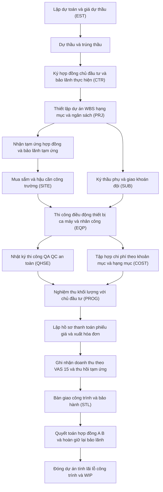
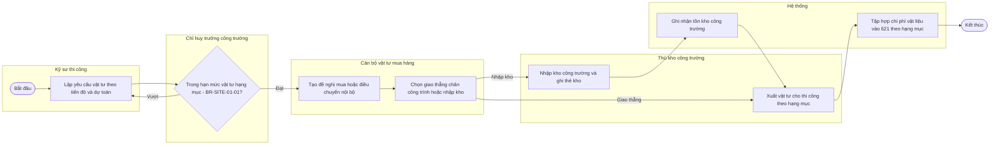
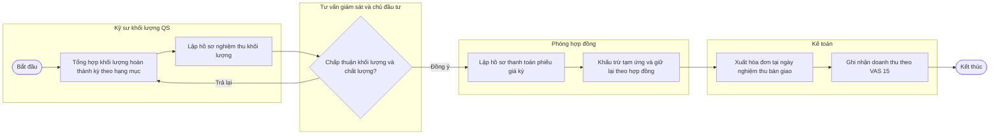
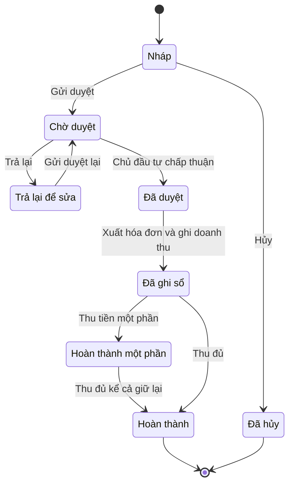
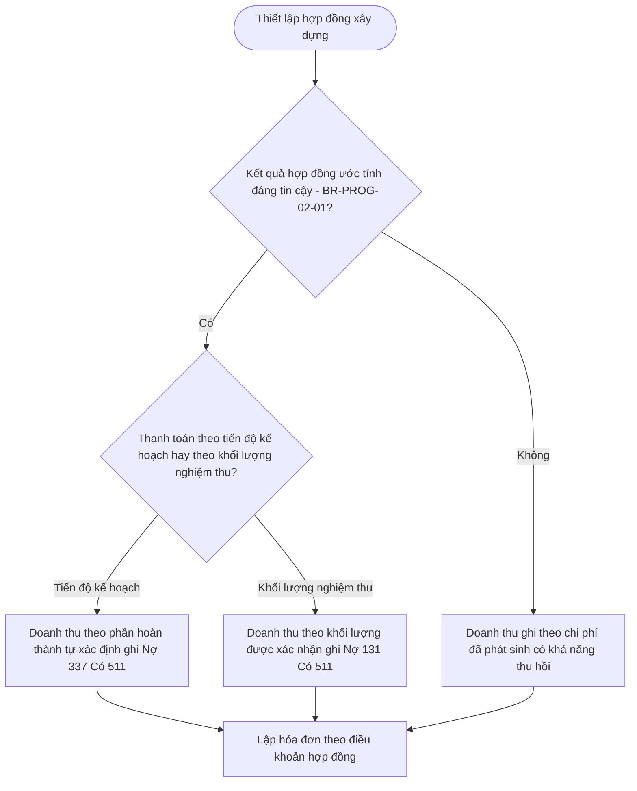

# Ngành Xây dựng — kiến thức nghiệp vụ cho BA ERP

> **Cập nhật đến: 2026-10-20 — quy định thay đổi thường xuyên; BA phải kiểm tra lại hiệu lực khi dùng cho dự án.** Khung pháp lý xây dựng vừa thay mới toàn bộ: **Luật Xây dựng số 135/2025/QH15 có hiệu lực 01/07/2026** (thay Luật Xây dựng 2014/2020) cùng bộ nghị định hướng dẫn 2026 (NĐ 206, 207, 210, 217/2026) thay cho các nghị định 2021. Nhiều bài viết trên mạng vẫn mô tả khung cũ (NĐ 10/2021, 06/2021, 37/2015, 15/2021 → 175/2024) — phải phân biệt rõ khi tra cứu.
>
> **Phạm vi:** đặc thù nghiệp vụ ngành xây dựng cho cả **nhà thầu thi công (construction contractor)** và **chủ đầu tư / nhà phát triển (investor / developer)**. File này chỉ bổ sung phần ĐẶC THÙ ngành; phần nền tảng dùng chung được liên kết tới file khác, **không chép lại**:
> - Quản lý dự án & kế toán dự án tổng quát (WBS, ngân sách, POC, WIP, dự án lỗ, giữ lại cơ bản) → `references/processes/project-management.md`.
> - Tính giá thành & phân bổ chi phí chung → `references/processes/costing.md`; lập & kiểm soát ngân sách → `references/processes/budgeting.md`.
> - Mua hàng (PR→RFQ→PO→nhận→hóa đơn) → `references/processes/p2p-procure-to-pay.md`; kho & tồn kho → `references/processes/inventory-warehouse.md`.
> - Bán & công nợ phải thu → `references/processes/o2c-order-to-cash.md`, `ar-accounts-receivable.md`; công nợ phải trả → `ap-accounts-payable.md`.
> - Chế độ kế toán, hệ thống tài khoản, VAS → `references/regulations/vn-accounting.md`.
> - Hóa đơn điện tử, thời điểm xuất hóa đơn, thuế GTGT → `references/regulations/vn-tax-einvoice.md`, `references/processes/tax-einvoice.md`.
> - Lao động, khoán, BHXH → `references/regulations/vn-labor-payroll.md`, `references/processes/hr-payroll.md`.
> - TSCĐ & XDCB dở dang (phía chủ đầu tư) → `references/processes/fixed-assets.md`.

## Mục lục
- [1. Tổng quan ngành & mô hình kinh doanh](#1-tổng-quan-ngành--mô-hình-kinh-doanh)
- [2. Quy định pháp lý liên quan](#2-quy-định-pháp-lý-liên-quan)
- [3. Bản đồ quy trình đầu-cuối của ngành](#3-bản-đồ-quy-trình-đầu-cuối-của-ngành)
- [4. Chi tiết từng quy trình đặc thù](#4-chi-tiết-từng-quy-trình-đặc-thù)
- [5. Danh mục (master data) đặc thù ngành](#5-danh-mục-master-data-đặc-thù-ngành)
- [6. Module & chức năng chuẩn cho ERP ngành](#6-module--chức-năng-chuẩn-cho-erp-ngành)
- [7. Báo cáo & KPI ngành](#7-báo-cáo--kpi-ngành)
- [8. Đối thủ / sản phẩm tham chiếu](#8-đối-thủ--sản-phẩm-tham-chiếu)
- [9. Thuật ngữ ngành](#9-thuật-ngữ-ngành)
- [10. Câu hỏi khảo sát khách hàng của ngành](#10-câu-hỏi-khảo-sát-khách-hàng-của-ngành)
- [11. Rủi ro & lỗi thường gặp khi phân tích ngành này](#11-rủi-ro--lỗi-thường-gặp-khi-phân-tích-ngành-này)
- [12. Nguồn tham khảo](#12-nguồn-tham-khảo)

---

## 1. Tổng quan ngành & mô hình kinh doanh

### 1.1. Phân khúc & loại khách hàng của phần mềm
Phần mềm ERP ngành xây dựng phục vụ bốn nhóm chủ thể, nghiệp vụ lõi khác nhau rõ rệt — BA phải xác định **đúng vai của khách hàng** trước khi đặc tả:

| Nhóm | Tên (EN) | Đặc thù nghiệp vụ chi phối thiết kế |
|---|---|---|
| Nhà thầu thi công | Construction Contractor (General Contractor – GC, Subcontractor) | Trúng thầu → thi công → **nghiệm thu khối lượng** → thanh toán theo tiến độ; chi phí tập hợp theo công trình/hạng mục (TK 621/622/623/627 → 154); doanh thu theo **VAS 15**; thầu phụ, ca máy, khoán đội |
| Chủ đầu tư / Ban QLDA | Investor / Project Management Unit (PMU) | Lập **tổng mức đầu tư**, dự toán; ký & thanh toán hợp đồng cho nhà thầu; vốn hóa chi phí vào **TK 241 (XDCB dở dang)**; **quyết toán vốn đầu tư**; (vốn NSNN: tuân thủ chặt NĐ 206/2026 về chi phí) |
| Nhà phát triển BĐS | Real Estate Developer | Xây để bán: chi phí dự án vào **TK 154/155/156 (BĐS)**; doanh thu bán BĐS theo **VAS 14** (không phải VAS 15); vốn hóa lãi vay (**VAS 16**); kết hợp CRM bán hàng — xem `references/processes/crm-service.md` |
| Tư vấn xây dựng | Consultant (Design, QS, Supervision) | Hợp đồng dịch vụ theo mốc/khối lượng; gần với dự án dịch vụ — chủ yếu dùng `references/processes/project-management.md` + phần dự toán ở đây |

> Một doanh nghiệp thường **kiêm nhiều vai** (vừa đầu tư vừa tự thi công; tổng thầu kiêm thầu phụ). Thiết kế ERP phải cho một công trình gắn **cả hai hồ sơ**: hồ sơ phía A (chủ đầu tư) và hồ sơ phía B (nhà thầu).

### 1.2. Phân loại theo loại công trình (ảnh hưởng định mức, cấp công trình, bảo hành)
Dân dụng & công nghiệp (buildings), hạ tầng kỹ thuật, giao thông (đường, cầu, hầm), thủy lợi, năng lượng, cơ điện công trình (Mechanical Electrical Plumbing – MEP). **Cấp công trình** (construction grade) quyết định thời hạn bảo hành, yêu cầu quản lý chất lượng, thẩm quyền thẩm định — phân cấp theo Thông tư của Bộ Xây dựng [4][6].

### 1.3. Chuỗi giá trị & đặc điểm kinh tế
Chuẩn bị đầu tư (chủ trương, khảo sát, thiết kế cơ sở, tổng mức đầu tư) → Thực hiện đầu tư (thiết kế kỹ thuật/bản vẽ thi công, **dự toán**, **đấu thầu**, **thi công & giám sát**, **nghiệm thu**) → Kết thúc (bàn giao, **bảo hành**, **quyết toán**, vận hành).

Đặc điểm kinh tế chi phối ERP:
1. **Sản xuất đơn chiếc, dài hạn, theo đơn đặt hàng** — mỗi công trình là một "nhà máy" riêng; không có tồn kho thành phẩm hàng loạt.
2. **Công trường phân tán nhiều địa điểm** — kho công trường riêng, giao thẳng vật tư tới chân công trình, kết nối offline/đồng bộ dữ liệu hiện trường.
3. **Chi phí & doanh thu theo công trình/hạng mục** — mọi nghiệp vụ gắn chiều phân tích Công trình × Hạng mục × Khoản mục chi phí.
4. **Dòng tiền theo tiến độ** — tạm ứng, nghiệm thu khối lượng, thu hồi tạm ứng, **giữ lại (retention)**, **bảo lãnh ngân hàng**.
5. **Nhiều tầng thầu phụ & khoán đội** — chi phí nhân công thường qua hợp đồng giao khoán.
6. **Rủi ro biến động giá vật liệu** — hợp đồng điều chỉnh giá theo **chỉ số giá xây dựng**.
7. **WIP (chi phí dở dang) lớn và kéo dài qua nhiều kỳ** — ghi nhận doanh thu/giá vốn theo mức độ hoàn thành (percentage of completion).

---

## 2. Quy định pháp lý liên quan

> Chế độ kế toán áp dụng cho ví dụ hạch toán: **Thông tư 99/2025/TT-BTC** (hiệu lực 01/01/2026, thay Thông tư 200/2014) với doanh nghiệp nói chung; doanh nghiệp nhỏ và vừa dùng **TT 133/2016**; siêu nhỏ dùng **TT 58/2026** (từ 01/07/2026) — xem `references/regulations/vn-accounting.md` §2. Số hiệu tài khoản dưới đây theo TT99/2025.

| Văn bản | Nội dung chính liên quan hệ thống | Hiệu lực | Tình trạng (2026-10-20) | Ảnh hưởng thiết kế |
|---|---|---|---|---|
| **Luật Xây dựng 135/2025/QH15** [1] | Quản lý hoạt động đầu tư xây dựng: dự án, thiết kế, dự toán, giấy phép, hợp đồng, chất lượng, chi phí; chuyển sang quản lý rủi ro & hậu kiểm | 01/07/2026 (một số điều từ 01/01/2026) | **Còn hiệu lực — luật nền hiện hành**; thay Luật XD 50/2014 & 62/2020 | Khung chủ đạo; mọi quy trình dự toán/hợp đồng/nghiệm thu bám theo luật này và 4 nghị định dưới |
| Luật Xây dựng 50/2014/QH13 (sửa bởi 62/2020/QH14) [2] | Khung cũ | 2015 / 2021 | **Hết hiệu lực từ 01/07/2026** (thay bởi 135/2025) | Chỉ áp dụng cho dự án/hợp đồng chuyển tiếp ký trước 01/07/2026 |
| **NĐ 206/2026/NĐ-CP** [3] | Quản lý **chi phí đầu tư xây dựng**: tổng mức đầu tư, dự toán, giá gói thầu, định mức, giá xây dựng, chỉ số giá, chi phí QLDA/tư vấn | 01/07/2026 | Còn hiệu lực; **thay NĐ 10/2021** (căn cứ Điều 74, khoản 7 Điều 76 Luật XD 135/2025) | Cấu trúc dự toán, bộ định mức/đơn giá, cơ chế điều chỉnh giá theo chỉ số giá |
| **NĐ 207/2026/NĐ-CP** [4] | Quản lý **chất lượng, thi công xây dựng và bảo trì công trình**; bổ sung điều riêng về ứng dụng CNTT và **BIM** trong quản lý thi công/nghiệm thu | 01/07/2026 | Còn hiệu lực; **thay NĐ 06/2021** (Điều 52) | Quy trình nghiệm thu chất lượng, nhật ký thi công, hồ sơ quản lý chất lượng, bảo hành, cấp công trình |
| **NĐ 210/2026/NĐ-CP** [5] | **Hợp đồng xây dựng**: loại hợp đồng, tạm ứng, thanh toán, điều chỉnh giá, bảo lãnh, giữ lại, ban xử lý tranh chấp (DAB/DRB), hợp đồng điện tử | 01/07/2026 | Còn hiệu lực; **thay NĐ 37/2015 và NĐ 50/2021** (căn cứ Điều 82, khoản 4 Điều 83 Luật XD 135/2025) | Quản lý hợp đồng, tạm ứng/thu hồi, giữ lại, bảo lãnh, phụ lục phát sinh |
| NĐ 217/2026/NĐ-CP [6] ⚠️ CHƯA XÁC MINH đầy đủ số điều | Quản lý **hoạt động xây dựng**: thẩm định, cấp phép xây dựng, điều kiện năng lực, chứng chỉ hành nghề | 01/07/2026 | Còn hiệu lực; **thay NĐ 175/2024** [7] (vốn đã thay NĐ 15/2021) | Danh mục công trình miễn phép, hồ sơ thẩm định, chứng chỉ năng lực của nhà thầu |
| TT 38/2026/TT-BXD [8] | Ban hành **định mức xây dựng** (8 phụ lục) | 01/07/2026 | Còn hiệu lực; thay TT 12/2021 (và 09/2024, 08/2025, Điều 2 TT 60/2025) | Dữ liệu định mức dựng sẵn cho dự toán |
| TT 36/2026/TT-BXD; TT 37/2026/TT-BXD [9] ⚠️ CHƯA XÁC MINH | Phương pháp xác định chi phí đầu tư xây dựng (thay TT 11/2021); phương pháp xác định định mức, giá ca máy, chỉ số giá (thay TT 13/2021) | 01/07/2026 | Các nguồn thứ cấp chưa thống nhất số hiệu | Công thức lập dự toán, giá ca máy, đo bóc khối lượng |
| **Chế độ kế toán TT 99/2025/TT-BTC** [11] | Hệ thống tài khoản, trong đó giữ **TK 623 (chi phí sử dụng máy thi công)** và **TK 337 (thanh toán theo tiến độ hợp đồng xây dựng)** | 01/01/2026 | Còn hiệu lực (thay TT 200/2014) | Xem `references/regulations/vn-accounting.md`; §4.11 bên dưới |
| **VAS 15 — Chuẩn mực KT số 15 "Hợp đồng xây dựng"** (QĐ 165/2002/QĐ-BTC) [10] | Ghi nhận **doanh thu & chi phí hợp đồng xây dựng theo mức độ hoàn thành**; dự phòng khoản lỗ hợp đồng | 2003 | Còn hiệu lực (chuẩn mực áp dụng cho nhà thầu); điều kiện ghi nhận áp dụng thống nhất trong TT99/TT200 [10] | Hai phương pháp ghi nhận doanh thu — §4.8, §4.11 |
| HĐ điện tử (NĐ 254/2026/NĐ-CP, TT 91/2026/TT-BTC) [12] | **Thời điểm lập hóa đơn xây dựng/lắp đặt = thời điểm nghiệm thu, bàn giao** công trình/hạng mục/khối lượng, không phân biệt đã thu tiền | 01/07/2026 | Còn hiệu lực (khung HĐĐT hiện hành) | Xem `references/regulations/vn-tax-einvoice.md` §4 — suy thời điểm hóa đơn từ sự kiện nghiệm thu |
| Giảm thuế GTGT 10%→8% (NQ 204/2025/QH15, NĐ 174/2025/NĐ-CP) [13] | Xây dựng/lắp đặt thuộc nhóm 10% được giảm còn 8% có thời hạn (có danh mục loại trừ) | 01/07/2025 – hết 31/12/2026 | Còn hiệu lực, hết hạn 31/12/2026 | Thuế suất **effective-dated**, tự quay 10% từ 01/01/2027 — xem `references/regulations/vn-tax-einvoice.md` §2.2 |

> **Hệ quả thiết kế then chốt:** mọi dự án/hợp đồng ký trước 01/07/2026 chạy theo khung cũ (chuyển tiếp), ký từ 01/07/2026 chạy theo khung mới. ERP phải cho phép **gắn "bộ quy định áp dụng" theo ngày/theo hợp đồng** (định mức, cơ chế tạm ứng, bảo hành) thay vì hard-code một mốc.

---

## 3. Bản đồ quy trình đầu-cuối của ngành

Danh sách quy trình lõi (phía nhà thầu — mã BP minh họa):
1. BP-CON-01 — Lập dự toán & giá dự thầu (estimating & bidding).
2. BP-CON-02 — Ký hợp đồng chủ đầu tư, bảo lãnh thực hiện, tạm ứng & bảo lãnh tạm ứng.
3. BP-CON-03 — Thiết lập dự án thi công: WBS/hạng mục & ngân sách từ dự toán.
4. BP-CON-04 — Hậu cần công trường: yêu cầu vật tư → mua sắm → kho công trường/giao thẳng → xuất thi công.
5. BP-CON-05 — Thiết bị & ca máy thi công (own vs rented, machine shift).
6. BP-CON-06 — Nhân công & giao khoán đội (labor package).
7. BP-CON-07 — Thầu phụ: hợp đồng → nghiệm thu → thanh toán → giữ lại.
8. BP-CON-08 — Nghiệm thu khối lượng với chủ đầu tư → hồ sơ thanh toán (phiếu giá) → hóa đơn → doanh thu (VAS 15).
9. BP-CON-09 — Tập hợp chi phí theo khoản mục & hạng mục; WIP; ngân sách so thực tế.
10. BP-CON-10 — Nhật ký thi công, QA/QC, an toàn (HSE), quản lý bản vẽ & RFI.
11. BP-CON-11 — Bàn giao, bảo hành, quyết toán hợp đồng (A-B), đóng dự án, lãi lỗ công trình.

> Phía **chủ đầu tư** đảo chiều: lập tổng mức đầu tư/dự toán → tổ chức đấu thầu chọn nhà thầu → ký hợp đồng (phía A) → tạm ứng/nghiệm thu/thanh toán cho nhà thầu → tập hợp chi phí vào **TK 241** → quyết toán vốn đầu tư → kết chuyển TSCĐ hoặc BĐS (§4.11).

---

## 4. Chi tiết từng quy trình đặc thù

Mỗi quy trình nêu: vai trò, chứng từ, các bước, trạng thái, quy tắc, hạch toán đặc thù, tham số, báo cáo. Vòng đời & hành động phân quyền dùng **bộ mã chuẩn** (`references/conventions.md` §6).

### 4.1. Lập dự toán & giá dự thầu (Estimating & Bidding)
**Vai trò:** Kỹ sư dự toán/QS (Quantity Surveyor – ROLE-CON-QS), Phòng Kinh tế-Kế hoạch/Hợp đồng (ROLE-CON-COMM), Giám đốc (ROLE-DIR duyệt giá bỏ thầu).
**Chứng từ:** Hồ sơ dự toán (Cost Estimate – DOC-EST), Bảng tiên lượng/khối lượng mời thầu (Bill of Quantities – BOQ), Giá dự thầu (Bid Price – DOC-BIDPRICE).

**Các khái niệm nền (BA phải nắm):**
- **Định mức dự toán (norm):** hao phí chuẩn vật liệu, nhân công, máy thi công cho một đơn vị khối lượng công tác (ví dụ 1 m³ bê tông) — do Bộ Xây dựng ban hành (TT 38/2026) [8], có thể lập định mức riêng.
- **Đơn giá xây dựng (unit price):** = định mức × giá vật liệu/nhân công/giá ca máy tại thời điểm, theo khu vực.
- **Đo bóc khối lượng (quantity take-off):** bóc tách khối lượng từng công tác từ bản vẽ → nhân đơn giá.
- **Cấu trúc chi phí dự toán xây dựng** (theo NĐ 206/2026 + TT 36/2026 [3][9], ⚠️ cấu trúc chi tiết phải đối chiếu TT 36/2026): chi phí trực tiếp (vật liệu + nhân công + máy thi công) → chi phí gián tiếp/chi phí chung → thu nhập chịu thuế tính trước → thuế GTGT → chi phí dự phòng.
- **Tổng mức đầu tư (Total Investment)** (phía chủ đầu tư) = bồi thường, GPMB + chi phí xây dựng + chi phí thiết bị + chi phí QLDA + chi phí tư vấn ĐTXD + chi phí khác + dự phòng.

**Các bước:** (1) Nhận mời thầu/BOQ của chủ đầu tư → (2) Đo bóc khối lượng từ bản vẽ → (3) Gán định mức & đơn giá (chọn **bộ định mức/đơn giá áp dụng** PRM-EST-001) → (4) Tổng hợp chi phí trực tiếp + gián tiếp + thu nhập chịu thuế + thuế → (5) Phân tích đơn giá chi tiết (Detailed Unit Price Analysis) → (6) Lập **giá dự thầu** (có thể ≠ dự toán do chiến lược bỏ thầu) → (7) Duyệt (ROLE-DIR) → (8) Nộp thầu → trúng/trượt.
**Trạng thái DOC-EST / DOC-BIDPRICE:** DRAFT → PENDING → APPROVED → (trúng) chuyển thành ngân sách dự án; hoặc REJECTED/CLOSED (trượt).
**Quy tắc:** BR — giá dự thầu KHÔNG ĐƯỢC thấp hơn chi phí trực tiếp + thuế (chống bỏ thầu dưới giá thành) trừ khi Giám đốc duyệt ngoại lệ có lý do. BR — mọi khối lượng bóc phải tham chiếu bản vẽ (phiên bản) và mã công tác định mức.
**Hạch toán:** chưa phát sinh bút toán (chi phí lập hồ sơ dự thầu → 642/627 nếu trọng yếu). **Tham số:** PRM-EST-001 (bộ định mức/đơn giá theo tỉnh, theo ngày), PRM-EST-002 (tỷ lệ chi phí chung, thu nhập chịu thuế tính trước), PRM-EST-003 (nguồn chỉ số giá). **Báo cáo:** RPT-EST-01 (tổng hợp dự toán theo khoản mục), so sánh dự toán ↔ giá dự thầu ↔ (sau này) chi phí thực tế.

### 4.2. Thiết lập dự án thi công: WBS/hạng mục & ngân sách từ dự toán
Khi trúng thầu, **dự toán trúng thầu trở thành ngân sách gốc (baseline budget)** của dự án. Đây là mắt xích chống trôi dạt quan trọng nhất của ngành.
**Các bước:** (1) Tạo **Công trình (Project/Work)** và cây **Hạng mục (Work Item)** + **WBS (Work Breakdown Structure)** → (2) Nạp ngân sách theo **Khoản mục chi phí (Cost Element)**: vật liệu/nhân công/máy/chung, theo từng hạng mục → (3) Khóa baseline; thay đổi sau đó phải qua **phụ lục/điều chỉnh (variation)** có vết → (4) Gắn hợp đồng phía A (chủ đầu tư) và kế hoạch tiến độ (schedule, có thể tích hợp Primavera P6/MS Project [15]).
**Quy tắc:** BR — mọi chứng từ chi phí (mua vật tư, ca máy, lương, thầu phụ) PHẢI gắn **Công trình × Hạng mục × Khoản mục**; không cho ghi chi phí "treo" ngoài hạng mục. BR — tổng ngân sách hạng mục = dự toán trúng thầu ± phụ lục đã duyệt. Nền WBS/ngân sách/kiểm soát khả dụng: xem `references/processes/project-management.md` §3–§5 và `budgeting.md`.

### 4.3. Hợp đồng chủ đầu tư, tạm ứng, bảo lãnh, phát sinh (phía B)
**Vai trò:** Phòng Hợp đồng/Thương mại (ROLE-CON-COMM), Kế toán (ROLE-CON-ACC), Giám đốc (ROLE-DIR).
**Chứng từ:** Hợp đồng chính (Prime/Main Contract – DOC-CONTRACT), Phụ lục hợp đồng (Contract Appendix / Variation – DOC-APPENDIX), Đề nghị & chứng từ tạm ứng (Advance – DOC-ADVANCE), Theo dõi bảo lãnh (Guarantee – DOC-GUARANTEE).

**Loại hợp đồng (NĐ 210/2026 [5]):** trọn gói (lump-sum), đơn giá cố định, đơn giá điều chỉnh (theo chỉ số giá), theo thời gian, EPC/chìa khóa trao tay. **Điều khoản ERP phải mô hình hóa:** giá trị, cơ chế điều chỉnh giá, tỷ lệ & điều kiện tạm ứng, tiến độ thanh toán, tỷ lệ giữ lại, tiền/thời hạn bảo hành, phạt chậm tiến độ, các loại bảo lãnh.

**Ba loại bảo lãnh (bank guarantee) phải theo dõi riêng (giá trị, ngày phát hành, ngày hết hiệu lực, ngân hàng, phí):**
1. **Bảo lãnh thực hiện hợp đồng (Performance Guarantee)** — thường một tỷ lệ % giá hợp đồng, hiệu lực đến khi hết nghĩa vụ thi công.
2. **Bảo lãnh tạm ứng (Advance Payment Guarantee)** — theo NĐ 210/2026 phải duy trì giá trị đến khi bên giao thầu thu hồi hết tiền tạm ứng [5].
3. **Bảo lãnh bảo hành (Warranty Guarantee)** — trong thời gian bảo hành, có thể thay cho tiền giữ lại bảo hành.

**Tạm ứng & thu hồi:** mức tạm ứng tối thiểu/tối đa theo loại hợp đồng và nguồn vốn (ví dụ tối thiểu ≥10% với EPC/chìa khóa trao tay) — **đặt là tham số, KHÔNG hard-code** vì các nguồn thứ cấp chưa thống nhất trần tạm ứng của NĐ 210/2026 (30% hay 50%) ⚠️ CHƯA XÁC MINH, phải đối chiếu bản gốc [5]. Tạm ứng được **thu hồi dần** bằng cách khấu trừ theo tỷ lệ trên mỗi hồ sơ thanh toán khối lượng.

**Phát sinh (variation):** khối lượng phát sinh tăng/giảm, công tác mới, đơn giá mới → lập **phụ lục** → duyệt → cập nhật ngân sách & giá trị hợp đồng. BR — KHÔNG ĐƯỢC nghiệm thu/thanh toán khối lượng phát sinh chưa có phụ lục duyệt (trừ lệnh khẩn có cơ chế hồi tố).

**Tham số:** PRM-CTR-001 (trần tạm ứng), PRM-CTR-002 (mức tạm ứng tối thiểu theo loại HĐ), PRM-CTR-003 (tỷ lệ thu hồi tạm ứng), PRM-CTR-004 (tỷ lệ giữ lại mặc định), PRM-CTR-005 (thời hạn & tiền bảo hành theo cấp công trình). **Báo cáo:** RPT-CTR-01 (tạm ứng & thu hồi, giữ lại theo HĐ), RPT-CTR-02 (theo dõi bảo lãnh & cảnh báo sắp hết hiệu lực).

### 4.4. Hậu cần công trường: yêu cầu vật tư → mua sắm → kho công trường → xuất thi công
**Vai trò:** Kỹ sư thi công (Site Engineer – ROLE-CON-ENG), Chỉ huy trưởng công trường (Site Commander/Construction Manager – ROLE-CON-SITEMGR), Cán bộ vật tư (Material Officer – ROLE-CON-MAT), Thủ kho công trường (Site Storekeeper – ROLE-CON-STORE).
**Chứng từ:** Yêu cầu vật tư công trường (Site Material Request – DOC-MR), Phiếu nhập kho công trường (Site Goods Receipt – DOC-GRN-SITE), Phiếu xuất vật tư cho thi công (Material Issue – DOC-MI).

Đặc thù: (a) nhu cầu vật tư **suy từ khối lượng × định mức** của hạng mục sắp thi công; (b) **kho theo công trường** (mỗi công trình một hoặc nhiều kho); (c) cho phép **giao thẳng chân công trình (direct delivery)** không nhập kho khi vật tư rời (cát, đá, bê tông thương phẩm) — vẫn phải ghi nhận chi phí theo hạng mục; (d) **điều chuyển nội bộ giữa các công trường**. Nền mua hàng & tồn kho: `references/processes/p2p-procure-to-pay.md`, `references/processes/inventory-warehouse.md` — ở đây chỉ nêu chiều phân tích theo hạng mục và cơ chế giao thẳng.

**Quy tắc:** BR-SITE — yêu cầu vật tư cảnh báo khi lũy kế vượt khối lượng × định mức của hạng mục (kiểm soát thất thoát). BR — xuất kho ghi nhận theo phương pháp tính giá đã chọn (bình quân/FIFO — ngành xây dựng chỉ dùng **kê khai thường xuyên** [10]). **Hạch toán:** xuất vật tư cho thi công: **Nợ 621 / Có 152** (chi tiết Công trình × Hạng mục). **Báo cáo:** RPT-SITE-01 (nhập-xuất-tồn vật tư công trường), đối chiếu tiêu hao thực tế ↔ định mức.

### 4.5. Thiết bị & ca máy thi công (Plant & Equipment / Machine Shifts)
**Vai trò:** Quản lý thiết bị/cơ giới (Plant/Equipment Manager – ROLE-CON-PLANT), vận hành, kế toán.
**Chứng từ:** Lệnh điều động thiết bị, Nhật ký/Bảng kê ca máy (Machine Shift Log – DOC-MACHINELOG).
Phân biệt **máy sở hữu (own)** và **máy thuê ngoài (rented)**; đo theo **ca máy (machine shift)** hoặc giờ máy.
- **Máy sở hữu:** chi phí ca máy = khấu hao + nhiên liệu + nhân công vận hành + sửa chữa + dụng cụ → tập hợp vào **TK 623 (chi phí sử dụng máy thi công)** theo tiểu khoản: 6231 nhân công điều khiển, 6232 nhiên liệu/vật liệu, 6233 dụng cụ, 6234 khấu hao máy thi công, 6237 dịch vụ mua ngoài, 6238 chi phí khác.
- **Máy thuê ngoài theo ca:** **Nợ 623 (6237) / Nợ 133 / Có 331** (theo bảng kê ca máy đã xác nhận).
**Quy tắc:** BR — mỗi ca máy phải gắn Công trình × Hạng mục; đối chiếu nhật ký ca máy với nhiên liệu cấp phát. **Tham số:** PRM-EQP-001 (số giờ/ca chuẩn, phương pháp tính giá ca máy). **Báo cáo:** RPT-EQP-01 (nhật ký, hiệu suất ca máy, chi phí máy theo công trình). Quản lý tài sản máy móc (mua, khấu hao, thanh lý) dùng `references/processes/fixed-assets.md`.

### 4.6. Nhân công & giao khoán đội (Labor & Crew Packages)
**Vai trò:** Chỉ huy trưởng, Đội trưởng thi công (Crew Leader – ROLE-CON-CREW), Kế toán, HR.
Hai hình thức: (a) nhân công trực tiếp của công ty (chấm công → lương → **TK 622**); (b) **giao khoán (labor subcontract/piecework)** cho đội/tổ theo khối lượng hoặc theo hạng mục — phổ biến nhất.
**Chứng từ:** Hợp đồng/Phiếu giao khoán (Labor Package Contract – DOC-KHOAN), Biên bản nghiệm thu khối lượng khoán, Bảng thanh toán khoán.
**Các bước khoán:** giao khoán theo đơn giá khoán/khối lượng → đội thi công → nghiệm thu khối lượng khoán → tạm ứng cho đội (TK 141) → thanh toán quyết toán khoán → giữ lại (nếu có).
**Hạch toán:** tạm ứng cho đội: **Nợ 141 / Có 111,112**; nghiệm thu & tính chi phí nhân công khoán: **Nợ 622 (hoặc 627) / Có 334,331,141**. (Nếu đội là nhà thầu phụ pháp nhân → xem §4.7, dùng 331.)
**Quy tắc:** BR — thanh toán khoán KHÔNG ĐƯỢC vượt khối lượng nghiệm thu × đơn giá khoán của phiếu giao khoán đã duyệt. Ràng buộc lao động, BHXH, thuế TNCN của nhân công & đội khoán: xem `references/regulations/vn-labor-payroll.md`.

### 4.7. Thầu phụ (Subcontractor): hợp đồng → nghiệm thu → thanh toán → giữ lại
**Vai trò:** Phòng Hợp đồng, Chỉ huy trưởng (nghiệm thu), Kế toán công nợ phải trả (AP Accountant – ROLE-AP).
**Chứng từ:** Hợp đồng thầu phụ (Subcontract – DOC-SUBCONTRACT), Biên bản nghiệm thu & thanh toán thầu phụ (DOC-SUBACC).
Thầu phụ cũng có **tạm ứng, nghiệm thu khối lượng, giữ lại, bảo hành** — là "gương" của quan hệ với chủ đầu tư nhưng ở chiều phải trả.
**Hạch toán (đặt tính là nhà thầu phụ pháp nhân):**

| Nghiệp vụ | Nợ | Có | Ghi chú |
|---|---|---|---|
| Tạm ứng cho thầu phụ | 331 (chi tiết tạm ứng) | 112 | Theo bảo lãnh tạm ứng của thầu phụ |
| Nghiệm thu khối lượng thầu phụ (giá trị thi công) | 154 (chi tiết hạng mục) / hoặc 627 | 331 | Cộng VAT đầu vào vào 133; chọn khoản mục chi phí thầu phụ theo cấu hình PRM-COST-001 |
| VAT đầu vào | 133 | 331 | Hóa đơn thầu phụ |
| Thu hồi tạm ứng khi thanh toán | 331 (tạm ứng) | 331 (phải trả) | Khấu trừ nội bộ công nợ |
| Thanh toán (phần không giữ lại) | 331 | 112 | |
| Giữ lại chờ bảo hành (ví dụ 5%) | — | 331 (chi tiết giữ lại) | Treo đến hết bảo hành rồi trả nốt |

**Quy tắc:** BR — giá trị nghiệm thu thầu phụ cấu thành chi phí công trình, phải gắn đúng Công trình × Hạng mục; BR — không thanh toán vượt giá trị nghiệm thu trừ tạm ứng và giữ lại. **Báo cáo:** RPT-SUB-01 (công nợ, nghiệm thu, giữ lại thầu phụ). Nền công nợ phải trả: `references/processes/ap-accounts-payable.md`.

### 4.8. Nghiệm thu khối lượng với chủ đầu tư → hồ sơ thanh toán → hóa đơn → doanh thu (VAS 15)
Đây là quy trình **tạo doanh thu** của nhà thầu — đặc thù nhất của ngành.
**Vai trò:** Kỹ sư khối lượng/QS (ROLE-CON-QS), Tư vấn giám sát (Construction Supervision Consultant – ROLE-CON-CSC) & Chủ đầu tư (xác nhận), Phòng Hợp đồng, Kế toán.
**Chứng từ:** Biên bản nghiệm thu khối lượng hoàn thành (Volume/Work Acceptance – DOC-VACC), Hồ sơ thanh toán / **Phiếu giá** (Interim Payment Certificate – IPC – DOC-IPC), Hóa đơn GTGT.

**Các bước:** (1) QS tổng hợp khối lượng hoàn thành kỳ theo hạng mục → (2) Lập hồ sơ nghiệm thu, tư vấn giám sát & chủ đầu tư xác nhận khối lượng + chất lượng → (3) Lập hồ sơ thanh toán (phiếu giá) = Σ(khối lượng × đơn giá) ± phát sinh → (4) **Khấu trừ tạm ứng & giữ lại** theo hợp đồng → (5) Chủ đầu tư duyệt giá trị thanh toán → (6) **Xuất hóa đơn tại ngày nghiệm thu/bàn giao** (không phân biệt đã thu tiền [12]) → (7) Ghi nhận doanh thu theo VAS 15 → (8) Theo dõi thu tiền.

Vòng đời hồ sơ thanh toán khối lượng (phiếu giá / IPC):

**Quy tắc then chốt:**
- BR-PROG — giá trị thanh toán KHÔNG ĐƯỢC vượt (khối lượng nghiệm thu × đơn giá hợp đồng) + phát sinh đã duyệt.
- BR-PROG — thời điểm xuất hóa đơn = ngày nghiệm thu/bàn giao khối lượng, **không phân biệt đã thu tiền** [12] (suy từ sự kiện nghiệm thu, cảnh báo xuất trễ).
- BR-PROG — mỗi hồ sơ thanh toán tự động tính **thu hồi tạm ứng** (PRM-CTR-003) và **giữ lại** (PRM-CTR-004).
- BR-PROG — khối lượng lũy kế nghiệm thu không vượt khối lượng hợp đồng + phụ lục.

**Tham số:** PRM-PROG-001 (phương pháp ghi nhận doanh thu theo hợp đồng), PRM-PROG-002 (ngưỡng duyệt phiếu giá theo giá trị). **Báo cáo:** RPT-PROG-01 (giá trị khối lượng hoàn thành & đề nghị thanh toán kỳ), RPT-PROG-02 (sản lượng kế hoạch so thực tế).

### 4.9. Tập hợp chi phí, WIP & ngân sách so thực tế (Job Costing)
Mọi chi phí (vật liệu 621, nhân công 622, máy thi công 623, chung 627) tập hợp theo **Công trình × Hạng mục × Khoản mục**, kết chuyển về **TK 154 (chi phí sản xuất kinh doanh dở dang)** = **WIP công trình**. Phân bổ chi phí chung 627 về hạng mục theo tiêu thức cấu hình (PRM-COST-002) — chi tiết phương pháp phân bổ xem `references/processes/costing.md`.
**Kiểm soát:** so **ngân sách (baseline từ dự toán) ↔ cam kết (PO/HĐ thầu phụ đã ký) ↔ thực tế (đã ghi sổ)** theo từng hạng mục; cảnh báo vượt ngân sách (PRM-COST-003); dự báo **chi phí hoàn thành (Estimate at Completion – EAC)** và **lãi lỗ dự kiến công trình**. **Báo cáo:** RPT-COST-01 (chi phí theo khoản mục & hạng mục), RPT-COST-02 (budget vs actual + EAC), RPT-COST-04 (dở dang 154 theo công trình).

### 4.10. Nhật ký thi công, QA/QC, an toàn (HSE), bản vẽ & RFI
**Vai trò:** Kỹ sư thi công, Cán bộ QA/QC (ROLE-CON-QAQC), Cán bộ an toàn (HSE Officer – ROLE-CON-HSE), Tư vấn giám sát.
**Chứng từ/đối tượng:** Nhật ký thi công (Site Diary – DOC-SITEDIARY), Biên bản nghiệm thu nội bộ/công việc (Inspection – DOC-IR), Hồ sơ bản vẽ (Drawing Register – DOC-DRAWING), Yêu cầu thông tin (Request for Information – RFI – DOC-RFI), hồ sơ an toàn/sự cố.
Đặc thù: **quản lý phiên bản bản vẽ** (chỉ bản "for construction" mới nhất có hiệu lực), gắn khối lượng/nghiệm thu với phiên bản bản vẽ; **RFI** làm rõ thiết kế có thời hạn trả lời và ảnh hưởng tiến độ; **nhật ký thi công** là căn cứ pháp lý (NĐ 207/2026 [4], bổ sung ứng dụng CNTT/BIM). Hồ sơ quản lý chất lượng là **điều kiện nghiệm thu & quyết toán** — thiếu hồ sơ không thanh toán được. **Báo cáo:** RPT-QHSE-01 (nhật ký & nghiệm thu chất lượng, sự cố an toàn).

### 4.11. Bàn giao, bảo hành, quyết toán & đóng dự án; và hạch toán đặc thù
**Chứng từ:** Biên bản bàn giao đưa vào sử dụng (Handover – DOC-HANDOVER), Hồ sơ bảo hành (Warranty – DOC-WARRANTY), **Quyết toán hợp đồng A-B / quyết toán vốn đầu tư (Final Settlement – DOC-SETTLE)**.
**Các bước:** nghiệm thu hoàn thành → bàn giao → bắt đầu thời hạn bảo hành (theo cấp công trình, PRM-CTR-005) → hết bảo hành → **quyết toán** đối chiếu toàn bộ khối lượng/giá trị thực hiện ↔ hợp đồng → thu nốt giữ lại, hoàn bảo lãnh bảo hành → **đóng dự án**, kết chuyển giá vốn & tính **lãi lỗ công trình**.

#### 4.11.1. Ghi nhận doanh thu hợp đồng xây dựng (VAS 15) — chọn phương pháp theo điều khoản thanh toán

**Hạch toán phía nhà thầu (số hiệu TK theo TT 99/2025 [11]):**

| Nghiệp vụ | Nợ | Có | Ghi chú |
|---|---|---|---|
| Tập hợp chi phí vật liệu trực tiếp | 621 | 152,153,331,111 | Theo Công trình × Hạng mục |
| Tập hợp chi phí nhân công trực tiếp | 622 | 334,141,331 | Gồm nhân công khoán |
| Chi phí sử dụng máy thi công | 623 (6231–6238) | 214,152,334,331,111 | Máy sở hữu & thuê ngoài theo ca |
| Chi phí sản xuất chung | 627 | 214,334,152,331 | Phân bổ về hạng mục (PRM-COST-002) |
| Kết chuyển về dở dang | 154 | 621,622,623,627 | WIP công trình |
| **(a) Thanh toán theo tiến độ kế hoạch** — ghi doanh thu phần hoàn thành tự xác định | 337 | 511 | Không cần hóa đơn tại thời điểm này |
| (a) Khi lập hóa đơn theo tiến độ kế hoạch trong HĐ | 131 | 337, 3331 | Hóa đơn GTGT |
| **(b) Thanh toán theo khối lượng nghiệm thu** — ghi doanh thu khi khối lượng được xác nhận & xuất hóa đơn | 131 | 511, 3331 | **Không** dùng 337 |
| Kết chuyển giá vốn phần hoàn thành | 632 | 154 | Theo mức độ hoàn thành |
| Nhận tạm ứng hợp đồng từ chủ đầu tư | 112 | 131 (hoặc 3387) | Dư Có 131 "tạm ứng"; khấu trừ dần qua phiếu giá |
| Thu hồi tạm ứng (khấu trừ trên phiếu giá) | — | — | Giảm trừ công nợ nội bộ 131, không là bút toán tiền |
| Giữ lại của chủ đầu tư (ví dụ 5%) | 131 (chi tiết giữ lại) | — | Doanh thu vẫn ghi đủ; phần giữ lại là phải thu chưa đến hạn |
| Ký quỹ bảo lãnh (nếu ký quỹ tiền) | 244 (hoặc 1386) | 112 | Giá trị bảo lãnh theo dõi ngoài bảng; phí bảo lãnh → 635/642 |
| Trích trước dự phòng **khoản lỗ hợp đồng** (VAS 15) | 632 | 352 | Khi dự kiến tổng chi phí vượt tổng doanh thu |
| Trích **dự phòng bảo hành công trình** | 627 | 352 (3524) | Theo tỷ lệ PRM-WTY-001 |
| Chi phí bảo hành thực tế phát sinh | 352 (3524) | 111,112,152,334 | Dùng dần quỹ dự phòng |
| Hoàn nhập dự phòng bảo hành còn thừa cuối hạn | 352 (3524) | 711 | |

> Khác biệt chế độ: với doanh nghiệp áp dụng **TT 133/2016 (SME)**, không có 621/622/623/627 — mọi chi phí tập hợp thẳng vào **TK 154** (chi tiết theo khoản mục); vẫn dùng 632, 511, 131, 331, 352. Khi dự án dùng TT133, BA phải ánh xạ lại (xem `references/regulations/vn-accounting.md` §4).

#### 4.11.2. Phía chủ đầu tư / nhà phát triển
- **Chủ đầu tư công trình để dùng/đầu tư công:** chi phí đầu tư (nghiệm thu từ nhà thầu, tư vấn, GPMB) tập hợp vào **TK 241 (xây dựng cơ bản dở dang)**: **Nợ 241 / Nợ 133 / Có 331**; hoàn thành, quyết toán được duyệt → kết chuyển **Nợ 211/213/217… / Có 241** (xem `references/processes/fixed-assets.md`).
- **Nhà phát triển BĐS để bán:** chi phí xây dựng dự án → **TK 154 (chi phí sản xuất BĐS)** → thành phẩm/hàng hóa BĐS (155/156); doanh thu bán BĐS theo **VAS 14** (ghi khi bàn giao đủ điều kiện), **không dùng VAS 15/TK 337**; vốn hóa lãi vay theo **VAS 16**. Kết hợp bán hàng/CRM: `references/processes/crm-service.md`, ghi nhận doanh thu dự án: `references/processes/project-management.md` §8.
- **Quyết toán vốn đầu tư:** đối chiếu tổng mức đầu tư ↔ giá trị quyết toán; là báo cáo bắt buộc với dự án vốn nhà nước.

---

## 5. Danh mục (master data) đặc thù ngành (trường quan trọng)

| Mã | Danh mục (EN) | Trường quan trọng |
|---|---|---|
| MD-PROJECT | Công trình / Dự án (Project / Work) | Mã, tên, chủ đầu tư, loại & **cấp công trình**, địa điểm, nguồn vốn, hợp đồng, ngày khởi công/hoàn thành, bộ quy định áp dụng theo ngày |
| MD-WORKITEM | Hạng mục công trình (Work Item) | Mã, thuộc công trình, cây cha-con, ngân sách, % hoàn thành |
| MD-WBS | Cấu trúc phân rã công việc (WBS) / công tác | Mã WBS, hạng mục, công tác, liên kết tiến độ (P6/MS Project) |
| MD-BOQ | Danh mục công tác dự toán / tiên lượng (BOQ) | Mã công tác, mô tả, đơn vị, khối lượng, đơn giá, định mức tham chiếu |
| MD-NORM | Định mức (Norm) | Mã, bộ định mức (TT 38/2026), hao phí VL/NC/máy, phiên bản, ngày hiệu lực |
| MD-UNITPRICE | Bộ đơn giá (Unit Price Set) | Mã, khu vực/tỉnh, kỳ công bố, giá VL/NC/ca máy |
| MD-MATERIAL | Vật tư xây dựng (Material) | Mã, nhóm, đơn vị, kho công trường, định mức tiêu hao; liên kết `inventory-warehouse.md` |
| MD-PLANT | Thiết bị / xe máy thi công (Plant) | Mã, loại, sở hữu/thuê, nguyên giá/khấu hao (nếu sở hữu), định mức nhiên liệu |
| MD-MACHINERATE | Đơn giá ca máy (Machine Shift Rate) | Mã máy, giá ca máy, số giờ/ca, nguồn (TT 37/2026) |
| MD-SUBCON | Nhà thầu phụ (Subcontractor) | Mã, năng lực/chứng chỉ, điều khoản tạm ứng/giữ lại; liên kết danh mục nhà cung cấp |
| MD-CREW | Đội / tổ thi công (Crew) | Mã đội, đội trưởng, đơn giá khoán, nhân sự |
| MD-CONTRACT | Hợp đồng (Contract) | Mã, phía A/B, loại hợp đồng, giá trị, cơ chế điều chỉnh giá, tỷ lệ tạm ứng/giữ lại/bảo hành, bảo lãnh |
| MD-COSTELEMENT | Khoản mục chi phí (Cost Element) | Mã (VL/NC/MTC/chung/thầu phụ), ánh xạ tài khoản 621/622/623/627/154 |
| MD-PRICEINDEX | Chỉ số giá xây dựng (Price Index) | Kỳ, loại công trình, khu vực, giá trị — dùng điều chỉnh giá HĐ |

---

## 6. Module & chức năng chuẩn cho ERP ngành — feature catalog

| Module | Chức năng | Mô tả | Demo | Sản phẩm đầy đủ |
|---|---|---|---|---|
| EST — Dự toán & Đấu thầu | FN-EST-01 Đo bóc khối lượng & BOQ | Bóc khối lượng theo công tác, gắn bản vẽ | Should | Must |
| EST | FN-EST-02 Thư viện định mức & đơn giá | Nạp/chọn bộ định mức, đơn giá theo tỉnh & ngày | Should | Must |
| EST | FN-EST-03 Lập dự toán & phân tích đơn giá chi tiết | Tổng hợp chi phí trực tiếp/gián tiếp/thuế | Must | Must |
| EST | FN-EST-04 Lập giá dự thầu & hồ sơ dự thầu | Chiến lược giá, so dự toán ↔ giá bỏ thầu | Could | Should |
| PRJ — Thiết lập & kiểm soát dự án | FN-PRJ-01 Tạo công trình, cây hạng mục & WBS | Khởi tạo đối tượng chi phí | Must | Must |
| PRJ | FN-PRJ-02 Nạp ngân sách gốc từ dự toán trúng thầu | Baseline budget theo khoản mục/hạng mục | Must | Must |
| PRJ | FN-PRJ-03 Tích hợp tiến độ (P6/MS Project) | Đồng bộ WBS ↔ lịch thi công | Could | Should |
| CTR — Hợp đồng chủ đầu tư | FN-CTR-01 Quản lý hợp đồng chính & điều khoản | Giá, điều chỉnh giá, tạm ứng, giữ lại, bảo hành | Must | Must |
| CTR | FN-CTR-02 Phụ lục & khối lượng phát sinh (variation) | Điều chỉnh giá trị & ngân sách có vết | Should | Must |
| CTR | FN-CTR-03 Quản lý tạm ứng & thu hồi | Tạm ứng, lịch thu hồi theo tiến độ | Must | Must |
| CTR | FN-CTR-04 Theo dõi bảo lãnh (thực hiện/tạm ứng/bảo hành) | Giá trị, hạn hiệu lực, cảnh báo | Should | Must |
| SITE — Vật tư & kho công trường | FN-SITE-01 Yêu cầu vật tư theo tiến độ & định mức | Suy nhu cầu từ khối lượng × định mức | Must | Must |
| SITE | FN-SITE-02 Kho công trường, giao thẳng & điều chuyển | Nhập-xuất-tồn, direct delivery, chuyển kho | Must | Must |
| SITE | FN-SITE-03 Đối chiếu tiêu hao thực tế ↔ định mức | Cảnh báo thất thoát vật tư | Could | Should |
| EQP — Thiết bị & ca máy | FN-EQP-01 Điều động & nhật ký ca máy | Ghi ca máy theo hạng mục | Should | Must |
| EQP | FN-EQP-02 Tính chi phí ca máy (sở hữu/thuê) → 623 | Tập hợp 6231–6238 | Could | Must |
| SUB — Thầu phụ & khoán | FN-SUB-01 Hợp đồng thầu phụ & giao khoán đội | Điều khoản, đơn giá khoán | Should | Must |
| SUB | FN-SUB-02 Nghiệm thu & thanh toán thầu phụ, giữ lại | Tạm ứng, giữ lại, công nợ 331 | Should | Must |
| PROG — Nghiệm thu & thanh toán | FN-PROG-01 Nghiệm thu khối lượng với chủ đầu tư | Khối lượng kỳ, xác nhận TVGS/CĐT | Must | Must |
| PROG | FN-PROG-02 Hồ sơ thanh toán (phiếu giá/IPC) | Khấu trừ tạm ứng & giữ lại, duyệt | Must | Must |
| PROG | FN-PROG-03 Xuất hóa đơn & ghi nhận doanh thu VAS 15 | Hai phương pháp doanh thu, TK 337 | Must | Must |
| COST — Chi phí & WIP | FN-COST-01 Tập hợp chi phí theo hạng mục/khoản mục | Mọi chứng từ gắn công trình × hạng mục | Must | Must |
| COST | FN-COST-02 Kết chuyển & tính dở dang 154 (WIP) | Phân bổ 627, kết chuyển giá vốn 632 | Should | Must |
| COST | FN-COST-03 Ngân sách so thực tế & EAC | Budget/commitment/actual, dự báo | Must | Must |
| COST | FN-COST-04 Lãi lỗ công trình (Project P&L) | Doanh thu − giá vốn theo công trình | Should | Must |
| QHSE — Chất lượng, an toàn, nhật ký | FN-QHSE-01 Nhật ký thi công điện tử | Ghi nhật ký, ảnh hiện trường | Could | Should |
| QHSE | FN-QHSE-02 Nghiệm thu chất lượng & hồ sơ QA/QC | Biên bản nghiệm thu công việc | Could | Should |
| QHSE | FN-QHSE-03 Quản lý an toàn & sự cố (HSE) | Checklist, sự cố, khắc phục | Could | Could |
| DCTRL — Tài liệu & bản vẽ | FN-DCTRL-01 Quản lý bản vẽ & phiên bản | Bản "for construction" mới nhất | Could | Should |
| DCTRL | FN-DCTRL-02 Yêu cầu thông tin (RFI) | Luồng RFI, thời hạn trả lời | Could | Could |
| STL — Bàn giao, bảo hành, quyết toán | FN-STL-01 Bàn giao & khởi tạo bảo hành | Thời hạn bảo hành theo cấp công trình | Should | Must |
| STL | FN-STL-02 Dự phòng & theo dõi bảo hành (352) | Trích, sử dụng, hoàn nhập | Could | Must |
| STL | FN-STL-03 Quyết toán hợp đồng (A-B) & đóng dự án | Đối chiếu dự toán ↔ quyết toán | Should | Must |

> Module mã ngành: EST, PRJ, CTR, SITE, EQP, SUB, PROG, COST, QHSE, DCTRL, STL. Các module nền (PUR, INV, AP, AR, GL, FA, TAX, HR/PAY) tái sử dụng từ file process tương ứng — ERP ngành xây dựng là các module nền + lớp đặc thù ở trên.

---

## 7. Báo cáo & KPI ngành

| Mã | Báo cáo | Mục đích | Bắt buộc luật? |
|---|---|---|---|
| RPT-EST-01 | Tổng hợp dự toán / giá dự thầu theo khoản mục | Cơ sở ngân sách & bỏ thầu | Không |
| RPT-PROG-01 | Bảng giá trị khối lượng hoàn thành & đề nghị thanh toán kỳ (phiếu giá) | Hồ sơ thanh toán với chủ đầu tư | Theo hợp đồng |
| RPT-PROG-02 | Tiến độ sản lượng kế hoạch so thực tế theo hạng mục | Điều hành tiến độ | Không |
| RPT-COST-01 | Chi phí theo khoản mục & hạng mục (cost by element/work item) | Kiểm soát chi phí công trình | Không |
| RPT-COST-02 | Ngân sách so thực tế & dự báo chi phí hoàn thành (budget vs actual, EAC) | Cảnh báo vượt chi | Không |
| RPT-COST-03 | Lãi lỗ công trình (Project P&L) & WIP | Hiệu quả từng công trình | Không |
| RPT-COST-04 | Bảng kê chi phí dở dang 154 theo công trình | Thuyết minh WIP, khóa sổ | Phục vụ BCTC |
| RPT-SUB-01 | Công nợ, nghiệm thu & giữ lại thầu phụ | Quản lý thầu phụ | Không |
| RPT-CTR-01 | Theo dõi tạm ứng & thu hồi, giữ lại theo hợp đồng | Dòng tiền hợp đồng | Không |
| RPT-CTR-02 | Theo dõi bảo lãnh & cảnh báo hết hiệu lực | Quản trị rủi ro bảo lãnh | Không |
| RPT-EQP-01 | Nhật ký & hiệu suất ca máy, chi phí máy theo công trình | Kiểm soát cơ giới | Không |
| RPT-SITE-01 | Nhập-xuất-tồn vật tư công trường & đối chiếu định mức | Chống thất thoát vật tư | Không |
| RPT-STL-01 | Quyết toán hợp đồng A-B; chênh lệch dự toán ↔ quyết toán | Kết thúc hợp đồng | Theo hợp đồng |
| RPT-QHSE-01 | Nhật ký thi công & nghiệm thu chất lượng, sự cố an toàn | Hồ sơ pháp lý (NĐ 207/2026) | Có [4] |
| RPT-INV-01 | Hồ sơ quyết toán vốn đầu tư (phía chủ đầu tư) | Quyết toán dự án vốn NN | Có (vốn NN) |

**KPI ngành:** biên lợi nhuận gộp công trình (gross margin %), chênh lệch chi phí thực tế ↔ dự toán theo hạng mục (cost variance), % hoàn thành khối lượng so tiến độ (schedule performance), vòng quay tạm ứng & giữ lại, giá trị WIP & tuổi WIP, tỷ lệ phát sinh (variation %), tỷ lệ nghiệm thu đạt lần đầu (first-time acceptance), sự cố an toàn/1 triệu giờ công.

---

## 8. Đối thủ / sản phẩm tham chiếu (chỉ khẳng định tính năng có nguồn)

| Sản phẩm | Nhóm | Tính năng có nguồn | Nguồn |
|---|---|---|---|
| **Procore** | Nền tảng quản lý thi công (quốc tế) | Quản lý dự án: theo dõi & cảnh báo tự động RFI, nhật ký submittal chuẩn hóa, liên kết RFI với bản vẽ; công cụ Drawings quản lý bản vẽ tập trung, markup trên di động; tài chính: budget views (ngân sách gốc, thay đổi, ngân sách điều chỉnh), "Forecast to Complete", budget changes chuyển tiền giữa mã chi phí; change events/potential change order, CO duyệt dồn vào cột "Approved COs" của ngân sách; hóa đơn thầu phụ & hóa đơn chủ đầu tư (owner invoice); App Marketplace hơn 400 tích hợp + mở API | [14] |
| **Oracle Construction & Engineering** (Primavera P6, Primavera Unifier, Aconex) | Project controls & CDE (quốc tế) | Unifier kết nối ngân sách, hợp đồng, thay đổi, nguồn vốn, dòng tiền trong môi trường workflow; tích hợp P6 ↔ Unifier ánh xạ mã CBS của P6 với mã chi phí Unifier; kết hợp P6 + Unifier đo earned value (planned value, actual cost, earned value, schedule progress); Aconex quản lý tài liệu toàn vòng đời, lưu "complete project record"; Common Data Environment & Project Integration Framework kết nối P6/Unifier/Aconex | [15] |
| **Trimble Viewpoint Vista** | ERP xây dựng (quốc tế) | Định vị là ERP xây dựng "accounting-first" cho nhà thầu lớn: job costing, payroll công đoàn, kế toán đa pháp nhân trong một hệ; thuộc gói Trimble Construction One; công cụ hiện trường (daily log, time tracking) hạn chế, có thể cần add-on | [16] |
| **CMiC** | ERP xây dựng (quốc tế) | ERP cấp doanh nghiệp cho nhà thầu lớn: kế toán, quản lý dự án, nhân sự, quản lý hiện trường trên một nền tảng | [17] |
| **SAP S/4HANA Project System (PS) / for Engineering & Construction** | ERP (quốc tế) | Lập kế hoạch & tập hợp chi phí/doanh thu theo WBS/network; result analysis cho ghi nhận theo mức độ hoàn thành — ⚠️ CHƯA XÁC MINH bản cụ thể trong phiên này; xem nguồn & dẫn chiếu `references/processes/project-management.md` | [19] |
| **Odoo** | ERP nguồn mở (quốc tế/VN triển khai) | Không có module "xây dựng" chuyên biệt; ghép Project + Timesheets + Purchase + Accounting + (app bên thứ ba) — ⚠️ CHƯA XÁC MINH app xây dựng cụ thể; xem `references/processes/project-management.md` | [20] |
| **Hệ sinh thái GXD** (Dự toán GXD, QLCL GXD, Dự thầu GXD, Quyết toán GXD) | Phần mềm chuyên ngành (VN) | Dự toán GXD lập dự toán công trình/gói thầu (chi phí xây dựng, thiết bị, QLDA, tư vấn, khác, dự phòng); QLCL GXD lập hồ sơ nghiệm thu chất lượng, **nhật ký thi công**, tính khối lượng nghiệm thu phục vụ thanh toán; Dự thầu GXD lập giá dự thầu; Quyết toán GXD lập hồ sơ quyết toán | [18] |

> Khoảng trống thường gặp của phần mềm VN: mạnh về **dự toán/khối lượng/quyết toán** (GXD và tương tự) nhưng yếu về **kế toán chi phí theo hạng mục tích hợp + WIP + quản lý hợp đồng/bảo lãnh/dòng tiền**; sản phẩm quốc tế mạnh project controls nhưng **không bám chế độ kế toán & dự toán định mức VN**. Cơ hội của ERP nội: nối dự toán VN ↔ job costing ↔ VAS 15 ↔ hóa đơn điện tử VN. (Nhận định tổng hợp; từng tính năng cụ thể phải kiểm nguồn trước khi khẳng định với khách hàng.)

---

## 9. Thuật ngữ ngành (VI – EN – giải thích)

| Tiếng Việt | English | Giải thích |
|---|---|---|
| Dự toán xây dựng | Construction Cost Estimate | Chi phí dự tính để xây dựng công trình/hạng mục theo định mức, đơn giá |
| Tổng mức đầu tư | Total Investment | Toàn bộ chi phí dự tính của dự án (phía chủ đầu tư) |
| Bảng tiên lượng / khối lượng | Bill of Quantities (BOQ) | Danh mục công tác & khối lượng mời thầu/thi công |
| Đo bóc khối lượng | Quantity Take-off | Bóc tách khối lượng từng công tác từ bản vẽ |
| Định mức | Norm | Hao phí chuẩn VL/NC/máy cho một đơn vị khối lượng công tác |
| Đơn giá xây dựng | Unit Price | = định mức × giá VL/NC/ca máy |
| Chỉ số giá xây dựng | Construction Price Index | Hệ số điều chỉnh giá hợp đồng theo biến động thị trường |
| Hạng mục công trình | Work Item | Bộ phận công trình để quản lý chi phí/tiến độ |
| Cơ cấu phân rã công việc | Work Breakdown Structure (WBS) | Phân rã công trình thành công tác quản lý được |
| Khoản mục chi phí | Cost Element | Nhóm chi phí: vật liệu, nhân công, máy, chung, thầu phụ |
| Nghiệm thu khối lượng | Volume / Work Acceptance | Xác nhận khối lượng & chất lượng hoàn thành làm căn cứ thanh toán |
| Hồ sơ thanh toán / Phiếu giá | Interim Payment Certificate (IPC) | Chứng từ đề nghị thanh toán khối lượng hoàn thành kỳ |
| Tạm ứng hợp đồng | Contract Advance | Khoản ứng trước, thu hồi dần theo tiến độ |
| Thu hồi tạm ứng | Advance Recovery | Khấu trừ tạm ứng trên mỗi phiếu giá |
| Giữ lại | Retention | Phần giữ lại mỗi kỳ/ sau bàn giao đảm bảo nghĩa vụ |
| Tiền bảo hành | Warranty Retention | Khoản giữ/bảo lãnh trong thời gian bảo hành công trình |
| Bảo lãnh thực hiện hợp đồng | Performance Guarantee | Bảo lãnh ngân hàng đảm bảo thực hiện hợp đồng |
| Bảo lãnh tạm ứng | Advance Payment Guarantee | Bảo lãnh cho khoản tạm ứng, duy trì đến khi thu hồi hết |
| Khối lượng phát sinh | Variation / Change | Khối lượng/đơn giá tăng giảm so hợp đồng, phải có phụ lục |
| Thầu phụ | Subcontractor | Nhà thầu nhận lại một phần công việc từ nhà thầu chính |
| Giao khoán | Labor Package / Piecework | Khoán khối lượng/hạng mục cho đội theo đơn giá khoán |
| Ca máy | Machine Shift | Đơn vị đo sử dụng máy thi công (một ca) |
| Chi phí sử dụng máy thi công | Construction Machinery Cost | Chi phí vận hành máy — TK 623 |
| Chi phí dở dang | Work in Progress (WIP) | Chi phí thi công chưa kết chuyển giá vốn — TK 154 |
| Nhật ký thi công | Site Diary / Construction Log | Ghi chép hằng ngày tại công trường, căn cứ pháp lý |
| Yêu cầu thông tin | Request for Information (RFI) | Hỏi làm rõ thiết kế/thi công, có thời hạn trả lời |
| Bản vẽ thi công | Construction/Shop Drawing | Bản vẽ dùng để thi công, quản lý theo phiên bản |
| Quyết toán hợp đồng (A-B) | Contract Final Settlement | Đối chiếu, chốt giá trị thực hiện giữa chủ đầu tư (A) và nhà thầu (B) |
| Quyết toán vốn đầu tư | Investment Final Account | Chốt tổng chi phí dự án (phía chủ đầu tư, vốn NN) |
| Cấp công trình | Construction Grade | Phân cấp quyết định bảo hành, quản lý chất lượng, thẩm quyền |
| Mô hình thông tin công trình | Building Information Modeling (BIM) | Mô hình số công trình; NĐ 207/2026 khuyến khích ứng dụng |

---

## 10. Câu hỏi khảo sát khách hàng của ngành (theo nhóm quy trình)

**Vai & phạm vi**
1. Doanh nghiệp đóng vai nào: tổng thầu, thầu phụ, chủ đầu tư, phát triển BĐS, tư vấn? Có kiêm nhiều vai trên cùng công trình không?
2. Loại & cấp công trình chủ yếu? Nguồn vốn (tư nhân / ngân sách nhà nước / PPP / vốn ODA)? (ảnh hưởng mức tuân thủ NĐ 206/2026 và quyết toán.)

**Dự toán & đấu thầu (EST)**
3. Dùng bộ định mức/đơn giá nào, phần mềm dự toán hiện tại (GXD/G8/khác)? Cần nhập khẩu dự toán từ file nào (Excel/.XML)?
4. Giá dự thầu có khác dự toán không, ai duyệt giá bỏ thầu, ngưỡng nào?

**Hợp đồng, tạm ứng, bảo lãnh (CTR)**
5. Các loại hợp đồng đang dùng (trọn gói, đơn giá điều chỉnh…)? Cơ chế điều chỉnh giá theo chỉ số giá có áp dụng?
6. Tỷ lệ tạm ứng, cách thu hồi, tỷ lệ giữ lại, tiền/thời hạn bảo hành thực tế theo loại hợp đồng?
7. Theo dõi bảo lãnh (thực hiện/tạm ứng/bảo hành) ở đâu, có cần cảnh báo hết hạn?

**Thiết lập & chi phí dự án (PRJ/COST)**
8. Mức độ chi tiết hạng mục/WBS cần quản lý chi phí? Phân tích theo công trình × hạng mục × khoản mục đến đâu?
9. Khoản mục chi phí & cách ánh xạ tài khoản (621/622/623/627 hay gộp 154 theo TT133)? Áp dụng TT99/2025, TT133 hay TT58?
10. Phương pháp phân bổ chi phí chung (627) về hạng mục?

**Hậu cần công trường (SITE/EQP)**
11. Mỗi công trình bao nhiêu kho? Có giao thẳng chân công trình & điều chuyển giữa công trường không?
12. Thiết bị tự có hay thuê? Quản lý ca máy, nhiên liệu thế nào?

**Nhân công & thầu phụ (SUB)**
13. Nhân công trực tiếp hay khoán đội là chính? Quản lý giao khoán, tạm ứng đội ra sao?
14. Thầu phụ có tạm ứng/giữ lại/bảo hành không? Theo dõi công nợ & nghiệm thu thầu phụ thế nào?

**Nghiệm thu & doanh thu (PROG)**
15. Ghi nhận doanh thu theo **tiến độ kế hoạch** (dùng TK 337) hay theo **khối lượng nghiệm thu**? Ai xác nhận khối lượng (tư vấn giám sát/CĐT)?
16. Chu kỳ lập hồ sơ thanh toán (phiếu giá)? Mẫu phiếu giá đặc thù theo chủ đầu tư nào?

**Chất lượng, tài liệu (QHSE/DCTRL)**
17. Có cần nhật ký thi công điện tử, hồ sơ QA/QC, RFI, quản lý phiên bản bản vẽ, BIM?

**Kết thúc (STL)**
18. Quy trình bàn giao, bảo hành, quyết toán A-B; mẫu hồ sơ quyết toán? (phía CĐT: quyết toán vốn đầu tư?)

**Tích hợp & tổ chức**
19. Hóa đơn điện tử: nhà cung cấp nào, có khớp quy tắc xuất tại ngày nghiệm thu? (xem `references/regulations/vn-tax-einvoice.md`)
20. Nhiều công ty/chi nhánh/đội độc lập hạch toán? Dữ liệu công trường online hay offline đồng bộ?

---

## 11. Rủi ro & lỗi thường gặp khi phân tích ngành này

1. **Dùng khung pháp lý cũ.** Trích NĐ 10/2021, 06/2021, 37/2015, 15/2021/175/2024 sau 01/07/2026 là sai — đã thay bằng Luật XD 135/2025 + NĐ 206/207/210/217/2026. Luôn gắn "bộ quy định áp dụng theo ngày/theo hợp đồng".
2. **Nhầm vai chủ đầu tư ↔ nhà thầu.** Hạch toán khác hẳn: nhà thầu 621/622/623/627→154, doanh thu VAS 15; chủ đầu tư 241→TSCĐ; phát triển BĐS 154→155/156, doanh thu VAS 14. Hỏi rõ vai trước khi đặc tả.
3. **Bỏ TK 623 & ca máy.** Chi phí sử dụng máy thi công là khoản mục riêng bắt buộc của ngành (không gộp vào 627) — trừ khi áp dụng TT133.
4. **Lẫn hai phương pháp doanh thu VAS 15.** "Theo tiến độ kế hoạch" dùng **TK 337**; "theo khối lượng nghiệm thu" ghi thẳng **131/511**, không dùng 337. Chọn sai làm sai cả báo cáo và nghĩa vụ thuế.
5. **Nhầm thời điểm doanh thu với thời điểm hóa đơn.** Hóa đơn xuất tại ngày **nghiệm thu/bàn giao** không phân biệt thu tiền [12]; doanh thu kế toán theo mức độ hoàn thành (VAS 15) — hai cái có thể lệch kỳ, phải thiết kế unbilled/337 cho đúng.
6. **Không tách tạm ứng, thu hồi tạm ứng, giữ lại, bảo hành, bảo lãnh.** Năm khái niệm khác nhau; gộp chung gây sai dòng tiền và công nợ. Bảo lãnh là cam kết ngoài bảng, khác tiền giữ lại trên 131/331.
7. **Chi phí "treo" ngoài hạng mục.** Nếu cho ghi chi phí không gắn công trình × hạng mục × khoản mục thì job costing & WIP vô nghĩa. Ràng buộc bắt buộc 3 chiều phân tích.
8. **Thêm chức năng ngoài yêu cầu.** BIM, quản lý RFI/bản vẽ, tích hợp P6 rất "hấp dẫn" nhưng nhiều khách hàng VN chưa dùng — gắn mức Could/Should và marker `[ĐỀ XUẤT → Q-NNN]` (xem `references/conventions.md` §4), không mặc định đưa vào phạm vi.
9. **Bỏ quên khối lượng phát sinh & điều chỉnh giá.** Thực tế công trình luôn có phát sinh; thiếu luồng phụ lục/variation làm hệ thống lệch với hợp đồng thực.
10. **Áp sai chế độ kế toán.** Phải xác định TT99/2025 (chung), TT133/2016 (SME) hay TT58/2026 (siêu nhỏ) ngay từ đầu — số hiệu tài khoản & cách gộp 154 khác nhau (xem `references/regulations/vn-accounting.md` §2).
11. **Quên đặc thù công trường phân tán.** Nhiều kho, giao thẳng, dữ liệu offline — bỏ sót làm giải pháp không chạy ở hiện trường.
12. **Hồ sơ chất lượng không gắn thanh toán.** Thiếu biên bản nghiệm thu/nhật ký thì không thanh toán & không quyết toán được — cần ràng buộc hồ sơ là điều kiện của phiếu giá.

---

## 12. Nguồn tham khảo

[1] Luật Xây dựng số 135/2025/QH15 (thông qua 10/12/2025, hiệu lực 01/07/2026, một số điều từ 01/01/2026) — https://thuvienphapluat.vn/chinh-sach-phap-luat-moi/vn/ho-tro-phap-luat/chinh-sach-moi/82281/luat-xay-dung-moi-nhat-nam-2025-va-cac-van-ban-sua-doi-huong-dan ; https://thitruongtaichinhtiente.vn/chot-luat-xay-dung-sua-doi-co-hieu-luc-tu-ngay-1-7-2026-75352.html ; https://dauthaumuasam.vn/luat-xay-dung-so-135-2025-qh15-ngay-10-12-2025-cua-quoc-hoi/ (truy cập 2026-10-20)
[2] Luật Xây dựng 50/2014/QH13 & Luật 62/2020/QH14 (khung cũ, hết hiệu lực 01/07/2026) — https://vanban.chinhphu.vn/ (tra cứu theo số hiệu) (truy cập 2026-10-20)
[3] Nghị định 206/2026/NĐ-CP về quản lý chi phí đầu tư xây dựng (15/06/2026, hiệu lực 01/07/2026, thay NĐ 10/2021) — https://thuvienphapluat.vn/phap-luat-nha-dat/nghi-dinh-206-2026-thay-the-nghi-dinh-10-2021-quan-ly-chi-phi-dau-tu-xay-dung-tu-ngay-nao-17165.html ; https://baodauthau.vn/nghi-dinh-2062026nd-cp-ve-quan-ly-chi-phi-dau-tu-xay-dung-go-nhieu-vuong-mac-ve-dinh-muc-bien-dong-gia-post200788.html (truy cập 2026-10-20)
[4] Nghị định 207/2026/NĐ-CP về quản lý chất lượng, thi công xây dựng và bảo trì công trình (15/06/2026, hiệu lực 01/07/2026, thay NĐ 06/2021) — https://thuvienphapluat.vn/phap-luat/ho-tro-phap-luat/diem-moi-nghi-dinh-2072026ndcp-so-voi-nghi-dinh-062021ndcp-quan-ly-chat-luong-thi-cong-bao-tri-cong-274730.html (truy cập 2026-10-20)
[5] Nghị định 210/2026/NĐ-CP về hợp đồng xây dựng (15/06/2026, hiệu lực 01/07/2026, thay NĐ 37/2015 & NĐ 50/2021) — https://thuvienphapluat.vn/phap-luat/ho-tro-phap-luat/diem-moi-nghi-dinh-2102026ndcp-huong-dan-hop-dong-xay-dung-tu-172026-diem-moi-nghi-dinh-huong-dan-h-274644.html ; https://baodauthau.vn/nghi-dinh-moi-ve-hop-dong-xay-dung-sap-co-hieu-luc-rong-duong-thao-go-vuong-mac-thuc-tien-post201335.html (truy cập 2026-10-20)
[6] Nghị định 217/2026/NĐ-CP về quản lý hoạt động xây dựng (thẩm định, cấp phép; thay NĐ 175/2024) ⚠️ CHƯA XÁC MINH đầy đủ số điều — bảng tra thay thế: https://iic.huce.edu.vn/bai-viet/nghi-dinh-xay-dung-con-hieu-luc.html (truy cập 2026-10-20)
[7] Nghị định 175/2024/NĐ-CP (30/12/2024, thay NĐ 15/2021 — khung trước 01/07/2026) — https://vanban.chinhphu.vn/?pageid=27160&docid=212166 (truy cập 2026-10-20)
[8] Thông tư 38/2026/TT-BXD ban hành định mức xây dựng (26/06/2026, hiệu lực 01/07/2026, thay TT 12/2021) — https://luatvietnam.vn/xay-dung/thong-tu-38-2026-tt-bxd-dinh-muc-xay-dung-moi-nhat-tu-bo-xay-dung-438889-d1.html ; https://cemia.gov.vn/van-ban/thong-tu-so-382026tt-bxd-ban-hanh-dinh-muc-xay-dung.vb-8644.html (truy cập 2026-10-20)
[9] Thông tư 36/2026/TT-BXD (phương pháp xác định chi phí, thay TT 11/2021) & 37/2026/TT-BXD (định mức, giá ca máy, chỉ số giá, thay TT 13/2021) ⚠️ CHƯA XÁC MINH số hiệu — https://costflow.vn/van-ban/du-toan (truy cập 2026-10-20)
[10] Chuẩn mực kế toán Việt Nam số 15 — Hợp đồng xây dựng (ban hành theo Quyết định 165/2002/QĐ-BTC ngày 31/12/2002) — https://hkd.misa.vn/wp-content/uploads/2022/02/Chuan-muc-so-15_-Hop-dong-xay-dung.pdf ; ghi nhận doanh thu & hóa đơn xây dựng: https://amis.misa.vn/79157/ghi-nhan-doanh-thu-xuat-hoa-don-xay-dung/ (truy cập 2026-10-20)
[11] Thông tư 99/2025/TT-BTC — chế độ kế toán doanh nghiệp (hiệu lực 01/01/2026); TK 623, 337 — xem `references/regulations/vn-accounting.md` (truy cập 2026-10-20)
[12] Thời điểm lập hóa đơn xây dựng/lắp đặt (nghiệm thu/bàn giao) — NĐ 254/2026/NĐ-CP, Điều 9 (nền Điều 9 NĐ 123/2020 sửa bởi NĐ 70/2025) — xem `references/regulations/vn-tax-einvoice.md` §4 (truy cập 2026-10-20)
[13] Giảm thuế GTGT 10%→8% — NQ 204/2025/QH15 & NĐ 174/2025/NĐ-CP (đến 31/12/2026) — xem `references/regulations/vn-tax-einvoice.md` §2.2 (truy cập 2026-10-20)
[14] Procore — Project Management: https://www.procore.com/project-management ; Cost Management: https://www.procore.com/cost-management ; Financial Management User Guide (General Contractor): https://support.procore.com/products/online/financial-management-user-guides/general-contractor-financial-management-user-guide (truy cập 2026-10-20)
[15] Oracle Construction & Engineering — https://www.oracle.com/construction-engineering/ ; Primavera Unifier: https://www.oracle.com/construction-engineering/primavera-unifier-project-controls-asset-management/ ; Smart Construction Platform integrations: https://docs.oracle.com/en/industries/construction-engineering/smart-construction-platform/integration-documentation.html (truy cập 2026-10-20)
[16] Trimble Viewpoint Vista — https://erpresearch.com/en-us/trimble-viewpoint-vista ; https://projul.com/blog/best-trimble-viewpoint-alternatives/ (truy cập 2026-10-20)
[17] CMiC — so sánh CMiC Platform vs Trimble Vista: https://www.g2.com/compare/cmic-platform-vs-trimble-vista (truy cập 2026-10-20)
[18] Hệ sinh thái phần mềm GXD (Dự toán/QLCL/Dự thầu/Quyết toán) — https://qlda.gxd.vn/huong-dan/he-sinh-thai.html ; Dự toán GXD: https://dauthau.gxd.vn/huong-dan/su-dung-du-toan-gxd.html (truy cập 2026-10-20)
[19] SAP S/4HANA Project System / Engineering & Construction — tài liệu SAP: https://help.sap.com/ ; dẫn chiếu `references/processes/project-management.md` §8 [10] ⚠️ CHƯA XÁC MINH bản cụ thể trong phiên này (truy cập 2026-10-20)
[20] Odoo — tài liệu chính thức: https://www.odoo.com/documentation ; dẫn chiếu `references/processes/project-management.md` [12] ⚠️ CHƯA XÁC MINH app xây dựng cụ thể (truy cập 2026-10-20)
