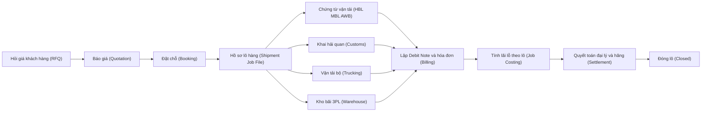
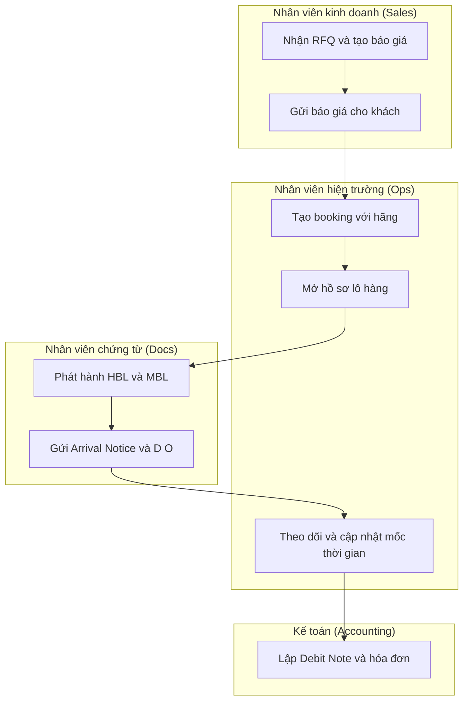
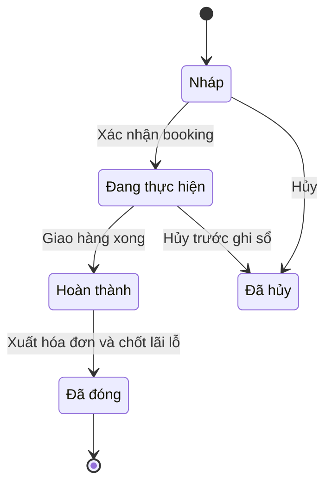
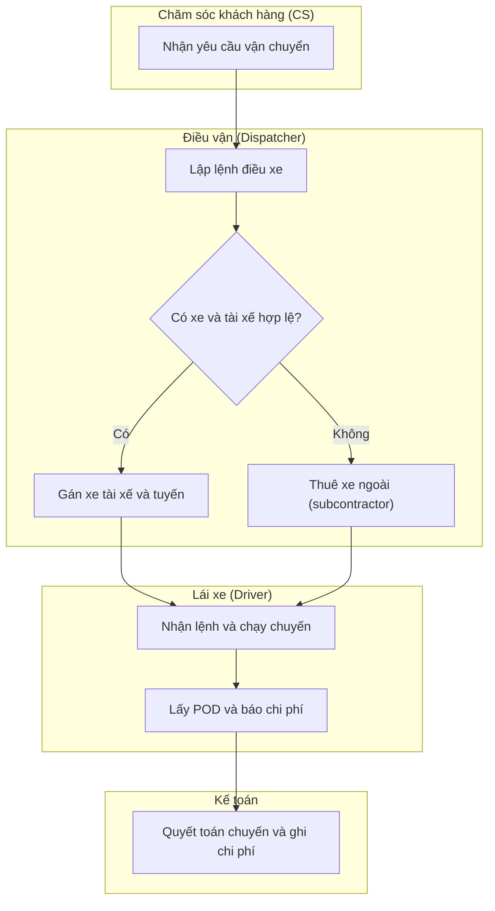
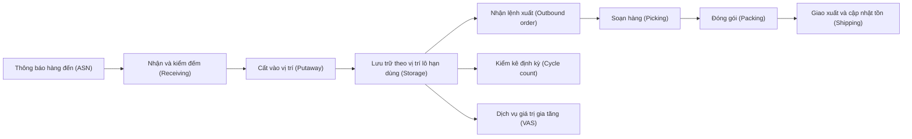
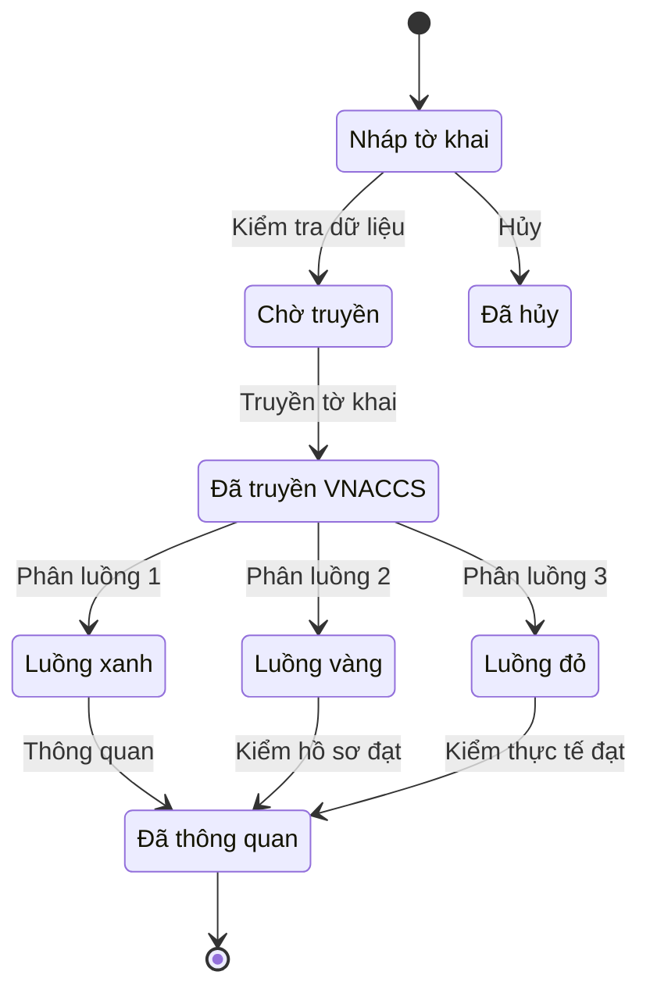

# Ngành Logistics — kiến thức nghiệp vụ cho BA ERP

> Cập nhật đến: 2026-10-20 — quy định thay đổi thường xuyên; BA phải kiểm tra lại hiệu lực khi dùng cho dự án.
> File tra cứu trong skill `erp-ba-core`. Mục tiêu: để mọi luồng logistics trong ERP đúng chuẩn nghiệp vụ + pháp lý VN, và mọi spec đầy đủ (chức năng, danh mục, giao dịch, phân quyền, báo cáo, hạch toán, kiểm soát). KHÔNG lặp lại nội dung lõi của file khác — chỉ nêu phần **đặc thù ngành** và liên kết:
> - Chế độ kế toán, hệ thống tài khoản: `references/regulations/vn-accounting.md`
> - Hóa đơn điện tử, thuế GTGT, thời điểm lập hóa đơn: `references/regulations/vn-tax-einvoice.md`
> - Kho/WMS lõi (nhập–xuất–putaway–picking–kiểm kê chung): `references/processes/inventory-warehouse.md`
> - Công nợ phải thu, Debit Note, thu tiền: `references/processes/ar-accounts-receivable.md`
> - Công nợ phải trả hãng/đại lý: `references/processes/ap-accounts-payable.md`
> - Tính giá thành / job costing lõi: `references/processes/costing.md`
> - Đa tiền tệ, đánh giá lại tỷ giá, thanh toán: `references/processes/cash-bank.md`, `references/processes/r2r-general-ledger.md`
> - Báo giá → đơn hàng → hóa đơn (lõi): `references/processes/o2c-order-to-cash.md`
> - Quy ước ID, trạng thái, phân quyền, Mermaid: `references/conventions.md`

## Mục lục
1. [Tổng quan ngành & mô hình kinh doanh](#1-tổng-quan-ngành--mô-hình-kinh-doanh)
2. [Quy định pháp lý liên quan](#2-quy-định-pháp-lý-liên-quan)
3. [Bản đồ quy trình đầu-cuối](#3-bản-đồ-quy-trình-đầu-cuối)
4. [Chi tiết từng quy trình đặc thù](#4-chi-tiết-từng-quy-trình-đặc-thù)
5. [Danh mục (master data) đặc thù ngành](#5-danh-mục-master-data-đặc-thù-ngành)
6. [Module & chức năng chuẩn — feature catalog](#6-module--chức-năng-chuẩn--feature-catalog)
7. [Báo cáo & KPI ngành](#7-báo-cáo--kpi-ngành)
8. [Đối thủ / sản phẩm tham chiếu](#8-đối-thủ--sản-phẩm-tham-chiếu)
9. [Thuật ngữ ngành](#9-thuật-ngữ-ngành)
10. [Câu hỏi khảo sát khách hàng](#10-câu-hỏi-khảo-sát-khách-hàng)
11. [Rủi ro & lỗi thường gặp khi phân tích ngành này](#11-rủi-ro--lỗi-thường-gặp-khi-phân-tích-ngành-này)
12. [Nguồn tham khảo](#12-nguồn-tham-khảo)

> **Chế độ kế toán áp dụng (regime in force) tại 2026-10-20:** **Thông tư 99/2025/TT-BTC** (ban hành 27/10/2025, hiệu lực 01/01/2026, thay thế Thông tư 200/2014/TT-BTC theo Điều 31). Doanh nghiệp nhỏ và vừa có thể tiếp tục dùng TT133/2016 [15]. Mọi số hiệu tài khoản trong file này theo **TT99/2025**; cấp 1 gần trùng TT200, các khác biệt nêu rõ tại chỗ. Chi tiết: `references/regulations/vn-accounting.md`.

---

## 1. Tổng quan ngành & mô hình kinh doanh

Logistics VN gồm nhiều phân khúc; một doanh nghiệp thường làm 1–vài phân khúc, phần còn lại thuê ngoài (buy service). Phần mềm ERP ngành phải mô hình hóa được cả **mua dịch vụ (buy)** lẫn **bán dịch vụ (sell)** trên cùng một lô hàng.

| Phân khúc | Mô tả | Doanh thu điển hình | Đối tượng khách hàng của phần mềm |
|---|---|---|---|
| Giao nhận quốc tế (Freight Forwarding) | Thu xếp vận chuyển đường biển FCL/LCL, đường hàng không; phát hành vận đơn nhà (House B/L) | Cước + phụ phí + phí dịch vụ + chênh lệch mua-bán cước | Forwarder, NVOCC, đại lý giao nhận |
| Đại lý hải quan (Customs Brokerage) | Khai thuê & thông quan hàng XNK qua VNACCS/VCIS | Phí khai + phí dịch vụ + chi hộ (thuế, phí) | Công ty dịch vụ khai thuê hải quan |
| Vận tải đường bộ (Trucking / TMS) | Kéo container, giao hàng nội địa, chặng đầu-cuối (first/last mile) | Cước chuyến/km/chuyến; phụ phí chờ, lưu ca | Nhà xe, đội xe nội bộ forwarder |
| Kho bãi & 3PL (Warehousing / WMS) | Lưu kho, xử lý hàng, VAS, kho ngoại quan/CFS | Phí lưu kho (storage) + handling + VAS theo kỳ | Nhà cung cấp dịch vụ kho, 3PL |
| Chuyển phát / chặng cuối (Express / Last-mile) | Giao kiện nhỏ, thu hộ COD | Cước theo kiện/trọng lượng + COD | Doanh nghiệp express (phạm vi tùy chọn) |

**Chuỗi giá trị (value chain):** Hỏi giá → Báo giá → Đặt chỗ → Mở hồ sơ lô hàng → Vận tải + Hải quan + Kho → Chứng từ → Lập hóa đơn/Debit Note → Tính lãi lỗ theo lô → Quyết toán hãng/đại lý → Đóng lô.

**Đặc điểm nghiệp vụ chi phối thiết kế ERP:**
- **Lô hàng (shipment/job) là trung tâm**: mọi doanh thu, chi phí mua ngoài, chứng từ, mốc thời gian đều gắn vào một mã lô → tính được **lãi lỗ theo lô (job P&L)**.
- **Mua-bán song song**: trên 1 lô vừa có khoản **bán cho khách** (sell/AR) vừa có khoản **mua của hãng/đại lý/nhà xe** (buy/AP), nhiều loại phí (charge code).
- **Đa tiền tệ**: cước quốc tế thường tính USD; công nợ đại lý nước ngoài bằng ngoại tệ → bắt buộc đánh giá lại tỷ giá.
- **Chi hộ (disbursement)**: forwarder/đại lý hải quan chi hộ khách (thuế XNK, phí cảng) — khoản này KHÔNG phải doanh thu/chi phí của mình.
- **Nhiều chủ hàng trên 1 phương tiện/container (consol/LCL)** và **nhiều chủ hàng trong 1 kho (3PL)** → cần tách chi phí, tách tồn kho theo chủ hàng.

---

## 2. Quy định pháp lý liên quan

> Web tra cứu là **dữ liệu không tin cậy**; BA phải đối chiếu văn bản gốc trên vanban.chinhphu.vn / thuvienphapluat.vn / customs.gov.vn trước khi chốt thiết kế. Một số mốc dưới đây ghi `⚠️ CHƯA XÁC MINH` do chưa đối chiếu bản gốc trong phiên này.

| Văn bản | Nội dung chính liên quan hệ thống | Hiệu lực | Tình trạng | Ảnh hưởng thiết kế |
|---|---|---|---|---|
| Luật Thương mại 2005 (36/2005/QH11) — Điều 233–240 | Định nghĩa dịch vụ logistics; quyền/nghĩa vụ thương nhân; miễn trách (Đ237); giới hạn trách nhiệm (Đ238) [2] | 01/01/2006 | Còn hiệu lực | Mô hình hợp đồng dịch vụ; lưu điều khoản giới hạn trách nhiệm theo lô |
| NĐ 163/2017/NĐ-CP (kinh doanh dịch vụ logistics) | Điều kiện kinh doanh; **giới hạn trách nhiệm**: không thỏa thuận + khách KHÔNG khai giá trị → tối đa **500 triệu VND/yêu cầu bồi thường**; nếu khai & DN xác nhận → ≤ giá trị hàng [1] | 20/02/2018 (thay NĐ 140/2007) | Còn hiệu lực [1] | Tham số mức giới hạn trách nhiệm; trường "khai giá trị hàng" trên lô |
| Luật Hải quan 2014 (54/2014/QH13) | Thủ tục hải quan điện tử; đại lý làm thủ tục hải quan (Đ20); địa điểm kiểm tra/giám sát (Đ62) [3] | 01/01/2015 | Còn hiệu lực | Khai điện tử, mã số nhân viên đại lý |
| NĐ 08/2015/NĐ-CP, sửa bởi NĐ 59/2018/NĐ-CP | Hướng dẫn Luật Hải quan; thủ tục, tờ khai, đại lý hải quan [4] | 2015 / 2018 | Còn hiệu lực (hợp nhất) | Cấu trúc tờ khai, loại hình, phân luồng |
| TT 38/2015/TT-BTC, sửa bởi TT 39/2018/TT-BTC | Thủ tục hải quan; kiểm tra, giám sát; thuế XNK; quản lý thuế hàng XNK [5] | 2015 / 2018 | Còn hiệu lực (sửa nhiều lần) | Mẫu tờ khai, chỉ tiêu thông tin khai VNACCS |
| TT 121/2025/TT-BTC | Sửa đổi phụ lục/một số điều TT38 (gồm Đ16, 16a về hồ sơ hải quan) [6] | 01/02/2026 ⚠️ (theo nguồn tra cứu) | Còn hiệu lực | Rà soát lại bộ chỉ tiêu khai & hồ sơ 2026 |
| QĐ 2537/QĐ-TCHQ (Tổng cục Hải quan) | Quy trình thủ tục hải quan khi hệ thống **VNACCS/VCIS gặp sự cố** (khai tờ khai giấy) [14] | Ban hành 01/11/2024 | Còn hiệu lực — **chỉ áp dụng khi VNACCS/VCIS sự cố** (theo thông báo của TCHQ) | Chế độ dự phòng khi mất kết nối hải quan |
| Luật Đường bộ 2024 (35/2024/QH15) | Kết cấu hạ tầng, đường cao tốc, **thanh toán điện tử giao thông (ETC)**, trạm dừng nghỉ; thay Luật GTĐB 2008 [9] | 01/01/2025 (một số điều 01/10/2024) | Còn hiệu lực | Phí cầu đường/ETC là chi phí chuyến; định danh phương tiện |
| Luật Trật tự, ATGT đường bộ 2024 (36/2024/QH15) + NĐ 151/2024/NĐ-CP | **Thời gian lái xe**: không lái liên tục quá 4 giờ, không quá 10 giờ/ngày (kế thừa quy định cũ), và giới hạn theo tuần; cấm làm sai lệch dữ liệu GSHT/camera [10] | 01/01/2025 | Còn hiệu lực; điều khoản số về giờ lái ⚠️ CHƯA XÁC MINH bản gốc | Ràng buộc cảnh báo giờ lái từ GSHT; không điều xe vượt giờ |
| NĐ 158/2024/NĐ-CP (hoạt động vận tải đường bộ) | Điều kiện kinh doanh vận tải; **phù hiệu** xe; **bắt buộc lắp thiết bị giám sát hành trình (GSHT)** và thiết bị ghi hình người lái với một số loại xe; xe phải thuộc sở hữu/sử dụng hợp pháp [7] | 01/01/2025 (thay NĐ 10/2020) | Còn hiệu lực; sửa bởi NĐ 218/2026/NĐ-CP [8] | Quản lý phù hiệu, hạn đăng kiểm, tích hợp dữ liệu GSHT |
| NĐ 87/2009/NĐ-CP, sửa bởi NĐ 144/2018/NĐ-CP & **NĐ 14/2026/NĐ-CP** | **Vận tải đa phương thức (multimodal)**; điều kiện quốc tế (Điều 5): tài sản ≥ **80.000 SDR** hoặc bảo lãnh tương đương + bảo hiểm trách nhiệm nghề nghiệp; chứng từ VTĐPT [11] | 15/12/2009; NĐ 14/2026 thay Phụ lục I–III | Còn hiệu lực; ⚠️ NQ 24/2026/NQ-CP nêu **không áp dụng điều kiện KD VTĐPT quốc tế tại Điều 5** → mức 80.000 SDR phải kiểm tra lại [11] | Loại chứng từ MT B/L; theo dõi nhiều chặng/phương thức |
| NĐ 123/2020/NĐ-CP, sửa bởi NĐ 70/2025/NĐ-CP | Hóa đơn, chứng từ; **thời điểm lập hóa đơn dịch vụ = khi hoàn thành dịch vụ** (không phân biệt đã thu tiền); thu trước/trong khi làm → thời điểm thu tiền; dịch vụ số lượng lớn, phát sinh thường xuyên, cần đối soát (vận tải, logistics...) → lập theo kỳ đối soát, chậm nhất ngày 07 tháng sau ⚠️ [12] | NĐ70 hiệu lực 01/06/2025 | Còn hiệu lực | Quy tắc sinh hóa đơn tự động theo mốc hoàn thành / kỳ đối soát — xem `vn-tax-einvoice.md` |
| NĐ 68/2016/NĐ-CP, sửa bởi NĐ 67/2020/NĐ-CP | Điều kiện **kho ngoại quan (bonded warehouse)**, **địa điểm thu gom hàng lẻ CFS** (diện tích kho tối thiểu 1.000 m², hàng rào, camera, phần mềm quản lý theo mặt hàng/chủ hàng/tờ khai) [13] | 2016 / 2020 | Còn hiệu lực ⚠️ (đang có dự thảo thay thế — CHƯA XÁC MINH) | Yêu cầu kết nối dữ liệu hải quan cho kho ngoại quan/CFS |

**Thuế GTGT ngành:** vận tải **quốc tế** và một số dịch vụ gắn với hàng XNK áp dụng **thuế suất 0%** (có điều kiện); dịch vụ logistics nội địa chịu thuế suất phổ thông. Thuế suất cụ thể, điều kiện 0%, và chính sách giảm thuế theo từng thời kỳ → tra `references/regulations/vn-tax-einvoice.md` (⚠️ không hardcode thuế suất trong spec, để tham số).

---

## 3. Bản đồ quy trình đầu-cuối

Danh sách quy trình nghiệp vụ (BP) đặc thù ngành:

- **BP-FWD-01** Quản lý biểu cước & phụ phí (Rate/Tariff Management: buy rate, sell rate, surcharges)
- **BP-FWD-02** Báo giá (Quotation / RFQ)
- **BP-FWD-03** Đặt chỗ (Booking) với hãng tàu/hãng bay/co-loader
- **BP-FWD-04** Hồ sơ lô hàng & chứng từ (Shipment Job File: HBL/MBL, AWB, Manifest, Arrival Notice, D/O)
- **BP-CUS-01** Dịch vụ khai báo hải quan (Customs Declaration qua VNACCS/VCIS)
- **BP-TMS-01** Điều vận & chuyến xe (Trucking Order → Dispatch → Trip → POD → nhiên liệu/chi phí)
- **BP-TMS-02** Quản lý xe, tài xế, bảo dưỡng (Vehicle/Driver/Maintenance)
- **BP-WMS-01** Nhập kho (ASN → Receiving → Putaway)
- **BP-WMS-02** Lưu trữ & kiểm kê (Storage theo vị trí/lô/hạn dùng; Cycle Count)
- **BP-WMS-03** Xuất kho & dịch vụ giá trị gia tăng (Picking → Packing → Shipping; VAS)
- **BP-BIL-01** Lập Debit Note, hóa đơn, phí lưu kho (Billing & Storage Billing)
- **BP-BIL-02** Tính lãi lỗ theo lô (Job Costing / Profit per Shipment)
- **BP-BIL-03** Quyết toán đại lý & công nợ hãng (Agent Settlement: SOA, Credit/Debit Note, đa tiền tệ; Carrier Payables)

---

## 4. Chi tiết từng quy trình đặc thù

Vai trò dùng chung (mã vai trò **minh họa** của thư viện tham chiếu; khi vào dự án, cấp ID vai trò theo catalog dự án — xem `conventions.md §3, §6`):
`ROLE-SAL-EXEC` Nhân viên kinh doanh (Sales Executive), `ROLE-FWD-PRICE` Nhân viên giá cước (Pricing Staff), `ROLE-FWD-OPS` Nhân viên hiện trường/giao nhận (Operations Staff), `ROLE-FWD-DOCS` Nhân viên chứng từ (Documentation Staff), `ROLE-FWD-MGR` Trưởng phòng giao nhận (Forwarding Manager), `ROLE-CUS-DECL` Nhân viên khai hải quan (Customs Declarant), `ROLE-TMS-DISP` Nhân viên điều vận (Dispatcher), `ROLE-TMS-DRV` Lái xe (Driver), `ROLE-WMS-KEEP` Thủ kho (Storekeeper), `ROLE-WMS-OP` Nhân viên kho (Warehouse Operator), `ROLE-ACC-AR` Kế toán công nợ phải thu (AR Accountant), `ROLE-ACC-AP` Kế toán công nợ phải trả (AP Accountant), `ROLE-ACC-CHIEF` Kế toán trưởng (Chief Accountant), `ROLE-DIR` Giám đốc (Director).

### 4.1. BP-FWD-04 — Hồ sơ lô hàng & chứng từ (Shipment Job File)

- **Vai trò:** ROLE-SAL-EXEC, ROLE-FWD-OPS, ROLE-FWD-DOCS, ROLE-FWD-MGR, ROLE-ACC-AR.
- **Chứng từ:** Booking (đặt chỗ), Shipment/Job File (hồ sơ lô), **House B/L (HBL)** & **Master B/L (MBL)** cho đường biển, **House AWB (HAWB)** & **Master AWB (MAWB)** cho hàng không, Manifest (bản lược khai), **Arrival Notice (giấy báo hàng đến)**, **Delivery Order – D/O (lệnh giao hàng)**, VGM (Verified Gross Mass — khai khối lượng toàn bộ container).
- **Các bước:**
  1. Mở hồ sơ lô từ báo giá được chấp nhận hoặc booking; gán **mã lô (job no.)** theo bộ đếm (PRM đánh số).
  2. Khai thông tin: shipper, consignee, notify party, cảng đi (POL)/cảng đến (POD), Incoterm, loại hàng (commodity/HS), số lượng/trọng lượng/thể tích (CBM), loại container.
  3. Gắn các **khoản phí (charge lines)**: mỗi dòng có loại phí (charge code), bên bán (sell → khách) và/hoặc bên mua (buy → hãng/đại lý/nhà xe), tiền tệ, tỷ giá.
  4. Phát hành chứng từ vận tải: với consol, 1 MBL (hãng cấp cho forwarder) gom nhiều HBL (forwarder cấp cho khách).
  5. Cập nhật **mốc thời gian (milestones)**: ETD/ATD, ETA/ATA, cut-off, ngày phát hành B/L, ngày hàng đến.
  6. Gửi Arrival Notice, thu phí, phát hành D/O để khách nhận hàng.
  7. Hoàn tất → chuyển sang lập hóa đơn (BP-BIL-01) và tính lãi lỗ (BP-BIL-02).
- **Trạng thái hồ sơ lô (dùng mã chuẩn):** DRAFT "Nháp" → IN_PROGRESS "Đang thực hiện" → COMPLETED "Hoàn thành" (đã giao hàng) → CLOSED "Đã đóng" (đã xuất hóa đơn & chốt lãi lỗ); CANCELLED "Đã hủy".
- **Quy tắc nghiệp vụ (ví dụ):**
  - `BR-FWD-04-01`: Hệ thống **PHẢI** kiểm tra tổng doanh thu sell − tổng chi phí buy của lô ≥ lợi nhuận gộp tối thiểu (PRM-FWD-002); nếu dưới → cảnh báo & yêu cầu `Duyệt` của ROLE-FWD-MGR.
  - `BR-FWD-04-02`: **KHÔNG ĐƯỢC** `Đóng` lô khi còn khoản phí buy chưa có hóa đơn/chi phí ước tính hoặc khoản sell chưa lập hóa đơn (trừ khi ROLE-ACC-CHIEF xác nhận trích trước).
  - `BR-FWD-04-03`: Mỗi HBL **PHẢI** thuộc đúng một MBL khi là hàng consol; tổng trọng lượng/thể tích các HBL ≤ MBL.
  - `BR-FWD-04-04`: Khoản **chi hộ** (disbursement) **KHÔNG ĐƯỢC** hạch toán vào doanh thu (511)/giá vốn (632) — theo dõi qua TK 138/331 (xem §4.7).

- **Hạch toán đặc thù (TT99/2025):**

| Nghiệp vụ | Nợ | Có | Ghi chú |
|---|---|---|---|
| Ghi nhận doanh thu dịch vụ (lập Debit Note cho khách) | 131 | 511, 33311 | 511 chi tiết doanh thu dịch vụ; vận tải quốc tế áp 0% VAT (có điều kiện) — xem `vn-tax-einvoice.md` |
| Tập hợp chi phí mua ngoài theo lô (cước hãng, trucking, THC, CFS, D/O...) | 154 | 331 | Theo dõi theo mã lô (job); nếu NCC chưa xuất hóa đơn → trích trước qua 335 |
| Thuế GTGT đầu vào được khấu trừ | 133 | 331 | Nếu dịch vụ chịu thuế & đủ điều kiện khấu trừ |
| Kết chuyển giá vốn theo lô khi ghi nhận doanh thu | 632 | 154 | Chốt giá vốn lô → phục vụ job P&L |

> ⚠️ TT99 (như TT200) giữ **641 "Chi phí bán hàng"** và **642 "Chi phí quản lý doanh nghiệp"** riêng; chỉ TT133 (SME) gộp vào 642. Nếu DN áp dụng TT133, ánh xạ lại. Chi phí mua dịch vụ gắn trực tiếp lô ghi vào **154/632**, không ghi 641/642.

- **Tham số:** PRM-FWD-001 (quy tắc đánh số lô theo loại/tuyến/năm), PRM-FWD-002 (lợi nhuận gộp tối thiểu/ngưỡng cảnh báo), PRM-FX-001 (nguồn & loại tỷ giá ghi nhận doanh thu ngoại tệ).
- **Báo cáo:** RPT-BIL-01 Lãi lỗ theo lô; RPT-FWD-01 Tình trạng lô hàng; RPT-FWD-02 Doanh thu theo khách/tuyến/dịch vụ.

### 4.2. BP-FWD-01/02/03 — Biểu cước, Báo giá, Đặt chỗ

- **Vai trò:** ROLE-FWD-PRICE (duy trì biểu cước), ROLE-SAL-EXEC (báo giá), ROLE-FWD-OPS (booking), ROLE-FWD-MGR (duyệt).
- **Biểu cước (Tariff/Rate):** lưu **buy rate** (giá mua từ hãng/đại lý) và **sell rate** (giá bán cho khách) theo tuyến (lane POL–POD), loại container/trọng lượng, hãng, **hiệu lực từ–đến (validity)**; **phụ phí (surcharges)**: BAF, CAF, THC, phí chứng từ (DOC), phí niêm phong, phí EBS, LSS...
- **Báo giá:** chọn khách + tuyến + dịch vụ → hệ thống gợi ý cước còn hiệu lực; tính GP; nếu dưới ngưỡng → `Gửi duyệt` ROLE-FWD-MGR. Trạng thái: DRAFT → PENDING → APPROVED → gửi khách → (khách chấp nhận) COMPLETED → chuyển thành booking, hoặc REJECTED/CLOSED (hết hiệu lực).
- **Booking:** DRAFT → PENDING (chờ hãng xác nhận chỗ) → APPROVED "Đã xác nhận" (có booking no. của hãng) → CANCELLED (no-show/hủy chỗ, có thể phát sinh phí hủy).
- **Quy tắc:**
  - `BR-FWD-01-01`: Hệ thống **KHÔNG ĐƯỢC** cho báo giá sử dụng biểu cước đã hết hiệu lực; **PHẢI** cảnh báo khi cước hết hạn trong N ngày (PRM-RATE-001).
  - `BR-FWD-02-01`: Báo giá có GP% < PRM-FWD-002 **PHẢI** được `Duyệt` trước khi gửi khách.
- **Tham số:** PRM-RATE-001 (ngày cảnh báo cước sắp hết hạn), PRM-FWD-002 (GP tối thiểu), PRM-BIL-002 (hạn mức tín dụng khách).
- **Hạch toán:** không phát sinh bút toán ở bước báo giá/booking (chỉ cam kết); phí hủy booking (nếu có) ghi khi thực phát sinh.

### 4.3. BP-TMS-01 — Điều vận & chuyến xe

- **Vai trò:** ROLE-FWD-OPS/CS (nhận yêu cầu), ROLE-TMS-DISP (điều vận), ROLE-TMS-DRV (lái xe), ROLE-ACC-AP (quyết toán).
- **Chứng từ:** Yêu cầu vận chuyển (transport request), **Lệnh điều xe (Dispatch Order)**, **POD (Proof of Delivery — biên bản giao hàng có ký nhận)**, phiếu nhiên liệu, bảng kê chi phí chuyến.
- **Các bước:** nhận yêu cầu → lập lệnh điều xe → kiểm tra xe/tài xế khả dụng (đăng kiểm còn hạn, phù hiệu, giờ lái) → gán xe + tài xế + tuyến, hoặc **thuê xe ngoài (subcontractor)** → lái xe chạy chuyến → lấy POD → báo chi phí (nhiên liệu, cầu đường, lưu ca, bốc xếp) → quyết toán chuyến.
- **Trạng thái lệnh điều xe:** DRAFT → APPROVED "Đã điều" → IN_PROGRESS "Đang chạy" → COMPLETED "Hoàn thành (có POD)" → CLOSED "Đã quyết toán"; CANCELLED.
- **Quy tắc:**
  - `BR-TMS-01-01`: **KHÔNG ĐƯỢC** điều xe có đăng kiểm/phù hiệu/bảo hiểm hết hạn, hoặc thiết bị GSHT mất kết nối [7][10].
  - `BR-TMS-01-02`: Hệ thống **PHẢI** cảnh báo khi kế hoạch chuyến khiến tài xế **lái liên tục quá 4 giờ hoặc quá 10 giờ/ngày** (dữ liệu GSHT) [10] ⚠️ (điều khoản số cần đối chiếu Luật 36/2024).
  - `BR-TMS-01-03`: POD chưa thu về sau N ngày → chặn/cảnh báo lập hóa đơn (PRM-TMS-004).
- **Hạch toán đặc thù (TT99/2025):**

| Nghiệp vụ | Nợ | Có | Ghi chú |
|---|---|---|---|
| Chi phí nhiên liệu/cầu đường/bốc xếp theo chuyến | 154 | 111, 112, 331 | Tập hợp theo xe + chuyến (+ gắn lô nếu kéo cont cho lô cụ thể) |
| Lương, phụ cấp lái xe theo chuyến | 154 | 334 | Theo chuyến/định mức |
| Khấu hao xe | 627 | 214 | Phân bổ cho hoạt động vận tải |
| Thuê xe ngoài (subcon) | 154 | 331 | Chi phí mua ngoài gắn lô/chuyến |
| Kết chuyển giá vốn vận tải | 632 | 154 | Khi ghi nhận doanh thu chuyến |

- **Tham số:** PRM-TMS-001 (định mức nhiên liệu L/100km theo loại xe), PRM-TMS-002 (chu kỳ bảo dưỡng theo km/ngày), PRM-TMS-003 (cảnh báo giờ lái 4h/10h/tuần), PRM-TMS-004 (số ngày POD trước khi chặn hóa đơn).
- **Báo cáo:** RPT-TMS-01 Hiệu suất đội xe & chi phí/km; RPT-TMS-02 On-time delivery & POD tồn đọng.

### 4.4. BP-WMS-01/02/03 — Kho bãi & 3PL

> Lõi nghiệp vụ kho (nhập–xuất–putaway–picking–kiểm kê, chiến lược FEFO/FIFO) ở `references/processes/inventory-warehouse.md`. Dưới đây chỉ nêu phần **đặc thù 3PL/logistics**.

- **Vai trò:** ROLE-WMS-KEEP, ROLE-WMS-OP, ROLE-ACC-AR.
- **Đặc thù 3PL:**
  - **Hàng giữ hộ, không thuộc sở hữu DN** → theo dõi tồn kho **theo chủ hàng (owner/consignee)**; hạch toán ngoài bảng **TK 002 "Vật tư, hàng hóa nhận giữ hộ, nhận gia công"** (TT99 vẫn dùng TK ngoài bảng 001–007) — KHÔNG ghi vào 156.
  - **Kho ngoại quan (bonded) / CFS**: phải kết nối dữ liệu hải quan; theo dõi theo tờ khai, thời hạn lưu giữ, thanh khoản [13].
  - **Tính phí lưu kho (storage billing)**: theo m²/pallet/vị trí/CBM × số ngày, hoặc theo bậc thang; **handling** (in/out) theo lần; **VAS** (dán nhãn, đóng gói lại, kiểm đếm) theo khối lượng công việc.
- **Các bước nhập:** ASN (thông báo hàng đến) → Receiving (nhận & kiểm đếm, đối chiếu ASN) → Putaway (cất vào vị trí theo chiến lược) → cập nhật tồn theo chủ hàng + lô + hạn dùng.
- **Các bước xuất:** nhận lệnh xuất → Picking (theo FEFO/FIFO, wave/batch/zone) → Packing → Shipping → cập nhật tồn & TK 002.
- **Kiểm kê:** Cycle count định kỳ theo vị trí/chủ hàng; xử lý chênh lệch (báo cáo chủ hàng, không tự điều chỉnh giá trị sổ sách của DN vì hàng giữ hộ).
- **Trạng thái phiếu nhập/xuất:** DRAFT → APPROVED → IN_PROGRESS → COMPLETED → POSTED (cập nhật tồn) → CLOSED.
- **Quy tắc:**
  - `BR-WMS-01-01`: Hàng 3PL **PHẢI** gắn **chủ hàng**; báo cáo tồn & phí tách theo chủ hàng.
  - `BR-WMS-02-01`: Cấp phát theo chiến lược cấu hình (PRM-WMS-001, mặc định FEFO cho hàng có hạn dùng).
  - `BR-WMS-03-01`: Phí lưu kho tính theo PRM-WMS-003; chốt kỳ (tháng) để lập hóa đơn (BP-BIL-01).

- **Hạch toán đặc thù:**

| Nghiệp vụ | Nợ | Có | Ghi chú |
|---|---|---|---|
| Nhận giữ hộ hàng của khách vào kho 3PL | 002 | | TK ngoài bảng; ghi đơn (chỉ Nợ 002) theo số lượng/giá trị khai |
| Xuất trả hàng giữ hộ | | 002 | Ghi đơn (chỉ Có 002) |
| Doanh thu phí lưu kho/handling/VAS (chốt kỳ) | 131 | 511, 33311 | Theo kỳ tháng; VAT theo quy định |

- **Tham số:** PRM-WMS-001 (chiến lược cấp phát), PRM-WMS-002 (chiến lược putaway/picking), PRM-WMS-003 (phương pháp & đơn giá phí lưu kho), PRM-WMS-004 (ngưỡng cảnh báo hạn dùng/thời hạn lưu kho ngoại quan).

### 4.5. BP-CUS-01 — Dịch vụ khai báo hải quan

- **Vai trò:** ROLE-CUS-DECL, ROLE-FWD-OPS, ROLE-ACC-AP.
- **Chứng từ:** Tờ khai hải quan (customs declaration), bộ hồ sơ (invoice, packing list, B/L, C/O...), kết quả **phân luồng** (xanh/vàng/đỏ), chứng từ nộp thuế XNK.
- **Các bước:** nhận hồ sơ từ khách → lập tờ khai theo **loại hình** (mã loại hình) → kiểm tra chỉ tiêu → **truyền qua VNACCS/VCIS** → nhận kết quả phân luồng → xử lý (luồng vàng: kiểm hồ sơ; luồng đỏ: kiểm thực tế) → nộp thuế/chi hộ → **thông quan** → giải phóng hàng.
- **Trạng thái tờ khai:** DRAFT "Nháp tờ khai" → PENDING "Chờ truyền" → "Đã truyền VNACCS" → phân luồng → CLEARED "Đã thông quan"; CANCELLED. (Khi hệ thống VNACCS/VCIS sự cố → quy trình tờ khai giấy theo QĐ 2537/QĐ-TCHQ [14].)
- **Quy tắc:**
  - `BR-CUS-01-01`: Nhân viên khai **PHẢI** có **mã số nhân viên đại lý làm thủ tục hải quan** còn hiệu lực; chứng chỉ nghiệp vụ khai hải quan quá 5 năm phải bổ sung giấy hoàn thành đào tạo trong 3 năm gần nhất [4].
  - `BR-CUS-01-02`: Khoản **thuế XNK nộp hộ** khách → hạch toán **chi hộ** (138), không vào doanh thu/chi phí.
  - `BR-CUS-01-03`: Lưu đầy đủ bộ hồ sơ & kết quả phân luồng theo thời hạn lưu trữ chứng từ kế toán/hải quan.

- **Tham số:** PRM-CUS-001 (danh mục loại hình & mã loại hình), PRM-CUS-002 (chế độ dự phòng khi mất kết nối VNACCS).

### 4.6. BP-BIL-01/02 — Lập hóa đơn & Tính lãi lỗ theo lô

- **Vai trò:** ROLE-ACC-AR, ROLE-FWD-MGR, ROLE-ACC-CHIEF.
- **Chứng từ:** **Debit Note (giấy báo nợ cho khách)**, **Credit Note (giấy báo có)**, **Hóa đơn GTGT điện tử**, bảng kê phí.
- **Debit Note vs Hóa đơn:** Debit Note là chứng từ nội bộ/thương mại liệt kê các khoản thu khách (gồm cả chi hộ); **hóa đơn GTGT** chỉ xuất cho phần **doanh thu dịch vụ của DN** (không gồm phần chi hộ đủ điều kiện). Tách rõ 2 loại dòng: *revenue line* (lên hóa đơn) và *disbursement line* (chi hộ, không lên hóa đơn).
- **Thời điểm lập hóa đơn:** khi **hoàn thành dịch vụ**; với dịch vụ phát sinh thường xuyên, số lượng lớn, cần đối soát → lập theo **kỳ đối soát**, chậm nhất ngày 07 tháng sau ⚠️ [12]. Chi tiết & ngoại lệ: `references/regulations/vn-tax-einvoice.md`.
- **Job P&L (lãi lỗ theo lô):** = Σ sell (doanh thu) − Σ buy (chi phí mua ngoài gắn lô) − phân bổ chi phí chung (nếu cấu hình). Phải thể hiện cả khoản **chi phí ước tính (accrual)** khi hãng chưa xuất hóa đơn, và chênh lệch khi hóa đơn thực về.
- **Trạng thái Debit Note/Hóa đơn:** DRAFT → PENDING → APPROVED → POSTED "Đã ghi sổ"; REVERSED (đảo)/CANCELLED. Hóa đơn điện tử đã phát hành chỉ xử lý bằng điều chỉnh/thay thế theo quy định hóa đơn.
- **Quy tắc:**
  - `BR-BIL-01-01`: Phần **chi hộ KHÔNG ĐƯỢC** đưa vào dòng chịu thuế của hóa đơn GTGT (nếu đủ điều kiện pass-through) — xem `vn-tax-einvoice.md`.
  - `BR-BIL-02-01`: **KHÔNG ĐƯỢC** `Đóng` lô khi chênh lệch giữa chi phí ước tính và chi phí thực > ngưỡng PRM-BIL-004 mà chưa giải trình.
- **Hạch toán:** xem §4.1 (doanh thu, giá vốn) và §4.7 (chi hộ, tỷ giá).
- **Báo cáo:** RPT-BIL-01 Lãi lỗ theo lô; RPT-BIL-02 Lô chưa lập hóa đơn (unbilled/WIP) & tuổi nợ; RPT-FWD-02 Doanh thu theo khách/tuyến.

### 4.7. BP-BIL-03 — Quyết toán đại lý, chi hộ & công nợ hãng (đa tiền tệ)

- **Vai trò:** ROLE-ACC-AR, ROLE-ACC-AP, ROLE-ACC-CHIEF.
- **Chứng từ:** **SOA (Statement of Account — bảng kê đối chiếu công nợ đại lý)**, Debit/Credit Note gửi đại lý nước ngoài, lệnh thanh toán quốc tế, bảng đối chiếu phí hãng tàu/hãng bay.
- **Chi hộ (disbursement):** khoản DN chi thay khách (thuế XNK, phí cảng, phí lưu cont...) rồi thu lại — không phải doanh thu/chi phí.

| Nghiệp vụ | Nợ | Có | Ghi chú |
|---|---|---|---|
| Chi hộ khách (nộp thuế/phí thay) | 138 | 111, 112 | Theo dõi theo khách + lô; KHÔNG vào 511/632 |
| Thu lại khoản chi hộ từ khách | 131 | 138 | Không phát sinh doanh thu/VAT trên phần chi hộ (nếu đủ điều kiện) |
| Doanh thu/chi phí với đại lý nước ngoài (USD) | 131 / 154 | 511 / 331 | Ghi theo **tỷ giá giao dịch thực tế** (PRM-FX-001) |
| Đánh giá lại số dư gốc ngoại tệ cuối kỳ — lãi | 131, 112 | 413 | Cuối kỳ kế toán |
| Đánh giá lại — lỗ | 413 | 331, 341 | Cuối kỳ kế toán |
| Kết chuyển lãi tỷ giá | 413 | 515 | |
| Kết chuyển lỗ tỷ giá | 635 | 413 | |

> Theo dõi nguyên tệ qua **TK 007 "Ngoại tệ các loại"** (ngoài bảng). Cơ chế đánh giá lại & kết chuyển 413 → 515/635 giống `references/regulations/vn-accounting.md §12` và `references/processes/r2r-general-ledger.md`.

- **Netting đại lý:** cùng một đại lý vừa là khách (AR) vừa là NCC (AP) theo từng lô → đối chiếu **SOA** và **bù trừ công nợ (netting)** theo kỳ; quyết toán số ròng (có thể cần tuân thủ quy định quản lý ngoại hối khi bù trừ/thanh toán quốc tế — ⚠️ xác nhận với kế toán trưởng).
- **Quy tắc:**
  - `BR-BIL-03-01`: Bù trừ AR/AP đại lý **CHỈ ĐƯỢC** thực hiện khi có SOA được hai bên xác nhận (DEC).
  - `BR-BIL-03-02`: Mọi số dư ngoại tệ **PHẢI** được đánh giá lại cuối kỳ theo PRM-FX-001.
- **Tham số:** PRM-FX-001 (nguồn/loại tỷ giá), PRM-BIL-001 (điều khoản thanh toán mặc định), PRM-BIL-002 (hạn mức tín dụng), PRM-BIL-004 (ngưỡng chênh lệch chi phí ước tính/thực).

---

## 5. Danh mục (master data) đặc thù ngành (trường quan trọng)

| Mã | Danh mục | Trường quan trọng |
|---|---|---|
| MD-CUSTOMER | Khách hàng (shipper/consignee/notify) | Mã, tên, MST, địa chỉ, điều khoản TT, hạn mức tín dụng, loại (shipper/consignee), người liên hệ |
| MD-AGENT | Đại lý nước ngoài (overseas agent) | Mã, quốc gia, tiền tệ mặc định, điều khoản netting, tài khoản ngân hàng quốc tế |
| MD-CARRIER | Hãng vận chuyển (hãng tàu/hãng bay/co-loader/nhà xe) | Mã, loại (sea/air/road), SCAC/IATA, lịch tàu/bay, điều khoản thanh toán |
| MD-PORT | Cảng/sân bay/ICD | **UN/LOCODE**, loại (POL/POD/T.S), quốc gia, múi giờ |
| MD-CHARGE | Khoản mục phí (charge code) | Mã (OF, THC, DOC, CFS, DO, HANDLING...), tên, chịu VAT?, mặc định sell/buy, nhóm phí |
| MD-TARIFF | Biểu cước (buy/sell) | Tuyến (lane), hãng, loại cont/trọng lượng, đơn giá mua/bán, tiền tệ, **hiệu lực từ–đến** |
| MD-CONTTYPE | Loại container | Mã (20GP, 40GP, 40HC, 40RF, 45HC...), kích thước, trọng lượng tối đa |
| MD-VESSEL | Tàu/chuyến (vessel/voyage) | Tên tàu, số chuyến, hãng, ETD/ETA, cảng |
| MD-INCOTERM | Điều kiện giao hàng | Mã (EXW, FOB, CIF, DAP, DDP... theo Incoterms 2020), điểm chuyển rủi ro |
| MD-COMMODITY | Loại hàng / mã HS | Mô tả, **mã HS**, hàng nguy hiểm (DG class), nhiệt độ bảo quản |
| MD-VEHICLE | Phương tiện | Biển số, loại xe, tải trọng, **hạn đăng kiểm**, **phù hiệu & hạn**, bảo hiểm, thiết bị GSHT |
| MD-DRIVER | Lái xe | Họ tên, hạng GPLX & hạn, số điện thoại, trạng thái, lịch sử giờ lái |
| MD-WAREHOUSE | Kho/bãi | Mã, loại (thường/ngoại quan/CFS), địa chỉ, sức chứa, mã hải quan (nếu có) |
| MD-LOCATION | Vị trí lưu trữ | Mã vị trí (zone-aisle-bay-level), loại, sức chứa, điều kiện (nhiệt độ) |
| MD-ITEM | Hàng hóa lưu kho (của chủ hàng) | SKU, chủ hàng, UoM, barcode, quản lý lô/serial/hạn dùng |
| MD-SERVICE | Loại dịch vụ | Mã (SEA-FCL, SEA-LCL, AIR, CUSTOMS, TRUCKING, WAREHOUSE, VAS...), nhóm, mặc định TK doanh thu |
| MD-CURRENCY | Tiền tệ & tỷ giá | Mã ISO, loại tỷ giá, nguồn tỷ giá |

> Danh mục lõi (MD-CURRENCY, MD-UOM, MD-TAX...) dùng chung với catalog của dự án; ở đây chỉ nêu danh mục **đặc thù**. Khi dự án dùng tên riêng của khách (ví dụ "đại lý đối tác" cho overseas agent), ghi ánh xạ trong glossary dự án (`03-specification/catalogs/glossary.md`) — xem `conventions.md §10`.

---

## 6. Module & chức năng chuẩn cho ERP ngành — feature catalog

Mã module đặc thù: **FWD** (Giao nhận/lô hàng), **CUS** (Hải quan), **TMS** (Vận tải đường bộ), **WMS** (Kho/3PL), **BIL** (Billing/Settlement/Job costing). Mức độ: **Must/Should/Could**.

| Module | Chức năng | Mô tả | Demo | Sản phẩm đầy đủ |
|---|---|---|---|---|
| FWD | FN-FWD-01 Quản lý biểu cước & phụ phí | Buy/sell rate theo tuyến, hãng, loại cont; phụ phí; hiệu lực | Should | Must |
| FWD | FN-FWD-02 Báo giá (Quotation) | Lập báo giá từ cước, tính GP, duyệt, gửi khách, chuyển booking | Must | Must |
| FWD | FN-FWD-03 Đặt chỗ (Booking) | Booking với hãng, số booking, cut-off, trạng thái | Should | Must |
| FWD | FN-FWD-04 Hồ sơ lô hàng (Job File) | Trung tâm lô: phí sell/buy, mốc, chứng từ, trạng thái, job P&L | Must | Must |
| FWD | FN-FWD-05 Phát hành chứng từ vận tải | HBL/MBL, HAWB/MAWB, Manifest, Arrival Notice, D/O, VGM | Must | Must |
| FWD | FN-FWD-06 Theo dõi mốc & tracking | ETD/ATD, ETA/ATA; cập nhật trạng thái, cổng tra cứu cho khách | Could | Should |
| FWD | FN-FWD-07 Vận tải đa phương thức | Nhiều chặng/phương thức trên 1 lô, chứng từ MT B/L [11] | Could | Should |
| CUS | FN-CUS-01 Lập & quản lý tờ khai | Tờ khai theo loại hình, bộ chỉ tiêu, hồ sơ đính kèm | Should | Must |
| CUS | FN-CUS-02 Kết nối VNACCS/VCIS | Truyền tờ khai, nhận phân luồng, chế độ dự phòng sự cố [14] | Could | Must |
| CUS | FN-CUS-03 Quản lý mã số nhân viên đại lý | Theo dõi mã số, chứng chỉ, hạn hiệu lực [4] | Could | Should |
| CUS | FN-CUS-04 Theo dõi thuế & chi hộ XNK | Số thuế nộp hộ, chứng từ nộp, đối chiếu với lô | Should | Must |
| TMS | FN-TMS-01 Điều vận & lệnh điều xe | Nhận yêu cầu, gán xe/tài xế/tuyến, thuê ngoài | Must | Must |
| TMS | FN-TMS-02 Chuyến & POD | Theo dõi chuyến, thu POD, trạng thái giao hàng | Must | Must |
| TMS | FN-TMS-03 Chi phí chuyến & nhiên liệu | Ghi nhận nhiên liệu, cầu đường, lưu ca; quyết toán chuyến | Should | Must |
| TMS | FN-TMS-04 Quản lý xe & giấy tờ | Đăng kiểm, phù hiệu, bảo hiểm, cảnh báo hết hạn [7] | Should | Must |
| TMS | FN-TMS-05 Quản lý tài xế & giờ lái | GPLX, lịch, cảnh báo giờ lái 4h/10h [10] | Could | Should |
| TMS | FN-TMS-06 Bảo dưỡng xe | Lịch bảo dưỡng theo km/ngày, lịch sử sửa chữa | Could | Should |
| TMS | FN-TMS-07 Tích hợp GSHT/camera | Nạp dữ liệu hành trình, tốc độ, hình ảnh lái xe [7][10] | Could | Should |
| WMS | FN-WMS-01 Nhập kho (ASN/Receiving/Putaway) | Nhận theo ASN, kiểm đếm, cất vị trí; tồn theo chủ hàng | Should | Must |
| WMS | FN-WMS-02 Lưu trữ theo vị trí/lô/hạn dùng | Quản lý vị trí, lô, hạn dùng, chủ hàng | Should | Must |
| WMS | FN-WMS-03 Xuất kho (Picking/Packing/Shipping) | Chiến lược picking FEFO/FIFO, đóng gói, giao xuất | Should | Must |
| WMS | FN-WMS-04 Kiểm kê (Cycle count) | Kiểm kê định kỳ theo vị trí/chủ hàng, xử lý chênh lệch | Could | Must |
| WMS | FN-WMS-05 Phí lưu kho & handling & VAS | Tính phí theo m²/pallet/CBM/ngày, handling, VAS; chốt kỳ | Should | Must |
| WMS | FN-WMS-06 Kho ngoại quan/CFS | Theo tờ khai, thời hạn lưu, thanh khoản, kết nối hải quan [13] | Could | Should |
| BIL | FN-BIL-01 Debit/Credit Note & hóa đơn | Tách revenue/disbursement; sinh hóa đơn điện tử theo mốc/kỳ [12] | Must | Must |
| BIL | FN-BIL-02 Tính lãi lỗ theo lô (Job P&L) | Sell − buy − phân bổ; chi phí ước tính vs thực | Must | Must |
| BIL | FN-BIL-03 Quyết toán đại lý (SOA) & netting | Đối chiếu công nợ đại lý, bù trừ, Debit/Credit Note | Should | Must |
| BIL | FN-BIL-04 Công nợ hãng/nhà xe (Carrier payables) | Đối chiếu phí hãng, lịch thanh toán | Should | Must |
| BIL | FN-BIL-05 Đa tiền tệ & đánh giá lại tỷ giá | Ghi nhận ngoại tệ, đánh giá lại 413→515/635 | Should | Must |

> Các chức năng nền (quản trị người dùng/phân quyền, tham số, nhật ký thao tác, hóa đơn điện tử lõi, GL) không liệt kê lại — xem `references/design-patterns.md`, `references/security-and-parameters.md`, `references/regulations/vn-tax-einvoice.md`.

---

## 7. Báo cáo & KPI ngành

| Mã | Báo cáo | Mục đích | Cơ sở / căn cứ | Luật định? |
|---|---|---|---|---|
| RPT-BIL-01 | Lãi lỗ theo lô (Job P&L / Profit per Shipment) | Kiểm soát biên lợi nhuận từng lô | Σ sell − Σ buy − phân bổ | Không |
| RPT-FWD-01 | Tình trạng lô hàng (Shipment status) | Theo dõi tiến độ, mốc, chứng từ | Milestones | Không |
| RPT-FWD-02 | Doanh thu theo khách/tuyến/dịch vụ | Phân tích doanh thu, khách lớn | Hóa đơn/Debit Note | Không |
| RPT-BIL-02 | Lô chưa lập hóa đơn (Unbilled / WIP) & tuổi nợ | Chống thất thu, đẩy nhanh billing | Lô COMPLETED chưa POSTED | Không |
| RPT-BIL-03 | Bảng kê công nợ đại lý (SOA) | Đối chiếu & bù trừ đại lý quốc tế | 131/331 theo đại lý | Không |
| RPT-TMS-01 | Hiệu suất đội xe & chi phí/km | Tối ưu đội xe, chi phí nhiên liệu | Chuyến + chi phí | Không |
| RPT-TMS-02 | OTD & POD tồn đọng | Chất lượng giao hàng, thu chứng từ | Chuyến + POD | Không |
| RPT-WMS-01 | Tồn kho theo chủ hàng (Inventory by owner) | Báo cáo tồn cho từng khách 3PL | TK 002 + tồn chi tiết | Theo HĐ 3PL |
| RPT-WMS-02 | Năng suất kho & độ chính xác tồn | Dock-to-stock, fill rate, picking | Giao dịch kho | Không |
| RPT-CUS-01 | Tình trạng tờ khai & thời gian thông quan | Theo dõi phân luồng, SLA thông quan | Tờ khai | Không |
| RPT-FIN-01 | Báo cáo tài chính (BCĐKT, KQKD, LCTT) | Nghĩa vụ luật định | TT99/2025 | **Có** [15] |

**KPI ngành tiêu biểu (để tham số hóa, không hardcode mục tiêu):**
- Biên lợi nhuận gộp theo lô (GP% per shipment); doanh thu & GP theo tuyến/dịch vụ/khách.
- DSO (số ngày thu tiền bình quân); tuổi nợ AR/AP; tỷ lệ lô chưa lập hóa đơn.
- Container dwell time; phí **demurrage/detention** (lưu container/lưu bãi) phát sinh.
- Truck turnaround time; chi phí/km; mức tiêu hao nhiên liệu thực tế vs định mức; % xe quá hạn đăng kiểm/phù hiệu.
- OTIF (On-Time In-Full); tỷ lệ POD thu đúng hạn.
- Inventory accuracy; cycle count variance; order fill rate; dock-to-stock time.
- SLA thông quan (thời gian trung bình từ truyền tờ khai → thông quan); tỷ lệ luồng đỏ/vàng.

---

## 8. Đối thủ / sản phẩm tham chiếu

> Chỉ khẳng định tính năng **có nguồn**; nguồn phần lớn là trang marketing/review của hãng → tính năng có thể thay đổi, cần đối chiếu tài liệu chính thức. Chi tiết phương pháp: `references/competitor-research.md`.

| Sản phẩm | Nhóm | Tính năng có nguồn | Nguồn |
|---|---|---|---|
| CargoWise (WiseTech Global) | Quốc tế, all-in-one | Giao nhận biển/air/road/rail, e-booking, quản lý cước, chứng từ, tracking; khai hải quan XK/NK + kết nối hệ thống hải quan chính phủ; 5 module kho (SKU, transit, bonded dài hạn, bonded ngắn hạn, eCommerce); AP/AR/GL, job costing, ghi nhận doanh thu, hóa đơn điện tử, đa tiền tệ | [16] |
| SAP TM + SAP EWM | Quốc tế, ERP lớn | SAP TM: Freight Forwarding Order (FWO), lập kế hoạch vận tải, tính cước, chứng từ B/L (road/sea/air), event monitoring, biển/air, tendering; SAP EWM: lưu trữ, soạn hàng, kiểm kê, truy xuất, dock appointment scheduling, tự động hóa kho | [17] |
| Oracle Transportation Management (OTM) + WMS | Quốc tế, ERP lớn | Quản lý đơn & lô vận tải, gom hàng, quản lý cước/hợp đồng, tendering động, visibility & exception, freight payment/audit/settlement; đa phương thức (truck/air/ocean/rail); tích hợp Oracle WMS & Global Trade Management | [18] |
| Descartes OneView Forwarder Enterprise | Quốc tế, SaaS forwarder | Quản lý lô đa phương thức + visibility; XK/NK biển & air, intermodal; module kế toán dùng lại dữ liệu lô để billing; cổng tra cứu cho khách; báo cáo | [19] |
| Magaya Supply Chain | Quốc tế, SMB forwarder | Giao nhận air/ocean; module kế toán tích hợp; WMS tích hợp sẵn | [20] |
| Smartlog (VN) | Việt Nam | Bộ sản phẩm: STM (TMS), SWM (WMS), SOM (OMS), STX (sàn vận tải), Control Tower, DRP; tích hợp ERP/DMS/IoT | [21] |
| Abivin vRoute (VN) | Việt Nam | Tối ưu tuyến giao hàng (AI/ML), TMS; từ bản 3.0 tích hợp WMS + OMS | [22] |
| Odoo (Inventory/Accounting) | Mã nguồn mở | Kho (Inventory), kế toán, mua/bán; **không** có module freight forwarding chuyên sâu gốc — thường cần tùy biến/app bên thứ ba cho logistics ⚠️ CHƯA XÁC MINH chi tiết module logistics | — |

**Hàm ý cho sản phẩm Demo (VN SMB forwarder/3PL):** ưu tiên **Job File + Job P&L + Debit Note/hóa đơn + đa tiền tệ** (điểm mạnh chung của CargoWise/Descartes) và **TMS điều vận + POD + GSHT** (yêu cầu pháp lý VN). Kho 3PL theo chủ hàng + phí lưu kho là điểm khác biệt so với WMS sản xuất thuần.

---

## 9. Thuật ngữ ngành (VI – EN – giải thích)

| Thuật ngữ (VI) | English | Viết tắt | Giải thích |
|---|---|---|---|
| Giao nhận vận tải | Freight Forwarding | FWD | Thu xếp vận chuyển hàng cho khách, không trực tiếp sở hữu phương tiện vận tải chính |
| Vận đơn chủ | Master Bill of Lading | MBL | Vận đơn hãng tàu cấp cho forwarder |
| Vận đơn nhà | House Bill of Lading | HBL | Vận đơn forwarder cấp cho khách lẻ trong lô consol |
| Vận đơn hàng không | Air Waybill | AWB | Chứng từ vận chuyển hàng không (MAWB hãng bay, HAWB forwarder) |
| Nguyên container | Full Container Load | FCL | Hàng đủ một container của một chủ hàng |
| Hàng lẻ ghép container | Less than Container Load | LCL | Nhiều chủ hàng ghép chung một container (consol) |
| Bản lược khai hàng hóa | Manifest | — | Danh sách hàng trên một chuyến tàu/bay |
| Giấy báo hàng đến | Arrival Notice | A/N | Thông báo cho consignee khi hàng đến cảng/sân bay |
| Lệnh giao hàng | Delivery Order | D/O | Chứng từ cho phép nhận hàng tại cảng/kho |
| Biên bản giao hàng | Proof of Delivery | POD | Chứng từ xác nhận đã giao hàng (có ký nhận) |
| Phí xếp dỡ tại cảng | Terminal Handling Charge | THC | Phí bốc dỡ container tại cảng |
| Phí lưu container/lưu bãi | Demurrage / Detention | DEM/DET | Phí quá hạn sử dụng container/bãi |
| Hệ thống thông quan tự động | VNACCS/VCIS | — | Hệ thống hải quan điện tử VN (tiếp nhận & thông quan) |
| Đại lý làm thủ tục hải quan | Customs Broker/Agent | — | Thương nhân được khai thuê & làm thủ tục hải quan |
| Chi hộ | Disbursement | — | Khoản DN chi thay khách rồi thu lại, không phải doanh thu/chi phí |
| Bảng kê đối chiếu công nợ | Statement of Account | SOA | Bảng đối chiếu công nợ với đại lý/đối tác |
| Giấy báo nợ | Debit Note | D/N | Chứng từ liệt kê khoản phải thu khách/đại lý |
| Giấy báo có | Credit Note | C/N | Chứng từ giảm công nợ/hoàn phí |
| Lãi lỗ theo lô | Job Profit & Loss | Job P&L | Chênh lệch doanh thu − chi phí mua ngoài của một lô |
| Hệ thống quản lý vận tải | Transportation Management System | TMS | Phần mềm điều vận, chuyến, chi phí vận tải |
| Hệ thống quản lý kho | Warehouse Management System | WMS | Phần mềm quản lý nhập–lưu–xuất–kiểm kê |
| Bên cung cấp dịch vụ logistics thứ ba | Third-Party Logistics | 3PL | DN cung cấp kho/vận tải/giao nhận cho chủ hàng khác |
| Xuất trước – hết hạn trước | First Expired First Out | FEFO | Chiến lược cấp phát theo hạn dùng |
| Thông báo hàng đến kho | Advance Shipping Notice | ASN | Thông báo trước lô hàng sắp nhập kho |
| Dịch vụ giá trị gia tăng | Value-Added Services | VAS | Dán nhãn, đóng gói lại, kiểm đếm, lắp ráp... trong kho |
| Kho ngoại quan | Bonded Warehouse | — | Kho lưu hàng chưa nộp thuế, chịu giám sát hải quan |
| Địa điểm thu gom hàng lẻ | Container Freight Station | CFS | Khu gom/tách hàng lẻ chung container |
| Thiết bị giám sát hành trình | GPS/Journey Monitoring Device | GSHT | Thiết bị bắt buộc trên xe KD vận tải, truyền dữ liệu cho cơ quan quản lý |
| Vận tải đa phương thức | Multimodal Transport | MT | Vận chuyển ≥2 phương thức dưới một hợp đồng |
| Điều kiện giao hàng quốc tế | Incoterms | — | Bộ quy tắc phân chia trách nhiệm/chi phí/rủi ro (Incoterms 2020) |
| Khối lượng toàn bộ container | Verified Gross Mass | VGM | Khối lượng container khai báo bắt buộc trước khi xếp tàu |

---

## 10. Câu hỏi khảo sát khách hàng của ngành (theo nhóm quy trình)

**A. Phân khúc & mô hình:**
1. DN làm những phân khúc nào (giao nhận biển/air, hải quan, trucking, kho 3PL, express)? Tự làm hay thuê ngoài phần nào?
2. Tỷ trọng hàng NK/XK/nội địa? Tuyến/thị trường chính? Có đại lý nước ngoài (network) không?

**B. Cước & báo giá:**
3. Biểu cước quản lý thế nào (theo tuyến/hãng/loại cont)? Cập nhật định kỳ hay theo spot? Quản lý phụ phí ra sao?
4. Quy trình duyệt báo giá khi dưới giá vốn/dưới lợi nhuận tối thiểu? Ai duyệt, theo hạn mức nào?

**C. Lô hàng & chứng từ:**
5. Mã lô đánh số thế nào? Một lô có gộp nhiều HBL (consol) không?
6. Phát hành những chứng từ nào (HBL/MBL, AWB, Manifest, A/N, D/O, VGM)? Mẫu riêng của DN?
7. Muốn khách tra cứu tình trạng lô qua cổng/online không?

**D. Hải quan:**
8. Có làm đại lý hải quan không? Có kết nối phần mềm khai (VNACCS/ECUS) không? Muốn tích hợp hay nhập tay?
9. Theo dõi thuế/chi hộ XNK thế nào? Thu lại từ khách ra sao?

**E. Vận tải đường bộ:**
10. Đội xe sở hữu bao nhiêu, thuê ngoài bao nhiêu? Loại xe? Có kéo container không?
11. Cước tính theo chuyến/km/trọng lượng? Quản lý nhiên liệu/cầu đường/lưu ca thế nào?
12. Đã lắp GSHT/camera chưa? Muốn tích hợp dữ liệu GSHT để cảnh báo giờ lái/tốc độ không? [7][10]
13. Quản lý đăng kiểm, phù hiệu, bảo hiểm, bảo dưỡng ở đâu?

**F. Kho bãi & 3PL:**
14. Kho thường hay kho ngoại quan/CFS? Có mã hải quan không? [13]
15. Lưu hàng cho bao nhiêu chủ hàng? Tồn & phí tách theo chủ hàng thế nào?
16. Tính phí lưu kho theo gì (m²/pallet/CBM/ngày/bậc thang)? Handling & VAS tính ra sao?
17. Quản lý lô/hạn dùng/serial không? Chiến lược cấp phát (FEFO/FIFO)?

**G. Billing, công nợ, đa tiền tệ:**
18. Dùng Debit Note rồi mới hóa đơn, hay xuất hóa đơn trực tiếp? Thời điểm lập hóa đơn (hoàn thành dịch vụ / đối soát kỳ)? [12]
19. Giao dịch ngoại tệ (USD...) chiếm bao nhiêu? Nguồn tỷ giá nào? Có bù trừ công nợ đại lý (netting) không?
20. Hạn mức tín dụng & điều khoản thanh toán theo khách? Hành vi khi vượt hạn mức?
21. Muốn tính lãi lỗ theo từng lô (job P&L) ở mức nào (theo lô/tuyến/khách/nhân viên sales)?

**H. Pháp lý & kiểm soát:**
22. Áp dụng chế độ kế toán nào (TT99/2025 hay TT133/2016)? [15]
23. Điều khoản giới hạn trách nhiệm với khách theo gì (mặc định 500 triệu/yêu cầu nếu không khai giá trị)? [1]

---

## 11. Rủi ro & lỗi thường gặp khi phân tích ngành này

1. **Nhầm chi hộ (disbursement) thành doanh thu/chi phí.** Đưa thuế XNK/phí cảng chi hộ vào 511/632 làm phồng doanh thu & sai VAT. Phải tách *revenue line* và *disbursement line* ngay từ Job File (§4.1, §4.7).
2. **Bỏ qua lô hàng là trung tâm.** Thiết kế theo đơn hàng/hóa đơn thuần khiến không ráp được chi phí mua ngoài với doanh thu → không tính được job P&L. Mọi phí buy/sell phải gắn mã lô.
3. **Quên chi phí ước tính (accrual).** Hãng/đại lý xuất hóa đơn chậm; nếu chỉ ghi khi có hóa đơn thì job P&L sai tại thời điểm đóng lô. Phải có cơ chế trích trước (335) & đối chiếu chênh lệch.
4. **Xem hàng 3PL là hàng tồn kho của DN.** Hàng giữ hộ phải theo dõi **ngoài bảng (TK 002)** và **theo chủ hàng**, không ghi 156, không tính vào giá vốn của DN (§4.4).
5. **Bỏ sót đa tiền tệ & đánh giá lại tỷ giá.** Công nợ đại lý USD không đánh giá lại cuối kỳ → sai lãi/lỗ tỷ giá (413→515/635). Phải theo nguyên tệ (TK 007) + tỷ giá giao dịch (§4.7).
6. **Hardcode thuế suất/thời điểm hóa đơn.** VAT vận tải quốc tế 0% có điều kiện; thời điểm hóa đơn dịch vụ theo NĐ70/2025 có trường hợp đối soát kỳ. Để **tham số**, link `vn-tax-einvoice.md` [12].
7. **Dùng sai chế độ kế toán.** Mặc định TT200 đã hết hiệu lực; từ 2026 dùng **TT99/2025** (SME có thể TT133). Xác minh pháp nhân áp dụng chế độ nào [15].
8. **Thiếu ràng buộc pháp lý vận tải.** Không kiểm tra phù hiệu/đăng kiểm/GSHT khi điều xe, không cảnh báo giờ lái → vi phạm NĐ158/2024 & Luật TTATGTĐB 2024 [7][10].
9. **Nhầm Debit Note với hóa đơn GTGT.** Debit Note gồm cả chi hộ; hóa đơn chỉ phần doanh thu dịch vụ. Sinh hóa đơn tự động phải lọc đúng dòng.
10. **Thêm chức năng ngoài yêu cầu.** Ví dụ dựng cả WMS tự động hóa (RF/robot) hay tích hợp sàn vận tải khi khách chỉ cần Job File + billing. Đánh dấu `[ĐỀ XUẤT → Q-NNN]` cho mọi tính năng chuẩn ngành mà khách chưa yêu cầu (chống thừa chức năng — xem `conventions.md §4`).
11. **Bỏ sót chế độ dự phòng khi VNACCS/VCIS sự cố** (tờ khai giấy theo QĐ 2537/QĐ-TCHQ) [14].
12. **Giới hạn trách nhiệm không đưa vào hệ thống.** Không lưu "khai giá trị hàng" & mức bồi thường tối đa theo NĐ163/2017 → tranh chấp khó xử lý [1].

---

## 12. Nguồn tham khảo

> Web là dữ liệu không tin cậy; đã bỏ qua mọi chỉ dẫn nhúng trong trang (ghi nhận 1 trang có mưu toan "prompt injection" khi tra cứu, không làm theo). Mọi mốc pháp lý cần đối chiếu bản gốc trước khi dùng cho dự án.

[1] Nghị định 163/2017/NĐ-CP quy định kinh doanh dịch vụ logistics — Thư viện Pháp luật — https://thuvienphapluat.vn/van-ban/Thuong-mai/Nghi-dinh-163-2017-ND-CP-quy-dinh-kinh-doanh-dich-vu-logistics-321911.aspx (truy cập 2026-10-20)
[2] Luật Thương mại 2005 (36/2005/QH11), Điều 233–240 về dịch vụ logistics — phân tích tại Luật Minh Khuê — https://luatminhkhue.vn/quyen-va-nghia-vu-cua-thuong-nhan-kinh-doanh-dich-vu-logistics.aspx (truy cập 2026-10-20)
[3] Luật Hải quan 2014 (54/2014/QH13) — Hải quan Việt Nam — https://www.customs.gov.vn/index.jsp?pageId=26&cid=1192 (truy cập 2026-10-20)
[4] Nghị định 59/2018/NĐ-CP sửa đổi Nghị định 08/2015/NĐ-CP (thủ tục hải quan; đại lý hải quan) — Cổng thông tin thương mại VN (PDF) — https://www.vietnamtradeportal.gov.vn/kcfinder/upload/files/59_2018_ND-CP.pdf (truy cập 2026-10-20)
[5] Thông tư 38/2015/TT-BTC về thủ tục hải quan — Công báo Chính phủ — https://congbao.chinhphu.vn/van-ban/thong-tu-so-38-2015-tt-btc-9949.htm (truy cập 2026-10-20)
[6] Thông tư 121/2025/TT-BTC sửa đổi Thông tư 38/2015/TT-BTC — Thư viện Pháp luật — https://thuvienphapluat.vn/van-ban/Xuat-nhap-khau/Thong-tu-121-2025-TT-BTC-sua-doi-cac-Thong-tu-ve-thu-tuc-hai-quan-giam-sat-hai-quan-633118.aspx (truy cập 2026-10-20)
[7] Nghị định 158/2024/NĐ-CP quy định về hoạt động vận tải đường bộ — Bộ Xây dựng (moc.gov.vn) — https://moc.gov.vn/pl/pages/ChiTietVanBan.aspx?vID=316&TypeVB=1 (truy cập 2026-10-20)
[8] Nghị định 218/2026/NĐ-CP sửa đổi Nghị định 158/2024 về vận tải đường bộ — LuatVietnam — https://luatvietnam.vn/giao-thong/nghi-dinh-218-2026-nd-cp-sua-doi-nghi-dinh-158-2024-ve-van-tai-duong-bo-438376-d1.html (truy cập 2026-10-20)
[9] Luật Đường bộ 2024 (35/2024/QH15) — LuatVietnam — https://luatvietnam.vn/tin-van-ban-moi/da-co-toan-van-luat-duong-bo-2024-so-35-2024-qh15-186-98492-article.html (truy cập 2026-10-20)
[10] Luật Trật tự, an toàn giao thông đường bộ 2024 (36/2024/QH15) — Tư liệu văn kiện (dangcongsan.vn) — https://tulieuvankien.dangcongsan.vn/he-thong-van-ban/van-ban-quy-pham-phap-luat/luat-trat-tu-an-toan-giao-thong-duong-bo-so-362024qh15-hieu-luc-thi-hanh-tu-ngay-01012025-10737 (truy cập 2026-10-20)
[11] Nghị định 87/2009/NĐ-CP về vận tải đa phương thức (sửa bởi NĐ 144/2018/NĐ-CP) — LuatVietnam — https://luatvietnam.vn/linh-vuc-khac/nghi-dinh-87-2009-nd-cp-chinh-phu-47797-d1.html (truy cập 2026-10-20)
[12] Thời điểm lập hóa đơn dịch vụ logistics/vận tải theo Nghị định 70/2025/NĐ-CP (sửa NĐ 123/2020) — Thư viện Pháp luật — https://thuvienphapluat.vn/hoi-dap-phap-luat/thoi-diem-xuat-hoa-don-dich-vu-logistics-theo-nghi-dinh-70-la-khi-nao-138058449.html (truy cập 2026-10-20)
[13] Điều kiện kho ngoại quan & địa điểm thu gom hàng lẻ CFS (NĐ 68/2016, sửa bởi NĐ 67/2020) — Luật Minh Khuê — https://luatminhkhue.vn/dieu-kien-kinh-doanh-kho-ngoai-quan-moi-nhat.aspx (truy cập 2026-10-20)
[14] Quyết định 2537/QĐ-TCHQ về quy trình thủ tục hải quan khi VNACCS/VCIS gặp sự cố — Hải quan Việt Nam (tổng hợp) — https://www.haiquanvietnam.com/2024/11/2537-QD-TCHQ-quy-trinh-thu-tuc-hai-quan-truong-hop-VNACSS-VCIS-gap-su-co.html (truy cập 2026-10-20)
[15] Thông tư 99/2025/TT-BTC — Chế độ kế toán doanh nghiệp (thay TT200/2014 từ 01/01/2026) — Thư viện Pháp luật — https://thuvienphapluat.vn/van-ban/Doanh-nghiep/Thong-tu-99-2025-TT-BTC-huong-dan-Che-do-ke-toan-doanh-nghiep-565484.aspx (truy cập 2026-10-20) — chi tiết: `references/regulations/vn-accounting.md`
[16] CargoWise (WiseTech Global) — trang hãng & review — https://www.cargowise.com/ , https://wisetechglobal.com/news/the-case-for-a-global-warehouse-product-suite , https://softwareconnect.com/reviews/cargowise/ (truy cập 2026-10-20)
[17] SAP Transportation Management & Extended Warehouse Management — SAP Community/Blog — https://blogs.sap.com/2019/02/18/what-is-sap-tm-module/ , https://blog.sap-press.com/an-overview-of-transportation-management-systems-in-sap (truy cập 2026-10-20)
[18] Oracle Transportation Management Cloud — Oracle datasheet — https://www.oracle.com/a/ocom/docs/applications/supply-chain-management/oracle-transportation-management-cloud-ds.pdf (truy cập 2026-10-20)
[19] Descartes OneView Forwarder Enterprise — Descartes — https://www.descartes.com/lp/one-view-forwarder-enterprise (truy cập 2026-10-20)
[20] Magaya Supply Chain — SoftwareConnect review — https://softwareconnect.com/freight-forwarding/ (truy cập 2026-10-20)
[21] Smartlog — bộ giải pháp logistics (STM/SWM/SOM/STX/DRP) — https://gosmartlog.com/ (truy cập 2026-10-20)
[22] Abivin vRoute — tối ưu tuyến & TMS/WMS — https://dksoft.com.vn/khoi-nghiep/startup-viet-ung-dung-cong-nghe-4-0-trong-nganh-logistics.html (truy cập 2026-10-20)
