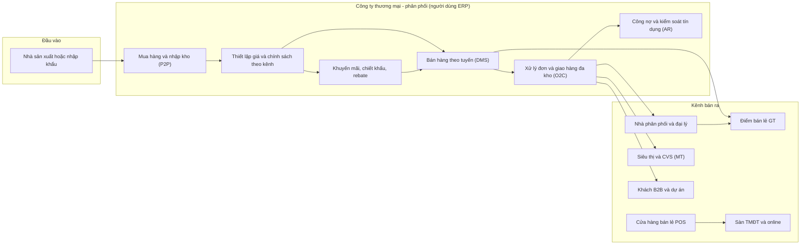
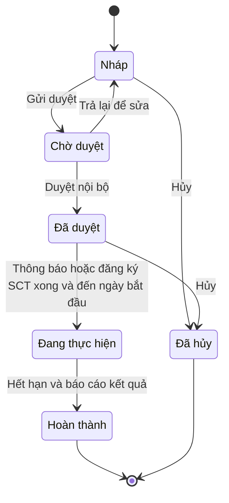
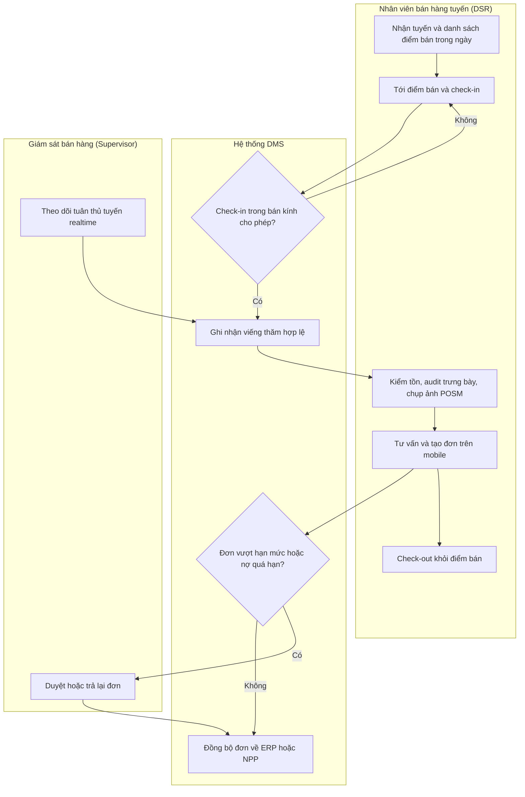
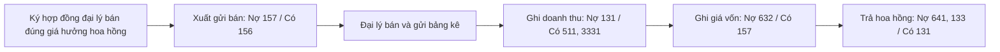

# Ngành Thương mại – Phân phối — kiến thức nghiệp vụ cho BA ERP

> Cập nhật đến: 2026-10-20 — quy định thay đổi thường xuyên; BA phải kiểm tra lại hiệu lực khi dùng cho dự án.

> Phạm vi: ERP cho **doanh nghiệp thương mại – phân phối** (trading & distribution) tại Việt Nam: nhà phân phối (NPP), công ty phân phối/nhãn hàng, đại lý, bán buôn B2B, chuỗi bán lẻ. File này chỉ mô tả phần **đặc thù ngành**; các quy trình nền (mua hàng, bán hàng, kho, công nợ, kế toán, thuế–hóa đơn) nằm ở file khác — xem liên kết trong từng mục. Không lặp nội dung file khác.

> Chế độ kế toán dùng trong file: **Thông tư 99/2025/TT-BTC** (regime in force 2026). Chi tiết & ánh xạ TT133/2016 (SME): `references/regulations/vn-accounting.md`.

## Mục lục
1. [Tổng quan ngành & mô hình kinh doanh](#1-tổng-quan-ngành--mô-hình-kinh-doanh)
2. [Quy định pháp lý liên quan](#2-quy-định-pháp-lý-liên-quan)
3. [Bản đồ quy trình đầu-cuối](#3-bản-đồ-quy-trình-đầu-cuối-của-ngành)
4. [Chi tiết từng quy trình đặc thù](#4-chi-tiết-từng-quy-trình-đặc-thù)
5. [Danh mục (master data) đặc thù](#5-danh-mục-master-data-đặc-thù-ngành)
6. [Module & chức năng chuẩn — feature catalog](#6-module--chức-năng-chuẩn-cho-erp-ngành)
7. [Báo cáo & KPI ngành](#7-báo-cáo--kpi-ngành)
8. [Đối thủ / sản phẩm tham chiếu](#8-đối-thủ--sản-phẩm-tham-chiếu)
9. [Thuật ngữ ngành](#9-thuật-ngữ-ngành)
10. [Câu hỏi khảo sát khách hàng](#10-câu-hỏi-khảo-sát-khách-hàng-của-ngành)
11. [Rủi ro & lỗi thường gặp](#11-rủi-ro--lỗi-thường-gặp-khi-phân-tích-ngành-này)
12. [Nguồn tham khảo](#12-nguồn-tham-khảo)

---

## 1. Tổng quan ngành & mô hình kinh doanh

### 1.1. Phân khúc & loại khách hàng của phần mềm
| Phân khúc | Đặc điểm nghiệp vụ | Phân hệ ERP trọng yếu |
|---|---|---|
| Phân phối FMCG (hàng tiêu dùng nhanh) | Nhiều SKU, vòng quay nhanh, hạn dùng (FEFO), bán theo tuyến (route-to-market), khuyến mãi dày đặc | DMS, SAL, INV, PROMO, AR |
| Phân phối dược phẩm | Quản lý số lô/hạn dùng bắt buộc, GDP/GSP, truy xuất, kiểm soát bán theo giấy phép | INV (lô/HSD), SAL, chất lượng |
| Phân phối vật liệu xây dựng / thiết bị | Đơn giá trị lớn, công nợ gối đầu dài, giao hàng công trình, bán theo dự án B2B | SAL (B2B), AR, INV |
| Phân phối điện tử / gia dụng | Serial/IMEI, bảo hành, kênh MT + đại lý + online | INV (serial), SVC bảo hành, ECM |
| Bán buôn (wholesale) B2B | Bảng giá nhiều bậc theo khối lượng, hợp đồng khung, chiết khấu theo doanh số | SAL, PRICE, AR |
| Chuỗi bán lẻ (retail chain) | POS nhiều cửa hàng, hóa đơn máy tính tiền, tồn kho đa điểm, bán đa kênh | POS, INV, ECM, CRM (loyalty) |

### 1.2. Chuỗi giá trị & kênh phân phối (route-to-market)
Nhà sản xuất/nhập khẩu → **Nhà phân phối (Distributor – NPP)** → **Đại lý/Điểm bán (Outlet)** → Người tiêu dùng. Nhiều mô hình chạy song song:

- **Kênh truyền thống – GT (General Trade):** tạp hóa, chợ, cửa hàng nhỏ; bán qua đội bán hàng đi tuyến (DMS).
- **Kênh hiện đại – MT (Modern Trade):** siêu thị, đại siêu thị, cửa hàng tiện lợi (CVS); PO tập trung, chiết khấu thương mại, phí trưng bày, đối soát sao kê.
- **Horeca:** nhà hàng, khách sạn, quán ăn.
- **B2B / dự án:** bán buôn, bán theo hợp đồng khung, bán cho công trình.
- **Online / Sàn TMĐT (E-commerce/Marketplace):** Shopee, Lazada, Tiki, TikTok Shop; website; bán hàng hợp kênh (omnichannel).
- **Bán lẻ trực tiếp (POS):** cửa hàng của chính doanh nghiệp.

Hai mô hình đội bán hàng tuyến:
- **Presales (bán trước – lấy đơn):** nhân viên đi tuyến ghi đơn, hàng giao sau bằng xe giao hàng độc lập.
- **Van sales (bán trên xe):** hàng đã ở trên xe, bán và giao ngay tại điểm bán; cuối ngày đối soát tồn xe và tiền.

### 1.3. Khái niệm sell-in / sell-out
- **Sell-in:** bán từ nhà sản xuất/nhãn hàng **vào** NPP (ghi nhận doanh thu của nhãn hàng).
- **Sell-out:** NPP bán **ra** điểm bán/người tiêu dùng (đo sức khỏe thị trường thật).
- Nhãn hàng dùng **DMS** để thu thập sell-out và tồn kho NPP (dữ liệu không nằm trên sổ của nhãn hàng) → cơ sở tính thưởng, dự báo, điều phối hàng. Đây là điểm khác biệt lớn so với ERP nội bộ thuần túy.

---

## 2. Quy định pháp lý liên quan

| Văn bản | Nội dung chính liên quan hệ thống | Hiệu lực | Tình trạng | Ảnh hưởng thiết kế |
|---|---|---|---|---|
| **Luật Thương mại 2005** (36/2005/QH11) [1] | Khung về khuyến mại (Điều 88–101): định nghĩa (Đ88), các hình thức KM (Đ92), hành vi bị cấm (Đ100), đăng ký/thông báo (Đ101) | 01/01/2006 | Còn hiệu lực | Module khuyến mãi phải khớp các hình thức KM hợp pháp; chặn hình thức bị cấm |
| **NĐ 81/2018/NĐ-CP** [2] | Quy định chi tiết Luật TM về xúc tiến thương mại: hạn mức giá trị KM, thủ tục **thông báo**/**đăng ký** KM với Sở/Bộ Công Thương, KM may rủi, báo cáo kết quả | 15/07/2018 | Còn hiệu lực, đã bị sửa nhiều lần (xem dưới) | Lưu số thông báo/đăng ký KM; kiểm soát hạn mức 50%/100%; quy trình may rủi |
| **NĐ 17/2020/NĐ-CP** [5] | Sửa đổi một số NĐ của Bộ Công Thương, trong đó có NĐ 81/2018 (hợp nhất tại VBHN 22/VBHN-BCT ngày 20/03/2020) | 2020 | Còn hiệu lực (đã có bản hợp nhất) | — |
| **NĐ 128/2024/NĐ-CP** [3] | Sửa NĐ 81/2018: KM tập trung áp **hạn mức 100%**; KM theo hình thức tại **khoản 8 Điều 92 LTM và Điều 8–11 NĐ 81 không phải thông báo**; **giảm** nghĩa vụ báo cáo kết quả KM; may rủi không có người trúng → nộp **50%** giá trị giải thưởng (mốc 45 ngày cho xử lý/nộp) | Ban hành 10/10/2024; hiệu lực **01/12/2024** | Còn hiệu lực | Cập nhật luật nghiệp vụ thông báo KM; cấu hình miễn thông báo theo hình thức |
| **NĐ 239/2026/NĐ-CP** [4] | Sửa NĐ 81/2018: viết lại **Điều 5** (hàng hóa/dịch vụ được & không được dùng để KM); sửa **Đ13 KM may rủi** (xác định trúng thưởng phải có khách hàng **chứng kiến trực tiếp hoặc trực tuyến**; làm rõ "giải không có người trúng") | **26/06/2026** (kể từ ngày ký) | Còn hiệu lực — **mới nhất 2026** | Rà soát lại logic may rủi; kiểm tra danh mục hàng cấm/hạn chế KM |
| **NĐ 254/2026/NĐ-CP** + **TT 91/2026/TT-BTC** (khung hóa đơn hiện hành từ 01/7/2026, **thay** NĐ 123/2020 & NĐ 70/2025) | Lập hóa đơn cho hàng **khuyến mại**; hóa đơn **điều chỉnh/thay thế** cho chiết khấu/giảm giá; hóa đơn từ **máy tính tiền** | 01/07/2026 | Còn hiệu lực | Xem `references/regulations/vn-tax-einvoice.md`. Hệ thống xuất HĐĐT hàng KM, HĐ điều chỉnh chiết khấu |
| **Luật Thuế GTGT 48/2024/QH15** + **NĐ 181/2025/NĐ-CP** [6] | Hàng **khuyến mại** đúng pháp luật TM có **giá tính thuế GTGT = 0**; nếu KM không đúng quy định → tính thuế như bán thường | 01/07/2025 | Còn hiệu lực | Xuất HĐ hàng KM giá 0 **chỉ khi** chương trình khai báo hợp lệ; xem `vn-tax-einvoice.md` |
| **TT 99/2025/TT-BTC** | Chế độ kế toán DN (regime in force) — hạch toán doanh thu, giảm trừ doanh thu (TK 521), hàng gửi bán (157), giá vốn | 01/01/2026 | Còn hiệu lực (thay TT200/2014) | Xem `references/regulations/vn-accounting.md`. Dùng số hiệu TK TT99 |
| **Luật Giá 2023** (16/2023/QH15) [17] | Quản lý giá, **nghĩa vụ niêm yết giá**, bình ổn giá, một số mặt hàng Nhà nước định giá | 01/07/2024 (đã có VBHN 36/VBHN-VPQH 2025 ⚠️) | Còn hiệu lực | Chức năng niêm yết giá bán lẻ; không bán cao hơn giá niêm yết |
| **Luật BVQLNTD 2023** (19/2023/QH15) + **NĐ 55/2024/NĐ-CP** [18] | Bảo vệ quyền lợi người tiêu dùng: hợp đồng mẫu, đổi/trả, bảo hành, thông tin sản phẩm | 01/07/2024 | Còn hiệu lực (thay luật 2010) | Quy tắc đổi/trả, bảo hành, lưu thông tin người tiêu dùng |
| Bán hàng đa cấp — NĐ 40/2018/NĐ-CP (sửa bởi NĐ 18/2023) ⚠️ CHƯA XÁC MINH trong phiên | Nếu mô hình là bán hàng đa cấp thì có khung riêng, giấy phép riêng | — | ⚠️ kiểm tra nếu KH là đa cấp | Thường **ngoài phạm vi** ERP phân phối thường; cảnh báo nếu gặp |

### 2.1. Hạn mức & thủ tục khuyến mại — tóm tắt vận hành (căn cứ NĐ 81/2018 sửa đổi) [2][3][9]
- **Hạn mức giá trị KM:** giá trị vật chất dùng để KM cho **một đơn vị** hàng hóa/dịch vụ **không quá 50%** giá bán ngay trước thời gian KM; tổng giá trị hàng dùng để KM trong một chương trình cũng giới hạn ~50%. **Ngoại lệ:** không áp trần với hình thức tại khoản 8, khoản 9 Điều 92 Luật TM. Trong **chương trình KM tập trung** (giờ/ngày/tuần/tháng/mùa KM) và chương trình do Thủ tướng quyết định → hạn mức **100%** [1][3].
- **Thông báo khuyến mại (notification):** gửi Sở Công Thương nơi tổ chức, **trước tối thiểu 03 ngày làm việc**; áp dụng cho KM không may rủi (giảm giá, tặng hàng, dùng thử, bán kèm phiếu…). Từ 01/12/2024, KM theo hình thức tại **Điều 8–11 NĐ 81 được miễn thông báo** [3][9].
- **Đăng ký khuyến mại (registration):** bắt buộc với KM **mang tính may rủi** (khách trúng thưởng theo thể lệ); phải được cơ quan **xác nhận trước khi thực hiện**. **Sở Công Thương** nếu trong 1 tỉnh; **Bộ Công Thương** nếu từ 2 tỉnh trở lên [9].
- **KM may rủi:** xác định trúng thưởng phải có khách hàng chứng kiến trực tiếp/trực tuyến (NĐ 239/2026) [4]; không có người trúng → **nộp 50% giá trị giải thưởng đã công bố** vào ngân sách [3].
- **NĐ 239/2026 (từ 26/06/2026) — đã xác minh [4]:** bỏ giới hạn **120 ngày/năm** cho KM giảm giá của một nhãn hiệu; chương trình **khách hàng thường xuyên** (thưởng theo số lượng/giá trị mua) **không phải thông báo**; thu hẹp danh mục hàng cấm KM (thuốc kê đơn vẫn cấm KM tới người tiêu dùng, trừ KM giữa các DN kinh doanh thuốc).
- **Báo cáo kết quả:** trong **45 ngày** kể từ khi kết thúc; một số hình thức được miễn báo cáo [3].
- ⚠️ CHƯA XÁC MINH: có dự thảo đề xuất **bỏ trần 50%** (sửa Điều 6 NĐ 81) nhưng chưa rõ đã ban hành — BA kiểm tra lại trước khi chốt [nguồn tìm kiếm chưa xác nhận].

> **Thiết kế:** mỗi chương trình KM phải có trường **Số/ngày thông báo hoặc xác nhận đăng ký** và loại hình (may rủi / không may rủi). Xuất hóa đơn hàng KM giá 0 **chỉ khi** chương trình đã khai báo hợp lệ; nếu không, hệ thống phải tính thuế GTGT như bán thường (xem §4.2 và `vn-tax-einvoice.md`).

---

## 3. Bản đồ quy trình đầu-cuối của ngành

Danh sách quy trình (những quy trình **đặc thù** in đậm; còn lại link file nền):
1. **Thiết lập kênh, NPP, đại lý, điểm bán & tuyến bán hàng** (§4 không mở riêng — xem §5 master data)
2. **Quản lý giá & chính sách giá theo kênh/khách hàng/vùng** (§4.1)
3. **Khuyến mãi & tuân thủ pháp lý** (§4.2)
4. **Chiết khấu thương mại & rebate/hồi khấu theo doanh số** (§4.3)
5. **Bán hàng theo tuyến — DMS (presales/van sales)** (§4.4)
6. **Hàng ký gửi / gửi bán đại lý (consignment)** (§4.5)
7. **Trả hàng & đổi hàng** (§4.6)
8. **Bán lẻ POS & hóa đơn máy tính tiền** (§4.7)
9. Mua hàng & nhập kho → `references/processes/p2p-procure-to-pay.md`
10. Xử lý đơn – giao hàng đa kho (Order-to-Cash) → `references/processes/o2c-order-to-cash.md`
11. Kiểm soát công nợ & hạn mức tín dụng → `references/processes/ar-accounts-receivable.md` (đặc thù §4.4, §5)
12. Quản lý kho đa điểm, lô/HSD, điều chuyển → `references/processes/inventory-warehouse.md`
13. Bán hàng online / sàn TMĐT & đối soát (§4.8)

---

## 4. Chi tiết từng quy trình đặc thù

Quy ước chung các mục dưới: trạng thái chứng từ dùng bộ mã chuẩn (DRAFT/PENDING/APPROVED/REJECTED/RETURNED/IN_PROGRESS/PARTIAL/COMPLETED/POSTED/CLOSED/CANCELLED/REVERSED — xem `references/conventions.md`). Bút toán dùng số hiệu TK **TT99/2025**; với SME dùng TT133 thì không có TK 521 (ghi giảm thẳng 511) và gộp 641 vào 6421 — xem `references/regulations/vn-accounting.md` §4.2.

### 4.1. Quản lý giá & chính sách giá theo kênh / khách hàng / vùng

**Vai trò:** Nhân viên trade marketing / quản lý giá (Pricing/Trade Marketing Staff – ROLE-PRICE-STAFF), Giám đốc kinh doanh (Sales Director – ROLE-SAL-DIR) duyệt, Kế toán bán hàng (Sales Accountant) tham chiếu.

**Chứng từ / đối tượng:** Bảng giá (Price List – MD-PRICELIST), Dòng giá theo SKU/bậc số lượng, Hợp đồng giá khách hàng (Customer-specific price agreement).

**Mô hình giá chuẩn ERP (nhiều cấp, có thứ tự ưu tiên):**
1. Giá hợp đồng/thỏa thuận riêng theo khách hàng (ưu tiên cao nhất).
2. Giá theo **nhóm khách hàng / kênh** (GT, MT, Horeca, B2B, online).
3. Giá theo **vùng/miền** (region) hoặc theo NPP.
4. Giá theo **bậc số lượng/giá trị** (tiered / volume pricing).
5. Bảng giá chuẩn (list price) — mặc định.

**Các bước:**
1. Tạo bảng giá (DRAFT) với: loại giá, đồng tiền, đơn vị tính/quy cách, ngày hiệu lực – hết hiệu lực, kênh/vùng/nhóm KH áp dụng.
2. Nhập dòng giá theo SKU và bậc số lượng (nếu có); đặt giá có/không gồm VAT (nhất quán toàn hệ thống).
3. Gửi duyệt (PENDING) → Duyệt (APPROVED) → kích hoạt theo ngày hiệu lực (IN_PROGRESS).
4. Khi hết hiệu lực → CLOSED; lưu phiên bản (versioning), không ghi đè giá cũ.

**Quy tắc (ví dụ):**
- BR-PRICE-01: Khi nhiều bảng giá cùng khớp, hệ thống **PHẢI** chọn theo thứ tự ưu tiên cấu hình (PRM-PRICE-001), không được mập mờ.
- BR-PRICE-02: Giá bán ra **KHÔNG ĐƯỢC** thấp hơn giá sàn (floor price) theo SKU/kênh; vượt ngưỡng phải duyệt cấp trên.
- BR-PRICE-03: Giá niêm yết bán lẻ **PHẢI** được quản lý để tuân thủ nghĩa vụ niêm yết giá (Luật Giá 2023) [17].
- BR-PRICE-04: Mọi thay đổi giá **PHẢI** lưu vết người sửa, thời điểm, ngày hiệu lực (audit trail).

**Tham số:** PRM-PRICE-001 (thứ tự ưu tiên bảng giá), PRM-PRICE-002 (giá gồm/không gồm VAT), PRM-PRICE-003 (cho phép sửa giá tay trên đơn trong biên độ ±x%), PRM-PRICE-004 (số chữ số thập phân đơn giá).

**Báo cáo:** RPT-PRICE-01 (lịch sử & hiệu lực bảng giá), RPT-PRICE-02 (so sánh giá theo kênh/vùng).

### 4.2. Khuyến mãi & tuân thủ pháp lý

**Vai trò:** Trade Marketing (ROLE-PRICE-STAFF) soạn, Sales Director (ROLE-SAL-DIR) / Kế toán trưởng (Chief Accountant) duyệt, hệ thống áp dụng tự động khi lên đơn.

**Chứng từ:** Chương trình khuyến mãi (Promotion Program – MD-PROMOTION / DOC-PROMO), kèm thể lệ, hình thức, ngân sách, số thông báo/đăng ký Sở–Bộ Công Thương.

**Các hình thức KM hay cấu hình & ánh xạ Luật TM Điều 92 [1]:**
| Hình thức nghiệp vụ | Mô tả cấu hình | Điều 92 LTM | Thủ tục |
|---|---|---|---|
| Giảm giá (% hoặc số tiền) | Theo SKU/hóa đơn/kênh, có trần số lượng/ngân sách | khoản 3 | Thông báo (miễn nếu thuộc Đ8–11 NĐ81) |
| Mua X tặng Y (bundle/gift) | Điều kiện mua → tặng hàng; cùng SKU hoặc SKU khác | khoản 2 | Thông báo |
| Tặng hàng không thu tiền / hàng mẫu dùng thử | Phát độc lập, không điều kiện mua | khoản 1, 2 | Thông báo |
| Chiết khấu theo bậc số lượng/giá trị | Mua đạt mốc → giảm giá/tặng | khoản 2, 3 | Thông báo |
| Phiếu mua hàng / voucher / e-voucher | Tặng phiếu dùng cho lần mua sau | khoản 4 | Thông báo |
| Tích điểm đổi quà (loyalty) | Theo chương trình khách hàng thân thiết | khoản 7 | Miễn thông báo (NĐ 239/2026 — thưởng theo số lượng/giá trị mua) |
| Quay số/bốc thăm trúng thưởng (may rủi) | Có yếu tố may rủi, có giải thưởng | khoản 6 | **Đăng ký** (Sở/Bộ CT) |

**Các bước (vòng đời chương trình KM):**
1. Soạn chương trình (DRAFT): hình thức, phạm vi (SKU/kênh/vùng/khách), điều kiện áp dụng, mức ưu đãi, thời gian, ngân sách, trần số lượng.
2. Kiểm tra **hạn mức 50%/100%** tự động (cảnh báo nếu vượt) — §2.1.
3. Gửi duyệt (PENDING) → Duyệt nội bộ (APPROVED).
4. **Thông báo/đăng ký** với Sở/Bộ Công Thương (nếu thuộc diện) → lưu số & ngày xác nhận (bước này là **cổng bắt buộc** trước khi chạy với hình thức áp dụng).
5. Đến ngày bắt đầu → kích hoạt (IN_PROGRESS); đơn hàng tự áp KM theo điều kiện.
6. Hết thời gian → COMPLETED; chốt số liệu; may rủi không có người trúng → nộp 50% giá trị giải thưởng vào NSNN (mốc 45 ngày cho xử lý/nộp). Nghĩa vụ **báo cáo kết quả KM** đã được **giảm/bỏ** theo NĐ 128/2024 & NĐ 239/2026 — ⚠️ đối chiếu văn bản gốc.

**Quy tắc:**
- BR-PROMO-01: Hệ thống **PHẢI** chặn kích hoạt chương trình thuộc diện phải thông báo/đăng ký khi chưa nhập số xác nhận của Sở/Bộ Công Thương (PRM-PROMO-003) [2][9].
- BR-PROMO-02: Khi nhiều KM cùng khớp một dòng đơn, áp dụng theo quy tắc **cộng dồn/không cộng dồn** (stacking) cấu hình tại PRM-PROMO-004; mặc định **không cộng dồn**, chọn ưu đãi tốt nhất cho khách.
- BR-PROMO-03: Giá trị KM mỗi đơn vị **KHÔNG ĐƯỢC** vượt hạn mức pháp lý (50%/100%) — cảnh báo cứng khi cấu hình [1][3].
- BR-PROMO-04: KM tiêu hao **ngân sách & trần số lượng**; khi hết ngân sách/hết suất, hệ thống ngừng áp dụng tự động.

**Hạch toán đặc thù KM (TT99/2025):**

Hàng khuyến mại **không thu tiền, không kèm điều kiện mua** (chương trình đã khai báo hợp lệ) — giá tính thuế GTGT = 0 [6]:
| Nghiệp vụ | Nợ | Có | Ghi chú |
|---|---|---|---|
| Xuất hàng KM không thu tiền (ghi theo giá vốn) | 641 | 156 | Lập HĐĐT, dòng hàng KM đơn giá 0, ghi rõ "hàng khuyến mại"; xem `vn-tax-einvoice.md` |
| Nếu KM **không** đăng ký/không đúng pháp luật TM | 641 | 3331 | Phải kê khai thuế GTGT đầu ra trên giá tính thuế hàng tương đương [6] |

Hàng khuyến mại **kèm điều kiện mua** (ví dụ mua 10 tặng 1) — bản chất là **giảm giá hàng bán**, phân bổ doanh thu cho cả hàng bán và hàng tặng; giá vốn hàng tặng vào 632 (theo logic TT200 Đ79 tiếp tục áp dụng — BA đối chiếu hướng dẫn TT99) ⚠️ xác minh chi tiết theo chế độ dự án:
| Nghiệp vụ | Nợ | Có | Ghi chú |
|---|---|---|---|
| Doanh thu (phân bổ cho tổng lô gồm hàng tặng) | 131/111/112 | 511, 3331 | Tổng tiền thu phân bổ cho cả hàng bán + hàng tặng |
| Giá vốn toàn bộ hàng xuất (gồm hàng tặng) | 632 | 156 | — |

**Tham số:** PRM-PROMO-001 (loại hình KM cho phép), PRM-PROMO-002 (ngưỡng cảnh báo hạn mức 50/100%), PRM-PROMO-003 (bắt buộc số thông báo/đăng ký), PRM-PROMO-004 (quy tắc cộng dồn), PRM-PROMO-005 (nguồn ngân sách KM: nhãn hàng/NPP chia sẻ).

**Báo cáo:** RPT-PROMO-01 (hiệu quả KM — uplift doanh số so với baseline), RPT-PROMO-02 (quyết toán ngân sách KM), RPT-PROMO-03 (theo dõi tuân thủ pháp lý: chương trình & số đăng ký).

### 4.3. Chiết khấu thương mại & rebate / hồi khấu theo doanh số

Phân biệt 3 khái niệm dễ nhầm (rất quan trọng cho hạch toán & hóa đơn):
| Khái niệm | Bản chất | Hạch toán bên bán (TT99) | Thuế GTGT |
|---|---|---|---|
| **Chiết khấu thương mại** (Trade Discount) | Giảm giá do mua nhiều/đạt doanh số | Giảm trừ doanh thu — **TK 521** | Giảm thuế GTGT đầu ra tương ứng |
| **Giảm giá hàng bán** (Sales Allowance) | Giảm giá do hàng kém phẩm chất, không đúng quy cách | Giảm trừ doanh thu — **TK 521** | Giảm thuế GTGT đầu ra |
| **Chiết khấu thanh toán** (Payment/Cash Discount) | Thưởng do khách trả tiền sớm | **Chi phí tài chính — TK 635** (không giảm doanh thu) | **Không** điều chỉnh GTGT (không phải khuyến mại) |

> Lưu ý pháp lý: **chiết khấu thương mại không phải là khuyến mại** theo Luật TM [1] — không phải thông báo/đăng ký, nhưng vẫn phải thể hiện đúng trên hóa đơn.

**Chiết khấu thương mại theo doanh số (volume rebate / hồi khấu cuối kỳ):**
- Cơ chế: khách đạt mốc doanh số kỳ (tháng/quý/năm) → hưởng % chiết khấu; thường quyết toán cuối kỳ.
- Cách xuất hóa đơn [8]:
  - Nếu số chiết khấu **nhỏ hơn** giá trị hóa đơn kỳ tiếp theo → trừ thẳng trên hóa đơn đó.
  - Nếu **lớn hơn** / quyết toán khi kết thúc chương trình → lập **hóa đơn điều chỉnh** kèm **bảng kê các hóa đơn** được điều chỉnh; hai bên kê khai điều chỉnh doanh thu/thuế.

**Hạch toán chiết khấu thương mại (bên bán, TT99):**
| Nghiệp vụ | Nợ | Có | Ghi chú |
|---|---|---|---|
| Chiết khấu thương mại trả/giảm cho khách | 521 | | Chi tiết "Chiết khấu thương mại" (TT99 bỏ chi tiết cứng 5211; DN tự chi tiết) [7] |
| Thuế GTGT đầu ra giảm tương ứng | 3331 | | |
| Tổng số tiền chiết khấu (gồm thuế) | | 131/111/112 | Trừ công nợ hoặc chi tiền |

**Hạch toán bên mua** (nếu hàng còn tồn: giảm giá vốn tồn; nếu đã bán: giảm 632) [8]:
| Nghiệp vụ | Nợ | Có | Ghi chú |
|---|---|---|---|
| Nhận chiết khấu (giảm công nợ phải trả) | 331/111/112 | | |
| Giảm thuế GTGT đầu vào đã khấu trừ | | 133 | |
| Giảm trị giá hàng tồn / giá vốn | | 156 hoặc 632 | 156 nếu còn tồn, 632 nếu đã bán |

**Rebate / thưởng NPP đạt chỉ tiêu bằng tiền hoặc hàng:** nếu bản chất là **chiết khấu thương mại** → xử lý như trên; nếu là **chi hỗ trợ/khuyến mại** → lập hóa đơn/chứng từ phù hợp, hạch toán 641. BA **PHẢI** làm rõ với kế toán bản chất từng khoản để chọn đúng TK & hóa đơn.

**Tham số:** PRM-REBATE-001 (kỳ tính rebate: tháng/quý/năm), PRM-REBATE-002 (bậc doanh số & tỷ lệ), PRM-REBATE-003 (hình thức chi: giảm công nợ/tiền/hàng), PRM-REBATE-004 (cơ sở tính: doanh số thuần/sau VAT).

**Báo cáo:** RPT-REBATE-01 (quyết toán chiết khấu/rebate theo khách/NPP), RPT-REBATE-02 (dự chi rebate đang tích lũy — accrual).

### 4.4. Bán hàng theo tuyến — DMS (Distribution Management System)

**Vai trò:** Nhân viên bán hàng tuyến / salesman thị trường (Field Salesman / DSR – ROLE-DMS-DSR), Giám sát bán hàng (Sales Supervisor – ROLE-DMS-SUP), Quản lý khu vực (Area Sales Manager – ROLE-SAL-ASM), Nhân viên giao hàng (Delivery Staff), Admin điều phối đơn (Order Coordinator).

**Chứng từ / đối tượng:** Tuyến bán hàng (Route/Journey Plan – MD-ROUTE), Lịch viếng thăm (Visit/MCP – Monthly Call Plan), Đơn hàng (Sales Order), Phiếu viếng thăm (Visit record: check-in/out, ảnh, kiểm kho điểm bán, audit trưng bày), Phiếu bán hàng van sales.

**Các bước (presales):**
1. Hệ thống phân tuyến & lịch viếng thăm theo tần suất (MCP) cho từng DSR.
2. DSR mở app, nhận danh sách điểm bán trong ngày; di chuyển tới điểm bán, **check-in** (xác thực GPS trong bán kính PRM-DMS-001).
3. Thực hiện tác nghiệp tại điểm: kiểm tồn kho trưng bày, **audit trưng bày** (chụp ảnh POSM/kệ hàng), khảo sát giá đối thủ, ghi nhận đơn.
4. Lên đơn hàng trên mobile; hệ thống áp giá + KM + kiểm **hạn mức tín dụng/công nợ quá hạn**.
5. **Check-out**; đơn đồng bộ về ERP/NPP để duyệt & giao.
6. Giám sát theo dõi tuân thủ tuyến theo thời gian thực (vị trí, thời lượng, độ phủ).

**Van sales (bán & giao ngay trên xe):** hàng xuất lên "kho xe" (van stock) đầu ngày; mỗi giao dịch bán giảm tồn xe và xuất hóa đơn ngay; cuối ngày **đối soát tồn xe + tiền mặt** và nhập trả hàng tồn về kho.

**Quy tắc:**
- BR-DMS-01: Viếng thăm chỉ hợp lệ khi check-in trong bán kính PRM-DMS-001 quanh tọa độ điểm bán và đủ thời lượng tối thiểu PRM-DMS-002.
- BR-DMS-02: DSR **KHÔNG ĐƯỢC** lên đơn cho điểm bán ngoài tuyến được phân (trừ khi có quyền bán ngoài tuyến).
- BR-DMS-03: Đơn vượt hạn mức tín dụng hoặc có công nợ quá hạn ≥ PRM-AR-002 ngày **PHẢI** bị chặn/chờ duyệt (xem `ar-accounts-receivable.md`).
- BR-DMS-04: Audit trưng bày **PHẢI** có ảnh chụp kèm tọa độ & thời gian (chống gian lận viếng thăm "ảo").
- BR-DMS-05: Van sales — cuối ngày tồn xe thực tế **PHẢI** khớp (tồn đầu + xuất lên xe − đã bán − trả về); chênh lệch phải giải trình.

**Hạch toán đặc thù:** kho xe là một **điểm lưu kho (storage location)** riêng; điều chuyển kho tổng → kho xe không phát sinh doanh thu (chỉ di chuyển nội bộ 156). Doanh thu ghi nhận khi bán tại điểm bán như bán hàng thường. Chi tiết kho/điều chuyển: `references/processes/inventory-warehouse.md`.

**Tham số:** PRM-DMS-001 (bán kính cho phép check-in, m), PRM-DMS-002 (thời lượng viếng thăm tối thiểu, phút), PRM-DMS-003 (bắt buộc chụp ảnh trưng bày Y/N), PRM-DMS-004 (cho phép bán ngoài tuyến Y/N), PRM-DMS-005 (cho phép lên đơn offline & ngưỡng đồng bộ).

**Báo cáo:** RPT-DMS-01 (tuân thủ viếng thăm & tuyến — visit compliance), RPT-DMS-02 (độ phủ & điểm bán có đơn — coverage/active outlets), RPT-DMS-03 (năng suất DSR: số viếng thăm, strike rate, SKU/đơn), RPT-DMS-04 (đối soát van sales cuối ngày).

### 4.5. Hàng ký gửi / gửi bán đại lý (Consignment)

**Khái niệm:** giao hàng cho đại lý nhưng **chưa chuyển quyền sở hữu/chưa ghi doanh thu** cho đến khi đại lý bán được. Dùng **TK 157 – Hàng gửi đi bán**. Áp dụng cho "đại lý bán đúng giá hưởng hoa hồng".

**Vai trò:** Kế toán bán hàng, Thủ kho (Storekeeper), Kế toán công nợ phải thu (AR Accountant).

**Hạch toán (TT99):**
| Nghiệp vụ | Nợ | Có | Ghi chú |
|---|---|---|---|
| Xuất kho gửi đại lý/ký gửi | 157 | 156 | Theo giá vốn; chưa ghi doanh thu |
| Đại lý bán được, nhận bảng kê — ghi doanh thu | 131/111/112 | 511, 3331 | Theo giá bán quy định |
| Kết chuyển giá vốn hàng đã bán | 632 | 157 | |
| Hoa hồng trả đại lý (đại lý xuất hóa đơn) | 641, 133 | 131/111 | Hoa hồng là chi phí bán hàng |
| Hàng ký gửi bị trả về nhập lại kho | 156 | 157 | |

**Quy tắc:**
- BR-CNS-01: Hàng gửi bán **KHÔNG** ghi nhận doanh thu khi xuất kho; chỉ ghi khi có xác nhận bán (bảng kê) từ đại lý.
- BR-CNS-02: Hệ thống **PHẢI** theo dõi tồn ký gửi theo từng đại lý và đối soát định kỳ.

**Tham số:** PRM-CNS-001 (tỷ lệ hoa hồng theo đại lý/nhóm hàng), PRM-CNS-002 (chu kỳ đối soát ký gửi). **Báo cáo:** RPT-CNS-01 (tồn & doanh số hàng ký gửi theo đại lý).

### 4.6. Trả hàng & đổi hàng (Returns & Exchanges)

**Vai trò:** Nhân viên bán hàng/CSKH tạo yêu cầu, Giám sát/Quản lý duyệt, Thủ kho nhập lại, Kế toán bán hàng ghi giảm doanh thu.

**Chứng từ:** Yêu cầu trả hàng (Return Request/RMA – DOC-RMA), Phiếu nhập hàng trả lại, Hóa đơn điều chỉnh/trả lại.

**Lý do trả/đổi điển hình:** hàng cận/hết hạn dùng (FMCG/dược), hàng lỗi/hư hỏng vận chuyển, giao sai/thừa, khách hủy, chính sách đổi trả bán lẻ (Luật BVQLNTD 2023 [18]).

**Các bước:** Tạo RMA (DRAFT) → duyệt (APPROVED) → nhập kho hàng trả (hoặc kho hàng hư) → lập hóa đơn điều chỉnh/trả lại → ghi giảm doanh thu & hoàn giá vốn → hoàn tiền/giảm công nợ (COMPLETED).

**Hạch toán hàng bán bị trả lại (TT99):**
| Nghiệp vụ | Nợ | Có | Ghi chú |
|---|---|---|---|
| Ghi giảm doanh thu phần bị trả | 521 | | Chi tiết "Hàng bán bị trả lại" |
| Giảm thuế GTGT đầu ra | 3331 | | |
| Giảm công nợ/hoàn tiền cho khách | | 131/111/112 | |
| Nhập lại kho & hoàn giá vốn | 156 | 632 | Nếu hàng còn bán được; hàng hư → 1381/chi phí |

**Quy tắc:**
- BR-RET-01: Chỉ nhận trả trong thời hạn & điều kiện cấu hình (PRM-RET-001); hàng cận HSD dưới ngưỡng có chính sách riêng.
- BR-RET-02: Hàng trả phải phân loại **bán lại được / hàng hư hỏng**; hàng hư không nhập vào tồn bán.
- BR-RET-03: Đổi hàng = một nghiệp vụ trả + một nghiệp vụ bán mới, liên kết chứng từ.

**Tham số:** PRM-RET-001 (thời hạn cho phép trả, ngày), PRM-RET-002 (ngưỡng HSD còn lại được nhận trả), PRM-RET-003 (phí trả hàng nếu có). **Báo cáo:** RPT-RET-01 (tỷ lệ & giá trị trả hàng theo lý do/khách/SKU).

### 4.7. Bán lẻ POS & hóa đơn khởi tạo từ máy tính tiền

> Cơ chế hóa đơn điện tử từ máy tính tiền, đối tượng bắt buộc, điều chỉnh/thay thế hóa đơn: xem đầy đủ tại `references/regulations/vn-tax-einvoice.md` (§4.7). Mục này chỉ nêu phần POS đặc thù.

**Vai trò:** Thu ngân (Cashier – ROLE-POS-CASHIER), Quản lý cửa hàng (Store Manager – ROLE-POS-MGR), Kế toán bán lẻ.

**Đặc thù POS:**
- Bán nhanh theo **ca (shift)**: mở ca/đóng ca, kiểm quỹ đầu–cuối ca, đối soát tiền mặt vs doanh thu.
- Thanh toán **đa phương thức**: tiền mặt, thẻ, ví điện tử, QR, voucher, điểm thưởng — một hóa đơn nhiều hình thức.
- **Hóa đơn điện tử khởi tạo từ máy tính tiền** ký hiệu mẫu loại **M**; đối tượng hộ KD doanh thu ≥ 1 tỷ đồng/năm thuộc bán lẻ, ăn uống… bắt buộc dùng (xem `vn-tax-einvoice.md`). Hóa đơn từ máy tính tiền **chỉ được lập hóa đơn thay thế** (không điều chỉnh) khi sai sót.
- Hoạt động **offline** khi mất mạng, đồng bộ lại khi có kết nối (PRM-POS-001).
- Tồn kho bán lẻ theo cửa hàng; đồng bộ tồn/giá đa điểm với kho tổng.

**Quy tắc:**
- BR-POS-01: Đóng ca **PHẢI** đối soát: tiền mặt thực + phi tiền mặt = doanh thu ca; chênh lệch ghi nhận & giải trình.
- BR-POS-02: Mỗi giao dịch bán lẻ **PHẢI** phát sinh hóa đơn/chứng từ theo quy định hóa đơn hiện hành.
- BR-POS-03: Giá bán lẻ không vượt giá niêm yết (Luật Giá 2023) [17].

**Tham số:** PRM-POS-001 (cho phép bán offline & giới hạn), PRM-POS-002 (phương thức thanh toán cho phép), PRM-POS-003 (làm tròn tiền mặt), PRM-POS-004 (in/gửi hóa đơn tự động). **Báo cáo:** RPT-POS-01 (doanh thu theo cửa hàng/ca/thu ngân), RPT-POS-02 (top SKU bán lẻ).

### 4.8. Bán hàng online / sàn TMĐT & đối soát

**Đặc thù:** đồng bộ **sản phẩm – giá – tồn kho – đơn hàng** hai chiều với Shopee/Lazada/Tiki/TikTok Shop và website; gom đơn đa kênh về một nơi; **đối soát** phí sàn, phí vận chuyển, tiền COD, hoàn/hủy. Mapping SKU hệ thống ↔ mã SKU trên sàn là điểm nghẽn thường gặp.

**Quy tắc:**
- BR-ECM-01: Tồn kho bán trên các kênh **PHẢI** được quản lý tránh oversell (giữ tồn/kho ảo theo kênh).
- BR-ECM-02: Doanh thu sàn **PHẢI** đối soát theo sao kê sàn; chênh lệch phí/hoàn ghi nhận đúng kỳ.

**Tham số:** PRM-ECM-001 (phân bổ tồn theo kênh), PRM-ECM-002 (quy tắc mapping SKU). **Báo cáo:** RPT-ECM-01 (đối soát doanh thu – phí sàn theo kênh). Tích hợp kỹ thuật: khai báo ở `03-specification/catalogs/integrations-notifications.md` của dự án (INT).

---

## 5. Danh mục (master data) đặc thù ngành (trường quan trọng)

| Mã | Danh mục | Trường quan trọng (đặc thù ngành) |
|---|---|---|
| MD-PRODUCT | Sản phẩm / SKU | Mã SKU, barcode/mã vạch, **quy cách đóng gói & cây đơn vị tính** (lon–lốc–thùng, hệ số quy đổi), nhóm/ngành hàng, **quản lý lô–HSD (FEFO)**, serial/IMEI (điện tử), thuế suất GTGT, giá vốn, trọng lượng/thể tích (chất xe) |
| MD-DISTRIBUTOR | Nhà phân phối (NPP) | Mã NPP, địa bàn độc quyền, kho NPP, hạn mức tín dụng, điều khoản thanh toán, chỉ tiêu doanh số, bậc chiết khấu/rebate |
| MD-CUSTOMER | Khách hàng / Điểm bán (Outlet) | Mã, **kênh (GT/MT/Horeca/B2B)**, loại hình điểm bán, **tọa độ GPS**, tuyến & tần suất viếng thăm, NPP phụ trách, hạn mức tín dụng, nhóm giá |
| MD-ROUTE | Tuyến bán hàng (Route/MCP) | Mã tuyến, DSR phụ trách, danh sách điểm bán & thứ tự, tần suất (ngày/tuần), vùng/khu vực |
| MD-SALESREP | Nhân viên bán hàng tuyến (DSR) | Mã NV, tuyến phụ trách, chỉ tiêu (target), thiết bị, vùng, giám sát quản lý |
| MD-PRICELIST | Bảng giá | Loại giá, kênh/vùng/nhóm KH, đồng tiền, gồm/không gồm VAT, ngày hiệu lực, **bậc số lượng**, giá sàn |
| MD-PROMOTION | Chương trình khuyến mãi | Hình thức (Đ92), điều kiện áp dụng, mức ưu đãi, phạm vi SKU/kênh/vùng, thời gian, ngân sách, trần số lượng, **số thông báo/đăng ký SCT**, loại may rủi/không |
| MD-REBATE | Chính sách chiết khấu/rebate | Cơ sở tính (doanh số thuần), bậc & tỷ lệ, kỳ tính, hình thức chi |
| MD-WAREHOUSE | Kho / điểm lưu kho | Kho tổng, kho NPP, **kho xe (van)**, kho cửa hàng, kho hàng hư/đổi trả; cho phép tồn âm? |
| MD-POSM | Vật phẩm trưng bày / chương trình trưng bày | Loại POSM, tiêu chí trưng bày, mức thưởng trưng bày, chu kỳ audit |
| MD-UOM | Đơn vị tính & quy đổi | Cây quy đổi lon↔lốc↔thùng; đơn vị bán, đơn vị tồn kho, đơn vị báo cáo |

> Danh mục nền (nhà cung cấp, tài khoản kế toán, thuế suất…) định nghĩa ở catalog chung của dự án và file nền — không lặp lại ở đây.

---

## 6. Module & chức năng chuẩn cho ERP ngành

Bảng feature catalog. Mức độ: **M**=Must, **S**=Should, **C**=Could. Mã module gợi ý: SAL (bán hàng), DMS (phân phối thị trường), POS (bán lẻ), PRICE (giá & KM), INV (kho), AR (công nợ), ECM (online).

| Module | Chức năng | Mô tả | Demo | Sản phẩm đầy đủ |
|---|---|---|---|---|
| PRICE | Bảng giá nhiều cấp theo kênh/vùng/KH | Ưu tiên giá, hiệu lực, bậc số lượng, giá sàn | M | M |
| PRICE | Quản lý chương trình khuyến mãi | Cấu hình hình thức KM, điều kiện, ngân sách, trần | M | M |
| PRICE | Kiểm soát hạn mức & thủ tục KM pháp lý | Cảnh báo 50/100%, lưu số thông báo/đăng ký | S | M |
| PRICE | Chiết khấu thương mại & rebate theo doanh số | Bậc, kỳ tính, accrual, quyết toán, xuất HĐ điều chỉnh | S | M |
| DMS | Phân tuyến & lịch viếng thăm (MCP) | Gán tuyến/DSR, tần suất, tối ưu lộ trình | M | M |
| DMS | App bán hàng tuyến (mobile, offline) | Check-in/out GPS, lên đơn, xem tồn/giá/công nợ | M | M |
| DMS | Audit trưng bày & khảo sát thị trường | Chụp ảnh POSM, khảo sát giá đối thủ, độ phủ | S | M |
| DMS | Van sales (bán & giao trên xe) | Kho xe, bán–giao tức thời, đối soát cuối ngày | C | S |
| DMS | Giám sát realtime & chống gian lận viếng thăm | Bản đồ GPS, thời lượng, ảnh có tọa độ–thời gian | S | M |
| SAL | Đơn hàng & duyệt theo hạn mức | Áp giá+KM tự động, chặn vượt hạn mức/nợ quá hạn | M | M |
| SAL | Quản lý NPP, đại lý, điểm bán | Phân cấp kênh, địa bàn, chỉ tiêu | M | M |
| SAL | Hàng ký gửi/gửi bán đại lý (consignment) | Theo dõi tồn ký gửi, ghi nhận khi bán, hoa hồng | C | S |
| SAL | Thu thập sell-out & tồn kho NPP | Nhập/đồng bộ dữ liệu bán ra của NPP | C | S |
| INV | Kho đa điểm & điều chuyển | Kho tổng/NPP/xe/cửa hàng, điều chuyển nội bộ | M | M |
| INV | Quản lý lô – hạn dùng (FEFO) | Bắt buộc với FMCG/dược; cảnh báo cận date | S | M |
| INV | Serial/IMEI & bảo hành | Điện tử/gia dụng; liên kết `crm-service.md` | C | S |
| AR | Hạn mức tín dụng & kiểm soát công nợ | Hạn mức theo KH/NPP, chặn đơn, tuổi nợ, DSO | M | M |
| AR | Thu tiền theo tuyến & đối soát | Thu hộ của DSR/van, đối soát quỹ | S | M |
| POS | Bán lẻ POS & ca bán | Mở/đóng ca, thanh toán đa phương thức, offline | C | M |
| POS | Hóa đơn điện tử máy tính tiền | Phát HĐĐT mẫu M, thay thế khi sai | C | M |
| ECM | Tích hợp sàn TMĐT & website | Đồng bộ sản phẩm/giá/tồn/đơn, chống oversell | C | S |
| ECM | Đối soát sàn & phí | Đối soát sao kê, COD, phí, hoàn | C | S |
| SAL | Trả hàng & đổi hàng (RMA) | Quy trình trả/đổi, giảm trừ doanh thu | S | M |
| — | Báo cáo & dashboard phân phối | KPI độ phủ, sell-in/out, tồn NPP, năng suất DSR | S | M |

---

## 7. Báo cáo & KPI ngành

### 7.1. Báo cáo chuẩn
| Mã | Báo cáo | Mục đích | Tính pháp lý? |
|---|---|---|---|
| RPT-SAL-01 | Sell-in / Sell-out theo NPP, kênh, vùng | Đo đẩy hàng vào & bán ra thực tế | Không (quản trị) |
| RPT-SAL-02 | Doanh số vs chỉ tiêu (theo DSR/tuyến/vùng) | Theo dõi đạt target | Không |
| RPT-DMS-01 | Tuân thủ viếng thăm & tuyến (visit compliance) | Giám sát đội tuyến | Không |
| RPT-DMS-02 | Độ phủ & điểm bán có đơn (coverage/active) | Đo phủ thị trường | Không |
| RPT-DMS-03 | Năng suất DSR (viếng thăm, strike rate, SKU/đơn) | Đánh giá nhân viên | Không |
| RPT-INV-01 | Tồn kho & cảnh báo hết hàng (OOS) đa kho/NPP | Điều phối hàng | Không |
| RPT-INV-02 | Tồn theo lô – hạn dùng (cận/hết HSD) | Quản lý FEFO | Không |
| RPT-PROMO-01 | Hiệu quả khuyến mãi (uplift vs baseline) | Đánh giá ROI KM | Không |
| RPT-PROMO-03 | Theo dõi chương trình KM & số đăng ký SCT | Tuân thủ pháp lý KM | Hỗ trợ tuân thủ [2] |
| RPT-REBATE-01 | Quyết toán chiết khấu/rebate theo NPP/khách | Chốt công nợ thưởng | Không |
| RPT-AR-01 | Công nợ & tuổi nợ (aging), DSO theo khách | Kiểm soát rủi ro tín dụng | Không (xem `ar-accounts-receivable.md`) |
| RPT-POS-01 | Doanh thu bán lẻ theo cửa hàng/ca/thu ngân | Quản trị bán lẻ | Không |
| RPT-ECM-01 | Đối soát doanh thu – phí sàn TMĐT | Đối soát online | Không |

> Báo cáo thuế/kế toán bắt buộc (tờ khai GTGT, BCTC, sổ sách) **không** thuộc file này — xem `references/regulations/vn-tax-einvoice.md` và `references/regulations/vn-accounting.md`.

### 7.2. KPI ngành phân phối
| KPI | Định nghĩa / công thức | Nhóm |
|---|---|---|
| Độ phủ (Numeric/Weighted Distribution) | % điểm bán có bán SKU trên tổng điểm bán mục tiêu | Thị trường |
| Active Outlets | Số điểm bán phát sinh đơn trong kỳ | Thị trường |
| Strike Rate | Số đơn thành công / số viếng thăm | Năng suất |
| Lines per Call (SKU/đơn) | Số SKU trung bình mỗi đơn | Năng suất |
| Visit Compliance | % viếng thăm đúng kế hoạch/đúng tuyến | Tuân thủ |
| Calls per Day | Số điểm bán viếng thăm/ngày/DSR | Năng suất |
| OOS Rate (Out-of-stock) | % SKU hết hàng tại điểm bán/NPP | Vận hành |
| Sell-through | Sell-out / (tồn đầu + sell-in) | Dòng hàng |
| DIO (Days Inventory Outstanding) | Số ngày tồn kho bình quân | Tồn kho |
| DSO (Days Sales Outstanding) | Kỳ thu tiền bình quân | Công nợ |
| Promotion ROI / Uplift | Doanh số tăng thêm / chi phí KM | Khuyến mãi |
| Fill Rate / OTIF | Giao đủ, đúng hạn / tổng đơn | Dịch vụ giao hàng |
| Target Achievement | Doanh số thực / chỉ tiêu | Hiệu quả |

---

## 8. Đối thủ / sản phẩm tham chiếu

> Chỉ liệt kê **tính năng có nguồn**; phần lớn trang nhà cung cấp mang tính tiếp thị — BA phải yêu cầu demo/tài liệu hợp đồng để xác nhận trước khi dựa vào. Nghiên cứu đối thủ tổng hợp: `references/competitor-research.md`.

| Sản phẩm | Nhóm | Tính năng có nguồn (tóm tắt) | Nguồn |
|---|---|---|---|
| **MobiWork DMS** (VN) | DMS phân phối | Phân tuyến cho từng NV, tránh đi chồng/trái tuyến, theo dõi lộ trình trên bản đồ GPS; check-in/out tại điểm bán, xem thời gian–vị trí–lịch sử–ảnh viếng thăm; kiểm soát tồn tại điểm bán/đại lý/NPP; theo dõi ảnh trưng bày & độ phủ; quản lý KM, chiết khấu, công nợ, chương trình trưng bày & POSM; giám sát van sales | [10] |
| **DMSpro** (VN) | DMS phân phối (cloud) | Giải pháp DMS trên nền đám mây cho nhà sản xuất & NPP; thiết kế theo ngành (FMCG, dược, vật liệu xây dựng, điện tử, gia dụng, nông nghiệp); khách hàng nêu gồm Samsung, P&G, Tân Hiệp Phát, TH True Milk | [11] |
| **KiotViet** (VN) | Bán lẻ / POS | Bán hàng kể cả khi mất internet (offline), đồng bộ tồn kho–giá–đơn hàng các kênh; đồng bộ sàn TMĐT & mạng xã hội (Tiki, Shopee, Lazada, TikTok Shop, Sendo, Facebook, Zalo), tạo website bán hàng; mục "Hóa đơn điện tử Miễn phí"; báo cáo biểu đồ hàng ngày/tháng; quản lý giao hàng & quản lý nhân viên (chấm công, lương, hoa hồng) | [12] |
| **Sapo** (VN) | Bán lẻ hợp kênh (omnichannel) | Nền tảng quản lý bán hàng hợp kênh; đồng bộ dữ liệu bán hàng, hóa đơn, kho, khách hàng trên mọi kênh (cửa hàng, website, Facebook, sàn Shopee/Lazada/Tiki); gom đơn đa kênh về một hệ thống | [13] |
| **Odoo** (quốc tế) | ERP / Sales + POS | Bảng giá (pricelist) & chương trình "Discounts, Loyalty & Gift Card" (giảm giá, loyalty, thẻ quà) dùng cho online & tại cửa hàng; chương trình loyalty trên Point of Sale, có thể giới hạn theo pricelist áp dụng | [14] |
| **Microsoft Dynamics 365** (quốc tế) | ERP (Supply Chain) | Module **Rebate management** gộp customer rebates, royalties, vendor rebates; **Trade allowance management** quản lý chiết khấu nhà cung cấp dành cho NPP/bán buôn/bán lẻ như ưu đãi xúc tiến (bill-back, deduction). ⚠️ Nhiều trang Trade allowance là bản lưu trữ (AX 2012 R3) | [15] |
| **SAP S/4HANA** (quốc tế) | ERP lớn | Từ S/4HANA, xử lý chiết khấu (rebate) cổ điển được thay bằng **Condition Contract Management** thuộc **Settlement Management**: condition contract định nghĩa cơ sở tính rebate, kỳ quyết toán, số tiền, đối tượng nhận; settlement run tạo chứng từ quyết toán làm căn cứ ghi sổ (từ release 1610). ⚠️ Nguồn thứ cấp (SAP PRESS/tư vấn), không phải help.sap.com | [16] |

---

## 9. Thuật ngữ ngành (VI – EN – giải thích)

| Tiếng Việt | English (viết tắt) | Giải thích ngắn |
|---|---|---|
| Nhà phân phối | Distributor (NPP) | Trung gian mua đứt bán đoạn từ nhà sản xuất, phân phối lại cho điểm bán trên địa bàn |
| Đại lý | Agent / Dealer | Bán hàng cho nhà cung cấp, có thể bán đúng giá hưởng hoa hồng (ký gửi) |
| Điểm bán | Outlet | Cửa hàng/tạp hóa bán cho người tiêu dùng cuối |
| Kênh truyền thống | General Trade (GT) | Kênh tạp hóa, chợ; bán qua đội tuyến |
| Kênh hiện đại | Modern Trade (MT) | Siêu thị, đại siêu thị, cửa hàng tiện lợi |
| Bán theo tuyến | Route-to-Market / Journey Plan | Lịch & lộ trình viếng thăm điểm bán theo tần suất |
| Hệ thống quản lý phân phối | Distribution Management System (DMS) | Phần mềm quản lý bán hàng thị trường, tuyến, tồn NPP, trưng bày |
| Bán trước | Pre-sales | Lấy đơn tại điểm bán, giao hàng sau |
| Bán trên xe | Van sales | Bán & giao ngay từ hàng trên xe |
| Nhân viên bán hàng tuyến | Field Salesman / DSR | Người đi tuyến viếng thăm & lấy đơn |
| Giám sát bán hàng | Sales Supervisor (GSBH) | Giám sát đội DSR theo khu vực |
| Độ phủ | Distribution Coverage | Tỷ lệ điểm bán có bán hàng của công ty |
| Đẩy hàng vào | Sell-in | Bán từ nhà cung cấp vào NPP/khách |
| Bán ra | Sell-out | NPP/điểm bán bán ra thị trường |
| Khuyến mại | Sales Promotion | Hoạt động xúc tiến thương mại dành lợi ích cho khách [1] |
| Chiết khấu thương mại | Trade Discount | Giảm giá do mua nhiều/đạt doanh số; giảm trừ doanh thu (TK 521) |
| Chiết khấu thanh toán | Payment/Cash Discount | Thưởng trả sớm; chi phí tài chính (TK 635), không phải KM |
| Hồi khấu / rebate | Volume Rebate | Chiết khấu theo doanh số quyết toán cuối kỳ |
| Hàng khuyến mại | Promotional Goods | Hàng tặng/giảm theo chương trình KM; giá tính thuế GTGT có thể = 0 [6] |
| Vật phẩm trưng bày | POSM (Point of Sale Materials) | Kệ, standee, poster… hỗ trợ bán tại điểm bán |
| Audit trưng bày | Display Audit | Kiểm tra & chấm điểm trưng bày tại điểm bán |
| Hàng gửi bán / ký gửi | Consignment | Giao hàng chưa ghi doanh thu đến khi bán được (TK 157) |
| Hàng bán bị trả lại | Sales Return | Hàng khách trả, ghi giảm trừ doanh thu (TK 521) |
| Hạn mức tín dụng | Credit Limit | Mức công nợ tối đa cho một khách/NPP |
| Kỳ thu tiền bình quân | Days Sales Outstanding (DSO) | Số ngày trung bình thu được tiền bán chịu |
| Hết hàng tại điểm bán | Out-of-Stock (OOS) | SKU không còn hàng để bán |
| Nhập trước xuất trước theo HSD | First-Expired-First-Out (FEFO) | Ưu tiên xuất lô gần hết hạn trước |
| Bán hàng hợp kênh | Omnichannel | Hợp nhất bán & tồn qua nhiều kênh (cửa hàng, online, sàn) |
| Hóa đơn từ máy tính tiền | Cash-register e-invoice | HĐĐT khởi tạo từ POS, ký hiệu mẫu loại M [6] |
| Quy cách đóng gói | Packaging / UoM hierarchy | Cây đơn vị lon–lốc–thùng và hệ số quy đổi |

---

## 10. Câu hỏi khảo sát khách hàng của ngành (theo nhóm quy trình)

**A. Kênh & mô hình phân phối**
1. Doanh nghiệp là nhà sản xuất, nhà phân phối, hay cả hai? Quản lý sell-out/tồn của NPP không?
2. Có những kênh nào (GT, MT, Horeca, B2B, online, POS)? Tỷ trọng mỗi kênh?
3. Có nhiều cấp phân phối (NPP → đại lý → điểm bán) không? Có địa bàn độc quyền?

**B. Giá & chính sách giá**
4. Giá khác nhau theo kênh/vùng/nhóm khách/bậc số lượng thế nào? Thứ tự ưu tiên khi nhiều giá cùng khớp?
5. Có giá sàn/giá niêm yết phải tuân thủ? Ai được sửa giá tay trên đơn và biên độ bao nhiêu?

**C. Khuyến mãi & chiết khấu**
6. Những hình thức KM nào đang chạy (giảm giá, mua X tặng Y, tích điểm, voucher, may rủi)? Có cộng dồn KM không?
7. Chương trình KM có đăng ký/thông báo với Sở–Bộ Công Thương không? Lưu số ở đâu?
8. Chính sách chiết khấu thương mại/rebate theo doanh số: cơ sở tính, bậc, kỳ, hình thức chi (giảm công nợ/tiền/hàng)?
9. Xuất hóa đơn hàng KM và chiết khấu đang làm thế nào (giá 0, hóa đơn điều chỉnh cuối kỳ)?

**D. Đội bán hàng tuyến (DMS)**
10. Mô hình presales hay van sales? Số DSR, số tuyến, tần suất viếng thăm?
11. Có cần check-in GPS, audit trưng bày (chụp ảnh), khảo sát giá đối thủ không?
12. DSR có được bán ngoài tuyến? Có cần hoạt động offline?

**E. Kho & giao hàng**
13. Có bao nhiêu kho/loại kho (tổng, NPP, xe, cửa hàng, hàng hư)? Có kho xe van?
14. Có quản lý lô–hạn dùng (FEFO)? Serial/IMEI? Có bảo hành?

**F. Công nợ & tín dụng**
15. Hạn mức tín dụng đặt theo khách/NPP thế nào? Chặn đơn khi vượt hạn mức/nợ quá hạn bao nhiêu ngày?
16. DSR có thu tiền hộ không? Đối soát quỹ ra sao?

**G. Bán lẻ & online**
17. Có cửa hàng bán lẻ POS? Dùng hóa đơn điện tử máy tính tiền chưa? Thanh toán đa phương thức nào?
18. Bán trên sàn TMĐT/website nào? Cần đồng bộ tồn/giá/đơn & đối soát phí sàn không?

**H. Hàng ký gửi & trả hàng**
19. Có hàng ký gửi/đại lý bán đúng giá hưởng hoa hồng không? Chu kỳ đối soát?
20. Chính sách đổi/trả hàng (thời hạn, HSD còn lại, hàng hư) thế nào?

---

## 11. Rủi ro & lỗi thường gặp khi phân tích ngành này

1. **Nhầm 3 loại "chiết khấu".** Chiết khấu thương mại (giảm trừ doanh thu, TK 521) ≠ chiết khấu thanh toán (chi phí tài chính, TK 635) ≠ khuyến mại (hàng KM, 641/giá 0). Nhầm → sai doanh thu, sai thuế. Luôn hỏi kế toán bản chất từng khoản.
2. **Bỏ qua thủ tục pháp lý KM.** Thiếu trường số thông báo/đăng ký Sở–Bộ Công Thương → không chứng minh được "KM đúng pháp luật TM" → hàng KM **không** được giá tính thuế 0, bị truy thuế [2][6].
3. **Không kiểm hạn mức 50%/100%.** Cấu hình KM vượt trần pháp lý mà hệ thống không cảnh báo [1][3].
4. **Lẫn sell-in và sell-out.** Dữ liệu sell-out/tồn NPP **không** nằm trên sổ của nhãn hàng; cần cơ chế thu thập qua DMS, đừng coi là doanh thu kế toán.
5. **Quên cây đơn vị tính (lon–lốc–thùng).** Không quản lý quy đổi UoM → sai tồn kho, sai giá, sai KM theo số lượng.
6. **Bỏ lô–HSD (FEFO).** FMCG/dược bắt buộc; thiếu → hàng hết hạn, rủi ro pháp lý & trả hàng lớn.
7. **Van sales không đối soát.** Thiếu đối soát tồn xe + tiền cuối ngày → thất thoát.
8. **Hạn mức tín dụng lỏng.** Không chặn đơn khi vượt hạn mức/nợ quá hạn → nợ xấu. Đặc thù công nợ: `ar-accounts-receivable.md`.
9. **Gian lận viếng thăm "ảo".** Check-in không ràng buộc GPS/bán kính/ảnh có tọa độ–thời gian → số liệu độ phủ sai.
10. **Oversell đa kênh.** Không giữ/phân bổ tồn theo kênh TMĐT → bán vượt tồn, phạt sàn.
11. **Hóa đơn máy tính tiền xử lý sai.** Quên rằng hóa đơn từ máy tính tiền **chỉ được thay thế** (không điều chỉnh) — xem `vn-tax-einvoice.md`.
12. **Thêm chức năng ngoài yêu cầu.** DMS/POS có rất nhiều tính năng; chỉ đưa vào đặc tả cái khách yêu cầu (gắn REQ/DEC), phần đề xuất phải đánh dấu `[ĐỀ XUẤT → Q-NNN]` theo `references/conventions.md`.
13. **Dùng nhầm số hiệu tài khoản.** File dùng TT99/2025; dự án SME theo TT133 phải ánh xạ lại (521 → giảm thẳng 511; 641 → 6421). Xem `vn-accounting.md`.
14. **Trích dẫn luật lỗi thời.** Quy định KM đổi liên tục (NĐ 81/2018 → 128/2024 → 239/2026). Luôn kiểm tra văn bản hợp nhất mới nhất [2][3][4].

---

## 12. Nguồn tham khảo

[1] Luật Thương mại 2005 (36/2005/QH11) — Mục Khuyến mại (Điều 88–101); các hình thức khuyến mại tại Điều 92 (9 khoản) — hethongphapluat.com — https://hethongphapluat.com/luat-thuong-mai-2005/dieu-92 (truy cập 2026-10-20)
[2] Nghị định 81/2018/NĐ-CP hướng dẫn Luật Thương mại về hoạt động xúc tiến thương mại — Thư viện Pháp luật — https://thuvienphapluat.vn/van-ban/Thuong-mai/Nghi-dinh-81-2018-ND-CP-huong-dan-Luat-thuong-mai-ve-hoat-dong-xuc-tien-thuong-mai-352393.aspx (truy cập 2026-10-20)
[3] Nghị định 128/2024/NĐ-CP sửa đổi Nghị định 81/2018/NĐ-CP — Thư viện Pháp luật — https://thuvienphapluat.vn/van-ban/Thuong-mai/Nghi-dinh-128-2024-ND-CP-sua-doi-Nghi-dinh-81-2018-ND-CP-huong-dan-Luat-Thuong-mai-578541.aspx (truy cập 2026-10-20)
[4] Nghị định 239/2026/NĐ-CP về khuyến mại (sửa NĐ 81/2018) — KPMG Việt Nam — https://kpmg.com/vn/vi/insights/2026/07/decree-239-on-sales-promotion.html; Báo Nhân Dân — https://nhandan.vn/sua-doi-bo-sung-mot-so-quy-dinh-ve-hoat-dong-khuyen-mai-post971985.html (truy cập 2026-10-20)
[5] Văn bản hợp nhất 22/VBHN-BCT (20/03/2020) hợp nhất NĐ 81/2018 & NĐ 17/2020 — caselaw.vn — https://caselaw.vn/van-ban-phap-luat/350399-van-ban-hop-nhat-so-22-vbhn-bct-ngay-20-03-2020-cua-bo-cong-thuong-hop-nhat-nghi-dinh-huong-dan-luat-thuong-mai-ve-hoat-dong-xuc-tien-thuong-mai (truy cập 2026-10-20)
[6] Giá tính thuế GTGT đối với hàng khuyến mại — khung hiện hành: Luật Thuế GTGT 48/2024/QH15 + NĐ 181/2025/NĐ-CP; khung hóa đơn nền trước đây (khoản 1 Điều 4 NĐ 123/2020 sửa bởi NĐ 70/2025) **đã hết hiệu lực 30/6/2026, thay bởi NĐ 254/2026** — xem `references/regulations/vn-tax-einvoice.md` để đối chiếu điều khoản hiện hành. Bài giải thích: Báo Chính phủ — https://baochinhphu.vn/cach-xac-dinh-gia-tinh-thue-doi-voi-hang-khuyen-mai-10226011410175004.htm; LuatVietnam — https://luatvietnam.vn/thue-phi-le-phi/hoa-don-khuyen-mai-co-ke-khai-thue-khong-565-95994-article.html (truy cập 2026-10-20)
[7] Các khoản giảm trừ doanh thu & cách hạch toán tài khoản 521 — MISA AMIS — https://amis.misa.vn/28630/ke-toan-cac-khoan-giam-tru-doanh-thu/ (truy cập 2026-10-20)
[8] Chiết khấu thương mại — xuất hóa đơn điều chỉnh cuối chương trình & hạch toán — xcyber.vn — https://xcyber.vn/so-tien-chiet-khau-thuong-mai-cua-hang-hoa; einvoice.vn — https://einvoice.vn/tin-tuc/huong-dan-hach-toan-hoa-don-dau-vao-co-chiet-khau-thuong-mai (truy cập 2026-10-20)
[9] Phân biệt Thông báo khuyến mại và Đăng ký khuyến mại; thủ tục tại Sở/Bộ Công Thương — accgroup.vn — https://accgroup.vn/thong-bao-khuyen-mai-va-dang-ky-khuyen-mai; Luật Việt An — https://luatvietan.vn/thu-tuc-dang-ky-khuyen-mai.html (truy cập 2026-10-20)
[10] MobiWork DMS — tính năng DMS (phân tuyến, GPS, viếng thăm, tồn điểm bán, trưng bày, van sales) — mobiwork.vn — https://mobiwork.vn/?p=12336; https://mobiwork.vn/?p=1976 (truy cập 2026-10-20)
[11] DMSpro — giải pháp quản lý hệ thống phân phối (trang chính thức) — dmspro.vn — https://www.dmspro.vn/en (truy cập 2026-10-20)
[12] KiotViet — phần mềm quản lý bán hàng (trang chính thức) — kiotviet.vn — https://www.kiotviet.vn/phan-mem-quan-ly-ban-hang/ (truy cập 2026-10-20)
[13] Sapo — nền tảng quản lý bán hàng hợp kênh (trang chính thức) — sapo.vn — https://sapo.vn (truy cập 2026-10-20)
[14] Odoo — Discounts, loyalty & gift cards / Pricelists; POS loyalty — Odoo Documentation & Odoo.com — https://github.com/odoo/documentation/pull/4471/files; https://www.odoo.com/slides/slide/build-loyalty-10558 (truy cập 2026-10-20)
[15] Microsoft Dynamics 365 — Vendor rebates/incentives overview; Rebate management — Microsoft Learn — https://learn.microsoft.com/en-us/dynamics365/guidance/business-processes/source-to-pay-process-vendor-rebates-incentives-overview; https://learn.microsoft.com/vi-vn/dynamics365-release-plan/2021wave1/finance-operations/dynamics365-supply-chain-management/rebate-management (truy cập 2026-10-20)
[16] SAP S/4HANA — Settlement Management / Condition Contract thay thế rebate cổ điển — Scheer Group — https://scheer-group.com/en/company/blog/sap-s/4hana-rebate-processing-being-replaced-by-condition-contract-management; Espresso Tutorials — https://www.espresso-tutorials.com/product/settlement-management-in-sap-s-4hana-condition-contract-settlement/ (truy cập 2026-10-20) — ⚠️ nguồn thứ cấp
[17] Luật Giá 2023 (16/2023/QH15) — nghĩa vụ niêm yết giá tại **Điều 29** (Điều 10 là "Quyền của người tiêu dùng", không phải niêm yết giá); hiệu lực 01/07/2024 — hethongphapluat.com — https://hethongphapluat.com/luat-gia-2023/dieu-29 (truy cập 2026-10-20)
[18] Luật Bảo vệ quyền lợi người tiêu dùng 2023 (19/2023/QH15) & NĐ 55/2024/NĐ-CP — LuatVietnam — https://luatvietnam.vn/thuong-mai/luat-bao-ve-quyen-loi-nguoi-tieu-dung-2023-so-19-2023-qh15-259732-d1.html (truy cập 2026-10-20)

---
*Liên kết file nền (không lặp nội dung): `references/regulations/vn-accounting.md`, `references/regulations/vn-tax-einvoice.md`, `references/processes/o2c-order-to-cash.md`, `references/processes/ar-accounts-receivable.md`, `references/processes/inventory-warehouse.md`, `references/processes/p2p-procure-to-pay.md`, `references/processes/crm-service.md`, `references/competitor-research.md`, `references/conventions.md`.*
