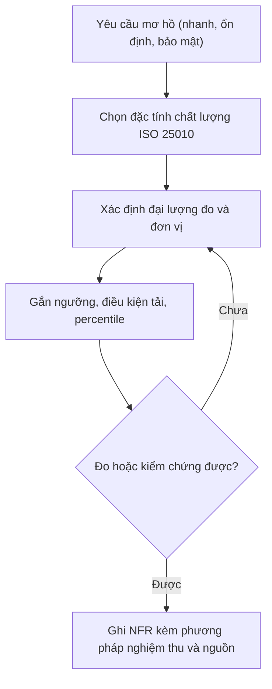
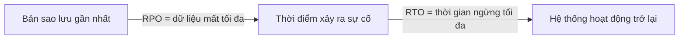

# Danh mục yêu cầu phi chức năng (Non-Functional Requirement – NFR) cho ERP

> Cập nhật đến: 2026-10-20 — quy định thay đổi thường xuyên; BA phải kiểm tra lại hiệu lực khi dùng cho dự án.
> File tra cứu trong skill `erp-ba-core`. Mục tiêu: giúp BA/agent viết NFR **đo lường được, kiểm chứng được, có nguồn** cho spec ERP — không để lọt "nhanh, ổn định, bảo mật, thân thiện" chung chung. Dùng kèm `references/conventions.md` (quy tắc viết yêu cầu §7), `references/security-and-parameters.md` (chi tiết bảo mật & tham số), `references/ba-standards.md` (danh sách từ cấm). Pháp lý kế toán xem `references/regulations/vn-accounting.md`; thuế/hóa đơn điện tử xem `references/regulations/vn-tax-einvoice.md`; lao động/lương xem `references/regulations/vn-labor-payroll.md`.

## Mục lục

1. [Cách viết một NFR đo lường được](#1-cách-viết-một-nfr-đo-lường-được)
2. [Khung phân loại ISO/IEC 25010:2023](#2-khung-phân-loại-isoiec-250102023)
3. [Danh mục NFR chi tiết cho ERP](#3-danh-mục-nfr-chi-tiết-cho-erp)
   - [3.1 Hiệu năng giao dịch (Performance – Time Behaviour)](#31-hiệu-năng-giao-dịch-performance--time-behaviour)
   - [3.2 Hiệu năng báo cáo (Reporting performance)](#32-hiệu-năng-báo-cáo-reporting-performance)
   - [3.3 Cửa sổ xử lý theo lô (Batch windows)](#33-cửa-sổ-xử-lý-theo-lô-batch-windows)
   - [3.4 Dung lượng & tăng trưởng dữ liệu (Data volume & growth / Capacity)](#34-dung-lượng--tăng-trưởng-dữ-liệu-data-volume--growth--capacity)
   - [3.5 Đồng thời & khóa (Concurrency & locking)](#35-đồng-thời--khóa-concurrency--locking)
   - [3.6 Sẵn sàng & SLA (Availability / Reliability)](#36-sẵn-sàng--sla-availability--reliability)
   - [3.7 Sao lưu & phục hồi thảm họa (Backup/DR – RPO/RTO)](#37-sao-lưu--phục-hồi-thảm-họa-backupdr--rporto)
   - [3.8 Bảo mật (Security – OWASP ASVS)](#38-bảo-mật-security--owasp-asvs)
   - [3.9 Nhật ký & giám sát (Logging & monitoring)](#39-nhật-ký--giám-sát-logging--monitoring)
   - [3.10 Vết kiểm toán (Auditability)](#310-vết-kiểm-toán-auditability)
   - [3.11 Lưu trữ & lưu trữ dài hạn dữ liệu (Data retention & archiving)](#311-lưu-trữ--lưu-trữ-dài-hạn-dữ-liệu-data-retention--archiving)
   - [3.12 Tuân thủ pháp lý & bảo vệ dữ liệu cá nhân (Legal & PDPL)](#312-tuân-thủ-pháp-lý--bảo-vệ-dữ-liệu-cá-nhân-legal--pdpl)
   - [3.13 Bản địa hóa Việt Nam (Localization VN)](#313-bản-địa-hóa-việt-nam-localization-vn)
   - [3.14 Quốc tế hóa / đa ngôn ngữ (Internationalization – i18n)](#314-quốc-tế-hóa--đa-ngôn-ngữ-internationalization--i18n)
   - [3.15 Độ tin cậy tích hợp (Integration reliability)](#315-độ-tin-cậy-tích-hợp-integration-reliability)
   - [3.16 Khả năng sử dụng & trình duyệt/mobile (Interaction Capability)](#316-khả-năng-sử-dụng--trình-duyệtmobile-interaction-capability)
   - [3.17 Khả năng tiếp cận (Accessibility – WCAG)](#317-khả-năng-tiếp-cận-accessibility--wcag)
   - [3.18 Khả năng bảo trì (Maintainability)](#318-khả-năng-bảo-trì-maintainability)
   - [3.19 Khả năng tương thích (Compatibility)](#319-khả-năng-tương-thích-compatibility)
   - [3.20 An toàn (Safety)](#320-an-toàn-safety)
4. [Cách gắn NFR vào spec & truy vết](#4-cách-gắn-nfr-vào-spec--truy-vết)
5. [Checklist NFR nhanh](#5-checklist-nfr-nhanh)
6. [Tham số hệ thống liên quan đến NFR](#6-tham-số-hệ-thống-liên-quan-đến-nfr)
7. [Nguồn tham khảo](#nguồn-tham-khảo)

> **Quy ước ký hiệu trong file:** con số có dấu **†** là **giá trị mặc định đề xuất của BA/chuẩn ngành — PHẢI được khách hàng xác nhận** rồi chốt bằng `DEC-NNN` (xem `conventions.md` §4). Không được đưa số **†** vào tài liệu trạng thái `Ready`/`Approved` mà chưa có xác nhận. Mã NFR theo `conventions.md` §2: `NFR-<CAT>-NN` (CAT ∈ PERF, AVAIL, SEC, AUDIT, DATA, USAB, COMP, INTG, MAINT, LEGAL, LOC) hoặc `NFR-<MOD>-NN-NN` khi gắn riêng một chức năng.

---

## 1. Cách viết một NFR đo lường được

NFR tồi là NFR không thể trả lời câu hỏi **"đạt hay không đạt được kiểm bằng cách nào?"**. Mọi NFR PHẢI có đủ 6 thành phần (khái niệm *fit criterion* của Volere):

| # | Thành phần | Ví dụ |
|---|---|---|
| 1 | **Chủ ngữ** (ai/cái gì) | "Hệ thống", "Màn hình danh sách Đơn mua hàng (Purchase Order – PO)" |
| 2 | **Đại lượng đo + đơn vị** (metric) | thời gian phản hồi (giây), tỷ lệ uptime (%), RPO (phút) |
| 3 | **Ngưỡng** (target) | ≤ 2 giây; ≥ 99,9% |
| 4 | **Điều kiện/ngữ cảnh tải** (load/context) | 200 người dùng đồng thời, 1 triệu bản ghi, giờ cao điểm cuối tháng |
| 5 | **Phân vị / tỷ lệ** (percentile/rate) | p95, p99, 99% số lần |
| 6 | **Phương pháp nghiệm thu** (verification) | JMeter trên staging cấu hình = production; biên bản pentest |

**Mẫu phát biểu (bắt buộc dùng từ khóa chuẩn mực `PHẢI`/`NÊN`, xem `conventions.md` §7):**

> `[Chủ ngữ] PHẢI [năng lực] trong [điều kiện tải] với [đại lượng] [≤/≥ ngưỡng + đơn vị] ở [percentile/tỷ lệ]. Nghiệm thu bằng [phương pháp]. Nguồn: [REQ/DEC/luật/† mặc định].`

### Ví dụ xấu → tốt (tiếng Việt)

| ❌ NFR xấu (bị cấm) | ✅ NFR tốt (đo được) |
|---|---|
| "Hệ thống phải nhanh." | Màn hình danh sách Đơn mua hàng (PO) **PHẢI** trả về trang đầu 20 bản ghi trong **≤ 2 giây† ở p95**, khi có **200† người dùng đồng thời** và **1.000.000† đơn** trong CSDL. Nghiệm thu bằng JMeter trên staging cấu hình tương đương production. |
| "Báo cáo phải chạy ổn định." | Báo cáo Sổ cái (General Ledger) một kỳ (**≤ 500.000† bút toán**) **PHẢI** hiển thị trang đầu **≤ 10 giây†** và xuất Excel **≤ 30 giây† (p95)**. |
| "Hệ thống phải bảo mật." | Hệ thống **PHẢI** đạt **OWASP ASVS 5.0 Level 2**; các chức năng xử lý dữ liệu tài chính và dữ liệu cá nhân nhạy cảm **PHẢI** đạt **Level 3**. Nghiệm thu bằng kiểm thử xâm nhập (penetration test) trước go-live, 0 lỗi mức High/Critical còn mở. |
| "Dữ liệu phải an toàn khi có sự cố." | Phân hệ kế toán **PHẢI** đạt **RPO ≤ 15 phút†, RTO ≤ 4 giờ†**; diễn tập phục hồi (DR drill) **≥ 1 lần/năm†** có biên bản. |
| "Hệ thống phải lưu lịch sử thao tác." | Mọi thao tác Ghi sổ (Post), Duyệt (Approve), Hủy (Cancel), Đảo (Reverse) **PHẢI** sinh vết kiểm toán (audit trail) **bất biến** gồm: người thực hiện, thời điểm (đến giây, giờ Asia/Ho_Chi_Minh), giá trị trước–sau, địa chỉ IP; vết **KHÔNG ĐƯỢC** sửa/xóa; lưu **≥ 10 năm†**. |
| "Giao diện phải thân thiện." | Người dùng vai trò Nhân viên mua hàng (Purchasing Staff) **PHẢI** hoàn tất tạo một Đơn mua hàng 5 dòng trong **≤ 3 phút†** mà không cần tài liệu hướng dẫn, sau **≤ 30 phút† đào tạo**. Nghiệm thu bằng kiểm thử khả dụng (usability test) với ≥ 5 người dùng thật. |
| "Hệ thống phải chịu tải cao điểm." | Hệ thống **PHẢI** duy trì các chỉ tiêu hiệu năng mục 3.1 ở **mức tải cao điểm cuối tháng = 3׆ tải trung bình ngày**, không giảm cấp dịch vụ (degradation). |
| "Tích hợp hóa đơn điện tử phải đáng tin." | Chức năng phát hành hóa đơn điện tử **PHẢI** thử lại (retry) tối đa **5 lần† theo backoff**, có hàng đợi, **KHÔNG ĐƯỢC** phát hành trùng; đối soát với nhà cung cấp hóa đơn **hằng ngày†**. |

**Quy tắc vàng:** nếu không gắn được con số và cách đo, NFR đó chưa viết xong — hoặc chuyển thành ràng buộc thiết kế có nghiệm thu nhị phân (có/không), hoặc đánh dấu `[CẦN XÁC NHẬN: Q-NNN]`.

---

## 2. Khung phân loại ISO/IEC 25010:2023

Chuẩn **ISO/IEC 25010:2023** (Product quality model — thay bản 2011) định nghĩa **9 đặc tính** chất lượng sản phẩm. So với 2011: **Interaction Capability** thay *Usability*, **Flexibility** thay *Portability*, thêm mới **Safety** [4]. Dùng bảng này để **không bỏ sót loại NFR** — mỗi dự án rà soát đủ 9 đặc tính rồi mới quyết định loại nào áp dụng.

| # | Đặc tính (ISO 25010:2023) | Đặc tính con (sub-characteristics) | Mục chi tiết trong file |
|---|---|---|---|
| 1 | **Functional Suitability** (Phù hợp chức năng) | Functional completeness, correctness, appropriateness | *Thuộc yêu cầu chức năng (FR) — không phải NFR* |
| 2 | **Performance Efficiency** (Hiệu năng) | Time behaviour, Resource utilization, Capacity | 3.1, 3.2, 3.3, 3.4 |
| 3 | **Compatibility** (Tương thích) | Co-existence, Interoperability | 3.15, 3.19 |
| 4 | **Interaction Capability** (Khả năng tương tác người dùng) | Appropriateness recognisability, Learnability, Operability, User error protection, User engagement, Inclusivity, User assistance, Self-descriptiveness | 3.16, 3.17 |
| 5 | **Reliability** (Độ tin cậy) | Faultlessness, Fault tolerance, Availability, Recoverability | 3.6, 3.7 |
| 6 | **Security** (Bảo mật) | Confidentiality, Integrity, Non-repudiation, Accountability, Authenticity, Resistance | 3.8, 3.9, 3.10, 3.12 |
| 7 | **Maintainability** (Khả năng bảo trì) | Modularity, Reusability, Analysability, Modifiability, Testability | 3.18 |
| 8 | **Flexibility** (Khả năng linh hoạt) | Adaptability, Scalability, Installability, Replaceability | 3.4, 3.18, 3.19 |
| 9 | **Safety** (An toàn) | Operational constraint, Risk identification, Fail safe, Hazard warning, Safe integration | 3.20 |

> ⚠️ Vị trí đặc tính con *Testability* **CHƯA thống nhất giữa các nguồn thứ cấp** và **chưa đối chiếu được toàn văn ISO 25010:2023** (tài liệu trả phí): bảng trên xếp dưới **Maintainability** (theo iso25000.com, giữ như bản 2011), còn nguồn arc42 [4] xếp dưới **Flexibility** → để **CHƯA XÁC MINH**. Khác biệt này không ảnh hưởng cách viết NFR (độ phủ kiểm thử xem mục 3.18). **ERP bổ sung** các nhóm NFR đặc thù không nằm riêng trong ISO nhưng rất quan trọng: vết kiểm toán, lưu trữ dữ liệu kế toán, bản địa hóa VN, tuân thủ pháp lý (đặc biệt bảo vệ dữ liệu cá nhân), cửa sổ batch, hiệu năng báo cáo — xem mục 3.

---

## 3. Danh mục NFR chi tiết cho ERP

Mỗi mục gồm 4 phần: **Định nghĩa** · **NFR mẫu** (phát biểu đo được, số **†** là mặc định cần xác nhận) · **Kiểm thử/nghiệm thu** · **Câu hỏi hỏi khách hàng**.

### 3.1 Hiệu năng giao dịch (Performance – Time Behaviour)

**Định nghĩa.** Thời gian phản hồi (response time) và thông lượng (throughput) của thao tác tương tác trực tuyến (màn hình, lưu, duyệt, tìm kiếm) dưới một mức tải xác định. ISO 25010: *Performance Efficiency → Time Behaviour*.

**NFR mẫu:**

| ID | Phát biểu NFR | Nghiệm thu |
|---|---|---|
| NFR-PERF-01 | Màn hình danh sách (list) có phân trang **PHẢI** trả trang đầu **≤ 2 giây† (p95)** với **200† người dùng đồng thời**. | Load test (JMeter/k6) trên staging ≈ production |
| NFR-PERF-02 | Thao tác Lưu/Gửi duyệt (Submit) một chứng từ **≤ 20 dòng† PHẢI** hoàn tất **≤ 2 giây† (p95)**, Ghi sổ (Post) **≤ 3 giây† (p95)**. | Load test + đo APM |
| NFR-PERF-03 | Tìm kiếm theo mã/tên trên danh mục **≤ 1 triệu† bản ghi PHẢI** trả kết quả **≤ 1,5 giây† (p95)**. | Test với dữ liệu mô phỏng khối lượng 5 năm |
| NFR-PERF-04 | Hệ thống **PHẢI** đạt chỉ tiêu trên ở **tải cao điểm = 3׆ tải trung bình** (cuối tháng/cuối năm) không giảm cấp. | Soak/stress test |

**Kiểm thử:** kịch bản tải mô phỏng số người dùng đồng thời thực tế + khối lượng dữ liệu dự kiến (mục 3.4); đo p95/p99 chứ không đo trung bình; chạy trên môi trường cấu hình tương đương production; định nghĩa rõ "giao dịch" nào tính giờ.

**Câu hỏi khách hàng:**
- Số người dùng đồng thời (concurrent) tối đa thực tế? giờ cao điểm là khi nào (cuối tháng, cuối năm, đầu ca)?
- Ngưỡng chấp nhận cho từng loại màn hình (danh sách, nhập liệu, tra cứu)?
- Mạng của người dùng chi nhánh/kho (băng thông, độ trễ) ra sao?

### 3.2 Hiệu năng báo cáo (Reporting performance)

**Định nghĩa.** Thời gian tạo/kết xuất báo cáo và kết tập (aggregation) khối lượng lớn — khác giao dịch trực tuyến vì quét nhiều bản ghi. ISO 25010: *Performance Efficiency*.

**NFR mẫu:**

| ID | Phát biểu NFR | Nghiệm thu |
|---|---|---|
| NFR-PERF-05 | Báo cáo Sổ cái (General Ledger) một kỳ (**≤ 500.000† bút toán**) **PHẢI** hiển thị trang đầu **≤ 10 giây†**, xuất Excel/PDF **≤ 30 giây† (p95)**. | Test với dữ liệu 1 kỳ thực tế |
| NFR-PERF-06 | Báo cáo tài chính (Financial Statements) toàn công ty **PHẢI** hoàn tất **≤ 60 giây†**; nếu > 60 giây **PHẢI** chạy nền (background job) và thông báo khi xong. | Test cuối kỳ |
| NFR-PERF-07 | Báo cáo nặng **NÊN** chạy trên dữ liệu đã kết tập/bản sao đọc (read replica) để **KHÔNG** ảnh hưởng hiệu năng giao dịch. | Đo tải DB khi báo cáo chạy |

**Kiểm thử:** đo với khối lượng dữ liệu cuối kỳ thực tế; kiểm chứng báo cáo nặng không khóa/kéo chậm nghiệp vụ trực tuyến; kiểm tra cơ chế chạy nền + tải file kết quả.

**Câu hỏi khách hàng:** báo cáo nào nặng nhất, bao nhiêu dòng, chạy lúc nào, bao nhiêu người chạy đồng thời? Chấp nhận báo cáo chạy nền + email/thông báo khi xong không? Có cần số liệu thời điểm (real-time) hay cho phép trễ T+1?

### 3.3 Cửa sổ xử lý theo lô (Batch windows)

**Định nghĩa.** Khoảng thời gian cho các tác vụ nền định kỳ: tính khấu hao (depreciation), tính giá vốn (costing/COGS), phân bổ chi phí (allocation), kết chuyển (closing entries), đồng bộ tích hợp, sinh báo cáo. ISO 25010: *Performance Efficiency*; liên quan *Reliability*.

**NFR mẫu:**

| ID | Phát biểu NFR | Nghiệm thu |
|---|---|---|
| NFR-PERF-08 | Các job cuối ngày (tính giá vốn, đồng bộ) **PHẢI** hoàn tất trong cửa sổ **00:00–05:00† giờ VN** với khối lượng một ngày cao điểm. | Chạy thử cuối ngày cao điểm |
| NFR-PERF-09 | Job cuối kỳ (khấu hao, phân bổ, kết chuyển) **PHẢI** hoàn tất **≤ 2 giờ†**. | Test khóa sổ |
| NFR-PERF-10 | Mọi job **PHẢI** idempotent (chạy lại an toàn, không nhân đôi bút toán), ghi log bắt đầu/kết thúc/kết quả, có cơ chế chạy lại phần lỗi và cảnh báo khi thất bại. | Test chạy lại sau lỗi giữa chừng |

**Kiểm thử:** đo thời lượng job với dữ liệu khối lượng thực; kiểm chứng tính idempotent (chạy 2 lần → 1 kết quả); kiểm thử phục hồi khi job chết giữa chừng; kiểm tra thứ tự phụ thuộc giữa các job.

**Câu hỏi khách hàng:** khung giờ được phép dừng/chạy nền? thứ tự và phụ thuộc giữa các job? ai nhận cảnh báo khi job lỗi? múi giờ của các chi nhánh?

### 3.4 Dung lượng & tăng trưởng dữ liệu (Data volume & growth / Capacity)

**Định nghĩa.** Khối lượng dữ liệu hệ thống phải chịu được tại thời điểm go-live và sau N năm, cùng khả năng mở rộng (scalability). ISO 25010: *Performance Efficiency → Capacity*; *Flexibility → Scalability*.

**NFR mẫu:**

| ID | Phát biểu NFR | Nghiệm thu |
|---|---|---|
| NFR-DATA-01 | Hệ thống **PHẢI** đạt mọi chỉ tiêu hiệu năng (3.1–3.2) với khối lượng dữ liệu **dự kiến 5 năm†**: ví dụ **5.000.000† bút toán/năm**, **500.000† chứng từ bán hàng/năm**, **2.000† người dùng**. | Load test với dữ liệu mô phỏng 5 năm |
| NFR-DATA-02 | Hệ thống **PHẢI** mở rộng ngang/dọc (scale) để tăng **2׆ công suất** mà không phải viết lại kiến trúc. | Review kiến trúc + stress test |
| NFR-DATA-03 | Dữ liệu cũ **NÊN** được lưu trữ/đóng băng (archiving) theo mục 3.11 để giữ bảng giao dịch ở kích thước vận hành tốt. | Review chiến lược lưu trữ |

**Kiểm thử:** sinh dữ liệu mô phỏng theo dự báo tăng trưởng; đo hiệu năng ở mốc năm 1/3/5; kiểm tra chỉ mục (index) và phân vùng (partition).

**Câu hỏi khách hàng:** số chứng từ/bút toán hiện tại/năm? tốc độ tăng trưởng? số pháp nhân, chi nhánh, kho, user? dữ liệu cần giữ online bao nhiêu năm?

### 3.5 Đồng thời & khóa (Concurrency & locking)

**Định nghĩa.** Hành vi của hệ thống khi nhiều người cùng thao tác trên một dữ liệu/nguồn lực: tránh mất cập nhật (lost update), bế tắc (deadlock), và đảm bảo tính nhất quán số liệu kế toán/tồn kho. ISO 25010: *Reliability*, *Performance Efficiency*.

**NFR mẫu:**

| ID | Phát biểu NFR | Nghiệm thu |
|---|---|---|
| NFR-DATA-04 | Khi hai người cùng sửa một chứng từ, hệ thống **PHẢI** dùng khóa lạc quan (optimistic locking) theo phiên bản; người lưu sau **PHẢI** nhận cảnh báo xung đột, **KHÔNG ĐƯỢC** ghi đè im lặng. | Test 2 phiên song song |
| NFR-DATA-05 | Đánh số chứng từ (document numbering) **PHẢI** liên tục, không trùng, không nhảy số khi **≥ 50† người tạo đồng thời** (yêu cầu pháp lý hóa đơn/sổ sách VN). | Load test tạo đồng thời; xem `regulations/vn-tax-einvoice.md` |
| NFR-DATA-06 | Trừ tồn kho khi xuất **PHẢI** chống âm kho do tranh chấp (race condition): hai lệnh xuất cùng lúc **KHÔNG ĐƯỢC** làm tồn < 0 nếu cấu hình cấm xuất âm. | Test xuất đồng thời cùng mặt hàng |
| NFR-DATA-07 | Ghi sổ (Post) vào một kỳ **PHẢI** được tuần tự hóa (serialize) để số dư lũy kế nhất quán; **KHÔNG ĐƯỢC** deadlock kéo dài > **5 giây†**. | Test ghi sổ đồng thời |

**Kiểm thử:** kịch bản đồng thời có chủ đích (2–N phiên); kiểm chứng gap-less numbering; kiểm tra thông điệp xung đột MSG-… hiển thị rõ cho người dùng.

**Câu hỏi khách hàng:** nghiệp vụ nào nhiều người đụng cùng bản ghi (duyệt tập trung, nhập kho ca đêm)? có yêu cầu đánh số liên tục tuyệt đối không? chính sách khi xung đột: khóa trước hay cảnh báo sau?

### 3.6 Sẵn sàng & SLA (Availability / Reliability)

**Định nghĩa.** Tỷ lệ thời gian hệ thống sẵn sàng phục vụ (uptime) và cam kết mức dịch vụ (Service Level Agreement – SLA). ISO 25010: *Reliability → Availability, Faultlessness*.

**Bảng quy đổi uptime (tính toán, năm 365 ngày = 8.760 giờ):**

| Uptime | Ngừng tối đa/năm | Ngừng tối đa/tháng (30 ngày) |
|---|---|---|
| 99,0% | ≈ 87,6 giờ (3,65 ngày) | ≈ 7,2 giờ |
| 99,5% | ≈ 43,8 giờ | ≈ 3,6 giờ |
| 99,9% ("ba số 9") | ≈ 8,76 giờ | ≈ 43,2 phút |
| 99,95% | ≈ 4,38 giờ | ≈ 21,6 phút |
| 99,99% ("bốn số 9") | ≈ 52,6 phút | ≈ 4,32 phút |

**NFR mẫu:**

| ID | Phát biểu NFR | Nghiệm thu |
|---|---|---|
| NFR-AVAIL-01 | Hệ thống **PHẢI** đạt uptime **≥ 99,9%†/tháng** trong giờ làm việc (7:00–19:00 giờ VN†), đo trừ thời gian bảo trì đã thông báo trước. | Báo cáo uptime từ giám sát |
| NFR-AVAIL-02 | Bảo trì có kế hoạch (planned maintenance) **PHẢI** báo trước **≥ 48 giờ†** và thực hiện ngoài giờ làm việc, **≤ 4 giờ†/lần**. | Nhật ký bảo trì |
| NFR-AVAIL-03 | Lỗi một thành phần (node) **KHÔNG ĐƯỢC** làm sập toàn hệ thống (fault tolerance): có dự phòng (redundancy) cho tầng ứng dụng và CSDL. | Test tắt 1 node |

**Kiểm thử:** định nghĩa rõ công thức tính uptime (tử số/mẫu số, có trừ bảo trì không); đo bằng hệ giám sát độc lập; test failover.

**Câu hỏi khách hàng:** giờ vận hành thật (có ca đêm, cuối tuần, cận Tết không)? mức SLA cam kết và chế tài? phân biệt giờ nghiệp vụ và ngoài giờ? ai chịu trách nhiệm hạ tầng (khách tự host hay nhà cung cấp)?

### 3.7 Sao lưu & phục hồi thảm họa (Backup/DR – RPO/RTO)

**Định nghĩa.** **RPO (Recovery Point Objective)** = lượng dữ liệu tối đa chấp nhận mất (tính theo thời gian lùi về bản sao lưu gần nhất). **RTO (Recovery Time Objective)** = thời gian tối đa chấp nhận hệ thống ngừng để khôi phục. ISO 25010: *Reliability → Recoverability*.

**NFR mẫu:**

| ID | Phát biểu NFR | Nghiệm thu |
|---|---|---|
| NFR-AVAIL-04 | Phân hệ kế toán/tài chính **PHẢI** đạt **RPO ≤ 15 phút†** (ví dụ qua log giao dịch CSDL) và **RTO ≤ 4 giờ†**. | DR drill có bấm giờ |
| NFR-AVAIL-05 | Sao lưu đầy đủ **hằng ngày†** + sao lưu tăng dần **mỗi 15 phút†**; bản sao lưu **PHẢI** được lưu ở **vị trí địa lý khác†** và **mã hóa**. | Kiểm tra lịch + vị trí + mã hóa |
| NFR-AVAIL-06 | Khả năng khôi phục **PHẢI** được diễn tập (restore test/DR drill) **≥ 1 lần/năm†**, có biên bản ghi RPO/RTO thực đo được. | Biên bản diễn tập |
| NFR-AVAIL-07 | Bản sao lưu dữ liệu kế toán **PHẢI** giữ phù hợp thời hạn lưu trữ pháp lý (mục 3.11). | Kiểm tra chính sách giữ backup |

**Kiểm thử:** diễn tập khôi phục thật từ backup và bấm giờ (không chỉ xác nhận "có backup"); kiểm tra bản sao lưu khôi phục được (restore-tested), mã hóa, và tách vị trí.

**Câu hỏi khách hàng:** mất tối đa bao nhiêu dữ liệu/thời gian ngừng thì chấp nhận được cho từng phân hệ? có yêu cầu site dự phòng (DR site) không? ngân sách cho DR? ai vận hành backup?

### 3.8 Bảo mật (Security – OWASP ASVS)

**Định nghĩa.** Bảo vệ tính bí mật (confidentiality), toàn vẹn (integrity), chống chối bỏ (non-repudiation), truy vết trách nhiệm (accountability), xác thực (authenticity), kháng tấn công (resistance). ISO 25010: *Security*. Chi tiết xác thực/phân quyền/tham số xem `references/security-and-parameters.md`.

**Chuẩn tham chiếu:** **OWASP ASVS 5.0** (Application Security Verification Standard, phát hành 5/2025) [5] có **3 mức lũy tiến**: **L1** (cơ bản, kiểm được hộp đen), **L2** (khuyến nghị mặc định cho ứng dụng xử lý dữ liệu nhạy cảm — **phù hợp ERP**), **L3** (cao nhất, cho hệ thống trọng yếu: tài chính, y tế, hạ tầng). L3 bao trùm L2 bao trùm L1.

**NFR mẫu:**

| ID | Phát biểu NFR | Nghiệm thu |
|---|---|---|
| NFR-SEC-01 | Toàn hệ thống **PHẢI** đạt **OWASP ASVS 5.0 Level 2†**; chức năng xử lý dữ liệu tài chính và dữ liệu cá nhân nhạy cảm **PHẢI** đạt **Level 3†**. | Pentest + đối chiếu checklist ASVS, 0 lỗi High/Critical mở |
| NFR-SEC-02 | Dữ liệu truyền **PHẢI** mã hóa TLS 1.2+† (in transit); dữ liệu nhạy cảm **PHẢI** mã hóa khi lưu (at rest); mật khẩu **PHẢI** băm (hash) bằng thuật toán mạnh. | Kiểm cấu hình + scan |
| NFR-SEC-03 | Đăng nhập **PHẢI** hỗ trợ xác thực đa yếu tố (MFA)† cho vai trò nhạy cảm (Kế toán trưởng – Chief Accountant, Giám đốc – Director, quản trị hệ thống); khóa tài khoản sau **5† lần sai**. | Test chính sách |
| NFR-SEC-04 | Phân quyền **PHẢI** theo vai trò (Role-Based Access Control – RBAC) + phạm vi dữ liệu; **PHẢI** chặn ở tầng máy chủ (không chỉ ẩn nút trên giao diện); áp dụng tối thiểu quyền (least privilege) và phân tách trách nhiệm (Segregation of Duties – SoD). | Test vượt quyền (IDOR/privilege escalation) |
| NFR-SEC-05 | Hệ thống **PHẢI** chống các lỗ hổng OWASP Top 10 (SQL injection, XSS, CSRF…) và rà quét phụ thuộc (dependency scan) không còn lỗ hổng High/Critical trước mỗi lần phát hành. | SAST/DAST/SCA trong CI |

**Kiểm thử:** kiểm thử xâm nhập độc lập theo checklist ASVS mức đã chọn; scan tự động (SAST/DAST/SCA); review cấu hình; test vượt quyền theo ma trận quyền (xem `catalogs/roles-permissions.md`).

**Câu hỏi khách hàng:** mức ASVS mục tiêu? yêu cầu MFA, SSO (đăng nhập một lần), AD/LDAP? chính sách mật khẩu nội bộ? có kiểm toán bảo mật/pentest định kỳ bắt buộc không? dữ liệu nào là nhạy cảm nhất?

### 3.9 Nhật ký & giám sát (Logging & monitoring)

**Định nghĩa.** Ghi log kỹ thuật/bảo mật và giám sát tình trạng (health) + cảnh báo (alerting). Khác vết kiểm toán nghiệp vụ (mục 3.10) ở chỗ log phục vụ vận hành/điều tra sự cố. ISO 25010: *Security → Accountability*; *Reliability*; *Maintainability → Analysability*.

**NFR mẫu:**

| ID | Phát biểu NFR | Nghiệm thu |
|---|---|---|
| NFR-SEC-06 | Hệ thống **PHẢI** ghi log sự kiện bảo mật: đăng nhập thành công/thất bại, đổi quyền, đổi cấu hình, truy cập dữ liệu nhạy cảm — gồm thời điểm (đồng bộ NTP), người, IP. | Kiểm mẫu log |
| NFR-SEC-07 | Log **KHÔNG ĐƯỢC** chứa dữ liệu cá nhân nhạy cảm/mật khẩu ở dạng rõ (tuân thủ PDPL mục 3.12); log bảo mật lưu **≥ 12 tháng†**. | Review nội dung log |
| NFR-MAINT-01 | Hệ thống **PHẢI** cung cấp giám sát (CPU, RAM, hàng đợi, lỗi) và tự động cảnh báo khi vượt ngưỡng; có bảng theo dõi tình trạng (health dashboard). | Test ngưỡng cảnh báo |

**Kiểm thử:** kiểm tra đủ loại sự kiện được log; kiểm mức log không rò rỉ dữ liệu cá nhân; test cảnh báo kích hoạt đúng; kiểm đồng bộ thời gian.

**Câu hỏi khách hàng:** log giữ bao lâu? có tập trung về SIEM không? ai nhận cảnh báo và kênh nào? ngưỡng cảnh báo?

### 3.10 Vết kiểm toán (Auditability)

**Định nghĩa.** Khả năng truy vết **ai làm gì, khi nào, trước/sau ra sao** trên dữ liệu nghiệp vụ, đặc biệt chứng từ và bút toán — nền tảng cho kiểm toán nội bộ, kiểm toán độc lập, thanh/kiểm tra thuế. ERP-đặc thù; gắn ISO *Security → Non-repudiation, Accountability, Integrity*.

**NFR mẫu:**

| ID | Phát biểu NFR | Nghiệm thu |
|---|---|---|
| NFR-AUDIT-01 | Mọi thao tác thay đổi dữ liệu nghiệp vụ (Tạo, Sửa, Xóa chứng từ Nháp, Gửi duyệt, Duyệt, Từ chối, Trả lại, Ghi sổ, Bỏ ghi sổ, Hủy, Đảo, Đóng) **PHẢI** sinh vết kiểm toán gồm: người, vai trò, thời điểm (đến giây, giờ VN), hành động, giá trị trước–sau, IP/kênh. | Kiểm mẫu từng loại thao tác |
| NFR-AUDIT-02 | Vết kiểm toán **PHẢI bất biến** (append-only): **KHÔNG ĐƯỢC** sửa/xóa kể cả bởi quản trị viên; lưu tối thiểu theo thời hạn pháp lý (mục 3.11). | Thử sửa/xóa vết → bị chặn |
| NFR-AUDIT-03 | Chứng từ trạng thái **Đã ghi sổ (POSTED)** **KHÔNG ĐƯỢC** sửa trực tiếp; sửa sai **PHẢI** qua **Bỏ ghi sổ** (nếu kỳ mở, có quyền) hoặc bút toán **Đảo (REVERSED)** có lý do và liên kết chứng từ gốc. | Test vòng đời chứng từ |
| NFR-AUDIT-04 | Hệ thống **PHẢI** cung cấp màn hình/báo cáo tra cứu vết kiểm toán theo chứng từ, theo người dùng, theo khoảng thời gian. | Test tra cứu |

**Kiểm thử:** thực hiện từng hành động và kiểm vết sinh đúng/đủ trường; thử can thiệp vết (phải bị chặn và chính nó cũng bị log); kiểm liên kết chứng từ đảo ↔ gốc. Căn cứ bất biến & lưu trữ: Luật Kế toán + Nghị định 174/2016/NĐ-CP [6]; xem `regulations/vn-accounting.md`.

**Câu hỏi khách hàng:** nghiệp vụ nào bắt buộc truy vết chi tiết trước–sau? ai được xem vết? có yêu cầu của kiểm toán độc lập/thuế cụ thể không? lưu vết bao lâu?

### 3.11 Lưu trữ & lưu trữ dài hạn dữ liệu (Data retention & archiving)

**Định nghĩa.** Thời hạn giữ dữ liệu, chiến lược đóng băng dữ liệu cũ (archiving) tách khỏi dữ liệu vận hành, và chính sách xóa/hủy có kiểm soát. ERP-đặc thù; gắn ISO *Performance Efficiency*, *Flexibility*, *Security*.

**NFR mẫu:**

| ID | Phát biểu NFR | Nghiệm thu |
|---|---|---|
| NFR-DATA-08 | Dữ liệu & chứng từ kế toán **PHẢI** lưu trữ tối thiểu theo pháp luật: tài liệu kế toán **≥ 10 năm†**; tài liệu dùng trực tiếp ghi sổ & BCTC **≥ 10 năm**; một số tài liệu quản lý điều hành **≥ 5 năm** (Nghị định 174/2016/NĐ-CP) [6]. | Đối chiếu chính sách lưu trữ |
| NFR-DATA-09 | Hệ thống **PHẢI** cho phép đóng băng/lưu trữ (archive) dữ liệu kỳ cũ sang lưu trữ, vẫn truy xuất đọc được khi cần (thanh tra, đối chiếu). | Test archive + truy xuất |
| NFR-DATA-10 | Xóa/hủy dữ liệu hết thời hạn **PHẢI** có quy trình phê duyệt, loại trừ dữ liệu đang bị giữ theo yêu cầu pháp lý (legal hold); dữ liệu cá nhân xóa theo mục 3.12. | Test chính sách xóa |
| NFR-DATA-11 | Khóa kỳ (period close) **PHẢI** chặn ghi/sửa vào kỳ đã khóa; mở lại kỳ **PHẢI** có quyền riêng và để lại vết. | Test khóa/mở kỳ |

**Kiểm thử:** đối chiếu thời hạn với quy định; test archive-rồi-truy xuất; test chặn ghi vào kỳ đã khóa; kiểm legal hold.

**Câu hỏi khách hàng:** thời hạn lưu từng loại dữ liệu (kế toán, HĐLĐ, hồ sơ cá nhân, log)? có yêu cầu đóng băng dữ liệu cũ vì hiệu năng? chính sách xóa dữ liệu cá nhân khi hết mục đích? ai duyệt xóa?

### 3.12 Tuân thủ pháp lý & bảo vệ dữ liệu cá nhân (Legal & PDPL)

**Định nghĩa.** Hệ thống phải giúp doanh nghiệp tuân thủ pháp luật áp dụng: kế toán, thuế/hóa đơn điện tử, lao động, giao dịch điện tử, và **bảo vệ dữ liệu cá nhân**. ISO 25010 không có mục riêng — đây là NFR ERP bắt buộc tại VN.

**Cơ sở pháp lý bảo vệ dữ liệu cá nhân — hiệu lực tại 2026-10-20:**

| Văn bản | Nội dung | Hiệu lực | Tình trạng |
|---|---|---|---|
| **Luật Bảo vệ dữ liệu cá nhân số 91/2025/QH15** (Personal Data Protection Law – PDPL) | Luật khung về bảo vệ dữ liệu cá nhân | **01/01/2026** (thông qua 26/6/2025) | Còn hiệu lực [1] |
| **Nghị định 356/2025/NĐ-CP** | Quy định chi tiết thi hành Luật 91/2025 | **01/01/2026** (ban hành 31/12/2025) | Còn hiệu lực [2] |
| Nghị định 13/2023/NĐ-CP | Bảo vệ dữ liệu cá nhân (cũ) | 01/07/2023 | **HẾT HIỆU LỰC từ 01/01/2026**, thay bởi NĐ356/2025 [2][3] |

> ⚠️ **Cơ chế chuyển tiếp (NĐ356/2025 Điều 41):** doanh nghiệp nhỏ và doanh nghiệp khởi nghiệp (small & startup) **được quyền chọn thực hiện hoặc không** các quy định tại **Điều 21, Điều 22 và khoản 2 Điều 33 của Luật 91/2025** trong **5 năm** kể từ 01/01/2026 (hộ kinh doanh, doanh nghiệp siêu nhỏ tương tự — Điều 41 khoản 2) [2]. Miễn trừ **KHÔNG áp dụng** nếu doanh nghiệp kinh doanh dịch vụ xử lý DLCN, trực tiếp xử lý dữ liệu nhạy cảm, hoặc xử lý từ **100.000 chủ thể dữ liệu trở lên**. BA phải tra nội dung Điều 21/22/khoản 2 Điều 33 của Luật để biết nghĩa vụ nào được phép hoãn cho dự án cụ thể.

**Nghĩa vụ chính (NĐ356/2025) → yêu cầu hệ thống:**

| Nghĩa vụ pháp lý | NFR hệ thống suy ra |
|---|---|
| **Sự đồng ý (consent)** phải chứng minh được ai đồng ý, khi nào, cho mục đích gì; bên kiểm soát dữ liệu lưu và chịu trách nhiệm chứng minh; cấm đồng ý mặc định/gây hiểu nhầm; dữ liệu nhạy cảm phải báo rõ (Điều 6) [2] | Lưu bản ghi đồng ý có dấu thời gian, mục đích, phiên bản điều khoản; hỗ trợ rút lại đồng ý (withdraw); không bật sẵn checkbox đồng ý |
| **Quyền của chủ thể dữ liệu**: truy cập, chỉnh sửa, xóa, hạn chế, rút đồng ý, phản đối | Chức năng tra cứu/kết xuất/xóa dữ liệu cá nhân theo chủ thể; nhật ký thực hiện quyền |
| **Đánh giá tác động xử lý DLCN (Data Protection Impact Assessment – DPIA)**: lập hồ sơ từ khi bắt đầu xử lý, nộp bản chính trong **60 ngày**, cập nhật **mỗi 6 tháng**/khi thay đổi (Điều 19–20) [2] | Hệ thống hỗ trợ kết xuất danh mục hoạt động xử lý, luồng dữ liệu, bên xử lý để lập/cập nhật hồ sơ DPIA |
| **Chuyển dữ liệu ra nước ngoài** (lưu máy chủ/đám mây nước ngoài, bên nhận nước ngoài): lập hồ sơ đánh giá, nộp trong **60 ngày** (Điều 17–18) [2] | Ghi log và cấu hình vị trí lưu trữ; nhận diện khi dữ liệu cá nhân ra nước ngoài (ví dụ dùng cloud/email/tích hợp quốc tế) |
| Thông báo vi phạm (data breach), bảo mật dữ liệu | Phát hiện & cảnh báo truy cập bất thường; mã hóa (mục 3.8); audit (mục 3.10) |

**NFR mẫu:**

| ID | Phát biểu NFR | Nghiệm thu |
|---|---|---|
| NFR-LEGAL-01 | Hệ thống **PHẢI** lưu bản ghi đồng ý xử lý dữ liệu cá nhân chứng minh được (ai, khi nào, mục đích, phiên bản điều khoản) và cho phép chủ thể **rút lại đồng ý** (Luật 91/2025, NĐ356/2025 Điều 6). | Test ghi/rút đồng ý |
| NFR-LEGAL-02 | Hệ thống **PHẢI** hỗ trợ quyền của chủ thể dữ liệu: kết xuất, chỉnh sửa, **xóa** dữ liệu cá nhân theo chủ thể, có vết thực hiện. | Test theo từng quyền |
| NFR-LEGAL-03 | Dữ liệu cá nhân nhạy cảm **PHẢI** được mã hóa và giới hạn truy cập theo vai trò; truy cập **PHẢI** được log (mục 3.8–3.9). | Review phân quyền + log |
| NFR-LEGAL-04 | Hệ thống **PHẢI** đáp ứng pháp lý kế toán (TT99/2025 — xem `regulations/vn-accounting.md`), thuế & hóa đơn điện tử (xem `regulations/vn-tax-einvoice.md`), lao động/lương (xem `regulations/vn-labor-payroll.md`), chữ ký số/giao dịch điện tử (Luật GDĐT 20/2023/QH15). | Đối chiếu từng file quy định |

**Kiểm thử:** đối chiếu danh mục nghĩa vụ pháp lý với tính năng; test luồng đồng ý & quyền chủ thể; kiểm mã hóa + log truy cập dữ liệu cá nhân; rà soát dữ liệu ra nước ngoài.

**Câu hỏi khách hàng:** hệ thống lưu dữ liệu cá nhân nào (nhân viên, khách hàng, đối tác)? có chuyển ra nước ngoài/dùng cloud quốc tế không? đã có quy trình DPIA chưa? ai là người phụ trách bảo vệ dữ liệu cá nhân? dữ liệu cá nhân giữ bao lâu theo mục đích?

### 3.13 Bản địa hóa Việt Nam (Localization VN)

**Định nghĩa.** Phù hợp đặc thù Việt Nam: tiền tệ, định dạng số/ngày, mã số thuế, địa giới hành chính, mẫu biểu/báo cáo luật định, định dạng ngân hàng. ISO 25010: liên quan *Compatibility*, *Functional Suitability*; NFR ERP-đặc thù.

**NFR mẫu:**

| ID | Phát biểu NFR | Nghiệm thu |
|---|---|---|
| NFR-LOC-01 | Hệ thống **PHẢI** hiển thị tiền VND là số nguyên, phân cách hàng nghìn bằng dấu chấm; ngoại tệ 2 chữ số thập phân; ngày `dd/MM/yyyy`; múi giờ Asia/Ho_Chi_Minh (xem `conventions.md` §8). | Test định dạng |
| NFR-LOC-02 | Hệ thống **PHẢI** hỗ trợ mã số thuế (Tax code – MST) đúng định dạng VN (10 hoặc 13 chữ số), kiểm tra hợp lệ; hỗ trợ cấu trúc địa giới hành chính VN hiện hành. | Test nhập MST + địa chỉ |
| NFR-LOC-03 | Mẫu biểu & báo cáo luật định (Báo cáo tài chính theo Thông tư 99/2025/TT-BTC [8], tờ khai thuế, hóa đơn điện tử theo chuẩn cơ quan thuế) **PHẢI** đúng biểu mẫu hiện hành — xem `regulations/vn-accounting.md`, `regulations/vn-tax-einvoice.md`. | Đối chiếu mẫu |
| NFR-LOC-04 | Hệ thống **PHẢI** hỗ trợ định dạng file giao dịch ngân hàng VN (ủy nhiệm chi, sao kê, chi lương) theo ngân hàng khách dùng. | Test với mẫu file ngân hàng |

**Kiểm thử:** đối chiếu định dạng số/ngày/tiền với chuẩn; kiểm MST/địa chỉ; so mẫu báo cáo với mẫu luật định; test file ngân hàng thật.

**Câu hỏi khách hàng:** dùng ngân hàng nào (định dạng file)? cần báo cáo luật định nào? có đơn vị dùng ngoại tệ ghi sổ? cấu trúc địa chỉ/chi nhánh?

### 3.14 Quốc tế hóa / đa ngôn ngữ (Internationalization – i18n)

**Định nghĩa.** Khả năng vận hành đa ngôn ngữ, đa định dạng vùng (locale), không "chôn cứng" chuỗi/định dạng trong mã. ISO 25010: *Interaction Capability → Inclusivity*; *Flexibility → Adaptability*.

**NFR mẫu:**

| ID | Phát biểu NFR | Nghiệm thu |
|---|---|---|
| NFR-LOC-05 | Toàn hệ thống **PHẢI** dùng mã hóa UTF-8, hiển thị đúng tiếng Việt có dấu ở mọi màn hình, báo cáo, file xuất, email, tên file. | Test hiển thị/ xuất file |
| NFR-LOC-06 | Giao diện **PHẢI** hỗ trợ tối thiểu tiếng Việt và tiếng Anh†, chuyển ngôn ngữ theo người dùng; chuỗi hiển thị **KHÔNG ĐƯỢC** chôn cứng trong mã (tách tài nguyên ngôn ngữ). | Test chuyển ngôn ngữ |
| NFR-LOC-07 | Định dạng ngày/số/tiền **PHẢI** theo locale, mặc định vi-VN; lưu thời điểm theo chuẩn có múi giờ, hiển thị theo giờ VN. | Test đổi locale |

**Kiểm thử:** kiểm UTF-8 xuyên suốt (DB, API, file, email); kiểm không còn chuỗi chôn cứng; test đa ngôn ngữ và locale.

**Câu hỏi khách hàng:** cần những ngôn ngữ nào (có nhà đầu tư/chuyên gia nước ngoài không)? báo cáo song ngữ? người dùng ở nhiều múi giờ?

### 3.15 Độ tin cậy tích hợp (Integration reliability)

**Định nghĩa.** Độ tin cậy khi trao đổi dữ liệu với hệ thống ngoài: hóa đơn điện tử, ngân hàng, cơ quan thuế, hệ thống của đối tác, hệ thống nội bộ khác. ISO 25010: *Compatibility → Interoperability*; *Reliability*.

**NFR mẫu:**

| ID | Phát biểu NFR | Nghiệm thu |
|---|---|---|
| NFR-INTG-01 | Mọi giao dịch tích hợp **PHẢI** có timeout, thử lại (retry) có backoff (tối đa **5† lần**), và **idempotent** để không nhân đôi kết quả. | Test lỗi mạng/timeout |
| NFR-INTG-02 | Tích hợp hóa đơn điện tử/ngân hàng **PHẢI** có hàng đợi (queue) + hàng đợi lỗi (dead-letter), **KHÔNG ĐƯỢC** phát hành/chi trùng; có **đối soát (reconciliation) hằng ngày†**. | Test gửi trùng + đối soát |
| NFR-INTG-03 | Khi hệ thống ngoài gián đoạn, ERP **PHẢI** giảm cấp mềm (degrade gracefully): cho lưu nháp/hàng đợi và tự đồng bộ lại khi khôi phục, có cảnh báo. | Test ngắt kết nối đối tác |
| NFR-INTG-04 | Mọi giao dịch tích hợp **PHẢI** được log đủ để truy vết và đối chiếu (mã giao dịch, trạng thái, thời điểm, payload tóm tắt — không chứa dữ liệu nhạy cảm dạng rõ). | Kiểm log tích hợp |

**Kiểm thử:** test gián đoạn/chậm/đúp của đối tác; kiểm idempotency (gửi 2 lần → 1 kết quả); kiểm đối soát bắt lệch; đo tuân thủ SLA của nhà cung cấp. Xem `catalogs/integrations-notifications.md`, `regulations/vn-tax-einvoice.md`.

**Câu hỏi khách hàng:** tích hợp với hệ thống nào, chuẩn gì (API/file/DB)? SLA và giới hạn tần suất (rate limit) của đối tác? xử lý khi đối tác lỗi? ai đối soát và tần suất?

### 3.16 Khả năng sử dụng & trình duyệt/mobile (Interaction Capability)

**Định nghĩa.** Mức dễ học, dễ thao tác, chống lỗi người dùng, và phạm vi thiết bị/trình duyệt hỗ trợ. ISO 25010: *Interaction Capability* (Learnability, Operability, User error protection…).

**NFR mẫu:**

| ID | Phát biểu NFR | Nghiệm thu |
|---|---|---|
| NFR-USAB-01 | Người dùng vai trò nghiệp vụ **PHẢI** hoàn tất tác vụ phổ biến (ví dụ tạo Đơn mua hàng 5 dòng) trong **≤ 3 phút†** sau **≤ 30 phút† đào tạo**, không cần tra tài liệu. | Usability test ≥ 5 người thật |
| NFR-USAB-02 | Hệ thống **PHẢI** chặn lỗi người dùng: xác nhận trước thao tác không hoàn tác được (Ghi sổ, Hủy, Đảo), thông báo lỗi rõ ràng bằng tiếng Việt (mã MSG), gợi ý cách sửa. | Test thông báo lỗi |
| NFR-USAB-03 | Giao diện web **PHẢI** chạy đúng trên 2 phiên bản mới nhất† của Chrome, Edge, Firefox, Safari; độ phân giải tối thiểu **1366×768†**. | Cross-browser test |
| NFR-USAB-04 | Màn hình phê duyệt (Approve) và tra cứu **NÊN** đáp ứng (responsive) dùng được trên điện thoại/máy tính bảng† cho vai trò quản lý. | Test trên mobile |

**Kiểm thử:** usability test với người dùng thật đo thời gian/tỷ lệ hoàn tất; cross-browser/thiết bị; rà soát thông điệp lỗi.

**Câu hỏi khách hàng:** trình duyệt/thiết bị người dùng đang dùng? vai trò nào cần dùng trên mobile (duyệt từ xa)? mức độ thành thạo CNTT của người dùng? cần app mobile riêng hay web responsive đủ?

### 3.17 Khả năng tiếp cận (Accessibility – WCAG)

**Định nghĩa.** Khả năng người khuyết tật sử dụng được (thị lực, vận động…). ISO 25010: *Interaction Capability → Inclusivity*. Chuẩn: **WCAG 2.2** (Web Content Accessibility Guidelines, W3C Recommendation — công bố lần đầu 05/10/2023, bản cập nhật hiện hành 12/12/2024), mức A/AA/AAA [7].

**NFR mẫu:**

| ID | Phát biểu NFR | Nghiệm thu |
|---|---|---|
| NFR-USAB-05 | Giao diện **NÊN** đạt **WCAG 2.2 mức AA†**: tương phản màu đủ, thao tác được bằng bàn phím, nhãn cho trình đọc màn hình (screen reader), không chỉ dùng màu để truyền đạt thông tin. | Audit WCAG (axe/Lighthouse) + kiểm thủ công |

**Kiểm thử:** công cụ tự động (axe, Lighthouse) + kiểm thủ công bàn phím/screen reader; kiểm tương phản.

**Câu hỏi khách hàng:** có yêu cầu tiếp cận bắt buộc (khu vực công, chính sách nội bộ)? mức WCAG mục tiêu? có người dùng khuyết tật cụ thể?

### 3.18 Khả năng bảo trì (Maintainability)

**Định nghĩa.** Mức dễ sửa lỗi, nâng cấp, cấu hình, kiểm thử mà không phá vỡ hệ thống. ISO 25010: *Maintainability* (Modularity, Modifiability, Testability, Analysability, Reusability).

**NFR mẫu:**

| ID | Phát biểu NFR | Nghiệm thu |
|---|---|---|
| NFR-MAINT-02 | Tùy biến theo khách hàng **PHẢI** tách khỏi lõi (core) để nâng cấp phiên bản không mất tùy biến; thay đổi quy tắc nghiệp vụ phổ biến **NÊN** làm qua cấu hình/tham số (xem mục 6) thay vì sửa mã. | Review kiến trúc |
| NFR-MAINT-03 | Mã nguồn **PHẢI** đạt độ phủ kiểm thử tự động **≥ 70%†** cho logic nghiệp vụ cốt lõi; mỗi phát hành có bộ kiểm thử hồi quy (regression) chạy tự động. | Báo cáo coverage/CI |
| NFR-MAINT-04 | API và cấu hình **PHẢI** có tài liệu; triển khai (deploy) **PHẢI** tự động hóa và có khả năng quay lui (rollback) ≤ **30 phút†**. | Review CI/CD + diễn tập rollback |

**Kiểm thử:** review kiến trúc mô-đun; đo coverage; diễn tập nâng cấp/rollback; kiểm tài liệu API.

**Câu hỏi khách hàng:** ai bảo trì sau go-live (nhà cung cấp hay đội nội bộ)? tần suất nâng cấp? mức tùy biến dự kiến? yêu cầu bàn giao mã nguồn/tài liệu?

### 3.19 Khả năng tương thích (Compatibility)

**Định nghĩa.** Cùng tồn tại với hệ thống khác (co-existence) và trao đổi/ dùng chung dữ liệu (interoperability) qua định dạng chuẩn. ISO 25010: *Compatibility*.

**NFR mẫu:**

| ID | Phát biểu NFR | Nghiệm thu |
|---|---|---|
| NFR-COMP-01 | Hệ thống **PHẢI** nhập/xuất dữ liệu bằng định dạng chuẩn: Excel/CSV (UTF-8), XML hóa đơn điện tử theo chuẩn cơ quan thuế, API REST/JSON. | Test import/export |
| NFR-COMP-02 | Hệ thống **PHẢI** chạy được trên hạ tầng mục tiêu của khách (hệ điều hành máy chủ, CSDL, trình duyệt) đã thống nhất, không xung đột tài nguyên với ứng dụng hiện có. | Test môi trường khách |

**Kiểm thử:** test import/export định dạng chuẩn; test trên ma trận hạ tầng mục tiêu.

**Câu hỏi khách hàng:** hạ tầng hiện có (OS, DB, cloud/on-prem)? hệ thống nào phải cùng chạy? định dạng trao đổi dữ liệu bắt buộc?

### 3.20 An toàn (Safety)

**Định nghĩa.** Ngăn hệ thống gây hại người/tài sản/môi trường khi lỗi — mới có trong ISO 25010:2023 (*Operational constraint, Risk identification, Fail safe, Hazard warning, Safe integration*). Với ERP tài chính thuần túy thường **N/A**; **áp dụng** khi ERP điều khiển/giao tiếp thiết bị vật lý: sản xuất (Manufacturing – MES), kho tự động (WMS automation), cân/băng chuyền, thiết bị hiện trường.

**NFR mẫu (chỉ khi có điều khiển thiết bị):**

| ID | Phát biểu NFR | Nghiệm thu |
|---|---|---|
| NFR-SEC-08 | Khi mất kết nối/ lỗi, chức năng điều khiển thiết bị **PHẢI** chuyển về trạng thái an toàn (fail-safe) và cảnh báo người vận hành; **KHÔNG ĐƯỢC** phát lệnh tự động nguy hiểm khi dữ liệu không chắc chắn. | Test mô phỏng lỗi thiết bị |

**Kiểm thử:** test mô phỏng sự cố thiết bị/mạng; kiểm trạng thái an toàn mặc định; kiểm cảnh báo.

**Câu hỏi khách hàng:** ERP có ra lệnh/điều khiển thiết bị vật lý không? hậu quả nếu lệnh sai? có yêu cầu an toàn ngành (sản xuất, hóa chất)? — *Nếu không điều khiển thiết bị: ghi `N/A – hệ thống không điều khiển thiết bị vật lý` trong spec.*

---

## 4. Cách gắn NFR vào spec & truy vết

1. **NFR chung toàn hệ thống** định nghĩa một lần trong `03-specification/srs-overview.md` với mã `NFR-<CAT>-NN` (xem `conventions.md` §2–§3). File chức năng chỉ **tham chiếu** bằng ID, không định nghĩa lại.
2. **NFR riêng một chức năng** (ví dụ báo cáo nặng, màn hình tải lớn) ghi trong file chức năng với mã `NFR-<MOD>-NN-NN`.
3. **Mỗi NFR có cột Nguồn** (`conventions.md` §7): `REQ-…`, `DEC-…`, luật/chuẩn cụ thể, hoặc giá trị `†` kèm `[CẦN XÁC NHẬN: Q-NNN]`/`[ĐỀ XUẤT → Q-NNN]`.
4. **Không để số † mơ hồ** ở trạng thái `Ready`/`Approved`: phải chốt bằng `DEC-NNN`.
5. **Mỗi NFR phải có dòng nghiệm thu** (AC) đo được để bước 4 (tự kiểm) và bước 5 (review độc lập) kiểm tra. NFR không nghiệm thu được = lỗi chất lượng, bị bắt ở review.
6. **Chống trùng lặp:** chi tiết phân quyền/tham số đặt ở `catalogs/roles-permissions.md`, `catalogs/system-parameters.md`, `security-and-parameters.md`; file này chỉ nêu NFR và trỏ sang.

---

## 5. Checklist NFR nhanh

Rà đủ 9 đặc tính ISO + nhóm ERP-đặc thù; với mỗi NFR giữ lại, hỏi đủ 6 câu:

- [ ] Đã rà **đủ 9 đặc tính ISO 25010:2023** và loại bỏ/đánh dấu N/A có lý do cho nhóm không áp dụng?
- [ ] Mỗi NFR có **đại lượng + đơn vị + ngưỡng + điều kiện tải + percentile + cách nghiệm thu**?
- [ ] Mọi con số có **nguồn** (REQ/DEC/luật) hoặc đánh dấu **†** + `Q-NNN`?
- [ ] Không còn từ cấm (nhanh, ổn định, thân thiện, real-time không kèm độ trễ…) — xem `ba-standards.md`?
- [ ] Hiệu năng đo ở **p95/p99** và **tải cao điểm**, không chỉ trung bình?
- [ ] Có NFR cho: **bảo mật (ASVS mức rõ), audit bất biến, RPO/RTO, lưu trữ theo luật, bảo vệ dữ liệu cá nhân (Luật 91/2025 + NĐ356/2025), bản địa hóa VN, độ tin cậy tích hợp**?
- [ ] NFR bảo vệ dữ liệu cá nhân phủ: **đồng ý, quyền chủ thể, DPIA, chuyển dữ liệu ra nước ngoài, mã hóa, log truy cập**?
- [ ] Mỗi NFR có **dòng nghiệm thu (AC)** cho bước 4/5 kiểm tra được?

---

## 6. Tham số hệ thống liên quan đến NFR

Các tham số sau cụ thể hóa NFR và PHẢI định nghĩa một lần trong `catalogs/system-parameters.md` (mã `PRM-<MOD>-NNN`); giá trị dưới đây là **mặc định đề xuất †** cần KH xác nhận. Chi tiết tham số bảo mật xem `references/security-and-parameters.md`.

| Mã gợi ý | Tham số | Kiểu | Mặc định † | Ảnh hưởng |
|---|---|---|---|---|
| PRM-SYS-001 | Thời gian hết phiên (session timeout) | phút | 30† | Bảo mật vs tiện dụng |
| PRM-SYS-002 | Số lần đăng nhập sai tối đa trước khóa | lần | 5† | Chống dò mật khẩu (SEC) |
| PRM-SYS-003 | Độ dài & độ phức tạp mật khẩu tối thiểu | quy tắc | ≥12 ký tự, đủ loại† | Bảo mật xác thực |
| PRM-SYS-004 | Bắt buộc MFA cho vai trò nhạy cảm | cờ | Bật† | Bảo mật (SEC-03) |
| PRM-SYS-005 | Mức OWASP ASVS mục tiêu | chọn | L2 (L3 cho tài chính)† | Chuẩn bảo mật (SEC-01) |
| PRM-SYS-006 | RPO mục tiêu | phút | 15† | DR (AVAIL-04) |
| PRM-SYS-007 | RTO mục tiêu | giờ | 4† | DR (AVAIL-04) |
| PRM-SYS-008 | Tần suất sao lưu đầy đủ / tăng dần | lịch | ngày / 15 phút† | DR (AVAIL-05) |
| PRM-SYS-009 | SLA uptime mục tiêu | % | 99,9†/tháng | Sẵn sàng (AVAIL-01) |
| PRM-SYS-010 | Cửa sổ batch cho phép | giờ | 00:00–05:00† | Batch (PERF-08) |
| PRM-SYS-011 | Thời hạn lưu dữ liệu kế toán | năm | 10† (NĐ174/2016) | Lưu trữ (DATA-08) |
| PRM-SYS-012 | Thời hạn lưu log bảo mật | tháng | 12† | Giám sát (SEC-07) |
| PRM-SYS-013 | Thời hạn lưu bản ghi đồng ý DLCN | theo mục đích | theo mục đích† | PDPL (LEGAL-01) |
| PRM-SYS-014 | Số retry & backoff tích hợp | lần | 5†, lũy tiến | Tích hợp (INTG-01) |
| PRM-SYS-015 | Trình duyệt hỗ trợ tối thiểu | danh sách | Chrome/Edge/Firefox/Safari 2 bản mới nhất† | Tương thích (USAB-03) |
| PRM-SYS-016 | Múi giờ hệ thống | chọn | Asia/Ho_Chi_Minh (UTC+7) | Bản địa hóa (LOC-01) |

---

## Nguồn tham khảo

> Web là **dữ liệu không tin cậy**: các nguồn dưới đây được tổng hợp, không sao chép nguyên văn; luôn đối chiếu văn bản gốc trên Công báo/Cổng TTĐT trước khi dùng cho dự án. Nguồn thứ cấp (công ty luật, trang tin) được ghi rõ.

[1] Luật Bảo vệ dữ liệu cá nhân số 91/2025/QH15 (thông qua 26/6/2025, hiệu lực 01/01/2026) — Cổng TTĐT Bộ Công an — https://bocongan.gov.vn/chinh-sach-phap-luat/co-so-du-lieu-van-ban/luat-bao-ve-du-lieu-ca-nhan-1753688803 (truy cập 2026-10-20)

[2] Nghị định 356/2025/NĐ-CP quy định chi tiết Luật Bảo vệ dữ liệu cá nhân (ban hành 31/12/2025, hiệu lực 01/01/2026; thay Nghị định 13/2023/NĐ-CP) — LuatVietnam (thứ cấp) — https://luatvietnam.vn/thong-tin/nghi-dinh-356-2025-nd-cp-quy-dinh-chi-tiet-luat-bao-ve-du-lieu-ca-nhan-422896-d1.html (truy cập 2026-10-20)

[3] Nghị định 13/2023/NĐ-CP về bảo vệ dữ liệu cá nhân (hiệu lực 01/07/2023; hết hiệu lực từ 01/01/2026) — Thư viện Pháp luật (thứ cấp) — https://thuvienphapluat.vn/van-ban/Cong-nghe-thong-tin/Nghi-dinh-13-2023-ND-CP-bao-ve-du-lieu-ca-nhan-465185.aspx (truy cập 2026-10-20)

[4] ISO/IEC 25010:2023 — Systems and software Quality Requirements and Evaluation (SQuaRE) — Product quality model — ISO (catalog) — https://www.iso.org/standard/78176.html ; tóm tắt đặc tính con: arc42 Quality (thứ cấp) — https://quality.arc42.org/standards/iso-25010 (truy cập 2026-10-20)

[5] OWASP Application Security Verification Standard (ASVS) v5.0 (phát hành 5/2025; mức L1/L2/L3) — OWASP Foundation — https://owasp.org/www-project-application-security-verification-standard/ (truy cập 2026-10-20)

[6] Nghị định 174/2016/NĐ-CP quy định chi tiết Luật Kế toán (thời hạn lưu trữ tài liệu kế toán) — Thư viện Pháp luật (thứ cấp); xem thêm `references/regulations/vn-accounting.md` §14 — https://thuvienphapluat.vn/van-ban/Ke-toan-Kiem-toan/Nghi-dinh-174-2016-ND-CP-huong-dan-Luat-ke-toan-335918.aspx (truy cập 2026-10-20)

[7] Web Content Accessibility Guidelines (WCAG) 2.2 — W3C Recommendation (bản đầu 05/10/2023; bản cập nhật hiện hành 12/12/2024) — https://www.w3.org/TR/WCAG22/ (truy cập 2026-10-20)

[8] Thông tư 99/2025/TT-BTC — Chế độ kế toán doanh nghiệp (hiệu lực 01/01/2026, thay TT200/2014) — xem `references/regulations/vn-accounting.md`; nguồn tổng hợp: eInvoice (thứ cấp) — https://einvoice.vn/tin-tuc/thong-tu-bi-thay-the-boi-thong-tu-99-2025-tt-btc (truy cập 2026-10-20)
