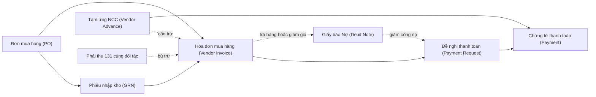
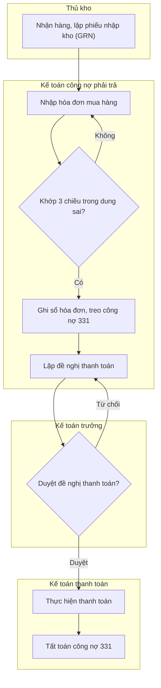
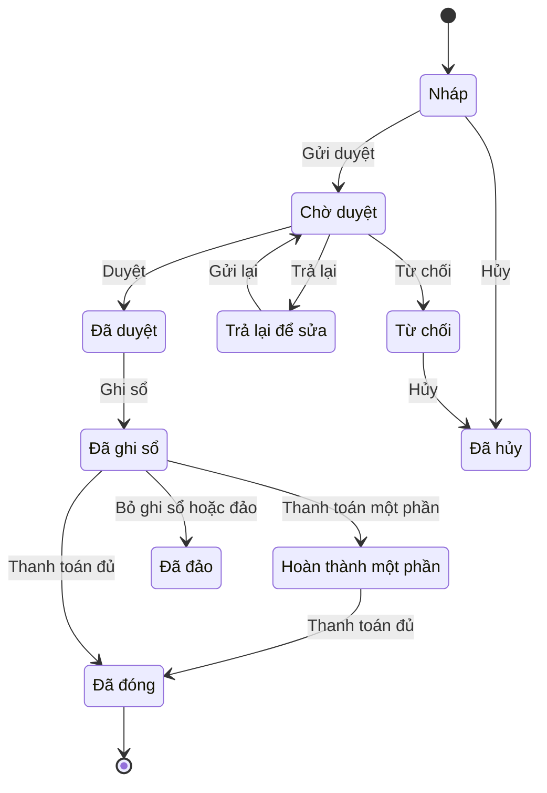

# AP — Công nợ phải trả (Accounts Payable)

> **Phạm vi:** Quản lý toàn bộ nghĩa vụ phải trả nhà cung cấp/người bán: từ hồ sơ tài chính nhà cung cấp, ghi nhận hóa đơn mua hàng (từ Đơn mua hàng – PO và Phiếu nhập kho – GRN qua đối chiếu 2/3 chiều, hoặc hóa đơn chi phí trực tiếp), thuế GTGT đầu vào, điều khoản & ngày đến hạn, đề nghị – phê duyệt – thực hiện thanh toán, tạm ứng/trả trước, giấy báo Nợ & trả lại hàng, bù trừ công nợ, chênh lệch tỷ giá, đối chiếu và phân tích tuổi nợ.
> **Module liên quan:** AP (lõi); PUR/P2P (mua hàng), INV (kho), GL (sổ cái), CB (tiền – ngân hàng), TAX (thuế GTGT, thuế nhà thầu), FA (tài sản cố định mua về).
> **Chuẩn tham chiếu:** SAP S/4HANA (FI-AP, Logistics Invoice Verification – MIRO), Oracle (Payables), Odoo (Vendor Bills), Microsoft Dynamics 365 Finance (Accounts payable); chế độ kế toán doanh nghiệp Việt Nam.
>
> **Cập nhật đến: 2026-10-20 — quy định thay đổi thường xuyên; BA phải kiểm tra lại hiệu lực khi dùng cho dự án.**
> **Chế độ kế toán áp dụng:** Thông tư **99/2025/TT-BTC** (ban hành 27/10/2025, hiệu lực **01/01/2026**, áp dụng cho năm tài chính bắt đầu từ/sau 01/01/2026), thay thế Thông tư 200/2014/TT-BTC [1][3]. Doanh nghiệp nhỏ và vừa vẫn có thể áp dụng **Thông tư 133/2016/TT-BTC** (TT 99 không thay thế TT 133) [4]. Số hiệu tài khoản công nợ phải trả cốt lõi (331, 133, 333…) **không đổi** so với TT 200 [2]. Chi tiết chế độ kế toán: xem `references/regulations/vn-accounting.md`.

## Mục lục
1. Mục đích & phạm vi — 2. Vai trò tham gia — 3. Danh mục (master data) tiên quyết — 4. Chứng từ & luồng chứng từ — 5. Các bước quy trình chuẩn — 6. Vòng đời trạng thái chứng từ — 7. Quy tắc nghiệp vụ & kiểm tra — 8. Hạch toán kế toán — 9. Tham số hệ thống — 10. Kiểm soát nội bộ & phân quyền — 11. Báo cáo chuẩn — 12. Tích hợp module — 13. Biến thể & ngoại lệ — 14. Lỗi BA hay mắc & câu hỏi khảo sát — 15. Nguồn tham khảo

---

## 1. Mục đích & phạm vi (trong/ngoài phạm vi)

**Mục đích:** Ghi nhận chính xác, đầy đủ, kịp thời công nợ phải trả; bảo đảm chỉ thanh toán cho hàng hóa/dịch vụ đã thực nhận, đúng giá, đúng hạn, đúng người thụ hưởng; tối ưu dòng tiền và tận dụng điều khoản thanh toán; bảo đảm điều kiện khấu trừ thuế GTGT đầu vào; cung cấp số liệu công nợ cho báo cáo tài chính và quản trị dòng tiền.

**Trong phạm vi:**
- Hồ sơ tài chính nhà cung cấp (phần kế toán – thanh toán).
- Ghi nhận hóa đơn mua hàng từ PO/GRN (đối chiếu 2/3 chiều, dung sai) và hóa đơn chi phí trực tiếp (không PO).
- Thuế GTGT đầu vào, điều kiện khấu trừ, ngày đến hạn.
- Tạm ứng/trả trước nhà cung cấp; đề nghị – duyệt – thực hiện thanh toán (tiền mặt/chuyển khoản/thanh toán theo lô).
- Giấy báo Nợ, trả lại hàng mua; bù trừ/cấn trừ công nợ hai chiều; chênh lệch tỷ giá; đối chiếu công nợ; tuổi nợ; khóa sổ kỳ (tất toán GR/IR).

**Ngoài phạm vi (liên kết tới module khác):**
- Tạo nhu cầu mua – chọn nhà cung cấp – tạo PO – nhận hàng/GRN: thuộc P2P/PUR → xem `references/processes/p2p-procure-to-pay.md`, `references/processes/inventory-warehouse.md`.
- Hạch toán giá vốn, nhập kho chi tiết: xem `references/processes/inventory-warehouse.md`, `references/processes/costing.md`.
- Thực hiện chi tiền tại ngân hàng/quỹ, đối chiếu sao kê: xem `references/processes/cash-bank.md`.
- Kê khai – nộp thuế GTGT, hóa đơn điện tử đầu vào: xem `references/processes/tax-einvoice.md`, `references/regulations/vn-tax-einvoice.md`.
- Ghi tăng tài sản cố định: xem `references/processes/fixed-assets.md`.

## 2. Vai trò tham gia

| Vai trò | Trách nhiệm | Quyền điển hình (theo hành động chuẩn) |
|---|---|---|
| Nhân viên mua hàng (Purchasing Staff) — `ROLE-AP-PUR` | Tạo PO, theo dõi giao hàng, xử lý sai lệch giá/lượng với nhà cung cấp | Xem, Tạo/Sửa PO (ngoài AP); Xem hóa đơn, công nợ NCC |
| Thủ kho (Storekeeper) — `ROLE-AP-WH` | Nhận hàng, lập Phiếu nhập kho (GRN), xác nhận số lượng/chất lượng | Xem PO; Tạo/Sửa GRN (ngoài AP) |
| Kế toán công nợ phải trả (AP Accountant) — `ROLE-AP-ACC` | Nhập/đối chiếu hóa đơn, ghi sổ công nợ, lập đề nghị thanh toán, theo dõi tuổi nợ, đối chiếu NCC | Xem, Tạo, Sửa, Xóa (Nháp), Gửi duyệt, Ghi sổ, In, Xuất file |
| Kế toán thanh toán/Thủ quỹ (Payment Accountant / Cashier) — `ROLE-AP-PAY` | Thực hiện thanh toán, lập ủy nhiệm chi/phiếu chi, cập nhật đã trả | Xem, Tạo chứng từ thanh toán, Ghi sổ thanh toán, In, Xuất file |
| Kế toán trưởng (Chief Accountant) — `ROLE-AP-CA` | Duyệt hóa đơn/đề nghị thanh toán trong hạn mức, kiểm soát hạch toán, khóa sổ | Xem, Duyệt, Từ chối, Trả lại, Bỏ ghi sổ, Đảo, Đóng kỳ |
| Giám đốc tài chính (CFO) / Giám đốc (Director) — `ROLE-AP-DIR` | Duyệt thanh toán vượt hạn mức, duyệt ngân sách chi | Xem, Duyệt (cấp cao), Từ chối |
| Quản trị hệ thống (System Admin) — `ROLE-AP-ADMIN` | Cấu hình tham số, dung sai, điều khoản, phân quyền | Xem, Cấu hình, Nhập file |

> SoD bắt buộc: người **duy trì master data nhà cung cấp (nhất là tài khoản ngân hàng)**, người **ghi nhận hóa đơn**, người **duyệt thanh toán**, người **thực hiện chi tiền** phải là các cá nhân khác nhau (xem §10).

## 3. Danh mục (master data) tiên quyết

| Danh mục | Trường quan trọng | Quy tắc chính |
|---|---|---|
| Nhà cung cấp – phần tài chính (`MD-VENDOR`) | Mã NCC; tên; **Mã số thuế (MST)**; TK đối ứng công nợ (reconciliation account – mặc định **331**); điều khoản thanh toán mặc định; tiền tệ; **tài khoản ngân hàng thụ hưởng**; nhóm thuế GTGT; cờ khóa thanh toán (payment block); cờ khóa mua (purchasing block); loại NCC (thường xuyên/vãng lai – one-time); đối tượng khấu trừ thuế nhà thầu | MST hợp lệ & duy nhất (10/13 chữ số); không trùng NCC (chống tạo trùng); TK ngân hàng phải trùng chủ tài khoản = tên NCC; mọi thay đổi TK ngân hàng phải qua phê duyệt & lưu vết (xem §10) |
| Điều khoản thanh toán (`MD-PAY-TERM`) | Mã; số ngày Net; mốc tính (baseline: ngày hóa đơn/ngày nhận hàng/ngày ghi sổ); chiết khấu thanh toán (nếu có: %/số ngày) | Ngày đến hạn = mốc tính + số ngày Net (§7-R5) |
| Mã thuế GTGT đầu vào (`MD-TAX-CODE`) | Mã; thuế suất (0%/5%/8%/10%/KCT/KKKNT); TK thuế (**1331/1332**); cờ được/không được khấu trừ | Thuế suất phổ thông 10%; **giảm còn 8%** cho nhóm đủ điều kiện đến hết 31/12/2026 [7] (xem §7-R7) |
| Tiền tệ & tỷ giá (`MD-CURRENCY`, `MD-FX-RATE`) | Mã tiền tệ; loại tỷ giá; nguồn; ngày hiệu lực | Tỷ giá ghi nhận & đánh giá lại theo §8 (nguyên tắc tỷ giá giao dịch thực tế) |
| Tài khoản sổ cái (`MD-GL-ACCOUNT`) | Số hiệu & tên TK theo TT 99/2025; TK trung gian GR/IR | 331 "Phải trả cho người bán"; 1331/1332; 3331/33311; 515/635; 413 [2] |
| Ngân hàng & tài khoản của công ty (`MD-BANK`) | Mã ngân hàng; số TK; chi nhánh; định dạng chuyển khoản (internet banking/host-to-host) | Dùng cho chi tiền & dự báo dòng tiền |
| Nhóm dung sai đối chiếu (`MD-TOLERANCE`) | Dung sai giá (%); dung sai số lượng (%); chênh lệch nhỏ (số tuyệt đối) | Vượt dung sai → treo (block) hóa đơn chờ xử lý (§7-R2) |
| Lý do khóa/giữ thanh toán (`MD-HOLD-REASON`) | Mã lý do; mô tả | Phục vụ treo/giữ & báo cáo kiểm soát |

## 4. Chứng từ & luồng chứng từ (document flow)

| Chứng từ (VI/EN) | Mục đích | Tạo từ | Sinh ra | Ảnh hưởng (kho/công nợ/sổ cái) |
|---|---|---|---|---|
| Đơn mua hàng (Purchase Order – PO) | Cam kết mua, giá & điều khoản | Nhu cầu mua/PR | GRN, Hóa đơn | Không ghi sổ cái (cam kết); làm cơ sở đối chiếu |
| Phiếu nhập kho (Goods Receipt Note – GRN) | Xác nhận thực nhận hàng | PO | Hóa đơn (3 chiều) | Kho tăng; **GR/IR** tăng (Nợ 152/156… / Có GR-IR) |
| Hóa đơn mua hàng (Vendor Invoice / Vendor Bill) | Ghi nhận nghĩa vụ phải trả + thuế GTGT đầu vào | PO + GRN (3 chiều) / PO (2 chiều) / trực tiếp (chi phí) | Đề nghị thanh toán | **Công nợ tăng** (Có 331); kết chuyển GR/IR; thuế 1331 |
| Hóa đơn chi phí trực tiếp (Non-PO / FI Invoice) | Ghi chi phí không qua PO (điện, nước, dịch vụ) | Trực tiếp | Đề nghị thanh toán | Nợ 627/641/642/242 + 1331 / Có 331 |
| Chứng từ tạm ứng/trả trước NCC (Vendor Advance / Down Payment) | Trả trước trước khi nhận hàng/hóa đơn | PO/hợp đồng | Thanh toán; cấn trừ hóa đơn | Nợ 331 (chi tiết trả trước) / Có 111/112 |
| Đề nghị thanh toán (Payment Request/Proposal) | Đề xuất chi trả hóa đơn đến hạn | Hóa đơn/nhiều hóa đơn | Chứng từ thanh toán | Không ghi sổ cái (đề xuất) |
| Chứng từ thanh toán (Payment / Ủy nhiệm chi – Phiếu chi) | Chi trả, tất toán công nợ | Đề nghị thanh toán | — | **Công nợ giảm** (Nợ 331 / Có 111/112) |
| Giấy báo Nợ / Trả lại hàng mua (Debit Note / Purchase Return) | Giảm công nợ do trả hàng/giảm giá | Hóa đơn/GRN gốc | Điều chỉnh công nợ | Kho giảm; Nợ 331 / Có 152/156 + 1331 |
| Bút toán bù trừ công nợ (Netting / Clearing) | Cấn trừ phải trả với phải thu cùng đối tác | Số dư 331 & 131 | — | Nợ 331 / Có 131 |

## 5. Các bước quy trình chuẩn

| # | Bước | Vai trò | Chứng từ | Hành động hệ thống | Trạng thái sau bước |
|---|---|---|---|---|---|
| 1 | Nhận hàng & lập GRN | Thủ kho | GRN | Ghi nhận thực nhận; tăng kho & GR/IR | GRN `COMPLETED` |
| 2 | Nhận hóa đơn NCC, nhập liệu | Kế toán AP | Hóa đơn mua hàng | Tạo hóa đơn (tham chiếu PO/GRN), kiểm tra trùng | Hóa đơn `DRAFT` |
| 3 | Đối chiếu 2/3 chiều & dung sai | Kế toán AP | Hóa đơn | So khớp PO–GRN–Hóa đơn; nếu vượt dung sai → treo | `DRAFT` hoặc **Treo (blocked)** |
| 4 | Gửi duyệt hóa đơn | Kế toán AP | Hóa đơn | Định tuyến phê duyệt theo giá trị | Hóa đơn `PENDING` |
| 5 | Duyệt hóa đơn | Kế toán trưởng | Hóa đơn | Duyệt/Từ chối/Trả lại | `APPROVED` / `REJECTED` / `RETURNED` |
| 6 | Ghi sổ hóa đơn | Kế toán AP | Hóa đơn | Sinh bút toán: Nợ CP/kho + 1331 / Có 331; kết chuyển GR/IR | Hóa đơn `POSTED` |
| 7 | Lập đề nghị thanh toán (chọn hóa đơn đến hạn) | Kế toán AP | Đề nghị thanh toán | Gom hóa đơn đến hạn, trừ tạm ứng & giấy báo Nợ | Đề nghị `PENDING` |
| 8 | Duyệt đề nghị thanh toán | Kế toán trưởng / CFO (theo hạn mức) | Đề nghị thanh toán | Duyệt theo hạn mức; kiểm tra chứng từ TTKDTM | `APPROVED` / `REJECTED` |
| 9 | Thực hiện thanh toán | Kế toán thanh toán / Thủ quỹ | Chứng từ thanh toán | Chi tiền (UNC/phiếu chi/lô); Nợ 331 / Có 111/112 | Thanh toán `POSTED`; hóa đơn `PARTIAL`/`CLOSED` |
| 10 | Đối chiếu công nợ định kỳ | Kế toán AP | Biên bản đối chiếu | Lập bảng đối chiếu, gửi NCC xác nhận | Đối chiếu `COMPLETED` |
| 11 | Khóa sổ kỳ (tất toán GR/IR, đánh giá lại tỷ giá) | Kế toán trưởng | Bút toán kỳ | Đánh giá lại số dư ngoại tệ, kết chuyển 413→515/635 | Kỳ `CLOSED` |

## 6. Vòng đời trạng thái chứng từ chính (Hóa đơn mua hàng)

| Từ | Hành động | Đến | Vai trò | Điều kiện |
|---|---|---|---|---|
| `DRAFT` | Gửi duyệt | `PENDING` | Kế toán AP | Đã khớp 2/3 chiều hoặc có lý do treo hợp lệ |
| `PENDING` | Duyệt | `APPROVED` | Kế toán trưởng | Trong hạn mức duyệt |
| `PENDING` | Trả lại | `RETURNED` | Kế toán trưởng | Thiếu/sai chứng từ |
| `PENDING` | Từ chối | `REJECTED` | Kế toán trưởng | Không hợp lệ |
| `APPROVED` | Ghi sổ | `POSTED` | Kế toán AP | Kỳ kế toán đang mở |
| `POSTED` | Thanh toán một phần | `PARTIAL` | Kế toán thanh toán | Số tiền trả < số phải trả |
| `POSTED`/`PARTIAL` | Thanh toán đủ | `CLOSED` | Kế toán thanh toán | Số dư = 0 |
| `POSTED` | Bỏ ghi sổ / Đảo | `REVERSED` | Kế toán trưởng | Kỳ mở; chưa thanh toán; có lý do & phê duyệt |
| `DRAFT`/`REJECTED` | Hủy | `CANCELLED` | Kế toán AP/trưởng | Chưa ghi sổ |

> Chỉ chứng từ `DRAFT` mới được **Xóa**. Chứng từ đã `POSTED` chỉ được **Đảo (Reverse)** để lưu vết, không xóa.

## 7. Quy tắc nghiệp vụ & kiểm tra (validation) điển hình

1. **BR-AP-01 – Chống hóa đơn trùng (duplicate invoice):** Chặn ghi nhận nếu trùng tổ hợp {MST nhà cung cấp + số hóa đơn + ngày hóa đơn + số tiền}. *Lý do:* tránh trả tiền hai lần – rủi ro mất tiền lớn nhất trong AP.
2. **BR-AP-02 – Đối chiếu & dung sai (2/3-way matching):** Hóa đơn chỉ được duyệt khi khớp PO (2 chiều) hoặc PO + GRN (3 chiều) trong dung sai; vượt dung sai thì **treo** cho đến khi giải phóng [9][10][11]. Công thức khớp 3 chiều:
   - Lệch số lượng: `|SL_hóa đơn − SL_GRN| ≤ SL_PO × dung_sai_SL%`
   - Lệch giá: `|Đơn giá_hóa đơn − Đơn giá_PO| ≤ Đơn giá_PO × dung_sai_giá%`
   - Trần giá trị: `Giá trị_lũy kế hóa đơn ≤ Giá trị_PO + dung_sai_tuyệt đối`
   *Lý do:* chỉ trả cho hàng đã nhận, đúng giá cam kết.
3. **BR-AP-03 – Khóa trị số âm & bắt buộc trường:** Số lượng, đơn giá, thuế suất không âm; bắt buộc có MST, số & ngày hóa đơn, điều khoản thanh toán, TK đối ứng.
4. **BR-AP-04 – Điều kiện khấu trừ thuế GTGT đầu vào (TTKDTM):** Từ 01/07/2025, hóa đơn mua hàng hóa/dịch vụ có **tổng giá trị từ 5.000.000đ trở lên** (đã gồm VAT) **phải có chứng từ thanh toán không dùng tiền mặt** mới được khấu trừ; dưới 5 triệu có thể trả tiền mặt. Mua **nhiều lần trong ngày từ cùng một người bán** mà tổng ≥ 5 triệu cũng phải TTKDTM. (Luật Thuế GTGT 48/2024/QH15, Nghị định 181/2025/NĐ-CP Điều 26 — hạ ngưỡng từ 20 triệu xuống 5 triệu) [5][6]. *Hệ thống cần:* cờ cảnh báo khi chọn phương thức tiền mặt cho hóa đơn ≥ 5 triệu.
5. **BR-AP-05 – Tính ngày đến hạn:** `Ngày đến hạn = Mốc tính (baseline) + Số ngày Net`; mốc tính cấu hình theo ngày hóa đơn / ngày nhận hàng / ngày ghi sổ (PRM-AP-007). *Lý do:* dự báo dòng tiền & tránh phạt trễ hạn.
6. **BR-AP-06 – Cấn trừ tạm ứng:** Khi ghi sổ hóa đơn cuối, phải tự động/bắt buộc cấn trừ các khoản đã tạm ứng/trả trước cho cùng PO/NCC trước khi lập đề nghị thanh toán. *Lý do:* tránh trả vượt.
7. **BR-AP-07 – Thuế suất GTGT 8%:** Áp mức 8% (thay cho 10%) cho nhóm hàng hóa/dịch vụ đủ điều kiện theo Nghị quyết 204/2025/QH15, hiệu lực 01/07/2025 **đến hết 31/12/2026**; loại trừ viễn thông, tài chính – ngân hàng – chứng khoán – bảo hiểm, bất động sản, kim loại, khai khoáng (trừ than), hàng chịu thuế TTĐB (trừ xăng) [7]. *Lý do:* ghi đúng thuế đầu vào theo hóa đơn NCC. Chi tiết: `references/regulations/vn-tax-einvoice.md`.
8. **BR-AP-08 – GR/IR tự khớp:** Số dư TK trung gian GR/IR (hàng về chưa có hóa đơn / hóa đơn chưa về hàng) phải được theo dõi & tất toán khi đủ cặp GRN–Hóa đơn. *Lý do:* phản ánh đúng công nợ & giá trị kho.
9. **BR-AP-09 – Khóa thanh toán NCC:** Không cho phép chọn hóa đơn của NCC đang bị khóa (payment block) vào đề nghị thanh toán. *Lý do:* kiểm soát tranh chấp/chất lượng.
10. **BR-AP-10 – Hạn mức duyệt theo cấp:** Định tuyến phê duyệt theo bậc giá trị (PRM-AP-010); vượt bậc chuyển cấp cao hơn. *Lý do:* phân quyền tài chính.
11. **BR-AP-11 – Kiểm soát đổi tài khoản ngân hàng NCC:** Mọi thay đổi TK ngân hàng thụ hưởng phải qua phê duyệt độc lập & xác minh lại với NCC (callback). *Lý do:* chống gian lận chuyển hướng thanh toán (BEC fraud).
12. **BR-AP-12 – Kỳ kế toán mở:** Chỉ ghi sổ/đảo trong kỳ đang mở; kỳ đã khóa phải mở lại có kiểm soát.

## 8. Hạch toán kế toán

> Áp dụng **Thông tư 99/2025/TT-BTC** (hiệu lực 01/01/2026). Số hiệu TK công nợ phải trả giữ nguyên so với TT 200/2014 [2][3]. Doanh nghiệp áp dụng **TT 133/2016** (DNNVV): phần lớn số hiệu tương đồng nhưng một số TK chi tiết khác — xem `references/regulations/vn-accounting.md` [4].

| Nghiệp vụ | Nợ | Có | Ghi chú |
|---|---|---|---|
| Mua hàng tồn kho nhập kho, có hóa đơn | 152/153/156 (giá chưa thuế) + 1331 | 331 | Khớp 3 chiều |
| Hàng mua đang đi đường (hóa đơn về, hàng chưa về) | 151 + 1331 | 331 | Khi hàng về: Nợ 152/156 / Có 151 |
| Hàng về trước, hóa đơn chưa về | 152/156 (giá tạm tính) | 331 (hoặc TK GR/IR) | Điều chỉnh khi hóa đơn về |
| Mua dịch vụ/chi phí trực tiếp (không PO) | 627/641/642/241/242 + 1331 | 331 | 242 nay tên "Chi phí chờ phân bổ" [3] |
| Mua tài sản cố định | 211 + 1332 | 331 | Xem `references/processes/fixed-assets.md` |
| Trả trước/tạm ứng cho NCC | 331 (chi tiết trả trước) | 111/112 | Số dư Nợ 331 trình bày bên tài sản |
| Thanh toán cho NCC | 331 | 111/112 | TTKDTM nếu ≥ 5 triệu (BR-AP-04) |
| Chiết khấu thanh toán **được hưởng** (trả sớm) | 331 | **515** | Doanh thu hoạt động tài chính (không giảm giá vốn) |
| Chiết khấu thương mại/giảm giá **được hưởng** | 331 (hoặc 111/112) | 152/156… + 1331 | Giảm giá trị hàng & thuế tương ứng |
| Trả lại hàng mua / giấy báo Nợ | 331 (hoặc 111/112) | 152/156 + 1331 | Kho giảm |
| Bù trừ công nợ (cùng đối tác vừa mua vừa bán) | 331 | 131 | Có biên bản bù trừ (BR §13) |
| Thuế GTGT đầu vào **không được khấu trừ** (vd trả tiền mặt ≥ 5 triệu) | 152/641/642 (gồm cả VAT) | 331 | VAT tính vào chi phí/giá trị tài sản |
| **Tỷ giá** – thanh toán nợ ngoại tệ, lãi tỷ giá | 331 (tỷ giá ghi sổ) | 1122 (tỷ giá xuất) + **515** | Chênh lệch có lợi |
| **Tỷ giá** – thanh toán nợ ngoại tệ, lỗ tỷ giá | 331 (tỷ giá ghi sổ) + **635** | 1122 (tỷ giá xuất) | Chênh lệch bất lợi |
| **Đánh giá lại** cuối kỳ số dư 331 ngoại tệ – lỗ | **413** | 331 | Cuối kỳ kết chuyển 413 → 635 |
| **Đánh giá lại** cuối kỳ số dư 331 ngoại tệ – lãi | 331 | **413** | Cuối kỳ kết chuyển 413 → 515 |
| Thuế nhà thầu (FCT) khấu trừ khi trả NCC nước ngoài | 331 | 3338/33382 (và 1331 nếu được khấu trừ phần VAT) | Xem `references/processes/tax-einvoice.md` ⚠️ CHƯA XÁC MINH chi tiết TK cấp 2 theo TT 99 |

**Nguyên tắc tỷ giá (theo tỷ giá giao dịch thực tế, kế thừa nguyên tắc TT 200, duy trì trong TT 99 [1][3]):** nợ phải trả ngoại tệ (331) ghi nhận và đánh giá lại cuối kỳ theo **tỷ giá bán** của ngân hàng thương mại nơi doanh nghiệp thường giao dịch; chênh lệch tỷ giá trong kỳ đưa vào 515/635, chênh lệch đánh giá lại cuối kỳ qua 413 rồi kết chuyển 515/635. ⚠️ BA cần đối chiếu điều khoản tỷ giá cụ thể trong TT 99/2025 cho dự án.

## 9. Tham số hệ thống điển hình

| Tham số | Kiểu | Giá trị gợi ý | Phạm vi | Ảnh hưởng |
|---|---|---|---|---|
| `PRM-AP-001` Dung sai giá | % | 1–3% | Công ty/nhóm NCC | Ngưỡng treo hóa đơn khi lệch giá |
| `PRM-AP-002` Dung sai số lượng | % | 0–5% | Công ty | Ngưỡng treo khi lệch lượng |
| `PRM-AP-003` Chênh lệch nhỏ tự chấp nhận | Số tiền | ≤ 50.000đ | Công ty | Tự ghi vào chênh lệch, không treo |
| `PRM-AP-004` Ngưỡng TTKDTM để khấu trừ VAT | Số tiền | **5.000.000đ** | Hệ thống (theo luật) [6] | Cảnh báo/kiểm soát khấu trừ |
| `PRM-AP-005` Chống hóa đơn trùng | Bật/Tắt + khóa so khớp | Bật; khóa = MST+số HĐ+ngày+tiền | Hệ thống | Chặn trả trùng |
| `PRM-AP-006` Điều khoản thanh toán mặc định | Danh mục | NET 30 | NCC/Công ty | Tính ngày đến hạn |
| `PRM-AP-007` Mốc tính ngày đến hạn | Lựa chọn | Ngày hóa đơn | Công ty | Baseline date |
| `PRM-AP-008` TK trung gian GR/IR | TK | (TK trung gian) | Hệ thống | Tất toán hàng/hóa đơn |
| `PRM-AP-009` Xử lý khi vượt dung sai | Lựa chọn | Treo + cần duyệt | Công ty | Chặn hay cảnh báo |
| `PRM-AP-010` Hạn mức duyệt theo cấp | Bảng bậc | Vd: KTT ≤ 500tr; CFO ≤ 2 tỷ; GĐ > 2 tỷ | Công ty | Định tuyến phê duyệt |
| `PRM-AP-011` Kiểm soát kép khi thanh toán | Bật/Tắt | Bật (maker–checker) | Hệ thống | Hai người cho mỗi lần chi |
| `PRM-AP-012` Loại tỷ giá hạch toán & nguồn | Danh mục | Tỷ giá NHTM giao dịch | Công ty | Ghi sổ & đánh giá lại |
| `PRM-AP-013` Cho phép thanh toán NCC bị khóa | Bật/Tắt | Tắt | Hệ thống | Kiểm soát tranh chấp |
| `PRM-AP-014` Tự cấn trừ tạm ứng | Bật/Tắt | Bật | Công ty | Tránh trả vượt |
| `PRM-AP-015` Kiểm soát đổi TK ngân hàng NCC | Quy trình duyệt | Bật + callback | Hệ thống | Chống gian lận chuyển hướng |

## 10. Kiểm soát nội bộ & phân quyền (SoD, hạn mức duyệt, audit)

- **Tách biệt chức năng (SoD) bắt buộc:** (a) duy trì master data NCC (đặc biệt TK ngân hàng), (b) ghi nhận hóa đơn, (c) duyệt thanh toán, (d) thực hiện chi tiền — bốn vai trò độc lập. Không để một người vừa tạo NCC vừa duyệt & chi.
- **Kiểm soát kép (maker–checker) cho chi tiền:** mỗi giao dịch thanh toán/đợt chi theo lô phải có người lập và người duyệt khác nhau; chuyển khoản host-to-host cần hai cấp phê duyệt.
- **Hạn mức duyệt theo cấp** (PRM-AP-010): phân bậc theo giá trị; vượt bậc tự định tuyến lên cấp cao hơn.
- **Kiểm soát đổi tài khoản ngân hàng NCC** (BR-AP-11): phê duyệt độc lập + xác minh callback với NCC; lưu vết người thay đổi, thời gian, giá trị cũ/mới — chống gian lận email doanh nghiệp (BEC).
- **Chống trả trùng** (BR-AP-01) và **đối chiếu GR/IR** (BR-AP-08) là chốt kiểm soát chính của AP.
- **Nhật ký kiểm toán (audit trail):** lưu vết tạo/sửa/ghi sổ/đảo/duyệt; không cho xóa chứng từ đã ghi sổ (chỉ Đảo). Phần mềm kế toán theo TT 99 phải đáp ứng yêu cầu lưu vết thay đổi, bảo mật, khả năng kết nối [3].
- **Đối chiếu công nợ định kỳ** với NCC (tối thiểu cuối năm; khuyến nghị theo quý với NCC lớn) và đối chiếu 331 với sổ cái.

## 11. Báo cáo chuẩn

| Báo cáo | Mục đích | Chiều phân tích / bộ lọc | Bắt buộc theo luật? |
|---|---|---|---|
| `RPT-AP-01` Sổ chi tiết công nợ phải trả theo NCC | Theo dõi phát sinh & số dư từng NCC | NCC, kỳ, tiền tệ, PO/hợp đồng | Có (sổ kế toán chi tiết) |
| `RPT-AP-02` Bảng tổng hợp công nợ phải trả | Số dư đầu/phát sinh/cuối toàn bộ NCC | NCC, nhóm, kỳ | Không (quản trị) |
| `RPT-AP-03` Bảng phân tích tuổi nợ phải trả (AP aging) | Quản trị dòng tiền & nợ đến hạn | Bucket: hiện hành/1–30/31–60/61–90/>90 ngày | Không |
| `RPT-AP-04` Biên bản đối chiếu công nợ NCC | Xác nhận số dư với NCC | NCC, ngày chốt | Không (nhưng cần cho kiểm toán) |
| `RPT-AP-05` Báo cáo GR/IR chưa khớp | Phát hiện hàng/hóa đơn lệch | PO, NCC, tuổi | Không |
| `RPT-AP-06` Nhật ký mua hàng / sổ nhật ký | Ghi nhận thời gian thực | Kỳ, loại chứng từ | Có (sổ kế toán) |
| `RPT-AP-07` Bảng kê/sổ theo dõi thuế GTGT đầu vào | Phục vụ Tờ khai thuế GTGT | Kỳ thuế, thuế suất, trạng thái khấu trừ | Tờ khai GTGT **bắt buộc**; bảng kê là chứng từ hỗ trợ — xem `references/regulations/vn-tax-einvoice.md` |
| `RPT-AP-08` Báo cáo nợ đến hạn & dự báo dòng tiền chi | Lập kế hoạch chi | Ngày đến hạn, NCC | Không |
| `RPT-AP-09` Sổ cái TK 331 | Khớp sổ cái – sổ chi tiết | Kỳ | Có (sổ cái) |
| `RPT-AP-10` Báo cáo tạm ứng NCC chưa tất toán | Kiểm soát trả trước | NCC, PO, tuổi | Không |

## 12. Tích hợp với module khác (ảnh hưởng dữ liệu hai chiều)

- **PUR/P2P ↔ AP:** PO & GRN là nguồn đối chiếu hóa đơn; AP trả về trạng thái thanh toán cho đánh giá NCC. Xem `references/processes/p2p-procure-to-pay.md`.
- **INV ↔ AP:** GRN tăng kho & GR/IR; chênh lệch giá hóa đơn so với giá nhập kho điều chỉnh giá trị kho/giá vốn. Xem `references/processes/inventory-warehouse.md`, `references/processes/costing.md`.
- **GL ↔ AP:** mọi bút toán ghi sổ 331 kết chuyển sổ cái; 331 là TK đối ứng (reconciliation). Xem `references/processes/r2r-general-ledger.md`.
- **CB ↔ AP:** đề nghị thanh toán → lệnh chi → cập nhật đã trả; đối chiếu sao kê ngân hàng. Xem `references/processes/cash-bank.md`.
- **TAX ↔ AP:** thuế GTGT đầu vào, điều kiện khấu trừ, thuế nhà thầu, tiếp nhận hóa đơn điện tử đầu vào (khung hóa đơn điện tử: Nghị định 123/2020/NĐ-CP sửa đổi tại Nghị định 70/2025/NĐ-CP [8]). Xem `references/processes/tax-einvoice.md`.
- **FA ↔ AP:** hóa đơn mua TSCĐ ghi tăng tài sản. Xem `references/processes/fixed-assets.md`.
- **AR ↔ AP:** bù trừ công nợ hai chiều với đối tác vừa là khách vừa là NCC. Xem `references/processes/ar-accounts-receivable.md`.

## 13. Biến thể & ngoại lệ

- **Giao/nhận một phần:** nhiều GRN cho một PO; hóa đơn khớp theo lũy kế; trạng thái PO `PARTIAL` đến khi đủ.
- **Hóa đơn nhiều PO / một PO nhiều hóa đơn:** cho phép phân bổ nhiều–nhiều; kiểm soát trần giá trị lũy kế.
- **Trả lại hàng sau khi đã thanh toán:** NCC hoàn tiền (Nợ 112/111 / Có 331) hoặc để dư Nợ 331 cấn trừ hóa đơn sau.
- **Hủy & sửa sau duyệt/ghi sổ:** đã ghi sổ chỉ **Đảo (Reverse)**; cần lý do + phê duyệt; không xóa.
- **Đa tiền tệ:** ghi nhận & đánh giá lại theo §8; theo dõi song song nguyên tệ & VND.
- **Trả trước/đặt cọc (down payment):** theo dõi riêng, cấn trừ khi có hóa đơn; TK 244 "Ký quỹ, ký cược" (đổi tên theo TT 99) cho ký quỹ [3].
- **Hàng nhập khẩu:** thuế GTGT hàng nhập khẩu nộp khâu hải quan (chứng từ nộp thuế là căn cứ khấu trừ), thuế nhập khẩu/TTĐB tính vào giá trị hàng; xem `references/industries/logistics.md`, `references/industries/trading-distribution.md`.
- **Hàng ký gửi (consignment):** chỉ ghi công nợ khi tiêu thụ/được chốt; không ghi 331 khi mới nhận giữ hộ.
- **Nhà cung cấp vãng lai (one-time vendor):** dùng NCC gộp + lưu thông tin trên chứng từ; không tạo master riêng.
- **Thanh toán theo lô (payment run/batch):** gom nhiều hóa đơn đến hạn, tạo tệp chuyển khoản; cần kiểm soát kép.

## 14. Lỗi BA hay mắc & câu hỏi cần hỏi khách hàng

**Lỗi thường gặp:**
- Bỏ quên cơ chế **chống hóa đơn trùng** và **đối chiếu 2/3 chiều** → rủi ro trả trùng/trả sai.
- Không thiết kế **TK trung gian GR/IR** → không khớp được hàng về và hóa đơn về lệch thời điểm.
- Quên **ngưỡng TTKDTM 5 triệu** mới (nhầm vẫn 20 triệu) → sai điều kiện khấu trừ VAT.
- Nhầm **chiết khấu thanh toán** (ghi 515, là tài chính) với **chiết khấu thương mại** (giảm giá trị hàng) → sai hạch toán & thuế.
- Không xử lý **cấn trừ tạm ứng** → trả vượt.
- Bỏ **kiểm soát đổi TK ngân hàng NCC** → rủi ro gian lận chuyển hướng.
- Thiết kế xóa được chứng từ đã ghi sổ (phải dùng Đảo).
- Dùng số hiệu/tên tài khoản cũ TT 200 mà không kiểm tra TT 99 (vd TK 242 đổi tên "Chi phí chờ phân bổ", TK 244 "Ký quỹ, ký cược", "Bảng cân đối kế toán" đổi thành "Báo cáo tình hình tài chính" B01-DN [3]).

**Câu hỏi khảo sát khách hàng:**
1. Doanh nghiệp áp dụng chế độ kế toán nào năm nay — TT 99/2025 hay TT 133/2016 (DNNVV)?
2. Tỷ lệ hóa đơn mua hàng có PO vs không PO? Loại chi phí nào thường không qua PO?
3. Dùng đối chiếu 2 chiều hay 3 chiều? Dung sai giá/số lượng bao nhiêu? Ai được giải phóng treo?
4. Có nhận hàng trước – hóa đơn sau không? Xử lý GR/IR thế nào?
5. Điều khoản thanh toán phổ biến (NET?, chiết khấu trả sớm?) tính từ mốc nào?
6. Quy trình & cấp duyệt đề nghị thanh toán; hạn mức từng cấp?
7. Có tạm ứng/đặt cọc NCC không? Cấn trừ tự động hay thủ công?
8. Có mua ngoại tệ/nhập khẩu không? Lấy tỷ giá từ nguồn nào? Có thuế nhà thầu không?
9. Có đối tác vừa mua vừa bán cần bù trừ công nợ không? Điều kiện & chứng từ bù trừ?
10. Tần suất & mẫu đối chiếu công nợ với NCC? Chấp nhận chênh lệch bao nhiêu?
11. Phương thức chi (tiền mặt/UNC/internet banking/host-to-host)? Có thanh toán theo lô không?
12. Ai được sửa tài khoản ngân hàng NCC? Có quy trình xác minh không?
13. Các bucket tuổi nợ phải trả mong muốn? Báo cáo dòng tiền chi theo chu kỳ nào?

## 15. Nguồn tham khảo

[1] Thông tư 99/2025/TT-BTC — Hướng dẫn Chế độ kế toán doanh nghiệp — https://congbao.chinhphu.vn/van-ban/thong-tu-so-99-2025-tt-btc-46529.htm (truy cập 2026-10-20)
[2] Danh mục tài khoản kế toán theo Thông tư 99/2025/TT-BTC — https://luatvietnam.vn/thue-phi-le-phi/danh-muc-tai-khoan-ke-toan-theo-thong-tu-99-2025-tt-btc-565-105326-article.html (truy cập 2026-10-20)
[3] Điểm mới Thông tư 99/2025/TT-BTC thay thế Thông tư 200 — https://elaw.com.vn/diem-moi-thong-tu-99-2025-tt-btc/ (truy cập 2026-10-20)
[4] Thông tư 99/2025 có thay thế Thông tư 133/2016 (DNNVV) không — https://thuvienphapluat.vn/ma-so-thue/phap-luat-thue/thong-tu-992025-co-thay-the-thong-tu-1332016-che-do-ke-toan-doanh-nghiep-nho-va-vua-213873.html (truy cập 2026-10-20)
[5] Luật Thuế GTGT số 48/2024/QH15 — điều kiện khấu trừ & chứng từ thanh toán không dùng tiền mặt — https://www.meinvoice.vn/tin-tuc/28261/luat-thue-gtgt-sua-doi-moi-nhat/ ; https://baophapluat.vn/doanh-nghiep-can-chuyen-doi-quy-dinh-moi-ve-khau-tru-thue-gtgt-yeu-cau-thanh-toan-khong-tien-mat-cho-moi-giao-dich-post15132.html (truy cập 2026-10-20)
[6] Nghị định 181/2025/NĐ-CP, Điều 26 — ngưỡng 5 triệu đồng chứng từ thanh toán không dùng tiền mặt — https://thuvienphapluat.vn/hoi-dap-phap-luat/dieu-26-nghi-dinh-1812025ndcp-ve-chung-tu-thanh-toan-khong-dung-tien-mat-ra-sao-138055486.html ; https://man.net.vn/nghi-dinh-181-2025/ (truy cập 2026-10-20)
[7] Nghị quyết 204/2025/QH15 giảm thuế GTGT 10%→8% đến hết 31/12/2026; Nghị định 174/2025/NĐ-CP hướng dẫn — https://thuvienphapluat.vn/phap-luat/ho-tro-phap-luat/nghi-quyet-2042025qh15-chinh-thuc-giam-thue-gtgt-tu-10-xuong-8-tu-ngay-172025-den-het-31122026-223404.html (truy cập 2026-10-20)
[8] Nghị định 70/2025/NĐ-CP sửa đổi Nghị định 123/2020/NĐ-CP về hóa đơn, chứng từ (hiệu lực 01/06/2025) — https://ketoananpha.vn/nhung-diem-moi-ve-hoa-don-dien-tu-tu-01-06-2025.html (truy cập 2026-10-20)
[9] Microsoft Dynamics 365 Finance — Three-way matching policies — https://learn.microsoft.com/en-us/dynamics365/finance/accounts-payable/three-way-matching-policies (truy cập 2026-10-20)
[10] Oracle Payables — Two-, Three-, and Four-way Matching — https://docs.oracle.com/cd/A60725_05/html/comnls/us/ap/point04.htm (truy cập 2026-10-20)
[11] Microsoft Dynamics 365 Finance — Set up accounts payable invoice matching validation — https://learn.microsoft.com/en-us/dynamics365/finance/accounts-payable/tasks/set-up-accounts-payable-invoice-matching-validation (truy cập 2026-10-20)
