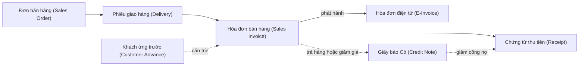
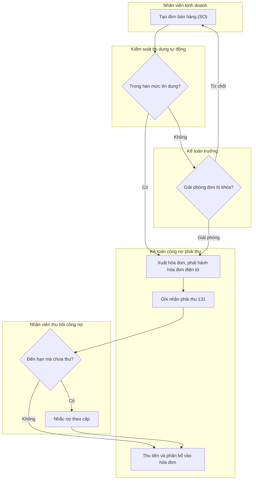
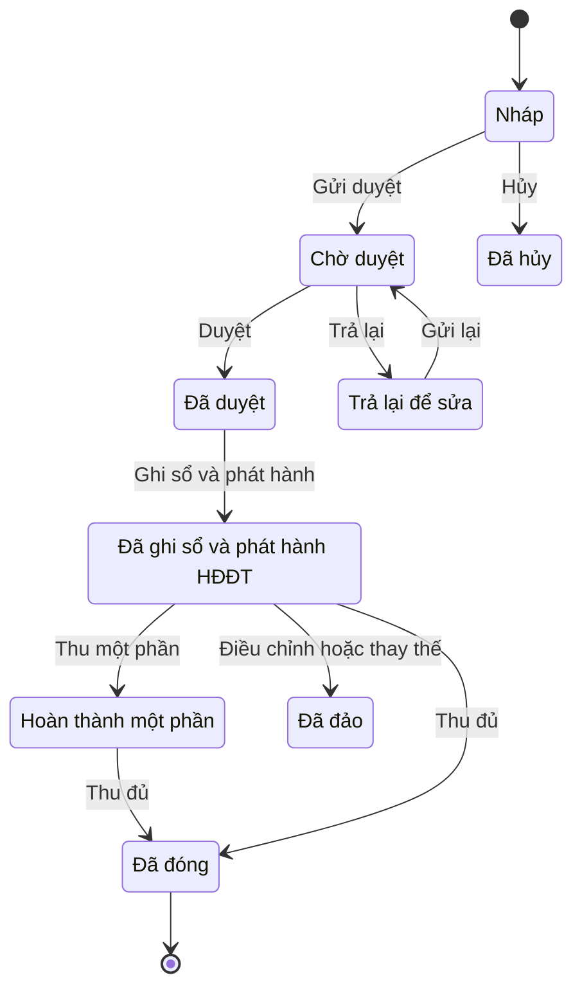

# AR — Công nợ phải thu (Accounts Receivable)

> **Phạm vi:** Quản lý toàn bộ quyền thu từ khách hàng: hồ sơ tài chính khách hàng, hạn mức & kiểm soát tín dụng, hóa đơn bán hàng gắn hóa đơn điện tử, thu tiền & phân bổ vào hóa đơn (FIFO/thủ công), khách ứng trước, giấy báo Có & trả lại hàng bán, chiết khấu thanh toán, nhắc nợ/đốc nợ, dự phòng nợ phải thu khó đòi, xóa sổ & thu hồi, đối chiếu công nợ, phân tích tuổi nợ và chênh lệch tỷ giá.
> **Module liên quan:** AR (lõi); SAL/O2C (bán hàng), INV (kho/giao hàng), GL (sổ cái), CB (tiền – ngân hàng), TAX (thuế GTGT đầu ra, hóa đơn điện tử), CRM (tín dụng/khách hàng).
> **Chuẩn tham chiếu:** SAP S/4HANA (FI-AR, Credit Management FI-AR-CR / SD-BF-CM, Dunning), Oracle (Receivables), Odoo (Invoicing/Follow-ups), Microsoft Dynamics 365 Finance (Accounts receivable, Credit & collections); chế độ kế toán doanh nghiệp Việt Nam.
>
> **Cập nhật đến: 2026-10-20 — quy định thay đổi thường xuyên; BA phải kiểm tra lại hiệu lực khi dùng cho dự án.**
> **Chế độ kế toán áp dụng:** Thông tư **99/2025/TT-BTC** (ban hành 27/10/2025, hiệu lực **01/01/2026**), thay thế Thông tư 200/2014/TT-BTC [1][2]; DNNVV có thể vẫn áp dụng **TT 133/2016** [8]. Số hiệu tài khoản phải thu cốt lõi (131, 333, 511, 521, 2293…) **không đổi** so với TT 200 [2]. Nợ đã xóa sổ tiếp tục theo dõi trên **TK 004 "Nợ khó đòi đã xử lý"** (tài khoản ngoài bảng, kế thừa TT 200) và trình bày trên thuyết minh BCTC (§8). ⚠️ **CHƯA XÁC MINH** nguyên văn danh mục tài khoản ngoài bảng (loại 0) trong Phụ lục II TT 99 — đa số nguồn tổng hợp cho thấy TT 99 **vẫn giữ** nhóm tài khoản ngoài bảng (chỉ **TT 133** DNNVV mới không có); BA đối chiếu khi dùng cho dự án.
> **Quy định dự phòng nợ phải thu khó đòi đang có hiệu lực:** Thông tư **48/2019/TT-BTC** (hiệu lực 10/10/2019), được sửa đổi bởi Thông tư **24/2022/TT-BTC** (hiệu lực 25/05/2022 — chỉ sửa phần dự phòng đầu tư chứng khoán, **không đổi** mức trích lập nợ phải thu khó đòi) [3][4].

## Mục lục
1. Mục đích & phạm vi — 2. Vai trò tham gia — 3. Danh mục (master data) tiên quyết — 4. Chứng từ & luồng chứng từ — 5. Các bước quy trình chuẩn — 6. Vòng đời trạng thái chứng từ — 7. Quy tắc nghiệp vụ & kiểm tra — 8. Hạch toán kế toán — 9. Tham số hệ thống — 10. Kiểm soát nội bộ & phân quyền — 11. Báo cáo chuẩn — 12. Tích hợp module — 13. Biến thể & ngoại lệ — 14. Lỗi BA hay mắc & câu hỏi khảo sát — 15. Nguồn tham khảo

---

## 1. Mục đích & phạm vi (trong/ngoài phạm vi)

**Mục đích:** Ghi nhận đầy đủ và kịp thời quyền thu từ khách hàng; kiểm soát rủi ro tín dụng (bán chịu trong hạn mức); thu đúng – thu đủ – thu đúng hạn; phân bổ chính xác tiền thu vào hóa đơn; trích lập dự phòng và xử lý nợ khó đòi đúng quy định; cung cấp số liệu công nợ, tuổi nợ, DSO cho báo cáo tài chính và quản trị dòng tiền.

**Trong phạm vi:**
- Hồ sơ tài chính khách hàng (phần kế toán – tín dụng).
- Hạn mức & kiểm soát tín dụng, khóa/giải phóng đơn hàng.
- Hóa đơn bán hàng và liên kết phát hành hóa đơn điện tử.
- Thu tiền & phân bổ (FIFO/thủ công/theo hạn); khách ứng trước; thu thừa/thiếu.
- Giấy báo Có, trả lại hàng bán; chiết khấu thanh toán; nhắc nợ.
- Dự phòng nợ phải thu khó đòi; xóa sổ & thu hồi; đối chiếu; tuổi nợ; chênh lệch tỷ giá; bù trừ công nợ.

**Ngoài phạm vi (liên kết tới module khác):**
- Báo giá – đơn bán hàng – giao hàng – xác định giá: thuộc O2C/SAL → xem `references/processes/o2c-order-to-cash.md`, `references/processes/inventory-warehouse.md`.
- Phát hành – lưu trữ – xử lý sai sót hóa đơn điện tử, kê khai thuế GTGT đầu ra: xem `references/processes/tax-einvoice.md`, `references/regulations/vn-tax-einvoice.md`.
- Thu tiền tại ngân hàng/quỹ, đối chiếu sao kê: xem `references/processes/cash-bank.md`.
- Hạch toán giá vốn, xuất kho: xem `references/processes/inventory-warehouse.md`, `references/processes/costing.md`.

## 2. Vai trò tham gia

| Vai trò | Trách nhiệm | Quyền điển hình (theo hành động chuẩn) |
|---|---|---|
| Nhân viên kinh doanh (Sales Staff) — `ROLE-AR-SALES` | Tạo đơn bán hàng, đề xuất hạn mức, chăm sóc công nợ khách | Xem, Tạo/Sửa SO (ngoài AR); Xem công nợ KH |
| Trưởng phòng kinh doanh (Sales Manager) — `ROLE-AR-SM` | Duyệt đơn/đề xuất nới hạn mức trong thẩm quyền | Xem, Duyệt (bán hàng) |
| Kế toán công nợ phải thu (AR Accountant) — `ROLE-AR-ACC` | Xuất hóa đơn, ghi nhận phải thu, thu tiền & phân bổ, trích lập dự phòng, đối chiếu | Xem, Tạo, Sửa, Xóa (Nháp), Gửi duyệt, Ghi sổ, In, Xuất file |
| Nhân viên thu hồi công nợ (Collections Officer) — `ROLE-AR-COL` | Nhắc nợ theo cấp, theo dõi cam kết trả nợ, đề xuất xử lý nợ xấu | Xem, Tạo thư nhắc nợ, In, Xuất file |
| Kế toán trưởng (Chief Accountant) — `ROLE-AR-CA` | Duyệt điều chỉnh, dự phòng, xóa sổ nợ; kiểm soát hạch toán; khóa sổ | Xem, Duyệt, Từ chối, Trả lại, Bỏ ghi sổ, Đảo, Đóng kỳ |
| Thủ quỹ (Cashier) — `ROLE-AR-CASH` | Thu tiền mặt, nộp quỹ/ngân hàng | Xem, Tạo phiếu thu, Ghi sổ thu, In |
| Giám đốc tài chính (CFO) / Giám đốc (Director) — `ROLE-AR-DIR` | Duyệt hạn mức lớn, duyệt xóa sổ nợ vượt thẩm quyền | Xem, Duyệt (cấp cao) |
| Quản trị hệ thống — `ROLE-AR-ADMIN` | Cấu hình hạn mức, quy trình nhắc nợ, tham số | Xem, Cấu hình, Nhập file |

> SoD bắt buộc: **phê duyệt tín dụng/hạn mức**, **nhập đơn & xuất hóa đơn**, **thu tiền**, **duyệt điều chỉnh/xóa sổ nợ**, **duy trì master khách hàng** phải tách biệt (xem §10).

## 3. Danh mục (master data) tiên quyết

| Danh mục | Trường quan trọng | Quy tắc chính |
|---|---|---|
| Khách hàng – phần tài chính (`MD-CUSTOMER`) | Mã KH; tên; **MST**; TK đối ứng (reconciliation – mặc định **131**); điều khoản thanh toán; **hạn mức tín dụng**; nhóm rủi ro; quy trình nhắc nợ áp dụng; tiền tệ; thông tin hóa đơn điện tử (email nhận, mã số thuế/mã người mua); cờ khóa bán (sales block) | MST hợp lệ & duy nhất; không trùng KH; hạn mức ≥ 0; gắn đúng quy trình nhắc nợ |
| Điều khoản thanh toán (`MD-PAY-TERM`) | Mã; số ngày Net; mốc tính; chiết khấu thanh toán (%/số ngày) | Ngày đến hạn = mốc tính + Net (§7-R6) |
| Nhóm/phân khúc tín dụng (`MD-CREDIT-SEG`) | Mã; hạn mức mặc định; loại kiểm tra (tĩnh/động); chân trời rủi ro (horizon) | Dùng cho kiểm soát tín dụng (§7-R1) |
| Quy trình nhắc nợ (`MD-DUNNING`) | Cấp (level); số ngày quá hạn mỗi cấp; mẫu thư; phí/lãi phạt (nếu có) | Cấp tăng theo số ngày quá hạn (§7-R8) [11][12] |
| Mã thuế GTGT đầu ra (`MD-TAX-CODE`) | Mã; thuế suất (0%/5%/8%/10%/KCT); TK **33311** | 8% cho nhóm đủ điều kiện đến hết 31/12/2026 [7] |
| Tiền tệ & tỷ giá (`MD-CURRENCY`, `MD-FX-RATE`) | Mã; loại tỷ giá; nguồn; ngày | Ghi nhận & đánh giá lại theo §8 |
| Tài khoản sổ cái (`MD-GL-ACCOUNT`) | Số hiệu theo TT 99/2025 | 131; 511; 521 (5211/5212/5213); 33311; 2293; 515/635; 413 [2] |
| Sản phẩm & bảng giá (`MD-PRODUCT`/`MD-PRICE`) | Mã hàng; giá; thuế suất | Chi tiết trong O2C — `references/processes/o2c-order-to-cash.md` |

## 4. Chứng từ & luồng chứng từ (document flow)

| Chứng từ (VI/EN) | Mục đích | Tạo từ | Sinh ra | Ảnh hưởng (kho/công nợ/sổ cái) |
|---|---|---|---|---|
| Đơn bán hàng (Sales Order – SO) | Ghi nhận cam kết bán, kiểm tra tín dụng | Báo giá/trực tiếp | Giao hàng, Hóa đơn | Không ghi sổ cái; chiếm dụng hạn mức tín dụng |
| Phiếu xuất kho/giao hàng (Delivery – DO) | Xuất & giao hàng | SO | Hóa đơn | Kho giảm; giá vốn Nợ 632/Có 156 |
| Hóa đơn bán hàng (Sales Invoice) | Ghi nhận doanh thu & phải thu + thuế GTGT đầu ra | SO/DO | Hóa đơn điện tử; Chứng từ thu tiền | **Phải thu tăng** (Nợ 131); doanh thu 511; thuế 33311 |
| Hóa đơn điện tử (E-Invoice) | Hóa đơn hợp pháp gửi khách & cơ quan thuế | Hóa đơn bán hàng | Lưu trữ, tra cứu (mã CQT) | Không ghi sổ riêng; là chứng từ gốc của 511/33311 |
| Chứng từ khách ứng trước (Customer Advance) | Thu trước khi giao hàng/xuất hóa đơn | SO/hợp đồng | Cấn trừ hóa đơn | Nợ 111/112 / Có 131 (chi tiết ứng trước) |
| Chứng từ thu tiền (Receipt) | Thu & phân bổ vào hóa đơn | Hóa đơn/nhiều hóa đơn | — | **Phải thu giảm** (Nợ 111/112 / Có 131) |
| Giấy báo Có / Trả lại hàng bán (Credit Note / Sales Return) | Giảm phải thu do trả hàng/giảm giá | Hóa đơn gốc | Điều chỉnh công nợ; hóa đơn điều chỉnh/thay thế | Kho tăng (nếu trả hàng); Nợ 5212/5213 + 33311 / Có 131 |
| Chứng từ dự phòng/xóa sổ (Provision / Write-off) | Trích lập & xử lý nợ khó đòi | Phân tích tuổi nợ | — | Nợ 642 / Có 2293; xóa sổ: Nợ 2293+642 / Có 131 |

## 5. Các bước quy trình chuẩn

| # | Bước | Vai trò | Chứng từ | Hành động hệ thống | Trạng thái sau bước |
|---|---|---|---|---|---|
| 1 | Tạo đơn bán hàng | Nhân viên kinh doanh | SO | Kiểm tra tín dụng tự động | SO `DRAFT`/`PENDING` hoặc **khóa tín dụng** |
| 2 | Giải phóng đơn bị khóa tín dụng | Kế toán trưởng/CFO | SO | Giải phóng/từ chối theo thẩm quyền | SO `APPROVED` / giữ khóa |
| 3 | Giao hàng | Thủ kho | DO | Xuất kho, ghi giá vốn | DO `COMPLETED` |
| 4 | Xuất hóa đơn & phát hành HĐĐT | Kế toán AR | Hóa đơn + HĐĐT | Sinh XML, gửi nhà cung cấp HĐĐT/cơ quan thuế lấy mã | Hóa đơn `POSTED`; HĐĐT đã phát hành |
| 5 | Ghi nhận phải thu | Kế toán AR | Hóa đơn | Bút toán Nợ 131 / Có 511 + 33311 | Phải thu mở (open item) |
| 6 | Thu tiền & phân bổ | Kế toán AR/Thủ quỹ | Chứng từ thu tiền | Phân bổ FIFO/thủ công; xử lý thừa/thiếu | Hóa đơn `PARTIAL`/`CLOSED` |
| 7 | Nhắc nợ nếu quá hạn | Nhân viên thu hồi công nợ | Thư nhắc nợ | Chạy nhắc nợ theo cấp & tuổi nợ | Nhắc nợ cấp 1..n |
| 8 | Trích lập dự phòng nợ khó đòi (định kỳ) | Kế toán AR → Kế toán trưởng duyệt | Chứng từ dự phòng | Tính theo tuổi nợ; Nợ 642 / Có 2293 | Dự phòng `POSTED` |
| 9 | Xóa sổ nợ không thu hồi được | Kế toán trưởng/CFO/GĐ | Chứng từ xóa sổ | Nợ 2293+642 / Có 131; theo dõi ngoài sổ | Nợ đã xử lý |
| 10 | Đối chiếu công nợ định kỳ | Kế toán AR | Biên bản đối chiếu | Lập & gửi KH xác nhận | Đối chiếu `COMPLETED` |
| 11 | Khóa sổ kỳ (đánh giá lại tỷ giá) | Kế toán trưởng | Bút toán kỳ | Đánh giá lại 131 ngoại tệ; kết chuyển 413→515/635 | Kỳ `CLOSED` |

## 6. Vòng đời trạng thái chứng từ chính (Hóa đơn bán hàng)

| Từ | Hành động | Đến | Vai trò | Điều kiện |
|---|---|---|---|---|
| `DRAFT` | Gửi duyệt | `PENDING` | Kế toán AR | Đủ thông tin hóa đơn & khách hàng |
| `PENDING` | Duyệt | `APPROVED` | Kế toán trưởng | Hợp lệ |
| `PENDING` | Trả lại | `RETURNED` | Kế toán trưởng | Sai/thiếu thông tin |
| `APPROVED` | Ghi sổ và phát hành | `POSTED` | Kế toán AR | Kỳ mở; phát hành HĐĐT thành công (có mã CQT) |
| `POSTED` | Thu một phần | `PARTIAL` | Kế toán AR | Số thu < phải thu |
| `POSTED`/`PARTIAL` | Thu đủ | `CLOSED` | Kế toán AR | Số dư = 0 |
| `POSTED` | Điều chỉnh/thay thế | `REVERSED` | Kế toán trưởng | Sai sót sau phát hành → lập **hóa đơn điều chỉnh/thay thế** (ND 70/2025 bỏ cơ chế hủy, dùng hóa đơn thay thế) [7][8] |
| `DRAFT` | Hủy | `CANCELLED` | Kế toán AR | Chưa phát hành HĐĐT |

> Sau khi HĐĐT đã phát hành (có mã cơ quan thuế), **không xóa** — mọi sai sót xử lý bằng hóa đơn điều chỉnh hoặc thay thế theo quy định hóa đơn điện tử. Xem `references/regulations/vn-tax-einvoice.md`.

## 7. Quy tắc nghiệp vụ & kiểm tra (validation) điển hình

1. **BR-AR-01 – Kiểm soát tín dụng:** Khi tạo/duyệt SO, hệ thống so **tổng dư nợ rủi ro (credit exposure)** với **hạn mức tín dụng**; vượt → cảnh báo hoặc **khóa đơn/giao hàng/xuất hóa đơn** cho đến khi người có thẩm quyền giải phóng [9][10]. Công thức rủi ro động (dynamic):
   `Credit exposure = Dư nợ 131 mở + Đơn hàng chưa giao + Hàng đã giao chưa xuất HĐ + Hóa đơn chưa thu`
   Kiểm tra: `Credit exposure > Hạn mức × (1 + % dung sai)` → khóa. *Lý do:* giới hạn rủi ro bán chịu.
2. **BR-AR-02 – Kiểm tra tín dụng tĩnh vs động:** Tĩnh = chỉ so dư nợ hiện tại; động = cộng cả đơn/giao hàng trong "chân trời rủi ro". Cấu hình theo nhóm tín dụng (PRM-AR-002).
3. **BR-AR-03 – Chống hóa đơn/khách trùng, bắt buộc trường:** MST hợp lệ & duy nhất; số lượng/giá/thuế không âm.
4. **BR-AR-04 – Liên kết hóa đơn điện tử:** Hóa đơn chỉ chuyển `POSTED` khi phát hành HĐĐT thành công và nhận **mã cơ quan thuế (mã CQT)**; lưu số HĐĐT & mã tra cứu ngược về hóa đơn AR. Thời điểm lập hóa đơn và xác định nghĩa vụ thuế GTGT đầu ra theo Luật Thuế GTGT 48/2024/QH15 [5], Nghị định 181/2025/NĐ-CP [6] và Nghị định 70/2025/NĐ-CP sửa Nghị định 123/2020 (Điều 9) [8]: khi chuyển giao quyền sở hữu/sử dụng hàng hóa, không phụ thuộc đã thu tiền hay chưa.
5. **BR-AR-05 – Phân bổ tiền thu (allocation):** Hỗ trợ **FIFO** (ưu tiên hóa đơn cũ/đến hạn trước), **thủ công** (chọn hóa đơn), hoặc **theo hạn**. Thu thừa/thiếu xử lý theo dung sai (PRM-AR-006): trong dung sai → ghi chênh lệch; ngoài → để **on-account** (chưa phân bổ) hoặc tạo khoản phải thu/khác. *Lý do:* số dư từng hóa đơn chính xác phục vụ tuổi nợ & nhắc nợ.
6. **BR-AR-06 – Ngày đến hạn:** `Ngày đến hạn = Mốc tính + Net` theo điều khoản thanh toán; là cơ sở tính tuổi nợ, nhắc nợ, dự phòng.
7. **BR-AR-07 – Chiết khấu & giảm trừ:**
   - **Chiết khấu thanh toán** (trả sớm) = **chi phí tài chính** (Nợ 635), **không** giảm doanh thu, **không** chịu thuế GTGT.
   - **Chiết khấu thương mại / giảm giá hàng bán / hàng bán trả lại** = **giảm trừ doanh thu** (TK 521: 5211/5213/5212) kèm giảm thuế GTGT đầu ra (33311). (TT 133: ghi giảm trực tiếp 511, không dùng 521.) *Lý do:* phân biệt bản chất tài chính vs giảm doanh thu.
8. **BR-AR-08 – Nhắc nợ theo cấp (dunning):** Cấp nhắc nợ xác định theo **số ngày quá hạn** (hoặc số tiền quá hạn), mỗi cấp một mẫu thư, mức độ tăng dần [11][12]. Ví dụ: cấp 1 (1–15 ngày) nhắc nhẹ; cấp 2 (16–30); cấp 3 (31–60); cấp 4 (>60) cảnh báo ngừng cấp tín dụng.
9. **BR-AR-09 – Trích lập dự phòng nợ phải thu khó đòi (TT 48/2019) [3]:** Căn cứ tuổi nợ quá hạn và chứng từ gốc (hợp đồng, biên bản đối chiếu công nợ):

   | Thời gian quá hạn | Mức trích lập |
   |---|---|
   | Từ 6 tháng đến dưới 1 năm | 30% giá trị nợ |
   | Từ 1 năm đến dưới 2 năm | 50% |
   | Từ 2 năm đến dưới 3 năm | 70% |
   | Từ 3 năm trở lên | 100% |

   Dự phòng được tính vào chi phí quản lý doanh nghiệp (642). Mức trích do TT 24/2022 **không** thay đổi (chỉ sửa dự phòng đầu tư chứng khoán) [4]. *Lý do:* phản ánh đúng giá trị thu hồi được & chi phí hợp lý.
10. **BR-AR-10 – Xóa sổ nợ:** Chỉ xóa khi đủ điều kiện/hồ sơ theo quy định và được cấp thẩm quyền duyệt; phần đã lập dự phòng ghi giảm 2293, phần thiếu vào 642; **tiếp tục theo dõi khoản đã xóa trên TK 004 (ngoài bảng) và thuyết minh BCTC** để thu hồi (xem §8). *Lý do:* tránh thổi phồng tài sản và không mất quyền đòi nợ.
11. **BR-AR-11 – Kỳ kế toán mở & bất biến sau phát hành:** Chỉ ghi sổ/đảo trong kỳ mở; HĐĐT đã phát hành bất biến, chỉ điều chỉnh/thay thế.

## 8. Hạch toán kế toán

> Áp dụng **Thông tư 99/2025/TT-BTC** (hiệu lực 01/01/2026). Số hiệu TK phải thu giữ nguyên so với TT 200/2014 [2]. **Theo dõi nợ đã xóa sổ:** ghi trên **TK 004 "Nợ khó đòi đã xử lý"** (tài khoản ngoài bảng, kế thừa TT 200) đồng thời trình bày trên **thuyết minh BCTC/sổ theo dõi chi tiết riêng** để tiếp tục thu hồi (TT 48/2019 [3]). ⚠️ **CHƯA XÁC MINH** nguyên văn danh mục loại 0 trong Phụ lục II TT 99 (đa số nguồn tổng hợp cho thấy TT 99 **vẫn giữ** nhóm tài khoản ngoài bảng); nếu dự án áp dụng **TT 133** (DNNVV – không có tài khoản ngoài bảng) thì theo dõi nợ đã xóa trên thuyết minh/sổ riêng. DNNVV theo **TT 133**: không dùng TK 521 (giảm trừ doanh thu ghi trực tiếp 511) — xem `references/regulations/vn-accounting.md`.

| Nghiệp vụ | Nợ | Có | Ghi chú |
|---|---|---|---|
| Bán hàng/dịch vụ, xuất hóa đơn | 131 | 511 + 33311 | Đồng thời giá vốn: Nợ 632 / Có 156 |
| Bán thu tiền ngay | 111/112 | 511 + 33311 | |
| Thu tiền khách hàng | 111/112 | 131 | Phân bổ vào hóa đơn (BR-AR-05) |
| Khách ứng trước | 111/112 | 131 (chi tiết trả trước) | Số dư Có 131 trình bày bên nợ phải trả (người mua trả tiền trước) |
| Chiết khấu thương mại / giảm giá hàng bán | 5211/5213 + 33311 | 131 | TT 133: ghi giảm 511 |
| Hàng bán bị trả lại | 5212 + 33311 | 131 | Đồng thời nhập lại kho: Nợ 156 / Có 632 |
| Chiết khấu thanh toán cho khách (trả sớm) | **635** | 131 (hoặc 111/112) | Chi phí tài chính; không giảm doanh thu |
| Trích lập dự phòng nợ phải thu khó đòi | 642 | **2293** | Theo TT 48/2019 [3] |
| Hoàn nhập dự phòng (thừa so với cần trích) | 2293 | 642 | Ghi giảm chi phí |
| Xóa sổ nợ không thu hồi được | 2293 (phần đã lập) + 642 (phần thiếu) | 131 | Đồng thời ghi **Nợ TK 004** (ngoài bảng) + thuyết minh BCTC để tiếp tục thu hồi (TT 48/2019 [3]) |
| Thu hồi nợ đã xóa sổ | 111/112 | **711** | Đồng thời ghi **Có TK 004** (giảm theo dõi ngoài bảng) |
| **Tỷ giá** – thu nợ ngoại tệ, lãi | 1122 (tỷ giá thực tế) | 131 (tỷ giá ghi sổ) + **515** | |
| **Tỷ giá** – thu nợ ngoại tệ, lỗ | 1122 + **635** | 131 (tỷ giá ghi sổ) | |
| **Đánh giá lại** cuối kỳ 131 ngoại tệ – lãi | 131 | **413** | Cuối kỳ kết chuyển 413 → 515 |
| **Đánh giá lại** cuối kỳ 131 ngoại tệ – lỗ | **413** | 131 | Cuối kỳ kết chuyển 413 → 635 |
| Bù trừ công nợ (đối tác vừa mua vừa bán) | 331 | 131 | Có biên bản bù trừ; xem `references/processes/ap-accounts-payable.md` |

**Nguyên tắc tỷ giá (tỷ giá giao dịch thực tế, kế thừa TT 200 và duy trì trong TT 99 [1][2]):** nợ phải thu ngoại tệ (131) ghi nhận & đánh giá lại cuối kỳ theo **tỷ giá mua** của ngân hàng thương mại nơi khách hàng thanh toán; chênh lệch trong kỳ vào 515/635, chênh lệch đánh giá lại cuối kỳ qua 413 rồi kết chuyển 515/635. ⚠️ BA cần đối chiếu điều khoản tỷ giá cụ thể trong TT 99/2025 cho dự án.

## 9. Tham số hệ thống điển hình

| Tham số | Kiểu | Giá trị gợi ý | Phạm vi | Ảnh hưởng |
|---|---|---|---|---|
| `PRM-AR-001` Hạn mức tín dụng mặc định | Số tiền | Theo nhóm KH | KH/phân khúc | Chặn/cảnh báo bán chịu |
| `PRM-AR-002` Loại kiểm tra tín dụng | Lựa chọn | Động (dynamic) | Công ty/nhóm | Cách tính rủi ro |
| `PRM-AR-003` % dung sai vượt hạn mức | % | 0–5% | Công ty | Ngưỡng khóa đơn |
| `PRM-AR-004` Hành động khi vượt hạn mức | Lựa chọn | Khóa đơn + cảnh báo | Công ty | Khóa đơn/giao hàng/hóa đơn |
| `PRM-AR-005` Phương pháp phân bổ thu tiền | Lựa chọn | FIFO | Công ty | Cách trừ công nợ |
| `PRM-AR-006` Dung sai thu thừa/thiếu | Số tiền/% | ≤ 50.000đ | Công ty | Tự ghi chênh lệch |
| `PRM-AR-007` Quy trình nhắc nợ (cấp & số ngày) | Bảng | 4 cấp: 1–15/16–30/31–60/>60 | Công ty/nhóm | Lịch & mẫu nhắc nợ |
| `PRM-AR-008` Điều khoản thanh toán mặc định | Danh mục | NET 30 | KH | Ngày đến hạn |
| `PRM-AR-009` Chiết khấu thanh toán | %/ngày | Vd 1%/10 ngày | KH/điều khoản | Tính 635 khi trả sớm |
| `PRM-AR-010` Mức trích lập dự phòng theo tuổi nợ | Bảng % | 30/50/70/100% | Hệ thống (theo TT 48/2019) [3] | Tính dự phòng 2293 |
| `PRM-AR-011` Kết nối nhà cung cấp HĐĐT/TVAN | Kết nối | (theo hợp đồng) | Hệ thống | Phát hành HĐĐT |
| `PRM-AR-012` Loại tỷ giá hạch toán & nguồn | Danh mục | Tỷ giá mua NHTM | Công ty | Ghi sổ & đánh giá lại |
| `PRM-AR-013` Bucket tuổi nợ | Bảng | Hiện hành/1–30/31–60/61–90/>90 | Công ty | Báo cáo tuổi nợ |
| `PRM-AR-014` Hạn mức duyệt xóa sổ nợ | Bảng bậc | Theo cấp | Công ty | Kiểm soát xóa sổ |

## 10. Kiểm soát nội bộ & phân quyền (SoD, hạn mức duyệt, audit)

- **Tách biệt chức năng (SoD):** (a) phê duyệt tín dụng/hạn mức, (b) nhập đơn & xuất hóa đơn, (c) thu tiền, (d) duyệt điều chỉnh/giảm giá/xóa sổ nợ, (e) duy trì master khách hàng — tách biệt. Người bán hàng không tự duyệt hạn mức của khách mình.
- **Kiểm soát tín dụng độc lập:** việc giải phóng đơn bị khóa tín dụng do bộ phận tài chính/kế toán trưởng thực hiện, không để kinh doanh tự giải phóng.
- **Duyệt dự phòng & xóa sổ nợ:** theo cấp thẩm quyền (PRM-AR-014); xóa sổ nợ lớn cần CFO/Giám đốc và đủ hồ sơ theo TT 48/2019 [3].
- **Kiểm soát chiết khấu/giảm giá:** mọi giảm trừ doanh thu & giấy báo Có phải có phê duyệt và lý do; liên kết hóa đơn gốc.
- **Đối soát thu tiền với ngân hàng/quỹ:** phiếu thu/giấy báo Có ngân hàng khớp sao kê; tiền mặt nộp quỹ trong ngày.
- **Nhật ký kiểm toán:** lưu vết tạo/sửa/ghi sổ/đảo/duyệt; HĐĐT đã phát hành bất biến; không xóa chứng từ đã ghi sổ (chỉ Đảo/điều chỉnh). Phần mềm theo TT 99 phải lưu vết thay đổi, bảo mật, kết nối [2].
- **Đối chiếu công nợ định kỳ** với khách hàng (tối thiểu cuối năm; khuyến nghị theo quý/tháng với khách lớn) và khớp 131 với sổ cái.

## 11. Báo cáo chuẩn

| Báo cáo | Mục đích | Chiều phân tích / bộ lọc | Bắt buộc theo luật? |
|---|---|---|---|
| `RPT-AR-01` Sổ chi tiết công nợ phải thu theo KH | Phát sinh & số dư từng KH | KH, kỳ, tiền tệ, hợp đồng | Có (sổ kế toán chi tiết) |
| `RPT-AR-02` Bảng tổng hợp công nợ phải thu | Số dư đầu/phát sinh/cuối toàn bộ KH | KH, nhóm, kỳ | Không (quản trị) |
| `RPT-AR-03` Bảng phân tích tuổi nợ phải thu (AR aging) | Theo dõi nợ quá hạn & rủi ro | Bucket: hiện hành/1–30/31–60/61–90/>90 | Không |
| `RPT-AR-04` Biên bản đối chiếu công nợ KH | Xác nhận số dư với KH | KH, ngày chốt | Không (cần cho kiểm toán) |
| `RPT-AR-05` Báo cáo hạn mức & rủi ro tín dụng | Quản trị tín dụng | KH, % sử dụng hạn mức, đơn bị khóa | Không |
| `RPT-AR-06` Bảng kê/sổ theo dõi thuế GTGT đầu ra | Phục vụ Tờ khai thuế GTGT | Kỳ thuế, thuế suất | Tờ khai GTGT **bắt buộc**; xem `references/regulations/vn-tax-einvoice.md` |
| `RPT-AR-07` Nhật ký bán hàng / sổ nhật ký | Ghi nhận theo thời gian | Kỳ, loại chứng từ | Có (sổ kế toán) |
| `RPT-AR-08` Báo cáo dự phòng nợ phải thu khó đòi | Theo dõi trích lập/hoàn nhập/xóa sổ | KH, tuổi nợ, mức % | Không (nhưng cần cho BCTC) |
| `RPT-AR-09` Báo cáo nhắc nợ/đốc nợ (collections) | Theo dõi nhắc nợ & cam kết trả | KH, cấp nhắc nợ, số ngày quá hạn | Không |
| `RPT-AR-10` Báo cáo DSO & hiệu quả thu hồi | Đo kỳ thu tiền bình quân | `DSO = (Phải thu bình quân / Doanh thu bán chịu) × số ngày kỳ` | Không |
| `RPT-AR-11` Sổ cái TK 131 | Khớp sổ cái – sổ chi tiết | Kỳ | Có (sổ cái) |

## 12. Tích hợp với module khác (ảnh hưởng dữ liệu hai chiều)

- **SAL/O2C ↔ AR:** SO kích hoạt kiểm tra tín dụng; giao hàng → hóa đơn → phải thu; AR trả trạng thái thu tiền & hạn mức khả dụng cho bán hàng. Xem `references/processes/o2c-order-to-cash.md`.
- **INV ↔ AR:** giao hàng giảm kho & ghi giá vốn; trả lại hàng nhập kho lại. Xem `references/processes/inventory-warehouse.md`.
- **TAX ↔ AR:** thuế GTGT đầu ra, phát hành & xử lý sai sót hóa đơn điện tử. Xem `references/processes/tax-einvoice.md`, `references/regulations/vn-tax-einvoice.md`.
- **CB ↔ AR:** thu tiền qua ngân hàng/quỹ, đối chiếu sao kê, xác định khoản thu chưa định danh. Xem `references/processes/cash-bank.md`.
- **GL ↔ AR:** bút toán 131/511/521/2293 kết chuyển sổ cái; 131 là TK đối ứng. Xem `references/processes/r2r-general-ledger.md`.
- **CRM ↔ AR:** thông tin tín dụng, lịch sử thanh toán phục vụ chấm điểm & chăm sóc. Xem `references/processes/crm-service.md`.
- **AP ↔ AR:** bù trừ công nợ hai chiều. Xem `references/processes/ap-accounts-payable.md`.

## 13. Biến thể & ngoại lệ

- **Giao/xuất hóa đơn một phần:** nhiều lần giao cho một SO; nhiều hóa đơn; tuổi nợ theo từng hóa đơn.
- **Trả lại hàng/giảm giá sau khi đã phát hành HĐĐT:** lập **hóa đơn điều chỉnh/thay thế** + giấy báo Có; nhập kho lại nếu trả hàng.
- **Hủy & sửa sau phát hành:** HĐĐT bất biến; chỉ điều chỉnh/thay thế có lý do & phê duyệt.
- **Đa tiền tệ:** ghi nhận & đánh giá lại theo §8; theo dõi nguyên tệ & VND.
- **Khách ứng trước/đặt cọc:** theo dõi số dư Có 131; cấn trừ khi xuất hóa đơn; lưu ý thời điểm xuất hóa đơn cho khoản ứng trước dịch vụ theo quy định HĐĐT.
- **Bán trả góp/trả chậm (installment):** theo dõi lịch thu nhiều kỳ; lãi trả chậm hạch toán doanh thu tài chính (nếu có).
- **Bán ký gửi/đại lý (consignment):** ghi doanh thu & phải thu khi hàng thực bán/được chốt, không khi giao ký gửi.
- **Thu hộ/định danh khoản thu (unidentified receipts):** khoản thu chưa rõ hóa đơn để **on-account**, định danh sau.
- **Bán nợ/chiết khấu công nợ (factoring):** chuyển quyền thu cho bên thứ ba — hạch toán & theo dõi riêng ⚠️ CHƯA XÁC MINH chi tiết theo khung pháp lý hiện hành; BA xác minh khi phát sinh.
- **Bù trừ công nợ:** đối tác vừa mua vừa bán — lập biên bản bù trừ 331/131.

## 14. Lỗi BA hay mắc & câu hỏi cần hỏi khách hàng

**Lỗi thường gặp:**
- Nhầm **chiết khấu thanh toán** (Nợ 635, tài chính, không chịu VAT) với **chiết khấu thương mại/giảm giá** (giảm trừ doanh thu 521 + giảm VAT đầu ra).
- Không thiết kế **kiểm soát tín dụng** (hạn mức, khóa/giải phóng đơn) hoặc để kinh doanh tự giải phóng.
- Thiếu **phân bổ tiền thu theo hóa đơn** → tuổi nợ & nhắc nợ sai.
- Nhầm rằng **TT 99 đã bỏ TK 004 / tài khoản ngoài bảng** nên bỏ theo dõi nợ đã xóa (thực tế TT 99 vẫn giữ nhóm ngoài bảng; chỉ **TT 133** DNNVV mới không có TK ngoài bảng) → phải tiếp tục theo dõi nợ đã xóa trên TK 004 và/hoặc thuyết minh BCTC để thu hồi.
- Trích lập dự phòng sai mức/sai mốc tuổi nợ (không theo 30/50/70/100% của TT 48/2019) hoặc thiếu hồ sơ (đối chiếu công nợ).
- Không gắn chặt **hóa đơn AR với hóa đơn điện tử** (trạng thái, mã CQT, xử lý sai sót bằng hóa đơn thay thế).
- Cho xóa hóa đơn đã phát hành thay vì điều chỉnh/thay thế.

**Câu hỏi khảo sát khách hàng:**
1. Doanh nghiệp áp dụng TT 99/2025 hay TT 133/2016 (DNNVV)?
2. Có bán chịu không? Cấp & quản lý hạn mức tín dụng thế nào? Kiểm tra tĩnh hay động? Ai giải phóng đơn bị khóa?
3. Dùng nhà cung cấp hóa đơn điện tử/TVAN nào? ERP phát hành trực tiếp hay qua trung gian? Quy trình xử lý hóa đơn sai sót?
4. Điều khoản thanh toán phổ biến? Có chiết khấu trả sớm không (%/số ngày)?
5. Quy tắc phân bổ tiền thu (FIFO/thủ công/theo hạn)? Xử lý thu thừa/thiếu & khoản thu chưa định danh ra sao?
6. Chính sách chiết khấu thương mại/giảm giá/hàng trả lại? Ai duyệt? Ghi nhận bằng 521 hay giảm trực tiếp 511?
7. Quy trình nhắc nợ: mấy cấp, mốc ngày, mẫu thư, ai phụ trách? Có tính lãi/phạt trễ hạn không?
8. Chính sách trích lập dự phòng nợ khó đòi — theo TT 48/2019 hay chính sách nội bộ chặt hơn? Hồ sơ gồm gì?
9. Quy trình & thẩm quyền xóa sổ nợ? Cách theo dõi nợ đã xóa để tiếp tục thu hồi?
10. Có bán ngoại tệ/xuất khẩu không? Nguồn tỷ giá? Cách đánh giá lại cuối kỳ?
11. Có khách ứng trước/đặt cọc/trả góp/ký gửi/factoring không?
12. Tần suất & mẫu đối chiếu công nợ với khách hàng? Mục tiêu DSO?
13. Các bucket tuổi nợ & báo cáo quản trị công nợ mong muốn?

## 15. Nguồn tham khảo

[1] Thông tư 99/2025/TT-BTC — Hướng dẫn Chế độ kế toán doanh nghiệp — https://congbao.chinhphu.vn/van-ban/thong-tu-so-99-2025-tt-btc-46529.htm (truy cập 2026-10-20)
[2] Danh mục tài khoản kế toán theo Thông tư 99/2025/TT-BTC (số hiệu 131/333/511/521/229 giữ nguyên; trang liệt kê các tài khoản trong bảng loại 1–9, không bao gồm phụ lục tài khoản ngoài bảng — không dùng để kết luận loại 0 đã bị bỏ) — https://luatvietnam.vn/thue-phi-le-phi/danh-muc-tai-khoan-ke-toan-theo-thong-tu-99-2025-tt-btc-565-105326-article.html (truy cập 2026-10-20)
[3] Thông tư 48/2019/TT-BTC — trích lập dự phòng nợ phải thu khó đòi (mức 30/50/70/100% theo tuổi nợ) — https://luatvietnam.vn/tin-van-ban-moi/muc-trich-lap-du-phong-cho-cac-khoan-no-xau-den-100-186-22005-article.html (truy cập 2026-10-20)
[4] Thông tư 24/2022/TT-BTC sửa đổi Thông tư 48/2019/TT-BTC (hiệu lực 25/05/2022; sửa phần dự phòng đầu tư chứng khoán) — https://caselaw.vn/van-ban-phap-luat/401792-thong-tu-so-24-2022-tt-btc-ngay-07-04-2022-cua-bo-truong-bo-tai-chinh-sua-doi-thong-tu-48-2019-tt-btc-huong-dan-viec-trich-lap-va-xu-ly-cac-khoan-du-phong (truy cập 2026-10-20)
[5] Luật Thuế GTGT số 48/2024/QH15 (hiệu lực 01/07/2025) — https://www.meinvoice.vn/tin-tuc/28261/luat-thue-gtgt-sua-doi-moi-nhat/ (truy cập 2026-10-20)
[6] Nghị định 181/2025/NĐ-CP hướng dẫn Luật Thuế GTGT (ngưỡng 5 triệu đồng thanh toán không dùng tiền mặt) — https://thuvienphapluat.vn/hoi-dap-phap-luat/dieu-26-nghi-dinh-1812025ndcp-ve-chung-tu-thanh-toan-khong-dung-tien-mat-ra-sao-138055486.html (truy cập 2026-10-20)
[7] Nghị quyết 204/2025/QH15 giảm thuế GTGT 10%→8% đến hết 31/12/2026 — https://thuvienphapluat.vn/phap-luat/ho-tro-phap-luat/nghi-quyet-2042025qh15-chinh-thuc-giam-thue-gtgt-tu-10-xuong-8-tu-ngay-172025-den-het-31122026-223404.html (truy cập 2026-10-20)
[8] Nghị định 70/2025/NĐ-CP sửa đổi Nghị định 123/2020/NĐ-CP về hóa đơn, chứng từ (hiệu lực 01/06/2025; bỏ hủy hóa đơn điện tử sai sót, dùng hóa đơn thay thế); Thông tư 99/2025 không thay thế TT 133/2016 — https://ketoananpha.vn/nhung-diem-moi-ve-hoa-don-dien-tu-tu-01-06-2025.html ; https://thuvienphapluat.vn/ma-so-thue/phap-luat-thue/thong-tu-992025-co-thay-the-thong-tu-1332016-che-do-ke-toan-doanh-nghiep-nho-va-vua-213873.html (truy cập 2026-10-20)
[9] SAP S/4HANA — Credit Evaluation and Management (credit exposure, hạn mức) — https://help.sap.com/docs/SAP_S4HANA_CLOUD/918bca53037f408f91a2295d04ac16bc/4d4653b0cfd70692e10000000a42189b.html (truy cập 2026-10-20)
[10] SAP S/4HANA — Credit Check (khóa đơn/giao hàng, giải phóng) — https://help.sap.com/docs/SAP_S4HANA_ON-PREMISE/3cb1182b4a184bdd93f8d62e3f1f0741/811174d486d74c709469ef3d36f9b7bb.html (truy cập 2026-10-20)
[11] SAP S/4HANA — Dunning Process (cấp nhắc nợ theo ngày quá hạn) — https://help.sap.com/docs/SAP_S4HANA_ON-PREMISE/3cb1182b4a184bdd93f8d62e3f1f0741/a5ebd353ca9f4408e10000000a174cb4.html (truy cập 2026-10-20)
[12] Oracle PeopleSoft Receivables — Setting Up Dunning Letter Processing — https://docs.oracle.com/en/applications/peoplesoft/financials-and-supply-chain-management/9.2.056/peoplesoft-receivables/setting-dunning-letter-processing.html (truy cập 2026-10-20)
