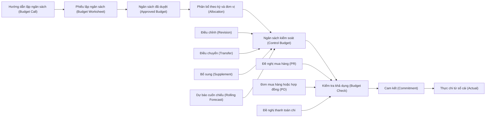
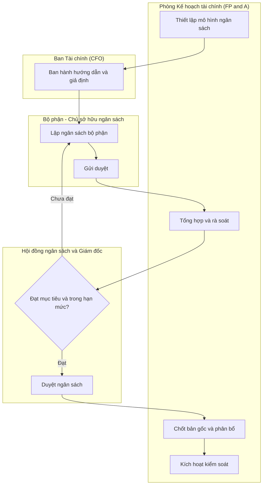
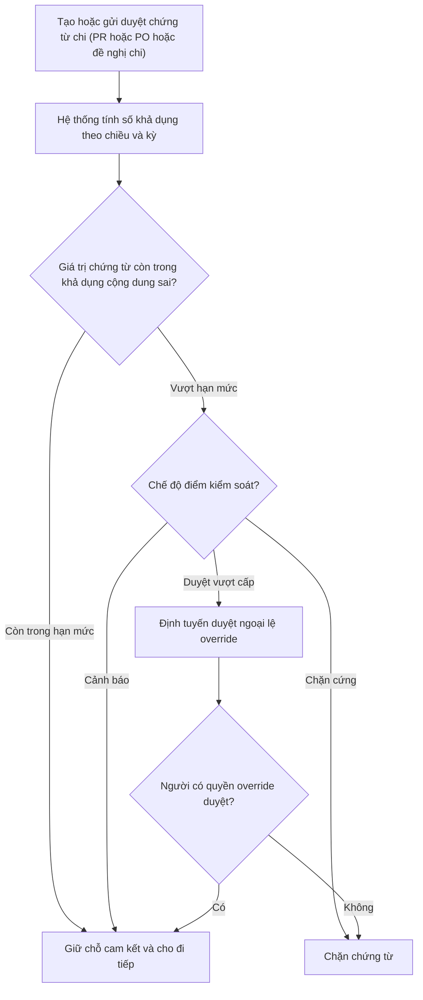
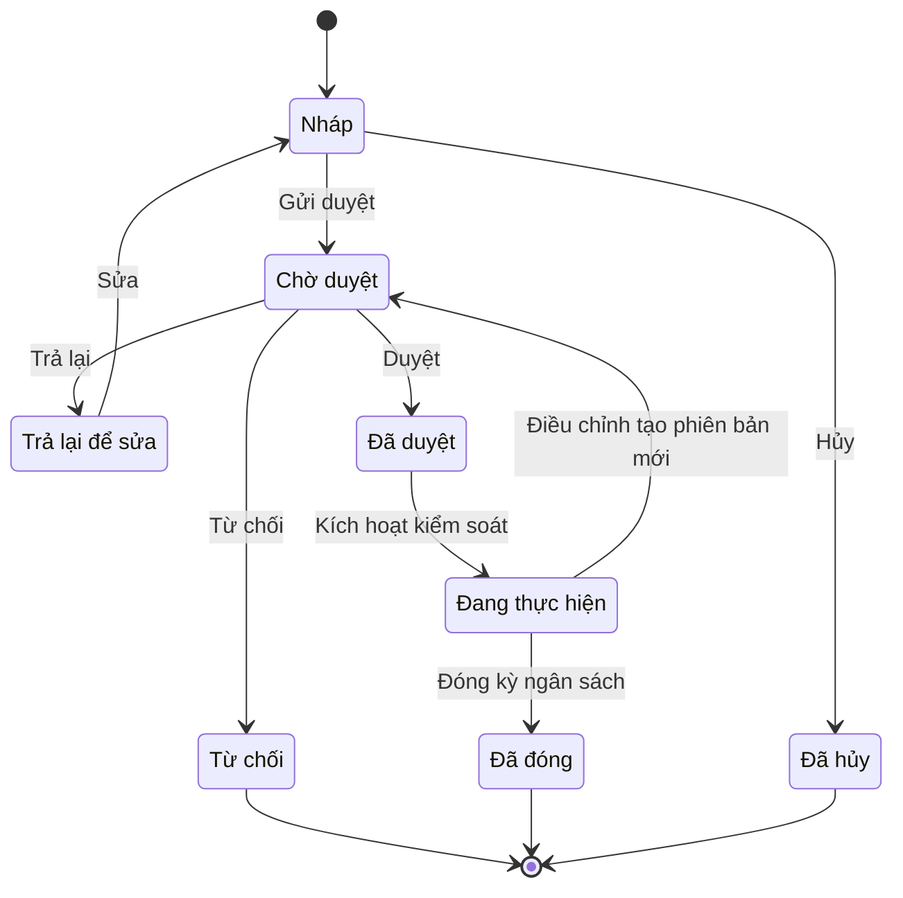

# BUD — Lập & Kiểm soát Ngân sách (Budgeting & Budget Control)

> **Phạm vi:** Toàn bộ chu trình ngân sách của doanh nghiệp: cấu trúc ngân sách (khoản mục × đơn vị gánh chịu × kỳ × phiên bản), lập – duyệt – phân bổ ngân sách, điều chỉnh/điều chuyển/bổ sung, **kiểm soát ngân sách tại các điểm kiểm soát** (đề nghị mua hàng, đơn mua hàng, hợp đồng, đề nghị thanh toán, đề nghị hoàn ứng) với ba hành vi chặn cứng / cảnh báo / duyệt vượt cấp, khái niệm **cam kết – phong tỏa (commitment / encumbrance)**, báo cáo ngân sách – cam kết – thực tế, và dự báo cuốn chiếu (rolling forecast). **Module liên quan:** BUD (lõi); tích hợp GL/R2R (Sổ cái – nguồn số thực chi), PUR/P2P (Mua hàng), AP (Công nợ phải trả), CB (Tiền/Ngân hàng), PRJ (Dự án), HR/PAY (Lương), SAL/O2C (Bán hàng/Doanh thu), COST (Giá thành), FA (Tài sản cố định). **Chuẩn tham chiếu:** SAP Funds Management / Budget Control System (PSM-FM-BCS) [3]; Oracle Fusion Cloud Budgetary Control & Encumbrance Accounting [4]; Microsoft Dynamics 365 Finance Budget control [5]; Odoo Budgets [6]; chế độ kế toán doanh nghiệp Việt Nam **Thông tư 99/2025/TT-BTC** (hiệu lực 01/01/2026, thay thế Thông tư 200/2014/TT-BTC) [1][2].
>
> **Cập nhật đến: 2026-10-20 — quy định thay đổi thường xuyên; BA phải kiểm tra lại hiệu lực khi dùng cho dự án.**
>
> ⚠️ **Lưu ý trọng yếu:** Với **doanh nghiệp**, ngân sách là **kế toán quản trị (management accounting)** — **KHÔNG bắt buộc theo luật** [7] và **KHÔNG sinh bút toán sổ cái tài chính**. Cam kết/phong tỏa (commitment/encumbrance) được theo dõi trên "sổ ngân sách" thống kê/ghi nhớ (memo/statistical ledger), **không** ghi vào hệ thống tài khoản tài chính theo TT99/TT200 (xem §8). Đây là điểm BA hay thiết kế sai.

## Mục lục
- [1. Mục đích & phạm vi](#1-mục-đích--phạm-vi-trongngoài-phạm-vi)
- [2. Vai trò tham gia](#2-vai-trò-tham-gia)
- [3. Danh mục (master data) tiên quyết](#3-danh-mục-master-data-tiên-quyết)
- [4. Chứng từ & luồng chứng từ](#4-chứng-từ--luồng-chứng-từ-document-flow)
- [5. Các bước quy trình chuẩn](#5-các-bước-quy-trình-chuẩn)
- [6. Vòng đời trạng thái chứng từ chính](#6-vòng-đời-trạng-thái-chứng-từ-chính-ngân-sách)
- [7. Quy tắc nghiệp vụ & kiểm tra (validation)](#7-quy-tắc-nghiệp-vụ--kiểm-tra-validation-điển-hình)
- [8. Hạch toán kế toán](#8-hạch-toán-kế-toán)
- [9. Tham số hệ thống điển hình](#9-tham-số-hệ-thống-điển-hình)
- [10. Kiểm soát nội bộ & phân quyền](#10-kiểm-soát-nội-bộ--phân-quyền-sod-hạn-mức-duyệt-audit)
- [11. Báo cáo chuẩn](#11-báo-cáo-chuẩn)
- [12. Tích hợp với module khác](#12-tích-hợp-với-module-khác-ảnh-hưởng-dữ-liệu-hai-chiều)
- [13. Biến thể & ngoại lệ](#13-biến-thể--ngoại-lệ)
- [14. Lỗi BA hay mắc & câu hỏi khảo sát](#14-lỗi-ba-hay-mắc--câu-hỏi-cần-hỏi-khách-hàng)
- [15. Nguồn tham khảo](#15-nguồn-tham-khảo)

Chức năng điển hình của module (dùng làm ví dụ ID khi đặc tả): `FN-BUD-01` Thiết lập mô hình & cấu trúc ngân sách · `FN-BUD-02` Lập & nhập ngân sách · `FN-BUD-03` Duyệt & chốt bản gốc (baseline) · `FN-BUD-04` Phân bổ ngân sách theo kỳ/đơn vị · `FN-BUD-05` Điều chỉnh/điều chuyển/bổ sung · `FN-BUD-06` Kiểm soát ngân sách tại điểm kiểm soát (budget check) · `FN-BUD-07` Theo dõi cam kết/encumbrance · `FN-BUD-08` Dự báo cuốn chiếu (rolling forecast) · `FN-BUD-09` Báo cáo ngân sách (BvA/BvCvA) · `FN-BUD-10` Đóng kỳ & chuyển nguồn ngân sách.

---

## 1. Mục đích & phạm vi (trong/ngoài phạm vi)

**Mục đích:** Chuẩn hóa chu trình ngân sách để (a) mọi khoản chi/thu dự kiến đều có **khoản mục ngân sách**, chủ sở hữu và phê duyệt; (b) ngân sách được lập theo cấu trúc nhiều chiều và nhiều phiên bản, có thể hợp nhất theo phân cấp; (c) chi tiêu thực tế bị **kiểm soát so với ngân sách khả dụng** tại đúng điểm phát sinh cam kết (PR/PO/hợp đồng/đề nghị chi) với hành vi rõ ràng (chặn cứng / cảnh báo / duyệt vượt cấp); (d) phân biệt và theo dõi đúng ba đại lượng **ngân sách – cam kết – thực tế**; (e) cung cấp báo cáo chênh lệch và dự báo cuốn chiếu để điều hành.

**Trong phạm vi:**
- Thiết lập **cấu trúc/mô hình ngân sách (budget structure / budget model)**: khoản mục ngân sách (budget line item) × đơn vị gánh chịu (cost center/phòng ban/dự án) × kỳ (period) × phiên bản/kịch bản (version/scenario) × loại ngân sách (hoạt động/đầu tư/doanh thu/tiền mặt).
- **Lập ngân sách (budget preparation)** theo các phương pháp: từ trên xuống (top-down), từ dưới lên (bottom-up), kết hợp lặp (iterative); tăng dần (incremental), ngân sách từ số 0 (zero-based budgeting – ZBB), theo yếu tố dẫn dắt (driver-based), cuốn chiếu (rolling).
- **Duyệt – chốt bản gốc (baseline) – phân bổ** theo kỳ và đơn vị; **kích hoạt kiểm soát (release/activate)**.
- **Điều chỉnh (revision), điều chuyển (transfer / virement), bổ sung (supplement), thu hồi/nộp trả** ngân sách; quản lý phiên bản.
- **Điểm kiểm soát ngân sách (budget control points)** và công cụ kiểm tra khả dụng (budget availability check): đề nghị mua hàng (PR), đơn mua hàng (PO), hợp đồng, đề nghị thanh toán, đề nghị hoàn/tạm ứng, bút toán chi phí.
- **Cam kết / phong tỏa (commitment / encumbrance)**: dự chi (pre-encumbrance từ PR), cam kết (encumbrance từ PO/hợp đồng), tất toán cam kết thành thực chi (actual).
- **Báo cáo** ngân sách vs thực tế (BvA), ngân sách vs cam kết vs thực tế (BvCvA), số khả dụng, phân tích chênh lệch, burn rate, **dự báo cuốn chiếu (rolling forecast)**, ngân sách tiền mặt (cash budget).
- Tham số, kiểm soát nội bộ, phân quyền của riêng module ngân sách.

**Ngoài phạm vi (xem file khác):**
- **Ghi sổ số thực chi/thực thu (actuals)** — phát sinh ở module nguồn: hóa đơn & công nợ → `references/processes/ap-accounts-payable.md`, `ar-accounts-receivable.md`; chi tiền → `cash-bank.md`; lương → `hr-payroll.md`; khấu hao & CAPEX → `fixed-assets.md`; giá vốn → `costing.md`; bút toán sổ cái → `r2r-general-ledger.md`.
- **Kiểm soát ngân sách & khả dụng ở cấp dự án (WBS, Budget Availability Control – AVAC)** → `references/processes/project-management.md` (BUD chỉ **hợp nhất** ngân sách dự án vào ngân sách công ty, tránh đếm trùng — xem §12, §13).
- **Kiểm tra ngân sách khi lập PR/PO** về mặt quy trình mua hàng → `references/processes/p2p-procure-to-pay.md` (§7 BR-PUR-02, `PRM-PUR-001`); kiểm tra khi duyệt chi → `cash-bank.md`. File này định nghĩa **cơ chế kiểm soát**; file P2P/CB mô tả **điểm gọi** cơ chế đó.
- **Chế độ kế toán, hệ thống tài khoản, tài khoản ngoài bảng** → `references/regulations/vn-accounting.md`.
- **Ngân sách khuyến mãi/chiến dịch** chi tiết → `o2c-order-to-cash.md`, `crm-service.md` (BUD chỉ giữ **trần tổng** của khoản mục).

**Khác biệt bản chất cần nắm (3 đại lượng):**

| Đại lượng (VI/EN) | Khi nào phát sinh | Có ghi sổ cái tài chính? | Nguồn |
|---|---|---|---|
| **Ngân sách (Budget)** | Khi duyệt kế hoạch | Không | Module BUD |
| **Dự chi (Pre-encumbrance)** | Khi tạo/duyệt PR | Không (sổ ngân sách) | PR (P2P) |
| **Cam kết / Phong tỏa (Commitment / Encumbrance)** | Khi duyệt PO / ký hợp đồng | Không (sổ ngân sách) | PO/Hợp đồng (P2P) |
| **Thực tế (Actual)** | Khi ghi sổ hóa đơn/chi phí/thực chi | **Có** (ở module nguồn) | GL/AP/CB/PAY/FA… |

> Công thức xuyên suốt: **Số khả dụng (Available) = Ngân sách điều chỉnh − (Thực tế + Cam kết + Dự chi)**, tùy chọn thành phần theo tham số (xem §7 BR-BUD-02, §9).

---

## 2. Vai trò tham gia

| Vai trò | Trách nhiệm | Quyền điển hình (theo hành động chuẩn) |
|---|---|---|
| Chủ sở hữu ngân sách / Trưởng bộ phận (Budget Owner / Department Head) — `ROLE-BUD-OWNER` | Lập ngân sách bộ phận/trung tâm chi phí mình phụ trách, giải trình chênh lệch, đề xuất điều chỉnh/điều chuyển | Xem (phạm vi bộ phận), Tạo, Sửa (bản nháp), Gửi duyệt, In, Xuất file |
| Chuyên viên Kế hoạch & Phân tích tài chính (FP&A Analyst / Budget Officer) — `ROLE-BUD-FPA` | Thiết lập mô hình/khoản mục/kỳ/phiên bản, ban hành biểu mẫu, tổng hợp, phân bổ, kích hoạt kiểm soát, lập báo cáo & dự báo | Xem (toàn công ty), Tạo, Sửa, Cấu hình, Gửi duyệt, Nhập file, Xuất file, Đóng |
| Kiểm soát ngân sách (Budget Controller) — `ROLE-BUD-CTRL` | Giám sát số khả dụng, xử lý cảnh báo/ngoại lệ vượt ngân sách, đối chiếu thực tế ↔ sổ cái | Xem, Duyệt vượt ngân sách (override), Xuất file |
| Kế toán trưởng (Chief Accountant) — `ROLE-BUD-CHIEFACC` | Rà soát tính nhất quán với chế độ kế toán, đối chiếu khoản mục ngân sách ↔ tài khoản, duyệt chuyên môn | Xem, Duyệt, Từ chối, Trả lại, Cấu hình (ánh xạ TK) |
| Giám đốc Tài chính (CFO) — `ROLE-BUD-CFO` | Ban hành giả định/mục tiêu, duyệt ngân sách & điều chỉnh trong hạn mức, duyệt vượt ngân sách cấp cao | Xem, Duyệt (theo hạn mức), Từ chối, Trả lại, Duyệt vượt ngân sách |
| Hội đồng ngân sách (Budget Committee) — `ROLE-BUD-COMMITTEE` | Rà soát, chất vấn, cân đối giữa các bộ phận, trình cấp cao | Xem, Trả lại, Duyệt (vòng rà soát) |
| Giám đốc / Tổng giám đốc (Director / CEO) — `ROLE-BUD-DIR` | Duyệt ngân sách tổng thể, điều chỉnh/bổ sung vượt hạn mức CFO | Xem, Duyệt, Từ chối, Trả lại |
| Hội đồng quản trị (Board of Directors) — `ROLE-BUD-BOD` | Phê duyệt ngân sách năm và các điều chỉnh trọng yếu (nếu điều lệ/quy chế yêu cầu) | Xem, Duyệt (ngân sách năm) |
| Người lập chứng từ chi (Requester/Buyer) — *tham chiếu* | Chịu tác động của kiểm soát khi tạo PR/PO/đề nghị chi | (quyền thuộc module P2P/CB) |

> Quy ước phân quyền: **Duyệt vượt ngân sách (override)** là quyền riêng, tách khỏi quyền tạo chứng từ và khỏi quyền duyệt chứng từ thông thường; mọi lần override phải có lý do và lưu vết (xem §10). Người **lập** ngân sách của một đơn vị ≠ người **duyệt** ngân sách của đơn vị đó. `ROLE-BUD-CTRL` có thể do `ROLE-BUD-FPA` kiêm nhiệm ở DN nhỏ nhưng phải tách quyền override.

---

## 3. Danh mục (master data) tiên quyết

| Danh mục | Trường quan trọng | Quy tắc chính |
|---|---|---|
| **Khoản mục ngân sách (Budget Line Item / Commitment Item / Budgetary Position)** — `MD-BUDITEM` | Mã, tên, phân cấp (cha–con), loại (chi phí/doanh thu/đầu tư/tiền mặt), **ánh xạ tới tài khoản/nhóm tài khoản sổ cái** (COA), chiều kiểm soát áp dụng | Mỗi khoản mục ánh xạ 1 hoặc nhiều tài khoản GL để lấy số thực tế; không được chồng lấn ánh xạ gây đếm trùng; Odoo gọi là *budgetary position* = danh sách tài khoản GL [6]; SAP gọi *commitment item* [3] |
| **Đơn vị gánh chịu / Chiều kiểm soát (Cost Center / Department / Profit Center)** — `MD-COSTCENTER` (dùng chung GL) | Mã, tên, phân cấp, người phụ trách (budget owner), trạng thái | Lấy từ GL/tổ chức; ngân sách lập & kiểm soát theo chiều này; phân cấp để roll-up |
| **Dự án / WBS (Project / WBS)** — `MD-PROJECT` (dùng chung PRJ) | Mã dự án, WBS, ngày hiệu lực | Chiều kiểm soát tùy chọn; **tránh đếm trùng** với ngân sách phòng ban (xem §13) |
| **Kỳ ngân sách & Năm tài chính (Budget Period / Fiscal Calendar)** — `MD-FISCALCAL` (đồng bộ GL) | Năm tài chính, kỳ (tháng/quý), ngày mở/đóng | **Phải trùng lịch kế toán của GL** để đối chiếu thực tế; chu kỳ ngân sách có thể bắc cầu nhiều năm tài chính [5] |
| **Phiên bản / Kịch bản ngân sách (Budget Version / Scenario)** — `MD-BUDVERSION` | Mã, loại (Gốc/Điều chỉnh/Dự báo/What-if), trạng thái, phiên bản kiểm soát (control = true/false) | Chỉ **một** phiên bản được đánh dấu "phiên bản kiểm soát" tại một thời điểm (xem `PRM-BUD-012`); bản gốc bất biến sau chốt |
| **Mô hình ngân sách / Chu kỳ ngân sách (Budget Model / Budget Cycle)** — `MD-BUDMODEL` | Mã, chiều áp dụng, khoảng thời gian, khoản mục áp dụng | Gom các chiều + kỳ + khoản mục thành một mô hình để nhập & kiểm soát |
| **Nhóm/Quỹ kiểm soát ngân sách (Budget Group / Fund / Pool)** — `MD-BUDGROUP` | Mã nhóm, tập tổ hợp chiều được gộp chung, ngưỡng riêng | Cho phép **kiểm tra lần hai ở cấp nhóm** (pooled check) sau kiểm tra theo quy tắc chi tiết (Dynamics *budget group* [5]) |
| **Giả định & yếu tố dẫn dắt (Budget Assumptions / Drivers)** — `MD-BUDDRIVER` | Tỷ lệ tăng trưởng, lạm phát, định mức, số lượng nhân sự (headcount), **tỷ giá kế hoạch (planning rate)**, đơn giá chuẩn | Dùng cho lập ngân sách theo driver; tỷ giá kế hoạch tách biệt tỷ giá thực tế (xem §13 đa tiền tệ) |
| **Dự phòng ngân sách (Budget Reserve / Contingency)** — `MD-BUDRESERVE` | Mã, giá trị, cấp duyệt rút | Chỉ dùng cho **bổ sung (supplement)**; rút phải duyệt cấp cao (xem §7 BR-BUD-07) |
| **Ma trận phê duyệt (Approval Matrix)** — `MD-APPROVAL` (dùng chung) | Loại chứng từ (ngân sách/điều chỉnh/điều chuyển/override), bậc duyệt, ngưỡng giá trị/tỷ lệ, người duyệt | Xác định số cấp duyệt theo giá trị & loại thay đổi (xem §9, §10) |

---

## 4. Chứng từ & luồng chứng từ (document flow)

| Chứng từ (VI / EN) | Mục đích | Tạo từ | Sinh ra | Ảnh hưởng (kho / công nợ / sổ cái) |
|---|---|---|---|---|
| Hướng dẫn / Thư mời lập ngân sách (Budget Guideline / Budget Call) | Truyền đạt mục tiêu, giả định, biểu mẫu, thời hạn | Chiến lược/kế hoạch năm | Phiếu lập ngân sách | **Không ghi sổ** |
| Phiếu lập ngân sách / Biểu nhập (Budget Worksheet / Budget Register Entry) | Nơi bộ phận nhập số liệu dự toán theo khoản mục × kỳ | Hướng dẫn + số liệu lịch sử | Ngân sách đã duyệt | **Không ghi sổ**; Dynamics: *budget register entry* [5] |
| Ngân sách đã duyệt / Bản gốc (Approved Budget / Baseline) | Trần chi/mục tiêu thu được duyệt, nền kiểm soát | Phiếu lập ngân sách (sau duyệt) | Phân bổ, kiểm soát | **Không ghi sổ cái**; cơ sở kiểm soát |
| Phân bổ ngân sách (Budget Allocation / Distribution) | Rải ngân sách năm ra kỳ và xuống đơn vị con | Bản gốc | Ngân sách kiểm soát theo kỳ | **Không ghi sổ** |
| Điều chỉnh ngân sách (Budget Revision) | Tăng/giảm trần một khoản mục (tạo phiên bản mới) | Ngân sách kiểm soát | Phiên bản kiểm soát mới | **Không ghi sổ**; đổi số khả dụng |
| Điều chuyển ngân sách (Budget Transfer / Virement) | Chuyển trần giữa khoản mục/đơn vị/kỳ, **tổng không đổi** | Ngân sách kiểm soát | Cập nhật số khả dụng hai phía | **Không ghi sổ**; net-zero (BR-BUD-06) |
| Bổ sung ngân sách (Budget Supplement) | Thêm trần từ dự phòng/nguồn mới | Dự phòng ngân sách | Tăng số khả dụng | **Không ghi sổ**; giảm dự phòng |
| Chứng từ cam kết / phong tỏa (Commitment / Encumbrance) | Giữ chỗ ngân sách khi phát sinh PR/PO/hợp đồng | PR (dự chi), PO/Hợp đồng (cam kết) ở P2P | Tất toán khi có thực chi | **Không ghi sổ cái** theo TT99/TT200 (xem §8); theo dõi trên sổ ngân sách |
| Dự báo cuốn chiếu (Rolling Forecast) | Cập nhật dự báo đến cuối năm/chu kỳ | Thực tế + cam kết + ước tính | So sánh với ngân sách | **Không ghi sổ** |
| Số thực tế (Actual) — *tham chiếu* | Số đã ghi sổ để đối chiếu ngân sách | Hóa đơn/chi phí/lương/khấu hao… | — | **Ghi sổ ở module nguồn** (không ở BUD) |

---

## 5. Các bước quy trình chuẩn

### 5A. Chu trình lập ngân sách (budget preparation cycle)

| # | Bước | Vai trò | Chứng từ | Hành động hệ thống | Trạng thái sau bước |
|---|---|---|---|---|---|
| 1 | Thiết lập mô hình, khoản mục, chiều, kỳ, phiên bản | `ROLE-BUD-FPA` | Mô hình ngân sách | Tạo `MD-BUDMODEL`, `MD-BUDITEM`, ánh xạ tài khoản GL | — (cấu hình) |
| 2 | Ban hành hướng dẫn & giả định (budget call) | `ROLE-BUD-CFO` + `ROLE-BUD-FPA` | Hướng dẫn lập ngân sách | Phát biểu mẫu, nạp số lịch sử, công bố driver/tỷ giá kế hoạch | — |
| 3 | Lập ngân sách bộ phận (bottom-up) / rải mục tiêu (top-down) | `ROLE-BUD-OWNER` | Phiếu lập ngân sách | Nhập theo khoản mục × kỳ; tính theo driver; kiểm tra roll-up | `DRAFT` "Nháp" |
| 4 | Gửi duyệt | `ROLE-BUD-OWNER` | Phiếu lập ngân sách | Khóa chỉnh sửa, định tuyến duyệt | `PENDING` "Chờ duyệt" |
| 5 | Tổng hợp & rà soát, so mục tiêu | `ROLE-BUD-FPA` + `ROLE-BUD-COMMITTEE` | Bảng tổng hợp | Hợp nhất theo phân cấp; so sánh vs mục tiêu/năm trước; phát hiện lệch | `PENDING` |
| 6 | Thương lượng / điều chỉnh (lặp) | Bộ phận ↔ Hội đồng ngân sách | Phiếu lập ngân sách | Trả lại để sửa nếu chưa đạt; lặp lại bước 3–5 | `RETURNED` → `DRAFT` (nếu trả) |
| 7 | Duyệt ngân sách theo hạn mức | `ROLE-BUD-CFO` → `ROLE-BUD-DIR` → `ROLE-BUD-BOD` | Ngân sách | Duyệt nhiều cấp theo giá trị (ma trận) | `APPROVED` "Đã duyệt" |
| 8 | Chốt bản gốc & phân bổ theo kỳ/đơn vị | `ROLE-BUD-FPA` | Bản gốc + Phân bổ | Đóng băng bản gốc (baseline), rải ra kỳ; sinh phiên bản kiểm soát | `APPROVED` (đã chốt) |
| 9 | Kích hoạt kiểm soát (release/activate) | `ROLE-BUD-FPA` | Ngân sách kiểm soát | Bật kiểm tra khả dụng tại các điểm kiểm soát | `IN_PROGRESS` "Đang thực hiện" (đang kiểm soát) |
| 10 | Theo dõi & điều chỉnh/điều chuyển/bổ sung trong kỳ | `ROLE-BUD-OWNER` → cấp duyệt | Revision/Transfer/Supplement | Tạo phiên bản mới có duyệt & lưu vết | `IN_PROGRESS` |
| 11 | Dự báo cuốn chiếu định kỳ | `ROLE-BUD-FPA` | Rolling Forecast | Cập nhật dự báo đến cuối chu kỳ (tháng/quý) | `IN_PROGRESS` |
| 12 | Đóng kỳ ngân sách & chuyển nguồn (carryforward) | `ROLE-BUD-FPA` | — | Khóa phiên bản; xử lý cam kết mở & phần chưa dùng theo tham số | `CLOSED` "Đã đóng" |

### 5B. Kiểm soát ngân sách tại thời điểm giao dịch (budget check)

1. Người dùng tạo/gửi duyệt một **chứng từ chi** tại điểm kiểm soát (PR, PO, hợp đồng, đề nghị thanh toán, đề nghị hoàn ứng).
2. Hệ thống xác định **tổ hợp chiều** (khoản mục × đơn vị × kỳ) và **tính số khả dụng** theo cơ sở thời gian (năm / lũy kế từ đầu năm / kỳ / quý — `PRM-BUD-004`).
3. So sánh **giá trị chứng từ (+ dự chi/cam kết đang chờ)** với số khả dụng × (1 + dung sai).
4. Áp dụng hành vi theo **chế độ của điểm kiểm soát** (`PRM-BUD-001`): **Cảnh báo (warning)** cho đi tiếp có ghi nhận; **Chặn cứng (hard stop)** dừng chứng từ; **Duyệt vượt cấp (approval escalation / override)** định tuyến tới người có quyền override.
5. Nếu được đi tiếp: **giữ chỗ cam kết** (PR = dự chi/pre-encumbrance; PO/hợp đồng = cam kết/encumbrance) trên sổ ngân sách.
6. Khi phát sinh thực chi (ghi sổ hóa đơn/chi phí): **tất toán (relieve)** cam kết tương ứng và ghi tăng thực tế, tránh đếm trùng (BR-BUD-05).

---

## 6. Vòng đời trạng thái chứng từ chính (Ngân sách)

> `IN_PROGRESS` "Đang thực hiện" ở đây mang nghĩa **ngân sách đang hiệu lực kiểm soát** (released/active). Biến thể theo hệ thống (chỉ ghi chú): Dynamics tách "Active" (cấu hình có hiệu lực) với "Turn On/Off" (bật/tắt kiểm tra thực tế) [5]; SAP dùng trạng thái phát hành ngân sách (released) trong FM/BCS [3].

| Từ | Hành động | Đến | Vai trò | Điều kiện |
|---|---|---|---|---|
| (mới) | Tạo | `DRAFT` | `ROLE-BUD-OWNER`/`ROLE-BUD-FPA` | Đủ chiều tối thiểu (khoản mục, đơn vị, kỳ, phiên bản) |
| `DRAFT` | Gửi duyệt | `PENDING` | `ROLE-BUD-OWNER` | Qua validation §7 (roll-up khớp, không âm trái phép) |
| `PENDING` | Duyệt | `APPROVED` | Theo hạn mức (`ROLE-BUD-CFO`/`DIR`/`BOD`) | Đúng cấp; người duyệt ≠ người lập |
| `PENDING` | Trả lại | `RETURNED` | Cấp duyệt/Hội đồng | Có ghi chú yêu cầu sửa |
| `PENDING` | Từ chối | `REJECTED` | Cấp duyệt | Có lý do; khóa chỉnh sửa |
| `RETURNED` | Sửa | `DRAFT` | `ROLE-BUD-OWNER` | Mở lại để chỉnh |
| `APPROVED` | Kích hoạt kiểm soát | `IN_PROGRESS` | `ROLE-BUD-FPA` | Đã chốt bản gốc & phân bổ; trong chu kỳ ngân sách |
| `IN_PROGRESS` | Điều chỉnh (tạo phiên bản) | `PENDING` | `ROLE-BUD-OWNER` → cấp duyệt | Qua ma trận duyệt điều chỉnh; giữ bản gốc bất biến |
| `IN_PROGRESS` | Đóng kỳ ngân sách | `CLOSED` | `ROLE-BUD-FPA` | Hết chu kỳ; đã xử lý cam kết mở & chuyển nguồn |
| `DRAFT` | Hủy | `CANCELLED` | `ROLE-BUD-OWNER`/`FPA` | Chỉ bản nháp; giữ lịch sử |

---

## 7. Quy tắc nghiệp vụ & kiểm tra (validation) điển hình

Mã quy ước: `BR-BUD-nn`.

1. **BR-BUD-01 — Nhất quán roll-up.** Tổng ngân sách các đơn vị con ≤ (hoặc =) ngân sách đơn vị cha; tổng các kỳ = ngân sách năm của cùng khoản mục × đơn vị. *Lý do:* giữ tính nhất quán của cấu trúc phân cấp và phân bổ theo kỳ.
2. **BR-BUD-02 — Công thức số khả dụng (budget availability).**
   `Số khả dụng = Ngân sách điều chỉnh × (1 + dung sai) − (Thực tế + Cam kết + Dự chi)`
   trong đó `Ngân sách điều chỉnh = Bản gốc + Σ Điều chỉnh đã duyệt ± Σ Điều chuyển + Σ Bổ sung`. Việc **có tính hay không tính** từng thành phần (Dự chi/Cam kết/chứng từ nháp) do `PRM-BUD-003` quyết định. *Lý do:* chuẩn hóa định nghĩa "còn bao nhiêu để chi" — nguồn gây tranh cãi lớn nhất giữa các bên nếu không viết rõ. (SAP: Availability = Budget − Commitment − Actual [3]; Oracle: funds available chỉ lưu trong Budgetary Control, **không** ở sổ cái [4].)
3. **BR-BUD-03 — Hành vi tại điểm kiểm soát.** Mỗi điểm kiểm soát (PR/PO/hợp đồng/đề nghị thanh toán/đề nghị hoàn ứng) có một chế độ: **Tắt / Cảnh báo / Chặn cứng / Duyệt vượt cấp** (`PRM-BUD-001`). Thường PR = cảnh báo (soft), PO = chặn/escalation (hard). *Lý do:* kiểm soát chặt ở nơi phát sinh cam kết chắc chắn (PO), linh hoạt ở nơi mới là nhu cầu (PR). (SAP cho cấu hình "hard commitment" vs "soft commitment" theo value type: PO cứng, PR mềm [3]; Dynamics có 3 chế độ "Allow over budget / Prevent at threshold / Prevent over budget" [5].)
4. **BR-BUD-04 — Cơ sở kiểm soát theo thời gian.** Số khả dụng tính theo một trong: **Năm (annual) / Lũy kế từ đầu năm (YTD) / Kỳ (period) / Quý (quarterly)** (`PRM-BUD-004`). *Lý do:* kiểm soát theo năm cho linh hoạt dồn chi; theo kỳ chặt hơn, chống tiêu trước. (Dynamics: time interval Fiscal year / Fiscal year to date / Fiscal period / Quarterly [5].)
5. **BR-BUD-05 — Vòng đời cam kết (commitment lifecycle), chống đếm trùng.** PR duyệt → **dự chi (pre-encumbrance)**; PO/hợp đồng tạo từ PR → **cam kết (encumbrance)** đồng thời **tất toán phần dự chi** tương ứng; ghi sổ hóa đơn/chi phí → **thực tế (actual)** đồng thời **tất toán (relieve)** phần cam kết tương ứng. *Lý do:* tránh một nhu cầu bị trừ ngân sách nhiều lần. (Oracle: PO encumbrance được "liquidate" khi ghi nhận thực chi [4]; Dynamics: preencumbrance → encumbrance → actual expenditures [5].)
6. **BR-BUD-06 — Điều chuyển net-zero.** Tổng tăng = tổng giảm trong một chứng từ điều chuyển; chỉ cho điều chuyển trong phạm vi cho phép (cùng đơn vị cha / cùng kỳ / cùng loại khoản mục) theo `PRM-BUD-006`. *Lý do:* điều chuyển không được làm tăng tổng ngân sách (khác với bổ sung).
7. **BR-BUD-07 — Bổ sung chỉ từ nguồn hợp lệ.** Bổ sung ngân sách phải rút từ **dự phòng (`MD-BUDRESERVE`)** hoặc nguồn được phê duyệt, làm giảm dự phòng tương ứng, và phải duyệt theo ma trận. *Lý do:* kiểm soát tổng chi, tránh "nở" ngân sách tùy tiện.
8. **BR-BUD-08 — Bất biến bản gốc & quản lý phiên bản.** Bản gốc (baseline) **không được sửa trực tiếp** sau khi chốt; mọi thay đổi là một **phiên bản điều chỉnh** mới, có người đề xuất – người duyệt – thời điểm – lý do. Số kiểm soát hiện hành = bản gốc + các điều chỉnh/điều chuyển/bổ sung đã duyệt. *Lý do:* truy vết và so sánh gốc vs hiện hành.
9. **BR-BUD-09 — Chỉ kiểm soát ngân sách đã kích hoạt & kỳ đang mở.** Không kiểm tra trên phiên bản chưa active, ngoài chu kỳ ngân sách, hoặc kỳ đã khóa. Giao dịch ghi trước khi bật kiểm soát không bị tính. *Lý do:* tránh chặn sai và lệch số liệu. (Dynamics: giao dịch ghi trước khi "turn on" không được tính; không tắt kiểm soát giữa năm [5].)
10. **BR-BUD-10 — Duyệt vượt ngân sách (override) có kiểm soát.** Khi chế độ = Duyệt vượt cấp và chứng từ vượt khả dụng: định tuyến tới người/nhóm có quyền override (`PRM-BUD-010`); người này **khác** người tạo chứng từ; mọi override ghi nhật ký (ai, khi nào, giá trị vượt, lý do). *Lý do:* cho phép ngoại lệ có kiểm soát thay vì chặn cứng gây tắc nghiệp vụ. (Dynamics: "Allow over budget processing" chỉ cho người thuộc nhóm quyền, kèm cảnh báo & yêu cầu kiểm toán nội bộ theo dõi override [5].)
11. **BR-BUD-11 — Kiểm soát theo dòng hay theo cả chứng từ.** Theo `PRM-BUD-014`: kiểm tra từng dòng (line) hoặc tổng chứng từ (document). *Lý do:* ảnh hưởng cách báo lỗi và cách giữ chỗ cam kết. (Dynamics cho chọn per line / per document [5].)
12. **BR-BUD-12 — Đơn vị tiền & tỷ giá kế hoạch.** Ngân sách lập theo **đồng tiền hạch toán** của đơn vị; khoản ngoại tệ quy đổi theo **tỷ giá kế hoạch (planning rate)** khi so với thực tế (ghi theo tỷ giá thực tế). Chênh lệch do tỷ giá tách khỏi chênh lệch do khối lượng/giá (xem §13). *Lý do:* không lẫn biến động tỷ giá vào đánh giá hiệu quả chi tiêu.
13. **BR-BUD-13 — Chuyển nguồn cuối kỳ (carryforward).** Phần ngân sách chưa dùng cuối kỳ **chỉ** được chuyển sang kỳ/năm sau khi `PRM-BUD-007 = true`; **cam kết mở (open PO)** có thể chuyển nguồn riêng theo `PRM-BUD-008`. Mặc định: ngân sách hoạt động không tự chuyển nguồn (lapse). *Lý do:* chống tích lũy trần chi không kiểm soát; CAPEX thường cho chuyển, OPEX thường không.
14. **BR-BUD-14 — Tính & dấu chênh lệch (variance).**
    `Chênh lệch = Thực tế − Ngân sách`; `% chênh lệch = Chênh lệch ÷ Ngân sách`.
    Với **khoản mục chi phí/đầu tư**: chênh lệch dương (chi vượt) = **bất lợi (unfavorable)**; với **khoản mục doanh thu**: chênh lệch dương (thu vượt) = **thuận lợi (favorable)**. *Lý do:* diễn giải đúng dấu theo bản chất khoản mục — lỗi phổ biến khi làm báo cáo.
15. **BR-BUD-15 — Giá trị lý thuyết theo tiến độ thời gian (time-phased / theoretical).** Số ngân sách "đáng lẽ đã dùng tới thời điểm t" = ngân sách kỳ × tỷ lệ thời gian đã trôi (hoặc theo đường cong phân bổ). *Lý do:* đánh giá tiến độ tiêu (burn) giữa kỳ. (Odoo: *Theoretical Amount* vs *Practical Amount* [6].)
16. **BR-BUD-16 — Kiểm tra hai tầng (rule + group/pool).** Sau khi qua kiểm tra theo quy tắc chi tiết, nếu tổ hợp chiều thuộc một **nhóm ngân sách (`MD-BUDGROUP`)** thì kiểm tra lần hai ở cấp nhóm. *Lý do:* kiểm soát cả ở mức gộp (quỹ) lẫn mức chi tiết. (Dynamics: budget group = secondary check [5].)

---

## 8. Hạch toán kế toán

> **Chế độ áp dụng:** Thông tư 99/2025/TT-BTC (hiệu lực 01/01/2026, thay thế Thông tư 200/2014/TT-BTC) [1][2]; doanh nghiệp nhỏ và vừa có thể áp dụng Thông tư 133/2016/TT-BTC.

**Bản thân nghiệp vụ ngân sách, dự chi, cam kết/phong tỏa, điều chỉnh/điều chuyển/bổ sung, dự báo: KHÔNG áp dụng bút toán sổ cái tài chính.**

*Lý do (quan trọng, BA phải nắm):* Chế độ kế toán doanh nghiệp VN theo **TT99/2025 (và trước đó TT200/2014) đã bỏ hệ thống tài khoản ngoài bảng loại 0**; không có tài khoản "dự toán", "cam kết", "phong tỏa" trong hệ thống tài khoản tài chính của doanh nghiệp [2]. Ngân sách và cam kết là **kế toán quản trị (management accounting)** — theo dõi trên một **sổ ngân sách / sổ thống kê (budget / statistical ledger)** riêng, song song, không ảnh hưởng Báo cáo tài chính. Điều này khớp chuẩn ERP: Oracle nêu rõ **số khả dụng và số ngân sách không lưu ở Sổ cái, chỉ ở Budgetary Control** [4]; SAP Funds Management chạy trên sổ FM riêng.

**(a) Số "thực chi/thực thu" (actual) mà ngân sách đối chiếu — được ghi sổ ở module nguồn, không ở BUD** (tài khoản theo TT99, trùng cấp 1 với TT200):

| Loại thực tế đối chiếu | Ghi sổ ở module | Tài khoản điển hình (TT99) | File tham chiếu |
|---|---|---|---|
| Chi phí mua vật tư/dịch vụ phi kho | AP / P2P | 627 / 641 / 642 (Có 331) | `ap-accounts-payable.md`, `p2p-procure-to-pay.md` |
| Chi phí lương & liên quan | PAY | 622 / 627 / 641 / 642 (Có 334, 338) | `hr-payroll.md` |
| Khấu hao TSCĐ | FA | 627 / 641 / 642 (Có 214) | `fixed-assets.md` |
| Giá vốn hàng bán | COST / INV | 632 | `costing.md`, `inventory-warehouse.md` |
| Chi đầu tư / CAPEX | FA / PRJ | 241 → 211 | `fixed-assets.md`, `project-management.md` |
| Doanh thu (ngân sách doanh thu) | SAL / AR | 511, 515 | `o2c-order-to-cash.md`, `ar-accounts-receivable.md` |

> ERP lấy số dư/phát sinh các tài khoản trên theo khoản mục ngân sách (ánh xạ `MD-BUDITEM` ↔ COA) × chiều (cost center) × kỳ để lên cột "Thực tế" của báo cáo ngân sách.

**(b) "Kế toán cam kết / phong tỏa" (commitment / encumbrance accounting) — CHỈ là tính năng tùy chọn của một số ERP; KHÔNG dùng trong chế độ kế toán DN Việt Nam theo TT99/TT200:**

| Nghiệp vụ (chỉ khi bật tính năng) | Nợ | Có | Ghi chú |
|---|---|---|---|
| Phong tỏa ngân sách khi duyệt PO (reserve for encumbrance) | TK "dự chi/encumbrance" (ngoài hệ thống TK tài chính TT99) | TK "dự phòng cho phong tỏa" | ⚠️ Oracle/Dynamics hỗ trợ sinh bút toán phong tỏa khi bật *encumbrance / commitment accounting* [4][5]; **không có tài khoản tương ứng trong TT99** → với DN VN **để tắt**, chỉ theo dõi thống kê |
| Tất toán phong tỏa khi ghi nhận thực chi | (đảo bút toán phong tỏa) | | Oracle: liquidate reserve, tạo bút toán thực chi [4] |

> **Tương phản khu vực công (ngoài phạm vi DN):** Đơn vị hành chính sự nghiệp dùng kế toán dự toán **có** tài khoản trên sổ (ví dụ tài khoản nhóm "Dự toán chi hoạt động" – TK 008) theo chế độ kế toán HCSN hiện hành là **Thông tư 24/2024/TT-BTC** (hiệu lực 01/01/2025, thay thế TT107/2017/TT-BTC) [8]. Nêu ở đây chỉ để BA phân biệt: cơ chế "encumbrance ghi sổ" là của khu vực công, **không** áp cho doanh nghiệp.

---

## 9. Tham số hệ thống điển hình

| Tham số | Kiểu | Giá trị gợi ý | Phạm vi | Ảnh hưởng |
|---|---|---|---|---|
| `PRM-BUD-001` Chế độ kiểm soát theo từng điểm kiểm soát | Bảng Enum theo điểm (PR/PO/HĐ/đề nghị TT/hoàn ứng): Tắt / Cảnh báo / Chặn cứng / Duyệt vượt cấp | PR=Cảnh báo; PO=Chặn (hoặc Duyệt vượt cấp) | Công ty / chi nhánh | Hành vi tại §5B, §7 BR-BUD-03 |
| `PRM-BUD-002` Dung sai vượt ngân sách (threshold) | Số (%) | 0% (mặc định) hoặc 5–10% | Công ty / khoản mục | Ngưỡng cho vượt trước khi chặn (Dynamics "threshold %" [5]) |
| `PRM-BUD-003` Thành phần tính số khả dụng | Multi-select: Thực tế / Cam kết (PO) / Dự chi (PR) / Chứng từ nháp | Thực tế + Cam kết + Dự chi | Công ty | §7 BR-BUD-02 (Dynamics: funds available calculation [5]) |
| `PRM-BUD-004` Cơ sở kiểm soát theo thời gian | Enum: Năm / Lũy kế đầu năm (YTD) / Kỳ / Quý | Năm (hoặc YTD) | Công ty / khoản mục | §7 BR-BUD-04 |
| `PRM-BUD-005` Chiều kiểm soát áp dụng | Multi-select: Khoản mục / Cost center / Phòng ban / Dự án / Tổ hợp | Khoản mục × Cost center | Công ty | Mức chi tiết của kiểm soát |
| `PRM-BUD-006` Cho phép & phạm vi điều chuyển | Cấu hình: trong cùng đơn vị cha / cùng kỳ / cùng loại; hạn mức | Trong cùng cost-center cha, cùng năm | Công ty | §7 BR-BUD-06 |
| `PRM-BUD-007` Chuyển nguồn ngân sách chưa dùng (carryforward) | Boolean theo loại ngân sách | OPEX=false; CAPEX=true | Công ty / loại | §7 BR-BUD-13 |
| `PRM-BUD-008` Chuyển nguồn cam kết mở (open PO roll) | Boolean | true | Công ty | Cam kết PO còn mở chuyển sang kỳ mới |
| `PRM-BUD-009` Tỷ giá kế hoạch & cách quy đổi đa tiền tệ | Enum + bảng tỷ giá | Tỷ giá kế hoạch cố định theo năm | Công ty | §7 BR-BUD-12, §13 |
| `PRM-BUD-010` Nhóm/quyền duyệt vượt ngân sách (override) | Danh sách vai trò/nhóm | `ROLE-BUD-CTRL`, `ROLE-BUD-CFO` | Công ty | §7 BR-BUD-10, §10 |
| `PRM-BUD-011` Ma trận hạn mức duyệt ngân sách & thay đổi | Bảng ngưỡng | VD: điều chỉnh ≤5% TP duyệt; ≤15% CFO; >15% GĐ/BOD | Công ty | Số cấp duyệt theo giá trị/tỷ lệ |
| `PRM-BUD-012` Phiên bản ngân sách dùng để kiểm soát | Tham chiếu `MD-BUDVERSION` | Phiên bản "Gốc + điều chỉnh đã duyệt" | Công ty / mô hình | Phiên bản nào là nền kiểm soát |
| `PRM-BUD-013` Chu kỳ & chân trời dự báo cuốn chiếu | Cấu hình: horizon + tần suất | 12–18 tháng; cập nhật hằng tháng/quý | Công ty | Rolling forecast (§13) |
| `PRM-BUD-014` Kiểm soát theo dòng hay cả chứng từ | Enum: Dòng / Chứng từ | Dòng | Công ty / loại chứng từ | §7 BR-BUD-11 |
| `PRM-BUD-015` Ngưỡng cảnh báo sớm (notify threshold) | Số (%) | 80% / 90% đã dùng | Công ty / khoản mục | Gửi thông báo khi đạt ngưỡng |
| `PRM-BUD-016` Làm tròn & đơn vị hiển thị ngân sách | Cấu hình | Làm tròn đến 1.000 đ; hiển thị triệu đồng | Công ty | Trình bày số ngân sách |

---

## 10. Kiểm soát nội bộ & phân quyền (SoD, hạn mức duyệt, audit)

**Phân tách trách nhiệm (Segregation of Duties – SoD) tối thiểu:**
1. **Người lập ngân sách của một đơn vị ≠ người duyệt ngân sách của đơn vị đó.** (Budget Owner lập, CFO/Director/Committee duyệt.)
2. **Người cấu hình mô hình/ánh xạ tài khoản (`ROLE-BUD-FPA`) ≠ người duyệt ngân sách** (tránh tự định hình rồi tự duyệt số của mình).
3. **Người có quyền duyệt vượt ngân sách (override) ≠ người tạo chứng từ chi** phát sinh vượt (BR-BUD-10).
4. **Người duyệt điều chuyển/bổ sung ≠ người đề xuất**; rút dự phòng thuộc cấp cao.

**Kiểm soát then chốt:**
- **Hạn mức phê duyệt theo giá trị & loại thay đổi** (ma trận `MD-APPROVAL`, `PRM-BUD-011`): ngân sách năm, điều chỉnh, điều chuyển, bổ sung, override — mỗi loại có ngưỡng và cấp duyệt riêng; có cơ chế ủy quyền khi người duyệt vắng.
- **Bất biến bản gốc + quản lý phiên bản** (BR-BUD-08): mọi thay đổi là phiên bản mới có lưu vết; so sánh được gốc vs hiện hành.
- **Nhật ký ngoại lệ & override** (BR-BUD-10): ghi ai duyệt vượt, giá trị vượt, lý do; báo cáo `RPT-BUD-09`; phục vụ hậu kiểm/kiểm toán nội bộ (Dynamics khuyến nghị quy trình kiểm toán theo dõi override [5]).
- **Audit trail**: ghi lại người tạo/sửa/duyệt/kích hoạt/đóng và giá trị cũ–mới của mọi chứng từ ngân sách.
- **Khóa phiên bản & đồng bộ khóa kỳ GL**: không sửa ngân sách của kỳ đã đóng; số thực tế lấy từ kỳ GL tương ứng (BR-BUD-09).
- **Đối chiếu định kỳ**: cột "Thực tế" trên báo cáo ngân sách phải khớp số dư/phát sinh tài khoản tương ứng trên Sổ cái (ánh xạ `MD-BUDITEM` ↔ COA không chồng lấn).
- **Kiểm soát dự phòng (contingency)**: chỉ cấp cao được rút; theo dõi số dư dự phòng còn lại.

Ma trận phân quyền chi tiết theo hành động chuẩn: xem bảng §2 và chuẩn chung `references/security-and-parameters.md`.

---

## 11. Báo cáo chuẩn

| Báo cáo | Mục đích | Chiều phân tích / bộ lọc | Bắt buộc theo luật? |
|---|---|---|---|
| `RPT-BUD-01` Ngân sách vs Thực tế (Budget vs Actual – BvA) | So trần/mục tiêu với thực hiện; chênh lệch & % | Khoản mục, cost center, phòng ban, kỳ, phiên bản | Không (quản trị nội bộ) |
| `RPT-BUD-02` Ngân sách – Cam kết – Thực tế & Số khả dụng (Budget vs Commitment vs Actual / Available) | Xem còn bao nhiêu để chi sau khi trừ cam kết | Khoản mục, cost center, kỳ; tách dự chi/cam kết/thực tế | Không (SAP: FMAVCR01 [3]; Oracle: Budgetary Control balances [4]) |
| `RPT-BUD-03` Sổ cam kết / Phong tỏa (Commitment / Encumbrance Register) | Liệt kê PR/PO/hợp đồng đang giữ chỗ ngân sách | NCC, PR/PO, khoản mục, cost center, trạng thái cam kết | Không |
| `RPT-BUD-04` Phân tích chênh lệch (Variance Analysis) | Diễn giải lệch thuận lợi/bất lợi theo khoản mục | Khoản mục, đơn vị, kỳ; favorable/unfavorable | Không |
| `RPT-BUD-05` Tiến độ sử dụng ngân sách / Burn rate | Tỷ lệ đã dùng, tốc độ tiêu, so với tiến độ thời gian (theoretical) | Khoản mục, đơn vị, kỳ; % đã dùng | Không (Odoo: practical vs theoretical [6]) |
| `RPT-BUD-06` Dự báo cuốn chiếu & Dự báo đến cuối năm (Rolling Forecast / Forecast to Complete) | Dự báo cập nhật = thực tế lũy kế + cam kết + ước tính còn lại | Khoản mục, đơn vị, horizon 12–18 tháng | Không |
| `RPT-BUD-07` Nhật ký điều chỉnh/điều chuyển/bổ sung (Budget Change Log) | Truy vết thay đổi ngân sách theo phiên bản | Loại thay đổi, người duyệt, kỳ, giá trị | Không |
| `RPT-BUD-08` Ngân sách tiền mặt / Dòng tiền dự kiến (Cash Budget / Cash Flow Forecast) | Dự báo thu–chi tiền theo kỳ để quản trị thanh khoản | Kỳ, loại dòng tiền, đơn vị | Không (liên kết `cash-bank.md`) |
| `RPT-BUD-09` Ngoại lệ vượt ngân sách & Override | Giám sát các lần vượt trần và override | Người duyệt, khoản mục, giá trị vượt, lý do | Không (kiểm soát nội bộ) |
| `RPT-BUD-10` Tổng hợp ngân sách theo phân cấp (Consolidated Budget) | Hợp nhất ngân sách theo cây cost center/khoản mục | Phân cấp đơn vị, khoản mục, phiên bản | Không |

> **Tính pháp lý:** Với doanh nghiệp, báo cáo ngân sách là **quản trị nội bộ, không bắt buộc theo luật**. (Khác với khu vực hành chính sự nghiệp có báo cáo quyết toán dự toán bắt buộc.) Tuy nhiên, nếu quy chế tài chính nội bộ/điều lệ công ty yêu cầu thì trở thành bắt buộc nội bộ.

---

## 12. Tích hợp với module khác (ảnh hưởng dữ liệu hai chiều)

| Module | Dữ liệu trao đổi | Chiều | Ghi chú |
|---|---|---|---|
| GL / R2R (`r2r-general-ledger.md`) | Số thực tế (actual) theo tài khoản × cost center × kỳ; lịch kế toán; cây tài khoản | GL → BUD (thực tế); BUD ↔ GL (chiều, kỳ) | BUD đọc số đã ghi sổ; **không** ghi ngược vào GL |
| P2P / PUR (`p2p-procure-to-pay.md`) | PR = dự chi; PO/hợp đồng = cam kết; kiểm tra khả dụng khi lập/duyệt PR/PO | PUR ↔ BUD | Điểm gọi: §7 BR-PUR-02, `PRM-PUR-001`; BUD cấp số khả dụng & nhận cam kết |
| AP (`ap-accounts-payable.md`) | Hóa đơn NCC = thực chi; tất toán cam kết PO | AP → BUD | Chuyển cam kết → thực tế (BR-BUD-05) |
| CB (`cash-bank.md`) | Đề nghị thanh toán/đề nghị chi = điểm kiểm soát; chi tiền = thực chi tiền; ngân sách tiền mặt | CB ↔ BUD | Kiểm tra ngân sách khi duyệt chi; dữ liệu cho cash budget |
| PRJ (`project-management.md`) | Ngân sách dự án (WBS) vs ngân sách phòng ban/công ty; cam kết theo WBS | PRJ ↔ BUD | **Tránh đếm trùng** (xem §13); PRJ kiểm soát AVAC cấp dự án, BUD hợp nhất cấp công ty |
| HR / PAY (`hr-payroll.md`) | Ngân sách nhân sự (headcount) & quỹ lương; lương thực tế | PAY ↔ BUD | Headcount là driver lập ngân sách; lương là thực chi |
| SAL / O2C (`o2c-order-to-cash.md`) | Ngân sách doanh thu vs doanh thu thực tế; trần ngân sách khuyến mãi/chiết khấu | SAL ↔ BUD | Chênh lệch doanh thu dấu ngược chi phí (BR-BUD-14) |
| COST (`costing.md`) | Ngân sách chi phí/định mức vs giá thành thực tế | COST ↔ BUD | Định mức là driver; giá vốn là thực tế |
| FA (`fixed-assets.md`) | Ngân sách đầu tư (CAPEX) vs phát sinh TSCĐ/XDCB dở dang | FA ↔ BUD | CAPEX thường cho carryforward (BR-BUD-13) |

---

## 13. Biến thể & ngoại lệ

1. **Nhiều kịch bản (scenario planning).** Lập song song các phiên bản Base / Best / Worst để so sánh; chỉ một phiên bản là "phiên bản kiểm soát" (`PRM-BUD-012`). What-if không dùng để kiểm soát.
2. **Phương pháp lập khác nhau.** Tăng dần (incremental) = năm trước ± %; **ngân sách từ số 0 (ZBB)** = lập lại từ đầu, biện minh từng khoản; theo yếu tố dẫn dắt (driver-based) = khối lượng × đơn giá; chọn phương pháp theo khoản mục.
3. **Dự báo cuốn chiếu (rolling forecast).** Không thay bản gốc; luôn duy trì dự báo cho 12–18 tháng tới, cập nhật hằng tháng/quý (`PRM-BUD-013`). Dùng điều hành, không dùng để chặn chi (trừ khi cấu hình).
4. **Điều chuyển liên đơn vị / liên kỳ (virement).** Phải net-zero (BR-BUD-06); liên đơn vị cần cấp duyệt cao hơn liên khoản mục trong cùng đơn vị.
5. **Bổ sung khẩn cấp / vượt ngân sách khẩn.** Dùng cơ chế override (BR-BUD-10) hoặc bổ sung từ dự phòng (BR-BUD-07) với hậu kiểm; ghi `RPT-BUD-09`.
6. **Đa tiền tệ.** Ngân sách gốc theo tỷ giá kế hoạch; thực tế theo tỷ giá thực tế. Tách **chênh lệch do tỷ giá (rate variance)** khỏi **chênh lệch do khối lượng/đơn giá (volume/price variance)** để đánh giá đúng hiệu quả (BR-BUD-12).
7. **Ngân sách dự án vs phòng ban — chống đếm trùng.** Khi một chi phí vừa thuộc dự án (PRJ) vừa thuộc cost center: quy ước **một chiều kiểm soát chính** (ví dụ kiểm soát theo dự án, phòng ban chỉ xem), hoặc ánh xạ sao cho không trừ hai lần (xem `project-management.md`).
8. **CAPEX nhiều năm (multi-year budget).** Ngân sách đầu tư trải nhiều năm; cho chuyển nguồn phần chưa dùng và cam kết mở (`PRM-BUD-007/008`); theo dõi lũy kế dự án đầu tư.
9. **Lập lại ngân sách giữa năm (re-budget / re-forecast).** Khi biến động lớn: tạo phiên bản điều chỉnh toàn diện, giữ bản gốc để so sánh; nêu rõ phiên bản nào thành phiên bản kiểm soát mới.
10. **Đóng kỳ ngân sách.** Xử lý cam kết mở: (a) chuyển nguồn sang kỳ mới (open PO roll), hoặc (b) hủy cam kết (lapse). Khóa phiên bản; chốt số liệu báo cáo.
11. **Doanh nghiệp nhỏ — ngân sách chỉ để báo cáo.** Nhiều DN chỉ cần so sánh ngân sách vs thực tế, **không chặn** giao dịch (Odoo tiêu chuẩn thiên về báo cáo [6]). Khi đó đặt mọi điểm kiểm soát = "Cảnh báo" hoặc "Tắt".
12. **Ngân sách doanh thu & lợi nhuận.** Khoản mục doanh thu có dấu chênh lệch ngược chi phí (BR-BUD-14); kiểm soát doanh thu thường là theo dõi mục tiêu, không "chặn".

---

## 14. Lỗi BA hay mắc & câu hỏi cần hỏi khách hàng

**Lỗi BA hay mắc:**
1. **Nhầm ba khái niệm** ngân sách (budget) – cam kết (commitment) – thực tế (actual); viết "kiểm tra ngân sách" mà không nói trừ cam kết hay không.
2. **Không định nghĩa công thức số khả dụng** (BR-BUD-02): có trừ dự chi PR không? có trừ cam kết PO không? tính theo năm hay theo kỳ?
3. **Không nói rõ hành vi tại từng điểm kiểm soát**: chặn cứng, cảnh báo, hay duyệt vượt cấp — mỗi điểm (PR/PO/đề nghị chi) có thể khác nhau.
4. **Bỏ qua vòng đời cam kết** (BR-BUD-05): PR và PO trừ ngân sách hai lần (đếm trùng); không tất toán cam kết khi có hóa đơn.
5. **Thiết kế ngân sách ghi bút toán sổ cái** — sai với chế độ kế toán DN VN (§8).
6. **Nhầm dấu chênh lệch** cho khoản mục doanh thu so với chi phí (BR-BUD-14).
7. **Bỏ qua điều chuyển/bổ sung và quản lý phiên bản**; coi bản gốc là sửa trực tiếp được.
8. **Không xử lý chuyển nguồn/khóa cuối kỳ** (cam kết mở, phần chưa dùng).
9. **Không tách quyền override**; để người tạo chứng từ tự duyệt vượt ngân sách.
10. **Đa tiền tệ**: không phân biệt tỷ giá kế hoạch vs thực tế → chênh lệch tỷ giá lẫn vào đánh giá chi tiêu.
11. **Trùng lặp ngân sách dự án và phòng ban** mà không quy ước chiều kiểm soát chính.
12. **Không đồng bộ lịch/khóa kỳ với GL** → cột thực tế lệch, không đối chiếu được.

**Câu hỏi khảo sát cụ thể (survey questions):**
1. Ngân sách lập theo những **chiều** nào (khoản mục, cost center, phòng ban, dự án, trung tâm lợi nhuận)? Kiểm soát ở chiều nào?
2. Chu kỳ ngân sách là **năm dương lịch hay năm tài chính riêng**? Kiểm soát theo **năm, lũy kế đầu năm, kỳ, hay quý**?
3. Có bao nhiêu **phiên bản** (gốc/điều chỉnh/dự báo)? Phiên bản nào dùng để kiểm soát?
4. Lập ngân sách theo **top-down, bottom-up hay kết hợp**? Có dùng ZBB/driver-based không?
5. Tại mỗi điểm kiểm soát (**PR, PO, hợp đồng, đề nghị thanh toán, đề nghị hoàn ứng**): **chặn cứng, cảnh báo, hay duyệt vượt cấp**? Dung sai bao nhiêu %?
6. **Số khả dụng** tính thế nào — có trừ **dự chi (PR)** và **cam kết (PO)** không? Có tính chứng từ nháp không?
7. Ai được **duyệt vượt ngân sách (override)**? Quy trình & lưu vết ra sao?
8. **Điều chuyển ngân sách** được phép trong phạm vi nào (cùng phòng/cùng kỳ/cùng khoản mục)? Hạn mức & cấp duyệt?
9. **Bổ sung ngân sách** lấy từ nguồn nào (dự phòng)? Ai duyệt?
10. Ma trận **hạn mức duyệt** ngân sách năm và các loại thay đổi (điều chỉnh/điều chuyển/bổ sung)?
11. Cuối kỳ, phần ngân sách **chưa dùng** và **cam kết mở** xử lý thế nào (chuyển nguồn hay hủy)? OPEX và CAPEX khác nhau không?
12. Có làm **dự báo cuốn chiếu** không? Chân trời bao nhiêu tháng, cập nhật tần suất nào?
13. Ngân sách có khoản **ngoại tệ** không? Dùng **tỷ giá kế hoạch** nào?
14. Ngân sách **dự án** và **phòng ban** chồng nhau thế nào? Chiều kiểm soát chính là gì (tránh đếm trùng)?
15. Cần những **báo cáo ngân sách** nào, phân tích theo chiều nào? Có cần ngân sách **tiền mặt/dòng tiền** không?
16. Ngân sách chỉ để **báo cáo so sánh** hay thực sự **chặn** giao dịch?

---

## 15. Nguồn tham khảo

[1] Thông tư 99/2025/TT-BTC — Chế độ kế toán doanh nghiệp (ban hành 27/10/2025, hiệu lực 01/01/2026, thay thế Thông tư 200/2014/TT-BTC) — https://luatvietnam.vn/tin-van-ban-moi/da-co-thong-tu-99-2025-tt-btc-thay-the-thong-tu-200-2014-tt-btc-ve-che-do-ke-toan-doanh-nghiep-186-105033-article.html (truy cập 2026-10-20)
[2] Tổng hợp chế độ kế toán DN Việt Nam (Luật Kế toán 88/2015/QH13; TT99/2025; TT133/2016; việc bỏ tài khoản ngoài bảng loại 0) — xem `references/regulations/vn-accounting.md` (file trong skill, đã dẫn nguồn gốc)
[3] SAP Help Portal — Funds Management / Budget Control System (PSM-FM-BCS), Availability Control, "Hard and Soft Funds Commitments": phong tỏa **cứng (hard)** = chặn/báo lỗi khi vượt dung sai, **mềm (soft)** = chỉ cảnh báo; cho phép quy định ngân sách không bị vượt bởi một số chứng từ (vd PO) trong khi chứng từ khác (vd PR) đăng ký ở mọi giá trị (PO cứng, PR mềm). Công thức AVC chuẩn: Số khả dụng = Ngân sách − Cam kết − Thực tế; báo cáo tra cứu AVC: FMAVCR01 — https://help.sap.com/saphelp_470/helpdata/en/fa/551c0869b511d295a70000e835339d/content.htm (truy cập 2026-10-20; tài liệu bản cổ điển SAP_470, S/4HANA FM/BCS có cơ chế tương đương)
[4] Oracle Fusion Cloud Financials — "Difference between Budgetary Control and Encumbrance Accounting": Budgetary Control duy trì số dư ngân sách / cam kết / khả dụng **KHÔNG sinh bút toán** và **không tự lưu ở Sổ cái** (chỉ trong module Budgetary Control); Encumbrance Accounting lưu số dư encumbrance & thực tế trên Sổ cái; reserve khi requisition submit/approve; liquidate PO encumbrance khi ghi thực chi — https://docs.oracle.com/en/cloud/saas/financials/25d/faups/difference-between-budgetary-control-and-encumbrance-accounting.html (truy cập 2026-10-20; Oracle cập nhật theo phiên bản, kiểm tra bản hiện hành của khách)
[5] Microsoft Learn — Dynamics 365 Finance, Budget control overview and configuration: over budget permissions (Allow / Prevent at threshold / Prevent over budget), funds available calculation (preencumbrance/encumbrance/actual), budget cycle, budget control rules, budget groups, line vs document, time interval — https://learn.microsoft.com/en-us/dynamics365/finance/budgeting/budget-control-overview-configuration (truy cập 2026-10-20)
[6] Odoo 17 Documentation — Budgets: budgetary positions (danh sách tài khoản GL), analytic accounts, Practical Amount vs Theoretical Amount; ngân sách thiên về báo cáo so sánh — https://www.odoo.com/documentation/17.0/applications/finance/accounting/reporting/budget.html (truy cập 2026-10-20)
[7] Thông tư 53/2006/TT-BTC — Hướng dẫn áp dụng kế toán quản trị trong doanh nghiệp (ban hành 12/06/2006, hiệu lực 13/07/2006; lập dự toán/ngân sách thuộc kế toán quản trị, mang tính hướng dẫn, không bắt buộc). Tình trạng: **còn hiệu lực**, chưa có văn bản bãi bỏ (lưu ý: Luật Kế toán 88/2015/QH13 đặt vấn đề ban hành hướng dẫn KTQT mới — BA kiểm tra lại hiệu lực tại vbpl.vn / thuvienphapluat.vn trước khi dẫn chiếu) — https://thuvienphapluat.vn/van-ban/Ke-toan-Kiem-toan/Thong-tu-53-2006-TT-BTC-huong-dan-ap-dung-ke-toan-quan-tri-doanh-nghiep-12534.aspx (truy cập 2026-10-20)
[8] Chế độ kế toán hành chính sự nghiệp (khu vực công) dùng tài khoản dự toán trên sổ (ví dụ nhóm TK 008 "Dự toán chi…") — chế độ hiện hành: **Thông tư 24/2024/TT-BTC** (ban hành 17/4/2024, hiệu lực 01/01/2025, thay thế Thông tư 107/2017/TT-BTC và một số thông tư khác). Chỉ nêu để tương phản với doanh nghiệp (ngoài phạm vi file) — https://thoibaotaichinhvietnam.vn/che-do-ke-toan-don-vi-hanh-chinh-su-nghiep-nhung-noi-dung-moi-can-quan-tam-150584.html (truy cập 2026-10-20)
