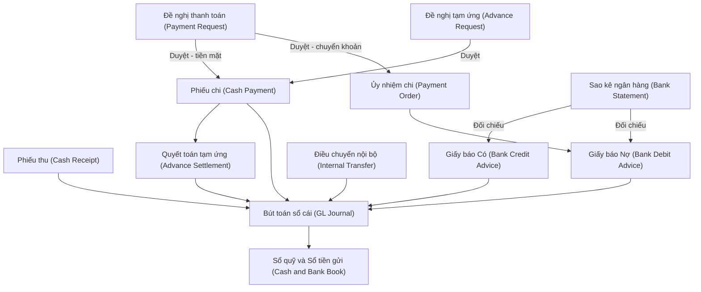
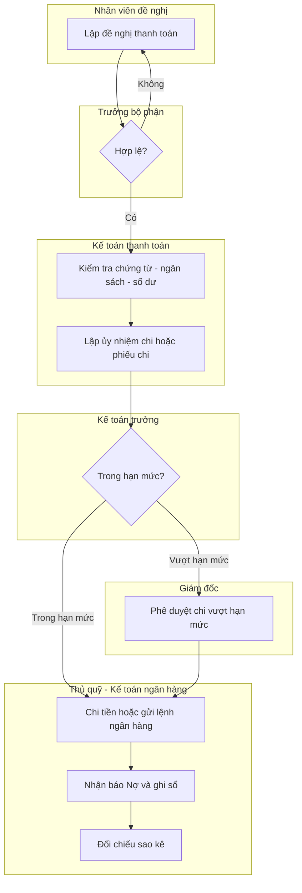
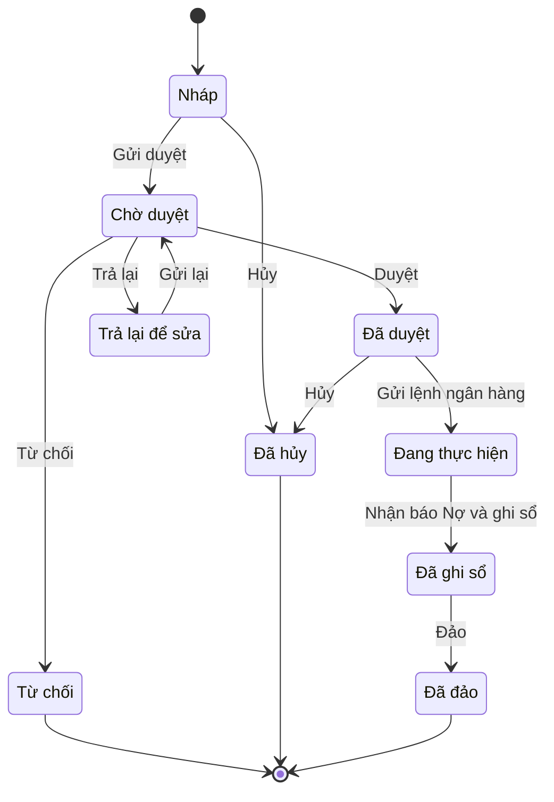

# CB — Quy trình Tiền mặt – Tiền gửi ngân hàng (Cash & Bank Management)

> **Phạm vi:** Quản lý quỹ tiền mặt (Cash Management), tiền gửi ngân hàng (Bank Management), đề nghị thanh toán & duyệt chi (Payment Request/Approval), tạm ứng & hoàn ứng (Employee Advance & Settlement), đối chiếu sao kê ngân hàng (Bank Reconciliation), kết nối ngân hàng (Bank Connectivity – patterns), tiền ngoại tệ (FX Cash) và dự báo dòng tiền (Cash-flow Forecast). Module liên quan: GL (R2R), AP, AR, FA, TAX, HR-PAY. Chuẩn tham chiếu: SAP S/4HANA (Bank Account Management – BAM, Electronic Bank Statement – EBS, Cash Management), Oracle Fusion Cash Management, Odoo Accounting (Bank & Cash, Reconciliation), Microsoft Dynamics 365 Finance (Cash and bank management) [11][12][13][14]; chế độ kế toán doanh nghiệp Việt Nam **Thông tư 99/2025/TT-BTC** (ban hành 27/10/2025, hiệu lực 01/01/2026, áp dụng cho năm tài chính bắt đầu từ hoặc sau 01/01/2026, thay thế Thông tư 200/2014/TT-BTC) [1][2][15].
>
> **Cập nhật đến: 2026-10-20 — quy định thay đổi thường xuyên; BA phải kiểm tra lại hiệu lực khi dùng cho dự án.**

## Mục lục
- [1. Mục đích & phạm vi](#1-mục-đích--phạm-vi-trongngoài-phạm-vi)
- [2. Vai trò tham gia](#2-vai-trò-tham-gia)
- [3. Danh mục (master data) tiên quyết](#3-danh-mục-master-data-tiên-quyết)
- [4. Chứng từ & luồng chứng từ](#4-chứng-từ--luồng-chứng-từ-document-flow)
- [5. Các bước quy trình chuẩn](#5-các-bước-quy-trình-chuẩn)
- [6. Vòng đời trạng thái chứng từ chính](#6-vòng-đời-trạng-thái-chứng-từ-chính)
- [7. Quy tắc nghiệp vụ & kiểm tra (validation)](#7-quy-tắc-nghiệp-vụ--kiểm-tra-validation-điển-hình)
- [8. Hạch toán kế toán](#8-hạch-toán-kế-toán)
- [9. Tham số hệ thống điển hình](#9-tham-số-hệ-thống-điển-hình)
- [10. Kiểm soát nội bộ & phân quyền](#10-kiểm-soát-nội-bộ--phân-quyền-sod-hạn-mức-duyệt-audit)
- [11. Báo cáo chuẩn](#11-báo-cáo-chuẩn)
- [12. Tích hợp với module khác](#12-tích-hợp-với-module-khác)
- [13. Biến thể & ngoại lệ](#13-biến-thể--ngoại-lệ)
- [14. Lỗi BA hay mắc & câu hỏi khảo sát](#14-lỗi-ba-hay-mắc--câu-hỏi-cần-hỏi-khách-hàng)
- [15. Nguồn tham khảo](#15-nguồn-tham-khảo)

---

## 1. Mục đích & phạm vi (trong/ngoài phạm vi)

**Mục đích:** Ghi nhận, kiểm soát và đối chiếu toàn bộ dòng tiền vào/ra qua **quỹ tiền mặt (cash on hand)** và **tài khoản ngân hàng (bank accounts)** của doanh nghiệp; đảm bảo mọi khoản thu/chi đều được phê duyệt đúng thẩm quyền, có chứng từ hợp lệ, hạch toán đúng chế độ kế toán và luôn khớp giữa sổ sách – thực quỹ – sao kê ngân hàng.

**Trong phạm vi (in scope):**
1. Thu/chi tiền mặt (Phiếu thu/Phiếu chi – Cash Receipt/Cash Payment).
2. Kiểm kê quỹ tiền mặt (Cash Count / Petty cash count).
3. Danh mục tài khoản ngân hàng của công ty (House Bank / Bank Account Master).
4. Thu/chi qua ngân hàng: giấy báo Có/Nợ (Bank credit/debit advice), ủy nhiệm chi (Payment Order).
5. Điều chuyển nội bộ tiền (Internal Transfer): quỹ ↔ ngân hàng, ngân hàng ↔ ngân hàng.
6. Đề nghị thanh toán / đề nghị chi (Payment Request) và luồng phê duyệt (Approval Workflow).
7. Tạm ứng (Employee Advance) và thanh toán/hoàn ứng (Advance Settlement).
8. Nhập sao kê & đối chiếu ngân hàng (Bank Statement Import & Reconciliation).
9. Kết nối ngân hàng ở mức mô hình chung (Bank Connectivity patterns – host-to-host, API, file).
10. Tiền ngoại tệ (FX cash: nhập/xuất quỹ ngoại tệ, chênh lệch tỷ giá, đánh giá lại cuối kỳ).
11. Dự báo dòng tiền ngắn hạn (Cash-flow Forecast) và tồn quỹ (Cash Position).

**Ngoài phạm vi (out of scope — liên kết sang file khác):**
- Ghi nhận công nợ phải trả/phải thu gốc, đối chiếu công nợ → `references/processes/ap-accounts-payable.md`, `references/processes/ar-accounts-receivable.md`.
- Bút toán tổng hợp, khóa sổ, **Báo cáo lưu chuyển tiền tệ (Statement of Cash Flows)** là một phần Báo cáo tài chính → `references/processes/r2r-general-ledger.md`.
- Chứng từ thanh toán không dùng tiền mặt phục vụ khấu trừ thuế GTGT/chi phí được trừ → `references/processes/tax-einvoice.md`, `references/regulations/vn-tax-einvoice.md`.
- Hệ thống tài khoản chi tiết & khác biệt TT99/TT133 → `references/regulations/vn-accounting.md`.
- Vay/trả nợ vay, tiền gửi có kỳ hạn (đầu tư) → module GL/Treasury (không thuộc 112 "không kỳ hạn").

---

## 2. Vai trò tham gia

| Vai trò | Trách nhiệm | Quyền điển hình (hành động chuẩn) |
|---|---|---|
| **Nhân viên đề nghị (Requestor / Employee)** `ROLE-CB-REQ` | Lập đề nghị thanh toán/đề nghị tạm ứng kèm chứng từ; quyết toán tạm ứng | Xem, Tạo, Sửa (bản Nháp của mình), Xóa (Nháp), Gửi duyệt, In |
| **Trưởng bộ phận đề nghị (Department Head)** `ROLE-CB-DEPT` | Duyệt nhu cầu chi của bộ phận trước khi chuyển kế toán | Xem, Duyệt, Từ chối, Trả lại |
| **Thủ quỹ (Cashier / Treasurer)** `ROLE-CB-CASHIER` | Giữ và chi/thu tiền mặt thực tế; ghi sổ quỹ; kiểm kê quỹ. **Không ghi sổ kế toán** | Xem, Thực hiện thu/chi (xác nhận đã thu/chi), In phiếu, Nhập liệu kiểm kê |
| **Kế toán thanh toán / Kế toán tiền (Cash/Payment Accountant)** `ROLE-CB-ACC` | Lập phiếu thu/chi, ủy nhiệm chi; kiểm tra chứng từ, ngân sách, điều kiện thanh toán | Xem, Tạo, Sửa, Gửi duyệt, Ghi sổ, In, Xuất file, Nhập file |
| **Kế toán ngân hàng (Bank Accountant)** `ROLE-CB-BANK` | Theo dõi TK ngân hàng, nhập sao kê, đối chiếu, hạch toán báo Có/Nợ | Xem, Tạo, Sửa, Ghi sổ, Nhập file (sao kê), Đối chiếu, In, Xuất file |
| **Kế toán trưởng (Chief Accountant)** `ROLE-CB-CHIEF` | Duyệt chi trong hạn mức; kiểm soát hạch toán; duyệt đánh giá lại ngoại tệ; khóa sổ | Xem, Duyệt, Từ chối, Trả lại, Bỏ ghi sổ, Đảo, Đóng, Cấu hình (một phần) |
| **Giám đốc / Tổng giám đốc (Director / CEO)** `ROLE-CB-DIR` | Phê duyệt chi vượt hạn mức kế toán trưởng; duyệt hạn mức tồn quỹ | Xem, Duyệt, Từ chối, Trả lại |
| **Quản trị hệ thống (System Admin)** `ROLE-CB-ADMIN` | Khai báo tài khoản ngân hàng, tham số, phân quyền, quy tắc đối chiếu | Xem, Cấu hình |

> SoD bắt buộc: **Thủ quỹ (giữ tiền) ≠ Kế toán tiền (ghi sổ)** — xem mục 10.

---

## 3. Danh mục (master data) tiên quyết

| Danh mục | Trường quan trọng | Quy tắc chính |
|---|---|---|
| **Tài khoản ngân hàng của công ty (Bank Account / House Bank)** `MD-BANK-ACCT` | Mã TK nội bộ, số tài khoản, ngân hàng + chi nhánh, loại tiền (currency), TK sổ cái gắn (111x/112x), chủ tài khoản, hạn mức thấu chi, trạng thái | Mỗi số TK ngân hàng + loại tiền ánh xạ 1-1 tới một TK chi tiết 112x; số TK là duy nhất; khóa thay vì xóa khi ngừng dùng |
| **Danh mục ngân hàng (Bank Directory)** `MD-BANK` | Mã ngân hàng, tên, mã BIC/SWIFT, mã CITAD/NAPAS, quốc gia | Dùng cho chuyển khoản liên ngân hàng; mã SWIFT bắt buộc với giao dịch quốc tế |
| **Quỹ tiền mặt / Điểm quỹ (Cash Desk / Petty Cash Fund)** `MD-CASH-FUND` | Mã quỹ, tên, chi nhánh, loại tiền, thủ quỹ phụ trách, TK sổ cái (111x), hạn mức tồn | Nhiều quỹ theo chi nhánh/loại tiền; mỗi quỹ một thủ quỹ chịu trách nhiệm |
| **Loại tiền tệ & tỷ giá (Currency & Exchange Rate)** `MD-CURRENCY` | Mã ISO (VND, USD, EUR...), loại tỷ giá (mua/bán/chuyển khoản TB), nguồn tỷ giá, ngày hiệu lực | Tỷ giá theo ngày; phân biệt tỷ giá nhập quỹ (giao dịch thực tế) và xuất quỹ (ghi sổ) [3] — xem mục 7 |
| **Hình thức thanh toán (Payment Method)** `MD-PAY-METHOD` | Mã (tiền mặt / chuyển khoản / UNC / séc / thẻ / ví), TK đối ứng mặc định | Quy định chứng từ sinh ra; đánh dấu phương thức "không dùng tiền mặt" phục vụ điều kiện khấu trừ VAT [6][7] |
| **Đối tượng thu/chi (Business Partner)** `MD-PARTNER` | Mã, tên, loại (NCC/KH/nhân viên/khác), số TK ngân hàng thụ hưởng, MST | Đối tượng là nhân viên → liên kết hồ sơ nhân sự; TK thụ hưởng dùng cho ủy nhiệm chi → `ap-accounts-payable.md`, `ar-accounts-receivable.md` |
| **Khoản mục dòng tiền / Lý do thu chi (Cash-flow Item / Reason code)** `MD-CF-ITEM` | Mã khoản mục, nhóm (HĐ kinh doanh/đầu tư/tài chính), chiều (thu/chi) | Bắt buộc gắn cho mỗi giao dịch để lập dự báo & phục vụ lập Báo cáo lưu chuyển tiền tệ |
| **Tài khoản sổ cái (GL Account)** `MD-GL-ACCOUNT` | Số hiệu TK theo TT99/2025 | 111/112/113/141... → chi tiết tại `references/regulations/vn-accounting.md` |

---

## 4. Chứng từ & luồng chứng từ (document flow)

| Chứng từ (VI/EN) | Mục đích | Tạo từ | Sinh ra | Ảnh hưởng (kho/công nợ/sổ cái) |
|---|---|---|---|---|
| **Đề nghị thanh toán (Payment Request)** | Xin chi tiền trả NCC/chi phí | Hóa đơn, hợp đồng, đề xuất | Phiếu chi / Ủy nhiệm chi | Không ghi sổ; tạo cam kết chi (commitment) |
| **Đề nghị tạm ứng (Advance Request)** | Xin ứng trước tiền công tác/mua sắm | Đề xuất nhân viên | Phiếu chi tạm ứng | Không ghi sổ cho tới khi chi |
| **Phiếu thu (Cash Receipt)** | Thu tiền mặt nhập quỹ | Hóa đơn bán, thu nợ KH, rút TGNH | Bút toán GL, dòng sổ quỹ | Giảm công nợ phải thu; tăng 111 |
| **Phiếu chi (Cash Payment)** | Chi tiền mặt | Đề nghị thanh toán/tạm ứng, hóa đơn | Bút toán GL, dòng sổ quỹ | Giảm công nợ phải trả/tăng chi phí; giảm 111 |
| **Ủy nhiệm chi (Payment Order)** | Lệnh chi chuyển khoản qua ngân hàng | Đề nghị thanh toán | Giấy báo Nợ | Giảm công nợ phải trả; giảm 112 (khi có báo Nợ) |
| **Giấy báo Có (Bank Credit Advice)** | Ghi nhận tiền về TK ngân hàng | Sao kê, thu nợ KH | Bút toán GL | Giảm 131; tăng 112 |
| **Giấy báo Nợ (Bank Debit Advice)** | Ghi nhận tiền ra khỏi TK ngân hàng | Sao kê, ủy nhiệm chi | Bút toán GL | Giảm 331/112 |
| **Phiếu điều chuyển nội bộ (Internal Transfer)** | Chuyển tiền quỹ↔NH, NH↔NH | Yêu cầu nội bộ | Cặp báo Nợ/Có hoặc PT/PC | Luân chuyển 111/112/113, không ảnh hưởng công nợ |
| **Bảng kiểm kê quỹ (Cash Count Sheet)** | Đối chiếu tồn quỹ thực tế – sổ sách | Định kỳ/đột xuất | Phiếu thu/chi điều chỉnh | Chênh lệch → 1381/3381 |
| **Bảng quyết toán tạm ứng (Advance Settlement)** | Hoàn ứng, tất toán khoản 141 | Chứng từ chi tiêu thực tế | Phiếu thu/chi chênh lệch | Giảm 141; ghi chi phí/tài sản |
| **Sao kê ngân hàng (Bank Statement)** | Cơ sở đối chiếu | Ngân hàng (file/kết nối) | Giấy báo Có/Nợ, bút toán đối chiếu | Không trực tiếp; dùng để đối chiếu 112 |

---

## 5. Các bước quy trình chuẩn

### 5A. Luồng chi qua ngân hàng (Payment Request → Ủy nhiệm chi → báo Nợ)

| # | Bước | Vai trò | Chứng từ | Hành động hệ thống | Trạng thái sau bước |
|---|---|---|---|---|---|
| 1 | Lập đề nghị thanh toán, đính kèm hóa đơn/hợp đồng | Nhân viên đề nghị | Đề nghị thanh toán | Kiểm tra bắt buộc đính kèm, chọn khoản mục dòng tiền | DRAFT "Nháp" |
| 2 | Gửi duyệt | Nhân viên đề nghị | Đề nghị thanh toán | Định tuyến theo quy tắc duyệt (số tiền) | PENDING "Chờ duyệt" |
| 3 | Duyệt nhu cầu chi | Trưởng bộ phận | Đề nghị thanh toán | Ghi vết duyệt; nếu không hợp lệ → Trả lại | APPROVED "Đã duyệt" / RETURNED |
| 4 | Kiểm tra chứng từ, điều kiện thanh toán, ngân sách, số dư | Kế toán thanh toán | Đề nghị thanh toán | Cảnh báo ngưỡng không dùng tiền mặt (≥5 triệu) [6][7]; kiểm tra số dư TK | APPROVED |
| 5 | Lập ủy nhiệm chi | Kế toán thanh toán | Ủy nhiệm chi | Lấy TK thụ hưởng từ đối tượng; sinh số chứng từ | PENDING |
| 6 | Duyệt chi (theo hạn mức) | Kế toán trưởng / Giám đốc | Ủy nhiệm chi | So hạn mức duyệt; định tuyến lên cấp cao nếu vượt | APPROVED |
| 7 | Gửi lệnh ra ngân hàng (ký/nộp/kết nối) | Kế toán ngân hàng | Ủy nhiệm chi | Xuất file/kết nối host-to-host (xem mục 12) | IN_PROGRESS "Đang thực hiện" |
| 8 | Nhận giấy báo Nợ, hạch toán | Kế toán ngân hàng | Giấy báo Nợ | Sinh bút toán Nợ 331/Có 112 | POSTED "Đã ghi sổ" |
| 9 | Đối chiếu với sao kê | Kế toán ngân hàng | Sao kê | So khớp dòng báo Nợ ↔ sao kê | COMPLETED "Hoàn thành" |

### 5B. Luồng thu/chi tiền mặt (Phiếu thu/Phiếu chi)

| # | Bước | Vai trò | Chứng từ | Hành động hệ thống | Trạng thái |
|---|---|---|---|---|---|
| 1 | Lập phiếu thu/chi | Kế toán tiền | Phiếu thu/chi | Kiểm tra số dư quỹ (nếu cấm âm quỹ); chọn lý do/khoản mục | DRAFT |
| 2 | Gửi duyệt | Kế toán tiền | Phiếu thu/chi | Định tuyến duyệt | PENDING |
| 3 | Duyệt | Kế toán trưởng / Giám đốc | Phiếu thu/chi | Kiểm hạn mức | APPROVED |
| 4 | Thu/chi tiền thực tế tại quỹ | Thủ quỹ | Phiếu thu/chi | Xác nhận đã thu/chi; cập nhật sổ quỹ | APPROVED (đã thực chi) |
| 5 | Ghi sổ kế toán | Kế toán tiền | Phiếu thu/chi | Sinh bút toán GL; cập nhật tồn 111 | POSTED |

---

## 6. Vòng đời trạng thái chứng từ chính

Chứng từ chính minh họa: **Phiếu chi / Ủy nhiệm chi (Cash/Bank Payment)**. Phiếu thu và các chứng từ ngân hàng dùng vòng đời tương tự (bỏ bước duyệt nhiều cấp nếu cấu hình đơn giản).

| Từ | Hành động | Đến | Vai trò | Điều kiện |
|---|---|---|---|---|
| DRAFT | Gửi duyệt | PENDING | Kế toán tiền | Đủ chứng từ, đã chọn khoản mục |
| PENDING | Duyệt | APPROVED | Kế toán trưởng / Giám đốc | Trong/đúng hạn mức theo cấp |
| PENDING | Từ chối | REJECTED | Người duyệt | Có lý do từ chối |
| PENDING | Trả lại | RETURNED | Người duyệt | Có góp ý chỉnh sửa |
| RETURNED | Gửi lại | PENDING | Kế toán tiền | Đã chỉnh sửa |
| APPROVED | Gửi lệnh ngân hàng | IN_PROGRESS | Kế toán ngân hàng | Chỉ với chuyển khoản/UNC |
| IN_PROGRESS | Nhận báo Nợ, ghi sổ | POSTED | Kế toán ngân hàng | Có giấy báo Nợ/sao kê khớp |
| APPROVED/DRAFT | Hủy | CANCELLED | Kế toán trưởng | Chưa ghi sổ |
| POSTED | Đảo | REVERSED | Kế toán trưởng | Kỳ chưa khóa; sinh bút toán đảo |

---

## 7. Quy tắc nghiệp vụ & kiểm tra (validation) điển hình

1. **BR-CB-01 — Cấm âm quỹ tiền mặt.** Khi ghi sổ phiếu chi, tồn quỹ sau chi ≥ 0 (nếu `PRM-CB-001 = Không cho phép âm quỹ`). *Lý do:* không thể chi quá số tiền thực có trong két; âm quỹ là dấu hiệu gian lận/sai sót.
2. **BR-CB-02 — Số dư khả dụng ngân hàng.** Khi lập UNC: số tiền ≤ (số dư TK + hạn mức thấu chi). *Lý do:* tránh lệnh chi bị ngân hàng từ chối.
3. **BR-CB-03 — Ngưỡng thanh toán không dùng tiền mặt (điều kiện khấu trừ VAT đầu vào).** Hàng hóa, dịch vụ mua vào có giá trị **từ 5.000.000 đồng trở lên (đã gồm VAT)** phải có chứng từ thanh toán không dùng tiền mặt mới đủ điều kiện khấu trừ thuế GTGT đầu vào, áp dụng từ 01/07/2025 (trước đây mốc 20 triệu; nay theo Khoản 2 Điều 14 Luật Thuế GTGT số 48/2024/QH15 hiệu lực 01/7/2025, hướng dẫn tại Nghị định 181/2025/NĐ-CP) [6][7][9]. Mua nhiều lần trong cùng một ngày của cùng một nhà cung cấp có tổng ≥ 5 triệu cũng áp dụng [7]. Điều kiện **chi phí được trừ khi tính thuế TNDN** cũng đòi hỏi thanh toán không dùng tiền mặt nhưng theo pháp luật thuế TNDN riêng — ⚠️ CHƯA XÁC MINH ngưỡng hiện hành cho chi phí được trừ có đồng bộ mức 5 triệu hay không; đối chiếu `references/regulations/vn-tax-einvoice.md`. Hệ thống cảnh báo/chặn tạo phiếu chi tiền mặt khi vượt ngưỡng. **Nộp tiền mặt vào tài khoản người bán không được coi là thanh toán không dùng tiền mặt** [7]. *Lý do:* điều kiện khấu trừ VAT/chi phí hợp lệ; xem `tax-einvoice.md`.
4. **BR-CB-04 — Giao dịch bắt buộc không dùng tiền mặt (giữa doanh nghiệp).** Góp vốn, mua bán/chuyển nhượng phần vốn góp, và cho vay/đi vay giữa các tổ chức không phải tổ chức tín dụng **không được dùng tiền mặt** (Nghị định 222/2013/NĐ-CP, Điều 6; hướng dẫn tại Thông tư 09/2015/TT-BTC) [8][10]. *Lý do:* minh bạch dòng tiền, chống rửa tiền.
5. **BR-CB-05 — Khớp tổng Nợ = tổng Có.** Mọi bút toán sinh ra từ chứng từ tiền phải cân (double-entry). *Lý do:* nguyên tắc kế toán kép.
6. **BR-CB-06 — Bắt buộc khoản mục dòng tiền.** Mỗi dòng thu/chi phải gắn khoản mục dòng tiền (`MD-CF-ITEM`) nếu `PRM-CB-012 = Bắt buộc`. *Lý do:* phục vụ dự báo và lập Báo cáo lưu chuyển tiền tệ.
7. **BR-CB-07 — Hạn quyết toán tạm ứng.** Khoản tạm ứng cũ chưa quyết toán quá `PRM-CB-010` ngày sẽ cảnh báo và có thể **chặn tạm ứng mới** cho cùng nhân viên. *Lý do:* kiểm soát chiếm dụng vốn.
8. **BR-CB-08 — Tỷ giá giao dịch ngoại tệ.**
   - Bên **Nợ** TK tiền khi **nhập quỹ/thu** ngoại tệ: dùng **tỷ giá giao dịch thực tế** (theo TT99 doanh nghiệp được chọn tỷ giá mua–bán chuyển khoản trung bình hoặc tỷ giá xấp xỉ, áp dụng nhất quán) [3].
   - Bên **Có** TK tiền khi **xuất quỹ/chi** ngoại tệ: dùng **tỷ giá ghi sổ bình quân gia quyền di động** [3].
   - Chênh lệch giữa tỷ giá chi và tỷ giá giao dịch hạch toán vào **515 (lãi)** / **635 (lỗ)**.
   *Công thức tỷ giá ghi sổ BQGQ di động:*
   `Tỷ giá BQ sau mỗi lần nhập = (Giá trị VND tồn trước + Giá trị VND nhập) / (Số ngoại tệ tồn trước + Số ngoại tệ nhập)`.
9. **BR-CB-09 — Đánh giá lại ngoại tệ cuối kỳ.** Số dư gốc ngoại tệ của 1112/1122 (và 113 ngoại tệ) phải đánh giá lại theo tỷ giá cuối kỳ (TT99: tỷ giá mua–bán chuyển khoản trung bình của NHTM nơi DN thường xuyên giao dịch) [3]; chênh lệch qua TK 413 rồi kết chuyển 515/635 → xem `r2r-general-ledger.md`.
10. **BR-CB-10 — Một số TK ngân hàng không ghi âm.** Thấu chi (overdraft) **không ghi âm** trên 112 mà phản ánh như một khoản vay (TK 341). *Lý do:* trình bày đúng bản chất nợ vay.
11. **BR-CB-11 — Chống trùng (duplicate) khi nhập sao kê.** Dòng sao kê trùng (cùng ngày + số tham chiếu + số tiền) bị loại khi import. *Lý do:* tránh hạch toán kép.
12. **BR-CB-12 — Số chứng từ liên tục, không trùng.** Phiếu thu/chi đánh số tự động theo dải (`PRM-CB-007`), không nhảy cóc, không trùng. *Lý do:* yêu cầu kiểm soát & kiểm toán.
13. **BR-CB-13 — Dung sai đối chiếu.** Chênh lệch khi tự đối chiếu ≤ `PRM-CB-009` mới được tự khớp; vượt thì xử lý tay. *Lý do:* kiểm soát sai số làm tròn.
14. **BR-CB-14 — Khóa kỳ.** Không ghi sổ/sửa chứng từ vào kỳ đã khóa; chỉ hạch toán vào kỳ mở (`PRM-CB-013`, đồng bộ GL).

---

## 8. Hạch toán kế toán

> **Chế độ áp dụng: Thông tư 99/2025/TT-BTC** (hiệu lực 01/01/2026, thay thế TT200/2014) [1][2][15]. Nhóm tiền giữ nguyên số hiệu so với TT200, **riêng TK 112 đổi tên** từ "Tiền gửi Ngân hàng" thành **"Tiền gửi không kỳ hạn"** [2]; TK 111 Tiền mặt (chi tiết 1111 Tiền Việt Nam, 1112 Ngoại tệ, 1113 Vàng tiền tệ), TK 113 Tiền đang chuyển, TK 141 Tạm ứng giữ nguyên [2][3]. Doanh nghiệp nhỏ và vừa có thể chọn áp dụng TT99/2025 hoặc TT133/2016 [4][5] (xem mục 15 và `vn-accounting.md`).

| Nghiệp vụ | Nợ | Có | Ghi chú |
|---|---|---|---|
| Thu tiền mặt từ bán hàng (có VAT) | 1111 | 511, 3331 | Phiếu thu |
| Thu nợ khách hàng bằng tiền mặt | 1111 | 131 | Phiếu thu; giảm phải thu |
| Thu tiền gửi về TK ngân hàng từ KH | 1121 | 131 | Giấy báo Có |
| Lãi tiền gửi không kỳ hạn | 1121 | 515 | Giấy báo Có |
| Chi tiền mặt mua vật tư/hàng hóa/TSCĐ | 152, 153, 156, 211, 133 | 1111 | Phiếu chi; VAT 133 |
| Chi tiền mặt trả nợ nhà cung cấp | 331 | 1111 | Phiếu chi; chú ý ngưỡng 5 triệu (BR-CB-03) |
| Chuyển khoản trả nhà cung cấp (UNC) | 331 | 1121 | Giấy báo Nợ |
| Chi phí dịch vụ trả bằng tiền (điện, nước...) | 627, 641, 642, 133 | 1111, 1121 | Phiếu chi / báo Nợ |
| Phí dịch vụ ngân hàng | 6427 (hoặc 635), 133 | 1121 | Giấy báo Nợ; 133 nếu hóa đơn có VAT |
| Nộp tiền mặt vào ngân hàng, đã có báo Có ngay | 1121 | 1111 | Phiếu chi + báo Có cùng ngày |
| Nộp tiền mặt vào NH, **chưa** có báo Có | 113 | 1111 | Tiền đang chuyển |
| Khi ngân hàng báo Có số đã nộp | 1121 | 113 | Tất toán 113 |
| Rút tiền gửi về nhập quỹ | 1111 | 1121 | Phiếu thu + báo Nợ |
| Chuyển tiền giữa hai TK ngân hàng (cùng DN) | 1121 (nhận) | 1121 (chuyển) | Qua 113 nếu khác ngày báo |
| Chi tạm ứng cho nhân viên | 141 | 1111, 1121 | Phiếu chi tạm ứng |
| Quyết toán tạm ứng – chi phí thực tế | 152, 156, 242, 627, 641, 642, 133 | 141 | Theo chứng từ quyết toán |
| Hoàn ứng – nộp lại tiền thừa | 1111 | 141 | Phiếu thu |
| Quyết toán – chi tiêu vượt tạm ứng (chi bù) | (chi phí), 133 | 141 | Rồi chi bù phần thiếu: Nợ 141 / Có 1111 |
| Kiểm kê thừa quỹ chưa rõ nguyên nhân | 1111 | 3381 | Chờ xử lý |
| Kiểm kê thiếu quỹ chưa rõ nguyên nhân | 1381 | 1111 | Chờ xử lý; sau quy trách nhiệm → 1388/334 |
| Chi ngoại tệ – lỗ tỷ giá | 331, 635 | 1112 | 635 = phần chênh lệch lỗ |
| Chi ngoại tệ – lãi tỷ giá | 331 | 1112, 515 | 515 = phần chênh lệch lãi |
| Đánh giá lại ngoại tệ cuối kỳ – lãi | 1112, 1122 | 413 | Kết chuyển 413 → 515 |
| Đánh giá lại ngoại tệ cuối kỳ – lỗ | 413 | 1112, 1122 | Kết chuyển 413 → 635 |
| Hủy/đảo phiếu đã ghi sổ (reversal) | (đảo bút toán gốc) | (đảo bút toán gốc) | Giữ dấu vết; không xóa |

> Khác biệt cần lưu ý so với TT200: nhóm tiền (111/112/113/141) giữ nguyên số hiệu, **riêng TK 112 đổi tên** thành "Tiền gửi không kỳ hạn" (bản chất không đổi) [2]. Tuy nhiên hệ thống tài khoản TT99 được **tái cấu trúc để tiệm cận IFRS** và cho phép DN chi tiết hóa [1][2] — ⚠️ các tài khoản đối ứng **ngoài nhóm tiền** nêu trong bảng trên (ví dụ 511, 131, 331, 627, 641, 642, 515, 635, 341, 242) đang dùng số hiệu theo quy ước TT200; **phải đối chiếu lại với danh mục tài khoản chính thức kèm TT99** trước khi cấu hình ERP — tra `references/regulations/vn-accounting.md`. Khi cấu hình, map từng TK ngân hàng vào 112x theo danh mục TK đã chọn. Với doanh nghiệp áp dụng TT133/2016, một số TK chi tiết khác — tra `vn-accounting.md`.

---

## 9. Tham số hệ thống điển hình

| Tham số | Kiểu | Giá trị gợi ý | Phạm vi | Ảnh hưởng |
|---|---|---|---|---|
| `PRM-CB-001` Cho phép âm quỹ tiền mặt | Boolean | Không | Công ty/Chi nhánh | Chặn ghi sổ phiếu chi vượt tồn quỹ (BR-CB-01) |
| `PRM-CB-002` Hạn mức duyệt chi theo cấp | Bảng (số tiền↔vai trò) | TBP ≤ 20tr; KTT ≤ 200tr; GĐ > 200tr | Công ty | Định tuyến phê duyệt |
| `PRM-CB-003` Ngưỡng bắt buộc thanh toán không dùng tiền mặt | Số tiền | 5.000.000 VND | Hệ thống | Cảnh báo/chặn chi tiền mặt (BR-CB-03) [7] |
| `PRM-CB-004` Bắt buộc Đề nghị thanh toán trước khi chi | Boolean | Có | Công ty | Không cho tạo phiếu chi lẻ ngoài luồng |
| `PRM-CB-005` Phương pháp tỷ giá xuất quỹ ngoại tệ | Enum | Bình quân gia quyền di động | Hệ thống | Tính giá vốn ngoại tệ (BR-CB-08) |
| `PRM-CB-006` Loại tỷ giá nhập quỹ ngoại tệ | Enum | Tỷ giá mua–bán chuyển khoản TB | Công ty | Ghi nhận giao dịch ngoại tệ |
| `PRM-CB-007` Quy tắc đánh số chứng từ | Chuỗi mẫu | PT/PC/BC/BN + năm + số thứ tự | Công ty/Chi nhánh | Số liên tục, không trùng (BR-CB-12) |
| `PRM-CB-008` Cho phép ghi sổ lùi ngày | Boolean | Không | Công ty | Kiểm soát backdating |
| `PRM-CB-009` Dung sai tự đối chiếu ngân hàng | Số tiền | 0 (hoặc 1.000 VND) | Công ty | Ngưỡng auto-match (BR-CB-13) |
| `PRM-CB-010` Hạn quyết toán tạm ứng | Số ngày | 30 ngày | Công ty | Cảnh báo/chặn tạm ứng mới (BR-CB-07) |
| `PRM-CB-011` Quy tắc tự đối chiếu (matching rule) | Cấu hình | Theo số tham chiếu + số tiền + ngày | Công ty | Tự khớp sao kê – chứng từ |
| `PRM-CB-012` Bắt buộc chọn khoản mục dòng tiền | Boolean | Có | Công ty | Dữ liệu cho dự báo & LCTT (BR-CB-06) |
| `PRM-CB-013` Kỳ khóa sổ | Ngày/kỳ | Đồng bộ GL | Công ty | Chặn ghi/sửa kỳ đã khóa (BR-CB-14) |
| `PRM-CB-014` Hạn mức tồn quỹ tối đa | Số tiền | Theo chính sách | Chi nhánh/Quỹ | Cảnh báo khi tồn quỹ vượt mức an toàn |

---

## 10. Kiểm soát nội bộ & phân quyền (SoD, hạn mức duyệt, audit)

**Phân tách trách nhiệm (Segregation of Duties – SoD):**
1. **Thủ quỹ (giữ tiền) ≠ Kế toán tiền (ghi sổ).** Đây là chốt kiểm soát quan trọng nhất của tiền mặt: người giữ tiền không được đồng thời là người ghi sổ kế toán quỹ.
2. **Người lập ≠ Người duyệt ≠ Người chi.** Lập phiếu, phê duyệt và thực chi phải là ba người khác nhau.
3. **Người tạo TK ngân hàng/tham số (Admin) ≠ Người giao dịch.**
4. **Người nhập sao kê ≠ Người phê duyệt bút toán điều chỉnh đối chiếu** (nếu khối lượng cho phép).

**Hạn mức duyệt (Approval limits) — `PRM-CB-002`:** nhiều cấp theo số tiền (Trưởng bộ phận → Kế toán trưởng → Giám đốc). Tự động leo thang (escalation) khi vượt hạn mức; lưu toàn bộ vết duyệt.

**Kiểm soát vận hành:**
- Kiểm kê quỹ định kỳ (cuối ngày/tuần/tháng) và đột xuất; biên bản kiểm kê có chữ ký thủ quỹ + kế toán + đại diện; chênh lệch xử lý qua 1381/3381 (mục 8).
- Đối chiếu ngân hàng tối thiểu hàng tháng; lập **Bảng đối chiếu số dư ngân hàng (Bank Reconciliation Statement)**; làm rõ khoản treo (outstanding/unpresented items).
- Hạn mức tồn quỹ (`PRM-CB-014`) và chính sách nộp tiền mặt vượt mức vào ngân hàng.
- Quản lý séc/ủy nhiệm chi trắng; hai chữ ký với lệnh chi lớn (dual authorization) khi ngân hàng hỗ trợ.

**Audit trail:** mọi hành động (tạo/sửa/duyệt/ghi sổ/đảo/hủy) ghi log người dùng – thời điểm – giá trị trước/sau; không cho xóa chứng từ đã ghi sổ (chỉ Đảo/Hủy có kiểm soát). Dùng cho đối chiếu kiểm toán nội bộ và độc lập.

**Chế tài liên quan:** vi phạm quy định thanh toán bằng tiền mặt (Nghị định 222/2013) có thể bị xử phạt hành chính theo pháp luật về tiền tệ – ngân hàng ⚠️ CHƯA XÁC MINH mức phạt cụ thể và văn bản xử phạt hiện hành (có nguồn dẫn Nghị định 88/2019/NĐ-CP sửa đổi bởi 143/2021/NĐ-CP) — BA kiểm tra lại khi dự án cần trích dẫn [8].

---

## 11. Báo cáo chuẩn

| Báo cáo (VI/EN) | Mục đích | Chiều phân tích / bộ lọc | Bắt buộc theo luật? |
|---|---|---|---|
| **Sổ quỹ tiền mặt (Cash Book)** `RPT-CB-01` | Theo dõi thu/chi/tồn quỹ theo thời gian | Theo quỹ, loại tiền, ngày | Có — sổ kế toán bắt buộc (mẫu S07-DN theo TT200; TT99 cho phép DN tự thiết kế mẫu) ⚠️ mã mẫu TT99 cần kiểm tra |
| **Sổ kế toán chi tiết quỹ tiền mặt** `RPT-CB-01a` | Chi tiết theo đối tượng/khoản mục | Theo khoản mục, đối tượng | Có (mẫu S07a-DN tham chiếu TT200) ⚠️ |
| **Sổ tiền gửi ngân hàng (Bank Book)** `RPT-CB-02` | Theo dõi biến động từng TK ngân hàng | Theo TK ngân hàng, loại tiền | Có (mẫu S08-DN tham chiếu TT200) ⚠️ |
| **Báo cáo tồn quỹ / số dư ngân hàng (Cash Position)** `RPT-CB-03` | Tồn quỹ và số dư NH tức thời | Theo quỹ/TK, chi nhánh, loại tiền | Không (quản trị) |
| **Nhật ký thu chi (Cash/Bank Journal)** `RPT-CB-04` | Liệt kê giao dịch thu chi theo kỳ | Theo ngày, khoản mục, phương thức | Không |
| **Bảng đối chiếu ngân hàng (Bank Reconciliation Statement)** `RPT-CB-05` | Khớp số dư sổ sách – sao kê | Theo TK ngân hàng, kỳ | Không (nhưng kiểm toán yêu cầu) |
| **Báo cáo công nợ tạm ứng (Advance Aging)** `RPT-CB-06` | Theo dõi tạm ứng chưa quyết toán | Theo nhân viên, tuổi nợ | Không |
| **Dự báo dòng tiền (Cash-flow Forecast)** `RPT-CB-07` | Dự kiến thu/chi, thanh khoản | Theo kỳ, khoản mục, kịch bản | Không (quản trị) |
| **Báo cáo lưu chuyển tiền tệ (Statement of Cash Flows)** | Một phần BCTC năm | Trực tiếp/gián tiếp | **Có** — nhưng lập tại GL/R2R → `r2r-general-ledger.md` |

---

## 12. Tích hợp với module khác (ảnh hưởng dữ liệu hai chiều)

| Module | Dữ liệu trao đổi | Chiều |
|---|---|---|
| **AP – Phải trả** (`ap-accounts-payable.md`) | Đề nghị thanh toán lấy hóa đơn NCC; phiếu chi/UNC tất toán công nợ 331; thông tin TK thụ hưởng | CB ↔ AP |
| **AR – Phải thu** (`ar-accounts-receivable.md`) | Phiếu thu/báo Có gán vào hóa đơn KH, tất toán 131 | CB ↔ AR |
| **GL – Sổ cái** (`r2r-general-ledger.md`) | Mọi chứng từ tiền sinh bút toán; khóa kỳ; đánh giá lại ngoại tệ (413); Báo cáo LCTT | CB → GL |
| **HR-PAY – Lương** (`hr-payroll.md`) | Chi lương qua ngân hàng (bảng thanh toán lương → UNC/chi lương); tạm ứng lương | PAY → CB |
| **FA – Tài sản** (`fixed-assets.md`) | Chi mua TSCĐ bằng tiền; tiền thu thanh lý | CB ↔ FA |
| **TAX – Thuế & hóa đơn** (`tax-einvoice.md`) | Điều kiện chứng từ thanh toán không dùng tiền mặt để khấu trừ VAT/chi phí; nộp thuế | CB ↔ TAX |
| **BUD – Ngân sách** (`budgeting.md`) | Kiểm tra ngân sách khi duyệt chi (budget check/commitment) | BUD ↔ CB |
| **P2P / O2C** | Thanh toán cuối chuỗi mua/bán | gián tiếp qua AP/AR |

**Kết nối ngân hàng (Bank Connectivity) — chỉ mô hình chung, không khẳng định API ngân hàng cụ thể:**
- **File-based:** xuất file lệnh chi và nhập sao kê theo định dạng chuẩn — SWIFT **MT940/MT942** (sao kê), **ISO 20022 CAMT.053/CAMT.054** (sao kê/báo có), **PAIN.001** (lệnh chi), **BAI2** (Mỹ). ⚠️ Việc một ngân hàng VN cụ thể hỗ trợ định dạng nào cần kiểm tra tài liệu của ngân hàng đó.
- **Host-to-host / SFTP:** trao đổi file định kỳ, có mã hóa và chữ ký.
- **API / Open Banking:** gọi dịch vụ truy vấn số dư, khởi tạo thanh toán; tại VN thường qua cổng/đối tác tích hợp. ⚠️ Không khẳng định endpoint/tính năng của ngân hàng cụ thể khi chưa có tài liệu chính thức của ngân hàng.
- **Hạ tầng liên ngân hàng VN:** chuyển tiền giá trị cao thường qua hệ thống của Ngân hàng Nhà nước và chuyển nhanh 24/7 qua NAPAS; mã định danh ngân hàng theo chuẩn CITAD/BIC. ⚠️ Chi tiết kỹ thuật cần kiểm tra nguồn chính thức.

---

## 13. Biến thể & ngoại lệ

1. **Thanh toán một phần (partial payment):** một đề nghị thanh toán/hóa đơn được chi làm nhiều lần → chứng từ gốc ở trạng thái PARTIAL "Hoàn thành một phần" tới khi đủ, rồi COMPLETED.
2. **Gộp thanh toán (payment batch):** nhiều hóa đơn/đề nghị gộp thành một UNC cho cùng một người thụ hưởng; phân bổ lại khi hạch toán.
3. **Hoàn/chi thừa – chi thiếu tạm ứng:** thừa → nhân viên nộp lại (Nợ 111/Có 141); thiếu → DN chi bù (mục 8).
4. **Hủy/đảo sau duyệt:** chứng từ đã ghi sổ không sửa trực tiếp — dùng Đảo (REVERSED) sinh bút toán ngược, hoặc Hủy (CANCELLED) nếu chưa ghi sổ; kỳ đã khóa phải mở kỳ hoặc hạch toán kỳ hiện tại.
5. **Chi hộ / thu hộ (on-behalf):** theo dõi qua TK phải thu/phải trả khác (1388/3388), không ghi doanh thu/chi phí.
6. **Đa tiền tệ (multi-currency):** quỹ/TK ngoại tệ theo dõi song song nguyên tệ và VND; chênh lệch tỷ giá khi chi (635/515) và đánh giá lại cuối kỳ (413) — BR-CB-08, BR-CB-09.
7. **Séc (cheque):** phát hành/nhận séc; séc chưa thanh toán (outstanding cheque) là khoản treo khi đối chiếu; séc chưa xuất trình không giảm 112 cho tới khi ngân hàng chi.
8. **Tiền đang chuyển (cash/funds in transit):** nộp tiền cuối ngày chưa có báo Có, thu qua cổng thanh toán/thẻ chưa về TK → treo ở 113 (mục 8).
9. **Thấu chi (overdraft):** số âm trên TK ngân hàng phản ánh như khoản vay (341), không ghi âm 112 — BR-CB-10.
10. **Tiền mặt tại nhiều điểm/chi nhánh:** nhiều quỹ, nhiều thủ quỹ; điều chuyển nội bộ giữa các quỹ.
11. **Khoản treo khi đối chiếu (reconciliation differences):** phí ngân hàng chưa ghi, lãi chưa ghi, chứng từ ghi nhầm kỳ → tạo bút toán điều chỉnh sau khi phê duyệt.
12. **Phục hồi/điều chỉnh sau khóa kỳ:** hạch toán vào kỳ hiện hành kèm thuyết minh thay vì sửa kỳ đã khóa.

---

## 14. Lỗi BA hay mắc & câu hỏi cần hỏi khách hàng

**Lỗi BA hay mắc:**
- Gộp chung "thủ quỹ" và "kế toán tiền" làm một vai trò → phá vỡ SoD (mục 10).
- Bỏ qua ngưỡng thanh toán không dùng tiền mặt mới (5 triệu, từ 01/07/2025) hoặc vẫn dùng mốc cũ 20 triệu [6][7].
- Quên luồng tạm ứng – hoàn ứng và theo dõi tuổi nợ 141 (chỉ làm phiếu thu/chi đơn lẻ).
- Không thiết kế trạng thái "Tiền đang chuyển" (113) → lệch số khi nộp/rút tiền qua kỳ.
- Thiết kế cho phép âm quỹ tiền mặt vì "cho tiện".
- Bỏ qua đa tiền tệ, chênh lệch tỷ giá và đánh giá lại cuối kỳ.
- Không có quy trình đối chiếu ngân hàng và xử lý khoản treo.
- Nhầm "tiền gửi không kỳ hạn" (112) với tiền gửi có kỳ hạn/đầu tư (không thuộc 112).
- Thiết kế hạn mức duyệt cứng, không escalation; không lưu vết duyệt phục vụ kiểm toán.
- Quên khoản mục dòng tiền → không lập được dự báo và Báo cáo lưu chuyển tiền tệ.

**Câu hỏi khảo sát khách hàng:**
1. Có bao nhiêu quỹ tiền mặt, theo chi nhánh/loại tiền nào? Ai là thủ quỹ từng quỹ?
2. Danh sách tài khoản ngân hàng (ngân hàng, loại tiền, mục đích)? Có TK ngoại tệ không? Có hạn mức thấu chi không?
3. Có bắt buộc **Đề nghị thanh toán** trước mọi khoản chi không? Ngoại lệ nào được chi thẳng?
4. Hạn mức và các cấp phê duyệt chi (theo số tiền, loại chi, bộ phận)? Có cần hai chữ ký với lệnh lớn?
5. Có cho phép âm quỹ tiền mặt không? Hạn mức tồn quỹ tối đa là bao nhiêu?
6. Chính sách tạm ứng: ai được tạm ứng, mức trần, hạn quyết toán bao nhiêu ngày, có chặn tạm ứng mới khi còn nợ cũ?
7. Phương thức thanh toán nào đang dùng (tiền mặt, UNC, séc, thẻ, ví, QR)? Phương thức nào tính là "không dùng tiền mặt"?
8. Tần suất và cách đối chiếu ngân hàng hiện tại? Lấy sao kê bằng file (định dạng gì) hay kết nối trực tiếp?
9. Có kết nối ngân hàng (host-to-host/API) không? Với (các) ngân hàng nào và qua đối tác tích hợp nào?
10. Quy tắc đánh số chứng từ (PT/PC/UNC...) theo công ty hay chi nhánh? Reset theo năm?
11. Có giao dịch ngoại tệ không? Nguồn tỷ giá nào? Tần suất đánh giá lại?
12. Cần những báo cáo tiền nào, định dạng mẫu theo luật hay theo mẫu nội bộ?
13. Chu kỳ kiểm kê quỹ và quy trình xử lý thừa/thiếu quỹ?
14. Khoản mục dòng tiền phục vụ quản trị/dự báo được phân nhóm thế nào?
15. Doanh nghiệp áp dụng chế độ kế toán nào — TT99/2025 (DN nói chung) hay TT133/2016 (DNNVV lựa chọn)? Năm tài chính bắt đầu khi nào?

---

## 15. Nguồn tham khảo

[1] LuatVietnam — Đã có Thông tư 99/2025/TT-BTC thay thế Thông tư 200/2014/TT-BTC về chế độ kế toán doanh nghiệp (ban hành 27/10/2025, hiệu lực 01/01/2026) — https://luatvietnam.vn/tin-van-ban-moi/da-co-thong-tu-99-2025-tt-btc-thay-the-thong-tu-200-2014-tt-btc-ve-che-do-ke-toan-doanh-nghiep-186-105033-article.html (truy cập 2026-10-20)
[2] LuatVietnam — Danh mục tài khoản kế toán theo Thông tư 99/2025/TT-BTC (TK 111/112/113/141; TK 112 "Tiền gửi không kỳ hạn") — https://luatvietnam.vn/thue-phi-le-phi/danh-muc-tai-khoan-ke-toan-theo-thong-tu-99-2025-tt-btc-565-105326-article.html (truy cập 2026-10-20)
[3] Ketoan.vn — Hướng dẫn hạch toán Tài khoản 111 – Tiền mặt theo Thông tư 99/2025/TT-BTC (tài khoản cấp 2, kết cấu, nguyên tắc ngoại tệ) — https://www.ketoan.vn/tt-99/tai-khoan-111-tien-mat-theo-tt-99/ (truy cập 2026-10-20)
[4] LuatVietnam — Từ 01/01/2026, có thể áp dụng chế độ kế toán doanh nghiệp cho doanh nghiệp vừa và nhỏ (DNNVV chọn TT99/2025 hoặc TT133/2016) — https://luatvietnam.vn/tin-van-ban-moi/tu-01-01-2026-co-the-ap-dung-che-do-ke-toan-doanh-nghiep-cho-doanh-nghiep-vua-va-nho-186-105084-article.html (truy cập 2026-10-20)
[5] Thư viện Pháp luật — Thông tư 133/2016 có bị thay thế bởi Thông tư 58/2026 không? (TT133/2016 còn hiệu lực; TT58/2026 thay thế TT132/2018 cho DN siêu nhỏ) — https://thuvienphapluat.vn/ma-so-thue/phap-luat-thue/thong-tu-1332016-co-bi-thay-the-boi-thong-tu-582026-khong-225798.html (truy cập 2026-10-20)
[6] LuatVietnam — 8 điểm mới của Nghị định 181/2025/NĐ-CP về thuế GTGT — https://luatvietnam.vn/thue-phi-le-phi/diem-moi-cua-nghi-dinh-181-2025-nd-cp-565-102796-article.html (truy cập 2026-10-20)
[7] iHoaDon — Quy định về thanh toán không dùng tiền mặt từ 01/7/2025 (ngưỡng từ 5.000.000 đồng đã gồm VAT theo Khoản 2 Điều 14 Luật Thuế GTGT 2024; chứng từ thanh toán không dùng tiền mặt được định nghĩa tại Khoản 1 Điều 26 Nghị định 181/2025/NĐ-CP; nộp tiền mặt vào TK người bán không được coi là không dùng tiền mặt; mua nhiều lần trong ngày tổng ≥ 5 triệu cũng áp dụng) — https://ihoadon.vn/hddt/thanh-toan-khong-dung-tien-mat-tu-01-7-2025-tai-nghi-dinh-181-2025-nd-cp.html (truy cập 2026-10-20)
[8] Thư viện Pháp luật — Decree No. 222/2013/NĐ-CP on cash payment (Điều 6: góp vốn/chuyển nhượng phần vốn góp và vay mượn giữa doanh nghiệp không dùng tiền mặt; hướng dẫn tại Thông tư 09/2015/TT-BTC) — https://thuvienphapluat.vn/van-ban/tien-te-ngan-hang/decree-no-222-2013-nd-cp-on-cash-payment-218365.aspx (truy cập 2026-10-20)
[9] LuatVietnam — Tổng hợp danh sách Thông tư hướng dẫn Luật Thuế GTGT 2024 (Luật số 48/2024/QH15 hiệu lực 01/7/2025, thay Luật 13/2008/QH12; hướng dẫn tại Nghị định 181/2025/NĐ-CP, Thông tư 69/2025/TT-BTC) — https://luatvietnam.vn/thue-phi-le-phi/tong-hop-danh-sach-thong-tu-huong-dan-luat-thue-gtgt-2024-565-103952-article.html (truy cập 2026-10-20)
[10] Văn bản gốc Nghị định 222/2013/NĐ-CP — tra cứu bản chính trên Cổng Công báo (congbao.chinhphu.vn) hoặc CSDL quốc gia về VBPL (vbpl.vn) ⚠️ CHƯA XÁC MINH deep-link bản gốc (đường dẫn tệp dẫn trước đây trả về HTTP 404 khi kiểm tra 2026-10-20) — https://congbao.chinhphu.vn (truy cập 2026-10-20)
[11] SAP Help Portal — Bank Account Management, Electronic Bank Statement, Cash Management (SAP S/4HANA) — https://help.sap.com (mô hình chuẩn; truy cập 2026-10-20)
[12] Oracle Help Center — Oracle Fusion Cloud Cash Management (bank reconciliation, bank statements) — https://docs.oracle.com (mô hình chuẩn; truy cập 2026-10-20)
[13] Odoo Documentation — Accounting: Bank and cash, Bank reconciliation — https://www.odoo.com/documentation (mô hình chuẩn; truy cập 2026-10-20)
[14] Microsoft Learn — Dynamics 365 Finance: Cash and bank management — https://learn.microsoft.com (mô hình chuẩn; truy cập 2026-10-20)
[15] Công báo Chính phủ — Thông tư số 99/2025/TT-BTC hướng dẫn Chế độ kế toán doanh nghiệp (bản chính thức; Bộ Tài chính; ban hành 27/10/2025, hiệu lực 01/01/2026) — https://congbao.chinhphu.vn/van-ban/thong-tu-so-99-2025-tt-btc-46529.htm (truy cập 2026-10-20)
