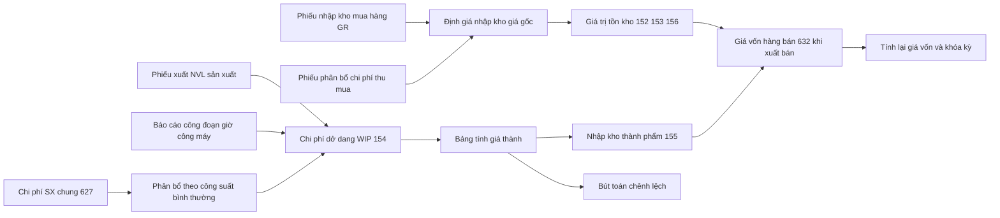
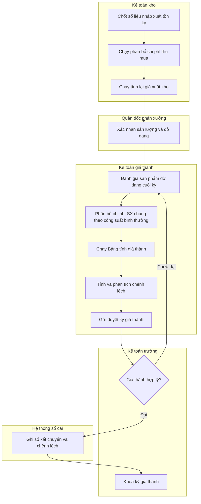
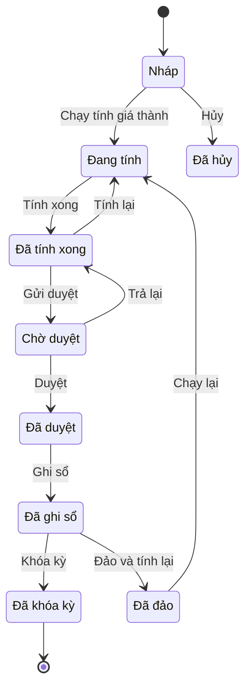

# COST — Tính giá thành & định giá tồn kho (Costing & Inventory Valuation)

> **Phạm vi:** Toàn bộ nghiệp vụ định giá trong ERP: định giá tồn kho (perpetual vs periodic; bình quân gia quyền tức thời/cả kỳ, FIFO, thực tế đích danh; chạy tính lại giá vốn; khóa kỳ kho; chính sách tồn âm), phân bổ chi phí thu mua (landed cost: vận chuyển, bảo hiểm, thuế nhập khẩu theo trị giá/số lượng/trọng lượng), tính giá thành sản xuất (cost object → 621/622/627 → WIP 154 → thành phẩm 155 theo chế độ kế toán hiện hành; phân bổ chi phí sản xuất chung; đánh giá sản phẩm dở dang; các phương pháp tính giá thành: giản đơn, hệ số, tỷ lệ, theo đơn đặt hàng, phân bước), giá thành định mức vs thực tế & phân tích chênh lệch (variance), liên kết giá thành dự án/hợp đồng; báo cáo giá thành. **Module liên quan:** COST (lõi); tích hợp INV (kho), MFG (sản xuất), P2P/PUR (mua & nhập khẩu), O2C/SAL (giá vốn khi bán), PRJ (dự án), GL (sổ cái), TAX (thuế nhập khẩu, GTGT), FA (khấu hao đưa vào 627), BUD (dự toán chi phí). **Chuẩn tham chiếu:** SAP S/4HANA Material Ledger + Product Cost Planning/Controlling (CO-PC) [13][14]; Oracle Cost Management; Odoo Inventory Valuation (Standard/FIFO/AVCO) + Landed Costs [12]; Microsoft Dynamics 365 SCM (Costing methods + Inventory close/recalculation) [15]; chế độ kế toán Việt Nam **Thông tư 99/2025/TT-BTC** [1][3][4], chuẩn mực **VAS 02 – Hàng tồn kho** [7]. **Mã quy trình:** COST.

> **Cập nhật đến: 2026-10-20 — quy định thay đổi thường xuyên; BA phải kiểm tra lại hiệu lực khi dùng cho dự án.**

> **Chế độ kế toán áp dụng (xác định tại 2026-10-20):** **Thông tư 99/2025/TT-BTC** (ban hành 27/10/2025, hiệu lực **01/01/2026**, áp dụng cho năm tài chính bắt đầu từ/sau 01/01/2026), **thay thế Thông tư 200/2014/TT-BTC** [1][2][3]. Doanh nghiệp nhỏ và vừa (DNNVV) vẫn được chọn áp dụng **Thông tư 133/2016/TT-BTC** (TT99 không thay thế TT133) [6]. **Thay đổi ảnh hưởng trực tiếp tới giá thành:** TK **631 "Giá thành sản xuất"** và TK **611 "Mua hàng"** bị **loại bỏ** — kể cả phương pháp kiểm kê định kỳ cũng tập hợp chi phí dở dang vào **TK 154**; các TK **621, 622, 623, 627** giữ nguyên bản chất (một số nguồn nêu TT99 bổ sung tiểu khoản **6275 "Thuế, phí, lệ phí"** cho 627 — ⚠️ CHƯA XÁC MINH, cần đối chiếu Phụ lục II TT99); TK **155** đổi tên thành **"Sản phẩm"** (TT200 gọi "Thành phẩm"); TK **156** bỏ chi tiết **1562 "Chi phí thu mua hàng hóa"** [3][4][5]. Chi tiết hệ thống tài khoản & nguyên tắc: `references/regulations/vn-accounting.md`.

---

## Mục lục
1. Mục đích & phạm vi
2. Vai trò tham gia
3. Danh mục (master data) tiên quyết
4. Chứng từ & luồng chứng từ
5. Các bước quy trình chuẩn
6. Vòng đời trạng thái chứng từ chính
7. Quy tắc nghiệp vụ & công thức tính toán
8. Hạch toán kế toán
9. Tham số hệ thống điển hình
10. Kiểm soát nội bộ & phân quyền
11. Báo cáo chuẩn
12. Tích hợp với module khác
13. Biến thể & ngoại lệ
14. Lỗi BA hay mắc & câu hỏi khảo sát
15. Nguồn tham khảo

---

## 1. Mục đích & phạm vi (trong/ngoài phạm vi)

**Mục đích:** Xác định **giá trị bằng tiền** của hàng tồn kho và giá vốn một cách nhất quán, kiểm tra được và đúng chuẩn mực, phục vụ: ghi sổ kho/sổ cái, lập Báo cáo tài chính (BCTC), định giá bán, phân tích lãi gộp và kiểm soát chi phí sản xuất.

**Trong phạm vi:**
- Định giá nhập kho (giá gốc) và **phân bổ chi phí thu mua / landed cost**.
- Tính **giá xuất kho / giá vốn** theo phương pháp đã chọn (đích danh, bình quân gia quyền, FIFO).
- **Chạy tính lại giá vốn** (cost recalculation / inventory close) và **khóa kỳ kho**.
- **Chính sách tồn âm** (negative stock) và ảnh hưởng tới định giá.
- **Tính giá thành sản xuất**: tập hợp chi phí theo đối tượng (cost object), phân bổ chi phí sản xuất chung, đánh giá sản phẩm dở dang (WIP), kết chuyển vào 154 → 155.
- **Giá thành định mức (standard cost)** vs **giá thành thực tế (actual cost)** và **phân tích chênh lệch (variance)**.
- Liên kết **giá thành dự án/hợp đồng** (project/contract costing) — xem `references/processes/project-management.md`.
- Báo cáo giá thành: Bảng tính giá thành, Thẻ tính giá thành, báo cáo chênh lệch, N-X-T giá trị.

**Ngoài phạm vi (thuộc file khác):**
- Luồng vật lý kho (nhập/xuất/chuyển/kiểm kê) → `references/processes/inventory-warehouse.md`.
- Luồng sản xuất vật lý (lệnh sản xuất, BOM, routing, backflush, QC) → `references/processes/manufacturing-mrp.md`.
- Mua hàng & nhập khẩu (chứng từ PO, hóa đơn NCC) → `references/processes/p2p-procure-to-pay.md`.
- Hệ thống tài khoản, nguyên tắc giá gốc/giá trị thuần, **dự phòng giảm giá HTK (TK 2294, TT48/2019)** → `references/regulations/vn-accounting.md` §11.
- Thuế nhập khẩu, thuế TTĐB, thuế GTGT hàng nhập khẩu (chi tiết tính thuế) → `references/regulations/vn-tax-einvoice.md`.
- Kết chuyển giá vốn khi bán (632 → 911) → `references/processes/r2r-general-ledger.md`.

---

## 2. Vai trò tham gia

| Vai trò | Trách nhiệm chính | Quyền điển hình (theo hành động chuẩn) |
|---|---|---|
| Kế toán giá thành (Cost Accountant) — `ROLE-COST-ACCT` | Thiết lập đối tượng/phương pháp tính giá thành, đánh giá SPDD, chạy Bảng tính giá thành, tính & phân tích chênh lệch | Xem, Tạo, Sửa (dữ liệu giá thành), Gửi duyệt, Ghi sổ (sau duyệt), In, Xuất file |
| Kế toán kho (Inventory Accountant) — `ROLE-COST-INV` | Định giá nhập kho, phân bổ chi phí thu mua, chạy tính giá xuất kho/tính lại giá vốn, đối chiếu N-X-T | Xem, Tạo, Sửa, Gửi duyệt, Ghi sổ, Bỏ ghi sổ (kỳ mở), In, Xuất file |
| Kế toán tổng hợp (General Accountant) — `ROLE-COST-GEN` | Đối chiếu 152/154/155/632 với sổ cái, kết chuyển cuối kỳ, lập dự phòng giảm giá HTK | Xem, Tạo (bút toán kết chuyển), Ghi sổ, In, Xuất file |
| Kế toán trưởng (Chief Accountant) — `ROLE-COST-CHIEF` | Phê duyệt kỳ giá thành, phương pháp tính giá, bút toán chênh lệch lớn; chốt khóa kỳ | Xem, Duyệt, Từ chối, Trả lại, Bỏ ghi sổ (ngoại lệ), Đóng (khóa kỳ) |
| Quản đốc phân xưởng (Production Supervisor) — `ROLE-MFG-SUP` | Cung cấp sản lượng hoàn thành, dở dang, phế liệu/SP phụ; xác nhận tiêu hao thực tế | Xem, Nhập file (số liệu sản lượng), In (không sửa dữ liệu kế toán giá thành) |
| Thủ kho (Storekeeper) — `ROLE-COST-STORE` | Chốt số lượng tồn vật lý (kiểm kê) làm căn cứ định giá cuối kỳ | Xem, Nhập file (kết quả kiểm kê), In |
| Giám đốc (Director) — `ROLE-COST-DIR` | Phê duyệt chính sách giá thành/định giá, hạn mức chênh lệch bất thường | Xem, Duyệt (chính sách), In |
| Quản trị hệ thống (System Administrator) — `ROLE-SYS` | Cấu hình phương pháp định giá/tính giá thành, tham số, ánh xạ tài khoản | Xem, Cấu hình |

> **Nguyên tắc phân tách (SoD):** người **nhập dữ liệu sản lượng/tiêu hao** (quản đốc) khác người **tính & ghi sổ giá thành** (kế toán giá thành); người **chạy tính giá thành** khác người **duyệt & khóa kỳ** (kế toán trưởng). Xem §10.

---

## 3. Danh mục (master data) tiên quyết

| Danh mục | Trường quan trọng | Quy tắc chính |
|---|---|---|
| Vật tư/hàng hóa/thành phẩm (Item/Material Master — `MD-ITEM`) | Mã; loại (NVL/CCDC/hàng hóa/BTP/thành phẩm); đơn vị tính; **phương pháp định giá** (`đích danh`/`BQGQ cả kỳ`/`BQGQ tức thời`/`FIFO`); **phương pháp tính giá thành**; giá chuẩn (standard price); nhóm chi phí (cost group); trọng lượng; thể tích; cờ quản lý lô/serial | Mỗi mặt hàng có **đúng một** phương pháp định giá, áp dụng **nhất quán** trong năm tài chính [7][10]. Đổi phương pháp phải qua phê duyệt & ghi nhận ảnh hưởng (xem §13). Trọng lượng/thể tích bắt buộc nếu dùng landed cost theo trọng lượng/thể tích. |
| Nhóm vật tư (Item Category / Valuation Class — `MD-ITEM-CAT`) | Mã nhóm; phương pháp định giá mặc định; ánh xạ tài khoản (152/153/155/156/632...) | Mặt hàng kế thừa cấu hình nhóm; cho phép ghi đè ở cấp mặt hàng. Quyết định bút toán tự động khi nhập/xuất. |
| Đối tượng tập hợp chi phí & tính giá thành (Cost Object / Cost Collector — `MD-COST-OBJECT`) | Mã; loại (sản phẩm / nhóm sản phẩm / phân xưởng / đơn hàng / dự án / công đoạn); phương pháp tính giá thành gắn kèm | Là nơi chi phí 621/622/627 được quy về; một kỳ một đối tượng tính **một** giá thành. Phải khớp đối tượng của MFG/PRJ. |
| Khoản mục/yếu tố chi phí (Cost Component / Cost Element — `MD-COST-ELEMENT`) | Mã; nhóm (NVL trực tiếp / nhân công trực tiếp / máy / SX chung biến đổi / SX chung cố định); tài khoản gốc | Dùng để phân tách giá thành theo khoản mục trên Bảng tính giá thành & Thẻ tính giá thành. |
| Giá thành định mức (Standard Cost Estimate — `MD-STDCOST`) | Thành phần NVL/nhân công/máy/SX chung; kỳ hiệu lực (từ–đến); phiên bản | Dùng cho phương pháp giá thành định mức; **effective-dated**, chỉ một phiên bản hiệu lực tại một thời điểm. Cập nhật định kỳ (standard cost run). |
| Tỷ lệ/cơ sở phân bổ SX chung (Overhead Rate / Costing Sheet — `MD-OH-RATE`) | Cơ sở phân bổ (giờ máy/giờ công/NVL trực tiếp/sản lượng); đơn giá; công suất bình thường | Căn cứ phân bổ 627 vào 154 theo §7. Công suất bình thường (normal capacity) là tham số bắt buộc để áp VAS 02. |
| Trung tâm làm việc (Work Center / Resource — `MD-WORKCENTER`) | Đơn giá giờ máy/giờ công; công suất/ca; lịch; tài khoản chi phí | Nguồn đơn giá nhân công/máy đưa vào 622/627. Đồng bộ với MFG. |
| Loại chi phí thu mua (Landed Cost Type — `MD-LANDED-TYPE`) | Mã; **cơ sở phân bổ** (trị giá/số lượng/trọng lượng/thể tích/đều nhau); tài khoản trung gian; cờ "tính vào giá gốc" | Mỗi loại (cước vận chuyển, bảo hiểm, thuế NK, phí hải quan, bốc xếp) có một cơ sở phân bổ mặc định. Thuế GTGT nhập khẩu **không** đánh dấu "tính vào giá gốc" (được khấu trừ). |
| Tài khoản sổ cái (GL Account — `MD-GL-ACCOUNT`) | Số hiệu & tên TK theo TT99 | 152/153/154/155/156/157/621/622/623/627/632/2294... Không hard-code trong mã nguồn; ánh xạ qua `MD-ITEM-CAT`/`MD-COST-ELEMENT`. Chi tiết: `references/regulations/vn-accounting.md`. |
| Tiền tệ & tỷ giá (Currency & FX Rate — `MD-FX-RATE`) | Mã tiền tệ; loại tỷ giá; ngày hiệu lực | Dùng quy đổi giá gốc hàng nhập khẩu về VND theo tỷ giá giao dịch thực tế tại ngày phát sinh. |

---

## 4. Chứng từ & luồng chứng từ (document flow)

| Chứng từ (VI / EN) | Mục đích | Tạo từ | Sinh ra | Ảnh hưởng (kho/công nợ/sổ cái) |
|---|---|---|---|---|
| Phiếu nhập kho mua hàng (Goods Receipt — GR) | Ghi nhận giá gốc hàng nhập | Đơn mua hàng (PO) / nhập khẩu | Giá trị tồn ban đầu | **Kho:** tăng 152/153/156. **Sổ cái:** 152/153/156 ↔ 331/111/112 (xem `inventory-warehouse.md`, `p2p`) |
| Phiếu phân bổ chi phí thu mua (Landed Cost Voucher — `DOC-LCV`) | Cộng cước, bảo hiểm, thuế NK... vào giá gốc | Hóa đơn chi phí mua + GR liên quan | Điều chỉnh giá vốn tồn kho | **Sổ cái:** 152/153/156 ↔ 331/111/112; thuế NK ↔ 3333; TTĐB ↔ 3332 |
| Phiếu xuất NVL cho sản xuất (Material Issue — MI) | Tiêu hao NVL vào WIP | Lệnh sản xuất (MFG) | Chi phí 621/154 | **Kho:** giảm 152. **Sổ cái:** 621 ↔ 152 (hoặc thẳng 154) |
| Bảng phân bổ chi phí SX chung (Overhead Allocation Sheet — `DOC-OHALLOC`) | Phân bổ 627 vào các đối tượng theo công suất bình thường | Chi phí 627 phát sinh + `MD-OH-RATE` | Chi phí 154 / 632 (phần không phân bổ) | **Sổ cái:** 154 ↔ 627; 632 ↔ 627 (dưới công suất) |
| Bảng đánh giá sản phẩm dở dang (WIP Valuation Sheet — `DOC-WIP`) | Xác định giá trị 154 cuối kỳ | Sản lượng dở dang + phương pháp đánh giá | Giá trị WIP cuối kỳ | Không ghi sổ trực tiếp; là đầu vào Bảng tính giá thành |
| Bảng tính giá thành / Lệnh chạy giá thành (Costing Run / Cost Sheet — `DOC-COSTRUN`) | Tính giá thành sản phẩm hoàn thành & kết chuyển | Chi phí tập hợp 621/622/627 + `DOC-WIP` | Thẻ tính giá thành, bút toán nhập kho TP, chênh lệch | **Kho:** tăng 155. **Sổ cái:** 155 ↔ 154; chênh lệch ↔ 632 |
| Thẻ tính giá thành (Cost Card / Job Cost Card — `DOC-COSTCARD`) | Chi tiết giá thành theo khoản mục của 1 đối tượng | Bảng tính giá thành | Báo cáo | Không ghi sổ (báo cáo) |
| Phiếu tính lại giá vốn / Khóa kỳ kho (Cost Recalculation / Inventory Close — `DOC-RECALC`) | Chốt giá xuất kho BQGQ cả kỳ/FIFO cuối kỳ, điều chỉnh chênh lệch tạm tính | Giao dịch nhập/xuất trong kỳ | Bút toán điều chỉnh giá vốn | **Sổ cái:** 632/152/155... (điều chỉnh) |
| Chứng từ ghi sổ chênh lệch (Variance Posting — `DOC-VAR`) | Ghi nhận chênh lệch định mức – thực tế | Bảng tính giá thành (standard costing) | Bút toán chênh lệch | **Sổ cái:** 632/154/155 ↔ TK chênh lệch |
| Phiếu lập dự phòng giảm giá HTK (Inventory Write-down — `DOC-WRDOWN`) | Ghi giảm giá trị tồn khi giá gốc > giá trị thuần có thể thực hiện được | Bảng kê so sánh giá gốc & NRV | Dự phòng | **Sổ cái:** 632 ↔ 2294 (xem `vn-accounting.md` §11, công thức ở `inventory-warehouse.md`) |

**Sơ đồ luồng chứng từ (document flow):**

---

## 5. Các bước quy trình chuẩn (chu trình cuối kỳ — period-end costing)

| # | Bước | Vai trò | Chứng từ | Hành động hệ thống | Trạng thái sau bước |
|---|---|---|---|---|---|
| 1 | Chốt số liệu nhập-xuất-tồn trong kỳ; đối chiếu kho với sổ cái | Kế toán kho | — | Khóa tạm giao dịch kho kỳ đang tính | Dữ liệu kho đã chốt |
| 2 | Phân bổ chi phí thu mua (landed cost) vào giá gốc | Kế toán kho | `DOC-LCV` | Phân bổ theo cơ sở đã chọn, điều chỉnh giá vốn | `DOC-LCV` **POSTED** |
| 3 | Chạy tính giá xuất kho / tính lại giá vốn (BQGQ cả kỳ, FIFO) | Kế toán kho | `DOC-RECALC` | Tính đơn giá xuất chính thức, sinh bút toán điều chỉnh | `DOC-RECALC` **COMPLETED** |
| 4 | Xác nhận sản lượng hoàn thành, dở dang, phế liệu/SP phụ | Quản đốc phân xưởng | Số liệu sản lượng | Nạp dữ liệu vào đối tượng tính giá thành | Dữ liệu sản lượng đã xác nhận |
| 5 | Đánh giá sản phẩm dở dang cuối kỳ (WIP) | Kế toán giá thành | `DOC-WIP` | Tính giá trị 154 cuối kỳ theo phương pháp đã chọn | `DOC-WIP` **COMPLETED** |
| 6 | Phân bổ chi phí sản xuất chung theo công suất bình thường | Kế toán giá thành | `DOC-OHALLOC` | Phân bổ 627; phần vượt/thiếu công suất đưa 632 | `DOC-OHALLOC` **POSTED** |
| 7 | Chạy Bảng tính giá thành | Kế toán giá thành | `DOC-COSTRUN` | Tính tổng giá thành & giá thành đơn vị, sinh Thẻ tính giá thành | `DOC-COSTRUN` **COMPLETED** |
| 8 | Tính & phân tích chênh lệch (nếu dùng giá thành định mức) | Kế toán giá thành | `DOC-VAR` | So sánh thực tế vs định mức, bóc tách chênh lệch | Đã có báo cáo chênh lệch |
| 9 | Kiểm tra & gửi duyệt kỳ giá thành | Kế toán giá thành | `DOC-COSTRUN` | Kiểm tra bất thường (vượt ngưỡng cảnh báo) | `DOC-COSTRUN` **PENDING** |
| 10 | Phê duyệt kỳ giá thành | Kế toán trưởng | `DOC-COSTRUN` | Duyệt hoặc trả lại | **APPROVED** / **RETURNED** |
| 11 | Ghi sổ kết chuyển & chênh lệch | Kế toán giá thành / tổng hợp | `DOC-COSTRUN`, `DOC-VAR` | Sinh bút toán 155↔154, chênh lệch↔632 | **POSTED** |
| 12 | Khóa kỳ giá thành & kỳ kho | Kế toán trưởng | — | Đặt ngày khóa; cấm sửa giao dịch trước ngày khóa | Kỳ **CLOSED** |

**Sơ đồ swimlane (theo vai trò):**

---

## 6. Vòng đời trạng thái chứng từ chính — Bảng tính giá thành (Costing Run)

| Từ | Hành động | Đến | Vai trò | Điều kiện |
|---|---|---|---|---|
| DRAFT | Chạy tính giá thành | IN_PROGRESS | Kế toán giá thành | Đã đủ dữ liệu chi phí & sản lượng của kỳ |
| IN_PROGRESS | Tính xong | COMPLETED | Hệ thống | Hoàn tất tính toán, không lỗi dữ liệu |
| COMPLETED | Tính lại | IN_PROGRESS | Kế toán giá thành | Phát hiện sai số liệu đầu vào trước khi gửi duyệt |
| COMPLETED | Gửi duyệt | PENDING | Kế toán giá thành | Đã kiểm tra bất thường/ngưỡng chênh lệch |
| PENDING | Trả lại | COMPLETED | Kế toán trưởng | Cần sửa/giải trình |
| PENDING | Duyệt | APPROVED | Kế toán trưởng | Giá thành hợp lý, trong ngưỡng |
| APPROVED | Ghi sổ | POSTED | Kế toán giá thành / tổng hợp | Kỳ kế toán còn mở |
| POSTED | Đảo và tính lại | REVERSED | Kế toán trưởng | Phát hiện sai sau ghi sổ, kỳ còn mở |
| POSTED | Khóa kỳ | CLOSED | Kế toán trưởng | Hoàn tất đối chiếu, chốt BCTC kỳ |
| DRAFT | Hủy | CANCELLED | Kế toán giá thành | Lập nhầm, chưa ghi sổ |

> Biến thể nhà cung cấp (chỉ ghi chú): SAP dùng **Costing Run (CK40N)** cho standard cost và **Actual Costing Run (CKMLCP)** cho PUP [14]; Dynamics dùng **Inventory close**/**Recalculation** thay cho chứng từ riêng [15]; Odoo định giá tức thời theo từng giao dịch (perpetual), không có "kỳ giá thành" tách rời [12].

---

## 7. Quy tắc nghiệp vụ & công thức tính toán (validation)

### 7.1. Định giá tồn kho (inventory valuation)

1. **BR-COST-01 — Phương pháp định giá hợp lệ (VAS 02):** Hệ thống **CHỈ** cho chọn: **Thực tế đích danh (Specific Identification)**, **Bình quân gia quyền (Weighted Average)** (cả kỳ dự trữ / sau mỗi lần nhập), **Nhập trước – xuất trước (FIFO)** [7][10]. **KHÔNG ĐƯỢC** hỗ trợ **Nhập sau – xuất trước (LIFO)** — đã loại khỏi chế độ kế toán VN [7][10]. *Lý do:* tuân thủ VAS 02.
2. **BR-COST-02 — Nhất quán:** Mỗi mặt hàng/nhóm áp dụng **một** phương pháp định giá xuyên suốt năm tài chính; đổi phương pháp phải được phê duyệt và thuyết minh ảnh hưởng trên BCTC [7].
3. **BR-COST-03 — Bình quân gia quyền tức thời (moving average):** sau **mỗi** lần nhập, tính lại đơn giá bình quân; giá xuất = đơn giá bình quân hiện hành tại thời điểm xuất.
   `Giá BQ mới = (Giá trị tồn trước khi nhập + Giá trị lần nhập) ÷ (Số lượng tồn trước khi nhập + Số lượng lần nhập)`
4. **BR-COST-04 — Bình quân gia quyền cả kỳ dự trữ (periodic weighted average):** chỉ tính được **cuối kỳ**; áp một đơn giá cho toàn bộ lượng xuất trong kỳ.
   `Đơn giá BQ kỳ = (Giá trị tồn đầu kỳ + Giá trị nhập trong kỳ) ÷ (Số lượng tồn đầu kỳ + Số lượng nhập trong kỳ)`
   Giá vốn trong kỳ được ghi **tạm tính** (theo BQ tức thời hoặc giá tạm), sau đó **điều chỉnh** khi chạy tính lại cuối kỳ (`DOC-RECALC`).
5. **BR-COST-05 — FIFO:** giá xuất = đơn giá của lô nhập **cũ nhất còn tồn**; hệ thống trừ dần theo thứ tự thời gian nhập. Cuối kỳ (nếu FIFO định kỳ) điều chỉnh theo lớp giá thực tế.
6. **BR-COST-06 — Đích danh:** mỗi lô/serial gắn **đúng** đơn giá nhập thực tế của lô đó; bắt buộc quản lý lô/serial. Dùng cho mặt hàng ít chủng loại, giá trị lớn.

### 7.2. Phân bổ chi phí thu mua (landed cost) & giá gốc

7. **BR-COST-07 — Thành phần giá gốc hàng mua/nhập khẩu (VAS 02):**
   `Giá gốc = Giá mua (đã quy đổi VND) + Thuế không được hoàn lại (thuế nhập khẩu, thuế TTĐB, thuế BVMT nếu có) + Chi phí thu mua (vận chuyển, bảo hiểm, bốc xếp, lưu kho, hao hụt trong định mức) − Chiết khấu thương mại, giảm giá hàng mua`
   **Thuế GTGT hàng nhập khẩu** được khấu trừ → **KHÔNG** tính vào giá gốc (ghi 133); chỉ tính vào giá gốc khi **không** được khấu trừ [7]. Chi phí bán hàng, chi phí quản lý **KHÔNG** tính vào giá gốc [7][11].
8. **BR-COST-08 — Cơ sở phân bổ chi phí thu mua:** cho dòng hàng *i* trên phiếu `DOC-LCV`:
   - Theo **trị giá (by value)**: `CP phân bổ_i = Tổng CP × (Trị giá_i ÷ Σ Trị giá)`
   - Theo **số lượng (by quantity)**: `= Tổng CP × (Số lượng_i ÷ Σ Số lượng)`
   - Theo **trọng lượng (by weight)**: `= Tổng CP × (Trọng lượng_i ÷ Σ Trọng lượng)`
   - Theo **thể tích (by volume)**: `= Tổng CP × (Thể tích_i ÷ Σ Thể tích)`
   - **Đều nhau (equal)**: `= Tổng CP ÷ Số dòng`
   Thuế nhập khẩu/bảo hiểm thường phân bổ **theo trị giá**; cước vận chuyển thường **theo trọng lượng hoặc thể tích**. Odoo hỗ trợ 5 cách: equal, by quantity, by current cost, by weight, by volume [12]; SAP dùng **điều kiện chi phí (delivery cost conditions)** kế hoạch/ngoài kế hoạch; Dynamics dùng **Charges** phân bổ theo trị giá/số lượng.
9. **BR-COST-09 — Thuế nhập khẩu & GTGT nhập khẩu:** `Thuế NK = Trị giá tính thuế × Thuế suất NK`; `Thuế GTGT NK = (Trị giá tính thuế + Thuế NK + Thuế TTĐB) × Thuế suất GTGT`. Chi tiết: `references/regulations/vn-tax-einvoice.md`.

### 7.3. Giá thành sản xuất (manufacturing costing)

10. **BR-COST-10 — Tập hợp chi phí:** chi phí quy về đối tượng tính giá thành theo 3 khoản mục: **NVL trực tiếp (621 — Direct Material)**, **nhân công trực tiếp (622 — Direct Labor)**, **chi phí sản xuất chung (627 — Manufacturing Overhead)**; ngành xây lắp thêm **chi phí máy thi công (623)**.
11. **BR-COST-11 — Phân bổ chi phí sản xuất chung theo công suất bình thường (VAS 02, Điểm 08):** chi phí SX chung **biến đổi** phân bổ hết theo mức thực tế; chi phí SX chung **cố định** chỉ phân bổ vào giá thành theo **công suất bình thường (normal capacity)** [7][11]:
    `Mức phân bổ CP cố định = CP cố định × (Sản lượng thực tế ÷ Công suất bình thường)` — tối đa bằng CP cố định thực tế.
    - Khi **sản lượng thực tế < công suất bình thường**: phần CP cố định **không** phân bổ → ghi thẳng **632** trong kỳ (không được tính vào giá gốc tồn kho) [7][11].
    - Khi **sản lượng thực tế ≥ công suất bình thường**: phân bổ theo chi phí thực tế phát sinh.
    *Ví dụ:* CP cố định 5.000 triệu, công suất bình thường 100.000 lít, sản lượng thực tế 95.000 lít → phân bổ vào giá thành 4.750 triệu, ghi 632 phần 250 triệu [11].
12. **BR-COST-12 — Đánh giá sản phẩm dở dang (WIP valuation):** chọn một phương pháp, áp dụng nhất quán:
    (a) theo **chi phí NVL trực tiếp** (hoặc NVL chính) — đơn giản, dùng khi NVL chiếm tỷ trọng lớn;
    (b) theo **khối lượng sản phẩm hoàn thành tương đương (equivalent units)** — chính xác hơn khi mức độ hoàn thành khác nhau;
    (c) theo **chi phí định mức (standard)**;
    (d) theo **100% NVL + % chi phí chế biến** theo mức độ hoàn thành.
    `Giá trị SPDD cuối kỳ (theo NVL) = (CP NVL đầu kỳ + CP NVL phát sinh) ÷ (SL hoàn thành + SL dở dang) × SL dở dang`
13. **BR-COST-13 — Các phương pháp tính giá thành (costing methods):** chọn theo đặc điểm sản xuất [8][9]:

| Phương pháp (VI / EN) | Áp dụng khi | Công thức/nguyên tắc cốt lõi |
|---|---|---|
| Giản đơn / trực tiếp (Direct / Simple) | Ít mặt hàng, khối lượng lớn, chu kỳ ngắn | `Tổng giá thành = CP DD đầu kỳ + CP phát sinh − CP DD cuối kỳ − Giá trị phế liệu/SP phụ`; `Giá thành đơn vị = Tổng giá thành ÷ SL hoàn thành` |
| Hệ số (Coefficient) | Cùng quy trình/NVL, ra nhiều loại SP | `SL tiêu chuẩn = Σ(SL loại_i × Hệ số_i)`; `Giá thành ĐV chuẩn = Tổng giá thành ÷ Σ SL tiêu chuẩn`; `Giá thành loại_i = Giá thành ĐV chuẩn × Hệ số_i` |
| Tỷ lệ (Ratio) | Nhiều quy cách, có định mức/kế hoạch | `Tỷ lệ = Tổng giá thành thực tế ÷ Tổng giá thành định mức của SL thực tế`; `Giá thành thực tế loại_i = Giá thành định mức loại_i × Tỷ lệ` |
| Loại trừ sản phẩm phụ (By-product Exclusion) | Có SP phụ giá trị nhỏ (thường < 10% SP chính) | Loại giá trị SP phụ thu hồi ước tính khỏi tổng chi phí trước khi tính giá thành SP chính |
| Phân bước (Step / Process) | Quy trình nhiều giai đoạn | *Có tính giá thành BTP* (kết chuyển tuần tự): tính giá thành bán thành phẩm từng bước rồi chuyển sang bước sau; *Không tính giá thành BTP* (kết chuyển song song): tập hợp phần chi phí từng bước nằm trong thành phẩm cuối |
| Theo đơn đặt hàng (Job Order) | Sản xuất đơn chiếc/theo đơn | Mỗi đơn hàng là một đối tượng tập hợp chi phí & tính giá thành riêng; chỉ tính giá thành khi đơn hoàn thành |
| Định mức (Standard) | Có hệ thống định mức ổn định | Ghi nhận theo định mức trong kỳ, cuối kỳ điều chỉnh theo chênh lệch (§7.4) |

> Các phương pháp tính giá thành là kỹ thuật **kế toán quản trị**, không gắn số hiệu tài khoản bắt buộc; nguồn tham khảo là giáo trình/thực hành kế toán chi phí [8][9], không phải một điều khoản TT99 cụ thể.

### 7.4. Giá thành định mức vs thực tế & chênh lệch (standard vs actual, variances)

14. **BR-COST-14 — Chênh lệch NVL trực tiếp:**
    - Chênh lệch **giá** (Material Price Variance) `= (Đơn giá thực tế − Đơn giá định mức) × Lượng thực tế`
    - Chênh lệch **lượng** (Material Usage/Quantity Variance) `= (Lượng thực tế − Lượng định mức cho SL thực tế) × Đơn giá định mức`
15. **BR-COST-15 — Chênh lệch nhân công:** chênh lệch **đơn giá** (rate) `= (Đơn giá giờ thực tế − định mức) × Số giờ thực tế`; chênh lệch **năng suất** (efficiency) `= (Số giờ thực tế − định mức) × Đơn giá giờ định mức`.
16. **BR-COST-16 — Chênh lệch SX chung:** tách **biến đổi** (chi tiêu/spending + năng suất/efficiency) và **cố định** (chi tiêu/spending + khối lượng/volume). Phân loại chi tiết tham khảo SAP (input price, input quantity, resource-usage, remaining input, scrap ở phía nhập; mixed-price, output price, lot size, remaining ở phía xuất) [13].
17. **BR-COST-17 — Xử lý chênh lệch cuối kỳ:** chênh lệch nhỏ → kết chuyển thẳng **632**; chênh lệch lớn → **phân bổ** cho tồn kho (154/155) và giá vốn (632) theo tỷ lệ, để tồn kho phản ánh gần giá thực tế (tham số `PRM-COST-011`). Chênh lệch do **vượt định mức bình thường** (NVL, nhân công trên mức) → ghi **632** [7].
18. **BR-COST-18 — Ngưỡng cảnh báo:** nếu `|Giá thành thực tế − định mức| ÷ định mức > PRM-COST-010` thì cảnh báo và bắt giải trình trước khi ghi sổ.

### 7.5. Kỳ & tồn âm

19. **BR-COST-19 — Khóa kỳ:** sau khi khóa kỳ (`CLOSED`), **KHÔNG ĐƯỢC** sửa/ghi sổ giao dịch có ngày ≤ ngày khóa; sửa phải mở lại kỳ (quyền hạn chế) hoặc hạch toán kỳ sau.
20. **BR-COST-20 — Chính sách tồn âm (negative stock):** mặc định **KHÔNG** cho phép xuất quá tồn. Nếu `PRM-COST-004 = Cho phép` (ví dụ cho phép ghi nhận hóa đơn trước phiếu nhập), hệ thống xuất ở **giá tạm** và khi chạy tính lại (`DOC-RECALC`) sẽ **điều chỉnh** giá vốn theo giá nhập thực tế; phải cảnh báo và báo cáo riêng số dương/âm. *Lý do:* tồn âm làm sai giá bình quân và giá vốn.
21. **BR-COST-21 — Giá thành không âm & cân đối:** giá thành đơn vị ≥ 0; tổng chi phí phân bổ phải **khớp** tổng chi phí tập hợp (kiểm tra `Σ phân bổ = Σ tập hợp`); làm tròn theo `PRM-COST-012`, chênh lệch làm tròn đưa vào dòng cuối hoặc 632.

---

## 8. Hạch toán kế toán

> **Chế độ áp dụng: Thông tư 99/2025/TT-BTC** (hiệu lực 01/01/2026) [1][3]. Các TK 621/622/623/627/154/155/632 giữ bản chất như TT200; **631 và 611 đã bỏ** — mọi phương pháp tập hợp chi phí dở dang vào **154** [4][5]. DNNVV áp dụng **TT133/2016** có một số TK chi tiết khác — xem `references/regulations/vn-accounting.md`. Bút toán chi tiết luồng sản xuất xem thêm `references/processes/manufacturing-mrp.md` §8.

| Nghiệp vụ | Nợ | Có | Ghi chú |
|---|---|---|---|
| Phân bổ chi phí thu mua/nhập khẩu vào giá gốc | 152, 153, 156 | 331, 111, 112 | Cước, bảo hiểm, bốc xếp... tính vào giá gốc [7] |
| Thuế nhập khẩu phải nộp | 152, 153, 156 | 3333 | Tính vào giá gốc |
| Thuế TTĐB hàng nhập khẩu | 152, 153, 156 | 3332 | Nếu thuộc diện chịu TTĐB |
| Thuế GTGT hàng nhập khẩu được khấu trừ | 1331 | 33312 | **Không** tính vào giá gốc |
| Xuất NVL cho sản xuất | 621 | 152 | Theo phiếu xuất/backflush |
| Lương & trích theo lương công nhân trực tiếp | 622 | 334, 338 | |
| Chi phí SX chung phát sinh | 627 | 334, 338, 152, 153, 214, 331, 111, 112 | Khấu hao máy (214), điện, lương quản đốc... |
| Kết chuyển NVL trực tiếp vào WIP | 154 (trong định mức); 632 (phần vượt mức) | 621 | Phần vượt định mức → giá vốn [7] |
| Kết chuyển nhân công trực tiếp vào WIP | 154 (trong mức); 632 (vượt mức) | 622 | [7] |
| Phân bổ SX chung — đạt/vượt công suất bình thường | 154 | 627 | Phân bổ hết [7] |
| Phân bổ SX chung — dưới công suất (phần cố định không phân bổ) | 632 | 627 | Theo VAS 02 Điểm 08 [7][11] |
| Nhập kho thành phẩm theo giá thành thực tế | 155 | 154 | TK 155 "Sản phẩm" theo TT99 [3] |
| Giao thẳng cho khách không qua kho | 632 | 154 | |
| Phế liệu / sản phẩm phụ thu hồi nhập kho | 152, 155 | 154 | Giảm giá thành SP chính |
| SP hỏng ngoài định mức, bắt bồi thường | 1388, 334 | 154 | |
| Gia công ngoài: chi phí thuê gia công | 154 | 331 | Thuế GTGT: Nợ 1331 |
| Điều chỉnh giá vốn khi chạy tính lại cuối kỳ (BQGQ/FIFO) | 632 hoặc 152/155 | 152/155 hoặc 632 | Chênh lệch giá tạm vs giá chính thức |
| Chênh lệch định mức – thực tế (chênh lệch nhỏ) | 632 | 154/155 | Kết chuyển thẳng giá vốn [theo `PRM-COST-011`] |
| Chênh lệch định mức – thực tế (phân bổ) | 154, 155, 632 | TK chênh lệch | Phân bổ theo tỷ lệ tồn kho/giá vốn |
| Xuất bán thành phẩm/hàng hóa (ghi giá vốn) | 632 | 155, 156 | Xem `o2c-order-to-cash.md` |
| Lập dự phòng giảm giá hàng tồn kho | 632 | 2294 | Khi giá gốc > giá trị thuần có thể thực hiện; TT48/2019 — xem `vn-accounting.md` §11 |
| Hoàn nhập dự phòng giảm giá HTK | 2294 | 632 | Phần chênh lệch khi kỳ sau cần trích thấp hơn |
| Kết chuyển giá vốn xác định kết quả | 911 | 632 | Cuối kỳ — xem `r2r-general-ledger.md` |

---

## 9. Tham số hệ thống điển hình

| Tham số | Kiểu | Giá trị gợi ý | Phạm vi | Ảnh hưởng |
|---|---|---|---|---|
| `PRM-COST-001` Phương pháp định giá tồn kho | Enum | BQGQ cả kỳ | Mặt hàng / nhóm / kho | Cách tính giá xuất kho, giá vốn |
| `PRM-COST-002` Phương pháp tính giá thành | Enum | Giản đơn / phân bước / đơn hàng | Đối tượng tính giá thành | Thuật toán Bảng tính giá thành |
| `PRM-COST-003` Kiểu kê khai tồn kho | Enum | Kê khai thường xuyên (perpetual) | Công ty | Perpetual vs kiểm kê định kỳ (TT99 bỏ 611/631) |
| `PRM-COST-004` Cho phép tồn âm | Boolean | Không | Kho / mặt hàng | Cho/không cho xuất quá tồn |
| `PRM-COST-005` Xử lý tồn âm khi tính lại | Enum | Giá tạm → điều chỉnh | Công ty | Cách gán giá vốn khi tồn âm |
| `PRM-COST-006` Công suất bình thường | Số | Theo work center | Trung tâm làm việc | Phân bổ 627 cố định (VAS 02) |
| `PRM-COST-007` Cơ sở phân bổ SX chung | Enum | Giờ máy / giờ công / NVL / sản lượng | Phân xưởng / đối tượng | Mức phân bổ 627 vào 154 |
| `PRM-COST-008` Phương pháp đánh giá SPDD | Enum | Sản phẩm hoàn thành tương đương | Đối tượng tính giá thành | Giá trị 154 cuối kỳ |
| `PRM-COST-009` Cơ sở phân bổ chi phí thu mua | Enum | Theo trị giá | Loại chi phí thu mua | Phân bổ landed cost |
| `PRM-COST-010` Ngưỡng cảnh báo chênh lệch | % | 10% | Công ty / nhóm SP | Bắt giải trình khi vượt |
| `PRM-COST-011` Cách xử lý chênh lệch cuối kỳ | Enum | Phân bổ 154/155/632 | Công ty | Phân bổ hay kết chuyển thẳng 632 |
| `PRM-COST-012` Số thập phân đơn giá vốn | Số | 4 | Công ty | Làm tròn giá vốn/đơn giá |
| `PRM-COST-013` Ngày khóa kỳ kho/giá thành | Ngày | Cuối mỗi tháng | Công ty / kho | Cấm sửa giao dịch trước ngày |
| `PRM-COST-014` Cho phép ghi nhận lùi ngày | Boolean | Không (chỉ trong kỳ mở) | Công ty | Chèn giao dịch quá khứ |
| `PRM-COST-015` Tiền tệ & loại tỷ giá giá gốc NK | Enum | Tỷ giá giao dịch thực tế | Công ty | Quy đổi giá gốc nhập khẩu |

> **Nguyên tắc:** mọi tham số định giá là **effective-dated** (có ngày hiệu lực), **không** hard-code trong mã nguồn; đổi phương pháp định giá/tính giá thành phải ghi vết và chỉ áp dụng từ kỳ mới. Mẫu thiết kế: `references/security-and-parameters.md`.

---

## 10. Kiểm soát nội bộ & phân quyền (SoD, hạn mức, audit)

- **Phân tách trách nhiệm (Segregation of Duties):**
  - Người **cung cấp số liệu sản lượng/tiêu hao** (quản đốc) ≠ người **tính giá thành** (kế toán giá thành).
  - Người **chạy & ghi sổ** kỳ giá thành ≠ người **duyệt & khóa kỳ** (kế toán trưởng).
  - Người **cấu hình phương pháp/tham số** (quản trị hệ thống) ≠ người **vận hành** nghiệp vụ.
- **Hạn mức duyệt:** chênh lệch vượt `PRM-COST-010` → bắt buộc kế toán trưởng duyệt kèm giải trình; chênh lệch bất thường vượt ngưỡng do Giám đốc quy định → Giám đốc duyệt.
- **Khóa kỳ (period lock):** sau khóa kỳ, bỏ ghi sổ/sửa chỉ qua quyền đặc biệt (`Bỏ ghi sổ`, `Mở lại kỳ`) của kế toán trưởng, có lý do và lưu vết.
- **Kiểm soát đổi phương pháp:** đổi `PRM-COST-001`/`002` phải có phê duyệt cấp Giám đốc/Kế toán trưởng, đánh giá ảnh hưởng BCTC, chỉ hiệu lực từ đầu năm tài chính/đầu kỳ mới.
- **Nhật ký kiểm toán (audit trail):** ghi lại mọi lần chạy tính giá thành, tính lại giá vốn, điều chỉnh thủ công giá vốn, đổi tham số — gồm người, thời điểm, giá trị trước/sau. Điều chỉnh thủ công giá vốn (manual cost adjustment) là hành động nhạy cảm, cần quyền riêng và báo cáo định kỳ.
- **Đối chiếu bắt buộc trước khóa kỳ:** số dư 152/153/154/155/156 trên sổ chi tiết kho = số dư trên sổ cái; tổng chi phí tập hợp = tổng kết chuyển.

---

## 11. Báo cáo chuẩn

| Báo cáo (VI / EN) | Mục đích | Chiều phân tích / bộ lọc | Bắt buộc theo luật? |
|---|---|---|---|
| Bảng tính giá thành sản phẩm (Production Cost Statement) — `RPT-COST-01` | Tổng & đơn vị giá thành theo khoản mục (621/622/627) | Theo đối tượng/sản phẩm/kỳ/phân xưởng | Không (báo cáo quản trị; số liệu feed BCTC) |
| Thẻ tính giá thành (Cost Card) — `RPT-COST-02` | Chi tiết cấu thành giá thành 1 đối tượng/đơn hàng | Theo đối tượng/đơn hàng | Không |
| Bảng phân bổ chi phí sản xuất chung (Overhead Allocation Report) — `RPT-COST-03` | Minh bạch phân bổ 627 & phần không phân bổ (632) | Theo phân xưởng/kỳ/cơ sở phân bổ | Không |
| Bảng đánh giá sản phẩm dở dang (WIP Valuation Report) — `RPT-COST-04` | Giá trị 154 cuối kỳ | Theo đối tượng/công đoạn | Không (feed BCTC) |
| Báo cáo chênh lệch giá thành (Variance Report) — `RPT-COST-05` | Chênh lệch định mức – thực tế theo khoản mục | Theo loại chênh lệch/SP/kỳ | Không |
| Sổ chi tiết & tổng hợp Nhập-Xuất-Tồn theo giá trị (Inventory Valuation / Stock Ledger) — `RPT-COST-06` | Giá trị tồn kho theo giá vốn | Theo mặt hàng/kho/kỳ | Gián tiếp (feed Bảng cân đối kế toán) |
| Bảng kê phân bổ chi phí thu mua (Landed Cost Allocation Report) — `RPT-COST-07` | Kiểm tra phân bổ landed cost | Theo lô nhập/chứng từ | Không |
| Báo cáo giá vốn hàng bán (COGS Report) — `RPT-COST-08` | Giá vốn theo mặt hàng/khách/kênh | Theo kỳ/mặt hàng/kênh | Gián tiếp (feed Báo cáo KQKD) |
| Báo cáo giá thành định mức vs thực tế (Standard vs Actual) — `RPT-COST-09` | So sánh & xu hướng chi phí | Theo SP/kỳ | Không |
| Báo cáo giá thành theo dự án/hợp đồng (Project/Contract Cost Report) — `RPT-COST-10` | Chi phí & kết quả theo dự án | Theo dự án/hợp đồng/giai đoạn | Không — xem `project-management.md` |

> TT99 cho doanh nghiệp quyền **chủ động thiết kế biểu mẫu** sổ sách, chứng từ & báo cáo quản trị; các báo cáo giá thành trên là **quản trị**, không có mẫu bắt buộc, nhưng số liệu phải khớp sổ kế toán và BCTC [1][3].

---

## 12. Tích hợp với module khác (ảnh hưởng dữ liệu hai chiều)

| Module | Dữ liệu COST nhận vào | Dữ liệu COST trả ra |
|---|---|---|
| INV – Kho (`inventory-warehouse.md`) | Số lượng N-X-T, kết quả kiểm kê, lô/serial | Đơn giá vốn, giá trị tồn, bút toán điều chỉnh giá vốn |
| MFG – Sản xuất (`manufacturing-mrp.md`) | Tiêu hao NVL, giờ công/máy, sản lượng hoàn thành & dở dang, BOM, routing | Giá thành thực tế, chênh lệch, giá nhập kho thành phẩm |
| P2P/PUR – Mua & nhập khẩu (`p2p-procure-to-pay.md`) | Giá mua, chi phí thu mua, thuế NK, tỷ giá | Giá gốc nhập kho sau landed cost |
| O2C/SAL – Bán hàng (`o2c-order-to-cash.md`) | Số lượng/lô xuất bán | Giá vốn hàng bán (632) theo lô/đơn |
| PRJ – Dự án (`project-management.md`) | Chi phí dự án theo WBS, mốc | Giá thành/giá vốn dở dang dài hạn, WIP dự án |
| GL – Sổ cái (`r2r-general-ledger.md`) | Ánh xạ tài khoản, kỳ kế toán | Bút toán giá thành, chênh lệch, dự phòng |
| TAX – Thuế (`vn-tax-einvoice.md`) | Thuế NK, TTĐB, GTGT nhập khẩu | Phần thuế không hoàn lại vào giá gốc |
| FA – Tài sản (`fixed-assets.md`) | Khấu hao máy móc phân xưởng | Khấu hao đưa vào 627 |
| BUD – Ngân sách (`budgeting.md`) | Định mức chi phí, dự toán giá thành | Chi phí thực tế để so sánh dự toán |

---

## 13. Biến thể & ngoại lệ

1. **Điều chỉnh giá vốn hồi tố (retroactive cost adjustment):** hóa đơn chi phí thu mua/điều chỉnh giá về **sau** khi hàng đã xuất bán → chạy tính lại (`DOC-RECALC`); phần thuộc hàng đã bán điều chỉnh vào **632**, phần còn tồn điều chỉnh giá vốn tồn. Chỉ trong kỳ mở; kỳ đã khóa → hạch toán kỳ hiện tại kèm thuyết minh.
2. **Nhập về sau hóa đơn (hàng đang đi đường):** cho tồn âm tạm (nếu `PRM-COST-004`) hoặc dùng TK **151 "Hàng mua đang đi đường"**; khi nhận hàng hạch toán 152/156 ↔ 151.
3. **Nhập khẩu đa tiền tệ:** quy đổi giá gốc theo tỷ giá giao dịch thực tế tại ngày phát sinh; chênh lệch tỷ giá khi thanh toán vào 515/635 (không vào giá gốc) — xem `ap-accounts-payable.md`.
4. **Sản phẩm phụ & sản phẩm liên kết (by-product / joint product):** by-product loại trừ theo giá trị thuần có thể thực hiện; joint product phân bổ chi phí chung theo hệ số/giá trị bán tương đối.
5. **Phế liệu (scrap):** nhập kho ghi giảm giá thành (152/155 ↔ 154); phế liệu ngoài định mức & thiệt hại → 632 hoặc đòi bồi thường (1388).
6. **Gia công thuê ngoài (subcontracting):** NVL gửi đi vẫn thuộc sở hữu DN; chi phí gia công đưa vào 154; nhận lại nhập 152/155 ↔ 154 — xem `manufacturing-mrp.md`.
7. **Chuyển kho nội bộ/liên công ty (stock transfer / intercompany):** chuyển trong công ty giữ nguyên giá vốn; liên công ty theo giá nội bộ (transfer price) và loại trừ lãi nội bộ khi hợp nhất.
8. **Đánh giá lại tồn kho & lập dự phòng (revaluation / write-down):** khi giá gốc > giá trị thuần có thể thực hiện → lập dự phòng 2294 (công thức ở `inventory-warehouse.md`; quy định TT48/2019 ở `vn-accounting.md`).
9. **Đổi phương pháp định giá/tính giá thành:** chỉ từ đầu năm tài chính/kỳ mới, có phê duyệt & thuyết minh ảnh hưởng (BR-COST-02).
10. **Sửa sau khi ghi sổ (POSTED):** chỉ qua **Bỏ ghi sổ**/**Đảo** trong kỳ mở (quyền hạn chế), tính lại và ghi sổ lại; kỳ đã khóa phải mở lại kỳ (ngoại lệ, có kiểm soát).
11. **Hủy kỳ giá thành (CANCELLED):** chỉ khi còn ở DRAFT/COMPLETED chưa ghi sổ.
12. **Giá thành dở dang dài hạn (dự án/xây lắp):** chi phí tích lũy nhiều kỳ trong 154/241; ghi nhận doanh thu/giá vốn theo tiến độ (VAS 15) — xem `project-management.md`, `references/industries/construction.md`.

---

## 14. Lỗi BA hay mắc & câu hỏi cần hỏi khách hàng

**Lỗi thường gặp:**
- Nhầm **phương pháp tính giá xuất kho** (định giá tồn) với **phương pháp tính giá thành** (sản xuất) — là hai khái niệm khác nhau; cần hỏi riêng cho từng loại mặt hàng.
- Để **LIFO** là tùy chọn trong hệ thống (đã bị loại khỏi chế độ kế toán VN) [7][10].
- Quên **landed cost**: không cộng cước/bảo hiểm/thuế NK vào giá gốc → giá vốn sai; hoặc tính nhầm **thuế GTGT nhập khẩu** vào giá gốc (phải để khấu trừ).
- Phân bổ **chi phí SX chung cố định** toàn bộ vào giá thành khi sản xuất **dưới công suất bình thường** (sai VAS 02 — phần không phân bổ phải vào 632) [7][11].
- Không định nghĩa **công suất bình thường** → không áp được quy tắc phân bổ cố định.
- Bỏ qua **đánh giá sản phẩm dở dang** hoặc chọn phương pháp không nhất quán giữa các kỳ.
- Không có cơ chế **tính lại giá vốn/khóa kỳ**, dẫn tới giá vốn tạm tính bị "treo" vĩnh viễn (đặc biệt BQGQ cả kỳ & FIFO định kỳ).
- Thiết kế **tồn âm** tùy tiện không kèm quy trình điều chỉnh → giá bình quân âm/sai.
- Vẫn dùng TK **631/611** trong thiết kế (đã bỏ theo TT99) [4][5].
- Không tách **SoD** giữa người tính và người duyệt/khóa kỳ giá thành.

**Câu hỏi khảo sát khách hàng:**
1. Doanh nghiệp áp dụng chế độ kế toán nào — **TT99/2025** (doanh nghiệp lớn) hay **TT133/2016** (DNNVV)? Năm tài chính trùng năm dương lịch?
2. Mỗi nhóm mặt hàng dùng **phương pháp tính giá xuất kho** nào (đích danh/BQGQ cả kỳ/BQGQ tức thời/FIFO)? Có quản lý theo lô/serial không?
3. Định giá theo **kê khai thường xuyên** (perpetual) hay **kiểm kê định kỳ**? (ERP mặc định perpetual.)
4. Có **chi phí thu mua/nhập khẩu** nào cần phân bổ vào giá gốc? Phân bổ theo **trị giá/số lượng/trọng lượng/thể tích**?
5. Doanh nghiệp sản xuất theo mô hình nào (giản đơn/phân bước/theo đơn hàng/liên tục)? → chọn **phương pháp tính giá thành**.
6. **Đối tượng tập hợp chi phí & tính giá thành** là gì (sản phẩm/nhóm/phân xưởng/đơn hàng/công đoạn)?
7. **Công suất bình thường** của từng trung tâm/dây chuyền là bao nhiêu? Cơ sở phân bổ chi phí SX chung (giờ máy/giờ công/NVL/sản lượng)?
8. **Đánh giá sản phẩm dở dang** theo phương pháp nào? Có sản phẩm phụ/phế liệu/SP liên kết không?
9. Có áp dụng **giá thành định mức** không? Chênh lệch xử lý ra sao (kết chuyển 632 hay phân bổ 154/155/632)? Ngưỡng cảnh báo?
10. Chu kỳ **chạy tính giá thành & khóa kỳ** (tháng/quý)? Ai duyệt, ai được mở lại kỳ?
11. Chính sách **tồn âm**: cho phép không? Nếu có, xử lý giá vốn khi tính lại thế nào?
12. Có **giá thành theo dự án/hợp đồng** không (ghi nhận theo tiến độ)?
13. Yêu cầu báo cáo giá thành đặc thù (Bảng/Thẻ tính giá thành theo mẫu riêng, báo cáo chênh lệch)?
14. Quy tắc **làm tròn** đơn giá vốn (số thập phân, làm tròn từng dòng hay tổng)?

---

## 15. Nguồn tham khảo

[1] Thông tư 99/2025/TT-BTC — Hướng dẫn Chế độ kế toán doanh nghiệp (ban hành 27/10/2025, hiệu lực 01/01/2026, thay thế TT200/2014) — Công báo Chính phủ — https://congbao.chinhphu.vn/van-ban/thong-tu-so-99-2025-tt-btc-46529.htm (truy cập 2026-10-20)
[2] Toàn văn Thông tư 99/2025/TT-BTC — Thư viện Pháp luật — https://thuvienphapluat.vn/van-ban/Doanh-nghiep/Thong-tu-99-2025-TT-BTC-huong-dan-Che-do-ke-toan-doanh-nghiep-565484.aspx (truy cập 2026-10-20)
[3] Danh mục tài khoản kế toán theo Thông tư 99/2025/TT-BTC (Phụ lục II) — LuatVietnam — https://luatvietnam.vn/thue-phi-le-phi/danh-muc-tai-khoan-ke-toan-theo-thong-tu-99-2025-tt-btc-565-105326-article.html (truy cập 2026-10-20)
[4] Các tài khoản bị loại bỏ khỏi hệ thống tài khoản kế toán theo Thông tư 99/2025/TT-BTC (bỏ 611, 631, 1562) — Thư viện Pháp luật — https://thuvienphapluat.vn/phap-luat-doanh-nghiep/bai-viet/cac-tai-khoan-bi-loai-bo-khoi-danh-muc-he-thong-tai-khoan-ke-toan-theo-thong-tu-99-2025-tt-btc-15660.html (truy cập 2026-10-20)
[5] "Tài khoản 611 và 631 sẽ bị loại bỏ" (TT99/2025) — Gurutto Vietnam — https://www.gurutto-vietnam.com/detail/6182/news-detail-221199.html (truy cập 2026-10-20)
[6] Thông tư 133/2016/TT-BTC có bị thay thế bởi Thông tư 99/2025/TT-BTC không (DNNVV vẫn áp dụng TT133) — Thư viện Pháp luật — https://thuvienphapluat.vn/chinh-sach-phap-luat-moi/vn/ho-tro-phap-luat/chinh-sach-moi/97431/thong-tu-133-2016-tt-btc-co-bi-thay-the-boi-thong-tu-99-2025-tt-btc-che-do-ke-toan-doanh-nghiep-khong (truy cập 2026-10-20)
[7] Chuẩn mực kế toán Việt Nam số 02 — Hàng tồn kho (ban hành kèm Quyết định 149/2001/QĐ-BTC ngày 31/12/2001 của Bộ Tài chính) — tra cứu theo số hiệu văn bản trên vbpl.vn / thuvienphapluat.vn (⚠️ liên kết .doc trực tiếp trên vbpl.vn trả về lỗi 404 khi truy cập 2026-10-20) (truy cập 2026-10-20)
[8] Các phương pháp tính giá thành sản phẩm (giản đơn, hệ số, tỷ lệ, phân bước, loại trừ SP phụ, theo đơn hàng) — Lạc Việt — https://lacviet.vn/cac-phuong-phap-tinh-gia-thanh/ (truy cập 2026-10-20)
[9] 6 phương pháp tính giá thành sản phẩm trong doanh nghiệp sản xuất — Nhanh.vn — https://nhanh.vn/6-phuong-phap-tinh-gia-thanh-san-pham-trong-cac-doanh-nghiep-san-xuat-n56295.html (truy cập 2026-10-20)
[10] Các phương pháp tính giá xuất kho (TT200: bình quân gia quyền, đích danh, FIFO) — Kế toán Anpha — https://ketoananpha.vn/phuong-phap-tinh-gia-xuat-kho.html (truy cập 2026-10-20)
[11] Phân bổ chi phí sản xuất chung cố định theo công suất bình thường (VAS 02 Điểm 08, ví dụ máy dưới công suất → 632) — Gonnapass — https://gonnapass.com/chi-phi-san-suat-chung-khi-may-hoat-dong-duoi-cong-suat/ (truy cập 2026-10-20)
[12] Odoo Inventory — Landed Costs (5 cách phân bổ: equal, by quantity, by current cost, by weight, by volume; yêu cầu định giá AVCO/FIFO tự động) — Cybrosys Odoo Book v15 — https://www.cybrosys.com/odoo/odoo-books/odoo-book-v15/inventory/landed-costs/ (truy cập 2026-10-20)
[13] SAP — Variance Categories (input price, input quantity, resource-usage, remaining input, scrap; mixed-price, output price, lot size, remaining) — SAP Help Portal — https://help.sap.com/saphelp_46c/helpdata/en/90/ba624f446711d189420000e829fbbd/content.htm (truy cập 2026-10-20)
[14] Giới thiệu SAP S/4HANA Material Ledger & Actual Costing (CKMLCP, periodic unit price) — PIKON — https://www.pikon.com/en/blog/introduction-to-s4hana-material-ledger-and-actual-costing/ (truy cập 2026-10-20)
[15] Microsoft Learn — Inventory cost methodologies (Dynamics 365 SCM: FIFO/weighted average/standard/moving average; inventory close & recalculation) — https://learn.microsoft.com/en-us/training/modules/configure-inventory-management-dyn365-supply-chain-mgmt/inventory-cost-methodologies (truy cập 2026-10-20)
