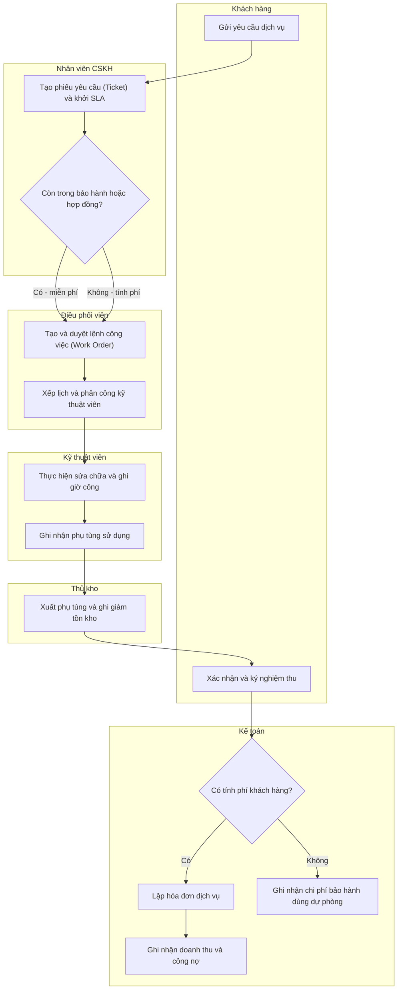
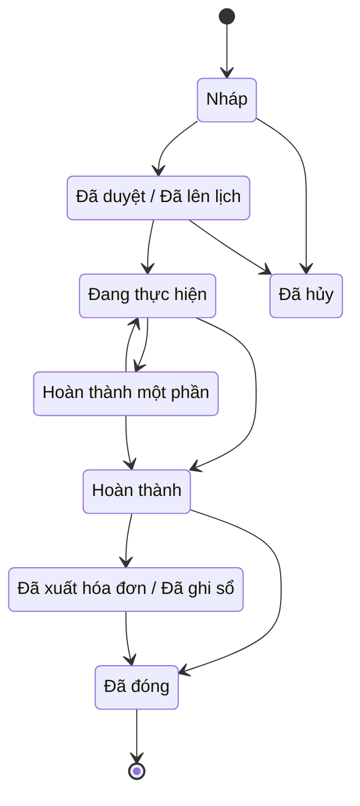
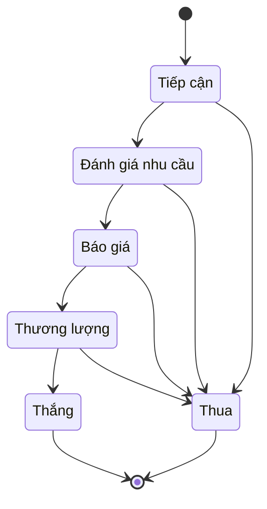
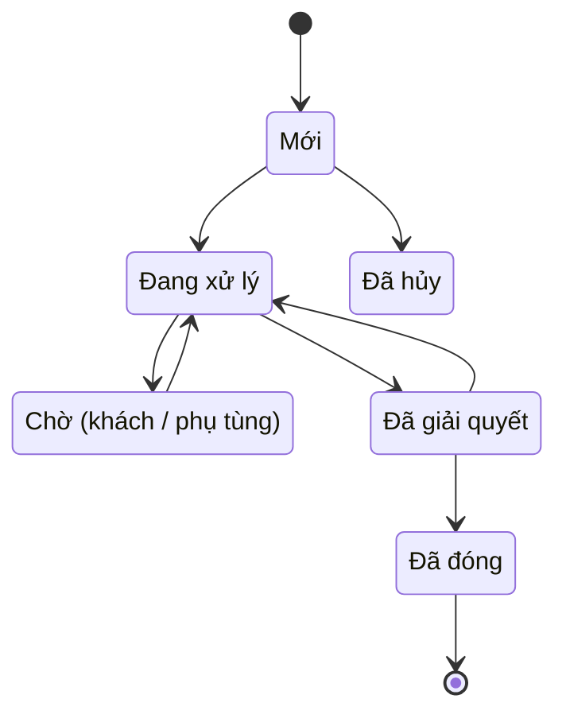

# CRM-SVC — Quản lý quan hệ khách hàng & Dịch vụ sau bán hàng (Customer Relationship Management & After-Sales Service)

> Phạm vi: toàn bộ vòng đời khách hàng từ tiền bán hàng (khách hàng tiềm năng → cơ hội → báo giá) đến sau bán hàng (chăm sóc, bảo hành, yêu cầu dịch vụ, dịch vụ hiện trường, phụ tùng, SLA, lập hóa đơn dịch vụ, phản hồi). Module liên quan: CRM, SVC; liên kết chặt với SAL/O2C (bán hàng), INV (kho phụ tùng), AR (công nợ phải thu), GL (sổ cái), TAX (hóa đơn điện tử), MFG (chất lượng/sửa chữa). Chuẩn tham chiếu: SAP S/4HANA Service & SAP Sales/Service Cloud [9], Oracle CX (Siebel / Fusion Service), Odoo CRM/Field Service/Helpdesk/Repairs [7], Microsoft Dynamics 365 Sales/Customer Service/Field Service [8]. Chế độ kế toán VN áp dụng: **Thông tư 99/2025/TT-BTC** [1] (xem mục 8).
>
> Cập nhật đến: 2026-10-20 — quy định thay đổi thường xuyên; BA phải kiểm tra lại hiệu lực khi dùng cho dự án.

## Mục lục
- [1. Mục đích & phạm vi](#1-mục-đích--phạm-vi-trongngoài-phạm-vi)
- [2. Vai trò tham gia](#2-vai-trò-tham-gia)
- [3. Danh mục (master data) tiên quyết](#3-danh-mục-master-data-tiên-quyết)
- [4. Chứng từ & luồng chứng từ](#4-chứng-từ--luồng-chứng-từ-document-flow)
- [5. Các bước quy trình chuẩn](#5-các-bước-quy-trình-chuẩn)
- [6. Vòng đời trạng thái chứng từ chính](#6-vòng-đời-trạng-thái-chứng-từ-chính)
- [7. Quy tắc nghiệp vụ & kiểm tra](#7-quy-tắc-nghiệp-vụ--kiểm-tra-validation-điển-hình)
- [8. Hạch toán kế toán](#8-hạch-toán-kế-toán)
- [9. Tham số hệ thống điển hình](#9-tham-số-hệ-thống-điển-hình)
- [10. Kiểm soát nội bộ & phân quyền](#10-kiểm-soát-nội-bộ--phân-quyền-sod-hạn-mức-duyệt-audit)
- [11. Báo cáo chuẩn](#11-báo-cáo-chuẩn)
- [12. Tích hợp với module khác](#12-tích-hợp-với-module-khác)
- [13. Biến thể & ngoại lệ](#13-biến-thể--ngoại-lệ)
- [14. Lỗi BA hay mắc & câu hỏi khảo sát](#14-lỗi-ba-hay-mắc--câu-hỏi-cần-hỏi-khách-hàng)
- [15. Nguồn tham khảo](#15-nguồn-tham-khảo)

---

## 1. Mục đích & phạm vi (trong/ngoài phạm vi)

**Mục đích.** Chuẩn hóa cách thiết kế chức năng cho hai mảng nghiệp vụ:
- **CRM (tiền bán hàng):** nắm bắt và nuôi dưỡng khách hàng tiềm năng (Lead), quản lý cơ hội bán hàng (Opportunity) theo phễu (Pipeline), ghi nhận hoạt động (Activity), lập báo giá (Quotation) rồi bàn giao sang bán hàng; phân khúc khách hàng (Segmentation) và chiến dịch marketing cơ bản (Campaign).
- **SVC (sau bán hàng):** chăm sóc khách hàng qua phiếu hỗ trợ (Ticket/Case), đăng ký và xử lý bảo hành (Warranty), yêu cầu dịch vụ (Service Request) và lệnh công việc (Work Order), chuyến thăm hiện trường (Field Service Visit), tiêu hao phụ tùng (Spare Parts) nối với kho, cam kết mức dịch vụ (SLA), lập hóa đơn dịch vụ (Service Billing) và thu thập phản hồi khách hàng (Feedback/CSAT-NPS).

**Trong phạm vi:** Lead→Opportunity→Quotation; Activity; Campaign cơ bản & phân khúc; Ticket/Case; đăng ký bảo hành & yêu cầu bảo hành; Work Order & dịch vụ hiện trường; xuất/ghi nhận phụ tùng; SLA & hợp đồng dịch vụ; nghiệm thu & lập hóa đơn dịch vụ; hạch toán doanh thu dịch vụ, giá vốn dịch vụ, dự phòng bảo hành; phản hồi khách hàng; **tuân thủ bảo vệ dữ liệu cá nhân (Luật 91/2025/QH15)** [4].

**Ngoài phạm vi (liên kết, không mô tả lại):**
- Chuyển báo giá thành đơn bán hàng, giao hàng, hóa đơn bán hàng → xem `references/processes/o2c-order-to-cash.md`.
- Quản lý tồn kho, số serial, nhập/xuất kho phụ tùng → xem `references/processes/inventory-warehouse.md`.
- Ghi nhận công nợ, thu tiền, bù trừ → xem `references/processes/ar-accounts-receivable.md`.
- Hóa đơn điện tử dịch vụ, thuế GTGT đầu ra → xem `references/processes/tax-einvoice.md` và `references/regulations/vn-tax-einvoice.md`.
- Giá thành/đối tượng tập hợp chi phí dịch vụ → xem `references/processes/costing.md`.
- Dự án lắp đặt/triển khai lớn → xem `references/processes/project-management.md`.
- Khung bảo vệ dữ liệu cá nhân & tham số bảo mật chung → xem `references/security-and-parameters.md`.

---

## 2. Vai trò tham gia

| Vai trò | Trách nhiệm | Quyền điển hình (theo hành động chuẩn) |
|---|---|---|
| Nhân viên kinh doanh (Sales Representative / Account Executive) — `ROLE-CRM-SALES` | Tạo & chăm sóc Lead/Opportunity, ghi hoạt động, lập báo giá | Xem, Tạo, Sửa, Gửi duyệt (báo giá), In, Xuất file |
| Trưởng phòng kinh doanh (Sales Manager) — `ROLE-CRM-MGR` | Phân bổ lead, duyệt báo giá/chiết khấu, kiểm soát phễu | Xem (toàn đội), Duyệt, Từ chối, Trả lại, Cấu hình phễu |
| Nhân viên marketing (Marketing Staff) — `ROLE-CRM-MKT` | Tạo chiến dịch, phân khúc, quản lý nguồn lead, đồng ý nhận tin | Xem, Tạo, Sửa (campaign), Nhập file, Xuất file |
| Nhân viên chăm sóc khách hàng (Customer Service Agent) — `ROLE-SVC-AGENT` | Tiếp nhận & phân loại ticket, trả lời khách, tạo yêu cầu dịch vụ | Xem, Tạo, Sửa, Gửi duyệt, In |
| Trưởng phòng dịch vụ khách hàng (Customer Service Manager) — `ROLE-SVC-MGR` | Duyệt work order/giảm trừ phí, xử lý leo thang, giám sát SLA | Xem, Duyệt, Từ chối, Trả lại, Đóng, Cấu hình SLA |
| Điều phối viên dịch vụ (Service Dispatcher) — `ROLE-SVC-DISP` | Xếp lịch, phân công kỹ thuật viên, theo dõi tiến độ | Xem, Tạo (work order), Sửa (lịch), Phân công |
| Kỹ thuật viên dịch vụ / hiện trường (Service Technician / Field Engineer) — `ROLE-SVC-TECH` | Thực hiện sửa chữa, ghi phụ tùng & giờ công, nghiệm thu tại chỗ | Xem (phiếu được giao), Sửa (ghi nhận thực hiện), In |
| Thủ kho (Storekeeper) — `ROLE-INV-WH` | Xuất/trả phụ tùng theo work order | Xem, Tạo (phiếu xuất), Ghi sổ (xuất kho) |
| Kế toán công nợ phải thu (AR Accountant) — `ROLE-AR-ACC` | Lập & ghi sổ hóa đơn dịch vụ, theo dõi thu tiền | Xem, Tạo (hóa đơn), Ghi sổ, In, Xuất file |
| Kế toán trưởng (Chief Accountant) — `ROLE-GL-CHIEF` | Duyệt dự phòng bảo hành, kiểm soát hạch toán | Xem, Duyệt, Ghi sổ, Bỏ ghi sổ, Đảo |
| Giám đốc (Director) — `ROLE-DIR` | Phê duyệt vượt hạn mức, chính sách bảo hành/SLA | Xem, Duyệt (vượt hạn mức), Cấu hình |
| Cán bộ/Bộ phận bảo vệ dữ liệu cá nhân (Data Protection Officer – DPO) — `ROLE-DPO` | Quản lý đồng ý, hồ sơ đánh giá tác động, yêu cầu của chủ thể dữ liệu | Xem, Cấu hình (chính sách DLCN), Xuất file (phục vụ quyền truy cập) |

> Nguyên tắc tối thiểu quyền: kỹ thuật viên chỉ thấy phiếu được giao; nhân viên kinh doanh chỉ thấy khách hàng/cơ hội của mình (hoặc của đội theo cấu hình "phạm vi dữ liệu" – data scope). Truy cập dữ liệu cá nhân khách hàng phải gắn mục đích và được ghi nhật ký (xem mục 10 và [4]).

---

## 3. Danh mục (master data) tiên quyết

| Danh mục | Trường quan trọng | Quy tắc chính |
|---|---|---|
| Khách hàng / Tài khoản (Customer / Account) — `MD-CUSTOMER` | Mã KH, tên, MST, loại (cá nhân/tổ chức), địa bàn, phân khúc, điều khoản thanh toán | Dùng chung với AR/O2C; không trùng MST; cá nhân → gắn cờ "dữ liệu cá nhân" [4]. Xem `ar-accounts-receivable.md` |
| Người liên hệ (Contact) — `MD-CONTACT` | Họ tên, chức danh, điện thoại, email, kênh ưu tiên, trạng thái đồng ý nhận tin | Email/điện thoại là dữ liệu cá nhân; phải có bản ghi đồng ý trước khi gửi marketing (mục 7, [4]) |
| Nguồn khách hàng tiềm năng (Lead Source) — `MD-LEAD-SOURCE` | Mã nguồn, kênh (web/hội chợ/giới thiệu/quảng cáo), chiến dịch gốc | Bắt buộc khi tạo lead để đo hiệu quả marketing |
| Giai đoạn cơ hội (Pipeline Stage) — `MD-PIPELINE-STAGE` | Mã giai đoạn, thứ tự, % xác suất thắng, điều kiện chuyển | Mỗi giai đoạn có xác suất để dự báo; đổi tên theo doanh nghiệp (mục 6) |
| Sản phẩm / Dịch vụ (Product / Service Item) — `MD-PRODUCT` | Mã, loại (hàng hóa/dịch vụ/phụ tùng), đơn giá, nhóm bảo hành, có theo serial? | Dịch vụ là "item dịch vụ" không quản tồn kho; dùng chung với INV/SAL |
| Thiết bị đã lắp đặt / Số máy (Installed Base / Equipment / Serial) — `MD-SERIAL` | Số serial, khách hàng, ngày bán, hết hạn bảo hành, lịch sử dịch vụ | Gốc để xác định quyền bảo hành & lịch sử sửa chữa; sinh từ giao hàng (O2C/INV) |
| Chính sách bảo hành (Warranty Policy) — `MD-WARRANTY` | Thời hạn, phạm vi (linh kiện/công), loại trừ, nhà cung cấp bảo hành | Gắn theo nhóm sản phẩm; quyết định tính phí hay miễn phí (mục 7) |
| Hợp đồng dịch vụ / SLA (Service Contract / SLA) — `MD-SLA` | Mức ưu tiên, thời gian phản hồi, thời gian xử lý, lịch làm việc, phạm vi | Xác định đồng hồ SLA cho ticket/work order [8] |
| Phụ tùng (Spare Part) — `MD-SPAREPART` | Mã, kho mặc định dịch vụ, giá vốn, giá bán, định mức | Là item quản tồn kho; liên kết `inventory-warehouse.md` |
| Kỹ thuật viên / Nguồn lực (Technician / Resource) — `MD-TECH` | Mã NV, kỹ năng, địa bàn, lịch làm việc, năng lực | Dùng để xếp lịch & tối ưu phân công; liên kết HR |
| Địa bàn (Territory) — `MD-TERRITORY` | Mã vùng, phạm vi địa lý, đội phụ trách | Dùng cho phân bổ lead và điều phối kỹ thuật viên |
| Chiến dịch (Campaign) — `MD-CAMPAIGN` | Mã, mục tiêu, ngân sách, kênh, tập đối tượng, ngày | Gắn lead/cơ hội để đo ROI; đối tượng phải hợp lệ về đồng ý [4] |
| Bảng giá & đơn giá công (Price List / Labor Rate) — `MD-PRICELIST` | Giá dịch vụ, đơn giá giờ công, phụ phí, hiệu lực | Áp theo hợp đồng/khách; chi phối giá trị work order & hóa đơn |
| Loại yêu cầu (Ticket Category / Reason) — `MD-TICKETCAT` | Mã loại, mức ưu tiên mặc định, nhóm xử lý, SLA mặc định | Định tuyến ticket & đặt đồng hồ SLA tự động |
| Bản ghi đồng ý xử lý DLCN (Consent Record) — `MD-CONSENT` | Chủ thể, mục đích, phạm vi, kênh, thời điểm, trạng thái (còn/đã rút) | Bắt buộc theo Luật 91/2025/QH15; lưu vết tạo-sửa-rút [4][5] |

---

## 4. Chứng từ & luồng chứng từ (document flow)

| Chứng từ (VI/EN) | Mục đích | Tạo từ | Sinh ra | Ảnh hưởng (kho/công nợ/sổ cái) |
|---|---|---|---|---|
| Khách hàng tiềm năng (Lead) | Ghi nhận quan tâm chưa đủ điều kiện | Campaign, nhập tay, web form | Cơ hội (khi đủ điều kiện) | Không |
| Cơ hội bán hàng (Opportunity) | Theo dõi khả năng bán qua phễu | Lead chuyển đổi, tạo tay | Báo giá | Không (chỉ dự báo) |
| Báo giá (Quotation / Sales Quote) | Chào giá cho khách | Cơ hội | Đơn bán hàng (O2C) | Không (cho tới khi thành đơn) |
| Đăng ký bảo hành (Warranty Registration) | Kích hoạt bảo hành theo serial | Giao hàng/hóa đơn bán, khách tự đăng ký | Quyền bảo hành trên `MD-SERIAL` | Không |
| Phiếu yêu cầu / Hỗ trợ (Service Ticket / Case) | Tiếp nhận sự cố, yêu cầu, khiếu nại | Khách gọi/email/portal, tự tạo | Lệnh công việc | Không (khởi đồng hồ SLA) |
| Lệnh công việc dịch vụ (Service Work Order / Service Order) | Chỉ thị thực hiện dịch vụ/sửa chữa | Ticket, hợp đồng định kỳ, tay | Chuyến thăm, phiếu xuất phụ tùng, nghiệm thu | Có thể sinh chi phí & giá vốn dịch vụ |
| Chuyến thăm hiện trường (Field Service Visit / Appointment) | Lịch & kết quả đến hiện trường | Work order | Ghi nhận giờ công, phụ tùng | Không trực tiếp |
| Phiếu xuất phụ tùng (Parts/Goods Issue) | Xuất phụ tùng dùng cho dịch vụ | Work order | Bút toán xuất kho | **Kho giảm**; GL: giá vốn/dự phòng (mục 8) |
| Biên bản nghiệm thu dịch vụ (Service Confirmation / Completion) | Xác nhận hoàn thành, khách ký | Work order | Hóa đơn dịch vụ | Không (căn cứ ghi nhận doanh thu) |
| Hóa đơn dịch vụ (Service Invoice) | Yêu cầu thanh toán phần có phí | Nghiệm thu/work order | Hóa đơn điện tử, công nợ | **Công nợ tăng (131)**; GL: doanh thu 511, thuế 3331 |
| Phiếu khảo sát phản hồi (Feedback / CSAT-NPS Survey) | Đo hài lòng sau xử lý | Đóng ticket/work order | Điểm CSAT/NPS | Không |

```mermaid
flowchart LR
  CAMP["Chiến dịch (Campaign)"] --> LEAD["Khách hàng tiềm năng (Lead)"]
  LEAD --> OPP["Cơ hội bán hàng (Opportunity)"]
  OPP --> QUOTE["Báo giá (Quotation)"]
  QUOTE -.->|"chuyển sang O2C"| SO["Đơn bán hàng (Sales Order)"]
  SO -.->|"sau giao hàng"| WRG["Đăng ký bảo hành (Warranty)"]
  WRG --> TICKET["Phiếu yêu cầu (Service Ticket)"]
  TICKET --> WO["Lệnh công việc (Work Order)"]
  WO --> FSV["Chuyến thăm hiện trường (Field Visit)"]
  WO --> GI["Phiếu xuất phụ tùng (Parts Issue)"]
  GI -.->|"ghi giảm tồn kho"| INV["Tồn kho phụ tùng (INV)"]
  FSV --> SCONF["Biên bản nghiệm thu (Service Confirmation)"]
  SCONF --> SINV["Hóa đơn dịch vụ (Service Invoice)"]
  SINV -.->|"công nợ phải thu"| AR["Phải thu khách hàng (AR)"]
  SCONF --> FB["Khảo sát phản hồi (Feedback)"]
```

---

## 5. Các bước quy trình chuẩn

### 5A. Luồng CRM (Lead → Báo giá)

| # | Bước | Vai trò | Chứng từ | Hành động hệ thống | Trạng thái sau bước |
|---|---|---|---|---|---|
| 1 | Thu thập lead (nhập tay/web/chiến dịch) | Marketing/Sales | Lead | Kiểm trùng, gán nguồn & chiến dịch, ghi đồng ý nếu có | Lead `IN_PROGRESS` (Mới) |
| 2 | Phân bổ lead cho nhân viên | Sales Manager | Lead | Tự động theo địa bàn/round-robin hoặc gán tay | Đã phân bổ |
| 3 | Đánh giá đủ điều kiện (qualify) & chuyển thành cơ hội | Sales Rep | Lead → Opportunity | Chấm điểm, chuyển đổi, tạo contact/account | Opportunity giai đoạn đầu phễu |
| 4 | Ghi hoạt động (gọi/họp/việc) & cập nhật giai đoạn | Sales Rep | Activity | Cập nhật % xác suất, ngày đóng dự kiến | Opportunity `IN_PROGRESS` |
| 5 | Lập báo giá | Sales Rep | Quotation | Lấy giá từ bảng giá, tính chiết khấu | Quotation `DRAFT` |
| 6 | Gửi duyệt báo giá (nếu vượt hạn mức chiết khấu) | Sales Rep → Manager | Quotation | Định tuyến duyệt theo hạn mức (mục 9) | `PENDING` → `APPROVED`/`RETURNED`/`REJECTED` |
| 7 | Gửi khách & thương lượng | Sales Rep | Quotation | Gửi PDF/email, ghi phiên bản | Đã gửi |
| 8 | Thắng → bàn giao sang bán hàng | Sales Rep | Quotation → Sales Order | Chuyển báo giá thành đơn bán hàng (O2C) | Opportunity `COMPLETED` (Won) |
| 8b | Thua → đóng cơ hội | Sales Rep | Opportunity | Ghi lý do thua (win/loss) | Opportunity `CANCELLED` (Lost) |

### 5B. Luồng Dịch vụ (Ticket → Nghiệm thu → Hóa đơn)

| # | Bước | Vai trò | Chứng từ | Hành động hệ thống | Trạng thái sau bước |
|---|---|---|---|---|---|
| 1 | Tiếp nhận yêu cầu, tạo ticket | CS Agent | Ticket | Phân loại, gán serial/khách, **khởi đồng hồ SLA** | Ticket `IN_PROGRESS` (Mới) |
| 2 | Kiểm tra quyền bảo hành/hợp đồng | CS Agent | Ticket | Tra `MD-SERIAL`/`MD-WARRANTY`/`MD-SLA`, đặt cờ tính phí | Đã xác định phạm vi |
| 3 | Tạo lệnh công việc & duyệt (nếu cần) | Dispatcher/SVC Mgr | Work Order | Sinh WO từ ticket, duyệt nếu vượt hạn mức | WO `APPROVED`/lên lịch |
| 4 | Xếp lịch & phân công kỹ thuật viên | Dispatcher | Work Order | Tối ưu theo kỹ năng/địa bàn/lịch | Đã lên lịch |
| 5 | Dự trù & xuất phụ tùng | Technician/Storekeeper | Parts Issue | Giữ hàng, xuất kho, ghi giảm tồn | Kho giảm; WO `IN_PROGRESS` |
| 6 | Thực hiện dịch vụ tại hiện trường | Technician | Field Visit | Ghi giờ công, phụ tùng dùng, ảnh/ghi chú | WO `IN_PROGRESS`/`PARTIAL` |
| 7 | Nghiệm thu với khách | Technician/Khách | Service Confirmation | Khách ký (chữ ký số/giấy), chốt khối lượng | WO `COMPLETED` |
| 8 | Lập hóa đơn phần có phí | AR Accountant | Service Invoice | Tổng hợp công + phụ tùng, xuất hóa đơn điện tử | WO `POSTED` (đã xuất HĐ) |
| 9 | Ghi nhận doanh thu/giá vốn & dự phòng | AR/Chief Accountant | Bút toán | Hạch toán mục 8 | Đã ghi sổ |
| 10 | Đóng ticket & gửi khảo sát | CS Agent/Hệ thống | Ticket/Feedback | Dừng đồng hồ SLA, gửi CSAT/NPS | Ticket `CLOSED` |

---

## 6. Vòng đời trạng thái chứng từ chính

### 6A. Lệnh công việc dịch vụ (Service Work Order)

| Từ | Hành động | Đến | Vai trò | Điều kiện |
|---|---|---|---|---|
| `DRAFT` | Gửi duyệt / Duyệt | `APPROVED` | Dispatcher/SVC Mgr | Đủ thông tin khách, serial, loại dịch vụ |
| `DRAFT` | Hủy | `CANCELLED` | SVC Mgr | Trùng/sai; chỉ hủy khi chưa phát sinh phụ tùng |
| `APPROVED` | Bắt đầu thực hiện | `IN_PROGRESS` | Technician | Đã phân công & đến hiện trường |
| `IN_PROGRESS` | Tạm dừng chờ phụ tùng/khách | `PARTIAL` | Technician | Thiếu phụ tùng hoặc chờ phê duyệt chi phí |
| `PARTIAL` | Tiếp tục | `IN_PROGRESS` | Technician | Đã có phụ tùng/được duyệt |
| `IN_PROGRESS`/`PARTIAL` | Nghiệm thu | `COMPLETED` | Technician + Khách | Khách ký xác nhận |
| `COMPLETED` | Lập & xuất hóa đơn | `POSTED` | AR Accountant | Có phí; hóa đơn điện tử phát hành |
| `COMPLETED` | Đóng (miễn phí) | `CLOSED` | SVC Mgr | Trong bảo hành/không tính phí |
| `POSTED` | Đóng | `CLOSED` | SVC Mgr | Đã xuất hóa đơn & cập nhật lịch sử serial |

### 6B. Cơ hội bán hàng (Opportunity Pipeline)

> Giai đoạn phễu là **tùy biến theo doanh nghiệp** (không phải trạng thái chứng từ chuẩn). Ánh xạ canonical: các giai đoạn mở ≈ `IN_PROGRESS`; **Thắng ≈ `COMPLETED`** (chuyển sang đơn bán hàng); **Thua ≈ `CANCELLED`** (bắt buộc ghi lý do thua). Mỗi giai đoạn gắn % xác suất để dự báo doanh số. Biến thể vendor: Odoo "Won/Lost" [7], Dynamics "Open/Won/Lost" [8].

### 6C. Phiếu yêu cầu / hỗ trợ (Service Ticket / Case)

> Ánh xạ canonical: Mới ≈ `DRAFT`/mới tiếp nhận; Đang xử lý ≈ `IN_PROGRESS`; Chờ ≈ `PENDING` (đồng hồ SLA **tạm dừng** khi chờ khách); Đã giải quyết ≈ `COMPLETED`; Đã đóng ≈ `CLOSED`. "Mở lại" (RESOLVED→INPROG) khi khách chưa hài lòng. Biến thể vendor: Odoo Helpdesk/Zendesk "New/Open/Pending/Solved/Closed" [7].

---

## 7. Quy tắc nghiệp vụ & kiểm tra (validation) điển hình

1. **BR-CRM-01 — Chống trùng lặp lead/khách.** Khi tạo lead/contact, hệ thống kiểm tra trùng theo email + điện thoại + MST (tổ chức). Nếu trùng → cảnh báo gộp (merge), không tạo bản ghi mới mặc định.
2. **BR-CRM-02 — Nguồn & chiến dịch bắt buộc.** Không lưu được lead nếu thiếu nguồn (`MD-LEAD-SOURCE`); lead phát sinh từ campaign tự gắn mã chiến dịch để đo ROI.
3. **BR-CRM-03 — Đồng ý trước khi marketing (opt-in).** Chỉ được gửi email/SMS/gọi marketing tới contact có bản ghi đồng ý còn hiệu lực (`MD-CONSENT`), đúng mục đích đã nêu; mọi tin gửi đi phải có cơ chế từ chối/hủy đăng ký (opt-out). Căn cứ Luật 91/2025/QH15 — Điều 9 (sự đồng ý của chủ thể dữ liệu), đã xác minh qua Nghị định 356/2025/NĐ-CP [4][5]; quy định xử lý DLCN cho marketing/quảng cáo được điều chỉnh tại Luật này nhưng ⚠️ CHƯA XÁC MINH số hiệu điều khoản (bản tổng hợp nêu Điều 28 — đối chiếu toàn văn Luật trước khi trích dẫn).
4. **BR-CRM-04 — Hạn mức chiết khấu báo giá.** Nếu % chiết khấu hoặc giá trị > hạn mức của vai trò (mục 9) → bắt buộc `Gửi duyệt`; chưa duyệt không được gửi khách.
5. **BR-CRM-05 — Xác suất theo giai đoạn.** % xác suất lấy theo `MD-PIPELINE-STAGE`; không cho sửa tùy tiện để bảo đảm dự báo nhất quán. Cơ hội "Thua" bắt buộc chọn **lý do thua**.
6. **BR-SVC-01 — Xác định quyền bảo hành.** Phí dịch vụ = miễn phí nếu `ngày yêu cầu ≤ ngày hết hạn bảo hành của serial` **và** lỗi thuộc phạm vi `MD-WARRANTY`; ngược lại → tính phí. Hệ thống tự đặt cờ "billable" trên work order.
7. **BR-SVC-02 — Đồng hồ SLA.** Thời điểm bắt đầu = lúc tạo ticket; `Thời gian phản hồi` và `Thời gian xử lý` tính theo lịch làm việc trong `MD-SLA`; **tạm dừng** khi trạng thái `PENDING` (chờ khách). Vi phạm (breach) khi vượt mốc → tự leo thang theo ma trận (mục 9) [8].
8. **BR-SVC-03 — Không xuất phụ tùng vượt dự trù khi chưa duyệt.** Phụ tùng ngoài định mức/ước tính ban đầu phải được SVC Manager duyệt trước khi thủ kho xuất (kiểm soát chi phí & thất thoát).
9. **BR-SVC-04 — Không nghiệm thu khi còn phụ tùng chưa ghi nhận.** Không chuyển `COMPLETED` nếu còn phụ tùng đã xuất mà chưa gắn vào work order (đối chiếu xuất kho ↔ work order).
10. **BR-SVC-05 — Hóa đơn chỉ từ phần có phí đã nghiệm thu.** Chỉ lập hóa đơn cho dòng `billable` đã được khách ký nghiệm thu; phần bảo hành (miễn phí) không lên hóa đơn bán nhưng vẫn ghi nhận chi phí bảo hành (mục 8).
11. **BR-SVC-06 — Cập nhật lịch sử serial.** Khi đóng work order phải ghi lịch sử dịch vụ vào `MD-SERIAL` (ngày, lỗi, phụ tùng thay, kỹ thuật viên) để phục vụ bảo hành/triệu hồi.
12. **BR-SVC-07 — Trích lập dự phòng bảo hành.** Cuối kỳ, trích dự phòng cho sản phẩm đã bán còn trong hạn bảo hành theo công thức ước tính (xem công thức dưới), hạch toán TK 352 (mục 8).
13. **BR-DPO-01 — Lưu trữ có thời hạn & quyền của chủ thể.** Dữ liệu cá nhân chỉ lưu trong thời hạn phục vụ mục đích; phải hỗ trợ quyền truy cập, chỉnh sửa, xóa, **rút đồng ý** của chủ thể dữ liệu; có quy trình phản hồi yêu cầu rút đồng ý theo thời hạn quy định [4][5]. ⚠️ CHƯA XÁC MINH: thời hạn phản hồi cụ thể (bản dự thảo nêu 2 ngày làm việc) — kiểm tra lại Nghị định 356/2025/NĐ-CP bản ban hành.
14. **BR-DPO-02 — Hồ sơ đánh giá tác động.** Hoạt động xử lý DLCN quy mô lớn (CRM/marketing) phải lập & lưu **Hồ sơ đánh giá tác động xử lý dữ liệu cá nhân (DPIA)** theo Điều 21; chuyển dữ liệu ra nước ngoài (ví dụ CRM cloud đặt máy chủ ngoài VN) phải lập hồ sơ theo Điều 20 [4][5].

**Công thức tính toán (viết rõ):**
- `Giá trị work order = Σ(giờ công × đơn giá công) + Σ(số lượng phụ tùng × đơn giá) + phụ phí − chiết khấu`.
- `Thuế GTGT = Giá trị chịu thuế × thuế suất` (dịch vụ sửa chữa/bảo hành phổ biến 8% hoặc 10% tùy chính sách giảm thuế hiện hành — xem `references/regulations/vn-tax-einvoice.md`). ⚠️ CHƯA XÁC MINH thuế suất áp dụng 2026: kiểm tra chính sách giảm thuế GTGT còn hiệu lực.
- `Dự phòng bảo hành kỳ = Doanh thu (hoặc số lượng) hàng bán còn bảo hành × tỷ lệ chi phí bảo hành ước tính (%)`; tỷ lệ ước tính dựa trên dữ liệu lịch sử chi phí bảo hành/doanh thu. Chênh lệch so với số dư dự phòng đầu kỳ → trích thêm (vào chi phí) hoặc hoàn nhập (giảm chi phí) [1].
- `SLA % tuân thủ = Số ca xử lý đúng hạn / Tổng số ca × 100%`.
- `First-time fix rate = Số work order xử lý xong trong 1 lần / Tổng work order × 100%`.

---

## 8. Hạch toán kế toán

> **Chế độ kế toán áp dụng (xác minh tại 2026-10-20): Thông tư 99/2025/TT-BTC** — Bộ Tài chính ban hành 27/10/2025, **hiệu lực 01/01/2026**, thay thế Thông tư 200/2014/TT-BTC (áp dụng cho năm tài chính bắt đầu từ/sau 01/01/2026) [1]. Doanh nghiệp nhỏ và vừa có thể chọn **Thông tư 133/2016/TT-BTC** (xác minh 2026-10-20: trạng thái **"Còn hiệu lực"** theo [3]; thông tin "đã sửa bởi Thông tư 46/2025/TT-BTC" ⚠️ CHƯA XÁC MINH — nguồn [3] không đề cập) [3]. Số hiệu tài khoản dưới đây theo TT99; các TK trọng yếu cho dịch vụ (131, 511, 632, 641, 352, 154) **giữ nguyên số hiệu như TT200**; khác biệt đáng lưu ý: TT99 **không bắt buộc chi tiết cấp 2 của TK 511** (TT200 dùng 5113 cho doanh thu dịch vụ) và **bỏ TK 631**; ngoài ra TT99 **đổi tên TK 6415** (ở TT200 là "Chi phí bảo hành") thành "Thuế, phí, lệ phí" — do đó chi phí & dự phòng bảo hành hạch toán ở TK cấp 1 **641**, KHÔNG dùng tiểu khoản 6415 như TT200 [10].

| Nghiệp vụ | Nợ | Có | Ghi chú |
|---|---|---|---|
| Ghi nhận doanh thu dịch vụ có phí (nghiệm thu + hóa đơn) | 131 | 511, 3331 (33311) | TT200 chi tiết doanh thu DV ở 5113; TT99 dùng 511 (tự chi tiết). Thuế GTGT đầu ra 33311 [1] |
| Kết chuyển giá vốn dịch vụ | 632 | 154 | Giá vốn gồm giờ công, phụ tùng, chi phí hiện trường tập hợp ở 154 |
| Tập hợp chi phí dịch vụ (giờ công, nhân công) | 154 (hoặc 621/622/627) | 334, 338, 214, 111, 112 | Dùng cho đối tượng tập hợp chi phí dịch vụ (`costing.md`) |
| Xuất phụ tùng dùng cho dịch vụ **có phí** | 154 | 152 (phụ tùng) / 153 | Phụ tùng tính vào giá vốn dịch vụ; kho giảm |
| Bán phụ tùng rời cho khách (có thu tiền) | 632 / 131 | 156 / (511, 33311) | Ghi nhận như bán hàng hóa; xem `o2c-order-to-cash.md` |
| Thu tiền hóa đơn dịch vụ | 111, 112 | 131 | Bù trừ công nợ phải thu |
| Trích lập/điều chỉnh tăng dự phòng bảo hành (cuối kỳ) | 641 | 352 (3521) | 3521 = dự phòng bảo hành sản phẩm, hàng hóa [1] |
| Chi phí bảo hành thực tế — có bộ phận bảo hành độc lập | 352 (3521) / 641 (phần vượt dự phòng) | 154 | Tập hợp chi phí bộ phận bảo hành vào 154 rồi kết chuyển |
| Chi phí bảo hành thực tế — không có bộ phận riêng | 352 (3521) / 641 (phần vượt) | 111, 112, 152, 153, 214, 334, 338 | Ghi thẳng chi phí sửa chữa bảo hành |
| Hoàn nhập dự phòng bảo hành không dùng hết | 352 (3521) | 641 | Khi số dự phòng cần lập < số dư hiện có [1] |
| Chi phí chiến dịch marketing/quảng cáo | 641, 133 | 111, 112, 331 | TT200 chi tiết ở 6417/6418; TT99 đã tái cấu trúc tiểu khoản 641 — DN tự chi tiết cấp 2 theo Điều 11 TT99. 133 = thuế GTGT đầu vào được khấu trừ |
| Thuê ngoài đối tác dịch vụ (subcontractor) | 154 / 627, 133 | 331 | Chi phí dịch vụ thuê ngoài tính vào giá vốn/chi phí |

> **Khác biệt TT133 (DNNVV) [3]:** không tách TK 641/642 — chi phí bán hàng & quản lý gộp vào **TK 642 "Chi phí quản lý kinh doanh"** (6421 bán hàng, 6422 QLDN); dự phòng bảo hành vẫn dùng **TK 352**; doanh thu dịch vụ vẫn TK 511. Dùng đúng chế độ doanh nghiệp đã đăng ký, nhất quán cả năm tài chính.

---

## 9. Tham số hệ thống điển hình

| Tham số | Kiểu | Giá trị gợi ý | Phạm vi | Ảnh hưởng |
|---|---|---|---|---|
| `PRM-CRM-001` Giai đoạn phễu & % xác suất | Bảng | Tiếp cận 10%, Đánh giá 30%, Báo giá 60%, Thương lượng 80% | Công ty | Dự báo doanh số, báo cáo phễu |
| `PRM-CRM-002` Quy tắc phân bổ lead | Lựa chọn | Theo địa bàn / round-robin / theo tải | Công ty/Chi nhánh | Tự động gán lead cho nhân viên |
| `PRM-CRM-003` Ngưỡng điểm qualify lead | Số | 50/100 | Công ty | Lead đạt ngưỡng mới chuyển thành cơ hội |
| `PRM-CRM-004` Quy tắc chống trùng | Lựa chọn | Email + Điện thoại + MST | Hệ thống | Cảnh báo/khóa tạo trùng |
| `PRM-CRM-005` Hạn mức chiết khấu cần duyệt | Số/% | >10% hoặc >50 triệu | Công ty | Định tuyến duyệt báo giá |
| `PRM-CRM-006` Bắt buộc đồng ý marketing (opt-in) | Cờ | Bật | Hệ thống | Chặn gửi tin nếu chưa có đồng ý [4] |
| `PRM-CRM-007` Thời hạn lưu dữ liệu lead/contact | Số (tháng) | 24–36 | Công ty | Tự ẩn/xóa khi hết thời hạn mục đích [4] |
| `PRM-SVC-001` Chính sách SLA theo mức ưu tiên | Bảng | Cao: phản hồi 1h/xử lý 8h; TB: 4h/24h; Thấp: 8h/72h | Công ty/Hợp đồng | Đặt mốc & cảnh báo breach [8] |
| `PRM-SVC-002` Lịch làm việc tính SLA | Bảng | 8x5 hoặc 24x7 | Công ty/Chi nhánh | Cách tính thời gian SLA |
| `PRM-SVC-003` Thời hạn bảo hành mặc định theo nhóm SP | Số (tháng) | 12 / 24 / 36 | Công ty | Xác định quyền bảo hành khi tạo serial |
| `PRM-SVC-004` Tự tạo work order từ ticket | Cờ | Bật cho loại "sửa chữa" | Công ty | Giảm thao tác, chuẩn hóa luồng |
| `PRM-SVC-005` Kho phụ tùng mặc định cho dịch vụ | Mã kho | Kho dịch vụ vùng | Chi nhánh | Nguồn xuất phụ tùng, kiểm soát tồn |
| `PRM-SVC-006` Mặc định tính phí ngoài bảo hành | Cờ | Bật | Công ty | Tự đặt cờ billable trên WO |
| `PRM-SVC-007` Ma trận leo thang khi breach SLA | Bảng | L1→L2 sau 50% thời gian; →Manager khi breach | Công ty | Tự thông báo/leo thang [8] |
| `PRM-SVC-008` Bảng giá dịch vụ & đơn giá công | Bảng | Theo hợp đồng/khách | Công ty | Tính giá trị WO & hóa đơn |
| `PRM-SVC-009` Kích hoạt khảo sát sau đóng ticket | Cờ | Bật (CSAT/NPS) | Công ty | Thu thập phản hồi |
| `PRM-SVC-010` Tỷ lệ trích dự phòng bảo hành | % | Theo lịch sử (vd 1–3% doanh thu) | Công ty | Mức trích TK 352 [1] |

---

## 10. Kiểm soát nội bộ & phân quyền (SoD, hạn mức duyệt, audit)

- **Phân tách nhiệm vụ (SoD):**
  - Người **lập báo giá/chiết khấu** ≠ người **duyệt** (BR-CRM-04).
  - Người **thực hiện dịch vụ** (kỹ thuật viên) ≠ người **lập hóa đơn** (kế toán AR) ≠ người **duyệt giảm trừ phí** (SVC Manager).
  - Người **xuất phụ tùng** (thủ kho) ≠ người **ghi nhận sử dụng trên WO** (kỹ thuật viên); đối chiếu định kỳ xuất kho ↔ WO.
  - Người **trích lập dự phòng bảo hành** (kế toán) được **Kế toán trưởng duyệt**.
- **Hạn mức duyệt:** chiết khấu báo giá (PRM-CRM-005); miễn/giảm phí dịch vụ; xuất phụ tùng ngoài định mức (PRM-SVC); vượt hạn mức → leo lên Giám đốc.
- **Nhật ký kiểm toán (audit trail):** ghi mọi thao tác tạo/sửa/xóa/duyệt trên lead, cơ hội, báo giá, ticket, WO, hóa đơn; **đặc biệt mọi truy cập, xuất, chỉnh sửa dữ liệu cá nhân khách hàng** (ai, khi nào, mục đích) để chứng minh tuân thủ Luật 91/2025/QH15 [4].
- **Kiểm soát dữ liệu cá nhân (bắt buộc theo luật):**
  - Thu thập tối thiểu, đúng mục đích; có bản ghi đồng ý (`MD-CONSENT`) và cơ chế rút đồng ý.
  - Phân quyền theo "cần biết" (need-to-know); che/ẩn (masking) thông tin nhạy cảm với vai trò không cần.
  - Lập **DPIA (Điều 21)** cho xử lý quy mô lớn; hồ sơ **chuyển dữ liệu xuyên biên giới (Điều 20)** nếu dùng cloud nước ngoài [4][5].
  - Chỉ định **bộ phận/cán bộ bảo vệ DLCN (DPO)** khi thuộc diện quy định; quy trình xử lý sự cố lộ lọt dữ liệu & thông báo cơ quan quản lý.
  - Chi tiết khung chung xem `references/security-and-parameters.md`.
- **Chỉ xóa chứng từ ở trạng thái `Nháp` (DRAFT).** Chứng từ đã duyệt/ghi sổ chỉ được `Hủy`/`Đảo` có lưu vết; không xóa cứng.

---

## 11. Báo cáo chuẩn

| Báo cáo | Mục đích | Chiều phân tích / bộ lọc | Bắt buộc theo luật? |
|---|---|---|---|
| `RPT-CRM-01` Phễu bán hàng (Sales Pipeline) | Theo dõi cơ hội theo giai đoạn & giá trị | Nhân viên, đội, giai đoạn, kỳ | Không (quản trị) |
| `RPT-CRM-02` Dự báo doanh số (Sales Forecast) | Dự báo theo xác suất giai đoạn | Kỳ, đội, sản phẩm | Không |
| `RPT-CRM-03` Tỷ lệ chuyển đổi & Win/Loss | Đo hiệu quả bán & lý do thua | Nguồn, nhân viên, lý do | Không |
| `RPT-CRM-04` Hiệu quả chiến dịch (Campaign ROI) | Chi phí/kết quả theo chiến dịch | Chiến dịch, kênh, kỳ | Không |
| `RPT-CRM-05` Hoạt động nhân viên kinh doanh | Số cuộc gọi/họp/việc & kết quả | Nhân viên, loại hoạt động | Không |
| `RPT-CRM-06` Phân khúc & giá trị khách hàng | Phân khúc, giá trị vòng đời (CLV) | Phân khúc, địa bàn | Không |
| `RPT-SVC-01` Tuân thủ SLA (SLA Compliance) | % đúng hạn, số ca breach | Mức ưu tiên, đội, hợp đồng | Không |
| `RPT-SVC-02` Khối lượng & tồn đọng ticket | Ticket mới/đóng/tồn, tuổi ticket | Loại, kênh, nhân viên | Không |
| `RPT-SVC-03` Work order & năng suất kỹ thuật viên | Số WO, giờ công, first-time fix | Kỹ thuật viên, địa bàn | Không |
| `RPT-SVC-04` Doanh thu & giá vốn dịch vụ | Lãi/lỗ mảng dịch vụ | Dịch vụ, khách, kỳ | Không |
| `RPT-SVC-05` Phân tích chi phí bảo hành | Chi phí bảo hành/doanh thu, dự phòng | Sản phẩm, serial, kỳ | Không (hỗ trợ BCTC) |
| `RPT-SVC-06` Tiêu hao phụ tùng (Parts Consumption) | Phụ tùng dùng theo WO/serial | Phụ tùng, kho, kỳ | Không |
| `RPT-SVC-07` Hài lòng khách hàng (CSAT/NPS) | Điểm hài lòng sau xử lý | Kênh, đội, kỳ | Không |

> Lưu ý: báo cáo CRM/SVC là **báo cáo quản trị** (không phải báo cáo tài chính luật định). Hóa đơn điện tử dịch vụ chịu nghĩa vụ hóa đơn/thuế → xem `references/processes/tax-einvoice.md`. Hồ sơ **DPIA/chuyển dữ liệu xuyên biên giới** là hồ sơ **tuân thủ bắt buộc** (lưu trữ & xuất trình khi cơ quan quản lý yêu cầu), không phải báo cáo định kỳ nộp [4][5].

---

## 12. Tích hợp với module khác (ảnh hưởng dữ liệu hai chiều)

- **Bán hàng / O2C** (`o2c-order-to-cash.md`): Báo giá "Thắng" → Đơn bán hàng; giao hàng O2C sinh **serial/installed base** quay về SVC; hóa đơn dịch vụ dùng chung quy trình xuất hóa đơn.
- **Kho / Inventory** (`inventory-warehouse.md`): phụ tùng tồn kho, giữ hàng & xuất kho theo WO; trả phụ tùng thừa; số serial/lô liên kết thiết bị đã lắp đặt.
- **Phải thu / AR** (`ar-accounts-receivable.md`): hóa đơn dịch vụ → công nợ 131; đối chiếu, thu tiền, tuổi nợ.
- **Sổ cái / GL** (`r2r-general-ledger.md`): bút toán doanh thu, giá vốn, dự phòng bảo hành (352), chi phí marketing.
- **Thuế & hóa đơn điện tử** (`tax-einvoice.md`, `regulations/vn-tax-einvoice.md`): phát hành hóa đơn điện tử dịch vụ, thuế GTGT đầu ra.
- **Sản xuất / MRP & Chất lượng** (`manufacturing-mrp.md`): phản hồi lỗi bảo hành → yêu cầu khắc phục/triệu hồi; định mức phụ tùng sửa chữa (BOM sửa chữa).
- **Nhân sự / Lương** (`hr-payroll.md`): kỹ thuật viên là nhân viên; giờ công/định mức công tác; chi phí nhân công dịch vụ.
- **Dự án** (`project-management.md`): dịch vụ lắp đặt/triển khai lớn quản như dự án (WBS, nghiệm thu giai đoạn).
- **Giá thành** (`costing.md`): WO là đối tượng tập hợp chi phí dịch vụ → tính giá vốn.
- **Bảo mật & tham số** (`security-and-parameters.md`): khung bảo vệ dữ liệu cá nhân, phân quyền, masking, nhật ký.

---

## 13. Biến thể & ngoại lệ

- **Dịch vụ miễn phí trong bảo hành:** không lập hóa đơn bán nhưng **vẫn ghi nhận chi phí** (dùng dự phòng 352 hoặc chi phí bán hàng 641) và cập nhật lịch sử serial (BR-SVC-05, mục 8).
- **Hoàn thành một phần (`PARTIAL`):** hết phụ tùng hoặc cần duyệt thêm chi phí → WO tạm dừng, có thể nghiệm thu & lập hóa đơn phần đã làm, phần còn lại tạo WO con.
- **Phụ tùng trả lại/đổi:** phụ tùng xuất thừa trả về kho (bút toán đảo xuất); phụ tùng hỏng thu hồi về kho phế/bảo hành NCC.
- **Yêu cầu bảo hành với nhà cung cấp (vendor warranty claim):** chi phí được thu hồi từ NCC/nhà sản xuất → theo dõi công nợ phải thu khác, không tính vào giá vốn công ty.
- **Hủy sau duyệt / sửa sau duyệt:** work order/báo giá đã duyệt chỉ `Hủy`/`Trả lại để sửa` có lưu vết & lý do; hóa đơn đã phát hành sai → lập hóa đơn điều chỉnh/thay thế (theo quy định hóa đơn điện tử).
- **Đa tiền tệ (multi-currency):** hợp đồng dịch vụ/khách nước ngoài lập báo giá & hóa đơn ngoại tệ; ghi sổ quy đổi VND theo tỷ giá; chênh lệch tỷ giá xử lý ở AR/GL.
- **Dịch vụ định kỳ theo hợp đồng (preventive maintenance):** hệ thống tự sinh WO theo lịch (ví dụ bảo trì 3 tháng/lần) từ hợp đồng dịch vụ.
- **Khiếu nại/đổi trả sản phẩm:** ticket khiếu nại có thể dẫn tới trả hàng (RMA) → liên kết O2C/INV để nhập lại & hoàn tiền/ghi giảm công nợ.
- **Chuyển dữ liệu ra nước ngoài (CRM/service cloud ngoài VN):** phải có hồ sơ theo Điều 20 Luật 91/2025/QH15 và thỏa thuận ràng buộc với bên nhận [4][5].
- **Chủ thể dữ liệu rút đồng ý / yêu cầu xóa:** ngừng marketing & xử lý theo mục đích đã rút; giữ lại dữ liệu tối thiểu phục vụ nghĩa vụ pháp lý (ví dụ hóa đơn, bảo hành) theo thời hạn luật định.

---

## 14. Lỗi BA hay mắc & câu hỏi cần hỏi khách hàng

**Lỗi BA hay mắc:**
1. Gộp CRM (tiền bán) và SVC (sau bán) làm một mà không tách vòng đời chứng từ (cơ hội ≠ ticket ≠ work order) → đặc tả mơ hồ, trùng chức năng.
2. Bỏ qua bước **xác định quyền bảo hành** → không rõ khi nào miễn phí/tính phí, sai doanh thu & chi phí.
3. Không thiết kế **đồng hồ SLA** (bắt đầu/tạm dừng/breach) và lịch làm việc → không đo được cam kết dịch vụ.
4. Quên liên kết **phụ tùng với kho** (xuất kho, giá vốn) → tồn kho & giá vốn dịch vụ sai.
5. Thiếu ràng buộc **đồng ý marketing** và lưu trữ có thời hạn → vi phạm Luật 91/2025/QH15 (phạt tới 5% doanh thu/10 lần khoản thu bất hợp pháp/đến 3 tỷ đồng tùy hành vi — Điều 8) [4][6].
6. Không ghi **lịch sử serial** → mất dữ liệu phục vụ bảo hành, triệu hồi, phân tích lỗi.
7. Không quy định **dự phòng bảo hành** (TK 352) → chi phí bảo hành dồn vào kỳ phát sinh, lệch kết quả kinh doanh [1].
8. Bỏ **lý do thua (win/loss)** và % xác suất giai đoạn → dự báo & cải tiến bán hàng không khả thi.
9. Không phân tách SoD (kỹ thuật viên tự lập hóa đơn; người xuất phụ tùng tự ghi nhận) → rủi ro gian lận/thất thoát.
10. Giả định mọi doanh nghiệp theo TT200 → **sai số hiệu TK**; từ 01/01/2026 áp dụng TT99 (hoặc TT133 cho DNNVV) [1][3].

**Câu hỏi khảo sát cần hỏi khách hàng (cụ thể):**
1. Quy trình bán gồm những **giai đoạn phễu** nào, tên gọi và % xác suất mỗi giai đoạn? Ai được xem/chỉnh cơ hội của người khác?
2. Lead đến từ những **kênh/nguồn** nào? Phân bổ lead theo địa bàn, round-robin hay theo tải? Có chấm điểm lead không?
3. **Hạn mức chiết khấu** báo giá theo cấp nào phải trình duyệt? Ai duyệt? Có duyệt nhiều cấp không?
4. Hoạt động marketing có gửi email/SMS/gọi không? Cơ chế **thu thập & quản lý đồng ý** hiện tại thế nào? Có xử lý dữ liệu trên cloud đặt ngoài Việt Nam không?
5. **Chính sách bảo hành** theo nhóm sản phẩm: thời hạn, phạm vi (linh kiện/công), loại trừ? Có bảo hành từ nhà cung cấp để thu hồi chi phí không?
6. Có **hợp đồng dịch vụ/SLA** không? Mức ưu tiên, thời gian phản hồi/xử lý, lịch làm việc (8x5 hay 24x7)? Chế tài khi vi phạm SLA?
7. Kênh tiếp nhận yêu cầu dịch vụ (tổng đài, email, portal, Zalo/app)? Có cần tích hợp tổng đài/omnichannel không?
8. Dịch vụ tại **hiện trường** hay tại xưởng? Cách **xếp lịch & phân công** kỹ thuật viên (theo kỹ năng/địa bàn)? Có app di động cho kỹ thuật viên không?
9. **Phụ tùng** lấy từ kho nào? Có cho phép kỹ thuật viên giữ tồn trên xe (van stock) không? Quy trình duyệt phụ tùng vượt dự trù?
10. Khi nào **tính phí** vs miễn phí? Cách tính **đơn giá công** và bảng giá dịch vụ? Có phụ phí đi lại/khẩn cấp?
11. **Nghiệm thu** cần chữ ký khách (giấy/số)? Thời điểm ghi nhận doanh thu dịch vụ?
12. Doanh nghiệp áp dụng **chế độ kế toán nào** (TT99/2025 hay TT133/2016)? Có trích **dự phòng bảo hành** không, tỷ lệ bao nhiêu?
13. Có cần **khảo sát hài lòng** (CSAT/NPS) sau xử lý không? Thời điểm & kênh gửi?
14. Yêu cầu **phân quyền & bảo mật dữ liệu cá nhân**: ai được xem thông tin khách, có cần che (masking) số điện thoại/email, lưu nhật ký truy cập? Đã chỉ định DPO chưa?
15. Có bán sản phẩm/khách hàng **nước ngoài** (đa tiền tệ) hay dịch vụ **định kỳ theo hợp đồng** (bảo trì phòng ngừa) không?

---

## 15. Nguồn tham khảo

[1] Thông tư 99/2025/TT-BTC về chế độ kế toán doanh nghiệp (thay thế Thông tư 200/2014/TT-BTC, hiệu lực 01/01/2026) — bản tổng hợp & danh mục tài khoản: https://luatvietnam.vn/thue-phi-le-phi/danh-muc-tai-khoan-ke-toan-theo-thong-tu-99-2025-tt-btc-565-105326-article.html (truy cập 2026-10-20). Khuyến nghị đối chiếu toàn văn trên Công báo/Cổng thông tin Bộ Tài chính (mof.gov.vn).
[2] Thông tư 200/2014/TT-BTC (chế độ kế toán doanh nghiệp — đối chiếu, áp dụng tới hết năm tài chính 2025): https://thuvienphapluat.vn (truy cập 2026-10-20).
[3] Thông tư 133/2016/TT-BTC (chế độ kế toán doanh nghiệp nhỏ và vừa) — xác minh 2026-10-20: trạng thái **"Còn hiệu lực"**, ban hành 26/08/2016, hiệu lực 01/01/2017: https://vcci.com.vn/legal-document/thong-tu-1332016tt-btc-cua-bo-tai-chinh-ve-viec-huong-dan-che-do-ke-toan-doanh-nghiep-nho-va-vua (truy cập 2026-10-20). ⚠️ CHƯA XÁC MINH: việc sửa đổi bởi Thông tư 46/2025/TT-BTC (nguồn [3] không đề cập) — đối chiếu Công báo trước khi dùng.
[4] Luật Bảo vệ dữ liệu cá nhân — Luật số 91/2025/QH15 (Quốc hội thông qua 26/06/2025, hiệu lực 01/01/2026): https://vanban.chinhphu.vn/?pageid=27160&docid=214590&classid=1&orggroupid=1 (truy cập 2026-10-20).
[5] Nghị định 356/2025/NĐ-CP quy định chi tiết Luật Bảo vệ dữ liệu cá nhân (ban hành 31/12/2025, hiệu lực 01/01/2026, thay Nghị định 13/2023/NĐ-CP): https://luatvietnam.vn/dan-su/nghi-dinh-356-2025-nd-cp-quy-dinh-chi-tiet-luat-bao-ve-du-lieu-ca-nhan-422896-d1.html (truy cập 2026-10-20).
[6] "Nghiêm cấm mua bán dữ liệu cá nhân; mức xử phạt vi phạm hành chính trong lĩnh vực bảo vệ dữ liệu cá nhân" — Cổng xây dựng chính sách, Chính phủ: https://xaydungchinhsach.chinhphu.vn/nghiem-cam-mua-ban-du-lieu-ca-nhan-muc-xu-phat-vi-pham-hanh-chinh-trong-linh-vuc-bao-ve-du-lieu-ca-nhan-119250728102154903.htm (truy cập 2026-10-20). Xác minh 2026-10-20 (Điều 8, mức phạt tối đa với **tổ chức**): 10 lần khoản thu từ hành vi mua bán dữ liệu (khoản 3); 5% doanh thu năm trước liền kề với vi phạm chuyển dữ liệu xuyên biên giới (khoản 4); **3 tỷ đồng** với vi phạm khác (khoản 5); **cá nhân vi phạm bị phạt bằng 1/2 mức của tổ chức** (khoản 6). Nguồn chính thống này xác nhận con số 3 tỷ đồng.
[7] Odoo Documentation — CRM (pipeline, leads/opportunities), Field Service, Helpdesk (SLA), Repairs: https://www.odoo.com/documentation/17.0/applications/sales/crm.html ; https://www.odoo.com/documentation/17.0/applications/services/field_service.html ; https://www.odoo.com/documentation/17.0/applications/services/helpdesk.html (truy cập 2026-10-20).
[8] Microsoft Learn — Dynamics 365 Field Service: SLA cho work order & Entitlements; Customer Service entitlements: https://learn.microsoft.com/dynamics365/field-service/sla-work-orders ; https://learn.microsoft.com/dynamics365/field-service/work-order-entitlements (truy cập 2026-10-20).
[9] SAP Help Portal — SAP S/4HANA Service (service order, warranty, installed base) & SAP Sales/Service Cloud: https://help.sap.com (tra cứu theo phiên bản sản phẩm, truy cập 2026-10-20).
[10] "Điểm mới hệ thống tài khoản kế toán theo Thông tư 99/2025" (so sánh TK TT99 vs TT200: 71 TK cấp 1, bỏ TK 631, TK 511 không chi tiết cấp 2, đổi tên 6415) — MISA AMIS: https://amis.misa.vn/251599/diem-moi-he-thong-tai-khoan-ke-toan-theo-thong-tu-99-2025/ (truy cập 2026-10-20).
[11] Hạch toán dự phòng phải trả — TK 352 (3521 bảo hành sản phẩm, hàng hóa) theo chế độ kế toán DN — MISA AMIS: https://amis.misa.vn/30389/du-phong-phai-tra/ (truy cập 2026-10-20).
