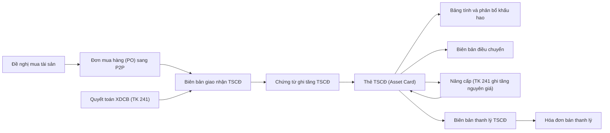
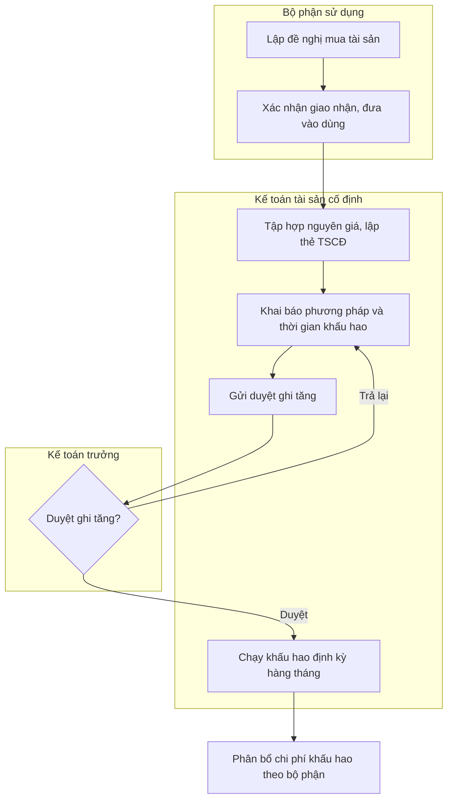
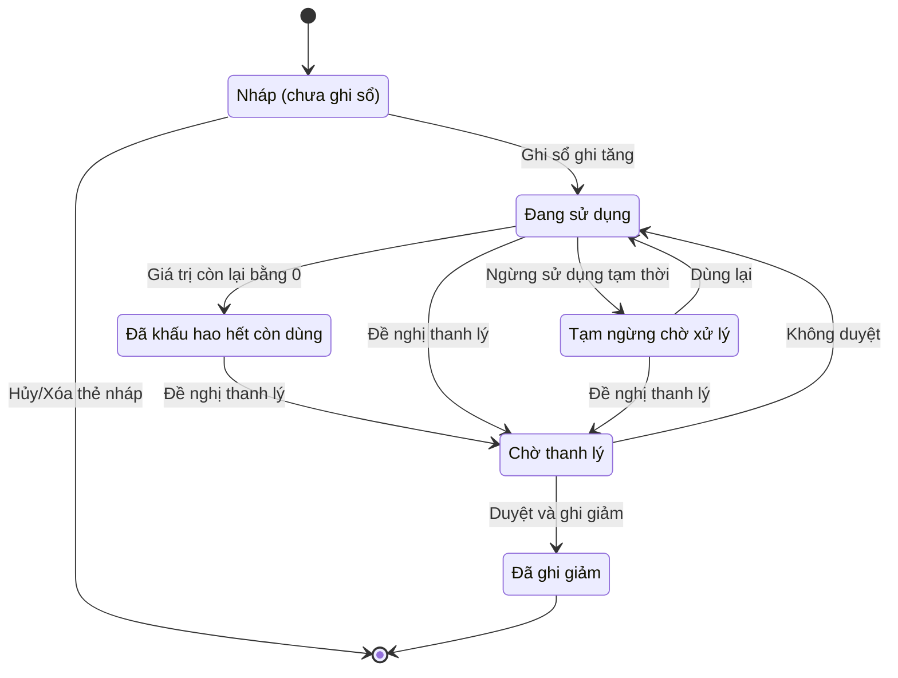

# FA — Tài sản cố định, công cụ dụng cụ & chi phí trả trước (Fixed Assets, Tools & Prepaid Expenses)

> **Phạm vi:** Toàn bộ vòng đời tài sản dài hạn và chi phí phân bổ dần: phân loại tài sản cố định (TSCĐ – hữu hình/vô hình/thuê tài chính), ghi tăng (mua sắm, hoàn thành xây dựng cơ bản – XDCB, nhận điều chuyển/góp vốn), thẻ TSCĐ, khấu hao (depreciation) và các quy tắc tính theo ngày, chạy khấu hao định kỳ, điều chuyển bộ phận, đánh giá lại, sửa chữa (ghi chi phí hay vốn hóa), thanh lý/nhượng bán, kiểm kê; xuất dùng & phân bổ công cụ dụng cụ (CCDC); phân bổ chi phí trả trước (prepaid expenses).
> **Module liên quan:** FA (lõi); AP/P2P (mua TSCĐ, CCDC), INV (kho CCDC – TK 153, phế liệu thu hồi), GL (sổ cái, khấu hao), CB (chi mua/thu thanh lý), COST (phân bổ khấu hao vào giá thành), BUD (ngân sách đầu tư – capex), TAX (chi phí được trừ, thuế hoãn lại), PRJ (dự án đầu tư XDCB).
> **Chuẩn tham chiếu:** SAP S/4HANA Asset Accounting (FI-AA, universal journal ACDOCA, depreciation areas) [11]; Oracle Assets; Odoo Accounting (Assets, asset types, depreciation board) [9]; Microsoft Dynamics 365 Finance (Fixed assets, capitalization threshold, depreciation books) [10]; chế độ kế toán doanh nghiệp Việt Nam.
>
> **Cập nhật đến: 2026-10-20 — quy định thay đổi thường xuyên; BA phải kiểm tra lại hiệu lực khi dùng cho dự án.**
> **Chế độ kế toán áp dụng:** Thông tư **99/2025/TT-BTC** (hiệu lực **01/01/2026**, cho năm tài chính bắt đầu từ/sau 01/01/2026), thay Thông tư 200/2014/TT-BTC [1]. DN nhỏ và vừa vẫn có thể dùng TT 133/2016. **Quy định chuyên ngành TSCĐ: Thông tư 45/2013/TT-BTC** (sửa bởi TT 147/2016, TT 28/2017, **TT 30/2025** hiệu lực 15/07/2025) — còn hiệu lực đến **≤31/12/2026** theo QĐ 1760/QĐ-BTC [2][3][4]. Chi tiết nền pháp lý (số hiệu TK, VAS 03/04/06, lưu trữ): xem `references/regulations/vn-accounting.md` §4, §8, §9. Số hiệu tài khoản trong file dùng theo **TT 99/2025**.

## Mục lục
1. Mục đích & phạm vi — 2. Vai trò tham gia — 3. Danh mục (master data) tiên quyết — 4. Chứng từ & luồng chứng từ — 5. Các bước quy trình chuẩn — 6. Vòng đời trạng thái — 7. Quy tắc nghiệp vụ & kiểm tra (gồm công thức khấu hao) — 8. Hạch toán kế toán — 9. Tham số hệ thống — 10. Kiểm soát nội bộ & phân quyền — 11. Báo cáo chuẩn — 12. Tích hợp module — 13. Biến thể & ngoại lệ — 14. Lỗi BA hay mắc & câu hỏi khảo sát — 15. Nguồn tham khảo

---

## 1. Mục đích & phạm vi (trong/ngoài phạm vi)

**Mục đích:** Quản lý đầy đủ hiện vật và giá trị của tài sản dài hạn từ lúc ghi tăng đến khi ghi giảm; tính và phân bổ khấu hao đúng chuẩn kế toán và quy định thuế; bảo đảm mọi tài sản gắn với một bộ phận/người sử dụng chịu trách nhiệm; phản ánh đúng nguyên giá, giá trị hao mòn lũy kế và giá trị còn lại trên sổ sách và Báo cáo tình hình tài chính (B01-DN); phân bổ hợp lý giá trị công cụ dụng cụ và chi phí trả trước vào chi phí kỳ.

**Trong phạm vi:**
- Phân loại & thẻ TSCĐ (asset master/asset card): TSCĐ hữu hình (211), vô hình (213), thuê tài chính (212); bất động sản đầu tư (217) ở mức liên kết.
- Ghi tăng TSCĐ: mua trong nước/nhập khẩu, mua trả chậm/trả góp, hình thành qua XDCB (241), nhận điều chuyển nội bộ/nhận góp vốn/được tặng, phát hiện thừa khi kiểm kê.
- Khấu hao: phương pháp (đường thẳng, số dư giảm dần có điều chỉnh, theo số lượng/khối lượng sản phẩm), xác định thời gian sử dụng theo khung, quy ước bắt đầu/ngừng theo ngày, chạy khấu hao định kỳ và phân bổ theo bộ phận.
- Biến động: điều chuyển bộ phận/địa điểm, đánh giá lại (revaluation), sửa chữa (phân biệt ghi chi phí vs vốn hóa nâng cấp), thanh lý/nhượng bán, kiểm kê định kỳ.
- Công cụ dụng cụ (CCDC – TK 153): nhập kho, xuất dùng, phân bổ 1 lần hoặc nhiều kỳ; theo dõi hiện vật nơi sử dụng.
- Chi phí trả trước (TK 242 – TT 99 đổi tên "Chi phí chờ phân bổ"): ghi nhận và phân bổ dần.

**Ngoài phạm vi (liên kết module khác):**
- Tạo nhu cầu mua – chọn nhà cung cấp – PO – nhận hàng: thuộc P2P/PUR → `references/processes/p2p-procure-to-pay.md`.
- Ghi nhận hóa đơn mua & công nợ phải trả người bán TSCĐ: `references/processes/ap-accounts-payable.md`.
- Chi tiền mua / thu tiền thanh lý tại quỹ – ngân hàng: `references/processes/cash-bank.md`.
- Quản lý tiến độ dự án đầu tư XDCB (tập hợp chi phí 241 theo dự án): `references/processes/project-management.md`, `references/industries/construction.md`.
- Kê khai thuế, hóa đơn điện tử bán thanh lý: `references/processes/tax-einvoice.md`, `references/regulations/vn-tax-einvoice.md`.
- Nền pháp lý, hệ thống tài khoản, VAS: `references/regulations/vn-accounting.md`.

## 2. Vai trò tham gia

| Vai trò | Trách nhiệm | Quyền điển hình (theo hành động chuẩn) |
|---|---|---|
| Kế toán tài sản cố định (Fixed Asset Accountant) — `ROLE-FA-ACC` | Lập thẻ TSCĐ, ghi tăng/giảm, chạy khấu hao, phân bổ CCDC & chi phí trả trước, đối chiếu sổ TSCĐ với sổ cái | Xem, Tạo, Sửa, Xóa (Nháp), Gửi duyệt, Ghi sổ, In, Xuất file |
| Bộ phận/người sử dụng tài sản (Asset Custodian / Dept. Head) — `ROLE-FA-USER` | Quản lý hiện vật, xác nhận giao nhận/điều chuyển, đề nghị sửa chữa/thanh lý, báo mất/hỏng | Xem (tài sản của bộ phận), Tạo đề nghị, Xác nhận biên bản |
| Kế toán trưởng (Chief Accountant) — `ROLE-FA-CA` | Duyệt ghi tăng/giảm, duyệt phương pháp & thời gian khấu hao, duyệt bút toán khấu hao, khóa kỳ | Xem, Duyệt, Từ chối, Trả lại, Bỏ ghi sổ, Đảo, Đóng kỳ |
| Giám đốc / Giám đốc tài chính (Director / CFO) — `ROLE-FA-DIR` | Duyệt đầu tư mua sắm, thanh lý/nhượng bán vượt hạn mức, đánh giá lại | Xem, Duyệt (cấp cao), Từ chối |
| Ban kiểm kê tài sản (Asset Count Committee) — `ROLE-FA-COUNT` | Kiểm kê định kỳ/đột xuất, lập biên bản kiểm kê, đề xuất xử lý thừa/thiếu | Xem, Tạo phiếu kiểm kê, Nhập số đếm, In |
| Nhân viên mua sắm (Purchasing Staff) — `ROLE-FA-PUR` | Mua TSCĐ/CCDC (ngoài FA) | Xem; thao tác PO/GRN thuộc P2P |
| Quản trị hệ thống (System Admin) — `ROLE-FA-ADMIN` | Cấu hình nhóm tài sản, khung khấu hao, tài khoản, tham số, phân quyền | Xem, Cấu hình, Nhập file |

> SoD bắt buộc: **người giữ/sử dụng tài sản**, **kế toán tài sản (ghi sổ)**, **người duyệt thanh lý**, **ban kiểm kê** phải tách biệt (xem §10).

## 3. Danh mục (master data) tiên quyết

| Danh mục | Trường quan trọng | Quy tắc chính |
|---|---|---|
| Thẻ TSCĐ / Hồ sơ tài sản (`MD-FA-ASSET`) | Số thẻ; tên; nhóm/loại; ngày ghi tăng; ngày đưa vào sử dụng; nguyên giá; nguồn hình thành (mua/XDCB/góp vốn); bộ phận sử dụng (cost center); địa điểm; người giữ; phương pháp khấu hao; thời gian sử dụng; TK nguyên giá/hao mòn/chi phí; giá trị thu hồi ước tính; trạng thái | Nguyên giá ≥ ngưỡng (`PRM-FA-001`) & thời gian dùng > 1 năm mới ghi là TSCĐ [2]; một thẻ = một đối tượng ghi sổ; không trùng số thẻ; mỗi thẻ gắn đúng một bộ phận tại một thời điểm |
| Nhóm/loại tài sản (`MD-FA-CLASS`) | Mã nhóm; loại (hữu hình/vô hình/thuê TC/BĐS đầu tư); khung thời gian khấu hao min–max; phương pháp mặc định; bộ tài khoản mặc định (211/212/213, 214, 627/641/642) | Thời gian khấu hao của thẻ phải nằm trong khung của nhóm (§7-BR-FA-04); loại quyết định TK & cách phân bổ |
| Phương pháp khấu hao (`MD-FA-METHOD`) | Mã; loại (đường thẳng / số dư giảm dần có điều chỉnh / theo sản lượng); hệ số điều chỉnh; quy ước tính (theo ngày/theo tháng tròn) | Đổi phương pháp tối đa 1 lần/tài sản và phải thông báo cơ quan thuế trước khi trích [2] |
| Bộ phận sử dụng / Trung tâm chi phí (`MD-COSTCENTER`) | Mã bộ phận; loại chi phí tương ứng (SX/bán hàng/QLDN); TK chi phí khấu hao (627/641/642/623) | Quyết định TK Nợ khi trích khấu hao & phân bổ CCDC (§8) |
| Địa điểm tài sản (`MD-FA-LOCATION`) | Mã địa điểm; chi nhánh; mô tả | Phục vụ kiểm kê & theo dõi hiện vật |
| Công cụ dụng cụ (`MD-CCDC`) | Mã CCDC; tên; đơn vị tính; phương pháp phân bổ (1 lần/nhiều kỳ); số kỳ phân bổ; TK chi phí | Phân bổ nhiều kỳ: thời gian tối đa 36 tháng cho mục đích thuế (`PRM-FA-007`) [6][7] |
| Khoản chi phí trả trước (`MD-FA-PREPAID`) | Mã khoản; nội dung; tổng giá trị; ngày bắt đầu; số kỳ phân bổ; TK chi phí phân bổ | Phân bổ theo thời gian được hưởng lợi ích; không để số dư 242 "treo" vô thời hạn |
| Tài khoản sổ cái (`MD-GL-ACCOUNT`) | Số hiệu & tên TK theo TT 99/2025 | 211/212/213/214, 217, 241, 242, 412, 627/641/642/623, 811/711, 133/3331 (xem §8) |

## 4. Chứng từ & luồng chứng từ (document flow)

| Chứng từ (VI/EN) | Mục đích | Tạo từ | Sinh ra | Ảnh hưởng (kho/công nợ/sổ cái) |
|---|---|---|---|---|
| Đề nghị mua sắm tài sản (Asset Purchase Request) | Xin đầu tư/mua TSCĐ | Nhu cầu bộ phận, ngân sách capex | PO (sang P2P) | Không ghi sổ (cam kết nội bộ) |
| Biên bản giao nhận TSCĐ (Asset Handover Minutes) | Xác nhận nhận & đưa vào sử dụng | Hóa đơn + PO/GRN / quyết toán XDCB | Thẻ TSCĐ, chứng từ ghi tăng | Căn cứ ghi tăng; chưa ghi sổ cái |
| Chứng từ ghi tăng TSCĐ (Asset Acquisition / Capitalization) | Ghi nhận tài sản vào sổ | Biên bản giao nhận | Lịch khấu hao (depreciation schedule) | **Nợ 211/212/213 + 1332 / Có 331/112/241…** |
| Thẻ TSCĐ (Fixed Asset Card) | Hồ sơ gốc từng tài sản | Chứng từ ghi tăng | — | Không ghi sổ; là sổ chi tiết tài sản |
| Bảng tính & phân bổ khấu hao (Depreciation Calculation & Allocation Sheet) | Tính mức khấu hao kỳ theo bộ phận | Thẻ TSCĐ đang dùng | Bút toán khấu hao | **Nợ 627/641/642/623 / Có 214** |
| Biên bản điều chuyển TSCĐ (Asset Transfer Note) | Chuyển bộ phận/địa điểm | Thẻ TSCĐ | Cập nhật thẻ | Nội bộ: đổi cost center (không đổi tổng nguyên giá); khác pháp nhân: ghi giảm + ghi tăng |
| Biên bản đánh giá lại TSCĐ (Asset Revaluation) | Điều chỉnh nguyên giá/hao mòn theo quyết định hợp pháp | Thẻ TSCĐ | Bút toán chênh lệch | **Nợ/Có 211 ↔ 412** (+ điều chỉnh 214) |
| Đề nghị & biên bản sửa chữa/nâng cấp (Repair / Upgrade Order) | Sửa chữa thường xuyên hay nâng cấp | Thẻ TSCĐ | Hóa đơn/chi phí hoặc ghi tăng nguyên giá | Chi phí: Nợ 627/641/642; Nâng cấp: Nợ 241(2414) → 211 |
| Biên bản thanh lý/nhượng bán TSCĐ (Asset Disposal / Liquidation) | Ghi giảm tài sản | Thẻ TSCĐ + quyết định duyệt | Hóa đơn bán (nếu nhượng bán), phiếu nhập phế liệu | **Nợ 214 + 811 / Có 211**; thu: Có 711 + 3331 |
| Phiếu nhập/xuất kho CCDC (Tool Receipt/Issue – GRN/GIN) | Nhập, xuất dùng công cụ dụng cụ | PO / đề nghị xuất | Bảng phân bổ CCDC | Kho 153 tăng/giảm; xuất: Nợ 627/641/642 hoặc 242 / Có 153 |
| Bảng phân bổ CCDC (Tools Allocation Sheet) | Phân bổ giá trị CCDC nhiều kỳ | Số dư 242 (CCDC) | Bút toán phân bổ | **Nợ 627/641/642 / Có 242** |
| Bảng phân bổ chi phí trả trước (Prepaid Allocation Sheet) | Phân bổ 242 vào chi phí kỳ | Số dư 242 | Bút toán phân bổ | **Nợ 627/641/642 / Có 242** |
| Biên bản kiểm kê TSCĐ/CCDC (Asset Count Minutes) | Đối chiếu sổ – thực tế | Danh sách tài sản | Chứng từ xử lý thừa/thiếu | Thừa: Nợ 211 / Có 3381; thiếu: Nợ 1381/811 / Có 211 |

## 5. Các bước quy trình chuẩn

### 5.1. Ghi tăng TSCĐ từ mua sắm & chạy khấu hao

| # | Bước | Vai trò | Chứng từ | Hành động hệ thống | Trạng thái sau bước |
|---|---|---|---|---|---|
| 1 | Lập đề nghị mua & đối chiếu ngân sách capex | Bộ phận sử dụng | Đề nghị mua tài sản | Kiểm tra ngân sách đầu tư (BUD) | Đề nghị `PENDING` |
| 2 | Mua – nhận hàng – nhận hóa đơn | Mua sắm / AP | PO, GRN, Hóa đơn | Xem P2P & AP; hóa đơn mua TSCĐ ghi Nợ 211 tạm | (ngoài FA) |
| 3 | Lập biên bản giao nhận & tập hợp nguyên giá | Kế toán TSCĐ + Bộ phận | Biên bản giao nhận | Cộng giá mua + chi phí trước khi dùng (vận chuyển, lắp đặt, chạy thử) vào nguyên giá | Biên bản `COMPLETED` |
| 4 | Lập thẻ TSCĐ & khai báo khấu hao | Kế toán TSCĐ | Thẻ TSCĐ | Gán nhóm, phương pháp, thời gian (trong khung); hệ thống dựng lịch khấu hao | Thẻ `DRAFT` |
| 5 | Gửi duyệt ghi tăng | Kế toán TSCĐ | Chứng từ ghi tăng | Định tuyến duyệt theo giá trị (`PRM-FA-013`) | `PENDING` |
| 6 | Duyệt & ghi sổ ghi tăng | Kế toán trưởng | Chứng từ ghi tăng | Sinh bút toán kết chuyển sang 211/213; khóa thẻ | Thẻ `POSTED` / Đang sử dụng |
| 7 | Chạy khấu hao định kỳ (cuối tháng) | Kế toán TSCĐ | Bảng tính & phân bổ khấu hao | Tính theo ngày/tháng, phân bổ theo bộ phận, sinh bút toán Nợ 627/641/642 / Có 214 | Bút toán khấu hao `POSTED` |
| 8 | Đối chiếu sổ TSCĐ với sổ cái 211/214 | Kế toán TSCĐ/trưởng | Báo cáo đối chiếu | So khớp giá trị còn lại; khóa kỳ | Kỳ `CLOSED` |

### 5.2. Thanh lý / nhượng bán TSCĐ

| # | Bước | Vai trò | Chứng từ | Hành động hệ thống | Trạng thái sau bước |
|---|---|---|---|---|---|
| 1 | Đề nghị thanh lý (hỏng, không dùng) | Bộ phận sử dụng | Đề nghị thanh lý | Tra giá trị còn lại, hao mòn lũy kế | Đề nghị `PENDING` |
| 2 | Duyệt thanh lý theo hạn mức | Giám đốc / KT trưởng | Quyết định thanh lý | Kiểm tra hạn mức (`PRM-FA-013`) | `APPROVED` |
| 3 | Lập hội đồng, biên bản thanh lý | Ban thanh lý | Biên bản thanh lý | — | Biên bản `COMPLETED` |
| 4 | Ghi giảm & xóa sổ tài sản | Kế toán TSCĐ | Chứng từ ghi giảm | Nợ 214 + 811 / Có 211; dừng khấu hao từ ngày giảm | Thẻ `POSTED` (Đã thanh lý) |
| 5 | Xuất hóa đơn bán (nếu nhượng bán) & thu tiền | Kế toán / Thủ quỹ | Hóa đơn, phiếu thu | Có 711 + 3331; thu hồi phế liệu nhập 152 | Giao dịch `POSTED` |

## 6. Vòng đời trạng thái tài sản (asset operational lifecycle)

> Các **chứng từ** (ghi tăng, điều chuyển, thanh lý, phân bổ) tuân bộ trạng thái chuẩn `DRAFT → PENDING → APPROVED → POSTED` (có thể `RETURNED`/`REJECTED`/`REVERSED`) theo `references/conventions.md` §6. Dưới đây là vòng đời của **đối tượng tài sản** (thẻ TSCĐ) — phục vụ truy vấn trạng thái vận hành.

| Từ | Hành động | Đến | Vai trò | Điều kiện |
|---|---|---|---|---|
| Nháp | Ghi sổ ghi tăng | Đang sử dụng | Kế toán trưởng | Đủ hồ sơ, nguyên giá ≥ ngưỡng, trong kỳ mở |
| Đang sử dụng | Ngừng tạm thời | Tạm ngừng | KT TSCĐ | Có lý do; vẫn trích khấu hao trừ trường hợp luật cho tạm hoãn [3] |
| Đang sử dụng | Khấu hao hết | Đã khấu hao hết (còn dùng) | Hệ thống | Hao mòn lũy kế = nguyên giá; ngừng trích, vẫn theo dõi hiện vật |
| Đang sử dụng / Tạm ngừng / Khấu hao hết | Đề nghị thanh lý | Chờ thanh lý | Bộ phận sử dụng | Có đề nghị hợp lệ |
| Chờ thanh lý | Duyệt & ghi giảm | Đã ghi giảm | Giám đốc + KT TSCĐ | Trong hạn mức duyệt; ngừng khấu hao từ ngày giảm |
| Nháp | Xóa | (hết) | KT TSCĐ | Chỉ thẻ chưa ghi sổ |

## 7. Quy tắc nghiệp vụ & kiểm tra (validation) điển hình

1. **BR-FA-01 – Tiêu chuẩn ghi nhận TSCĐ:** Chỉ ghi là TSCĐ khi **đồng thời**: (a) chắc chắn thu lợi ích kinh tế tương lai; (b) thời gian sử dụng **> 1 năm**; (c) nguyên giá xác định tin cậy; (d) nguyên giá **≥ `PRM-FA-001` (mặc định 30.000.000đ)** [2]. Không đủ → ghi CCDC (153) hoặc chi phí. *Lý do:* tránh vốn hóa sai, lệch chi phí – lợi nhuận.
2. **BR-FA-02 – Cấu thành nguyên giá (cost):** Nguyên giá mua = giá mua (trừ chiết khấu) + thuế không hoàn lại + chi phí trực tiếp đưa vào trạng thái sẵn sàng sử dụng (vận chuyển, bốc xếp, lắp đặt, chạy thử, lệ phí trước bạ). *Lý do:* VAS 03 [8]. Chi phí phát sinh **sau khi** đưa vào dùng (lãi vay sau ghi nhận, chi phí vận hành) không tính vào nguyên giá.
3. **BR-FA-03 – Nguyên giá không đổi sau ghi nhận, trừ 4 trường hợp:** chỉ được thay đổi khi (a) đánh giá lại theo quyết định hợp pháp; (b) nâng cấp làm tăng lợi ích; (c) tháo dỡ một/một số bộ phận; (d) các trường hợp luật cho phép. Sửa nguyên giá phải qua chứng từ điều chỉnh có lưu vết. *Lý do:* chống sửa tùy tiện.
4. **BR-FA-04 – Thời gian khấu hao trong khung:** Thời gian sử dụng khai báo PHẢI nằm trong khung min–max của nhóm tài sản theo **Phụ lục 1 TT 45/2013** (xem `references/regulations/vn-accounting.md` §9) [2]. Tài sản đã qua sử dụng: thời gian = (giá trị hợp lý / giá mua mới cùng loại) × khung tài sản mới. *Lý do:* chi phí khấu hao được trừ thuế.
5. **BR-FA-05 – Quy ước bắt đầu/ngừng khấu hao theo ngày:** "Việc trích hoặc thôi trích khấu hao được thực hiện bắt đầu từ ngày (theo số ngày của tháng) mà TSCĐ **tăng** hoặc **giảm**" [2]. Khấu hao tháng tăng/giảm tính theo số ngày thực tế. *Công thức tháng tròn:*
   - `Mức khấu hao năm = Nguyên giá / Thời gian sử dụng (năm)`
   - `Mức khấu hao tháng = Mức khấu hao năm / 12`
   - `Mức khấu hao tháng tăng/giảm = (Mức khấu hao tháng / Số ngày của tháng) × Số ngày còn sử dụng trong tháng`
6. **BR-FA-06 – Phương pháp số dư giảm dần có điều chỉnh (declining balance):** chỉ áp dụng cho TSCĐ **đầu tư mới (chưa qua sử dụng)**, thuộc máy móc – thiết bị hoặc dụng cụ đo lường/thí nghiệm, trong lĩnh vực công nghệ thay đổi nhanh; phải thông báo cơ quan thuế trước khi trích [2]. *Công thức:*
   - `Tỷ lệ khấu hao đường thẳng = 1 / Thời gian sử dụng × 100%`
   - `Tỷ lệ khấu hao nhanh = Tỷ lệ đường thẳng × Hệ số điều chỉnh`
   - `Mức khấu hao năm = Giá trị còn lại đầu năm × Tỷ lệ khấu hao nhanh`
   - **Hệ số điều chỉnh** (Phụ lục 2 TT 45/2013) [2]:

     | Thời gian trích khấu hao (t) | Hệ số |
     |---|---|
     | t ≤ 4 năm | 1,5 |
     | 4 năm < t ≤ 6 năm | 2,0 |
     | t > 6 năm | 2,5 |
   - Những năm cuối, khi mức khấu hao nhanh **≤** (giá trị còn lại / số năm sử dụng còn lại) thì **chuyển sang đường thẳng** cho số năm còn lại (ví dụ minh họa cách tính [5]).
7. **BR-FA-07 – Phương pháp theo số lượng/khối lượng sản phẩm:** `Mức khấu hao kỳ = Sản lượng thực tế trong kỳ × (Nguyên giá / Tổng sản lượng ước tính theo công suất thiết kế)`. Áp dụng cho tài sản gắn trực tiếp sản lượng [2].
8. **BR-FA-08 – Trần khấu hao nhanh để tính thuế:** Phần khấu hao nhanh vượt **2 lần** mức đường thẳng **không được trừ** khi tính thuế TNDN [2]; chênh lệch kế toán – thuế theo dõi qua thuế hoãn lại (xem §12, `vn-accounting.md` §8 VAS 17). *Lý do:* tránh loại chi phí khi quyết toán.
9. **BR-FA-09 – Tài sản không trích khấu hao:** TSCĐ đã khấu hao hết nhưng còn dùng; **quyền sử dụng đất lâu dài** (vô thời hạn); TSCĐ không tham gia SXKD theo quy định; TSCĐ giữ hộ/thuê hoạt động (không thuộc sở hữu) — không trích [2]. *Lý do:* đúng bản chất hao mòn.
10. **BR-FA-10 – Sửa chữa vs nâng cấp (expense vs capitalize):** Chi phí **sửa chữa** để duy trì hoạt động bình thường → ghi **chi phí** kỳ (hoặc phân bổ dần qua 242 nếu lớn). Chi phí **nâng cấp** làm tăng công suất/kéo dài thời gian dùng/giảm chi phí vận hành đáng kể → **vốn hóa** tăng nguyên giá (qua 241→211) [2][8]. Ngưỡng vốn hóa gợi ý ở `PRM-FA-008`. *Lý do:* chống vốn hóa chi phí sửa chữa thường xuyên để "đẹp" lợi nhuận.
11. **BR-FA-11 – Phân bổ CCDC nhiều kỳ tối đa 36 tháng (thuế):** Giá trị CCDC xuất dùng phân bổ nhiều kỳ: thời gian phân bổ **tối đa 3 năm (không quá 36 tháng)** mới được tính đủ vào chi phí được trừ khi quyết toán thuế TNDN. Căn cứ hiện hành: **điểm a khoản 6 Điều 10 Nghị định 320/2025/NĐ-CP** hướng dẫn Luật Thuế TNDN 2025 (quy định CCDC không đủ điều kiện là TSCĐ được phân bổ tối đa không quá 3 năm), chi tiết tại Thông tư 20/2026/TT-BTC [6][7]; quy định gốc trước đây là TT 96/2015/TT-BTC Điều 4 (đã hết hiệu lực theo khung thuế cũ). *Lý do:* chống kéo dài phân bổ để giảm thu nhập chịu thuế; đây là trần thuế, kế toán vẫn có thể chọn thời gian dài hơn nhưng phần vượt 3 năm không được trừ.
12. **BR-FA-12 – Phân bổ chi phí trả trước theo thời gian hưởng lợi:** Số dư 242 phân bổ đều/hợp lý theo kỳ được hưởng lợi ích; không để treo quá hạn phân bổ; rà soát cuối năm. *Lý do:* phù hợp doanh thu – chi phí.
13. **BR-FA-13 – Điều chuyển nội bộ không phát sinh lãi/lỗ:** Điều chuyển giữa các bộ phận cùng pháp nhân chỉ đổi cost center/địa điểm, giữ nguyên nguyên giá & hao mòn lũy kế; điều chuyển giữa các **pháp nhân** khác nhau = ghi giảm bên giao + ghi tăng bên nhận. *Lý do:* tránh tạo lãi/lỗ ảo.
14. **BR-FA-14 – Đánh giá lại hạn chế:** Chỉ đánh giá lại khi pháp luật cho phép (góp vốn bằng tài sản, cổ phần hóa, điều chuyển theo quyết định nhà nước, tổ chức lại DN) [8]; không đánh giá lại tùy ý. *Lý do:* VAS dùng mô hình giá gốc.
15. **BR-FA-15 – Mỗi tài sản gắn một bộ phận chịu trách nhiệm:** Không cho ghi tăng khi thiếu bộ phận sử dụng/người giữ; mọi điều chuyển phải có biên bản xác nhận hai bên. *Lý do:* quy trách nhiệm & phục vụ kiểm kê.
16. **BR-FA-16 – Không xóa tài sản đã ghi sổ:** Tài sản đã `POSTED` chỉ ghi giảm bằng thanh lý/điều chuyển; bút toán sai đã ghi sổ chỉ được **Đảo (Reverse)** (xem `vn-accounting.md` §3, Luật KT Điều 27).

## 8. Hạch toán kế toán

> Áp dụng **Thông tư 99/2025/TT-BTC** [1]. Số hiệu TK tài sản dài hạn giữ cấu trúc TT 200; lưu ý thay đổi TT 99: **242 đổi tên "Chi phí chờ phân bổ"**, **241 thêm 2414 "Nâng cấp, cải tạo TSCĐ"**, **215 "Tài sản sinh học" tách khỏi 211** (xem `vn-accounting.md` §4). TK hao mòn 214 chi tiết theo loại: **2141** (hữu hình), **2142** (thuê tài chính), **2143** (vô hình) — theo TT 200, TT 99 cho DN tự chi tiết. DN áp dụng TT 133 ghi TSCĐ gộp vào **211** → phải ánh xạ lại.

### 8.1. Ghi tăng

| Nghiệp vụ | Nợ | Có | Ghi chú |
|---|---|---|---|
| Mua TSCĐ hữu hình trong nước (có hóa đơn) | 211 (nguyên giá chưa thuế) + 1332 | 331/112/111 | Chi phí lắp đặt, chạy thử cộng vào 211 |
| Mua TSCĐ vô hình (phần mềm, quyền SD đất có thời hạn) | 213 + 1332 | 331/112 | Quyền SD đất lâu dài: 213, không khấu hao (BR-FA-09) |
| Nhập khẩu TSCĐ | 211 (giá + thuế NK + TTĐB nếu có) | 331, 3333 (thuế NK), 3332 (TTĐB) | Thuế GTGT hàng NK: Nợ 1332 / Có 33312 |
| Mua trả chậm, trả góp | 211 (giá mua trả ngay) + 242 (lãi trả chậm) + 1332 | 331 | Định kỳ phân bổ lãi: Nợ 635 / Có 242 |
| Hình thành qua XDCB hoàn thành | 211/213 | 241 (2412) | Kết chuyển chi phí đầu tư khi quyết toán |
| Nhận vốn góp bằng TSCĐ | 211/213 | 411 | Theo giá đánh giá được chấp thuận |
| Được tài trợ, biếu tặng | 211/213 | 711 | Ghi thu nhập khác |
| Phát hiện thừa khi kiểm kê (chưa rõ nguyên nhân) | 211 | 3381 | Chờ xử lý |
| TSCĐ thuê tài chính (finance lease) | 212 + 133 (nếu có) | 341 (nợ thuê tài chính) | Khấu hao như tài sản sở hữu; xem VAS 06 |

### 8.2. Khấu hao & phân bổ

| Nghiệp vụ | Nợ | Có | Ghi chú |
|---|---|---|---|
| Trích khấu hao TSCĐ dùng ở phân xưởng SX | 627 | 214 (2141/2142/2143) | Vào chi phí sản xuất chung |
| Trích khấu hao TSCĐ bộ phận bán hàng | 641 | 214 | |
| Trích khấu hao TSCĐ bộ phận quản lý | 642 | 214 | |
| Trích khấu hao máy thi công (xây dựng) | 623 | 214 | Xem `references/industries/construction.md` |
| Phân bổ chi phí trả trước vào chi phí kỳ | 627/641/642 | 242 | Theo thời gian hưởng lợi (BR-FA-12) |

### 8.3. Công cụ dụng cụ (CCDC – TK 153)

| Nghiệp vụ | Nợ | Có | Ghi chú |
|---|---|---|---|
| Mua CCDC nhập kho | 153 + 1331 | 331/111/112 | |
| Xuất dùng, phân bổ **1 lần** (giá trị nhỏ) | 627/641/642 | 153 | Toàn bộ vào chi phí kỳ |
| Xuất dùng, phân bổ **nhiều kỳ** | 242 | 153 | Chuyển vào chi phí chờ phân bổ |
| Phân bổ CCDC từng kỳ | 627/641/642 | 242 | Tối đa 36 tháng cho mục đích thuế (BR-FA-11) |
| CCDC báo hỏng/mất, phần chưa phân bổ | 627/641/642 hoặc 811/1381 | 242 | Theo nguyên nhân |

### 8.4. Sửa chữa, nâng cấp, đánh giá lại

| Nghiệp vụ | Nợ | Có | Ghi chú |
|---|---|---|---|
| Sửa chữa thường xuyên (ghi chi phí) | 627/641/642 + 1331 | 111/112/331 | Duy trì hoạt động bình thường |
| Sửa chữa lớn phân bổ dần | 242 (→ phân bổ 627/641/642) | 2413 | Tập hợp qua 241 (2413) |
| Nâng cấp (vốn hóa) – tập hợp chi phí | 241 (2414) + 1332 | 331/112 | |
| Nâng cấp hoàn thành – ghi tăng nguyên giá | 211 | 241 (2414) | Tính lại lịch khấu hao |
| Đánh giá lại tăng nguyên giá | 211 | 412 | Chỉ khi luật cho phép (BR-FA-14) |
| Đánh giá lại giảm nguyên giá | 412 | 211 | Điều chỉnh tương ứng 214 |

### 8.5. Ghi giảm – thanh lý, nhượng bán, kiểm kê thiếu

| Nghiệp vụ | Nợ | Có | Ghi chú |
|---|---|---|---|
| Xóa sổ TSCĐ thanh lý/nhượng bán | 214 (hao mòn lũy kế) + 811 (giá trị còn lại) | 211 | Giá trị còn lại = nguyên giá − hao mòn |
| Thu từ nhượng bán/thanh lý | 111/112/131 | 711 + 33311 | Xuất hóa đơn GTGT |
| Chi phí thanh lý (tháo dỡ, môi giới) | 811 + 1331 | 111/112/331 | |
| Thu hồi phế liệu nhập kho | 152 | 711 | |
| Kiểm kê thiếu, chờ xử lý | 1381 (giá trị còn lại) + 214 | 211 | Quy trách nhiệm: Nợ 1388/334 / Có 1381 |

## 9. Tham số hệ thống điển hình

| Tham số | Kiểu | Giá trị gợi ý | Phạm vi | Ảnh hưởng |
|---|---|---|---|---|
| `PRM-FA-001` Ngưỡng nguyên giá ghi nhận TSCĐ | Số tiền | **30.000.000đ** | Hệ thống (theo luật) [2] | Phân loại TSCĐ vs CCDC |
| `PRM-FA-002` Thời gian sử dụng tối thiểu | Số năm | > 1 năm | Hệ thống [2] | Điều kiện ghi nhận |
| `PRM-FA-003` Phương pháp khấu hao mặc định | Danh mục | Đường thẳng | Công ty/nhóm | Lịch khấu hao |
| `PRM-FA-004` Quy ước tính khấu hao | Lựa chọn | Theo ngày (prorata) / Tháng tròn | Công ty | Mức khấu hao tháng tăng/giảm (BR-FA-05) |
| `PRM-FA-005` Hệ số điều chỉnh khấu hao nhanh | Bảng | 1,5 / 2,0 / 2,5 theo thời gian | Hệ thống [2] | Phương pháp số dư giảm dần |
| `PRM-FA-006` Khung thời gian khấu hao theo nhóm | Bảng min–max | Theo Phụ lục 1 TT 45 | Hệ thống [2] | Chặn khai ngoài khung (BR-FA-04) |
| `PRM-FA-007` Thời gian phân bổ CCDC tối đa | Số tháng | **36 tháng** | Hệ thống (thuế) [6][7] | Phân bổ nhiều kỳ |
| `PRM-FA-008` Ngưỡng vốn hóa sửa chữa/nâng cấp | Số tiền / % | Theo chính sách DN | Công ty | Expense vs capitalize (BR-FA-10) |
| `PRM-FA-009` Bộ tài khoản mặc định theo nhóm | Bảng TK | 211/213-214-627/641/642 | Nhóm tài sản | Định khoản tự động |
| `PRM-FA-010` Cho phép khấu hao nhanh vượt đường thẳng | Bật/Tắt + trần | Tắt (trần 2×) | Công ty [2] | Cảnh báo chênh lệch thuế |
| `PRM-FA-011` Chu kỳ chạy khấu hao | Lựa chọn | Hàng tháng | Công ty | Lịch job khấu hao |
| `PRM-FA-012` Quy tắc tự sinh số thẻ TSCĐ | Mẫu mã | Theo nhóm + năm + số thứ tự | Công ty | Đánh số không trùng |
| `PRM-FA-013` Hạn mức duyệt ghi tăng/thanh lý theo cấp | Bảng bậc | KTT ≤ 500tr; CFO ≤ 2 tỷ; GĐ > 2 tỷ | Công ty | Định tuyến phê duyệt |
| `PRM-FA-014` Quy ước làm tròn khấu hao | Lựa chọn | Làm tròn đến đồng; dồn chênh vào kỳ cuối | Công ty | Khớp tổng khấu hao = nguyên giá |

## 10. Kiểm soát nội bộ & phân quyền (SoD, hạn mức duyệt, audit)

- **Tách biệt chức năng (SoD):** (a) bộ phận **giữ/sử dụng** tài sản, (b) kế toán **ghi sổ** tài sản, (c) người **duyệt** ghi tăng/thanh lý, (d) **ban kiểm kê** độc lập — không để một người kiêm nhiều vai (vd người giữ tài sản không được tự duyệt thanh lý tài sản mình giữ).
- **Hạn mức duyệt theo cấp** (`PRM-FA-013`): ghi tăng & thanh lý/nhượng bán định tuyến theo giá trị; vượt bậc chuyển cấp cao hơn (KTT → CFO → Giám đốc).
- **Kiểm soát vốn hóa (BR-FA-10):** chốt kiểm soát quan trọng — mọi khoản sửa chữa lớn phải có quyết định phân loại expense/capitalize có phê duyệt, tránh thao túng lợi nhuận.
- **Kiểm kê định kỳ** (tối thiểu cuối năm trước khi lập BCTC) do ban kiểm kê độc lập; đối chiếu thẻ – thực tế – sổ cái 211/214; xử lý thừa/thiếu có biên bản.
- **Khóa thẻ sau ghi sổ:** nguyên giá & dữ liệu khấu hao chỉ sửa qua chứng từ điều chỉnh có lưu vết; cấm sửa trực tiếp (BR-FA-03, BR-FA-16).
- **Nhật ký kiểm toán (audit trail):** lưu vết người, thời điểm, giá trị trước/sau cho mọi thay đổi thẻ, khấu hao, điều chuyển, thanh lý; không xóa chứng từ đã `POSTED` — chỉ **Đảo** (Luật KT Điều 27, xem `vn-accounting.md` §15 REGREQ-03, REGREQ-05).
- **Đối chiếu sổ TSCĐ ↔ sổ cái** định kỳ; chênh lệch phải truy nguyên.
- **Kiểm soát job khấu hao:** chỉ chạy trong kỳ mở; chạy lại kỳ đã khóa phải có phê duyệt; cảnh báo tài sản chưa gán phương pháp/thời gian.

## 11. Báo cáo chuẩn

| Báo cáo | Mục đích | Chiều phân tích / bộ lọc | Bắt buộc theo luật? |
|---|---|---|---|
| `RPT-FA-01` Thẻ TSCĐ (Fixed Asset Card) | Hồ sơ chi tiết từng tài sản (nguyên giá, hao mòn, giá trị còn lại, lịch sử) | Theo thẻ/tài sản | Có (sổ/thẻ kế toán chi tiết) |
| `RPT-FA-02` Sổ tài sản cố định (Fixed Asset Register) | Danh mục & biến động toàn bộ TSCĐ | Nhóm, bộ phận, kỳ, nguồn hình thành | Có (sổ kế toán chi tiết) |
| `RPT-FA-03` Bảng tính và phân bổ khấu hao TSCĐ | Mức khấu hao kỳ & phân bổ theo bộ phận | Kỳ, bộ phận, nhóm, TK chi phí | Có (căn cứ ghi sổ khấu hao) |
| `RPT-FA-04` Bảng phân bổ công cụ dụng cụ (CCDC) | Phân bổ giá trị CCDC nhiều kỳ | Kỳ, bộ phận, CCDC | Không (chứng từ nội bộ) |
| `RPT-FA-05` Bảng phân bổ chi phí trả trước | Phân bổ 242 theo kỳ | Kỳ, khoản chi phí, bộ phận | Không |
| `RPT-FA-06` Biên bản kiểm kê TSCĐ | Đối chiếu sổ – thực tế, xử lý thừa/thiếu | Đợt kiểm kê, địa điểm, bộ phận | Không (bắt buộc cho kiểm toán) |
| `RPT-FA-07` Báo cáo tăng – giảm TSCĐ | Theo dõi biến động nguyên giá/hao mòn kỳ | Kỳ, loại biến động, nhóm | Không (quản trị) |
| `RPT-FA-08` Báo cáo TSCĐ đã khấu hao hết còn sử dụng | Kiểm soát tài sản hết khấu hao | Bộ phận, nhóm | Không |
| `RPT-FA-09` Sổ theo dõi CCDC tại nơi sử dụng | Quản lý hiện vật CCDC | Bộ phận, địa điểm | Không |
| `RPT-FA-10` Báo cáo giá trị còn lại TSCĐ theo bộ phận | Phục vụ B01 & phân bổ chi phí | Bộ phận, nhóm, kỳ | Không (hỗ trợ BCTC) |

## 12. Tích hợp với module khác (ảnh hưởng dữ liệu hai chiều)

- **P2P/PUR → FA:** PO & GRN mua TSCĐ/CCDC là nguồn hình thành; cờ "là tài sản" trên dòng mua để tự tạo thẻ. Xem `references/processes/p2p-procure-to-pay.md`.
- **AP ↔ FA:** hóa đơn mua TSCĐ ghi Nợ 211/213 & công nợ 331; FA lập thẻ từ hóa đơn. Xem `references/processes/ap-accounts-payable.md`.
- **INV ↔ FA:** CCDC nhập/xuất kho qua TK 153; phế liệu thu hồi khi thanh lý nhập 152. Xem `references/processes/inventory-warehouse.md`.
- **GL ↔ FA:** mọi bút toán ghi tăng/giảm/khấu hao/phân bổ kết chuyển sổ cái; số dư 211/213/214/242 cho B01-DN. Xem `references/processes/r2r-general-ledger.md`.
- **COST ↔ FA:** chi phí khấu hao (627) phân bổ vào giá thành sản phẩm theo cost center/máy. Xem `references/processes/costing.md`.
- **BUD ↔ FA:** ngân sách đầu tư (capex) kiểm soát đề nghị mua sắm; so sánh thực tế – kế hoạch. Xem `references/processes/budgeting.md`.
- **CB ↔ FA:** chi tiền mua tài sản; thu tiền thanh lý/nhượng bán. Xem `references/processes/cash-bank.md`.
- **TAX ↔ FA:** khấu hao được trừ khi tính thuế TNDN (chênh lệch kế toán – thuế → thuế hoãn lại TK 243/347); hóa đơn bán thanh lý (711 + 3331). Xem `references/processes/tax-einvoice.md`.
- **PRJ ↔ FA:** TSCĐ hình thành từ dự án đầu tư; tập hợp 241 theo dự án rồi kết chuyển 211. Xem `references/processes/project-management.md`.

## 13. Biến thể & ngoại lệ

- **Ghi tăng một phần / tổ hợp tài sản:** một hóa đơn nhiều tài sản → tách thành nhiều thẻ; một tài sản gồm nhiều bộ phận có thời gian dùng khác nhau → cân nhắc tách thẻ theo bộ phận chính (component).
- **TSCĐ hình thành dần qua nhiều kỳ (XDCB):** tập hợp 241 đến khi quyết toán mới ghi tăng; chạy thử có sản phẩm bán được xử lý theo quy định.
- **Nâng cấp sau khi đã khấu hao một phần:** ghi tăng nguyên giá, tính lại mức khấu hao trên giá trị còn lại + chi phí nâng cấp, phân bổ cho thời gian dùng còn lại/được đánh giá lại.
- **Tạm hoãn/giãn khấu hao:** theo mặc định vẫn trích đủ; chỉ tạm hoãn khi luật cho phép — vd **TT 30/2025 khoản 12 Điều 9** cho DN **100% vốn nhà nước** (theo QĐ 1468/QĐ-TTg) được giãn/tạm hoãn khấu hao TSCĐ hữu hình chưa đưa vào sử dụng [3]. ⚠️ Ngoài phạm vi này không được tự tạm hoãn.
- **Tài sản đã qua sử dụng (mua lại):** thời gian khấu hao xác định theo tỷ lệ giá trị hợp lý / giá mua mới cùng loại × khung mới (BR-FA-04).
- **Điều chuyển giữa pháp nhân / chi nhánh hạch toán phụ thuộc vs độc lập:** phụ thuộc = điều chuyển nội bộ (giữ nguyên giá, hao mòn); độc lập = ghi giảm + ghi tăng (BR-FA-13).
- **Thanh lý sau khi đã khấu hao hết:** giá trị còn lại = 0 → không có 811 phần giá trị còn lại; chỉ Nợ 214 / Có 211 và ghi thu nhập thanh lý (nếu có).
- **Mất mát, thiếu khi kiểm kê:** ghi giảm, phần giá trị còn lại treo 1381 chờ xử lý, quy trách nhiệm bồi thường (1388/334) hoặc đưa vào 811.
- **Sửa/hủy sau duyệt – ghi sổ:** đã `POSTED` chỉ **Đảo (Reverse)** có lý do + phê duyệt; không xóa (BR-FA-16).
- **TSCĐ thuê tài chính (finance lease) vs thuê hoạt động (operating lease):** thuê tài chính ghi 212 và khấu hao; thuê hoạt động chỉ ghi chi phí thuê kỳ (không ghi tài sản) — xem VAS 06, `vn-accounting.md` §8.
- **Đa tiền tệ:** TSCĐ nhập khẩu ghi nguyên giá theo tỷ giá ngày giao dịch; nguyên giá cố định sau ghi nhận (không đánh giá lại theo tỷ giá vì là khoản mục phi tiền tệ).

## 14. Lỗi BA hay mắc & câu hỏi cần hỏi khách hàng

**Lỗi thường gặp:**
- Nhầm **ngưỡng 30 triệu** hoặc hard-code ngưỡng/khung khấu hao thay vì để tham số có ngày hiệu lực.
- Không thiết kế **quy ước tính khấu hao theo ngày** (BR-FA-05) → sai mức khấu hao tháng tăng/giảm.
- Lẫn **sửa chữa (ghi chi phí)** với **nâng cấp (vốn hóa)** → sai nguyên giá & lợi nhuận.
- Bỏ qua **trần khấu hao nhanh 2×** và chênh lệch kế toán – thuế (thuế hoãn lại).
- Phân bổ **CCDC/chi phí trả trước** không giới hạn thời gian; quên trần 36 tháng cho CCDC (mục đích thuế).
- Cho **điều chuyển nội bộ** phát sinh lãi/lỗ, hoặc không phân biệt pháp nhân phụ thuộc/độc lập.
- Cho **đánh giá lại tùy ý** (trong khi VAS dùng giá gốc, chỉ đánh giá lại khi luật cho phép).
- Thiết kế **xóa được tài sản/bút toán đã ghi sổ** (phải dùng ghi giảm/Đảo).
- Không gắn tài sản với **bộ phận/người giữ** → không kiểm kê & quy trách nhiệm được.
- Dùng số hiệu/tên TK cũ TT 200 (vd "Chi phí trả trước" thay vì **242 "Chi phí chờ phân bổ"** theo TT 99) — xem `vn-accounting.md` §4.

**Câu hỏi khảo sát khách hàng:**
1. DN áp dụng chế độ kế toán nào (TT 99/2025 hay TT 133/2016)? Có nhiều pháp nhân khác chế độ cần hợp nhất không?
2. Ngưỡng ghi nhận TSCĐ áp dụng (30 triệu hay khác)? Có danh mục nhóm tài sản & khung thời gian khấu hao riêng không?
3. Phương pháp khấu hao mỗi nhóm (đường thẳng / số dư giảm dần / theo sản lượng)? Có tài sản khấu hao nhanh đã đăng ký cơ quan thuế không?
4. Tính khấu hao **theo ngày** hay theo tháng tròn? Quy tắc làm tròn & xử lý chênh kỳ cuối?
5. Nguồn hình thành tài sản phổ biến (mua, nhập khẩu, XDCB, góp vốn, điều chuyển)? Có tài sản trả chậm/trả góp không?
6. Phân biệt sửa chữa vs nâng cấp theo tiêu chí/ngưỡng nào? Có trích trước chi phí sửa chữa lớn không?
7. Chính sách đánh giá lại (chỉ khi góp vốn/cổ phần hóa)? Có TSCĐ thuê tài chính không?
8. Quy trình & cấp duyệt ghi tăng, thanh lý/nhượng bán; hạn mức từng cấp?
9. Tần suất & phạm vi kiểm kê TSCĐ? Ai thuộc ban kiểm kê? Cách xử lý thừa/thiếu?
10. CCDC quản lý thế nào (qua kho 153 hay chi thẳng)? Phân bổ 1 lần hay nhiều kỳ? Số kỳ tối đa?
11. Danh mục chi phí trả trước điển hình (công cụ, chi phí thuê, bảo hiểm, chi phí thành lập)? Thời gian phân bổ?
12. Cost center/bộ phận chi phí khấu hao mong muốn? Khấu hao có cần phân bổ vào giá thành sản phẩm (COST) không?
13. Có kiểm soát ngân sách đầu tư (capex) trước khi mua không? Tích hợp với module nào?
14. Mẫu in bắt buộc (Thẻ TSCĐ, Sổ TSCĐ, Bảng tính & phân bổ khấu hao, Bảng phân bổ CCDC)?

## 15. Nguồn tham khảo

[1] Thông tư 99/2025/TT-BTC — Hướng dẫn Chế độ kế toán doanh nghiệp — https://congbao.chinhphu.vn/van-ban/thong-tu-so-99-2025-tt-btc-46529.htm (truy cập 2026-10-20). Chi tiết hệ thống tài khoản & VAS: xem `references/regulations/vn-accounting.md`.
[2] Thông tư 45/2013/TT-BTC — Hướng dẫn chế độ quản lý, sử dụng và trích khấu hao tài sản cố định — https://thuvienphapluat.vn/van-ban/Tai-chinh-nha-nuoc/Thong-tu-45-2013-TT-BTC-huong-dan-che-do-quan-ly-su-dung-trich-khau-hao-tai-san-co-dinh-186211.aspx (truy cập 2026-10-20)
[3] Thông tư 30/2025/TT-BTC — Sửa đổi, bổ sung Thông tư 45/2013 (bổ sung khoản 12 Điều 9; hiệu lực 15/07/2025) — https://luatvietnam.vn/tai-chinh/thong-tu-30-2025-tt-btc-sua-doi-bo-sung-huong-dan-quan-ly-su-dung-va-trich-khau-hao-tai-san-co-dinh-402247-d1.html (truy cập 2026-10-20)
[4] QĐ 1760/QĐ-BTC — TT 45/2013 tiếp tục có hiệu lực đến ≤31/12/2026 — https://thoibaotaichinhvietnam.vn/thong-tu-so-452013tt-btc-va-thong-tu-so-482019tt-btc-tiep-tuc-co-hieu-luc-200058.html (truy cập 2026-10-20)
[5] Hướng dẫn & ví dụ tính khấu hao theo số dư giảm dần có điều chỉnh (công thức tỷ lệ khấu hao nhanh, quy tắc chuyển sang đường thẳng những năm cuối) — MISA AMIS — https://amis.misa.vn/38535/phuong-phap-khau-hao-theo-so-du-giam-dan-co-dieu-chinh/ (truy cập 2026-10-20). Lưu ý: trang này minh họa bảng hệ số rút gọn 2 bậc; bảng hệ số đầy đủ 3 bậc (1,5 / 2,0 / 2,5) là của Phụ lục 2 Thông tư 45/2013/TT-BTC [2].
[6] Thời gian phân bổ công cụ dụng cụ tối đa 3 năm (không quá 36 tháng) để tính vào chi phí được trừ thuế TNDN — căn cứ hiện hành điểm a khoản 6 Điều 10 Nghị định 320/2025/NĐ-CP (TT 96/2015/TT-BTC Điều 4 đã hết hiệu lực) — Lạc Việt — https://lacviet.vn/thoi-gian-phan-bo-cong-cu-dung-cu/ (truy cập 2026-10-20)
[7] Nghị định 320/2025/NĐ-CP — Hướng dẫn Luật Thuế thu nhập doanh nghiệp 2025 (hiệu lực 15/12/2025, áp dụng từ kỳ tính thuế 2025; Điều 10 về chi phí được trừ — trần phân bổ CCDC/chi phí trả trước tối đa 3 năm; hướng dẫn chi tiết tại TT 20/2026/TT-BTC; sửa đổi bởi NĐ 144/2026/NĐ-CP) — https://thuvienphapluat.vn/van-ban/Doanh-nghiep/Nghi-dinh-320-2025-ND-CP-huong-dan-Luat-Thue-thu-nhap-doanh-nghiep-665051.aspx (truy cập 2026-10-20). ⚠️ Chưa truy cập trực tiếp được bản gốc (máy chủ chặn truy vấn tự động); BA kiểm tra lại ngày hiệu lực và số khoản/điều khi dùng cho hồ sơ thuế.
[8] Chuẩn mực kế toán VN — VAS 03 (TSCĐ hữu hình), VAS 04 (TSCĐ vô hình), VAS 06 (Thuê tài sản) — tổng hợp — https://amis.misa.vn/39016/chuan-muc-ke-toan/ (truy cập 2026-10-20). Xem `references/regulations/vn-accounting.md` §8.
[9] Odoo Accounting — Manage your fixed assets (asset types, depreciation board, auto entries, create from bills) — https://www.odoo.com/documentation/user/12.0/accounting/others/adviser/assets.html (truy cập 2026-10-20)
[10] Microsoft Dynamics 365 Finance — Fixed assets (depreciation, capitalization threshold, depreciation books) — https://learn.microsoft.com/en-us/dynamics365/finance/fixed-assets/fixed-assets (truy cập 2026-10-20)
[11] SAP S/4HANA Asset Accounting (FI-AA) — KBA 2368280 "FAQ in a S/4HANA implementation in Asset Accounting" (xem trước công khai; toàn văn cần đăng nhập SAP for Me) — https://userapps.support.sap.com/sap/support/knowledge/en/2368280 (truy cập 2026-10-20)
