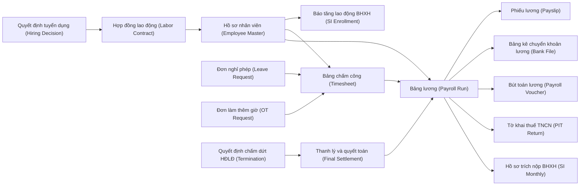
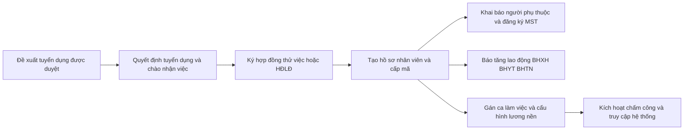
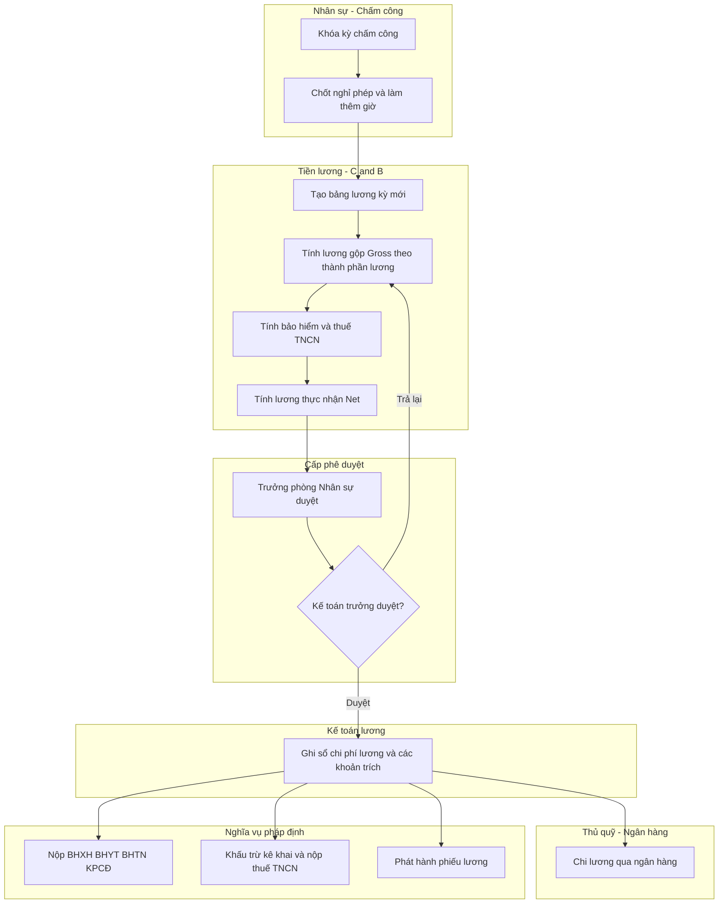
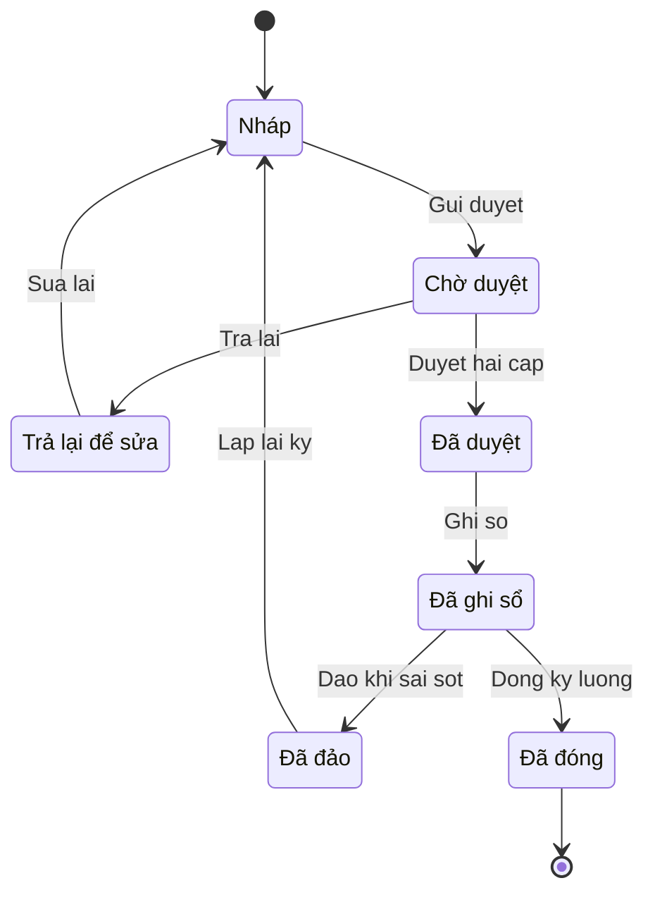
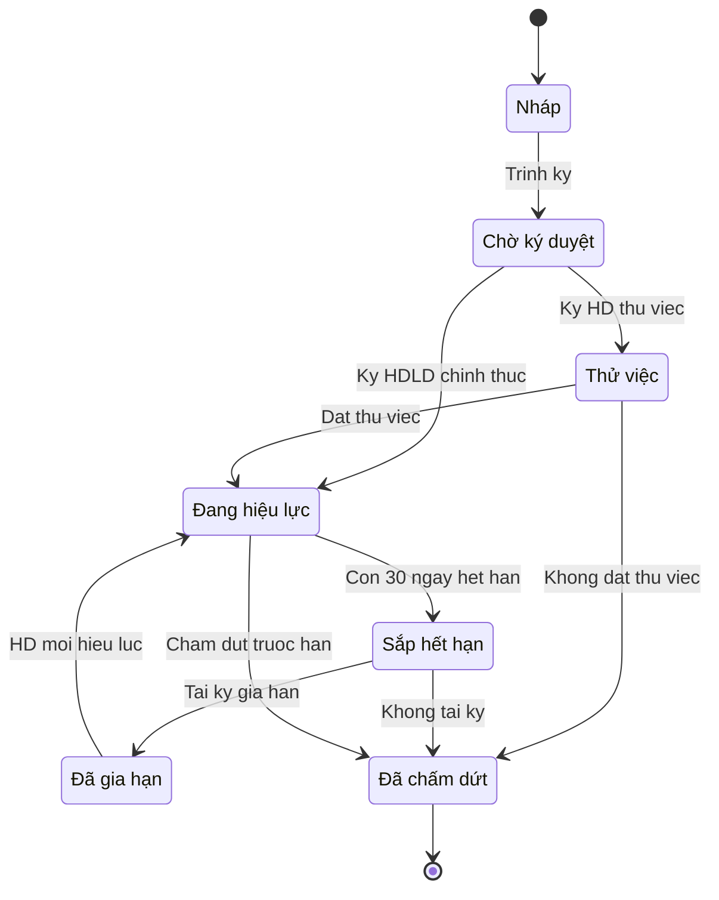

# HR & PAY — Quy trình Nhân sự & Tiền lương (Hire-to-Retire / HR & Payroll)

> **Phạm vi:** Toàn bộ chu trình nhân sự – tiền lương từ cơ cấu tổ chức & vị trí → hồ sơ nhân viên → vòng đời hợp đồng lao động → tiếp nhận (onboarding) / nghỉ việc (offboarding) → chấm công (máy/app, ca, làm thêm giờ, nghỉ phép) → thiết lập lương (thành phần lương, phụ cấp chịu/không chịu thuế, công thức) → tính lương (gross→net: bảo hiểm, kinh phí/đoàn phí công đoàn, khấu trừ thuế TNCN, tạm ứng & khấu trừ) → duyệt & phiếu lương → chi lương qua ngân hàng → hạch toán → kê khai pháp định (bảo hiểm, thuế TNCN tháng/quý và quyết toán năm) → tham số theo ngày hiệu lực.
> **Module liên quan:** **HR** (Nhân sự) và **PAY** (Tiền lương) là module chủ; tích hợp GL (Sổ cái), CB (Tiền mặt/Ngân hàng), COST (Giá thành), MFG (Sản xuất), PRJ (Dự án), BUD (Ngân sách), TAX (Thuế TNCN/chứng từ điện tử), AP (nếu chi trả qua bên thứ ba).
> **Chuẩn tham chiếu:** SAP SuccessFactors (Employee Central, Employee Central Payroll – ECP, Time Tracking) & SAP ERP HCM (PA/OM/PT/PY) [5]; Oracle Fusion Cloud HCM (Global Human Resources, Global Payroll, Time and Labor – OTL, Absence Management) [6]; Odoo (Employees, Payroll, Time Off, Attendances, Recruitment) [7]; Microsoft Dynamics 365 Human Resources (core HR; tính lương bản địa VN thường qua đối tác/ISV) [8]. Chế độ kế toán doanh nghiệp Việt Nam **Thông tư 99/2025/TT-BTC** (hiệu lực 01/01/2026, thay thế Thông tư 200/2014/TT-BTC); DNNVV được chọn **Thông tư 133/2016/TT-BTC** [2].
>
> **Cập nhật đến: 2026-10-20 — quy định thay đổi thường xuyên; BA phải kiểm tra lại hiệu lực khi dùng cho dự án.** Mọi tỷ lệ, ngưỡng, mức lương/thuế là **tham số có ngày hiệu lực** (effective-dated), không hard-code. Toàn bộ căn cứ pháp lý & tỷ lệ chi tiết: xem `references/regulations/vn-labor-payroll.md` [1] — file này KHÔNG lặp lại luật mà mô tả **quy trình & cách thiết kế chức năng**.

## Mục lục
- [1. Mục đích & phạm vi](#1-mục-đích--phạm-vi-trongngoài-phạm-vi)
- [2. Vai trò tham gia](#2-vai-trò-tham-gia)
- [3. Danh mục (master data) tiên quyết](#3-danh-mục-master-data-tiên-quyết)
- [4. Chứng từ & luồng chứng từ](#4-chứng-từ--luồng-chứng-từ-document-flow)
- [5. Các bước quy trình chuẩn](#5-các-bước-quy-trình-chuẩn)
- [6. Vòng đời trạng thái chứng từ chính](#6-vòng-đời-trạng-thái-chứng-từ-chính)
- [7. Quy tắc nghiệp vụ & kiểm tra (validation)](#7-quy-tắc-nghiệp-vụ--kiểm-tra-validation-điển-hình)
- [8. Hạch toán kế toán](#8-hạch-toán-kế-toán)
- [9. Tham số hệ thống điển hình](#9-tham-số-hệ-thống-điển-hình)
- [10. Kiểm soát nội bộ & phân quyền](#10-kiểm-soát-nội-bộ--phân-quyền-sod-hạn-mức-duyệt-audit)
- [11. Báo cáo chuẩn](#11-báo-cáo-chuẩn)
- [12. Tích hợp với module khác](#12-tích-hợp-với-module-khác)
- [13. Biến thể & ngoại lệ](#13-biến-thể--ngoại-lệ)
- [14. Lỗi BA hay mắc & câu hỏi khảo sát](#14-lỗi-ba-hay-mắc--câu-hỏi-cần-hỏi-khách-hàng)
- [15. Nguồn tham khảo](#15-nguồn-tham-khảo)

---

## 1. Mục đích & phạm vi (trong/ngoài phạm vi)

**Mục đích:** Chuẩn hóa chu trình nhân sự – tiền lương để (a) mọi nhân viên có hồ sơ, hợp đồng lao động (Labor Contract) và vị trí (Position) hợp lệ trước khi được tính lương; (b) dữ liệu chấm công được khóa và đối soát trước khi chạy lương; (c) tiền lương gross→net được tính đúng theo thành phần lương, bảo hiểm bắt buộc, thuế thu nhập cá nhân (Personal Income Tax – PIT/TNCN) và các khoản khấu trừ; (d) chỉ sinh bút toán và chi tiền khi bảng lương đã được duyệt; (e) nghĩa vụ pháp định (bảo hiểm xã hội, kinh phí công đoàn, thuế TNCN) được kê khai và nộp đúng hạn; (f) toàn bộ tỷ lệ/ngưỡng là tham số có ngày hiệu lực để tính lại (retro) chính xác kỳ cũ.

**Trong phạm vi:**
- Cơ cấu tổ chức (Organization/Org Unit) & vị trí/chức danh (Position/Job); ngạch–bậc lương (Pay Grade/Step).
- Hồ sơ nhân viên (Employee Master) & người phụ thuộc (Dependent).
- Vòng đời hợp đồng lao động: thử việc (Probation) → chính thức → điều chuyển/tăng lương → tái ký/gia hạn → chấm dứt (Termination).
- Tiếp nhận (Onboarding) & nghỉ việc (Offboarding), gồm thanh lý & quyết toán cuối cùng (final settlement).
- Chấm công: máy chấm công/app (time device/app), ca–lịch làm việc (shift/work schedule), đăng ký & duyệt làm thêm giờ (Overtime – OT), đơn & duyệt nghỉ phép (Leave/Absence Request).
- Thiết lập lương: thành phần lương (pay elements/wage types), phụ cấp chịu/không chịu thuế, khoản tính/không tính đóng bảo hiểm, công thức tính.
- Chạy lương (Payroll Run) gross→net: trích bảo hiểm (BHXH/BHYT/BHTN), kinh phí công đoàn (KPCĐ) & đoàn phí, khấu trừ thuế TNCN, tạm ứng & khấu trừ khác.
- Duyệt bảng lương, phát hành phiếu lương (Payslip), chi lương qua ngân hàng (bank payment file).
- Hạch toán chi phí lương & các khoản trích; kê khai pháp định: hồ sơ báo tăng/giảm & trích nộp bảo hiểm, tờ khai thuế TNCN tháng/quý và quyết toán năm, chứng từ khấu trừ thuế TNCN điện tử.
- Lương tháng 13, thưởng; tính lại (backpay/retro) khi thay đổi lương tối thiểu vùng, tăng lương hồi tố.

**Ngoài phạm vi (xem file khác):**
- Căn cứ pháp lý, tỷ lệ, ngưỡng, mức lương tối thiểu, biểu thuế, giảm trừ gia cảnh → `references/regulations/vn-labor-payroll.md` [1] (file này chỉ **tham chiếu**, không lặp lại).
- Chế độ kế toán & hệ thống tài khoản chi tiết → `references/regulations/vn-accounting.md` [2].
- Phát hành chứng từ khấu trừ thuế TNCN điện tử & hệ thống hóa đơn/chứng từ điện tử, kê khai thuế → `references/processes/tax-einvoice.md`, `references/regulations/vn-tax-einvoice.md` [3].
- Thực hiện chi tiền tại ngân hàng/quỹ, đối chiếu sao kê → `references/processes/cash-bank.md`.
- Ghi sổ cái, khóa sổ kỳ kế toán → `references/processes/r2r-general-ledger.md`.
- Kết chuyển chi phí nhân công vào giá thành/lệnh sản xuất/dự án → `references/processes/costing.md`, `references/processes/manufacturing-mrp.md`, `references/processes/project-management.md`.
- Lập & kiểm soát ngân sách quỹ lương → `references/processes/budgeting.md`.
- Tuyển dụng chi tiết (ATS/recruitment pipeline), đào tạo (LMS), đánh giá năng lực (performance) — ngoài phạm vi; chỉ nêu điểm kết nối (onboarding nhận đầu ra từ tuyển dụng).
- Thiết kế tham số theo ngày hiệu lực & ma trận phân quyền tổng → `references/security-and-parameters.md`.

---

## 2. Vai trò tham gia

| Vai trò | Trách nhiệm | Quyền điển hình (theo hành động chuẩn) |
|---|---|---|
| Nhân viên (Employee / Self-service) — `ROLE-HR-EMP` | Chấm công, nộp đơn nghỉ phép/làm thêm giờ, khai người phụ thuộc, xem/tải phiếu lương của mình | Xem (của mình), Tạo (đơn nghỉ/OT/khai NPT), Sửa (đơn nháp), Gửi duyệt, In, Xuất file (phiếu lương) |
| Quản lý trực tiếp / Trưởng bộ phận (Line Manager) — `ROLE-HR-MGR` | Duyệt nghỉ phép/OT của nhân viên dưới quyền, xác nhận công, đề xuất điều chuyển/tăng lương | Xem (phòng ban), Duyệt, Từ chối, Trả lại, Tạo (đề xuất) |
| Nhân viên Nhân sự (HR Staff / HR Admin) — `ROLE-HR-STAFF` | Lập/cập nhật hồ sơ, hợp đồng, quyết định nhân sự; quản lý ca & máy chấm công; làm hồ sơ báo tăng/giảm bảo hiểm | Xem, Tạo, Sửa, Xóa (chứng từ nháp), Gửi duyệt, In, Xuất file, Nhập file |
| Nhân viên Tiền lương – C&B (Payroll/C&B Staff) — `ROLE-PAY-STAFF` | Thiết lập thành phần lương, chạy bảng lương, tính bảo hiểm & thuế TNCN, lập bảng kê chuyển khoản | Xem, Tạo (bảng lương), Sửa (nháp), Gửi duyệt, In, Xuất file, Cấu hình (thành phần lương) |
| Trưởng phòng Nhân sự (HR Manager) — `ROLE-HR-HRM` | Duyệt cấp 1 bảng lương, duyệt quyết định nhân sự, duyệt quỹ phép & chính sách | Xem (công ty), Duyệt, Từ chối, Trả lại, Cấu hình (chính sách HR) |
| Kế toán tiền lương (Payroll Accountant) — `ROLE-PAY-ACC` | Ghi sổ chi phí lương & các khoản trích, đối chiếu bảng lương với sổ cái, lập bút toán đảo | Xem, Ghi sổ, Bỏ ghi sổ, Đảo, In, Xuất file |
| Kế toán trưởng (Chief Accountant) — `ROLE-PAY-CA` | Duyệt cấp 2 bảng lương, kiểm soát hạch toán & nghĩa vụ nộp, khóa kỳ lương | Xem, Duyệt, Từ chối, Trả lại, Bỏ ghi sổ, Đảo, Đóng, Cấu hình (tài khoản) |
| Giám đốc (Director) — `ROLE-HR-DIR` | Duyệt quỹ lương/thưởng & bảng lương vượt hạn mức, duyệt bổ nhiệm cấp cao | Xem, Duyệt (hạn mức cao), Từ chối |
| Thủ quỹ / Kế toán thanh toán (Cashier / Payment Accountant) — `ROLE-PAY-PAY` | Thực hiện chi lương (chuyển khoản/tiền mặt), tạo & gửi file ngân hàng | Xem, Tạo (chứng từ chi), Ghi sổ (chi), In, Xuất file |
| Quản trị hệ thống (System Admin) — `ROLE-HR-ADMIN` | Cấu hình tham số, tỷ lệ, biểu thuế, phân quyền, tích hợp máy chấm công | Xem, Cấu hình, Nhập file |

> **SoD bắt buộc (xem §10):** người **lập/sửa hồ sơ & tài khoản ngân hàng nhân viên**, người **chạy & trình bảng lương**, người **duyệt bảng lương**, người **ghi sổ**, người **chi tiền** phải là các cá nhân khác nhau. **Xóa** chỉ áp dụng chứng từ Nháp; **Bỏ ghi sổ/Đảo** chỉ kế toán có quyền và phải lưu vết (audit trail). Dữ liệu lương là dữ liệu nhạy cảm — hạn chế xem theo phạm vi (của mình / phòng ban / công ty).

---

## 3. Danh mục (master data) tiên quyết

| Danh mục | Trường quan trọng | Quy tắc chính |
|---|---|---|
| Cơ cấu tổ chức (Organization / Org Unit) — `MD-ORGUNIT` | Mã đơn vị, tên, đơn vị cha, loại (công ty/chi nhánh/phòng/tổ), **vùng lương tối thiểu** của địa bàn, trung tâm chi phí mặc định | Cây phân cấp không vòng lặp; mỗi đơn vị gán **1 vùng** (I/II/III/IV) để áp lương tối thiểu & trần BHTN; có ngày hiệu lực khi tái cơ cấu |
| Vị trí & chức danh (Position / Job) — `MD-POSITION` | Mã vị trí, chức danh, đơn vị, ngạch–bậc, định biên (headcount), người quản lý trực tiếp, nhóm chức danh (quyết định thời gian thử việc) | 1 vị trí thuộc 1 đơn vị; định biên kiểm soát số người; nhóm chức danh ánh xạ thời gian thử việc tối đa (xem §9 PRM-HR-001) |
| Hồ sơ nhân viên (Employee Master) — `MD-EMPLOYEE` | Mã NV, họ tên, ngày sinh, giới tính, CCCD, **mã số thuế (MST) cá nhân**, mã số BHXH, địa chỉ, tình trạng cư trú (cư trú/không cư trú), vị trí, đơn vị, ngày vào/ra, tài khoản ngân hàng, tình trạng (thử việc/chính thức/nghỉ việc) | MST & mã BHXH duy nhất/không trùng; tài khoản ngân hàng trùng tên chủ tài khoản = tên NV; thay đổi tài khoản ngân hàng phải duyệt & lưu vết; trạng thái điều khiển việc đưa vào bảng lương |
| Người phụ thuộc (Dependent) — `MD-DEPENDENT` | Mã NV, họ tên NPT, quan hệ, MST NPT, thời gian được tính giảm trừ (từ–đến) | Mỗi NPT có MST; **một NPT chỉ được tính giảm trừ cho một người nộp thuế** (chống trùng); giảm trừ theo tháng phát sinh nghĩa vụ nuôi dưỡng |
| Loại hợp đồng lao động (Contract Type) — `MD-CONTRACT-TYPE` | Mã, tên (không xác định thời hạn / xác định thời hạn ≤36 tháng / thử việc / dịch vụ), có thuộc đối tượng đóng BHXH không | Chỉ 2 loại HĐLĐ chính thức; đếm số lần gia hạn loại xác định thời hạn (tối đa 2 lần, xem §7-BR-HR-02) |
| Ca & lịch làm việc (Shift / Work Schedule) — `MD-SHIFT` | Mã ca, giờ vào–ra, giờ nghỉ giữa ca, ca ngày/đêm (22:00–06:00), ngày làm việc trong tuần, dung sai muộn/sớm | Ca đêm gắn hệ số phụ trội; lịch quy định ngày công chuẩn; hỗ trợ ca xoay/ca gãy |
| Loại nghỉ phép (Leave / Absence Type) — `MD-LEAVE-TYPE` | Mã, tên (phép năm, nghỉ không lương, ốm, thai sản, việc riêng hưởng lương, nghỉ bù OT…), hưởng lương (có/không/do BHXH chi), đơn vị tính (ngày/giờ/buổi), có trừ quỹ phép không | Phép năm trừ quỹ phép; ốm đau/thai sản gắn chế độ BHXH; nghỉ không lương giảm công tính lương |
| Thành phần lương (Pay Element / Wage Type) — `MD-PAY-ELEMENT` | Mã, tên, loại (thu nhập/khấu trừ), cờ **tính đóng BH**, cờ **chịu thuế TNCN** (và mức miễn nếu có), cách tính (cố định/theo công/theo công thức), thứ tự tính | Phân biệt rõ 3 nhóm đóng BH (lương + phụ cấp lương + bổ sung xác định được) với khoản không đóng; cờ chịu thuế điều khiển thu nhập chịu thuế (xem §7) |
| Ngạch – bậc lương (Pay Grade / Step) — `MD-GRADE` | Mã ngạch, bậc, mức lương/hệ số, thời gian nâng bậc | Dùng để đề xuất lương theo vị trí; có ngày hiệu lực |
| Máy chấm công / thiết bị (Time Device) — `MD-TIMEDEVICE` | Mã thiết bị, loại (vân tay/khuôn mặt/thẻ/app GPS), đơn vị, trạng thái kết nối | Ánh xạ mã chấm công ↔ mã NV; log thô là nguồn dữ liệu công (xem §12) |
| Tài khoản sổ cái & trung tâm chi phí (GL Account / Cost Center) — `MD-GL-ACCOUNT` | Số hiệu & tên TK theo TT 99/2025 (334, 338x, 3335, 622/627/641/642…), cost center, nguồn ngân sách | Lấy từ GL; ánh xạ thành phần lương & bộ phận → tài khoản chi phí (xem §8); mã tiểu khoản BHTN theo COA khách hàng (3386 TT 99) |

---

## 4. Chứng từ & luồng chứng từ (document flow)

| Chứng từ (VI / EN) | Mục đích | Tạo từ | Sinh ra | Ảnh hưởng (kho / công nợ / sổ cái) |
|---|---|---|---|---|
| Quyết định tuyển dụng/bổ nhiệm (Hiring/Appointment Decision) | Chính thức hóa việc nhận/bổ nhiệm | Kết quả tuyển dụng | HĐLĐ, hồ sơ NV | Không ghi sổ |
| Hợp đồng lao động (Labor Contract – HĐLĐ) | Thiết lập quan hệ lao động, lương, thời hạn | Quyết định tuyển dụng | Hồ sơ NV, báo tăng BHXH | Không ghi sổ; làm căn cứ lương & đóng BH |
| Hồ sơ nhân viên (Employee Record) | Lưu dữ liệu nhân sự & lương nền | HĐLĐ | Bảng lương, hồ sơ BHXH | Không ghi sổ |
| Quyết định điều chuyển / tăng lương (Transfer / Pay Change Decision) | Thay đổi vị trí/lương có ngày hiệu lực | Đề xuất của quản lý | Cập nhật lương nền, điều chỉnh BHXH | Không ghi sổ; có thể phát sinh truy lĩnh (retro) |
| Bảng chấm công (Timesheet / Attendance) | Tổng hợp công, giờ OT, nghỉ phép theo kỳ | Log máy chấm công/app + đơn nghỉ/OT | Bảng lương | Không ghi sổ; khóa kỳ trước khi chạy lương |
| Đơn nghỉ phép (Leave Request) | Xin nghỉ có/không hưởng lương | Nhân viên | Cập nhật chấm công & quỹ phép | Không ghi sổ |
| Đơn đăng ký làm thêm giờ (Overtime Request) | Đăng ký & duyệt OT trước/sau | Nhân viên/quản lý | Cập nhật giờ OT vào chấm công | Không ghi sổ; kiểm soát trần OT |
| Bảng lương (Payroll Run / Payroll Register) | Tính gross→net toàn kỳ | Chấm công + hồ sơ NV + thành phần lương | Phiếu lương, bảng kê ngân hàng, bút toán, hồ sơ BHXH, tờ khai TNCN | **Sổ cái:** khi ghi sổ → chi phí lương & các khoản trích (xem §8) |
| Phiếu lương (Payslip) | Thông báo chi tiết lương cho NLĐ | Bảng lương | — | Không ghi sổ; bắt buộc cung cấp cho NLĐ (bảng kê trả lương) |
| Bảng kê chuyển khoản lương (Bank Payment File) | Chi lương qua ngân hàng | Bảng lương đã duyệt | Chứng từ chi (CB) | **Sổ cái:** Nợ 334 / Có 112 (ở CB) |
| Hồ sơ báo tăng/giảm & trích nộp BHXH (SI Declaration) | Điều chỉnh lao động & nộp bảo hiểm | Biến động nhân sự + bảng lương | Chứng từ nộp BHXH | **Sổ cái:** nộp → Nợ 338x / Có 112 |
| Tờ khai thuế TNCN tháng/quý (PIT Return 05/KK-TNCN) | Kê khai khấu trừ TNCN | Bảng lương | Chứng từ nộp thuế | **Sổ cái:** nộp → Nợ 3335 / Có 112 |
| Chứng từ khấu trừ thuế TNCN điện tử (e-Withholding Certificate) | Xác nhận số thuế đã khấu trừ cho NLĐ | Bảng lương/kỳ khấu trừ | — | Không ghi sổ; phát hành điện tử, gửi cơ quan thuế (xem [3]) |
| Tờ khai quyết toán TNCN năm (Annual Finalization 05/QTT-TNCN) | Quyết toán thuế năm (DN quyết toán thay) | Dữ liệu lương cả năm | Nộp thừa/thiếu thuế | **Sổ cái:** điều chỉnh 3335 |
| Quyết định chấm dứt HĐLĐ (Termination Decision) | Kết thúc quan hệ lao động | Đơn/quyết định | Thanh lý, báo giảm BHXH | Không ghi sổ trực tiếp |
| Bảng thanh lý & quyết toán cuối cùng (Final Settlement) | Tính lương cuối, phép chưa nghỉ, trợ cấp thôi việc | Quyết định chấm dứt + bảng lương | Chi trả cuối cùng | **Sổ cái:** chi phí trợ cấp (641/642) & chi trả |
| Bút toán lương (Payroll Accounting Voucher) | Ghi nhận chi phí lương & trích theo lương | Bảng lương đã duyệt | — | **Sổ cái:** theo §8 |



---

## 5. Các bước quy trình chuẩn

### 5.1 Vòng đời nhân sự (Hire-to-Retire) — các bước chính

| # | Bước | Vai trò | Chứng từ | Hành động hệ thống | Trạng thái sau bước |
|---|---|---|---|---|---|
| 1 | Lập quyết định tuyển dụng & chào nhận việc | HR Staff | Quyết định tuyển dụng | Nhận dữ liệu ứng viên từ tuyển dụng; sinh mã NV dự kiến | Nháp |
| 2 | Ký HĐ thử việc hoặc HĐLĐ | HR Staff + NLĐ | HĐLĐ | Ghi loại HĐ, thời hạn, lương; đếm số lần gia hạn | HĐ `APPROVED` / hiệu lực |
| 3 | Tạo hồ sơ nhân viên, cấp mã, gán vị trí & lương nền | HR Staff | Hồ sơ NV | Kiểm định biên vị trí; gán ca; cấu hình thành phần lương | Hồ sơ hoạt động |
| 4 | Khai người phụ thuộc & đăng ký MST | NLĐ + HR Staff | Khai NPT | Kiểm tra MST; chống trùng NPT | NPT được duyệt |
| 5 | Báo tăng lao động & đăng ký BHXH/BHYT/BHTN | HR Staff | Hồ sơ báo tăng | Kết xuất hồ sơ theo mẫu BHXH | Đã nộp cơ quan BHXH |
| 6 | Kích hoạt chấm công & tài khoản tự phục vụ | System Admin | — | Ánh xạ mã chấm công ↔ NV; cấp quyền self-service | NV sẵn sàng tính lương |
| 7 | Chấm công hằng ngày, nộp đơn nghỉ/OT | NLĐ + Line Manager | Chấm công, đơn nghỉ/OT | Thu log máy/app; duyệt nghỉ/OT; kiểm trần OT | Dữ liệu công tích lũy |
| 8 | Điều chuyển / tăng lương (khi phát sinh) | Line Manager + HR Manager | Quyết định điều chuyển | Cập nhật lương nền có ngày hiệu lực; tính truy lĩnh nếu hồi tố | Lương nền mới hiệu lực |
| 9 | Chốt & chấm dứt HĐLĐ (khi nghỉ việc) | HR Staff + HR Manager | Quyết định chấm dứt | Tính phép tồn, trợ cấp thôi việc; báo giảm BHXH; chốt chấm công | Chờ quyết toán cuối |

### 5.2 Chu trình tính lương tháng (monthly payroll run) — các bước chi tiết

| # | Bước | Vai trò | Chứng từ | Hành động hệ thống | Trạng thái sau bước |
|---|---|---|---|---|---|
| 1 | Khóa kỳ chấm công, chốt nghỉ phép & OT | HR Staff | Bảng chấm công | Khóa dữ liệu công; chặn sửa đơn sau khóa | Chấm công đã khóa |
| 2 | Tạo bảng lương kỳ mới | Payroll Staff | Bảng lương | Lấy danh sách NV đang hoạt động + lương nền + thành phần lương | Bảng lương `DRAFT` |
| 3 | Tính thu nhập gộp (Gross) theo thành phần lương & OT | Payroll Staff | Bảng lương | Áp công thức theo công, phụ cấp, OT, thưởng | Gross đã tính |
| 4 | Xác định tiền lương đóng bảo hiểm & trích BH | Payroll Staff | Bảng lương | Tính SI base, áp trần/sàn theo quỹ; trích BH 2 bên | BH đã tính |
| 5 | Tính thu nhập chịu/tính thuế & khấu trừ TNCN | Payroll Staff | Bảng lương | Trừ khoản miễn, BH, giảm trừ gia cảnh; áp biểu lũy tiến | TNCN đã tính |
| 6 | Tính lương thực nhận (Net) & khấu trừ khác | Payroll Staff | Bảng lương | Trừ tạm ứng, đoàn phí, khấu trừ theo quyết định | Net đã tính |
| 7 | Trình duyệt bảng lương | Payroll Staff | Bảng lương | Kiểm tra validation; khóa sửa; định tuyến duyệt | `PENDING` |
| 8 | Duyệt cấp 1 (Trưởng phòng NS) & cấp 2 (Kế toán trưởng) | HR Manager → Chief Accountant | Bảng lương | Đối chiếu tổng số; duyệt hoặc trả lại | `APPROVED` / `RETURNED` |
| 9 | Ghi sổ chi phí lương & các khoản trích | Payroll Accountant | Bút toán lương | Sinh bút toán theo §8; phân bổ theo bộ phận/cost center | `POSTED` |
| 10 | Phát hành phiếu lương & bảng kê chuyển khoản | Payroll Staff | Phiếu lương, bảng kê NH | Gửi phiếu lương (self-service/email); tạo file ngân hàng | Phiếu lương phát hành |
| 11 | Chi lương qua ngân hàng | Cashier | Chứng từ chi | Chuyển khoản; ghi Nợ 334 / Có 112 (ở CB) | Đã chi lương |
| 12 | Trích nộp BHXH/BHYT/BHTN/KPCĐ | Payroll Accountant | Hồ sơ BHXH | Kết xuất hồ sơ & nộp; ghi Nợ 338x / Có 112 | Đã nộp bảo hiểm |
| 13 | Khấu trừ, kê khai & nộp thuế TNCN; phát hành chứng từ khấu trừ điện tử | Payroll Accountant | 05/KK-TNCN, chứng từ KT | Lập tờ khai; nộp thuế; phát hành chứng từ điện tử | Đã kê khai & nộp |
| 14 | Đóng kỳ lương | Chief Accountant | Bảng lương | Chốt kỳ; chặn sửa; mở kỳ kế tiếp | `CLOSED` |





---

## 6. Vòng đời trạng thái chứng từ chính

### 6.1 Bảng lương (Payroll Run) — chứng từ chính

Thống nhất bộ trạng thái chuẩn với `references/regulations/vn-labor-payroll.md` §8.2 [1].



| Từ | Hành động | Đến | Vai trò | Điều kiện |
|---|---|---|---|---|
| DRAFT | Gửi duyệt | PENDING | Payroll Staff | Kỳ chấm công đã khóa; không còn cảnh báo thiếu dữ liệu (NV chưa có lương nền, MST, tài khoản NH) |
| PENDING | Duyệt cấp 1 | PENDING | HR Manager | Tổng công & số người khớp danh sách; OT trong trần |
| PENDING | Duyệt cấp 2 | APPROVED | Chief Accountant | Tổng Gross/BH/TNCN/Net đối chiếu khớp; quỹ lương trong ngân sách |
| PENDING | Trả lại | RETURNED | HR Manager / Chief Accountant | Phát hiện sai lệch; ghi lý do bắt buộc |
| RETURNED | Sửa & gửi lại | PENDING | Payroll Staff | Đã xử lý lý do trả lại |
| APPROVED | Ghi sổ | POSTED | Payroll Accountant | Kỳ kế toán đang mở; tài khoản ánh xạ đầy đủ |
| POSTED | Chi lương (hành động) | POSTED | Cashier | Đã sinh bảng kê chuyển khoản; không đổi trạng thái bảng lương |
| POSTED | Đảo | REVERSED | Chief Accountant | Phát hiện sai sau ghi sổ; kỳ còn mở; sinh bút toán đảo |
| REVERSED | Lập lại kỳ | DRAFT | Payroll Staff | Tạo lại bảng lương sau khi đảo |
| POSTED | Đóng kỳ | CLOSED | Chief Accountant | Đã chi lương, nộp BH & thuế; chốt kỳ, chặn sửa |

> **Đơn nghỉ phép / Đơn OT** dùng vòng đời duyệt chuẩn rút gọn: DRAFT → PENDING → APPROVED/REJECTED/RETURNED → (COMPLETED khi đã phản ánh vào chấm công) → có thể CANCELLED trước khi phản ánh. Chỉ đơn ở APPROVED mới tác động chấm công & lương.

### 6.2 Hợp đồng lao động (Labor Contract) — vòng đời quản lý (HR lifecycle state, không phải trạng thái ghi sổ)



> Các trạng thái PROBATION/ACTIVE/EXPIRING/RENEWED là **trạng thái vòng đời HR** của hợp đồng (biến thể nhà cung cấp: SAP – Contract Elements/Infotype 0016; Oracle – Employment/Assignment status). Hệ thống phải cảnh báo tự động khi chuyển sang EXPIRING (tham số số ngày báo trước) và khi ký loại xác định thời hạn lần thứ 3.

---

## 7. Quy tắc nghiệp vụ & kiểm tra (validation) điển hình

Ký hiệu ID minh họa (reference-level): `BR-PAY-nn`, `BR-HR-nn`. Mọi tỷ lệ/ngưỡng là tham số có ngày hiệu lực; **căn cứ pháp lý & giá trị số: xem `references/regulations/vn-labor-payroll.md` [1]** — dưới đây là quy tắc tính và kiểm tra ở mức thiết kế.

**Nhóm hợp đồng & nhân sự**
1. **BR-HR-01 — Lương thử việc:** Hệ thống PHẢI kiểm tra lương thử việc ≥ 85% lương của công việc tương ứng. *Lý do:* sàn luật định; tránh trả thấp trái luật. [1 §2.2]
2. **BR-HR-02 — Giới hạn gia hạn HĐ:** Hệ thống PHẢI đếm số lần ký HĐ xác định thời hạn liên tiếp và cảnh báo/chặn khi tạo HĐ xác định thời hạn **lần thứ 3** cho cùng NLĐ (trừ ngoại lệ theo luật). *Lý do:* lần 3 phải là HĐ không xác định thời hạn. [1 §2.1]
3. **BR-HR-03 — Lương không dưới tối thiểu vùng:** Lương theo công việc trong HĐLĐ KHÔNG ĐƯỢC thấp hơn mức lương tối thiểu vùng của địa bàn đơn vị. *Lý do:* sàn lương luật định. [1 §4.1]
4. **BR-HR-04 — Đối tượng đóng BHXH bắt buộc:** Hệ thống PHẢI xác định đúng đối tượng đóng (HĐLĐ ≥ 1 tháng theo Luật BHXH 2024); loại thử việc thuần (không ghi trong HĐLĐ) khỏi đối tượng đóng. *Lý do:* tránh đóng/khỏi đóng sai. [1 §2.2, §5]
5. **BR-HR-05 — Quỹ phép năm:** Quỹ phép = mức cơ bản theo loại công việc (12/14/16 ngày) + 1 ngày cho mỗi 5 năm thâm niên tại cùng NSDLĐ; người làm chưa đủ 12 tháng tính **theo tỷ lệ** số tháng. *Lý do:* tính đúng phép hưởng lương & chi trả phép tồn khi nghỉ. [1 §3.4]

**Nhóm chấm công & làm thêm giờ**
6. **BR-PAY-01 — Khóa chấm công trước khi chạy lương:** Hệ thống KHÔNG ĐƯỢC cho chạy bảng lương kỳ nếu kỳ chấm công tương ứng chưa khóa. *Lý do:* chống tính trên dữ liệu công còn thay đổi.
7. **BR-PAY-02 — Đơn giá giờ/ngày:** Đơn giá giờ = (lương tháng + phụ cấp tính OT) ÷ (số ngày công chuẩn × số giờ chuẩn/ngày). Số ngày công chuẩn theo tham số (cố định 26 hoặc theo lịch tháng). *Lý do:* cơ sở tính OT, lương ngày lễ, trừ nghỉ không lương.
8. **BR-PAY-03 — Hệ số & trần làm thêm giờ:** Tiền OT = Σ(số giờ OT loại k × đơn giá giờ × hệ số k), hệ số **tối thiểu** 150% (ngày thường), 200% (ngày nghỉ tuần), 300% (lễ/tết); làm đêm +30%; làm thêm vào ban đêm cộng thêm 20% của đơn giá ngày tương ứng. Hệ thống PHẢI cảnh báo khi OT vượt 40 giờ/tháng hoặc 200 (300) giờ/năm. *Lý do:* trả đúng tối thiểu luật & kiểm soát trần. [1 §3.1-3.2]

**Nhóm tính lương gross→net (code-ready)**
9. **BR-PAY-04 — Công thức Net tổng quát:**
   ```
   Gross            = Σ thành phần thu nhập (lương theo công + phụ cấp + bổ sung + OT + thưởng + khác)
   SI_base          = min( max( Σ(thành phần có cờ "đóng BH"), sàn ), trần_theo_quỹ )
   BH_NLĐ           = BHXH 8%×SI_base_BHXH + BHYT 1,5%×SI_base_BHYT + BHTN 1%×SI_base_BHTN   (≈ 10,5%)
   Đoàn_phí         = 1% × căn cứ (nếu là đoàn viên; có trần)
   Thu_nhập_chịu_thuế = Σ thành phần có cờ "chịu thuế" − các khoản miễn thuế trong định mức
   Thu_nhập_tính_thuế = Thu_nhập_chịu_thuế − BH_NLĐ − giảm_trừ_bản_thân − giảm_trừ_NPT×số_NPT − đóng_góp_được_trừ
   TNCN             = tra biểu lũy tiến từng phần (hoặc 10% với thu nhập vãng lai ≥ ngưỡng)
   Net              = Gross − BH_NLĐ − Đoàn_phí − TNCN − tạm_ứng − khấu_trừ_khác
   ```
10. **BR-PAY-05 — Trần/sàn theo từng quỹ (lỗi cấu hình phổ biến):** BHXH & BHYT áp trần = 20 × mức tham chiếu; BHTN áp trần = 20 × lương tối thiểu vùng; sàn = lương tối thiểu vùng. Hệ thống PHẢI áp trần **riêng theo từng quỹ**, không dùng một trần chung. *Lý do:* BHTN và BHXH có trần khác nhau. [1 §5.2]
11. **BR-PAY-06 — Cờ đóng BH & chịu thuế trên từng thành phần:** Mỗi thành phần lương PHẢI có cờ `tính đóng BH` và `chịu thuế TNCN` độc lập; tiền lương đóng BH = lương + phụ cấp lương + các khoản bổ sung **xác định được**; các khoản như ăn ca, xăng xe, điện thoại, chuyên cần biến động theo cấu hình không tính đóng. *Lý do:* xác định đúng căn cứ đóng & thu nhập chịu thuế. [1 §4.3, §5.2]
12. **BR-PAY-07 — Khoản miễn thuế trong định mức:** Phần phụ trội OT/làm đêm (phần vượt đơn giá giờ bình thường), ăn ca trong mức trần, trang phục bằng tiền ≤ mức trần/năm KHÔNG tính vào thu nhập chịu thuế; phần vượt tính thuế. *Lý do:* tính đúng thu nhập chịu thuế. [1 §6.1]
13. **BR-PAY-08 — Biểu thuế lũy tiến (bảng tính rút gọn, suy ra từ biểu 5 bậc áp dụng từ kỳ 2026):**

    | Bậc | Thu nhập tính thuế/tháng (triệu) | Thuế suất | Tính nhanh: TNCN = |
    |---|---|---|---|
    | 1 | đến 10 | 5% | 5% × TNTT |
    | 2 | trên 10 đến 30 | 10% | 10% × TNTT − 0,5 tr |
    | 3 | trên 30 đến 60 | 20% | 20% × TNTT − 3,5 tr |
    | 4 | trên 60 đến 100 | 30% | 30% × TNTT − 9,5 tr |
    | 5 | trên 100 | 35% | 35% × TNTT − 14,5 tr |

    *Lý do:* hằng số rút gọn là **số học suy ra** từ biểu lũy tiến; biểu bậc là căn cứ pháp lý. ⚠️ Mốc áp dụng biểu 5 bậc cho khấu trừ hằng tháng trong năm 2026 cần đối chiếu [1 §6.3]; hệ thống PHẢI hỗ trợ song song biểu 7 bậc (kỳ ≤ 2025) và 5 bậc theo ngày hiệu lực.
14. **BR-PAY-09 — Giảm trừ gia cảnh & người phụ thuộc:** Giảm trừ bản thân và mỗi NPT theo tham số kỳ; chỉ tính NPT đã đăng ký, có MST, trong khoảng thời gian được tính; một NPT chỉ giảm trừ cho một người nộp thuế. *Lý do:* chống trùng & tính đúng. [1 §6.2]
15. **BR-PAY-10 — Khấu trừ 10% thu nhập vãng lai:** Với cá nhân cư trú không ký HĐLĐ hoặc ký HĐ < 3 tháng, mỗi lần chi trả ≥ ngưỡng (2.000.000đ) PHẢI khấu trừ 10% trước khi trả, trừ khi có bản cam kết hợp lệ (có MST, chỉ một nguồn thu nhập). *Lý do:* nghĩa vụ khấu trừ tại nguồn. [1 §6.4]
16. **BR-PAY-11 — Phân biệt KPCĐ và đoàn phí:** Kinh phí công đoàn 2% là **chi phí doanh nghiệp** (không trừ vào lương NLĐ); đoàn phí 1% chỉ trừ vào lương của **đoàn viên**. *Lý do:* hạch toán & khấu trừ đúng bản chất. [1 §5.1]

**Nhóm kiểm soát & chi trả**
17. **BR-PAY-12 — Net không âm & tạm ứng:** Tổng khấu trừ (tạm ứng + khoản khác) KHÔNG ĐƯỢC làm Net âm; tạm ứng lương ≤ hạn mức (ví dụ 50% lương tháng); khấu trừ do kỷ luật/bồi thường theo giới hạn luật. *Lý do:* bảo vệ thu nhập tối thiểu của NLĐ & tránh âm quỹ.
18. **BR-PAY-13 — Điều kiện ghi sổ/chi trả:** Chỉ bảng lương `APPROVED` mới được ghi sổ; chỉ bảng lương `POSTED` mới được tạo bảng kê chuyển khoản & chi trả. *Lý do:* kiểm soát nội bộ, chống chi trước duyệt.
19. **BR-PAY-14 — Trợ cấp thôi việc/mất việc:** Thâm niên tính trợ cấp PHẢI **loại trừ** thời gian đã tham gia BHTN; tiền lương tính trợ cấp = bình quân 6 tháng liền kề trước khi chấm dứt; ghi vào chi phí (641/642), không qua quỹ BHXH. *Lý do:* tính đúng, tránh tính trùng BHTN. [1 §2.3]
20. **BR-PAY-15 — Làm tròn:** Quy tắc làm tròn (đến đồng; làm tròn từng khoản BH/thuế rồi cộng, hay cộng rồi làm tròn) PHẢI khai báo trong tham số và áp dụng nhất quán. *Lý do:* chống lệch cộng dồn.
21. **BR-PAY-16 — Tính lại hồi tố (retro):** Khi lương nền/tỷ lệ/mức tối thiểu thay đổi có hiệu lực lùi, hệ thống PHẢI tính lại kỳ bị ảnh hưởng theo **tham số của đúng thời điểm đó** và tạo khoản truy lĩnh/truy thu ở kỳ hiện tại. *Lý do:* chính xác & minh bạch. [1 §4.1]

> **Ví dụ minh họa (kỳ 2026, vùng I):** NLĐ lương HĐ 40tr + phụ cấp tính BH 5tr → SI_base = 45tr (< trần 46,8tr). BH_NLĐ = 10,5% × 45tr = **4,725tr**. Giả sử toàn bộ 45tr chịu thuế, có 1 NPT. Giảm trừ = 15,5 + 6,2 = 21,7tr. Thu nhập tính thuế = 45 − 4,725 − 21,7 = **18,575tr** (bậc 2). TNCN = 10% × 18,575 − 0,5 = **1,3575tr**. Net = 45 − 4,725 − 1,3575 = **38,9175tr** (chưa trừ đoàn phí/tạm ứng nếu có).

---

## 8. Hạch toán kế toán

**Chế độ kế toán áp dụng (xác định tại 2026-10-20): Thông tư 99/2025/TT-BTC** (ban hành 27/10/2025, hiệu lực **01/01/2026**, thay thế Thông tư 200/2014/TT-BTC) [2]. Doanh nghiệp nhỏ và vừa **được chọn** tiếp tục áp dụng **Thông tư 133/2016/TT-BTC** [2]. Tài khoản tiền lương cốt lõi (334, 338, 335, 3335) **giữ mã như TT 200**; khác biệt đáng lưu ý ở **tiểu khoản BHTN** và quyền tự chủ hệ thống tài khoản (xem ghi chú). Chi tiết: `references/regulations/vn-accounting.md` [2], `references/regulations/vn-labor-payroll.md` §7 [1].

| Nghiệp vụ | Nợ | Có | Ghi chú |
|---|---|---|---|
| Tính lương phải trả | 622 / 623 / 627 / 641 / 642 / 241 / 154 | 334 | Phân bổ theo bộ phận sử dụng lao động (SX trực tiếp/máy thi công/SX chung/bán hàng/QLDN/XDCB) |
| Trích trước lương nghỉ phép (nếu trích trước) | 622 / 627 / 641 / 642 | 335 | Provision phép năm; khi NLĐ nghỉ thực tế: Nợ 335 / Có 334 |
| Thưởng chi từ quỹ khen thưởng | 353 (3531) | 334 | Không tính vào chi phí |
| Trích BH + KPCĐ phần NSDLĐ (≈ 23,5%) | 622 / 623 / 627 / 641 / 642 / 154 / 241 | 3383 (17,5%) / 3384 (3%) / 3386 (1%) / 3382 (2%) | Chi phí doanh nghiệp: BHXH 17,5% + BHYT 3% + BHTN 1% + KPCĐ 2% |
| Trừ BH phần NLĐ (10,5%) | 334 | 3383 (8%) / 3384 (1,5%) / 3386 (1%) | Khấu trừ vào lương |
| Trừ đoàn phí công đoàn (đoàn viên) | 334 | 3382 | Đoàn phí 1%; chỉ với đoàn viên |
| Khấu trừ thuế TNCN | 334 | 3335 | Theo biểu lũy tiến hoặc 10% vãng lai |
| Khấu trừ tạm ứng lương | 334 | 141 | Thu hồi tạm ứng |
| Chi lương thực nhận (Net) | 334 | 111 / 112 | Net = Gross − 10,5% BH − TNCN − đoàn phí − tạm ứng |
| Nộp BHXH, BHYT, BHTN, KPCĐ | 3382 / 3383 / 3384 / 3386 | 112 | Cả phần NLĐ + NSDLĐ |
| Nộp thuế TNCN | 3335 | 112 | Theo tờ khai tháng/quý |
| Nhận tiền BHXH chi trả chế độ ốm đau/thai sản (DN chi hộ) | 112 | 3383 | Khi chi cho NLĐ: Nợ 3383 / Có 334 → 334 / Có 111,112 |
| Trợ cấp thôi việc / mất việc | 641 / 642 | 334 → 111 / 112 | Không qua quỹ BHXH [1 §2.3] |
| Đảo bút toán lương khi sai sót (REVERSED) | (bút toán đảo các dòng trên) | | Chỉ khi kỳ kế toán còn mở; lưu vết |

> **Khác biệt theo chế độ (BA phải chốt theo COA khách hàng):**
> - **BHTN:** TT 99/2025 phản ánh ở **3386** [1 §7.2]. TT 200/2014 **không** có tiểu khoản mặc định riêng (nhiều đơn vị tự mở 3385/3389). **TT 133/2016 (DNNVV) dùng 3385 = BHTN.** → Cấu hình mã tiểu khoản BHTN theo hệ thống tài khoản nội bộ (xem §14, câu hỏi KH).
> - **Quyền tự chủ tài khoản:** TT 99 cho phép DN tự mở/sửa tài khoản (ban hành quy chế nội bộ), không xin phép Bộ Tài chính [2].

---

## 9. Tham số hệ thống điển hình

Tất cả là **tham số có ngày hiệu lực** (effective-dated), giữ lịch sử để tính lại kỳ cũ. Giá trị gợi ý theo quy định hiện hành (as-of 2026-10-20); **giá trị số & căn cứ: [1]**. Mã minh họa `PRM-PAY-nnn` / `PRM-HR-nnn`.

| Tham số | Kiểu | Giá trị gợi ý | Phạm vi | Ảnh hưởng |
|---|---|---|---|---|
| PRM-PAY-001 Số ngày công chuẩn/tháng | Enum/Số | Cố định 26 **hoặc** theo lịch tháng | Công ty/Chi nhánh | Mẫu số tính lương theo công, đơn giá ngày/giờ |
| PRM-PAY-002 Phương pháp prorate lương theo công | Enum | Theo công thực tế / theo công chuẩn | Công ty | Lương người vào/ra giữa tháng, nghỉ không lương |
| PRM-PAY-003 Ngày chốt công (cut-off) | Số (ngày) | 25 | Công ty/Chi nhánh | Biên kỳ tính lương |
| PRM-PAY-004 Ma trận hệ số làm thêm giờ | Bảng (loại ngày × ca × OT) | 150 / 200 / 300; đêm +30; thêm đêm +20 | Công ty | Tiền OT; min theo luật, cho cấu hình cao hơn [1 §3.2] |
| PRM-PAY-005 Trần giờ làm thêm | Số | 40 giờ/tháng; 200 (300) giờ/năm | Công ty | Cảnh báo/chặn & báo cáo Sở LĐ |
| PRM-PAY-006 Bảng tỷ lệ đóng BH theo quỹ & bên | Bảng effective-dated | NLĐ 10,5% / NSDLĐ 21,5% (21,3% nếu TNLĐ 0,3%) | Hệ thống | Trích BH 2 bên [1 §5.1] |
| PRM-PAY-007 Trần đóng BHXH/BHYT (20× mức tham chiếu) | Số effective-dated | 46.800.000đ → 50.600.000đ (01/07/2026) | Hệ thống | Cap SI base BHXH/BHYT |
| PRM-PAY-008 Trần đóng BHTN (20× LTT vùng) | Số theo vùng | Vùng I: 106.200.000đ | Chi nhánh | Cap base BHTN |
| PRM-PAY-009 Lương tối thiểu vùng | Bảng 4 vùng (tháng+giờ) effective-dated | V1 5.310.000 / V2 4.730.000 / V3 4.140.000 / V4 3.700.000 | Chi nhánh (theo địa bàn) | Sàn lương, sàn & trần BHTN [1 §4.1] |
| PRM-PAY-010 Mức tham chiếu / lương cơ sở | Số effective-dated | 2.340.000đ → 2.530.000đ (01/07/2026) | Hệ thống | Trần đóng BHXH/BHYT |
| PRM-PAY-011 Tỷ lệ TNLĐ-BNN (NSDLĐ) | % | 0,5% (0,3% nếu đủ điều kiện) | Công ty | Phần trích NSDLĐ [1 §5.1] |
| PRM-PAY-012 Kinh phí công đoàn (KPCĐ) | % | 2% NSDLĐ | Công ty | Chi phí DN, TK 3382 |
| PRM-PAY-013 Đoàn phí công đoàn | % + trần | 1% đoàn viên (có trần ⚠️) | Công ty | Khấu trừ lương đoàn viên |
| PRM-PAY-014 Biểu thuế TNCN | Bảng bậc effective-dated | 5 bậc (5/10/20/30/35%) từ kỳ 2026; 7 bậc kỳ ≤ 2025 | Hệ thống | Tính TNCN [1 §6.3] |
| PRM-PAY-015 Giảm trừ gia cảnh – bản thân | Số effective-dated | 15.500.000đ/tháng (kỳ 2026) | Hệ thống | Thu nhập tính thuế |
| PRM-PAY-016 Giảm trừ – người phụ thuộc | Số effective-dated | 6.200.000đ/tháng (kỳ 2026) | Hệ thống | Theo số NPT đã đăng ký |
| PRM-PAY-017 Ngưỡng khấu trừ 10% vãng lai | Số | 2.000.000đ/lần (đề xuất 3.000.000 ⚠️) | Hệ thống | Khấu trừ thu nhập vãng lai |
| PRM-PAY-018 Trần ăn ca miễn thuế | Số | 730.000đ/tháng ⚠️ (NĐ 44/2025 có thể bỏ trần) | Hệ thống | Thu nhập chịu thuế |
| PRM-PAY-019 Quy tắc làm tròn | Enum | Làm tròn đồng; tròn từng khoản rồi cộng | Công ty | Số tiền lương/BH/thuế |
| PRM-PAY-020 Hạn mức tạm ứng lương | % lương tháng | ≤ 50% | Công ty | Đơn tạm ứng & khấu trừ |
| PRM-HR-001 Thời gian thử việc tối đa theo nhóm chức danh | Bảng | 6 / 30 / 60 / 180 ngày | Công ty | HĐ thử việc [1 §2.2] |
| PRM-HR-002 Tỷ lệ lương thử việc tối thiểu | % | ≥ 85% | Công ty | Lương thử việc |
| PRM-HR-003 Số lần gia hạn HĐ xác định thời hạn tối đa | Số | 2 | Hệ thống | Cảnh báo ký lần 3 [1 §2.1] |
| PRM-HR-004 Quỹ phép năm cơ bản + thâm niên | Bảng | 12 / 14 / 16 ngày + 1 ngày mỗi 5 năm | Công ty | Leave accrual [1 §3.4] |
| PRM-HR-005 Số ngày báo trước nghỉ phép | Số | Cấu hình theo loại nghỉ | Công ty | Validation đơn nghỉ |
| PRM-HR-006 Dung sai chấm công (muộn/sớm) | Số phút | Cấu hình | Công ty/Đơn vị | Quy đổi công & phạt muộn |
| PRM-HR-007 Số ngày cảnh báo HĐ sắp hết hạn | Số | 30 | Công ty | Chuyển trạng thái EXPIRING & nhắc tái ký |

---

## 10. Kiểm soát nội bộ & phân quyền (SoD, hạn mức duyệt, audit)

1. **Phân tách chức năng (Segregation of Duties):** tách 5 vai trò độc lập — (a) duy trì hồ sơ & **tài khoản ngân hàng** nhân viên; (b) chạy & trình bảng lương; (c) duyệt bảng lương; (d) ghi sổ; (e) chi tiền. Một người KHÔNG ĐƯỢC vừa thêm nhân viên/sửa tài khoản ngân hàng vừa chạy và chi lương (rủi ro "nhân viên ma"/ghost employee).
2. **Duyệt nhiều cấp theo hạn mức:** bảng lương duyệt 2 cấp (Trưởng phòng Nhân sự → Kế toán trưởng); quỹ lương/thưởng vượt hạn mức → thêm cấp Giám đốc. Hạn mức & ma trận duyệt là tham số (xem `references/security-and-parameters.md`).
3. **Kiểm soát "nhân viên ma":** định kỳ đối chiếu danh sách trả lương với hồ sơ nhân sự đang hiệu lực & dữ liệu BHXH; cảnh báo nhiều nhân viên trùng số tài khoản ngân hàng; cảnh báo nhân viên không chấm công nhưng vẫn hưởng đủ lương.
4. **Bảo mật dữ liệu lương:** lương là dữ liệu nhạy cảm — phân quyền xem theo phạm vi (của mình/phòng/công ty); che/ẩn cột lương với vai trò không có quyền; phiếu lương chỉ NLĐ và người được ủy quyền xem.
5. **Audit trail bắt buộc:** mọi thay đổi lương nền, thành phần lương, tỷ lệ, tham số, trạng thái bảng lương, bỏ ghi sổ/đảo phải lưu vết (ai, khi nào, giá trị cũ→mới, lý do). Bỏ ghi sổ/Đảo chỉ khi kỳ còn mở và có lý do.
6. **Khóa kỳ:** sau khi đóng kỳ lương (CLOSED) & khóa kỳ kế toán, không cho sửa; điều chỉnh qua kỳ sau (truy lĩnh/truy thu).
7. **Kiểm soát trần pháp định:** chặn/cảnh báo khi OT vượt trần, lương dưới tối thiểu vùng, đóng BH vượt trần quỹ — ngăn sai phạm từ gốc.

---

## 11. Báo cáo chuẩn

| Báo cáo (VI / EN) | Mục đích | Chiều phân tích / bộ lọc | Bắt buộc theo luật? |
|---|---|---|---|
| RPT-PAY-01 Bảng lương chi tiết (Payroll Register/Detail) | Tính & kiểm tra lương từng NLĐ, gross→net | Kỳ, đơn vị, NLĐ, thành phần lương | Không (nội bộ; cơ sở cho báo cáo pháp định) |
| RPT-PAY-02 Bảng tổng hợp lương theo bộ phận/cost center | Phân bổ & kiểm soát chi phí lương | Bộ phận, cost center, dự án, kỳ | Không |
| RPT-PAY-03 Phiếu lương (Payslip) | Thông báo chi tiết lương cho NLĐ (bảng kê trả lương) | NLĐ, kỳ | **Có** — NSDLĐ phải cung cấp bảng kê trả lương [1 §4] |
| RPT-PAY-04 Bảng kê chuyển khoản lương (Bank Payment List) | Chi lương qua ngân hàng | Kỳ, ngân hàng, đơn vị | Không |
| RPT-PAY-05 Bảng tổng hợp & hồ sơ trích nộp BHXH/BHYT/BHTN (báo tăng/giảm; đối chiếu C12-TS) | Nộp & đối chiếu với cơ quan BHXH | Kỳ, đơn vị, NLĐ | **Có** [1 §5.3] |
| RPT-PAY-06 Tờ khai thuế TNCN tháng/quý (05/KK-TNCN) | Kê khai khấu trừ TNCN | Kỳ | **Có** [1 §6.5] |
| RPT-PAY-07 Tờ khai quyết toán TNCN năm (05/QTT-TNCN + 05-1, 05-2) | Quyết toán thuế năm (DN quyết toán thay) | Năm, NLĐ | **Có** [1 §6.5] |
| RPT-PAY-08 Chứng từ khấu trừ thuế TNCN điện tử | Cấp cho NLĐ bị khấu trừ | NLĐ, kỳ | **Có** (điện tử) [3] |
| RPT-PAY-09 Báo cáo chi phí nhân công (Labor Cost) | Quản trị, đầu vào giá thành | Cost center, lệnh SX, dự án, kỳ | Không |
| RPT-HR-01 Báo cáo biến động nhân sự / Headcount | Theo dõi tăng/giảm & định biên | Đơn vị, vị trí, kỳ | Không |
| RPT-HR-02 Báo cáo tình hình sử dụng lao động (khai trình lao động – Labor Usage Report nộp Sở LĐTBXH) | Tuân thủ báo cáo định kỳ | Kỳ 6 tháng/năm, đơn vị | **Có** ⚠️ (định kỳ theo NĐ 145/2020 – kiểm tra mẫu & kỳ hiện hành) |
| RPT-HR-03 Báo cáo tỷ lệ nghỉ việc (Turnover) | Quản trị nhân sự | Đơn vị, lý do, kỳ | Không |
| RPT-HR-04 Bảng chấm công tổng hợp (Attendance Summary) | Cơ sở tính lương | Đơn vị, NLĐ, kỳ | Không |
| RPT-HR-05 Báo cáo làm thêm giờ (OT Report) | Kiểm soát trần OT & chi phí OT | Đơn vị, NLĐ, kỳ | Không (nhưng OT > 200 giờ/năm phải thông báo Sở LĐ) [1 §3.1] |
| RPT-HR-06 Báo cáo số dư phép (Leave Balance) | Quản lý quỹ phép & chi trả phép tồn | NLĐ, loại nghỉ, kỳ | Không |

---

## 12. Tích hợp với module khác (ảnh hưởng dữ liệu hai chiều)

- **GL – Sổ cái (`r2r-general-ledger.md`):** bảng lương `POSTED` → sinh bút toán chi phí lương & các khoản trích (§8). GL phản hồi trạng thái kỳ mở/đóng để cho phép/chặn ghi sổ. Hai chiều: GL cung cấp danh mục tài khoản/cost center; PAY cung cấp bút toán.
- **CB – Tiền mặt/Ngân hàng (`cash-bank.md`):** PAY tạo bảng kê chuyển khoản → CB thực hiện chi & ghi Nợ 334/Có 112; CB phản hồi kết quả chi (thành công/thất bại, hoàn) để cập nhật tình trạng chi lương.
- **COST – Giá thành (`costing.md`) / MFG (`manufacturing-mrp.md`):** giờ công/ chi phí nhân công trực tiếp kết chuyển vào lệnh sản xuất/công đoạn (622/627) theo cost center & số giờ chấm công; MFG cung cấp số giờ theo lệnh.
- **PRJ – Dự án (`project-management.md`):** timesheet theo dự án/WBS → phân bổ chi phí nhân công vào dự án; PRJ cung cấp cấu trúc WBS, PAY cung cấp đơn giá giờ.
- **BUD – Ngân sách (`budgeting.md`):** quỹ lương/thưởng đối chiếu ngân sách nhân sự; cảnh báo vượt ngân sách khi duyệt bảng lương.
- **TAX – Thuế/Chứng từ điện tử (`tax-einvoice.md`, `vn-tax-einvoice.md`):** phát hành **chứng từ khấu trừ thuế TNCN điện tử** và nộp tờ khai qua hệ thống chứng từ điện tử (đăng ký sử dụng, gửi cơ quan thuế trong ngày lập) [3].
- **AP – Công nợ phải trả (`ap-accounts-payable.md`):** khi chi trả qua bên thứ ba (ví dụ dịch vụ trả lương, bảo hiểm tự nguyện, công đoàn cấp trên) có thể đi qua AP; thông thường BHXH/thuế nộp trực tiếp qua CB.
- **Máy chấm công/app (`MD-TIMEDEVICE`):** log thô (vân tay/khuôn mặt/thẻ/GPS) đồng bộ vào chấm công theo lịch; ánh xạ mã chấm công ↔ mã NV; xử lý trùng/thiếu dấu, quên chấm, chấm công nhiều ca.
- **Tuyển dụng (ATS)/Đào tạo (LMS)/Đánh giá:** onboarding nhận hồ sơ ứng viên trúng tuyển; đánh giá có thể là đầu vào tăng lương/thưởng. Chỉ nêu điểm kết nối, chi tiết ngoài phạm vi.

---

## 13. Biến thể & ngoại lệ

1. **Người vào/ra giữa tháng:** prorate lương & phép theo số ngày công thực tế (PRM-PAY-002); báo tăng/giảm BHXH đúng thời điểm.
2. **Thử việc:** lương ≥ 85%; thường chưa đóng BHXH nếu thử việc thuần theo luật; chuyển chính thức tính lại.
3. **Nghỉ không lương / nghỉ dài:** giảm công & lương; xử lý đóng/khỏi đóng BHXH kỳ nghỉ không lương ≥ 14 ngày/tháng theo quy định.
4. **Ốm đau / thai sản / TNLĐ-BNN:** do quỹ BHXH chi trả; DN lập hồ sơ đề nghị thanh toán & chi hộ (bút toán qua 3383), không tính vào chi phí lương.
5. **Làm thêm giờ vượt trần:** cảnh báo/chặn; OT > 200 giờ/năm phải thông báo Sở LĐ; cấu hình ngành đặc thù 300 giờ.
6. **Lương tháng 13 & thưởng Tết:** cấu hình như kỳ lương đặc biệt; xác định phần chịu thuế TNCN (thưởng chịu thuế) và phần không đóng BH (thưởng theo Đ.104 không đóng BH).
7. **Truy lĩnh/truy thu (retro) khi tăng lương tối thiểu vùng hoặc tăng lương hồi tố:** tính lại kỳ cũ theo tham số thời điểm, chênh lệch đưa vào kỳ hiện tại (BR-PAY-16); có thể phát sinh truy thu BHXH.
8. **Nhân viên nước ngoài (foreign employee):** giấy phép lao động/visa; quy tắc đóng BHXH riêng; nghỉ thêm 1 ngày Tết cổ truyền + 1 ngày Quốc khánh nước họ; có thể trả một phần bằng ngoại tệ (đa tiền tệ – quy đổi theo tỷ giá, xem `cash-bank.md`).
9. **Cá nhân không cư trú:** thuế suất toàn phần 20% trên thu nhập từ tiền lương (khác cư trú); cấu hình theo tình trạng cư trú trong hồ sơ.
10. **Thu nhập nhiều nơi / HĐ < 3 tháng:** khấu trừ 10% vãng lai hoặc bản cam kết; cá nhân tự quyết toán (không ủy quyền DN).
11. **Khấu trừ theo quyết định (court-ordered/garnishment):** cấp dưỡng, bồi thường — khấu trừ theo giới hạn luật, không làm Net âm.
12. **Sửa sau duyệt/ghi sổ:** chỉ qua Bỏ ghi sổ/Đảo (REVERSED) khi kỳ còn mở; kỳ đã đóng → điều chỉnh kỳ sau.
13. **Chuyển đổi biểu thuế TNCN trong năm 2026:** hỗ trợ song song biểu 7 bậc & 5 bậc theo ngày hiệu lực; quyết toán năm theo biểu quy định — ⚠️ chốt mốc với cơ quan thuế/khách hàng [1 §6.3].
14. **Chi lương tiền mặt (một phần/toàn bộ):** với đơn vị chưa chuyển khoản 100%; kiểm soát quỹ & chữ ký nhận.

---

## 14. Lỗi BA hay mắc & câu hỏi cần hỏi khách hàng

### 14.1 Lỗi BA hay mắc (anti-patterns)
- **Hard-code tỷ lệ/ngưỡng** (BH, thuế, giảm trừ, lương tối thiểu) thay vì tham số có ngày hiệu lực → sai khi luật đổi & không tính lại được kỳ cũ.
- **Dùng một trần chung cho mọi quỹ bảo hiểm** → sai: BHXH/BHYT theo mức tham chiếu, BHTN theo lương tối thiểu vùng (BR-PAY-05).
- **Nhầm KPCĐ (chi phí DN) với đoàn phí (trừ lương đoàn viên)** → sai hạch toán & khấu trừ (BR-PAY-11).
- **Gộp "lương đóng BH" = "thu nhập chịu thuế" = Gross** → thực tế ba căn cứ khác nhau; thiếu cờ đóng BH/chịu thuế trên từng thành phần (BR-PAY-06).
- **Bỏ qua OT/ca đêm trong cả tính lương lẫn phần miễn thuế** → thiếu ma trận hệ số và thiếu tách phần phụ trội miễn thuế (BR-PAY-07, BR-PAY-08).
- **Không xử lý số ngày công chuẩn & prorate** → sai đơn giá ngày/giờ, sai lương người vào/ra giữa tháng.
- **Không thiết kế retro/truy lĩnh** → bế tắc khi tăng lương hồi tố hay đổi lương tối thiểu vùng.
- **Thiếu SoD & kiểm soát "nhân viên ma"** → rủi ro gian lận; không tách người sửa tài khoản ngân hàng với người chi lương.
- **Thêm chức năng ngoài yêu cầu** (ví dụ full ATS, LMS, KPI) khi khách chỉ cần payroll → đánh dấu `[ĐỀ XUẤT → Q-nnn]`, không tự đưa vào phạm vi.
- **Mã tiểu khoản BHTN mặc định sai chế độ** (giả định 3386 cho DN đang dùng TT 133 vốn là 3385) → sai sổ.

### 14.2 Câu hỏi khảo sát cụ thể (hỏi HR / C&B / Kế toán trưởng / pháp chế)
1. Mỗi đơn vị/chi nhánh thuộc **vùng lương tối thiểu** nào (I/II/III/IV)? Có đơn vị nào thay đổi vùng theo địa bàn mới không?
2. **Số ngày công chuẩn/tháng** tính theo cố định 26 ngày hay theo lịch dương từng tháng? Cách quy đổi đơn giá giờ/ngày cho OT & lương ngày lễ?
3. Những **thành phần lương** nào tính đóng BHXH (lương + phụ cấp + bổ sung xác định được)? Ăn ca, xăng xe, điện thoại, chuyên cần xử lý đóng/không đóng và chịu/không chịu thuế thế nào?
4. Doanh nghiệp áp **TNLĐ-BNN 0,5% hay 0,3%**? Đã có công đoàn cơ sở chưa; có trừ **đoàn phí 1%** của đoàn viên trên bảng lương không?
5. Chế độ kế toán áp dụng từ 2026: **TT 99/2025** hay (nếu DNNVV) tiếp tục **TT 133/2016**? Mã **tiểu khoản BHTN** trong COA nội bộ là 3386 (TT 99), 3385 (TT 133) hay khác?
6. Trong năm 2026, khấu trừ TNCN hằng tháng dùng biểu **7 bậc hay 5 bậc** và mốc chuyển (01/01 hay 01/07/2026)? Quyết toán năm 2026 dùng biểu nào? (nguồn chưa thống nhất — [1 §6.3])
7. Chính sách **ăn ca**: chi bằng tiền hay suất ăn? Còn áp trần miễn thuế 730.000đ hay đã bỏ theo NĐ 44/2025?
8. Đã **đăng ký phát hành chứng từ khấu trừ thuế TNCN điện tử** với cơ quan thuế chưa; dùng nhà cung cấp dịch vụ nào; quy trình gửi trong ngày?
9. **Máy chấm công/app**: loại thiết bị, tần suất đồng bộ, cách xử lý quên chấm/trùng dấu/nhiều ca; có chấm công GPS cho nhân viên hiện trường không?
10. Chính sách **tạm ứng lương** (hạn mức, kỳ khấu trừ)? Có khấu trừ theo quyết định tòa án/cấp dưỡng không?
11. Cơ cấu **lương tháng 13/thưởng Tết**, cách phân bổ chi phí & xác định phần chịu thuế?
12. Tỷ lệ NLĐ **ủy quyền doanh nghiệp quyết toán** thuế TNCN; xử lý NLĐ có thu nhập nhiều nơi?
13. Có trích trước **quỹ lương nghỉ phép** (TK 335) không, hay ghi nhận khi phát sinh?
14. Nhân viên nước ngoài: quy tắc đóng BHXH, trả lương ngoại tệ, ngày nghỉ bổ sung?

---

## 15. Nguồn tham khảo

> Căn cứ pháp lý, số hiệu văn bản, ngày hiệu lực, tỷ lệ, ngưỡng, mức lương & biểu thuế **không lặp lại** trong file này — xem `references/regulations/vn-labor-payroll.md` [1] (đã trích dẫn nguồn chính thức [1]–[30] gồm thuvienphapluat.vn, baohiemxahoi.gov.vn, chinhphu.vn, mof.gov.vn…). Phần vendor dưới đây dựa trên kiến thức sản phẩm chuẩn (mốc kiến thức 01/2026); **không truy cập được trang tài liệu cụ thể của vendor do ngân sách tìm kiếm web dùng chung của phiên đã hết** — các URL là trang tài liệu gốc ổn định, BA nên kiểm chứng chi tiết khi cần.

[1] `references/regulations/vn-labor-payroll.md` — Lao động, BHXH/BHYT/BHTN, KPCĐ, thuế TNCN, lương tối thiểu vùng, giảm trừ gia cảnh, biểu thuế, hạch toán lương (nội bộ skill; đã dẫn nguồn chính thức VN)
[2] `references/regulations/vn-accounting.md` — Chế độ kế toán doanh nghiệp (Thông tư 99/2025/TT-BTC hiệu lực 01/01/2026 thay TT 200/2014; TT 133/2016 cho DNNVV) & hệ thống tài khoản (nội bộ skill)
[3] `references/regulations/vn-tax-einvoice.md` và `references/processes/tax-einvoice.md` — Chứng từ khấu trừ thuế TNCN điện tử (NĐ 254/2026), kê khai & nộp thuế (nội bộ skill)
[4] `references/processes/` — cash-bank.md, r2r-general-ledger.md, costing.md, manufacturing-mrp.md, project-management.md, budgeting.md, ap-accounts-payable.md (các quy trình tích hợp, nội bộ skill)
[5] SAP Help Portal — SAP SuccessFactors (Employee Central, Employee Central Payroll, Time Tracking) & SAP ERP HCM — https://help.sap.com (truy cập 2026-10-20)
[6] Oracle Help Center — Oracle Fusion Cloud HCM (Global Human Resources, Global Payroll, Time and Labor, Absence Management) — https://docs.oracle.com (truy cập 2026-10-20)
[7] Odoo Documentation — Employees, Payroll, Time Off, Attendances, Recruitment — https://www.odoo.com/documentation (truy cập 2026-10-20)
[8] Microsoft Learn — Dynamics 365 Human Resources — https://learn.microsoft.com/dynamics365/human-resources (truy cập 2026-10-20)
