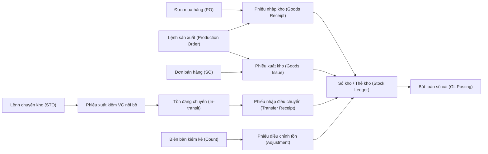
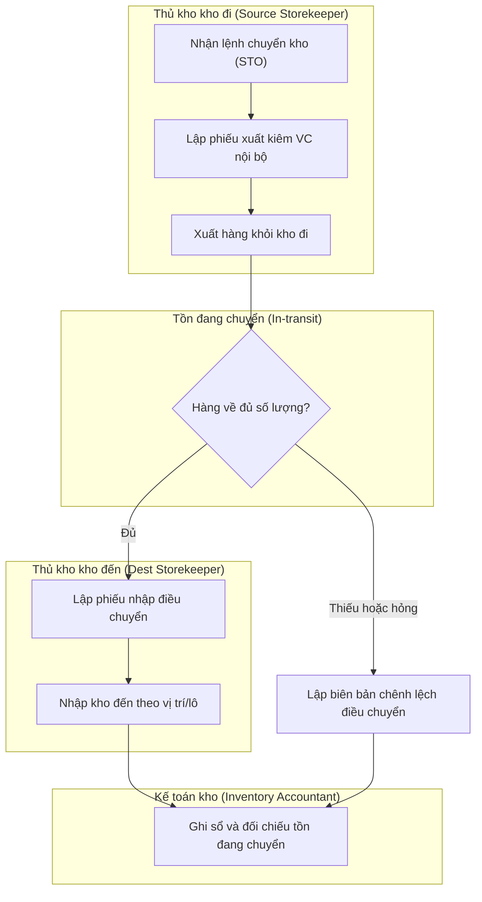
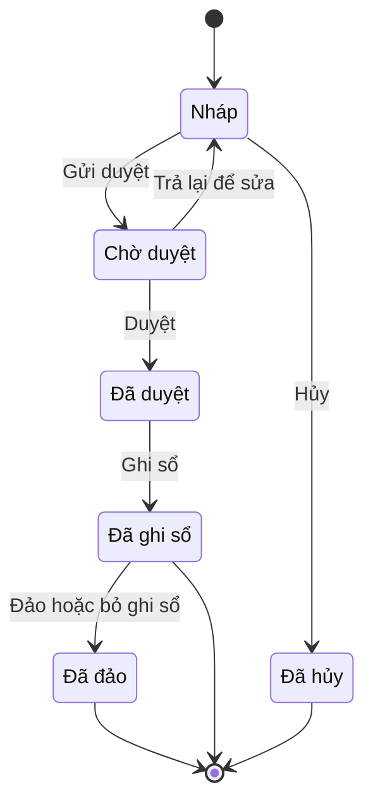

# INV — Kho & Quản lý kho (Inventory & Warehouse Management)

> **Phạm vi:** toàn bộ vòng đời tồn kho vật lý — danh mục vật tư/hàng hóa, cấu trúc kho/vị trí/ngăn kệ, nhập kho/xuất kho theo mục đích, chuyển kho hai bước (in-transit), giữ hàng, kiểm kê & điều chỉnh, truy xuất lô/serial/hạn dùng, chọn hàng FEFO/FIFO, hoạch định bổ sung tồn (min/max, điểm đặt hàng lại), chính sách tồn âm, liên kết định giá tồn kho và khóa sổ kỳ kho. **Module liên quan:** Mua hàng (PUR/P2P), Bán hàng (SAL/O2C), Sản xuất (MFG), Giá thành (COST), Kế toán tổng hợp (GL), Thuế–hóa đơn (TAX). **Chuẩn tham chiếu:** SAP MM/WM/EWM (movement types), Oracle Inventory (subinventory/locator), Odoo Inventory (routes/removal strategies), Microsoft Dynamics 365 SCM; chế độ kế toán Việt Nam **Thông tư 99/2025/TT-BTC** (áp dụng từ 01/01/2026, thay thế Thông tư 200/2014/TT-BTC) [1][2], chuẩn mực VAS 02 – Hàng tồn kho [8], dự phòng theo Thông tư 48/2019/TT-BTC [9].
>
> **Cập nhật đến: 2026-10-20 — quy định thay đổi thường xuyên; BA phải kiểm tra lại hiệu lực khi dùng cho dự án.** Phần giá vốn/định giá chi tiết xem `references/processes/costing.md`; chế độ kế toán xem `references/regulations/vn-accounting.md`; hóa đơn điện tử & phiếu xuất kho kiêm vận chuyển nội bộ xem `references/regulations/vn-tax-einvoice.md` và `references/processes/tax-einvoice.md`.

## Mục lục
- [1. Mục đích & phạm vi](#1-mục-đích--phạm-vi)
- [2. Vai trò tham gia](#2-vai-trò-tham-gia)
- [3. Danh mục (master data) tiên quyết](#3-danh-mục-master-data-tiên-quyết)
- [4. Chứng từ & luồng chứng từ](#4-chứng-từ--luồng-chứng-từ-document-flow)
- [5. Các bước quy trình chuẩn](#5-các-bước-quy-trình-chuẩn)
- [6. Vòng đời trạng thái chứng từ chính](#6-vòng-đời-trạng-thái-chứng-từ-chính)
- [7. Quy tắc nghiệp vụ & kiểm tra (validation)](#7-quy-tắc-nghiệp-vụ--kiểm-tra-validation-điển-hình)
- [8. Hạch toán kế toán](#8-hạch-toán-kế-toán)
- [9. Tham số hệ thống điển hình](#9-tham-số-hệ-thống-điển-hình)
- [10. Kiểm soát nội bộ & phân quyền](#10-kiểm-soát-nội-bộ--phân-quyền-sod-hạn-mức-duyệt-audit)
- [11. Báo cáo chuẩn](#11-báo-cáo-chuẩn)
- [12. Tích hợp với module khác](#12-tích-hợp-với-module-khác)
- [13. Biến thể & ngoại lệ](#13-biến-thể--ngoại-lệ)
- [14. Lỗi BA hay mắc & câu hỏi khảo sát](#14-lỗi-ba-hay-mắc--câu-hỏi-cần-hỏi-khách-hàng)
- [15. Nguồn tham khảo](#15-nguồn-tham-khảo)

---

## 1. Mục đích & phạm vi

**Mục đích:** quản lý chính xác **số lượng – giá trị – vị trí – truy xuất** của hàng tồn kho (Inventory) theo thời gian thực, bảo đảm mọi biến động kho đều có chứng từ, được duyệt, ghi sổ kho (sub-ledger) và phản ánh đúng lên sổ cái (General Ledger – GL), đồng thời cung cấp dữ liệu tồn cho mua hàng, bán hàng, sản xuất và giá thành.

**Trong phạm vi (in scope):**
- Danh mục vật tư, hàng hóa, thành phẩm, công cụ dụng cụ; đơn vị tính (Unit of Measure – UoM) & quy đổi; nhóm hàng.
- Cấu trúc kho → khu vực/vị trí (Location) → ngăn/kệ/ô (Bin).
- Nhập kho (Goods Receipt – GR) và xuất kho (Goods Issue – GI) theo mục đích: mua, bán, sản xuất, nội bộ, trả lại.
- Chuyển kho giữa các kho theo cơ chế hai bước với tồn đang chuyển (in-transit stock).
- Giữ hàng/đặt trước (Reservation), kiểm kê (Physical/Cycle Count), điều chỉnh tồn (Adjustment).
- Quản lý & truy xuất lô (Lot/Batch), số serial (Serial Number), hạn dùng (Expiry/Shelf Life); chọn hàng theo FEFO/FIFO.
- Hoạch định bổ sung tồn: tồn tối thiểu/tối đa (min/max), điểm đặt hàng lại (Reorder Point – ROP).
- Chính sách tồn âm (Negative Stock); khóa sổ kỳ kho (Inventory Period Close).

**Ngoài phạm vi (out of scope) — thuộc module khác, chỉ liên kết:**
- Tạo yêu cầu/đơn mua hàng, đánh giá nhà cung cấp → `references/processes/p2p-procure-to-pay.md`.
- Đơn bán hàng, giao hàng cho khách, doanh thu → `references/processes/o2c-order-to-cash.md`.
- Lệnh sản xuất, định mức BOM, hoạch định MRP → `references/processes/manufacturing-mrp.md`.
- **Tính giá vốn, phương pháp tính giá, xử lý chênh lệch giá, phân bổ chi phí mua hàng** → `references/processes/costing.md`.
- Phát hành hóa đơn điện tử (hóa đơn GTGT) → `references/processes/tax-einvoice.md`.

---

## 2. Vai trò tham gia

| Vai trò | Trách nhiệm | Quyền điển hình (theo hành động chuẩn) |
|---|---|---|
| **Thủ kho (Storekeeper)** — `ROLE-INV-STOREKEEPER` | Nhận/giao hàng vật lý, kiểm đếm, sắp xếp theo vị trí/lô, lập phiếu nhập–xuất, ghi thẻ kho | Xem, Tạo, Sửa (phiếu Nháp), Gửi duyệt, In phiếu nhập/xuất, ghi nhận số lượng thực tế |
| **Nhân viên kho/phụ kho (Warehouse Staff)** — `ROLE-INV-STAFF` | Soạn hàng (picking), đóng gói, dán nhãn, quét mã vạch | Xem, Tạo/Sửa thao tác soạn–nhận, In nhãn |
| **Trưởng kho / Quản lý kho (Warehouse Manager)** — `ROLE-INV-MANAGER` | Duyệt phiếu nhập/xuất/chuyển kho, điều phối kiểm kê, phê duyệt điều chỉnh trong hạn mức | Xem, Duyệt, Từ chối, Trả lại, Hủy, Cấu hình vị trí kho |
| **Nhân viên QC/KCS (Quality Control)** — `ROLE-INV-QC` | Kiểm tra chất lượng hàng nhập, chuyển trạng thái hàng chờ kiểm → đạt/không đạt | Xem, ghi kết quả kiểm tra, chuyển trạng thái chất lượng |
| **Nhân viên kế hoạch vật tư (Material Planner)** — `ROLE-INV-PLANNER` | Thiết lập min/max/ROP, chạy hoạch định bổ sung, theo dõi hàng cận hạn/chậm luân chuyển | Xem, Tạo đề xuất bổ sung, Cấu hình thông số hoạch định |
| **Kế toán kho (Inventory Accountant)** — `ROLE-INV-ACCOUNTANT` | Ghi sổ giá trị, đối chiếu sổ kho ↔ sổ cái, tính giá vốn, lập dự phòng, khóa sổ kỳ kho | Xem, Ghi sổ, Bỏ ghi sổ, Đảo, Đóng kỳ, Xuất file báo cáo |
| **Kế toán trưởng (Chief Accountant)** — `ROLE-INV-CHIEF` | Phê duyệt điều chỉnh giá trị lớn, phê duyệt kết quả kiểm kê, phê duyệt dự phòng, khóa sổ | Xem, Duyệt (hạn mức cao), Đóng kỳ, Cấu hình tài khoản kho |
| **Giám đốc (Director)** — `ROLE-INV-DIRECTOR` | Phê duyệt xử lý thừa/thiếu, xóa sổ (write-off) vượt hạn mức, quyết định bồi thường | Xem, Duyệt (hạn mức cao nhất) |

> Phân tách nhiệm vụ cốt lõi (Segregation of Duties – SoD): **người giữ hàng (thủ kho) ≠ người ghi sổ giá trị (kế toán kho) ≠ người duyệt điều chỉnh**. Chi tiết ở mục 10.

---

## 3. Danh mục (master data) tiên quyết

| Danh mục | Trường quan trọng | Quy tắc chính |
|---|---|---|
| **Vật tư/Hàng hóa (Item/Material Master)** — `MD-ITEM` | Mã hàng, tên, nhóm hàng, loại (NVL/CCDC/thành phẩm/hàng hóa), ĐVT cơ sở, phương pháp quản lý (thường/lô/serial), quản lý hạn dùng (Y/N), nhóm định khoản kho, phương pháp tính giá, min/max/ROP | Mã hàng duy nhất, không tái sử dụng; một ĐVT cơ sở (base UoM) cố định; đổi phương pháp tính giá/loại hàng khi đã có phát sinh phải kiểm soát chặt (xem BR-INV-14) |
| **Đơn vị tính & quy đổi (Unit of Measure & Conversion)** — `MD-UOM` | ĐVT cơ sở (lưu kho), ĐVT mua, ĐVT bán, hệ số quy đổi | Quy đổi cố định về ĐVT cơ sở; hệ số > 0; không cho đổi hệ số khi đang có tồn (ảnh hưởng số lượng lịch sử) |
| **Nhóm hàng (Item/Material Group)** — `MD-ITEM-GROUP` | Mã nhóm, cấp cha–con, nhóm định khoản mặc định | Dùng để gán tài khoản kho, báo cáo theo chiều phân tích; tránh nhóm quá mịn gây khó bảo trì |
| **Kho (Warehouse/Plant)** — `MD-WAREHOUSE` | Mã kho, loại kho (chính/phụ/bảo thuế/đại lý/sửa chữa), chi nhánh, pháp nhân, cho phép tồn âm (Y/N) | Gắn với một chi nhánh/pháp nhân; kho bảo thuế hạch toán riêng (TK 158) [5] |
| **Vị trí/Khu vực (Location/Storage Location)** — `MD-LOCATION` | Mã vị trí, kho cha, loại (nhận/soạn/lưu/đóng gói/chờ kiểm/hỏng), cho phép trộn lô (Y/N) | Vị trí "chờ kiểm" (QC) tách khỏi tồn sẵn bán; vị trí "hỏng/chờ xử lý" không tính khả dụng |
| **Ngăn/Kệ/Ô (Bin)** — `MD-BIN` | Mã bin, vị trí cha, sức chứa, thứ tự soạn (pick sequence) | Tùy chọn cho kho có quản lý vị trí chi tiết (SAP WM/EWM, Odoo storage locations) |
| **Lô / Số serial (Lot/Batch · Serial)** — `MD-LOT`, `MD-SERIAL` | Số lô, ngày sản xuất, hạn dùng, ngày nên xuất (removal date), số serial, trạng thái | Lô bắt buộc với hàng quản lý hạn dùng; serial là duy nhất toàn hệ thống; xem mục 13 |
| **Nhóm định khoản/tài khoản kho (Valuation Class / Account Determination)** — `MD-ACCT-DET` | Tài khoản tồn kho, giá vốn, chênh lệch, thừa/thiếu theo nhóm hàng/kho | Ánh xạ tới hệ thống tài khoản TT99 (mục 8); mỗi nhóm hàng có bộ tài khoản mặc định |
| **Mã lý do (Reason Code)** — `MD-REASON` | Mã, mô tả, loại (nhập/xuất/điều chỉnh/hủy), tài khoản đối ứng gợi ý | Bắt buộc cho xuất khác (hao hụt, hỏng, biếu tặng) và điều chỉnh kiểm kê để phục vụ phân tích & kiểm toán |

> Dữ liệu giá (giá gốc, giá vốn bình quân, giá chuẩn) thuộc phạm vi `references/processes/costing.md` — không nhân bản ở đây; danh mục kho chỉ tham chiếu phương pháp tính giá đã thiết lập cho từng mặt hàng.

---

## 4. Chứng từ & luồng chứng từ (document flow)

| Chứng từ (VI/EN) | Mục đích | Tạo từ | Sinh ra | Ảnh hưởng (kho/công nợ/sổ cái) |
|---|---|---|---|---|
| **Phiếu nhập kho (Goods Receipt Note – GRN; SAP MIGO mvt 101)** — Mẫu 01-VT [10] | Ghi nhận hàng nhập kho (mua, SX nhập, trả lại, thừa) | Đơn mua hàng (PO), Lệnh sản xuất, Đơn bán (hàng trả lại), Kiểm kê | Cập nhật sổ kho (+); bút toán kho | **Kho:** tăng; **Công nợ:** tăng 331 (nếu mua chịu); **GL:** Nợ 152/153/155/156 |
| **Phiếu xuất kho (Goods Issue Note – GIN; SAP mvt 201/261/601)** — Mẫu 02-VT [10] | Ghi nhận hàng xuất kho (bán, SX, nội bộ, hao hụt) | Đơn bán hàng (SO), Lệnh sản xuất, Yêu cầu xuất | Cập nhật sổ kho (−); bút toán giá vốn/chi phí | **Kho:** giảm; **GL:** Nợ 632/621/627/641/642 / Có 152/155/156 |
| **Phiếu xuất kho kiêm vận chuyển nội bộ (Internal Transfer & Delivery Note)** [12] | Điều chuyển hàng giữa kho/chi nhánh hạch toán phụ thuộc; đưa hàng đi gia công/giao đại lý | Yêu cầu/Lệnh chuyển kho (STO) | Phiếu nhập kho điều chuyển ở kho đến | **Kho:** giảm kho đi, tăng tồn đang chuyển; **GL:** thường không đổi giá trị (xem mục 8); lập theo NĐ123/2020 sửa đổi bởi NĐ70/2025 [12][13] |
| **Yêu cầu/Lệnh chuyển kho (Stock Transfer Order – STO)** | Khởi tạo điều chuyển hai bước | Kế hoạch bổ sung, yêu cầu của kho đến | Phiếu xuất điều chuyển + phiếu nhập điều chuyển | Theo dõi tồn đang chuyển (in-transit) |
| **Phiếu giữ hàng/đặt trước (Reservation)** | Khóa số lượng cho đơn bán/lệnh SX, chưa xuất vật lý | SO, Lệnh SX, kế hoạch | Giảm tồn khả dụng (ATP), không giảm tồn thực | Không ghi GL; chỉ ảnh hưởng tồn khả dụng |
| **Biên bản kiểm kê (Physical Inventory Count Sheet)** — Mẫu 05-VT | Ghi số lượng đếm thực tế theo kỳ/định kỳ | Kế hoạch kiểm kê | Phiếu điều chỉnh tồn (thừa/thiếu) | Cơ sở xử lý chênh lệch |
| **Phiếu điều chỉnh tồn kho (Stock Adjustment)** | Ghi nhận chênh lệch kiểm kê, hỏng, hao hụt | Biên bản kiểm kê, đề nghị xử lý | Bút toán thừa/thiếu | **GL:** Nợ 1381 / Có kho (thiếu); Nợ kho / Có 3381 (thừa) [5] |
| **Thẻ kho / Sổ kho (Bin Card / Stock Card)** — Mẫu S12-DN [11] | Sổ theo dõi nhập–xuất–tồn **số lượng** từng mặt hàng tại kho | Tự sinh từ phiếu nhập/xuất | — | Đối chiếu với kế toán chi tiết |

---

## 5. Các bước quy trình chuẩn

### 5A. Nhập kho mua hàng (Goods Receipt từ PO)

| # | Vai trò | Chứng từ | Hành động hệ thống | Trạng thái sau bước |
|---|---|---|---|---|
| 1 | Thủ kho | — | Nhận hàng, đối chiếu đơn mua hàng (PO) & packing list; tạo phiếu nhập từ PO | GRN = `DRAFT` "Nháp" |
| 2 | Nhân viên QC | Phiếu kiểm nghiệm | Ghi kết quả kiểm tra chất lượng; hàng đạt → vị trí tồn khả dụng, không đạt → vị trí chờ xử lý/trả lại | GRN `DRAFT` (gắn kết quả QC) |
| 3 | Thủ kho | GRN | Nhập số lượng thực nhận, gán lô/hạn dùng/serial, chọn vị trí; gửi duyệt | GRN = `PENDING` "Chờ duyệt" |
| 4 | Trưởng kho | GRN | Duyệt (hoặc Trả lại nếu sai lệch) | GRN = `APPROVED` "Đã duyệt" |
| 5 | Kế toán kho | GRN | Ghi sổ: tăng tồn số lượng & giá trị, tạo bút toán (mục 8); cập nhật giá vốn bình quân | GRN = `POSTED` "Đã ghi sổ" |
| 6 | Hệ thống | — | Cập nhật thẻ kho, tồn khả dụng; khớp 3 bên PO–GRN–hóa đơn cho AP | Tồn cập nhật |

### 5B. Xuất kho bán hàng (Goods Issue cho SO)

| # | Vai trò | Chứng từ | Hành động hệ thống | Trạng thái sau bước |
|---|---|---|---|---|
| 1 | Nhân viên kho | SO → lệnh soạn hàng | Hệ thống đề xuất lô/vị trí theo chiến lược FEFO/FIFO (PRM-INV-005); soạn hàng | Lệnh soạn `IN_PROGRESS` |
| 2 | Thủ kho | Phiếu xuất kho | Tạo phiếu xuất, xác nhận số lượng/lô thực xuất; gửi duyệt | GIN = `PENDING` |
| 3 | Trưởng kho | GIN | Duyệt | GIN = `APPROVED` |
| 4 | Kế toán kho | GIN | Ghi sổ: giảm tồn, tính & ghi giá vốn (Nợ 632 / Có 156,155) | GIN = `POSTED` |
| 5 | Hệ thống | — | Cập nhật thẻ kho; chuyển dữ liệu cho O2C lập hóa đơn | Tồn cập nhật |

### 5C. Chuyển kho hai bước (2-step transfer, in-transit)

| # | Vai trò | Chứng từ | Hành động hệ thống | Trạng thái sau bước |
|---|---|---|---|---|
| 1 | Kế hoạch/Trưởng kho | Lệnh chuyển kho (STO) | Tạo lệnh chuyển kho đi → kho đến, số lượng, lô | STO = `APPROVED` |
| 2 | Thủ kho (kho đi) | Phiếu xuất kiêm VC nội bộ | Xuất hàng khỏi kho đi → **tồn đang chuyển (in-transit)** | STO = `IN_PROGRESS` "Đang thực hiện"; tồn đi giảm |
| 3 | Thủ kho (kho đến) | Phiếu nhập điều chuyển | Nhận hàng, đối chiếu số lượng/lô; ghi nhận vào kho đến | STO = `COMPLETED` nếu đủ; `PARTIAL` nếu thiếu |
| 4 | Kế toán kho | — | Ghi sổ (thường không đổi giá trị nếu cùng pháp nhân/cùng giá; xem mục 8) | `POSTED` |

### 5D. Kiểm kê & điều chỉnh (Physical/Cycle Count)

| # | Vai trò | Chứng từ | Hành động hệ thống | Trạng thái sau bước |
|---|---|---|---|---|
| 1 | Trưởng kho | Kế hoạch kiểm kê | Chọn phạm vi (toàn bộ/định kỳ theo vòng – cycle count), tạo phiếu kiểm kê, chốt tồn sổ sách | Phiếu kiểm kê `DRAFT` |
| 2 | Thủ kho + tổ kiểm kê | Biên bản kiểm kê | Đếm thực tế (có thể khóa giao dịch kho trong lúc đếm), nhập số đếm | `IN_PROGRESS` |
| 3 | Hệ thống | — | So sánh tồn sổ ↔ tồn đếm, tính chênh lệch | Hiển thị chênh lệch |
| 4 | Trưởng kho/Kế toán trưởng | Đề nghị xử lý | Duyệt chênh lệch theo hạn mức; chênh lệch lớn chuyển cấp cao hơn | `APPROVED` |
| 5 | Kế toán kho | Phiếu điều chỉnh | Ghi sổ thừa/thiếu (Nợ 1381 / Có kho; Nợ kho / Có 3381) | `POSTED` |
| 6 | Giám đốc/HĐ xử lý | Quyết định xử lý | Xác định bồi thường/ghi chi phí cho phần thiếu; ghi nhận phần thừa | Đóng vụ việc |

---

## 6. Vòng đời trạng thái chứng từ chính

Áp dụng cho **Phiếu nhập kho / Phiếu xuất kho** (và tương tự cho phiếu điều chuyển, điều chỉnh).

| Từ | Hành động | Đến | Vai trò | Điều kiện |
|---|---|---|---|---|
| `DRAFT` | Gửi duyệt | `PENDING` | Thủ kho | Đủ dòng hàng, đủ lô/serial bắt buộc, trong kỳ mở |
| `PENDING` | Duyệt | `APPROVED` | Trưởng kho | Trong hạn mức; không vượt tồn (nếu cấm tồn âm) |
| `PENDING` | Trả lại để sửa | `DRAFT` | Trưởng kho | Có lý do trả lại |
| `DRAFT` | Hủy | `CANCELLED` | Thủ kho/Trưởng kho | Chỉ khi chưa ghi sổ |
| `APPROVED` | Ghi sổ | `POSTED` | Kế toán kho | Kỳ kho đang mở; giá vốn xác định được |
| `POSTED` | Đảo / Bỏ ghi sổ | `REVERSED` | Kế toán kho/Kế toán trưởng | Kỳ chưa khóa; tạo bút toán đảo, giữ vết (audit trail) |

> **Nguyên tắc:** chứng từ đã `POSTED` **không được xóa**; sửa sai bằng **Đảo (Reverse)** hoặc bỏ ghi sổ rồi lập lại. Chỉ chứng từ `DRAFT` mới được Xóa. Khi kỳ đã `CLOSED`, mọi điều chỉnh phải thực hiện ở kỳ mở kế tiếp.

---

## 7. Quy tắc nghiệp vụ & kiểm tra (validation) điển hình

1. **BR-INV-01 — Không ghi sổ ngược kỳ đã khóa.** Ngày chứng từ phải nằm trong kỳ kho đang mở (`PRM-INV-010`). *Lý do:* bảo toàn số liệu đã lập báo cáo & đã tính giá vốn.
2. **BR-INV-02 — Kiểm soát tồn âm.** Nếu `PRM-INV-002 = Không cho phép` thì hệ thống chặn xuất khi số lượng khả dụng < số lượng xuất tại kho/lô/vị trí. Nếu cho phép, chỉ áp dụng cho kho/mặt hàng được chỉ định và phải cảnh báo. *Lý do:* tồn âm làm sai giá vốn và che giấu sai lệch vật lý.
3. **BR-INV-03 — Số lượng khả dụng.** `Tồn khả dụng (ATP) = Tồn thực tế − Đã giữ (reservation) − Đã phân bổ cho phiếu xuất chưa ghi sổ + Dự kiến nhập (nếu cấu hình)`. Xuất/giữ hàng kiểm theo tồn khả dụng, không theo tồn thực.
4. **BR-INV-04 — Bắt buộc lô/hạn dùng.** Mặt hàng có `quản lý lô = Y` hoặc `quản lý hạn dùng = Y` thì mọi phiếu nhập phải khai lô + hạn dùng; mọi phiếu xuất phải chỉ định lô cụ thể. *Lý do:* truy xuất nguồn gốc & FEFO.
5. **BR-INV-05 — Serial duy nhất.** Mặt hàng quản lý serial: mỗi serial chỉ tồn tại 1 đơn vị, không nhập trùng serial đang tồn, không xuất serial không có trong kho.
6. **BR-INV-06 — FEFO/FIFO khi soạn hàng.** Hệ thống đề xuất lô theo chiến lược (`PRM-INV-005`): FEFO = hạn dùng gần nhất xuất trước; FIFO = nhập trước xuất trước. Thủ kho muốn xuất khác đề xuất phải có lý do (ghi log). *Lý do:* giảm hàng hết hạn/chết.
7. **BR-INV-07 — Chặn/cảnh báo hàng hết hạn.** Không cho xuất bán lô đã quá hạn dùng; cảnh báo lô cận hạn trong `PRM-INV-007` ngày. (Lưu ý: nhiều hệ thống chỉ cảnh báo chứ không chặn — xác nhận với khách hàng.) [15]
8. **BR-INV-08 — Quy đổi đơn vị tính.** Khi nhập/xuất theo ĐVT mua/bán, hệ thống quy đổi về ĐVT cơ sở theo hệ số cố định; làm tròn theo `PRM-INV-013`. Chênh lệch làm tròn ghi nhận theo quy tắc cấu hình.
9. **BR-INV-09 — Hai bước chuyển kho.** Tổng số nhập ở kho đến ≤ tổng số xuất khỏi kho đi; phần chênh (mất mát/hỏng trên đường) phải lập biên bản và xử lý qua điều chỉnh, không tự "bốc hơi" khỏi tồn đang chuyển.
10. **BR-INV-10 — Khớp chứng từ ↔ sổ kho ↔ sổ cái.** Tổng giá trị tồn trên sổ chi tiết vật tư = số dư tài khoản kho (152/153/155/156…) trên sổ cái tại mọi thời điểm khóa sổ. *Lý do:* điều kiện tiên quyết để khóa kỳ.
11. **BR-INV-11 — Dung sai kiểm kê.** Chênh lệch kiểm kê trong `PRM-INV-009` (vd ±0,5% giá trị/dòng) được duyệt ở cấp kho; vượt ngưỡng phải giải trình và duyệt cấp cao hơn.
12. **BR-INV-12 — Công thức bình quân gia quyền liên hoàn (moving average):**
    `Giá BQ mới = (Giá trị tồn trước + Giá trị nhập) ÷ (Số lượng tồn trước + Số lượng nhập)`. Áp dụng cho mặt hàng dùng phương pháp BQGQ tức thời; chi tiết & các phương pháp khác (FIFO, đích danh) ở `references/processes/costing.md`. Phương pháp **nhập sau–xuất trước (LIFO)** đã bị loại khỏi chế độ kế toán VN [8].
13. **BR-INV-13 — Mức dự phòng giảm giá hàng tồn kho** (Thông tư 48/2019/TT-BTC [9]):
    `Mức dự phòng = Σ [ Số lượng tồn tại thời điểm lập BCTC × (Giá gốc ghi sổ − Giá trị thuần có thể thực hiện được) ]` khi *giá gốc > giá trị thuần có thể thực hiện được*. Trong đó `Giá trị thuần có thể thực hiện được = Giá bán ước tính − Chi phí ước tính hoàn thành − Chi phí ước tính để tiêu thụ`. Hoàn nhập phần chênh lệch nếu kỳ sau mức cần trích thấp hơn số đã trích.
14. **BR-INV-14 — Khóa đổi thuộc tính trọng yếu.** Khi mặt hàng đã có phát sinh tồn/giao dịch: không đổi ĐVT cơ sở, phương pháp tính giá, phương pháp quản lý (lô/serial) trừ khi qua quy trình có duyệt và xử lý số dư. *Lý do:* tránh sai lệch số lượng & giá trị lịch sử.
15. **BR-INV-15 — Đánh số & bắt buộc lý do.** Mỗi loại phiếu có dải số (number range) riêng, không trùng, không nhảy cóc; phiếu xuất khác (hao hụt, hỏng, biếu tặng) bắt buộc mã lý do (`MD-REASON`).

---

## 8. Hạch toán kế toán

> **Chế độ kế toán áp dụng (tại 2026-10-20): Thông tư 99/2025/TT-BTC**, có hiệu lực từ 01/01/2026 cho năm tài chính bắt đầu từ/sau ngày này, **thay thế Thông tư 200/2014/TT-BTC** (toàn bộ, trừ khoản 2 Điều 31 — phần kế toán cổ phần hóa doanh nghiệp nhà nước vẫn áp dụng theo TT200 cho đến khi có văn bản thay thế) [1][2][19]. Doanh nghiệp nhỏ và vừa có thể tiếp tục áp dụng **Thông tư 133/2016/TT-BTC** (còn hiệu lực) [7]. Bảng dưới dùng số hiệu tài khoản theo TT99 — **nhóm tài khoản hàng tồn kho 151–158 hầu như giữ nguyên số hiệu so với TT200** [3]; khác biệt đáng chú ý: TK **1562 (chi phí thu mua hàng hóa) bị bỏ** — chi phí mua phân bổ vào giá gốc hàng hoặc đưa vào 632 nếu nhỏ và liên quan nhiều mặt hàng; TK **611 (mua hàng – kiểm kê định kỳ) và 631 (giá thành SX) bị bỏ** [4][6][20]; TK **155 đổi tên "Thành phẩm" → "Sản phẩm"**, TK **158 đổi tên thành "Nguyên liệu, vật tư tại kho bảo thuế"** [4][5]. Giả định phương pháp kê khai thường xuyên (perpetual) — mặc định trong mọi ERP. ⚠️ CHƯA XÁC MINH chi tiết bút toán kiểm kê định kỳ sau khi bỏ TK 611 — đối chiếu Phụ lục của TT99 khi áp dụng.

| Nghiệp vụ | Nợ | Có | Ghi chú |
|---|---|---|---|
| Nhập kho mua trong nước (hàng hóa) | 156 (giá mua + chi phí mua), 1331 (thuế GTGT) | 331 / 111 / 112 | Hàng hóa; NVL dùng 152, CCDC 153 |
| Hàng mua đang đi đường cuối kỳ (đã có hóa đơn, hàng chưa về) | 151, 1331 | 331 | Khi hàng về: **Nợ 152/156 / Có 151** [5] |
| Nhập khẩu hàng hóa | 156 (giá CIF + thuế NK + TTĐB) | 331, 3333 (thuế NK), 3332 (TTĐB nếu có) | VAT nhập khẩu: **Nợ 1331 / Có 33312**; xem `tax-einvoice.md` |
| Nhập kho thành phẩm từ sản xuất | 155 | 154 | TT99 đổi tên 155 = "Sản phẩm" [4] |
| Xuất kho bán hàng (giá vốn) | 632 | 156 / 155 | Doanh thu & 33311 ghi ở O2C/AR |
| Xuất kho nguyên vật liệu cho sản xuất | 621 (→ kết chuyển 154) | 152 | Chi tiết phân bổ xem `manufacturing-mrp.md`, `costing.md` |
| Xuất công cụ dụng cụ dùng ngay | 627 / 641 / 642 | 153 | Nếu phân bổ nhiều kỳ: **Nợ 242 / Có 153** rồi phân bổ dần |
| Xuất kho gửi bán / gửi đại lý | 157 | 155 / 156 | Khi tiêu thụ: **Nợ 632 / Có 157** |
| Chuyển kho nội bộ cùng pháp nhân, cùng giá | — | — | **Không phát sinh bút toán giá trị** (chỉ đổi chiều phân tích kho); nếu theo dõi tồn đang chuyển: Nợ 156 (đang chuyển) / Có 156 (kho đi), rồi Nợ 156 (kho đến) / Có 156 (đang chuyển) |
| Điều chuyển giữa đơn vị hạch toán phụ thuộc | 136 (phải thu nội bộ) | 155 / 156 | Đơn vị nhận: **Nợ 155/156 / Có 336** |
| Xuất trả lại nhà cung cấp | 331 / 111 / 112 | 152 / 156, 1331 | Ghi giảm công nợ & thuế GTGT đã khấu trừ |
| Hàng bán bị trả lại nhập kho | 156 / 155 | 632 | Đảo giá vốn; doanh thu/giảm trừ ghi ở O2C/AR |
| Kiểm kê **thừa** chờ xử lý | 152 / 155 / 156 | 3381 (tài sản thừa chờ giải quyết) | Xử lý: Có 711 / giảm chi phí tùy nguyên nhân [5] |
| Kiểm kê **thiếu** chờ xử lý | 1381 (tài sản thiếu chờ xử lý) | 152 / 155 / 156 | Xử lý: **Nợ 111/334/1388** (bồi thường) hoặc **632/811** (tính vào chi phí) / Có 1381 [5] |
| Hao hụt trong định mức | 632 / 154 / 627 | 152 / 156 | Theo định mức được duyệt |
| Lập/bổ sung dự phòng giảm giá hàng tồn kho | 632 | 2294 | Theo TT48/2019 (BR-INV-13) [9] |
| Hoàn nhập dự phòng giảm giá hàng tồn kho | 2294 | 632 | Khi mức cần trích kỳ này thấp hơn số đã trích [9] |
| Xuất hàng khuyến mại/biếu tặng | 641 / 642 | 155 / 156 | Thuế GTGT đầu ra theo quy định thuế — xem `tax-einvoice.md` |

> **Lưu ý TT99 so với TT200:** số hiệu các tài khoản kho dùng trong bảng (151, 152, 153, 155, 156, 157, 158, 1381, 3381, 2294, 1331, 331, 632, 621, 627) **không đổi số hiệu**; khác biệt chủ yếu là **tên gọi 155/158** và việc **bỏ 611/631/1562** [4][5][6]. Khi khách hàng vẫn áp dụng TT133 (DNNVV), một số tài khoản chi tiết khác biệt — kiểm tra `references/regulations/vn-accounting.md`.

---

## 9. Tham số hệ thống điển hình

| Tham số | Kiểu | Giá trị gợi ý | Phạm vi | Ảnh hưởng |
|---|---|---|---|---|
| `PRM-INV-001` Phương pháp tính giá xuất kho | Chọn | BQGQ liên hoàn / FIFO / Đích danh | Công ty / Mặt hàng | Quyết định giá vốn; LIFO không áp dụng ở VN [8] |
| `PRM-INV-002` Cho phép tồn âm | Bool | Không (mặc định) | Công ty / Kho / Mặt hàng | Chặn/không chặn xuất vượt tồn (BR-INV-02) |
| `PRM-INV-003` Số bước nhập kho | Chọn | 1 / 2 (input→stock) / 3 (input→QC→stock) | Kho | Có/không bước kiểm chất lượng [16][17] |
| `PRM-INV-004` Số bước xuất kho | Chọn | 1 / 2 (pick→ship) / 3 (pick→pack→ship) | Kho | Mức độ kiểm soát soạn–đóng–giao [16][17] |
| `PRM-INV-005` Chiến lược xuất mặc định | Chọn | FIFO (mặc định) / FEFO / Đích danh / Gần nhất | Nhóm hàng / Vị trí | Thứ tự đề xuất lô khi soạn hàng [14] |
| `PRM-INV-006` Quản lý lô / serial / hạn dùng | Chọn đa | Lô / Serial / Hạn dùng | Mặt hàng | Bật truy xuất & FEFO (BR-INV-04/05) |
| `PRM-INV-007` Số ngày cảnh báo cận hạn | Số | 30 / 60 / 90 | Mặt hàng / Hệ thống | Cảnh báo lô sắp hết hạn (BR-INV-07) |
| `PRM-INV-008` Min / Max / Điểm đặt hàng lại | Số | Theo lịch sử tiêu thụ | Mặt hàng – Kho | Sinh đề xuất bổ sung (mục 13) |
| `PRM-INV-009` Dung sai kiểm kê | % / Số tiền | ±0,5% giá trị dòng | Công ty | Ngưỡng tự duyệt chênh lệch (BR-INV-11) |
| `PRM-INV-010` Khóa kỳ kho / cho phép ghi lùi ngày | Bool/Ngày | Khóa sau khi tính giá vốn | Công ty | Chặn ghi sổ kỳ đã khóa (BR-INV-01) |
| `PRM-INV-011` Dải số chứng từ (number range) | Mẫu | Theo loại phiếu & năm | Công ty / Chi nhánh | Đánh số liên tục, không trùng (BR-INV-15) |
| `PRM-INV-012` Bắt buộc kiểm tra chất lượng khi nhập | Bool | Theo nhóm hàng | Mặt hàng / Kho | Hàng vào vị trí chờ kiểm trước khi khả dụng |
| `PRM-INV-013` Quy tắc làm tròn số lượng | Chọn | Theo số lẻ của ĐVT | Mặt hàng | Xử lý quy đổi ĐVT (BR-INV-08) |
| `PRM-INV-014` Hạn mức duyệt điều chỉnh tồn | Số tiền | Nhiều bậc theo giá trị | Công ty | Định tuyến phê duyệt (mục 10) |
| `PRM-INV-015` Bộ tài khoản kho theo nhóm hàng | Ánh xạ | Theo `MD-ACCT-DET` | Công ty | Tự động định khoản khi ghi sổ (mục 8) |

---

## 10. Kiểm soát nội bộ & phân quyền (SoD, hạn mức duyệt, audit)

**Phân tách nhiệm vụ (SoD) bắt buộc:**
- Người **giữ hàng vật lý** (Thủ kho) ≠ người **ghi sổ giá trị** (Kế toán kho) ≠ người **duyệt điều chỉnh/kiểm kê** (Trưởng kho/Kế toán trưởng).
- Người **tạo mặt hàng/thiết lập giá** ≠ người **ghi sổ kho**.
- Người **đếm kiểm kê** nên khác người **ghi tồn sổ sách** đang được kiểm.

**Hạn mức duyệt điều chỉnh/xử lý chênh lệch (ví dụ, `PRM-INV-014`):**

| Giá trị điều chỉnh/xóa sổ | Cấp duyệt |
|---|---|
| ≤ 5 triệu VND | Trưởng kho |
| > 5 – 50 triệu VND | Kế toán trưởng |
| > 50 triệu VND | Giám đốc / Hội đồng xử lý |

**Kiểm soát khác:**
- **Audit trail:** mọi thay đổi số lượng/giá trị, duyệt, ghi sổ, đảo đều lưu người – thời điểm – giá trị trước/sau; chứng từ `POSTED` không xóa, chỉ đảo.
- **Khóa giao dịch khi kiểm kê** toàn bộ (freeze) để tránh biến động trong lúc đếm.
- **Đối chiếu định kỳ** sổ kho (số lượng) ↔ sổ chi tiết vật tư (giá trị) ↔ sổ cái (BR-INV-10) trước khi khóa kỳ.
- **Phân quyền theo kho/chi nhánh:** thủ kho chỉ thao tác trên kho được gán; cấm xuất/nhập chéo kho ngoài quyền.
- **Kiểm soát hàng ký gửi/đại lý** (TK 157) và **kho bảo thuế** (TK 158) tách biệt, không lẫn tồn sở hữu.
- **Cấm sửa phiếu sau duyệt**; sửa phải Trả lại `DRAFT` hoặc Đảo sau `POSTED`.

---

## 11. Báo cáo chuẩn

| Báo cáo (VI/EN) | Mục đích | Chiều phân tích / bộ lọc | Bắt buộc theo luật? |
|---|---|---|---|
| **Thẻ kho / Sổ kho (Bin/Stock Card)** — S12-DN [11] | Theo dõi nhập–xuất–tồn **số lượng** từng mặt hàng tại một kho | Kho, mặt hàng, khoảng thời gian | **Có** — sổ kế toán theo chế độ |
| **Sổ chi tiết vật tư, công cụ, sản phẩm, hàng hóa (Inventory Subledger)** — S10-DN | Theo dõi nhập–xuất–tồn **số lượng & giá trị** chi tiết | Kho, mặt hàng, tài khoản, kỳ | **Có** — sổ kế toán chi tiết |
| **Bảng tổng hợp Nhập–Xuất–Tồn (Goods Received–Issued–Balance Summary)** | Tổng hợp biến động & tồn cuối kỳ toàn kho | Kho, nhóm hàng, kỳ | Không (quản trị; liên quan Bảng tổng hợp chi tiết S11-DN) |
| **Tồn kho theo lô / hạn dùng (Stock by Lot/Expiry)** | Kiểm soát lô, hàng cận/hết hạn | Mặt hàng, lô, hạn dùng, kho | Không (quản trị) |
| **Tồn kho tức thời theo kho–vị trí (Stock on Hand by Location)** | Xem tồn khả dụng theo thời gian thực | Kho, vị trí, bin, mặt hàng | Không |
| **Báo cáo hàng cận hạn / quá hạn (Near-expiry / Expired)** | Cảnh báo xử lý trước khi hết hạn | Mặt hàng, lô, số ngày tới hạn | Không |
| **Biên bản kiểm kê & chênh lệch (Count & Variance)** — 05-VT | Ghi kết quả đếm và chênh lệch sổ–thực | Kho, đợt kiểm kê | **Có** khi kiểm kê bắt buộc cuối năm |
| **Báo cáo hàng chậm luân chuyển / tồn lâu (Slow-moving / Aging)** | Nhận diện hàng chết, cơ sở lập dự phòng | Mặt hàng, nhóm, số ngày tồn | Không |
| **Báo cáo đề xuất bổ sung tồn (Reorder / Replenishment)** | Danh sách cần mua/sản xuất theo min/max/ROP | Mặt hàng, kho, nhà cung cấp | Không |
| **Bảng kê phiếu nhập / xuất (Receipt/Issue Register)** | Liệt kê chứng từ theo kỳ để đối chiếu | Loại phiếu, kho, kỳ, người lập | Không |
| **Báo cáo truy xuất nguồn gốc lô / serial (Lot/Serial Traceability)** | Truy ngược/xuôi lô từ nhà cung cấp đến khách hàng | Lô, serial, mặt hàng | Không (bắt buộc theo ngành với dược/thực phẩm) |

> Phần lớn ERP cho phép tự thiết kế/sửa biểu mẫu chứng từ & báo cáo. Điểm mới nổi bật của **TT99/2025 là quyền tự chủ hệ thống tài khoản kế toán** (doanh nghiệp sửa/bổ sung tài khoản không phải xin phép Bộ Tài chính bằng văn bản như TT200 quy định) [2][19]; riêng về biểu mẫu chứng từ, cả TT200 và TT99 đều cho phép doanh nghiệp tự thiết kế — các mẫu **01-VT, 02-VT** (theo TT200/TT133) vẫn là mẫu tham chiếu phổ biến (⚠️ CHƯA XÁC MINH danh mục biểu mẫu kèm theo TT99 — đối chiếu phụ lục của TT99 khi dùng) [10]. Danh mục báo cáo thuế liên quan hàng tồn kho xem `references/processes/tax-einvoice.md`.

---

## 12. Tích hợp với module khác (ảnh hưởng dữ liệu hai chiều)

| Module | Chiều tích hợp | Dữ liệu trao đổi |
|---|---|---|
| **Mua hàng / P2P** (`p2p-procure-to-pay.md`) | PO → nhập kho; nhập kho → khớp 3 bên với AP | Số lượng nhận, giá, chi phí mua; cập nhật TK 331 |
| **Bán hàng / O2C** (`o2c-order-to-cash.md`) | SO → giữ hàng/xuất kho; xuất kho → giá vốn & hóa đơn | Tồn khả dụng (ATP), giá vốn 632, lô/serial giao khách |
| **Sản xuất / MRP** (`manufacturing-mrp.md`) | Lệnh SX → xuất NVL (261) & nhập thành phẩm (101); MRP đọc tồn & ROP | Tiêu hao NVL, nhập kho thành phẩm, dở dang 154 |
| **Giá thành / Costing** (`costing.md`) | Kho cung cấp số lượng; Costing định giá & cập nhật giá vốn | Giá gốc, giá bình quân, chênh lệch giá, phân bổ chi phí mua |
| **Kế toán tổng hợp / GL** (`r2r-general-ledger.md`) | Mọi phiếu ghi sổ → bút toán kho; đối chiếu sổ cái | Số dư 151–158, 632, 2294; chênh lệch kiểm kê |
| **Thuế – Hóa đơn** (`tax-einvoice.md`, `vn-tax-einvoice.md`) | Xuất bán → hóa đơn GTGT; chuyển kho → phiếu xuất kiêm VC nội bộ | Thuế GTGT, mã CQT, chứng từ vận chuyển nội bộ [12][13] |
| **Tài sản cố định** (`fixed-assets.md`) | CCDC giá trị lớn/đủ tiêu chuẩn → ghi nhận TSCĐ | Chuyển 153/242 ↔ 211 khi đủ điều kiện |

---

## 13. Biến thể & ngoại lệ

- **Nhận/giao một phần (partial):** phiếu ở trạng thái `PARTIAL` "Hoàn thành một phần" cho đến khi đủ số lượng theo PO/SO/STO; phần còn lại nhận/giao bằng phiếu bổ sung.
- **Nhập kho chưa có hóa đơn (GR without invoice):** nhập theo PO, giá tạm; chênh lệch khi có hóa đơn xử lý qua khớp 3 bên (xem P2P) hoặc tài khoản chênh lệch.
- **Trả hàng:** trả nhà cung cấp (giảm tồn + giảm 331); khách trả lại (tăng tồn + đảo 632) — kiểm tra lại chất lượng trước khi nhập về tồn khả dụng.
- **Hàng hỏng/phế liệu (scrap):** xuất khỏi tồn khả dụng về vị trí/hạng mục "hỏng", xử lý qua điều chỉnh với mã lý do; SAP dùng movement 551 [17].
- **Hàng ký gửi / consignment:** hàng nhà cung cấp gửi (chưa sở hữu) theo dõi ngoài giá trị cho đến khi tiêu dùng/mua; hàng mình gửi bán dùng TK 157.
- **Kho bảo thuế / ngoại quan:** tồn theo dõi riêng (TK 158), ràng buộc thủ tục hải quan — xem `references/industries/logistics.md`.
- **Sửa sau duyệt / sau ghi sổ:** chỉ bằng Đảo (Reverse)/Bỏ ghi sổ rồi lập lại; cấm sửa trực tiếp (BR-INV-14, mục 6).
- **Hủy chứng từ:** chỉ phiếu `DRAFT`; phiếu đã ghi sổ phải đảo.
- **Đa tiền tệ:** giá nhập ngoại tệ quy đổi về VND theo tỷ giá tại ngày ghi sổ; tồn kho ghi sổ bằng VND (đồng tiền hạch toán). Chênh lệch tỷ giá xử lý ở AP/GL, không ở tồn kho.
- **Đa ĐVT:** mua theo thùng, bán theo cái, lưu theo cái — quy đổi theo hệ số cố định (BR-INV-08).
- **Chiến lược xuất đặc thù:** FEFO cho dược/thực phẩm (SAP WM "chiến lược H" theo hạn dùng; Odoo FEFO theo removal date) [18][15]; LIFO bị cấm ở nhiều nước và không dùng cho kế toán VN [14][8].
- **Lắp ráp/tháo dỡ bộ (kit/BOM phi sản xuất):** nhập/xuất đồng thời thành phần và bộ — cân nhắc dùng module sản xuất nếu phức tạp.
- **Hoạch định bổ sung (reorder):** min/max (đặt khi tồn ≤ min, bổ sung tới max) hoặc điểm đặt hàng lại ROP = nhu cầu bình quân trong thời gian giao hàng + tồn an toàn; sinh đề xuất mua/chuyển/sản xuất.

---

## 14. Lỗi BA hay mắc & câu hỏi cần hỏi khách hàng

**Lỗi thường gặp:**
1. Bỏ qua **chiều vật lý vs. kế toán**: mô tả tồn theo số lượng mà quên luồng giá trị/giá vốn và đối chiếu sổ cái (BR-INV-10).
2. Không làm rõ **chính sách tồn âm** → hệ thống chặn/không chặn sai kỳ vọng, hỏng giá vốn.
3. Bỏ sót **chuyển kho hai bước & tồn đang chuyển**, dẫn tới "mất hàng" trên đường mà không có chứng từ.
4. Nhầm **giữ hàng (reservation)** với **xuất kho thực** → tồn khả dụng sai cho bán hàng.
5. Không xác định **mặt hàng nào quản lý lô/serial/hạn dùng** từ đầu → không thể bật truy xuất/FEFO về sau khi đã có tồn.
6. Thiết kế dư thừa **chức năng không được yêu cầu** (vd WMS bin-level cho kho nhỏ) hoặc thiếu chức năng cốt lõi (kiểm kê định kỳ).
7. Quên **mã lý do** cho xuất/điều chỉnh → không phân tích được nguyên nhân hao hụt.
8. Áp số hiệu tài khoản **TT200 cũ** (vd còn dùng 1562/611) trong khi dự án 2026 đã theo **TT99** [4][6].
9. Không gắn **định giá/giá thành** đúng module → double-count hoặc mô tả chồng chéo (phải link `costing.md`).
10. Bỏ qua **khóa kỳ kho** và thứ tự: tính giá vốn → đối chiếu → khóa; cho ghi lùi ngày tùy tiện.

**Câu hỏi khảo sát cụ thể:**
- Doanh nghiệp áp dụng **TT99/2025 hay TT133/2016 (DNNVV)**? Năm tài chính trùng năm dương lịch?
- **Phương pháp tính giá xuất kho** cho từng nhóm hàng (BQGQ liên hoàn/cuối kỳ, FIFO, đích danh)?
- Có **cho phép tồn âm** không, với kho/mặt hàng nào?
- Cấu trúc kho đến mức nào: chỉ **kho**, hay **kho→vị trí→bin**? Có cần quản lý theo bin & thứ tự soạn hàng?
- Mặt hàng nào quản lý **lô / serial / hạn dùng**? Chiến lược xuất **FEFO hay FIFO**? Có **chặn** xuất hàng hết hạn hay chỉ cảnh báo?
- Nhập kho **mấy bước** (có bước QC không)? Xuất kho **mấy bước** (pick/pack/ship)?
- Chuyển kho giữa các kho có cần **hai bước & tồn đang chuyển**? Có qua **phiếu xuất kiêm vận chuyển nội bộ** theo NĐ70/2025 không? [12]
- **Kiểm kê**: toàn bộ cuối năm, hay kiểm kê định kỳ theo vòng (cycle count)? Dung sai & hạn mức duyệt chênh lệch?
- **Hạch toán thừa/thiếu**: xử lý bồi thường/ghi chi phí theo quy định nội bộ nào?
- **Dự phòng giảm giá hàng tồn kho** lập theo kỳ nào, căn cứ giá trị thuần có thể thực hiện được xác định ra sao? [9]
- Có kho đặc thù: **bảo thuế/ngoại quan, ký gửi, đại lý, hàng gia công**?
- **Hoạch định bổ sung** theo min/max hay ROP? Ai thiết lập và rà soát thông số?
- Yêu cầu **truy xuất nguồn gốc** theo ngành (dược, thực phẩm) tới mức nào?
- Chứng từ & báo cáo **bắt buộc theo luật** (Thẻ kho, Sổ chi tiết vật tư) và báo cáo quản trị cần có?
- Quy tắc **đánh số chứng từ**, phân quyền theo kho/chi nhánh, và yêu cầu **audit trail**?

---

## 15. Nguồn tham khảo

[1] Thông tư 99/2025/TT-BTC – Hướng dẫn Chế độ kế toán doanh nghiệp (ban hành 27/10/2025, hiệu lực 01/01/2026, thay thế TT200/2014) — https://thuvienphapluat.vn/van-ban/Doanh-nghiep/Thong-tu-99-2025-TT-BTC-huong-dan-Che-do-ke-toan-doanh-nghiep-565484.aspx (truy cập 2026-10-20)
[2] "Toàn văn Thông tư 99/2025/TT-BTC chế độ kế toán doanh nghiệp thay thế Thông tư 200 từ 01/01/2026" — https://thuvienphapluat.vn/phap-luat/ho-tro-phap-luat/toan-van-thong-tu-992025ttbtc-che-do-ke-toan-doanh-nghiep-thay-the-thong-tu-200-tu-01012026-ra-sao-239165.html (truy cập 2026-10-20)
[3] Danh mục tài khoản kế toán theo Thông tư 99/2025/TT-BTC — https://luatvietnam.vn/thue-phi-le-phi/danh-muc-tai-khoan-ke-toan-theo-thong-tu-99-2025-tt-btc-565-105326-article.html (truy cập 2026-10-20)
[4] Hệ thống tài khoản theo Thông tư 99/2025 (bỏ 611/631/1562; 155 "Sản phẩm") — https://easybooks.vn/he-thong-tai-khoan-theo-thong-tu-99-2025/ (truy cập 2026-10-20)
[5] Hệ thống tài khoản kế toán theo Thông tư 99/2025/TT-BTC (151, 152, 154, 1381, 3381, 2294, 1331) — https://ketoanthienung.net/he-thong-tai-khoan-ke-toan-theo-thong-tu-99-2025-tt-btc.htm (truy cập 2026-10-20)
[6] "Các tài khoản bị loại bỏ khỏi danh mục hệ thống tài khoản kế toán theo Thông tư 99/2025/TT-BTC" — https://thuvienphapluat.vn/phap-luat-doanh-nghiep/bai-viet/cac-tai-khoan-bi-loai-bo-khoi-danh-muc-he-thong-tai-khoan-ke-toan-theo-thong-tu-99-2025-tt-btc-15660.html (truy cập 2026-10-20)
[7] "Thông tư 133/2016 có bị thay thế bởi Thông tư 58/2026 không?" (TT133 còn hiệu lực cho DNNVV) — https://thuvienphapluat.vn/ma-so-thue/phap-luat-thue/thong-tu-1332016-co-bi-thay-the-boi-thong-tu-582026-khong-225798.html (truy cập 2026-10-20)
[8] VAS 02 – Hàng tồn kho (phương pháp tính giá; đã bỏ LIFO) — https://cdn.thuvienphapluat.vn//uploads/Hoidapphapluat/2024/TTTT/240912/vas2.doc và https://congtyluatacc.vn/vas-02-hang-ton-kho/ (truy cập 2026-10-20)
[9] Thông tư 48/2019/TT-BTC – Trích lập & xử lý dự phòng (giảm giá hàng tồn kho) — https://luatvietnam.vn/tai-chinh/thong-tu-48-2019-tt-btc-huong-dan-trich-lap-va-xu-ly-cac-khoan-du-phong-giam-gia-hang-ton-kho-176135-d1.html (truy cập 2026-10-20) — ⚠️ còn hiệu lực nhưng đã có văn bản sửa đổi, bổ sung; BA đối chiếu văn bản hợp nhất khi áp dụng.
[10] Mẫu Phiếu nhập kho 01-VT / Phiếu xuất kho 02-VT (hướng dẫn nay thuộc Phụ lục I TT99/2025) — https://luatvietnam.vn/bieu-mau/mau-phieu-nhap-kho-571-28211-article.html (truy cập 2026-10-20)
[11] Mẫu Thẻ kho (Sổ kho) S12-DN theo Thông tư 200 — https://luatvietnam.vn/bieu-mau/mau-the-kho-571-34345-article.html (truy cập 2026-10-20)
[12] Phiếu xuất kho kiêm vận chuyển nội bộ điện tử (Điều 13 NĐ123/2020 sửa đổi bởi NĐ70/2025) — https://helpsme.misa.vn/2026/kb/lam-the-nao-de-quan-ly-phieu-xuat-kho-kiem-van-chuyen-noi-bo-nhu-hoa-don-dien-tu/ (truy cập 2026-10-20)
[13] Nghị định 70/2025/NĐ-CP sửa đổi Nghị định 123/2020/NĐ-CP về hóa đơn, chứng từ (hiệu lực 01/06/2025) — https://ketoananpha.vn/nhung-diem-moi-ve-hoa-don-dien-tu-tu-01-06-2025.html (truy cập 2026-10-20) — ⚠️ có thể có nghị định/hướng dẫn hóa đơn mới hơn (2026); kiểm tra văn bản mới nhất, chi tiết ở `references/regulations/vn-tax-einvoice.md`.
[14] Removal strategies (FIFO default, LIFO, FEFO) — Odoo 18.0 documentation — https://www.odoo.com/documentation/18.0/applications/inventory_and_mrp/inventory/shipping_receiving/removal_strategies.html (truy cập 2026-10-20)
[15] FEFO removal (theo removal/expiration date) — Odoo 18.0 documentation — https://www.odoo.com/documentation/18.0/applications/inventory_and_mrp/inventory/shipping_receiving/removal_strategies/fefo.html (truy cập 2026-10-20)
[16] Two-step receipt and delivery (input→stock; pick→ship) — Odoo 18.0 documentation — https://www.odoo.com/documentation/18.0/applications/inventory_and_mrp/inventory/shipping_receiving/daily_operations/receipts_delivery_two_steps.html (truy cập 2026-10-20)
[17] Goods movement / movement types (OMJJ: 101 GR, 201/261 GI, 301/311 transfer) — SAP Help Portal — https://help.sap.com/saphelp_46C/helpdata/EN/fc/6cec6eb435d1118b3f0060b03ca329/content.htm (truy cập 2026-10-20)
[18] SAP WM – chiến lược xuất kho theo hạn dùng (Strategy H / SLED, FEFO) — SAP Help Portal — https://help.sap.com/saphelp_46c/helpdata/en/0b/603275e24bd111950d0060b03c6b76/content.htm (truy cập 2026-10-20)
[19] "Một số điểm mới Thông tư 99/2025/TT-BTC áp dụng từ 01.01.2026" — I-GLOCAL — https://www.i-glocal.com/vi/news/329/ (truy cập 2026-10-20)
[20] "Tài khoản 611 và 631 sẽ bị loại bỏ" (TT99/2025) — Gurutto Vietnam — https://www.gurutto-vietnam.com/detail/6182/news-detail-221199.html (truy cập 2026-10-20)
