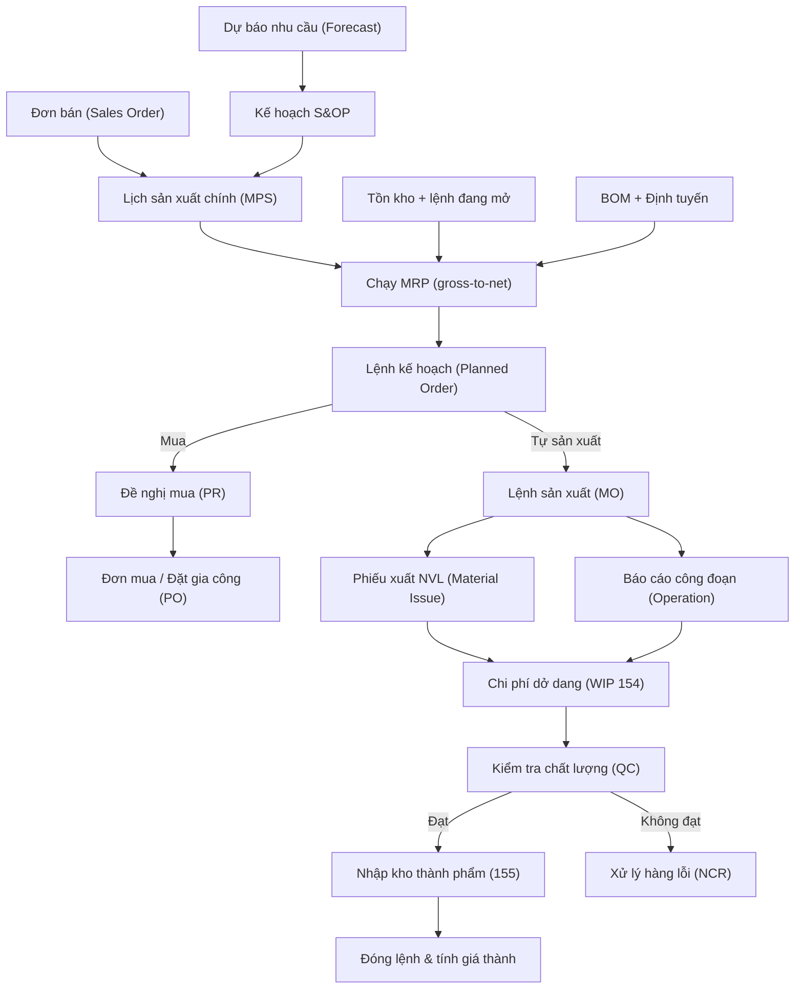
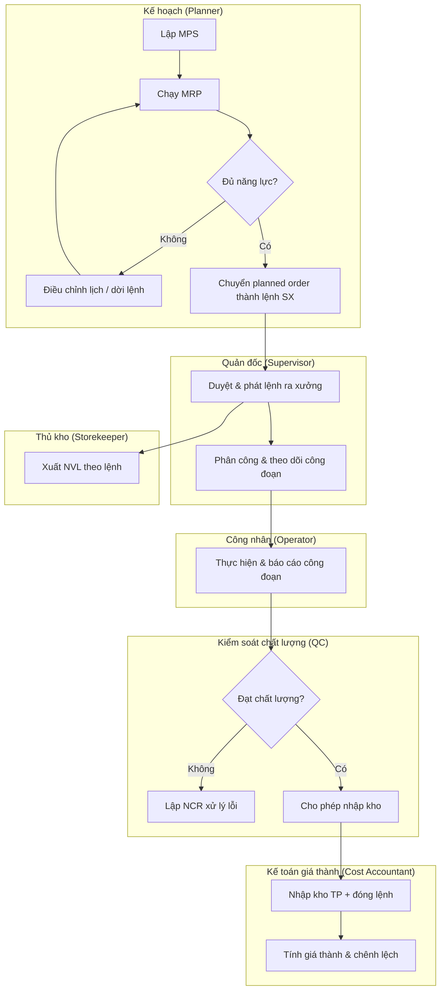
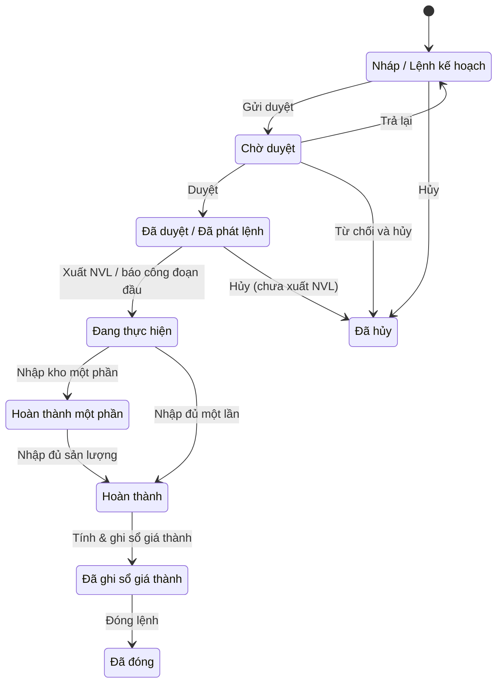

# MFG — Sản xuất & Hoạch định nhu cầu vật tư (Manufacturing & MRP)

> **Phạm vi:** Toàn bộ chuỗi hoạch định và thực thi sản xuất: hoạch định phân cấp (S&OP → MPS → MRP → hoạch định năng lực → điều độ xưởng/nhà cung cấp), định mức nguyên vật liệu (BOM), định tuyến & trung tâm làm việc (routing/work center), chạy MRP, lệnh sản xuất (production order), xuất vật tư (backflush/thủ công), báo cáo công đoạn, nhập kho thành phẩm, phế liệu/sản phẩm phụ, kiểm tra chất lượng (IQC/IPQC/OQC), gia công thuê ngoài, liên kết tính giá thành và KPI (OEE, tuân thủ tiến độ). **Module liên quan:** MFG (chính); tích hợp INV (kho), P2P (mua & gia công), O2C (đơn hàng/giao hàng), COST (giá thành), GL (sổ cái), QC/QM (chất lượng). **Chuẩn tham chiếu:** SAP PP/S4HANA, Oracle Manufacturing, Odoo Manufacturing, Microsoft Dynamics 365 SCM; chế độ kế toán Việt Nam theo Thông tư 99/2025/TT-BTC (doanh nghiệp lớn) và Thông tư 133/2016/TT-BTC (doanh nghiệp nhỏ và vừa). **Mã quy trình:** MFG.
>
> **Cập nhật đến: 2026-10-20 — quy định thay đổi thường xuyên; BA phải kiểm tra lại hiệu lực khi dùng cho dự án.**

## Mục lục
- [1. Mục đích & phạm vi](#1-mục-đích--phạm-vi-trongngoài-phạm-vi)
- [2. Vai trò tham gia](#2-vai-trò-tham-gia)
- [3. Danh mục (master data) tiên quyết](#3-danh-mục-master-data-tiên-quyết)
- [4. Chứng từ & luồng chứng từ](#4-chứng-từ--luồng-chứng-từ-document-flow)
- [5. Các bước quy trình chuẩn](#5-các-bước-quy-trình-chuẩn)
- [6. Vòng đời trạng thái lệnh sản xuất](#6-vòng-đời-trạng-thái-chứng-từ-chính-lệnh-sản-xuất)
- [7. Quy tắc nghiệp vụ & kiểm tra (validation)](#7-quy-tắc-nghiệp-vụ--kiểm-tra-validation-điển-hình)
- [8. Hạch toán kế toán](#8-hạch-toán-kế-toán)
- [9. Tham số hệ thống điển hình](#9-tham-số-hệ-thống-điển-hình)
- [10. Kiểm soát nội bộ & phân quyền](#10-kiểm-soát-nội-bộ--phân-quyền-sod-hạn-mức-duyệt-audit)
- [11. Báo cáo chuẩn](#11-báo-cáo-chuẩn)
- [12. Tích hợp với module khác](#12-tích-hợp-với-module-khác)
- [13. Biến thể & ngoại lệ](#13-biến-thể--ngoại-lệ)
- [14. Lỗi BA hay mắc & câu hỏi khảo sát](#14-lỗi-ba-hay-mắc--câu-hỏi-cần-hỏi-khách-hàng)
- [15. Nguồn tham khảo](#15-nguồn-tham-khảo)

---

## 1. Mục đích & phạm vi (trong/ngoài phạm vi)

**Mục đích:** Chuẩn hóa cách thiết kế chức năng cho module Sản xuất sao cho mọi luồng tuân theo mô hình hoạch định phân cấp chuẩn và mọi đặc tả đầy đủ (danh mục, chứng từ, trạng thái, quy tắc, hạch toán, phân quyền, báo cáo, tham số). MRP (Material Requirements Planning – Hoạch định nhu cầu vật tư) biến **nhu cầu độc lập** (đơn hàng, dự báo) thành **nhu cầu phụ thuộc** (linh kiện, bán thành phẩm) và đề xuất lệnh mua/lệnh sản xuất đúng số lượng, đúng thời điểm.

**Trong phạm vi:**
1. Hoạch định phân cấp: S&OP (Sales & Operations Planning) → MPS (Master Production Schedule – Lịch sản xuất chính) → MRP → RCCP/CRP (hoạch định năng lực) → điều độ xưởng và lịch cấp hàng nhà cung cấp.
2. Dữ liệu kỹ thuật: BOM đa cấp, phiên bản (version), linh kiện ảo (phantom), % hao hụt (scrap); định tuyến, công đoạn, trung tâm làm việc.
3. Chạy MRP: gross-to-net, xác định cỡ lô (lot sizing), bù lead time, sinh lệnh kế hoạch (planned order) → đề nghị mua (PR) / lệnh sản xuất.
4. Vòng đời lệnh sản xuất: lập → phát lệnh → đang thực hiện → hoàn thành → đóng; xuất vật tư (backflush/thủ công), báo cáo công đoạn, nhập kho thành phẩm.
5. Phế liệu, sản phẩm phụ, kiểm tra chất lượng (IQC/IPQC/OQC), gia công thuê ngoài (subcontracting – gia công), liên kết tính giá thành, KPI sản xuất.

**Ngoài phạm vi (xem file khác):**
- Chi tiết tính giá thành, phân bổ chi phí, chênh lệch định mức → xem `references/processes/costing.md`.
- Nghiệp vụ nhập/xuất kho, kiểm kê, độ chính xác tồn kho vận hành → xem `references/processes/inventory-warehouse.md`.
- Tạo đơn mua NVL và đơn đặt gia công (PO dịch vụ), đánh giá nhà cung cấp → xem `references/processes/p2p-procure-to-pay.md`.
- Đơn bán tạo nhu cầu độc lập, giao hàng thành phẩm → xem `references/processes/o2c-order-to-cash.md`.
- Hệ thống tài khoản chi tiết và chế độ kế toán → xem `references/regulations/vn-accounting.md`.

---

## 2. Vai trò tham gia

| Vai trò | Trách nhiệm | Quyền điển hình (theo hành động chuẩn) |
|---|---|---|
| Nhân viên kế hoạch sản xuất (Production Planner / MRP Controller) | Lập dự báo, MPS, chạy MRP, chuyển planned order thành lệnh sản xuất/PR | Xem, Tạo, Sửa, Gửi duyệt, Chạy MRP (chức năng riêng), In, Xuất file |
| Trưởng phòng Kế hoạch sản xuất (Planning/PPC Manager) | Duyệt MPS, duyệt/phát lệnh sản xuất, cân đối năng lực | Xem, Duyệt, Từ chối, Trả lại, Cấu hình tham số kế hoạch |
| Quản đốc phân xưởng (Production Supervisor) | Phân công, phát lệnh ra xưởng, xác nhận công đoạn, báo cáo sản lượng | Xem, Sửa (lệnh đã phát), Báo cáo công đoạn, Gửi duyệt nhập kho |
| Công nhân/Tổ trưởng sản xuất (Production Operator) | Thực hiện công đoạn, ghi nhận giờ máy/giờ công, số lượng tốt/hỏng | Xem (lệnh được giao), Báo cáo công đoạn (giới hạn) |
| Thủ kho NVL & thành phẩm (Storekeeper) | Xuất NVL theo lệnh, nhận phế liệu, nhập kho thành phẩm | Xem, Tạo phiếu xuất/nhập, In, (không được sửa định mức) |
| Nhân viên kiểm soát chất lượng (QC Staff / Quality Inspector) | Thực hiện IQC/IPQC/OQC, lập phiếu kiểm, quyết định đạt/không đạt | Xem, Tạo phiếu kiểm, Ghi kết quả, Gửi duyệt NCR |
| Trưởng phòng QC (QC Manager) | Duyệt xử lý hàng không đạt (NCR), phê duyệt nới lỏng (concession) | Xem, Duyệt, Từ chối, Cấu hình quy tắc lấy mẫu |
| Kế toán giá thành (Cost Accountant) | Thiết lập giá thành định mức, tính giá thành, tính & ghi sổ chênh lệch | Xem, Sửa (dữ liệu giá thành), Ghi sổ, Đóng kỳ giá thành |
| Kế toán kho (Inventory Accountant) | Đối chiếu xuất/nhập, ghi sổ biến động tồn kho WIP/thành phẩm | Xem, Ghi sổ, Bỏ ghi sổ, Đối chiếu |
| Giám đốc sản xuất/Nhà máy (Production/Plant Director) | Phê duyệt kế hoạch tổng, hạn mức ngoại lệ, ký duyệt S&OP | Xem, Duyệt (cấp cao), Cấu hình |

> Mã vai trò ví dụ: `ROLE-MFG-PLANNER`, `ROLE-MFG-SUPERVISOR`, `ROLE-MFG-OPERATOR`, `ROLE-MFG-STORE`, `ROLE-MFG-QC`, `ROLE-MFG-COST`.

---

## 3. Danh mục (master data) tiên quyết

| Danh mục | Trường quan trọng | Quy tắc chính |
|---|---|---|
| Mặt hàng/Sản phẩm (Item/Product – `MD-ITEM`) | Mã, loại (NVL/bán thành phẩm/thành phẩm), đơn vị tính, chiến lược nguồn cung (**mua/tự sản xuất** – make/buy), lead time, cỡ lô, tồn an toàn, % hao hụt, nhóm hoạch định (MRP type/planning method) | Sản phẩm "tự sản xuất" bắt buộc có BOM + routing; "mua" phải có nhà cung cấp & lead time mua. Đơn vị tính phải nhất quán với BOM. |
| Định mức nguyên vật liệu (Bill of Materials – BOM, `MD-BOM`) | Mã BOM, sản phẩm đích, phiên bản (version), ngày hiệu lực/hết hiệu lực, dòng linh kiện (component), định mức/đơn vị, % hao hụt dòng, cờ linh kiện ảo (phantom), BOM thay thế (alternate) | Một sản phẩm có thể nhiều phiên bản; chỉ **một** phiên bản hiệu lực tại một thời điểm theo ngày. BOM đa cấp (multilevel) không được tạo vòng lặp (A chứa B, B chứa A). Linh kiện ảo không nhập kho — MRP "xuyên qua" (explode through) tới linh kiện con [13]. |
| Định tuyến (Routing / Operations, `MD-ROUTING`) | Mã, sản phẩm, danh sách công đoạn (operation), trung tâm làm việc, thời gian setup, thời gian chạy/đơn vị (run time), công đoạn kiểm tra QC, trình tự | Trình tự công đoạn phải liên tục; mỗi công đoạn gắn đúng một trung tâm làm việc. Thời gian dùng để tính năng lực và (tùy chọn) chi phí nhân công/máy. |
| Trung tâm làm việc (Work Center / Resource, `MD-WORKCENTER`) | Mã, nhà máy/phân xưởng, công suất/ca, lịch làm việc, hệ số hiệu suất, đơn giá giờ máy/giờ công, tài khoản chi phí | Công suất khai báo là căn cứ tính tải (load) và **công suất bình thường** để phân bổ chi phí sản xuất chung (xem §7, §8). |
| Lịch làm việc & công suất (Working Calendar/Shift, `MD-CALENDAR`) | Ngày làm việc, ca, giờ/ca, ngày nghỉ lễ, thời gian dừng máy kế hoạch | Dùng để tính ngày phát lệnh/hoàn thành (lead time offset) và năng lực sẵn có. |
| Dự báo nhu cầu (Demand Forecast, `MD-FORECAST`) | Sản phẩm, kỳ (tuần/tháng), số lượng dự báo, phương pháp, độ tin cậy | Là đầu vào của S&OP/MPS; MRP tiêu thụ dự báo theo quy tắc **consume forecast** (đơn hàng thực tế "ăn" vào dự báo trong cùng kỳ để tránh đếm trùng). |
| Nhóm/chiến lược hoạch định (Planning Strategy) | MTS (Make-to-Stock), MTO (Make-to-Order), ATO/ETO | Quyết định MRP chạy theo dự báo hay theo đơn hàng; ảnh hưởng điểm tách (decoupling point). |
| Nhà cung cấp gia công (Subcontractor, `MD-SUBCON`) | Mã NCC, dịch vụ gia công, đơn giá gia công, lead time, NVL cấp | Liên kết P2P để tạo PO dịch vụ gia công; NVL gửi đi theo dõi riêng (xem §8, §13). |
| Giá thành định mức (Standard Cost, `MD-STDCOST`) | Thành phần: NVL, nhân công, máy, SX chung; kỳ hiệu lực | Dùng cho phương pháp giá thành định mức; chênh lệch so với thực tế → xem `costing.md`. |

> **Ba danh mục then chốt quyết định chất lượng MRP** là độ chính xác **tồn kho**, **BOM** và **định tuyến** (xem mục tiêu dữ liệu tại §7).

---

## 4. Chứng từ & luồng chứng từ (document flow)

| Chứng từ (VI / EN) | Mục đích | Tạo từ | Sinh ra | Ảnh hưởng (kho / công nợ / sổ cái) |
|---|---|---|---|---|
| Kế hoạch S&OP (S&OP Plan) | Cân đối cung–cầu tổng thể theo nhóm sản phẩm | Dự báo + mục tiêu KD | Đầu vào MPS | Không ghi sổ |
| Lịch sản xuất chính (Master Production Schedule – MPS) | Chốt kế hoạch sản xuất thành phẩm theo kỳ | S&OP, dự báo, đơn hàng | Đầu vào MRP | Không ghi sổ |
| Kết quả chạy MRP / Lệnh kế hoạch (MRP Result / Planned Order) | Đề xuất số lượng & thời điểm mua/sản xuất | MPS + BOM + tồn kho + đơn hàng | PR, Lệnh sản xuất | Không ghi sổ (chỉ đề xuất) |
| Đề nghị mua hàng (Purchase Requisition – PR) | Yêu cầu mua NVL/linh kiện thiếu | Planned order (mua) | PO (ở P2P) | Không ghi sổ |
| Lệnh sản xuất (Production/Manufacturing Order – MO; SAP: Production Order) | Cho phép & theo dõi sản xuất một lô | Planned order (sản xuất) hoặc tạo thủ công | Phiếu xuất NVL, báo cáo công đoạn, phiếu nhập TP | Không ghi sổ khi tạo; ghi khi xuất/nhập |
| Phiếu xuất NVL cho sản xuất (Material Issue / Goods Issue to Order) | Xuất NVL ra WIP | Lệnh sản xuất (thủ công hoặc backflush) | Ghi tiêu hao WIP | **Kho:** giảm NVL (152). **Sổ cái:** 621/154 ↔ 152 |
| Phiếu báo cáo công đoạn (Operation/Work Order Confirmation) | Ghi giờ công/giờ máy, SL tốt/hỏng từng công đoạn | Lệnh sản xuất | Cập nhật tiến độ, chi phí nhân công/máy | **Sổ cái (tùy cấu hình):** 622/627 |
| Phiếu nhập kho thành phẩm (Production Receipt / Goods Receipt from Order) | Nhập sản phẩm hoàn thành vào kho | Lệnh sản xuất | Tăng tồn thành phẩm | **Kho:** tăng TP (155). **Sổ cái:** 155 ↔ 154 |
| Phiếu kiểm tra chất lượng (Quality Inspection / QC Lot) | Ghi kết quả IQC/IPQC/OQC | PO nhận hàng, công đoạn, phiếu nhập TP | Quyết định đạt/không đạt, NCR | Không ghi sổ (có thể khóa kho chờ – quarantine) |
| Phiếu xử lý hàng không đạt (Non-Conformance Report – NCR) | Xử lý hàng lỗi: trả, sửa, loại, nới lỏng | Phiếu kiểm QC | Lệnh sửa/loại, phế liệu | Tùy xử lý |
| Phiếu nhập phế liệu/SP phụ (Scrap / By-product Receipt) | Nhập phế liệu, sản phẩm phụ thu hồi | Lệnh sản xuất | Tăng tồn phế liệu/SP phụ | **Kho:** tăng 152/155. **Sổ cái:** 152/155 ↔ 154 (giảm giá thành) |
| Đơn đặt gia công (Subcontract PO) | Thuê ngoài gia công một công đoạn/sản phẩm | Planned order hoặc lệnh SX | Xuất NVL gửi gia công, nhận bán TP | Xem P2P + §8 |
| Phiếu đóng lệnh & tính giá thành (Order Settlement / Close) | Tập hợp chi phí, tính giá thành thực tế, kết chuyển chênh lệch | Lệnh sản xuất hoàn thành | Bút toán giá thành | **Sổ cái:** kết chuyển 154, chênh lệch (xem costing.md) |

---

## 5. Các bước quy trình chuẩn

| # | Bước | Vai trò | Chứng từ | Hành động hệ thống | Trạng thái sau bước |
|---|---|---|---|---|---|
| 1 | Lập dự báo & S&OP | Planner / Director | Dự báo, S&OP | Gom dự báo, cân đối cung–cầu nhóm SP | Dự báo chốt |
| 2 | Lập & duyệt MPS | Planner → Planning Manager | MPS | Chốt SL thành phẩm theo kỳ, kiểm tra RCCP | MPS APPROVED |
| 3 | Chạy MRP | Planner | Kết quả MRP | Gross-to-net, lot sizing, bù lead time, sinh planned order | Có planned order |
| 4 | Duyệt & chuyển planned order | Planner → Manager | PR / MO | Chuyển thành PR (mua) và Lệnh SX (sản xuất) | PR/MO DRAFT |
| 5 | Kiểm tra năng lực (CRP) | Planner | Báo cáo tải | Tính tải vs công suất, dời/điều chỉnh lệnh | Lệnh khả thi |
| 6 | Duyệt & phát lệnh sản xuất | Planning Manager / Supervisor | Lệnh SX | Kiểm tồn NVL, phân bổ lô, in phiếu công đoạn | MO APPROVED → phát lệnh |
| 7 | Xuất NVL ra xưởng | Storekeeper (hoặc backflush tự động) | Phiếu xuất NVL | Trừ tồn NVL (152), ghi vào WIP (621→154) | MO IN_PROGRESS |
| 8 | Thực hiện & báo cáo công đoạn | Operator / Supervisor | Báo cáo công đoạn | Ghi giờ công/máy, SL tốt/hỏng, cập nhật tiến độ | MO IN_PROGRESS / PARTIAL |
| 9 | Kiểm tra chất lượng trong chuyền (IPQC) | QC Staff | Phiếu kiểm | Ghi kết quả, chặn công đoạn nếu không đạt | Đạt / NCR |
| 10 | Nhập kho thành phẩm (sau OQC) | QC → Storekeeper | Phiếu kiểm OQC, phiếu nhập TP | Kiểm đầu ra, nhập kho (155←154) | MO COMPLETED |
| 11 | Thu hồi phế liệu / SP phụ | Operator / Storekeeper | Phiếu nhập phế liệu | Nhập 152/155, giảm giá thành (←154) | Đã thu hồi |
| 12 | Đóng lệnh & tính giá thành | Supervisor → Cost Accountant | Phiếu đóng lệnh | Tập hợp chi phí, tính giá thành, kết chuyển chênh lệch | MO POSTED → CLOSED |
| 13 | Phân tích KPI | Planner / Director | Báo cáo KPI | Tính OEE, tuân thủ tiến độ, tỷ lệ phế | — |

---

## 6. Vòng đời trạng thái chứng từ chính (lệnh sản xuất)

| Từ | Hành động | Đến | Vai trò | Điều kiện |
|---|---|---|---|---|
| DRAFT | Gửi duyệt | PENDING | Planner | Đã gán BOM + routing + số lượng |
| PENDING | Duyệt | APPROVED | Planning Manager | Đủ NVL hoặc có PR bù; trong năng lực |
| PENDING | Trả lại | DRAFT | Planning Manager | Thiếu dữ liệu / sai số lượng |
| PENDING | Từ chối | CANCELLED | Planning Manager | Không còn nhu cầu |
| APPROVED | Xuất NVL / báo công đoạn | IN_PROGRESS | Storekeeper/Operator | Lệnh đã phát ra xưởng |
| IN_PROGRESS | Nhập kho một phần | PARTIAL | Storekeeper | SL nhập < SL lệnh |
| PARTIAL/IN_PROGRESS | Nhập đủ sản lượng | COMPLETED | Storekeeper | SL nhập ≥ SL lệnh (trong dung sai) |
| COMPLETED | Tính & ghi sổ giá thành | POSTED | Cost Accountant | Đã khóa tiêu hao, đủ chi phí |
| POSTED | Đóng lệnh | CLOSED | Supervisor/Cost Accountant | Không còn giao dịch chờ |
| DRAFT/APPROVED | Hủy | CANCELLED | Manager | Chưa phát sinh tiêu hao |

> **Ánh xạ biến thể theo hệ thống (ghi chú, không thay mã chuẩn):** SAP PP: `CRTD` (tạo) → `REL` (phát lệnh) → `PCNF` (xác nhận một phần) / `CNF` (xác nhận cuối) → `TECO` (kỹ thuật hoàn tất) → `CLSD` (đóng) [14]. Odoo: `Draft` → `Confirmed` → `In Progress` → `To Close` → `Done` (và `Cancelled`) [13]. Dynamics 365 SCM: `Created` → `Estimated` → `Scheduled` → `Released` → `Started` → `Reported as finished` → `Ended` [15].

---

## 7. Quy tắc nghiệp vụ & kiểm tra (validation) điển hình

Mã quy tắc ví dụ: `BR-MFG-01` …

1. **BR-MFG-01 — Logic MRP gross-to-net (lưới–ròng):** Với mỗi mặt hàng theo từng kỳ:
   `Nhu cầu ròng (Net Req) = Nhu cầu gộp (Gross Req) − Lượng về theo lịch (Scheduled Receipts) − Tồn dự kiến đầu kỳ (Projected On-Hand) + Tồn an toàn (Safety Stock)`.
   Nếu Net Req ≤ 0 → không đề xuất. Nếu > 0 → tạo **planned order receipt** (đã lot-sized) và **planned order release** lùi theo lead time [10].
2. **BR-MFG-02 — Bù lead time (offset):** `Ngày phát lệnh = Ngày cần hàng − (Lead time mua hoặc Lead time sản xuất)`, tính theo lịch làm việc (bỏ ngày nghỉ). Lead time sản xuất = Σ (setup + run time từng công đoạn) + thời gian chờ/di chuyển (queue/move).
3. **BR-MFG-03 — Nổ BOM & hao hụt linh kiện (scrap):** Nhu cầu linh kiện gộp:
   `Nhu cầu linh kiện = SL cha cần sản xuất × Định mức/đơn vị × (1 + % hao hụt linh kiện)`.
   Khi khai hao hụt theo kiểu "yield" (sản lượng đạt), dùng: `SL phải phát lệnh = SL cần nhập kho ÷ (1 − % phế liệu lũy kế)`. BA phải hỏi rõ hệ thống dùng công thức nào — hai cách cho kết quả khác nhau.
4. **BR-MFG-04 — Phương pháp xác định cỡ lô (lot sizing):** hỗ trợ tối thiểu: **Lot-for-Lot (L4L)** (đúng nhu cầu ròng), **Fixed Order Quantity (FOQ)**, **Economic Order Quantity (EOQ)**, **Period Order Quantity (POQ)**, **Min–Max (tái đặt theo điểm đặt hàng)**. Áp ràng buộc: bội số đóng gói (rounding/lot multiple), lô tối thiểu/tối đa.
5. **BR-MFG-05 — Linh kiện ảo (phantom):** Không hoạch định/không nhập kho riêng; MRP "xuyên qua" phantom để lấy nhu cầu linh kiện con, và xuất thẳng linh kiện con khi backflush [13].
6. **BR-MFG-06 — Một phiên bản BOM hiệu lực:** Tại mọi thời điểm chỉ một phiên bản BOM/định tuyến hiệu lực theo khoảng ngày; cấm trùng khoảng hiệu lực. Cấm BOM đệ quy (vòng lặp cha–con).
7. **BR-MFG-07 — Hoạch định năng lực (capacity):** `Tải trung tâm (Load) = Σ (SL lệnh × run time/đơn vị) + setup`. `% Sử dụng = Tải ÷ Công suất sẵn có`. RCCP kiểm tra sơ bộ ở mức MPS; CRP (Capacity Requirements Planning) kiểm tra chi tiết sau MRP. Nếu % Sử dụng > 100% → cảnh báo quá tải, đề xuất dời lệnh/tăng ca/thuê ngoài.
8. **BR-MFG-08 — Khóa phát lệnh khi thiếu dữ liệu:** Không cho phát lệnh (APPROVED) nếu thiếu BOM/routing hiệu lực, hoặc số lượng ≤ 0, hoặc trung tâm làm việc không có công suất.
9. **BR-MFG-09 — Backflush (trừ lùi NVL):** Khi bật backflush, NVL bị trừ tự động theo BOM tại thời điểm cấu hình (khi phát lệnh / hoàn thành công đoạn / nhập kho): `SL backflush = SL hoàn thành × Định mức × (1 + % hao hụt)`. Chỉ backflush linh kiện đủ điều kiện (không phải hàng theo lô/serial bắt buộc quét thủ công).
10. **BR-MFG-10 — Dung sai hoàn thành (over/under-completion):** Cho phép nhập kho lệch trong khoảng `± tolerance %` so với SL lệnh; ngoài khoảng phải duyệt. Khi nhập đủ hoặc trong dung sai → COMPLETED.
11. **BR-MFG-11 — Chặn nhập kho khi chưa QC (nếu bật):** Nếu sản phẩm thuộc nhóm bắt buộc OQC, hệ thống đưa vào kho chờ (quarantine) và chỉ cho phép dùng/bán khi QC "Đạt".
12. **BR-MFG-12 — Phân bổ chi phí sản xuất chung theo công suất bình thường:** Chi phí sản xuất chung **biến đổi** phân bổ hết theo chi phí thực tế; chi phí **cố định** chỉ phân bổ vào giá thành theo **công suất bình thường**; phần không phân bổ (khi sản lượng < công suất bình thường) đưa vào giá vốn (632) [4]. (Nguyên tắc nhất quán VAS 02 "Hàng tồn kho".)
13. **BR-MFG-13 — Mục tiêu độ chính xác dữ liệu cho MRP:** Dữ liệu phải được đo và chứng minh đạt ngưỡng; thiếu chính xác làm MRP sai hàng loạt:

    | Dữ liệu | Mục tiêu thường trích dẫn | Nguồn / ghi chú |
    |---|---|---|
    | Độ chính xác tồn kho (Inventory Record Accuracy – IRA) | **≥ 95%** (world-class hướng tới 99,5%) | Oliver Wight — đo liên tục, duy trì bằng kiểm kê quay vòng (cycle counting) [8][9] |
    | Độ chính xác BOM (BOM accuracy) | thường **98–99%** | Quy ước ngành; nhà cung cấp MRP khuyến nghị 95–98% cho dữ liệu nền [10] ⚠️ CHƯA XÁC MINH là chuẩn chính thức của một tổ chức đơn lẻ |
    | Độ chính xác định tuyến (Routing accuracy) | thường **95–98%** | Quy ước ngành [10] ⚠️ CHƯA XÁC MINH ngưỡng chính thức |

14. **BR-MFG-14 — Nhất quán đơn vị tính:** Đơn vị trên BOM, phiếu xuất, báo cáo công đoạn và nhập kho phải quy đổi nhất quán; hệ số quy đổi phải khai trong danh mục mặt hàng.
15. **BR-MFG-15 — Đóng lệnh:** Chỉ đóng (CLOSED) khi: đã nhập đủ/khóa SL, đã backflush/xuất hết NVL kế hoạch, đã QC, đã tính giá thành và kết chuyển chênh lệch; không còn phiếu công đoạn hay QC chờ.
16. **BR-MFG-16 — Chỉ số KPI sản xuất (công thức):**
    - **OEE (Overall Equipment Effectiveness – Hiệu suất thiết bị tổng thể):** `OEE = Khả dụng (Availability) × Hiệu suất (Performance) × Chất lượng (Quality)`, với Availability = thời gian chạy thực ÷ thời gian kế hoạch; Performance = (SL thực × thời gian chu kỳ lý tưởng) ÷ thời gian chạy; Quality = SL tốt ÷ tổng SL. Ba thành phần nhân nhau nên tổn thất **cộng dồn** (ví dụ 90% × 90% × 90% = 72,9%). Chuẩn **world-class ≈ 85%** cho sản xuất rời rạc (không phải mục tiêu phổ quát; thực tế nhiều nhà máy ở mức 60–85%) [11][12].
    - **Tuân thủ tiến độ (Schedule Adherence):** `= Số lệnh hoàn thành đúng hạn ÷ Tổng số lệnh theo kế hoạch × 100%`.
    - **Tỷ lệ phế liệu (Scrap rate):** `= SL hỏng/phế ÷ Tổng SL sản xuất × 100%`.
    - **Năng suất (Throughput):** SL hoàn thành trên một đơn vị thời gian.

---

## 8. Hạch toán kế toán

> **Chế độ kế toán áp dụng (xác định tại 2026-10-20):** **Thông tư 99/2025/TT-BTC** — ban hành 27/10/2025, **hiệu lực 01/01/2026**, **thay thế Thông tư 200/2014/TT-BTC** [2] cho doanh nghiệp lớn/áp dụng chế độ doanh nghiệp [1]. Doanh nghiệp nhỏ và vừa vẫn áp dụng **Thông tư 133/2016/TT-BTC** (chưa bị thay thế; có thể tự nguyện chuyển lên TT99) [3]. Tài khoản dưới đây theo **TT99/2025**.
>
> **Thay đổi chính so với TT200 có ảnh hưởng tới sản xuất:** TK **631 (Giá thành sản xuất)** bị **loại bỏ** — kể cả phương pháp kiểm kê định kỳ cũng tập hợp chi phí dở dang vào **TK 154** [6]; TK **611 (Mua hàng)** cũng bị loại bỏ — danh mục 71 tài khoản của TT99 không còn 611 lẫn 631 [7]. Các TK **621, 622, 623, 627** vẫn giữ nguyên bản chất [4][7]. TK **155** đổi tên thành **"Sản phẩm"** (TT200 gọi "Thành phẩm") [7].

**Tài khoản thường dùng (TT99/2025):** 152 (Nguyên liệu, vật liệu), 153 (Công cụ, dụng cụ), 154 (Chi phí sản xuất, kinh doanh dở dang – WIP), 155 (Sản phẩm/Thành phẩm), 157 (Hàng gửi bán), 621 (Chi phí NVL trực tiếp), 622 (Chi phí nhân công trực tiếp), 623 (Chi phí sử dụng máy thi công – xây lắp), 627 (Chi phí sản xuất chung), 632 (Giá vốn hàng bán), 334 (Phải trả người lao động), 338 (Phải trả, phải nộp khác), 214 (Hao mòn TSCĐ), 331 (Phải trả người bán), 133 (Thuế GTGT được khấu trừ). Hàng nhận giữ hộ/nhận gia công của khách: theo dõi ngoài bảng (**TK 002** theo TT200) — ⚠️ CHƯA XÁC MINH còn áp dụng theo TT99 vì danh mục tài khoản TT99 công bố không liệt kê tài khoản ngoài bảng [7]; BA đối chiếu Phụ lục II.

| Nghiệp vụ | Nợ | Có | Ghi chú |
|---|---|---|---|
| Xuất NVL cho sản xuất | 621 | 152 | Theo phiếu xuất hoặc backflush |
| Lương & trích theo lương công nhân trực tiếp | 622 | 334, 338 | |
| Chi phí sản xuất chung phát sinh | 627 | 334, 338, 152, 153, 214, 111/112/331 | Khấu hao máy, điện, lương quản đốc… |
| Kết chuyển NVL trực tiếp vào WIP | **154** (trong định mức); **632** (phần vượt mức bình thường) | 621 | Phần vượt định mức → giá vốn [4] |
| Kết chuyển nhân công trực tiếp | 154 (trong mức); 632 (vượt mức) | 622 | [4] |
| Phân bổ SX chung — đạt/ vượt công suất bình thường | 154 | 627 | Phân bổ hết [4] |
| Phân bổ SX chung — dưới công suất (phần cố định không phân bổ) | 632 | 627 | Phần còn lại vào 154 [4] |
| Nhập kho thành phẩm/sản phẩm hoàn thành | 155 | 154 | Theo giá thành thực tế [4] |
| Giao thẳng cho khách, không qua kho | 632 | 154 | [4] |
| Phế liệu thu hồi nhập kho | 152 | 154 | Giảm giá thành lô [4] |
| Sản phẩm phụ (by-product) nhập kho | 152 / 155 | 154 | Giảm giá thành SP chính (giá trị thuần có thể thực hiện) |
| SP hỏng ngoài định mức, bắt bồi thường | 1388, 334 | 154 | Trừ lương/đòi bồi thường [4] |
| **Gia công ngoài:** xuất NVL gửi đi gia công | 154 (hoặc 152 chi tiết "NVL gửi gia công") | 152 | Vẫn thuộc sở hữu DN |
| **Gia công ngoài:** chi phí thuê gia công | 154 | 331 | Thuế GTGT: Nợ 133 |
| **Gia công ngoài:** nhận lại hàng nhập kho | 152 / 155 | 154 | [4] |
| **Nhận gia công cho khách** (hàng của khách) | — theo dõi ngoài bảng (**TK 002** theo TT200; ⚠️ CHƯA XÁC MINH còn theo TT99) | — | Không ghi vào tồn kho; chỉ ghi nhận doanh thu phí gia công (xem o2c) [5] |
| Xuất bán thành phẩm (giá vốn) | 632 | 155 | Khi xuất bán — xem `o2c-order-to-cash.md` |

> **Khác biệt TT133 (DNNVV):** TT133 **không có** TK 621/622/627/631; chi phí sản xuất tập hợp **trực tiếp vào TK 154** (chi tiết theo khoản mục), rồi kết chuyển 155/632. Khi làm dự án cho DNNVV, dùng 154 + chi tiết thay cho cụm 62x. Chi tiết chế độ: xem `references/regulations/vn-accounting.md`.

---

## 9. Tham số hệ thống điển hình

| Tham số | Kiểu | Giá trị gợi ý | Phạm vi | Ảnh hưởng |
|---|---|---|---|---|
| `PRM-MFG-001` Phương pháp xuất NVL | Enum | Backflush / Thủ công / Hỗn hợp | Mặt hàng / nhóm | Cách trừ NVL & thời điểm ghi WIP |
| `PRM-MFG-002` Điểm backflush | Enum | Khi phát lệnh / Khi báo công đoạn / Khi nhập kho | Mặt hàng / sơ đồ | Thời điểm ghi tiêu hao 621→154 |
| `PRM-MFG-003` Kiểu chạy MRP | Enum | Tái tạo toàn bộ (regenerative) / Thay đổi ròng (net change) | Hệ thống / nhà máy | Phạm vi & tốc độ chạy MRP |
| `PRM-MFG-004` Hàng rào thời gian (planning / demand time fence) | Số (ngày) | 7–30 ngày | Mặt hàng | Trong time fence không tự ý dời/sinh lệnh |
| `PRM-MFG-005` Phương pháp cỡ lô (lot sizing) | Enum | L4L / FOQ / EOQ / POQ / Min-Max | Mặt hàng | Số lượng đề xuất của MRP |
| `PRM-MFG-006` Tồn an toàn / lead time an toàn | Số | Theo lớp ABC | Mặt hàng | Mức đệm chống thiếu hàng |
| `PRM-MFG-007` % hao hụt mặc định (scrap) | Số (%) | 0–5% | Mặt hàng / BOM | Số lượng phát lệnh & nhu cầu linh kiện |
| `PRM-MFG-008` Cho phép tồn kho/WIP âm | Boolean | Tắt (khuyến nghị) | Hệ thống / kho | Kiểm soát tính toàn vẹn tồn kho |
| `PRM-MFG-009` Dung sai hoàn thành (over/under %) | Số (%) | ±5–10% | Mặt hàng | Ngưỡng nhập kho không cần duyệt thêm |
| `PRM-MFG-010` Bắt buộc QC trước nhập kho | Boolean | Bật cho nhóm rủi ro | Nhóm mặt hàng | Đưa vào kho chờ (quarantine) |
| `PRM-MFG-011` Tự động chuyển planned order → PR/MO | Enum | Thủ công / Tự động trong firm horizon | Hệ thống | Mức tự động hóa kế hoạch |
| `PRM-MFG-012` Công suất bình thường (normal capacity) | Số (giờ/SL) | Theo trung tâm | Trung tâm làm việc | Căn cứ phân bổ SX chung cố định (§8) |
| `PRM-MFG-013` Phương pháp & chiến lược giá thành | Enum | Định mức (standard) / Thực tế (actual); theo đơn (job) / theo quá trình (process) | Công ty / nhóm SP | Cách tính & ghi chênh lệch (costing.md) |
| `PRM-MFG-014` Số bước kho sản xuất | Enum | 1 bước / 2 bước / 3 bước | Nhà máy / SP | Có/không bước soạn NVL & cất TP riêng [13] |
| `PRM-MFG-015` Cho báo cáo công đoạn không theo thứ tự | Boolean | Tắt (khuyến nghị) | Định tuyến | Ép đúng trình tự công đoạn |

---

## 10. Kiểm soát nội bộ & phân quyền (SoD, hạn mức duyệt, audit)

1. **Phân tách nhiệm vụ (SoD):**
   - Người **chạy MRP / lập lệnh** ≠ người **duyệt & phát lệnh** ≠ người **nhập kho thành phẩm** ≠ người **tính & ghi sổ giá thành**.
   - Người **báo cáo sản lượng** (Operator/Supervisor) ≠ người **kiểm tra chất lượng** (QC) — tránh tự xác nhận hàng của mình.
   - Người **xuất NVL** (Thủ kho) ≠ người **phê duyệt định mức BOM** (Kỹ thuật/Planning).
2. **Hạn mức duyệt theo cấp:** phát lệnh giá trị lớn, nới dung sai hoàn thành, xử lý NCR bằng nới lỏng (concession), hủy lệnh đã phát → cần cấp duyệt cao hơn (Manager/Director). Cấu hình ma trận duyệt theo giá trị WIP hoặc số lượng.
3. **Kiểm soát sửa sau phát lệnh:** sau khi APPROVED/IN_PROGRESS, thay đổi BOM/số lượng/định tuyến phải qua kiểm soát thay đổi (change order) và ghi nhật ký lý do.
4. **Dấu vết kiểm toán (audit trail):** lưu người–thời điểm cho mọi hành động (tạo, duyệt, phát lệnh, xuất NVL, báo công đoạn, nhập kho, đóng lệnh, ghi sổ); không cho xóa — chỉ Hủy/Đảo (REVERSED) chứng từ đã ghi sổ.
5. **Kiểm soát dữ liệu nền:** chỉ vai trò được cấp mới `Cấu hình` BOM, định tuyến, trung tâm làm việc, giá thành định mức; thay đổi giá thành định mức phải theo kỳ hiệu lực và được duyệt.
6. **Kiểm kê quay vòng (cycle counting):** bắt buộc để duy trì IRA ≥ 95% phục vụ MRP [8]; chênh lệch kiểm kê phải được duyệt trước khi điều chỉnh (xem `inventory-warehouse.md`).
7. **Khóa kỳ giá thành:** sau khi tính giá thành và chốt kỳ, khóa ghi sổ kỳ đó; điều chỉnh phải bằng bút toán đảo có phê duyệt.

---

## 11. Báo cáo chuẩn

| Báo cáo | Mục đích | Chiều phân tích / bộ lọc | Bắt buộc theo luật? |
|---|---|---|---|
| `RPT-MFG-01` Kết quả MRP / Nhu cầu vật tư (MRP / Planned Orders) | Xem đề xuất mua/sản xuất, cảnh báo thiếu/thừa | Theo mặt hàng, kỳ, nhà máy, nguồn (mua/SX) | Không |
| `RPT-MFG-02` Lịch sản xuất chính (MPS) | Theo dõi kế hoạch thành phẩm theo kỳ | SP, kỳ, dây chuyền | Không |
| `RPT-MFG-03` Tiến độ lệnh sản xuất (Production Order Status / WIP) | Trạng thái, % hoàn thành từng lệnh | Lệnh, SP, phân xưởng, trạng thái | Không |
| `RPT-MFG-04` Tiêu hao vật tư thực tế vs định mức (Material Consumption/Variance) | So sánh NVL thực dùng với BOM | Lệnh, SP, linh kiện | Không |
| `RPT-MFG-05` Hiệu suất thiết bị tổng thể (OEE) | Đo Availability × Performance × Quality | Trung tâm làm việc, ca, kỳ | Không |
| `RPT-MFG-06` Tuân thủ tiến độ (Schedule Adherence / On-time) | Tỷ lệ lệnh hoàn thành đúng hạn | Lệnh, dây chuyền, kỳ | Không |
| `RPT-MFG-07` Phế liệu & tỷ lệ lỗi (Scrap & Defect Rate) | Theo dõi phế liệu, hàng hỏng | SP, công đoạn, nguyên nhân | Không |
| `RPT-MFG-08` Giá thành sản xuất & chênh lệch (Production Cost/Variance) | Giá thành thực tế vs định mức | Lệnh, SP, thành phần chi phí | Không (quản trị) — xem `costing.md` |
| `RPT-MFG-09` Chất lượng (QC Pass/Fail, NCR) | Kết quả IQC/IPQC/OQC, hàng không đạt | NCC, SP, công đoạn, loại lỗi | Không |
| `RPT-MFG-10` Tải năng lực (Capacity Load / CRP) | So tải vs công suất từng trung tâm | Trung tâm làm việc, tuần | Không |
| `RPT-MFG-11` Tồn kho dở dang (WIP) | Giá trị & tuổi WIP theo lệnh | Lệnh, SP, phân xưởng | Phục vụ thuyết minh tồn kho BCTC (gián tiếp) |
| `RPT-MFG-12` Tiến độ gia công ngoài (Subcontract) | Theo dõi NVL gửi & bán TP nhận lại | NCC gia công, lệnh | Không |

> Số liệu tồn kho WIP/thành phẩm chảy vào Báo cáo tình hình tài chính (Bảng cân đối kế toán) theo TT99/2025 — xem `references/regulations/vn-accounting.md`. Bản thân các báo cáo sản xuất ở trên là **báo cáo quản trị**, không phải báo cáo luật định.

---

## 12. Tích hợp với module khác (ảnh hưởng dữ liệu hai chiều)

1. **INV — Kho (`inventory-warehouse.md`):** MRP đọc tồn kho & lệnh đang mở; xuất NVL làm giảm tồn, nhập TP/phế liệu làm tăng tồn. Độ chính xác tồn kho quyết định chất lượng MRP (IRA ≥ 95% [8]). Kho chờ QC (quarantine) chặn hàng chưa đạt.
2. **P2P — Mua & gia công (`p2p-procure-to-pay.md`):** planned order (mua) → PR → PO; đơn đặt gia công là PO dịch vụ; lead time mua lấy từ hợp đồng/NCC. MRP đọc lịch về hàng (scheduled receipts) từ PO.
3. **O2C — Bán hàng (`o2c-order-to-cash.md`):** đơn bán (MTO) và dự báo tạo nhu cầu độc lập cho MPS; giao thành phẩm lấy từ kho TP; quy tắc "consume forecast" tránh đếm trùng.
4. **COST — Giá thành (`costing.md`):** lệnh sản xuất là đối tượng tập hợp chi phí; đóng lệnh kích hoạt tính giá thành và kết chuyển chênh lệch (định mức ↔ thực tế). Giá thành thực tế cập nhật giá trị tồn TP.
5. **GL — Sổ cái (`r2r-general-ledger.md`):** mọi bút toán §8 (xuất NVL, phân bổ chi phí, nhập TP, chênh lệch) kết chuyển về sổ cái; WIP (154) và TP (155) lên Báo cáo tình hình tài chính.
6. **QC/QM — Chất lượng:** IQC gắn với nhận hàng mua (P2P), IPQC gắn công đoạn, OQC gắn nhập kho TP; kết quả QC khóa/mở hàng cho bước sau.
7. **FA/Bảo trì — Thiết bị:** trung tâm làm việc gắn máy móc (TSCĐ 211/214); thời gian dừng bảo trì ảnh hưởng công suất sẵn có và OEE.

---

## 13. Biến thể & ngoại lệ

1. **Nhập kho một phần (partial receipt):** nhập dần nhiều lần → trạng thái PARTIAL cho tới khi đủ; mỗi lần nhập ghi 155←154 theo giá thành tạm/định mức, chốt khi đóng lệnh.
2. **Lệnh sản xuất 1 bước / 2 bước / 3 bước:** 1 bước = sản xuất và nhập kho ngay; 2 bước = thêm soạn/cấp NVL (pick); 3 bước = thêm cất TP vào kho đích [13]. Chọn theo mức kiểm soát kho của khách.
3. **Backorder sản xuất (manufacturing backorder):** khi SL hoàn thành < SL lệnh, hệ thống có thể tạo lệnh con cho phần còn thiếu [13].
4. **Tách/gộp lệnh (split/merge MO):** tách lệnh lớn thành nhiều lô máy; gộp lệnh nhỏ cùng SP để tối ưu setup [13].
5. **Tháo rã / tái chế (unbuild/dismantling):** tháo thành phẩm trả lại linh kiện (ghi ngược 155→152) khi cần sửa chữa/thu hồi [13].
6. **Thay thế linh kiện (substitute/alternate BOM):** khi thiếu linh kiện chính, dùng linh kiện thay thế theo BOM thay thế đã duyệt; ghi nhận chênh lệch chi phí.
7. **Sản phẩm phụ & đồng sản phẩm (by-product / co-product):** by-product giảm giá thành SP chính; co-product phân bổ chi phí theo hệ số — làm rõ cách phân bổ (xem `costing.md`).
8. **Hàng không đạt (NCR):** xử lý theo nhánh: trả lại NCC (hàng mua), sửa lại (rework – tạo lệnh sửa), loại bỏ (scrap), hoặc nới lỏng (concession) có duyệt.
9. **Gia công ngoài (subcontracting – gia công):** NVL gửi đi vẫn thuộc sở hữu DN (theo dõi NVL gửi gia công); nhận lại bán thành phẩm/thành phẩm; phí gia công vào 154 (§8) [4][5]. **Nhận gia công cho khách:** hàng của khách theo dõi ngoài bảng (TK 002 theo TT200 — ⚠️ CHƯA XÁC MINH còn áp dụng theo TT99), chỉ ghi nhận doanh thu phí gia công (xem o2c).
10. **Sửa/hủy sau duyệt:** sau phát lệnh, sửa BOM/số lượng phải qua change order; hủy lệnh đã xuất NVL phải hoàn/điều chỉnh WIP trước khi CANCELLED.
11. **Đa tiền tệ:** chi phí gia công ngoài/NCC nước ngoài theo ngoại tệ → quy đổi theo tỷ giá ghi nhận; chênh lệch tỷ giá xử lý ở P2P/GL. Giá thành nội bộ luôn quy về VND.
12. **Đảo bút toán (reverse):** nhập kho/tiêu hao ghi sai → Bỏ ghi sổ (Unpost) nếu còn trong kỳ mở, hoặc Đảo (REVERSED) nếu kỳ đã khóa; cấm xóa chứng từ đã ghi sổ.

---

## 14. Lỗi BA hay mắc & câu hỏi cần hỏi khách hàng

**Lỗi thường gặp:**
- Mô tả MRP như một "nút bấm" mà bỏ qua chất lượng dữ liệu nền (BOM/định tuyến/tồn kho) — MRP rác vào, rác ra.
- Nhầm lẫn giữa **nhu cầu độc lập** (đơn/dự báo) và **nhu cầu phụ thuộc** (linh kiện) → đặt dự báo cho cả linh kiện gây đếm trùng.
- Bỏ qua hoạch định năng lực (RCCP/CRP) → kế hoạch bất khả thi về công suất.
- Trộn lẫn backflush và xuất thủ công mà không định rõ **điểm** trừ NVL → sai thời điểm và giá trị WIP.
- Thiết kế lệnh sản xuất thiếu trạng thái "đã phát lệnh" (released) và cơ chế đóng lệnh/tính giá thành.
- Không xử lý phế liệu/sản phẩm phụ/hàng hỏng → giá thành sai.
- Dùng tài khoản TT200 (ví dụ 631) đã bị loại bỏ trong TT99/2025 [6].
- Bỏ quên gia công ngoài và phân biệt "gửi gia công" vs "nhận gia công" (hàng nhận gia công theo dõi ngoài bảng, không ghi vào tồn kho) [5].

**Câu hỏi khảo sát cần hỏi khách hàng:**
1. Doanh nghiệp sản xuất theo chiến lược nào: tồn kho (MTS), theo đơn (MTO), lắp ráp theo đơn (ATO) hay thiết kế theo đơn (ETO)?
2. BOM có đa cấp, có phiên bản theo thời gian, có linh kiện ảo (phantom) không? Khai % hao hụt ở cấp linh kiện hay cấp sản lượng?
3. Có dùng định tuyến & trung tâm làm việc để tính năng lực và chi phí nhân công/máy không, hay chỉ quản lý chi phí tổng?
4. MRP chạy định kỳ (hằng ngày/tuần) hay theo thay đổi ròng (net change)? Có hàng rào thời gian (time fence) không?
5. Phương pháp cỡ lô mong muốn cho từng nhóm hàng (L4L/FOQ/EOQ/POQ/Min-Max)? Có ràng buộc lô tối thiểu/bội số đóng gói?
6. Lead time sản xuất/mua lấy từ đâu (cố định hay tính từ định tuyến)? Tồn an toàn theo lớp ABC?
7. Xuất NVL bằng backflush hay thủ công? Backflush tại thời điểm nào (phát lệnh/công đoạn/nhập kho)?
8. Có báo cáo công đoạn chi tiết (giờ công/giờ máy, SL tốt/hỏng) không? Mức chi tiết tới công đoạn hay tới lệnh?
9. Quy trình QC: cần IQC (đầu vào), IPQC (trong chuyền), OQC (đầu ra) ở khâu nào? Quy tắc lấy mẫu & tiêu chí đạt? Có kho chờ (quarantine) không?
10. Có gia công thuê ngoài không? Gửi NVL đi hay chỉ thuê công? Có nhận gia công cho khách không (TK 002)?
11. Phương pháp tính giá thành: định mức hay thực tế? Theo đơn (job) hay quá trình (process)? Công suất bình thường để phân bổ chi phí sản xuất chung là bao nhiêu?
12. Xử lý phế liệu, sản phẩm phụ, đồng sản phẩm, hàng hỏng như thế nào về mặt kho và giá thành?
13. KPI theo dõi: OEE, tuân thủ tiến độ, tỷ lệ phế, năng suất? Nguồn dữ liệu đo từ đâu?
14. Dung sai hoàn thành (over/under %) cho nhập kho là bao nhiêu? Ai duyệt khi vượt?
15. Doanh nghiệp áp dụng TT99/2025 (lớn) hay TT133/2016 (DNNVV)? (Ảnh hưởng cụm tài khoản 62x vs 154.)

---

## 15. Nguồn tham khảo

[1] Thông tư 99/2025/TT-BTC — Hướng dẫn Chế độ kế toán doanh nghiệp (thay thế TT200/2014, hiệu lực 01/01/2026) — https://thuvienphapluat.vn/van-ban/Doanh-nghiep/Thong-tu-99-2025-TT-BTC-huong-dan-Che-do-ke-toan-doanh-nghiep-565484.aspx (truy cập 2026-10-20)
[2] Thông tư 200/2014/TT-BTC — Chế độ kế toán doanh nghiệp (bị thay thế từ 01/01/2026; dùng để đối chiếu) — https://thuvienphapluat.vn/van-ban/Ke-toan-Kiem-toan/Thong-tu-200-2014-TT-BTC-huong-dan-Che-do-ke-toan-Doanh-nghiep-263599.aspx (truy cập 2026-10-20)
[3] Thông tư 133/2016/TT-BTC — Chế độ kế toán doanh nghiệp nhỏ và vừa (còn hiệu lực) — https://vbpl.vn/botaichinh/Pages/vbpq-van-ban-goc.aspx?ItemID=113560 (truy cập 2026-10-20)
[4] MISA AMIS — Tài khoản 154 theo Thông tư 99/2025: nguyên tắc & cách hạch toán (tập hợp 621/622/623/627, phân bổ SX chung theo công suất bình thường, phế liệu, gia công) — https://amis.misa.vn/253579/tai-khoan-154-theo-thong-tu-99/ (truy cập 2026-10-20)
[5] MISA AMIS — Tài khoản 156 theo Thông tư 99/2025 (hàng nhận giữ hộ/nhận gia công theo dõi ngoài bảng – TK 002, không ghi vào tồn kho) — https://amis.misa.vn/253807/tai-khoan-156-theo-thong-tu-99/ (truy cập 2026-10-20)
[6] MAN.net.vn — Hệ thống tài khoản theo Thông tư 99/2025: tài khoản mới & tài khoản bị loại bỏ (631 gộp vào 154; 611 loại bỏ) — https://man.net.vn/he-thong-tai-khoan-tt99-tk-215-332/ (truy cập 2026-10-20)
[7] LuatVietnam — Danh mục tài khoản kế toán theo Thông tư 99/2025/TT-BTC — https://luatvietnam.vn/thue-phi-le-phi/danh-muc-tai-khoan-ke-toan-theo-thong-tu-99-2025-tt-btc-565-105326-article.html (truy cập 2026-10-20)
[8] Oliver Wight Americas — Glossary (Closed-loop MRP; mục tiêu độ chính xác tồn kho ≥ 95%, kiểm kê quay vòng) — https://www.oliverwight-americas.com/glossary/ (truy cập 2026-10-20)
[9] Oliver Wight — White paper "Laying the Foundation: 6 Steps to 95% Inventory Record Accuracy" — https://www.oliverwight-americas.com/whitepapers/laying-the-foundation-6-steps-to-95-inventory-record-accuracy-guaranteed/ (truy cập 2026-10-20)
[10] University of Cambridge — Institute for Manufacturing (IfM), Decision Support Tools: MRP II (định nghĩa MRP/closed-loop/MRP II; nhà cung cấp khuyến nghị độ chính xác 95–98%) — https://www.ifm.eng.cam.ac.uk/research/dstools/mrp-ii/ (truy cập 2026-10-20)
[11] Lean Production — OEE (Overall Equipment Effectiveness): công thức Availability × Performance × Quality; chuẩn world-class 85% — https://www.leanproduction.com/oee/ (truy cập 2026-10-20)
[12] MaintMaster — OEE Definition, Calculation & the 85% Benchmark — https://maintmaster.com/blog/oee-definition-calculation-and-industry-standards (truy cập 2026-10-20)
[13] Odoo 18.0 — Manufacturing documentation (BOM, kits/phantom, multilevel BOM, work centers, MPS, scrap, backorders, by-products, subcontracting, OEE) — https://www.odoo.com/documentation/18.0/applications/inventory_and_mrp/manufacturing.html (truy cập 2026-10-20)
[14] SAP Help Portal — Production Order status (CRTD/REL/PCNF/CNF/TECO/CLSD) — https://help.sap.com/saphelp_46c/helpdata/en/ab/9b466f0e18d311ae620060b03c9bbe/content.htm (truy cập 2026-10-20) ⚠️ CHƯA XÁC MINH URL phiên bản hiện hành S/4HANA; mã trạng thái vẫn áp dụng
[15] Microsoft Learn — Dynamics 365 Supply Chain Management: Discrete production life cycle (Created → Estimated → Scheduled → Released → Started → Reported as finished → Ended) — https://learn.microsoft.com/en-us/training/modules/get-started-discrete-manufacturing-dyn365-supply-chain-mgmt/2-discrete-production-life-cycle (truy cập 2026-10-20) ⚠️ CHƯA XÁC MINH URL: liên kết mô-đun này hiện chuyển hướng về trang "Browse all training"; các mã trạng thái vẫn đúng theo tài liệu D365 SCM — tra "discrete production life cycle" trên learn.microsoft.com.
