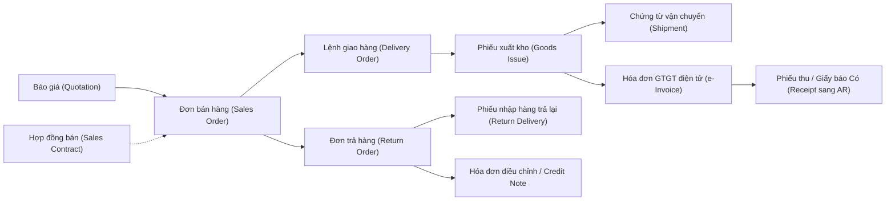
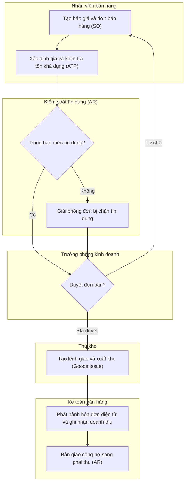
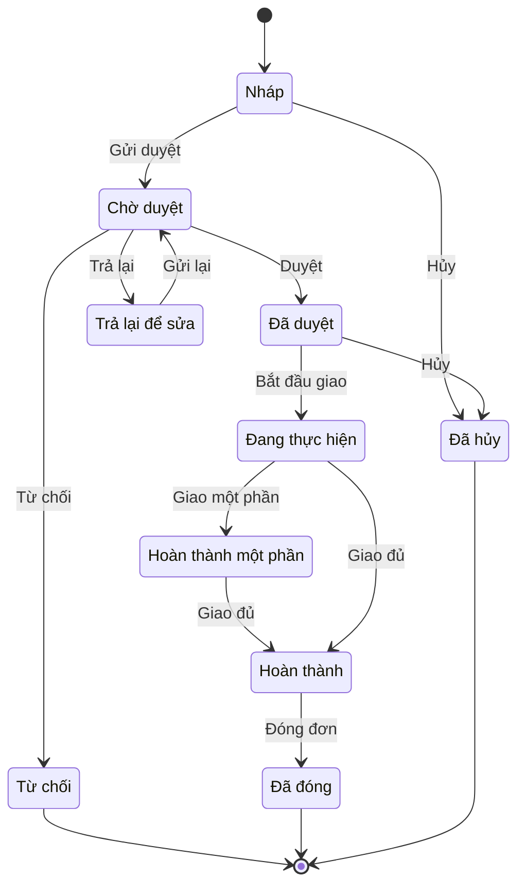

# SAL — Quy trình Đặt hàng đến Thu tiền (Order-to-Cash – O2C)

> **Phạm vi:** Toàn bộ chu trình bán hàng từ quản lý khách hàng (góc nhìn bán hàng), bảng giá – điều kiện giá, chiết khấu/khuyến mãi, báo giá, hợp đồng bán, đơn bán hàng (kèm kiểm tra tín dụng và kiểm tra tồn kho khả dụng/giữ hàng), duyệt đơn, lệnh giao hàng & xuất kho, vận chuyển, hóa đơn bán hàng & hóa đơn điện tử, bàn giao công nợ sang phải thu, trả hàng & credit note, hoa hồng bán hàng cơ bản, và liên kết sau bán. **Module liên quan:** SAL (bán hàng), INV (kho), AR (phải thu), GL (sổ cái), TAX (thuế & hóa đơn điện tử), COST (giá thành), CRM/SVC (sau bán). **Chuẩn tham chiếu:** SAP S/4HANA Sales (SD) [9], Oracle Fusion Order Management [11], Odoo Sales [10], Microsoft Dynamics 365 Sales/SCM [12]; chế độ kế toán Việt Nam theo **Thông tư 99/2025/TT-BTC** (hiệu lực 01/01/2026, thay thế Thông tư 200/2014/TT-BTC) [1][2], hóa đơn điện tử theo **Nghị định 123/2020/NĐ-CP** sửa đổi bởi **Nghị định 70/2025/NĐ-CP**, hướng dẫn tại **Thông tư 78/2021/TT-BTC** [4][5][8].
>
> **Cập nhật đến: 2026-10-20 — quy định thay đổi thường xuyên; BA phải kiểm tra lại hiệu lực khi dùng cho dự án.**
> Phần đặc thù phân phối sâu (đại lý, nhà phân phối, trade marketing, trả thưởng theo doanh số): xem `references/industries/trading-distribution.md`. Chi tiết hóa đơn điện tử: xem `references/regulations/vn-tax-einvoice.md` và `references/processes/tax-einvoice.md`. Công nợ phải thu & tuổi nợ: xem `references/processes/ar-accounts-receivable.md`.

## Mục lục
- [1. Mục đích & phạm vi](#1-mục-đích--phạm-vi-trongngoài-phạm-vi)
- [2. Vai trò tham gia](#2-vai-trò-tham-gia)
- [3. Danh mục (master data) tiên quyết](#3-danh-mục-master-data-tiên-quyết)
- [4. Chứng từ & luồng chứng từ](#4-chứng-từ--luồng-chứng-từ-document-flow)
- [5. Các bước quy trình chuẩn](#5-các-bước-quy-trình-chuẩn)
- [6. Vòng đời trạng thái chứng từ chính](#6-vòng-đời-trạng-thái-chứng-từ-chính)
- [7. Quy tắc nghiệp vụ & kiểm tra](#7-quy-tắc-nghiệp-vụ--kiểm-tra-validation-điển-hình)
- [8. Hạch toán kế toán](#8-hạch-toán-kế-toán)
- [9. Tham số hệ thống điển hình](#9-tham-số-hệ-thống-điển-hình)
- [10. Kiểm soát nội bộ & phân quyền](#10-kiểm-soát-nội-bộ--phân-quyền-sod-hạn-mức-duyệt-audit)
- [11. Báo cáo chuẩn](#11-báo-cáo-chuẩn)
- [12. Tích hợp với module khác](#12-tích-hợp-với-module-khác)
- [13. Biến thể & ngoại lệ](#13-biến-thể--ngoại-lệ)
- [14. Lỗi BA hay mắc & câu hỏi khảo sát](#14-lỗi-ba-hay-mắc--câu-hỏi-cần-hỏi-khách-hàng)
- [15. Nguồn tham khảo](#15-nguồn-tham-khảo)

---

## 1. Mục đích & phạm vi (trong/ngoài phạm vi)

**Mục đích:** Chuẩn hóa chu trình bán hàng – thu tiền để: (a) bán đúng giá, đúng chính sách chiết khấu; (b) kiểm soát rủi ro tín dụng (credit risk) và khả năng giao hàng (ATP) trước khi cam kết với khách; (c) ghi nhận doanh thu, giá vốn, thuế GTGT đầu ra đúng thời điểm và đúng chế độ kế toán; (d) phát hành hóa đơn điện tử hợp lệ; (e) bàn giao công nợ phải thu đầy đủ, có thể đối chiếu 3 chiều (đơn – giao – hóa đơn).

**Trong phạm vi:**
- Quản lý dữ liệu bán hàng của khách hàng (sales view của customer master): điều khoản thanh toán, hạn mức tín dụng, kênh/địa chỉ giao, bảng giá áp dụng.
- Định giá: bảng giá (price list), điều kiện giá (pricing conditions), chiết khấu thương mại, khuyến mãi (free goods) cơ bản.
- Báo giá (Quotation) → Hợp đồng bán (Sales Contract) → Đơn bán hàng (Sales Order – SO).
- Kiểm tra tín dụng (credit check), kiểm tra tồn khả dụng (Available-to-Promise – ATP), giữ hàng (stock reservation).
- Duyệt đơn (approval theo giá trị/chiết khấu/vượt hạn mức).
- Lệnh giao hàng (Delivery Order – DO) → xuất kho ghi nhận giá vốn (Goods Issue) → vận chuyển (Shipment).
- Hóa đơn bán hàng / hóa đơn GTGT điện tử; ghi nhận doanh thu.
- Trả hàng (Return) & hóa đơn điều chỉnh/credit note.
- Hoa hồng bán hàng cơ bản; móc nối sang dịch vụ sau bán (CRM/SVC).

**Ngoài phạm vi (link sang file khác):**
- Hạch toán chi tiết công nợ phải thu, tuổi nợ, bù trừ, thu tiền, xử lý nợ xấu → `references/processes/ar-accounts-receivable.md`.
- Thu tiền mặt/ngân hàng, đối chiếu ngân hàng → `references/processes/cash-bank.md`.
- Quản lý tồn kho, nhập xuất, đánh giá tồn → `references/processes/inventory-warehouse.md`.
- Tính giá thành/giá vốn (phương pháp tính giá xuất kho) → `references/processes/costing.md`.
- Phát hành, hủy, thay thế hóa đơn điện tử theo chuẩn cơ quan thuế → `references/processes/tax-einvoice.md`, `references/regulations/vn-tax-einvoice.md`.
- Bán qua đại lý/nhà phân phối, chiết khấu bậc thang theo ngành, trả thưởng (rebate) → `references/industries/trading-distribution.md`.
- Bán hàng theo đơn đặt sản xuất (make-to-order) → `references/processes/manufacturing-mrp.md`.

---

## 2. Vai trò tham gia

| Vai trò | Trách nhiệm | Quyền điển hình (theo hành động chuẩn) |
|---|---|---|
| **Nhân viên bán hàng (Sales Staff)** — `ROLE-SAL-STAFF` | Lập báo giá, đơn bán, chăm sóc khách, theo dõi thực hiện đơn | Xem, Tạo, Sửa (chứng từ Nháp), Xóa (Nháp), Gửi duyệt, In, Xuất file |
| **Trưởng phòng kinh doanh (Sales Manager)** — `ROLE-SAL-MGR` | Duyệt đơn/chiết khấu trong hạn mức, duyệt báo giá, phân bổ chỉ tiêu | Xem, Duyệt, Từ chối, Trả lại, Sửa giá/chiết khấu trong hạn, In, Xuất file |
| **Kế toán công nợ phải thu / Kiểm soát tín dụng (AR Accountant / Credit Controller)** — `ROLE-AR-ACC` | Thiết lập & giám sát hạn mức tín dụng, duyệt giải phóng đơn bị chặn tín dụng, theo dõi công nợ | Xem, Duyệt (giải phóng tín dụng), Cấu hình (hạn mức), Ghi sổ, In, Xuất file |
| **Thủ kho (Storekeeper)** — `ROLE-WH-KEEPER` | Soạn hàng (picking), xác nhận xuất kho, bàn giao hàng cho vận chuyển | Xem, Tạo (Lệnh giao/Phiếu xuất), Sửa (Nháp), Ghi sổ (xuất kho/Goods Issue), In |
| **Nhân viên giao vận (Shipping/Logistics Staff)** — `ROLE-SAL-SHIP` | Lập chứng từ vận chuyển, theo dõi giao nhận, cập nhật trạng thái giao | Xem, Tạo (chứng từ vận chuyển), Sửa (Nháp), In, Xuất file |
| **Kế toán bán hàng (Sales/Billing Accountant)** — `ROLE-SAL-ACC` | Lập & phát hành hóa đơn, ghi nhận doanh thu/giá vốn/thuế, xử lý credit note | Xem, Tạo (Hóa đơn), Ghi sổ, Bỏ ghi sổ, Đảo, In, Xuất file |
| **Kế toán trưởng (Chief Accountant)** — `ROLE-CHIEF-ACC` | Kiểm soát hạch toán, duyệt bút toán điều chỉnh/đảo, chốt kỳ | Xem, Duyệt, Bỏ ghi sổ, Đảo, Cấu hình (tài khoản/định khoản) |
| **Giám đốc (Director)** — `ROLE-DIR` | Duyệt đơn/hợp đồng/chiết khấu vượt hạn mức, duyệt xóa nợ | Xem, Duyệt, Từ chối, In |

> Nguyên tắc tách biệt: người **Tạo đơn** ≠ người **Duyệt** ≠ người **Xuất kho** ≠ người **Ghi sổ/Lập hóa đơn** (xem mục 10).

---

## 3. Danh mục (master data) tiên quyết

| Danh mục | Trường quan trọng | Quy tắc chính |
|---|---|---|
| **Khách hàng – góc nhìn bán hàng (Customer – Sales View)** `MD-CUSTOMER` | Mã KH, tên, mã số thuế, nhóm KH (customer group), điều khoản thanh toán (payment terms), hạn mức tín dụng (credit limit), điều khoản giao hàng (Incoterms), kênh bán (distribution channel), nhân viên phụ trách, bảng giá áp dụng, địa chỉ bán cho/giao cho/xuất hóa đơn (sold-to / ship-to / bill-to), trạng thái (active/blocked) | Mã số thuế hợp lệ & duy nhất khi là tổ chức; phân biệt 3 vai trò địa chỉ (sold-to/ship-to/bill-to); có thể **khóa bán hàng** (sales block) hoặc **khóa giao hàng** (delivery block) riêng |
| **Sản phẩm/Hàng hóa – góc nhìn bán hàng (Product/Material – Sales View)** `MD-PRODUCT` | Mã SP, tên, đơn vị tính bán (sales UoM) & hệ số quy đổi, nhóm hàng, **thuế suất GTGT** (0%/5%/8%/10%/KCT), giá bán tham chiếu, trọng lượng/thể tích (phục vụ vận chuyển), hàng quản lý theo lô/serial, cho phép bán hay không | Khớp UoM giữa bán – kho; thuế suất đúng nhóm hàng hiện hành (lưu ý mức 8% áp dụng đến 31/12/2026 [6][7]); hàng ngừng kinh doanh phải chặn tạo dòng đơn mới |
| **Bảng giá (Price List / Pricelist)** `MD-PRICELIST` | Mã bảng giá, loại giá (theo KH/nhóm KH/vùng/kênh), đơn vị tiền tệ, ngày hiệu lực/hết hiệu lực, giá theo bậc số lượng (quantity scale) | Có thời hạn hiệu lực; một thời điểm chỉ một giá có hiệu lực theo thứ tự ưu tiên (xem BR-SAL-04); hỗ trợ đa tiền tệ |
| **Điều kiện giá (Pricing Conditions)** `MD-PRICECOND` | Loại điều kiện (giá gốc, chiết khấu %, chiết khấu tiền, phụ phí, phí vận chuyển, thuế), cơ sở tính, thứ tự áp dụng (pricing procedure) | Theo kỹ thuật điều kiện (condition technique) của SAP/Odoo [9][10]; thuế tính sau chiết khấu thương mại; ghi rõ căn cứ từng loại |
| **Điều khoản thanh toán (Payment Terms)** `MD-PAYTERM` | Mã, số ngày (Net 30/45...), chiết khấu thanh toán sớm (vd 2/10 Net 30), mốc tính (từ ngày hóa đơn/giao hàng) | Dùng để tính hạn thanh toán & chiết khấu thanh toán (hạch toán 635, không giảm trừ doanh thu) |
| **Chương trình chiết khấu/khuyến mãi (Discount/Promotion)** `MD-PROMO` | Mã CT, loại (giảm %, giảm tiền, mua X tặng Y/free goods, quà tặng), điều kiện áp dụng, thời gian, ngân sách, nhóm KH/hàng áp dụng | Có hiệu lực theo thời gian; kiểm soát trần ngân sách; không chồng lấn trái quy định; phần sâu phân phối xem `trading-distribution.md` |
| **Nhân viên bán hàng (Salesperson)** `MD-SALESREP` | Mã NV, nhóm/khu vực bán, tỷ lệ/bậc hoa hồng, chỉ tiêu | Gắn với đơn để tính doanh số & hoa hồng; một đơn có thể chia hoa hồng nhiều NV |
| **Điểm xuất hàng / Kho (Shipping Point / Warehouse)** `MD-SHIPPOINT` | Mã kho/điểm xuất, chi nhánh, địa chỉ, lịch làm việc | Xác định nguồn xuất & tính ATP theo kho |

---

## 4. Chứng từ & luồng chứng từ (document flow)

| Chứng từ (VI / EN) | Mục đích | Tạo từ | Sinh ra | Ảnh hưởng (kho / công nợ / sổ cái) |
|---|---|---|---|---|
| **Báo giá (Quotation)** | Chào giá, điều kiện bán cho khách | Yêu cầu KH / cơ hội CRM | Đơn bán hàng | Không ảnh hưởng (tài liệu chào) |
| **Hợp đồng bán (Sales Contract / Agreement)** | Cam kết khung về giá/sản lượng/kỳ hạn | Báo giá / đàm phán | Nhiều đơn bán theo hợp đồng | Không ghi sổ; ràng buộc điều khoản |
| **Đơn bán hàng (Sales Order – SO)** | Cam kết bán: hàng, số lượng, giá, ngày giao | Báo giá / Hợp đồng / trực tiếp | Lệnh giao hàng, (hóa đơn) | Giữ chỗ tồn kho (reservation); chiếm dụng hạn mức tín dụng |
| **Lệnh giao hàng / Phiếu giao hàng (Delivery Order – DO / Outbound Delivery)** | Lệnh soạn & giao hàng | Đơn bán hàng | Phiếu xuất kho, chứng từ vận chuyển | Chưa ghi sổ cho tới khi xuất kho |
| **Phiếu xuất kho (Goods Issue – GI)** | Xác nhận xuất hàng khỏi kho | Lệnh giao hàng | — | **Kho:** giảm tồn; **Sổ cái:** ghi nhận giá vốn (Nợ 632/Có 156 hoặc 157) |
| **Chứng từ vận chuyển / Vận đơn (Shipment / Bill of Lading)** | Theo dõi vận chuyển, cước phí | Lệnh giao hàng | — | Có thể phát sinh chi phí vận chuyển |
| **Hóa đơn GTGT điện tử (VAT e-Invoice)** | Chứng từ pháp lý ghi nhận doanh thu & thuế | Đơn bán / Phiếu xuất kho | Công nợ phải thu | **Công nợ:** tăng phải thu; **Sổ cái:** Nợ 131/Có 511, 33311 |
| **Phiếu thu / Giấy báo Có (Receipt)** | Ghi nhận thu tiền từ KH | Hóa đơn / công nợ | — (bàn giao sang AR/CB) | **Công nợ:** giảm phải thu; **Sổ cái:** Nợ 111/112/Có 131 |
| **Đơn trả hàng (Return Order)** | Ghi nhận yêu cầu trả hàng | Đơn bán / hóa đơn gốc | Phiếu nhập hàng trả, credit note | Giữ chỗ nhập lại kho |
| **Phiếu nhập hàng bán bị trả lại (Return Delivery)** | Nhập lại hàng vào kho | Đơn trả hàng | — | **Kho:** tăng tồn; **Sổ cái:** Nợ 156/155 / Có 632 |
| **Hóa đơn điều chỉnh / Credit Note (Giảm trừ)** | Điều chỉnh giảm doanh thu & thuế | Hóa đơn gốc / Đơn trả hàng | Giảm công nợ | **Công nợ:** giảm phải thu; **Sổ cái:** Nợ 521, 33311 / Có 131 |

---

## 5. Các bước quy trình chuẩn

| Bước | Vai trò | Chứng từ | Hành động hệ thống | Trạng thái sau bước |
|---|---|---|---|---|
| 1. Tạo báo giá | `ROLE-SAL-STAFF` | Báo giá | Xác định giá theo bảng giá & điều kiện giá; áp chiết khấu/khuyến mãi | Báo giá DRAFT → PENDING |
| 2. Duyệt & gửi báo giá | `ROLE-SAL-MGR` | Báo giá | Kiểm tra chiết khấu trong hạn; chuyển KH | Báo giá APPROVED |
| 3. Tạo đơn bán hàng | `ROLE-SAL-STAFF` | Đơn bán (SO) | Sao chép từ báo giá/hợp đồng; tính lại giá; đặt ngày giao | SO DRAFT |
| 4. Kiểm tra tồn khả dụng (ATP) & giữ hàng | Hệ thống | SO | Tính ATP theo kho; giữ chỗ (reservation) nếu đủ; đề xuất ngày giao | SO DRAFT (đã giữ hàng) |
| 5. Kiểm tra tín dụng | Hệ thống / `ROLE-AR-ACC` | SO | So hạn mức khả dụng; nếu vượt → đặt **chặn tín dụng** (credit block) | SO DRAFT (có thể bị chặn) |
| 6. Gửi duyệt | `ROLE-SAL-STAFF` | SO | Định tuyến duyệt theo giá trị/chiết khấu/vượt hạn mức | SO PENDING |
| 7. Duyệt đơn / giải phóng tín dụng | `ROLE-SAL-MGR` / `ROLE-AR-ACC` / `ROLE-DIR` | SO | Duyệt hoặc Từ chối hoặc Trả lại; giải phóng credit block | SO APPROVED / REJECTED / RETURNED |
| 8. Tạo lệnh giao hàng | `ROLE-WH-KEEPER` | Lệnh giao (DO) | Tạo DO từ SO; soạn hàng (picking); gán lô/serial | DO IN_PROGRESS |
| 9. Xuất kho (Goods Issue) | `ROLE-WH-KEEPER` | Phiếu xuất kho | Giảm tồn; sinh bút toán giá vốn (Nợ 632/Có 156) | DO COMPLETED; SO PARTIAL/COMPLETED |
| 10. Vận chuyển & giao nhận | `ROLE-SAL-SHIP` | Chứng từ vận chuyển | Theo dõi giao; cập nhật đã giao; thu biên bản | Giao thành công |
| 11. Lập & phát hành hóa đơn điện tử | `ROLE-SAL-ACC` | Hóa đơn GTGT | Tính doanh thu, thuế; phát hành & gửi CQT/KH; ghi nhận doanh thu | Hóa đơn POSTED |
| 12. Bàn giao công nợ sang phải thu | `ROLE-SAL-ACC` / `ROLE-AR-ACC` | — | Mở khoản phải thu (open item) theo hạn thanh toán | Công nợ mở trong AR |
| 13. (Nếu có) Trả hàng & credit note | `ROLE-SAL-STAFF` / `ROLE-SAL-ACC` | Đơn trả hàng, Credit note | Nhập lại kho; giảm doanh thu & thuế; giảm công nợ | Credit note POSTED |
| 14. Đóng đơn | `ROLE-SAL-MGR` | SO | Khi đã giao đủ & hóa đơn đủ; chốt đơn | SO CLOSED |

---

## 6. Vòng đời trạng thái chứng từ chính

**Đơn bán hàng (Sales Order)** — áp mã trạng thái chuẩn:

| Từ | Hành động | Đến | Vai trò | Điều kiện |
|---|---|---|---|---|
| DRAFT | Gửi duyệt | PENDING | `ROLE-SAL-STAFF` | Đã qua ATP; nếu bị chặn tín dụng phải định tuyến thêm bước giải phóng |
| PENDING | Duyệt | APPROVED | `ROLE-SAL-MGR`/`ROLE-DIR` | Trong hạn mức duyệt theo giá trị/chiết khấu |
| PENDING | Từ chối | REJECTED | `ROLE-SAL-MGR` | Không đạt điều kiện; ghi lý do |
| PENDING | Trả lại | RETURNED | `ROLE-SAL-MGR` | Cần chỉnh sửa; quay lại người tạo |
| APPROVED | Bắt đầu giao | IN_PROGRESS | `ROLE-WH-KEEPER` | Đã tạo lệnh giao hàng |
| IN_PROGRESS | Giao một phần | PARTIAL | `ROLE-WH-KEEPER` | SL giao lũy kế < SL đặt |
| PARTIAL/IN_PROGRESS | Giao đủ | COMPLETED | `ROLE-WH-KEEPER` | SL giao lũy kế = SL đặt (COMPLETED = hoàn tất giao hàng; việc lập hóa đơn đủ là điều kiện chuyển sang CLOSED, do `ROLE-SAL-ACC`/`ROLE-SAL-MGR` phụ trách) |
| COMPLETED | Đóng đơn | CLOSED | `ROLE-SAL-MGR` | Hết nghĩa vụ giao & hóa đơn |
| DRAFT/APPROVED | Hủy | CANCELLED | `ROLE-SAL-MGR`/`ROLE-DIR` | Chưa xuất kho; giải phóng hàng đã giữ |

> Hóa đơn điện tử dùng vòng đời riêng: DRAFT → POSTED (đã phát hành/được CQT cấp mã) → có thể REVERSED/điều chỉnh bằng hóa đơn điều chỉnh hoặc thay thế (xem `tax-einvoice.md`). Không sửa trực tiếp hóa đơn đã phát hành.

---

## 7. Quy tắc nghiệp vụ & kiểm tra (validation) điển hình

1. **`BR-SAL-01` Kiểm tra tín dụng (credit check).** Mức tín dụng đang sử dụng (credit exposure):
   `Credit exposure = Dư nợ phải thu hiện tại + Giá trị đơn đã duyệt chưa giao + Giá trị đã giao chưa lập hóa đơn`.
   `Hạn mức khả dụng = Hạn mức tín dụng − Credit exposure`.
   Nếu `Giá trị đơn mới > Hạn mức khả dụng` → tùy tham số: **Cảnh báo** (warning, vẫn cho qua) hoặc **Chặn** (block, phải người có quyền giải phóng). *Lý do:* tránh bán vượt khả năng thu hồi, kiểm soát rủi ro công nợ.
2. **`BR-SAL-02` Kiểm tra tồn khả dụng (ATP – Available to Promise).**
   `ATP = Tồn thực tế (on-hand) − Số đã giữ chỗ cho đơn khác − Tồn an toàn (nếu cấu hình) + Dự kiến nhập trong khung thời gian (PO/sản xuất đã xác nhận)`.
   Chỉ xác nhận dòng đơn nếu `ATP ≥ số lượng yêu cầu` vào ngày yêu cầu; nếu thiếu → đề xuất ngày giao trễ hơn hoặc giao một phần. *Lý do:* cam kết giao đúng hẹn, tránh hứa ảo.
3. **`BR-SAL-03` Giữ hàng (reservation).** Khi đơn được xác nhận/duyệt, hệ thống giữ chỗ số lượng tương ứng; phần giữ chỗ **giảm ATP** cho đơn khác. Hủy/giảm đơn phải giải phóng tương ứng.
4. **`BR-SAL-04` Thứ tự ưu tiên xác định giá.** Giá riêng theo khách > giá theo nhóm KH/hợp đồng > giá theo bậc số lượng > giá bảng giá vùng/kênh > giá cơ sở sản phẩm. Chỉ một giá có hiệu lực tại một thời điểm theo ngày hiệu lực. *Lý do:* tránh mơ hồ, đảm bảo nhất quán.
5. **`BR-SAL-05` Trần chiết khấu theo vai trò.** Ví dụ: NV bán ≤ 5%, Trưởng phòng ≤ 15%, Giám đốc > 15%. Sửa giá/chiết khấu thủ công vượt trần → bắt buộc định tuyến duyệt cấp cao hơn. *Lý do:* kiểm soát biên lợi nhuận.
6. **`BR-SAL-06` Phân biệt chiết khấu thương mại vs chiết khấu thanh toán.** Chiết khấu thương mại/giảm giá hàng bán = **giảm trừ doanh thu (TK 521)**; chiết khấu thanh toán do trả sớm = **chi phí tài chính (TK 635)**, không giảm doanh thu, không giảm thuế GTGT. *Lý do:* sai bản chất dẫn tới sai doanh thu & thuế.
7. **`BR-SAL-07` Công thức tính giá trị hóa đơn.**
   `Thành tiền dòng = Số lượng × Đơn giá × (1 − % chiết khấu)`;
   `Tiền thuế dòng = Thành tiền dòng × Thuế suất GTGT` (0% / 5% / 8% / 10% theo nhóm hàng; mức 8% áp dụng đến 31/12/2026 với hàng thuộc diện giảm [6][7]);
   `Tổng thanh toán = Σ Thành tiền + Σ Tiền thuế`. Áp **quy tắc làm tròn** đã cấu hình (đến đồng). Nếu hóa đơn có nhiều thuế suất, phải ghi rõ thuế suất từng dòng [7].
8. **`BR-SAL-08` Giao hàng một phần (partial delivery).** Cho phép nếu KH/đơn cho phép; mỗi lần giao tạo phiếu xuất riêng; đơn ở PARTIAL cho tới khi `Σ SL giao = SL đặt`. Kiểm tra `Σ SL giao ≤ SL đặt` (không giao vượt trừ khi cấu hình dung sai – over-delivery tolerance).
9. **`BR-SAL-09` Ràng buộc 3 chiều đơn – giao – hóa đơn.** `SL xuất hóa đơn ≤ SL đã giao ≤ SL đã đặt (± dung sai)`. Không lập hóa đơn cho phần chưa giao (trừ trường hợp thu tiền trước/đặt cọc có quy định riêng). *Lý do:* chống khống doanh thu, chống thất thoát.
10. **`BR-SAL-10` Thời điểm ghi nhận doanh thu & lập hóa đơn.** Với **bán hàng hóa**: thời điểm lập hóa đơn là thời điểm **chuyển giao quyền sở hữu/quyền sử dụng** cho người mua, **không phân biệt đã thu tiền hay chưa** (Điều 9 Nghị định 123/2020 được sửa bởi Nghị định 70/2025) [4][5]. Doanh thu kế toán ghi nhận khi thỏa điều kiện chuyển giao rủi ro & lợi ích. *Lý do:* đồng bộ doanh thu – hóa đơn – thuế.
11. **`BR-SAL-11` Trả hàng trong giới hạn.** `SL trả ≤ SL đã giao` và trong thời hạn đổi/trả cho phép; credit note `≤` giá trị hóa đơn gốc còn lại. Phải tham chiếu hóa đơn gốc.
12. **`BR-SAL-12` Sửa đơn sau duyệt.** Đơn đã APPROVED chỉ sửa khi quay lại luồng duyệt (reset về PENDING hoặc tạo phiên bản thay đổi – change version) nếu thay đổi giá/số lượng/điều khoản trọng yếu. *Lý do:* giữ tính toàn vẹn phê duyệt & dấu vết (audit trail).
13. **`BR-SAL-13` Khóa bán/giao hàng.** KH ở trạng thái blocked (nợ quá hạn, tranh chấp) không được tạo đơn/giao hàng mới cho tới khi gỡ khóa. *Lý do:* kiểm soát rủi ro tín dụng.
14. **`BR-SAL-14` Đa tiền tệ.** Ghi nhận doanh thu theo tỷ giá giao dịch tại ngày ghi nhận; công nợ ngoại tệ đánh giá lại cuối kỳ theo quy định (xem `ar-accounts-receivable.md` & `vn-accounting.md`). Chênh lệch tỷ giá → doanh thu/chi phí tài chính (515/635).
15. **`BR-SAL-15` Cơ sở tính hoa hồng.** `Hoa hồng = Doanh số tính hoa hồng × Tỷ lệ (có thể bậc thang)`. Doanh số tính hoa hồng theo tham số: (a) doanh thu thuần đã xuất hóa đơn, hoặc (b) số tiền đã thu (collected). Chỉ chốt hoa hồng sau khi loại trừ phần trả hàng/giảm trừ. *Lý do:* tránh trả hoa hồng cho doanh thu bị hoàn.

---

## 8. Hạch toán kế toán

> **Chế độ áp dụng (xác minh tại 2026-10-20): Thông tư 99/2025/TT-BTC** — hiệu lực 01/01/2026, thay thế Thông tư 200/2014/TT-BTC, áp dụng cho năm tài chính bắt đầu từ/sau 01/01/2026 [1]. Doanh nghiệp nhỏ và vừa (DNNVV) được **tiếp tục áp dụng Thông tư 133/2016/TT-BTC** hoặc tự nguyện chuyển sang TT99 [3]. Số hiệu các tài khoản O2C cơ bản **giữ nguyên như TT200**; một số tài khoản được đổi tên: **112** "Tiền gửi không kỳ hạn" (TT200: "Tiền gửi Ngân hàng"), **155** "Sản phẩm" (TT200: "Thành phẩm") [2]. Thuế GTGT đầu ra hạch toán **33311** (thuộc 3331) [2]. ⚠️ Mã tiểu khoản của 511 (5111/5112/5113) và 521 (5211 chiết khấu thương mại / 5212 hàng bán bị trả lại / 5213 giảm giá hàng bán) cần đối chiếu Phụ lục II của TT99 trước khi cấu hình. Đối với DNNVV theo TT133: không có TK 641 riêng — chi phí bán hàng dùng **6421**, chi phí quản lý doanh nghiệp/dự phòng dùng **6422** (cả hai thuộc TK 642 "Chi phí quản lý kinh doanh"). Ngoài ra **TT133 không có TK 521**: các khoản giảm trừ doanh thu (chiết khấu thương mại, hàng bán bị trả lại, giảm giá hàng bán) ghi **giảm trực tiếp vào TK 511** thay vì qua 521 — các bút toán mục 8 dùng 521 chỉ đúng cho TT99/TT200.

| Nghiệp vụ | Nợ | Có | Ghi chú |
|---|---|---|---|
| Ghi nhận doanh thu bán hàng (phát hành hóa đơn) | 131 (hoặc 111/112 nếu thu ngay) | 511; 33311 | Doanh thu chưa thuế vào 511; thuế GTGT đầu ra vào 33311 |
| Ghi nhận giá vốn hàng bán (đồng thời xuất kho) | 632 | 156 (hàng hóa) hoặc 155 (sản phẩm) | Giá xuất theo phương pháp tính giá (xem `costing.md`) |
| Xuất kho gửi bán/ký gửi (chưa ghi doanh thu) | 157 | 156 / 155 | Hàng gửi đi bán; chưa chuyển giao quyền sở hữu |
| Khi hàng gửi bán được chấp nhận | 632 | 157 | Đồng thời ghi doanh thu (Nợ 131/Có 511, 33311) |
| Thu tiền khách hàng | 111 / 112 | 131 | Bàn giao chi tiết sang AR/CB |
| Khách hàng ứng trước tiền | 111 / 112 | 131 (chi tiết "ứng trước") | Số dư Có của 131; chưa phải doanh thu |
| Chiết khấu thương mại / giảm giá hàng bán (giảm trừ doanh thu) | 521; 33311 | 131 (hoặc 111/112) | Giảm cả doanh thu và thuế GTGT đầu ra |
| Hàng bán bị trả lại — phần doanh thu | 521; 33311 | 131 (hoặc 111/112) | Ghi giảm doanh thu theo credit note |
| Hàng bán bị trả lại — nhập lại kho | 156 / 155 | 632 | Hoàn nhập giá vốn theo giá đã xuất |
| Chiết khấu thanh toán cho khách (trả sớm) | 635 | 131 (hoặc 111/112) | **Chi phí tài chính**, KHÔNG giảm doanh thu/thuế |
| Lập dự phòng phải thu khó đòi | 642 (TT133: 6422) | 2293 | Theo tuổi nợ & tỷ lệ quy định (xem `ar-accounts-receivable.md`) |
| Hoàn nhập dự phòng phải thu khó đòi | 2293 | 642 | Khi rủi ro giảm |
| Xóa sổ nợ phải thu không đòi được | 2293 (phần đã lập dự phòng); 642 (phần chưa lập) | 131 | Đồng thời theo dõi ngoài bảng khoản nợ đã xử lý ⚠️ (TT200 dùng TK 004; đối chiếu danh mục tài khoản ngoài bảng của TT99) |
| Hoa hồng bán hàng cho nhân viên (nội bộ) | 641 (TT133: 6421) | 334 | Khi trả qua lương; nếu trích trước dùng 335 |
| Hoa hồng/môi giới cho đại lý, bên thứ ba | 641 (TT133: 6421) | 131 / 331 / 111 | Có hóa đơn/chứng từ hợp lệ của bên nhận |
| Phí vận chuyển giao hàng do bên bán chịu | 641 (TT133: 6421) | 111 / 112 / 331 | Chi phí bán hàng |

> **Bán hàng xuất khẩu:** thuế suất GTGT 0% (đáp ứng điều kiện hồ sơ); tỷ giá theo quy định — xem `tax-einvoice.md` và `vn-accounting.md`.

---

## 9. Tham số hệ thống điển hình

| Tham số | Kiểu | Giá trị gợi ý | Phạm vi | Ảnh hưởng |
|---|---|---|---|---|
| `PRM-SAL-001` Bật kiểm tra tín dụng | Boolean | Bật | Công ty | Có kiểm soát hạn mức khi tạo/duyệt đơn |
| `PRM-SAL-002` Kiểu kiểm tra tín dụng | Enum | Cảnh báo / Chặn | Công ty/Nhóm KH | Chặn thì phải có người giải phóng |
| `PRM-SAL-003` Bật kiểm tra ATP khi tạo đơn | Boolean | Bật | Công ty/Kho | Xác nhận ngày giao theo tồn khả dụng |
| `PRM-SAL-004` Cho phép bán âm kho | Boolean | Tắt | Kho | Tắt để chặn xuất quá tồn |
| `PRM-SAL-005` Dung sai giao vượt (over-delivery %) | Số | 0% | Nhóm hàng/KH | Cho phép giao vượt trong giới hạn |
| `PRM-SAL-006` Cho phép giao hàng một phần | Boolean | Bật | KH/Đơn | Tạo nhiều phiếu xuất cho 1 đơn |
| `PRM-SAL-007` Trần chiết khấu theo vai trò | Bảng % | Staff 5 / Mgr 15 / Dir >15 | Công ty | Vượt trần phải duyệt cấp cao |
| `PRM-SAL-008` Ngưỡng giá trị đơn cần duyệt | Tiền | Theo chính sách | Công ty/Chi nhánh | Định tuyến phê duyệt nhiều cấp |
| `PRM-SAL-009` Tự động tạo lệnh giao từ đơn đã duyệt | Boolean | Tắt | Công ty | Tự động hóa luồng giao |
| `PRM-SAL-010` Thời điểm ghi nhận doanh thu | Enum | Khi xuất kho giao / Khi khách xác nhận | Công ty | Khớp với thời điểm lập hóa đơn (BR-SAL-10) |
| `PRM-SAL-011` Xuất hóa đơn từng đơn hay gộp cuối kỳ | Enum | Theo đơn | KH | Hóa đơn gộp cho KH thường xuyên |
| `PRM-SAL-012` Thuế suất GTGT mặc định theo nhóm hàng | % | 8% (đến 31/12/2026) / 10% / 5% / 0% | Hệ thống/Nhóm hàng | Tính thuế đầu ra; lưu ý nhóm loại trừ giảm thuế [7] |
| `PRM-SAL-013` Quy tắc làm tròn | Enum | Làm tròn đến đồng | Công ty | Ảnh hưởng số tiền hóa đơn |
| `PRM-SAL-014` Dải số chứng từ (number range) | Cấu hình | Theo chi nhánh/năm/loại CT | Chi nhánh | Đánh số đơn/hóa đơn liên tục, không trùng |
| `PRM-SAL-015` Đa tiền tệ & nguồn tỷ giá | Cấu hình | Bật; tỷ giá NH giao dịch | Công ty | Ghi nhận doanh thu ngoại tệ |
| `PRM-SAL-016` Chính sách giữ hàng khi đơn chờ duyệt | Enum | Giữ khi duyệt / Giữ khi tạo | Công ty | Ảnh hưởng ATP cho đơn khác |
| `PRM-SAL-017` Cơ sở tính hoa hồng | Enum | Theo hóa đơn / Theo thu tiền | Công ty | Quyết định thời điểm & số tiền hoa hồng |

---

## 10. Kiểm soát nội bộ & phân quyền (SoD, hạn mức duyệt, audit)

**Tách biệt nhiệm vụ (Segregation of Duties – SoD):**
1. Người **Tạo đơn** (sales) ≠ người **Duyệt đơn** (quản lý) — chống tự bán tự duyệt.
2. Người **Duyệt tín dụng / thiết lập hạn mức** (kế toán công nợ) độc lập với bộ phận bán hàng — chống nới hạn mức tùy tiện.
3. Người **Xuất kho** (thủ kho) ≠ người **Lập/ghi sổ hóa đơn** (kế toán) ≠ người **thu tiền** — chống thất thoát hàng & tiền.
4. Người **cấu hình bảng giá/chiết khấu** ≠ người **bán** — chống tự tạo giá có lợi.

**Hạn mức duyệt (approval limits):** phân cấp theo giá trị đơn và theo % chiết khấu (xem `PRM-SAL-007`, `PRM-SAL-008`). Vượt hạn mức tín dụng chỉ được giải phóng bởi `ROLE-AR-ACC`/`ROLE-DIR`.

**Kiểm soát khác:**
- **Đối chiếu 3 chiều** đơn ↔ phiếu giao ↔ hóa đơn trước khi ghi nhận doanh thu (BR-SAL-09).
- **Khóa sửa** chứng từ sau khi POSTED; thay đổi phải qua Bỏ ghi sổ/Đảo có phê duyệt kế toán trưởng.
- **Nhật ký kiểm toán (audit trail):** ghi ai – khi nào – thay đổi gì cho mọi hành động Duyệt/Sửa giá/Giải phóng tín dụng/Hủy/Đảo.
- **Kiểm soát sửa giá & chiết khấu:** mọi điều chỉnh thủ công so với giá bảng giá phải lưu vết và lý do.
- **Quản lý hóa đơn điện tử:** phân quyền phát hành, hủy, điều chỉnh, thay thế tách khỏi người lập đơn (xem `tax-einvoice.md`).

---

## 11. Báo cáo chuẩn

| Báo cáo | Mục đích | Chiều phân tích / bộ lọc | Bắt buộc theo luật? |
|---|---|---|---|
| `RPT-SAL-01` **Doanh số bán hàng (Sales Revenue)** | Theo dõi doanh số theo khách/hàng/nhân viên | Khách hàng, mặt hàng/nhóm hàng, nhân viên bán, khu vực, kênh, kỳ | Không (quản trị) |
| `RPT-SAL-02` **Tình hình thực hiện đơn bán (Sales Order Fulfillment / Order Book)** | Đơn đã đặt vs đã giao vs còn lại vs đã hóa đơn | Đơn, khách, mặt hàng, trạng thái, ngày giao | Không (quản trị) |
| `RPT-SAL-03` **Công nợ phải thu (AR / Receivables)** | Số dư & tuổi nợ phải thu khách hàng | Khách hàng, tuổi nợ, hạn thanh toán, nhân viên | Không (quản trị; chi tiết xem `ar-accounts-receivable.md`) |
| `RPT-SAL-04` **Lãi gộp bán hàng (Gross Margin)** | `Lãi gộp = Doanh thu thuần − Giá vốn`; theo dõi biên lợi nhuận | Khách, mặt hàng, nhân viên, đơn, kỳ | Không (quản trị) |
| `RPT-SAL-05` **Chiết khấu & khuyến mãi** | Giá trị & tỷ lệ chiết khấu đã cấp | Chương trình, khách, mặt hàng, kỳ | Không (quản trị) |
| `RPT-SAL-06` **Hoa hồng bán hàng** | Tính & theo dõi hoa hồng theo chính sách | Nhân viên, kỳ, cơ sở tính | Không (quản trị) |
| `RPT-SAL-07` **Bảng kê hóa đơn bán ra** | Liệt kê hóa đơn GTGT đầu ra phục vụ kê khai thuế | Kỳ thuế, thuế suất, khách | Phục vụ nghĩa vụ kê khai GTGT (xem `tax-einvoice.md`) |

> Doanh thu, giá vốn, thuế GTGT đầu ra kết chuyển lên Báo cáo tài chính thuộc phạm vi `r2r-general-ledger.md`. (⚠️ CHƯA XÁC MINH: một số nguồn cho rằng TT99 đổi tên **Bảng cân đối kế toán** thành **Báo cáo tình hình tài chính** từ 2026 — cần đối chiếu mẫu biểu BCTC trong văn bản gốc TT99 trước khi khẳng định với khách hàng.)

---

## 12. Tích hợp với module khác (ảnh hưởng dữ liệu hai chiều)

| Module | Dữ liệu trao đổi | Chiều |
|---|---|---|
| **Kho (INV)** `inventory-warehouse.md` | ATP, giữ hàng, xuất kho (Goods Issue), nhập lại hàng trả | O2C ⇄ INV: đơn giữ chỗ; xuất kho giảm tồn & sinh giá vốn |
| **Phải thu (AR)** `ar-accounts-receivable.md` | Hóa đơn → khoản phải thu (open item); thu tiền; bù trừ; tuổi nợ | O2C → AR: tạo công nợ; AR → O2C: dư nợ cho credit check |
| **Sổ cái (GL/R2R)** `r2r-general-ledger.md` | Bút toán doanh thu, giá vốn, thuế, giảm trừ | O2C → GL: posting; GL khóa kỳ chặn ghi sổ |
| **Thuế & Hóa đơn điện tử (TAX)** `tax-einvoice.md`, `vn-tax-einvoice.md` | Phát hành hóa đơn, mã CQT, thuế GTGT đầu ra, bảng kê | O2C ⇄ TAX: hóa đơn & dữ liệu kê khai |
| **Giá thành (COST)** `costing.md` | Giá vốn hàng bán theo phương pháp tính giá | COST → O2C: giá xuất kho cho 632 |
| **Mua hàng (P2P)** `p2p-procure-to-pay.md` | Bán giao thẳng (drop-ship)/mua theo đơn bán (back-to-back) | O2C ⇄ P2P: đơn bán kích hoạt đơn mua |
| **Sản xuất (MFG)** `manufacturing-mrp.md` | Đơn bán make-to-order kích hoạt lệnh sản xuất; nhu cầu vào MRP | O2C → MFG: nhu cầu; MFG → O2C: ngày khả dụng |
| **CRM/Dịch vụ (CRM/SVC)** `crm-service.md` | Cơ hội → báo giá; bảo hành/đổi trả/khiếu nại sau bán | CRM ⇄ O2C: lead-to-quote & after-sales |

---

## 13. Biến thể & ngoại lệ

- **Giao hàng một phần / nhiều lần (partial / split delivery):** đơn ở PARTIAL, tạo nhiều phiếu xuất & nhiều hóa đơn; đóng đơn khi giao đủ (BR-SAL-08).
- **Trả hàng (returns):** toàn phần hoặc một phần; tham chiếu hóa đơn gốc; nhập lại kho + credit note (mục 8). Hàng lỗi không nhập kho bán lại mà vào kho hàng lỗi.
- **Hủy đơn (cancel):** chỉ khi chưa xuất kho; giải phóng hàng đã giữ & hạn mức tín dụng; nếu đã có hóa đơn phải xử lý điều chỉnh/hủy hóa đơn theo quy định thuế.
- **Sửa đơn sau duyệt:** thay đổi trọng yếu (giá/SL/điều khoản) phải tái duyệt (BR-SAL-12).
- **Đa tiền tệ (multi-currency):** tỷ giá ghi nhận, chênh lệch tỷ giá 515/635 (BR-SAL-14).
- **Bán kèm khuyến mãi/hàng tặng (free goods):** dòng hàng 0 đồng vẫn phải xuất kho & ghi giá vốn; xử lý thuế theo quy định (hàng khuyến mãi có đăng ký vs không đăng ký) — xem `tax-einvoice.md`.
- **Đặt cọc / ứng trước (down payment):** thu trước ghi 131 (dư Có)/không ghi doanh thu; xử lý hóa đơn theo quy định dịch vụ/hàng hóa.
- **Bán ký gửi/đại lý (consignment):** dùng TK 157; ghi doanh thu khi đại lý bán được; phần sâu xem `trading-distribution.md`.
- **Hóa đơn gộp cuối kỳ (consolidated invoice):** cho KH giao nhiều lần; gộp theo kỳ.
- **Bán hàng xuất khẩu (export):** GTGT 0%, hồ sơ hải quan, Incoterms; xem `tax-einvoice.md`, `vn-accounting.md`.
- **Giao thẳng (drop-ship):** nhà cung cấp giao thẳng cho KH; không qua kho mình — liên kết P2P.

---

## 14. Lỗi BA hay mắc & câu hỏi cần hỏi khách hàng

**Lỗi BA hay mắc:**
1. Nhầm **chiết khấu thương mại (giảm trừ doanh thu – 521)** với **chiết khấu thanh toán (chi phí tài chính – 635)** (BR-SAL-06).
2. Bỏ qua bước **kiểm tra tín dụng** hoặc **ATP**, dẫn tới hứa giao mà không đủ hàng/vượt công nợ.
3. Không định nghĩa rõ **thời điểm ghi nhận doanh thu** và liên kết với **thời điểm lập hóa đơn** theo ND70/2025 (BR-SAL-10).
4. Bỏ sót luồng **hàng gửi bán/ký gửi (157)** và **giao hàng một phần**.
5. Không phân biệt **sold-to / ship-to / bill-to**, gây sai địa chỉ giao & sai thông tin hóa đơn.
6. Thiếu quy tắc **đánh số chứng từ, làm tròn, đa tiền tệ, nhiều thuế suất trên một hóa đơn**.
7. Không quy định **ai được sửa giá/chiết khấu và mức trần** theo vai trò.
8. Thêm chức năng ngoài yêu cầu (vd rebate phức tạp) trong khi khách chỉ cần chiết khấu đơn giản — cần soi lại phạm vi.
9. Giả định thuế suất 10% trong khi nhiều mặt hàng đang **8% đến hết 31/12/2026** và có **nhóm loại trừ** [6][7].
10. Không xử lý **trả hàng sau khi đã xuất hóa đơn** (điều chỉnh hóa đơn + hoàn giá vốn).

**Câu hỏi khảo sát cụ thể:**
- Doanh nghiệp bán B2B, B2C hay cả hai? Có bán qua đại lý/nhà phân phối không? (nếu có → `trading-distribution.md`)
- Có áp dụng **hạn mức tín dụng** không? Vượt hạn mức thì **cảnh báo hay chặn**? Ai được giải phóng?
- **Thời điểm ghi nhận doanh thu**: khi xuất kho giao, khi khách ký nhận, hay khi phát hành hóa đơn?
- Có cho **giao hàng một phần** không? Có **đặt cọc/ứng trước** không?
- Chính sách giá: có mấy **bảng giá**? Theo khách/nhóm/vùng/kênh? Có **chiết khấu theo số lượng/lũy kế** không?
- **Ai được sửa giá/chiết khấu** trên đơn và **mức trần** theo cấp?
- Quy trình **duyệt đơn**: ngưỡng giá trị nào cần duyệt? Mấy cấp? Có duyệt riêng cho vượt hạn mức tín dụng không?
- Dùng **hóa đơn điện tử** nhà cung cấp nào? Xuất **từng đơn hay gộp**? Có hóa đơn từ máy tính tiền không (bán lẻ)?
- **Hoa hồng** tính theo doanh số đã xuất hóa đơn hay theo tiền đã thu? Có bậc thang không?
- Chính sách **trả hàng/đổi hàng**: thời hạn? Ai duyệt? Hàng lỗi xử lý thế nào?
- Có **bán ngoại tệ/xuất khẩu** không? Tỷ giá ghi nhận & chứng từ?
- Danh mục mặt hàng đang áp **thuế suất GTGT nào** (0/5/8/10%)? Có mặt hàng thuộc nhóm **không được giảm 8%** không?
- Có bán hàng **theo hợp đồng khung**/theo tiến độ không? Có **free goods/khuyến mãi** không và xử lý thuế ra sao?

---

## 15. Nguồn tham khảo

[1] Thông tư 99/2025/TT-BTC hướng dẫn Chế độ kế toán doanh nghiệp (hiệu lực 01/01/2026, thay thế Thông tư 200/2014/TT-BTC) — https://thuvienphapluat.vn/van-ban/Doanh-nghiep/Thong-tu-99-2025-TT-BTC-huong-dan-Che-do-ke-toan-doanh-nghiep-565484.aspx (truy cập 2026-10-20)
[2] Danh mục hệ thống tài khoản kế toán theo Thông tư 99/2025/TT-BTC — https://luatvietnam.vn/thue-phi-le-phi/danh-muc-tai-khoan-ke-toan-theo-thong-tu-99-2025-tt-btc-565-105326-article.html (truy cập 2026-10-20)
[3] Tình trạng hiệu lực Thông tư 133/2016/TT-BTC cho DNNVV (chưa bị thay thế; được lựa chọn áp dụng TT133 hoặc TT99) — https://thuvienphapluat.vn/hoi-dap-phap-luat/da-co-thong-tu-thay-the-thong-tu-1332016ttbtc-chua-138068381.html (truy cập 2026-10-20)
[4] Nghị định 123/2020/NĐ-CP quy định về hóa đơn, chứng từ (hiệu lực 01/7/2022) — https://thuvienphapluat.vn/van-ban/Thue-Phi-Le-Phi/Nghi-dinh-123-2020-ND-CP-hoa-don-chung-tu-445980.aspx (truy cập 2026-10-20)
[5] Một số nội dung mới của Nghị định 70/2025/NĐ-CP về hóa đơn, chứng từ (sửa đổi ND123/2020, hiệu lực 01/6/2025) — https://xaydungchinhsach.chinhphu.vn/mot-so-noi-dung-moi-cua-nghi-dinh-so-70-2025-nd-cp-ve-hoa-don-chung-tu-119250403074719995.htm (truy cập 2026-10-20)
[6] Nghị quyết 204/2025/QH15 giảm thuế GTGT từ 10% xuống 8% (01/7/2025 đến hết 31/12/2026) — https://thuvienphapluat.vn/phap-luat/nghi-quyet-2042025qh15-chinh-thuc-giam-thue-gtgt-tu-10-xuong-8-tu-ngay-172025-den-het-31122026-223404.html (truy cập 2026-10-20)
[7] Nghị định 174/2025/NĐ-CP hướng dẫn giảm thuế GTGT theo Nghị quyết 204/2025/QH15 (ban hành 30/6/2025; nhóm loại trừ tại Phụ lục I, II) — https://luatvietnam.vn/thue/nghi-dinh-174-2025-nd-cp-chinh-sach-giam-thue-gtgt-theo-nghi-quyet-204-2025-qh15-404331-d1.html (truy cập 2026-10-20)
[8] Thông tư 78/2021/TT-BTC hướng dẫn hóa đơn điện tử (cùng ND123/2020) — https://thuvienphapluat.vn/van-ban/Thue-Phi-Le-Phi/Circular-78-2021-TT-BTC-providing-guidance-on-Law-on-Tax-Administration-492057.aspx (truy cập 2026-10-20)
[9] SAP Help Portal — SAP S/4HANA Sales (SD): pricing, credit management, ATP, delivery, billing — https://help.sap.com (truy cập 2026-10-20)
[10] Odoo Documentation — Sales (quotations, pricelists, delivery, invoicing) — https://www.odoo.com/documentation (truy cập 2026-10-20)
[11] Oracle Fusion Cloud — Order Management & Pricing — https://docs.oracle.com (truy cập 2026-10-20)
[12] Microsoft Learn — Dynamics 365 Sales / Supply Chain Management (sales orders, trade allowance, ATP) — https://learn.microsoft.com (truy cập 2026-10-20)
