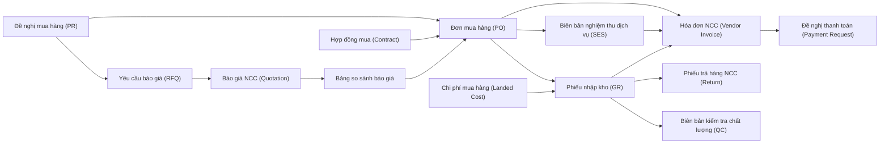
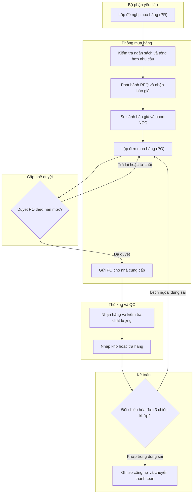
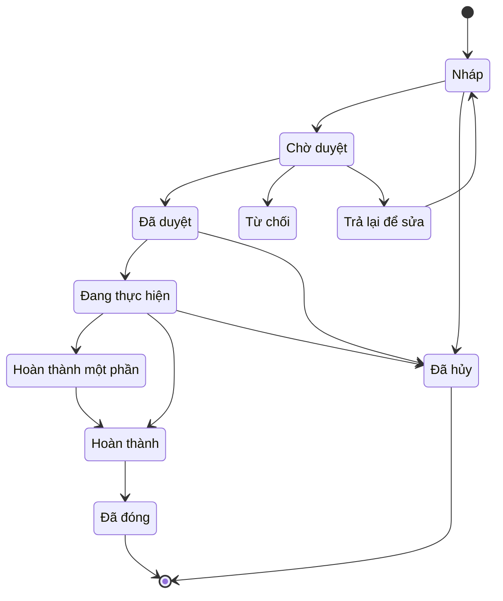

# PUR — Quy trình Mua hàng đến Thanh toán (Procure-to-Pay / P2P)

> **Phạm vi:** Toàn bộ chu trình mua sắm từ đề nghị mua hàng → tìm nguồn (sourcing) → đặt hàng → nhận hàng & kiểm tra chất lượng → đối chiếu hóa đơn → bàn giao thanh toán, bao gồm mua trong nước, nhập khẩu, mua dịch vụ, đơn hàng khung và hàng ký gửi. **Module liên quan:** PUR (Mua hàng) là module chủ; tích hợp INV (Kho), GL (Sổ cái), AP (Công nợ phải trả), CB (Tiền mặt/Ngân hàng), BUD (Ngân sách), COST (Giá thành), FA (Tài sản cố định), TAX (Thuế/Hóa đơn điện tử). **Chuẩn tham chiếu:** SAP MM (Materials Management), Oracle Fusion Procurement, Odoo Purchase, Microsoft Dynamics 365 Supply Chain Management; chế độ kế toán doanh nghiệp Việt Nam Thông tư 99/2025/TT-BTC (hiệu lực 01/01/2026, thay thế Thông tư 200/2014/TT-BTC) [1][2][3], doanh nghiệp nhỏ và vừa có thể tiếp tục Thông tư 133/2016/TT-BTC [4].
>
> **Cập nhật đến: 2026-10-20 — quy định thay đổi thường xuyên; BA phải kiểm tra lại hiệu lực khi dùng cho dự án.**

## Mục lục
- [1. Mục đích & phạm vi](#1-mục-đích--phạm-vi-trongngoài-phạm-vi)
- [2. Vai trò tham gia](#2-vai-trò-tham-gia)
- [3. Danh mục (master data) tiên quyết](#3-danh-mục-master-data-tiên-quyết)
- [4. Chứng từ & luồng chứng từ](#4-chứng-từ--luồng-chứng-từ-document-flow)
- [5. Các bước quy trình chuẩn](#5-các-bước-quy-trình-chuẩn)
- [6. Vòng đời trạng thái chứng từ chính](#6-vòng-đời-trạng-thái-chứng-từ-chính-đơn-mua-hàng)
- [7. Quy tắc nghiệp vụ & kiểm tra (validation)](#7-quy-tắc-nghiệp-vụ--kiểm-tra-validation-điển-hình)
- [8. Hạch toán kế toán](#8-hạch-toán-kế-toán)
- [9. Tham số hệ thống điển hình](#9-tham-số-hệ-thống-điển-hình)
- [10. Kiểm soát nội bộ & phân quyền](#10-kiểm-soát-nội-bộ--phân-quyền-sod-hạn-mức-duyệt-audit)
- [11. Báo cáo chuẩn](#11-báo-cáo-chuẩn)
- [12. Tích hợp với module khác](#12-tích-hợp-với-module-khác)
- [13. Biến thể & ngoại lệ](#13-biến-thể--ngoại-lệ)
- [14. Lỗi BA hay mắc & câu hỏi khảo sát](#14-lỗi-ba-hay-mắc--câu-hỏi-cần-hỏi-khách-hàng)
- [15. Nguồn tham khảo](#15-nguồn-tham-khảo)

---

## 1. Mục đích & phạm vi (trong/ngoài phạm vi)

**Mục đích:** Chuẩn hóa toàn bộ chu trình mua sắm để (a) mọi khoản chi mua hàng đều có đề nghị, phê duyệt và ngân sách; (b) giá mua được so sánh cạnh tranh; (c) chỉ ghi nhận công nợ và thanh toán khi có đủ chứng từ khớp 3 chiều (3-way match: đơn mua – nhận hàng – hóa đơn); (d) kiểm soát chất lượng và số lượng hàng nhận; (e) phản ánh đúng giá vốn (bao gồm chi phí mua hàng / landed cost) và nghĩa vụ thuế.

**Trong phạm vi:**
- Đề nghị mua hàng (Purchase Requisition – PR) kèm kiểm tra ngân sách.
- Tìm nguồn (sourcing): yêu cầu báo giá (Request for Quotation – RFQ), báo giá nhà cung cấp, so sánh & lựa chọn, đánh giá nhà cung cấp (vendor evaluation).
- Hợp đồng mua / thỏa thuận khung (Purchase Contract / Framework Agreement), đơn hàng khung (Blanket Order).
- Đơn mua hàng (Purchase Order – PO), phê duyệt theo số tiền/nhóm hàng, sửa đổi & phiên bản PO (PO change/version).
- Nhận hàng (Goods Receipt – GR) kèm kiểm tra chất lượng (Quality Inspection), trả hàng nhà cung cấp (Return to Vendor).
- Hóa đơn nhà cung cấp (Vendor Invoice) & đối chiếu 2/3 chiều, chi phí mua hàng (Landed Cost).
- Mua dịch vụ & nghiệm thu dịch vụ (Service Entry/Acceptance), hàng ký gửi (Consignment – cơ bản).
- Nhập khẩu cơ bản: thuế nhập khẩu, thuế GTGT hàng nhập khẩu, trị giá hải quan.
- Bàn giao thanh toán sang AP/Quỹ (payment handoff) — tạo đề nghị thanh toán, không bao gồm thực hiện chi tiền.

**Ngoài phạm vi (xem file khác):**
- Lập và giải phóng ngân sách → xem `references/processes/budgeting.md`.
- Hạch toán & theo dõi công nợ phải trả, lịch thanh toán, bù trừ công nợ → xem `references/processes/ap-accounts-payable.md`.
- Chi tiền, ủy nhiệm chi, đối chiếu ngân hàng → xem `references/processes/cash-bank.md`.
- Nhập/xuất/tồn, phương pháp tính giá xuất kho, kiểm kê → xem `references/processes/inventory-warehouse.md`.
- Tính giá thành, phân bổ chi phí sản xuất → xem `references/processes/costing.md`.
- Ghi tăng/khấu hao TSCĐ mua về → xem `references/processes/fixed-assets.md`.
- Hóa đơn điện tử đầu vào, kê khai thuế GTGT → xem `references/processes/tax-einvoice.md` và `references/regulations/vn-tax-einvoice.md`.
- Mua sắm cho dự án (gắn WBS) → xem `references/processes/project-management.md`.
- Cấu trúc tài khoản & chế độ kế toán → xem `references/regulations/vn-accounting.md`.

---

## 2. Vai trò tham gia

| Vai trò | Trách nhiệm | Quyền điển hình (theo hành động chuẩn) |
|---|---|---|
| Bộ phận yêu cầu / Người đề nghị (Requester) — `ROLE-PUR-REQ` | Lập đề nghị mua hàng, mô tả nhu cầu, xác nhận nhận dịch vụ | Xem, Tạo, Sửa (PR nháp), Xóa (PR nháp), Gửi duyệt, In |
| Nhân viên mua hàng (Purchasing Staff) — `ROLE-PUR-STAFF` | Tổng hợp nhu cầu, phát hành RFQ, nhập báo giá, lập PO, theo dõi giao hàng | Xem, Tạo, Sửa, Gửi duyệt (PR→PO, RFQ, PO), In, Xuất file |
| Trưởng phòng mua hàng (Purchasing Manager) — `ROLE-PUR-MGR` | Chọn nhà cung cấp, duyệt PO trong hạn mức, duyệt sửa PO, phê duyệt danh mục NCC | Xem, Duyệt, Từ chối, Trả lại, Sửa, Hủy (trong hạn mức), Cấu hình nhóm mua |
| Giám đốc (Director) — `ROLE-PUR-DIR` | Duyệt PO/hợp đồng vượt hạn mức, phê duyệt nhà cung cấp chiến lược | Xem, Duyệt, Từ chối, Trả lại |
| Nhân viên kiểm tra chất lượng (QC Inspector) — `ROLE-PUR-QC` | Kiểm tra chất lượng hàng nhận, lập biên bản kiểm tra, quyết định nhận/trả | Xem, Tạo (phiếu QC), Sửa, Gửi duyệt, In |
| Thủ kho (Storekeeper) — `ROLE-PUR-STORE` | Nhận hàng vật lý, lập phiếu nhập kho, lập phiếu trả hàng | Xem, Tạo (GR, phiếu trả), Sửa (nháp), Gửi duyệt, In |
| Kế toán kho (Inventory Accountant) — `ROLE-PUR-INVACC` | Ghi sổ nhập kho, phân bổ chi phí mua hàng, đối chiếu hàng nhận chưa có hóa đơn | Xem, Ghi sổ, Bỏ ghi sổ, Đảo, In, Xuất file |
| Kế toán công nợ phải trả (AP Accountant) — `ROLE-PUR-APACC` | Nhận hóa đơn NCC, đối chiếu 2/3 chiều, ghi nhận công nợ, lập đề nghị thanh toán | Xem, Tạo (hóa đơn, đề nghị TT), Ghi sổ, Đảo, In, Xuất file |
| Kế toán trưởng (Chief Accountant) — `ROLE-PUR-CHIEFACC` | Duyệt bút toán lớn, duyệt đề nghị thanh toán, kiểm soát danh mục NCC & tài khoản | Xem, Duyệt, Từ chối, Trả lại, Bỏ ghi sổ, Cấu hình |

> Quy ước phân quyền (áp dụng xuyên suốt): **Xóa** chỉ cho phép với chứng từ trạng thái Nháp; **Bỏ ghi sổ/Đảo** chỉ kế toán có quyền và phải để lại vết (audit trail); không vai trò nào vừa tạo PO vừa duyệt chính PO đó (xem §10).

---

## 3. Danh mục (master data) tiên quyết

| Danh mục | Trường quan trọng | Quy tắc chính |
|---|---|---|
| Nhà cung cấp (Vendor Master) — `MD-VENDOR` | Mã NCC, tên, MST (mã số thuế), địa chỉ, tài khoản ngân hàng, điều khoản thanh toán, loại NCC (trong nước/nước ngoài), đơn vị tiền tệ, trạng thái (active/blocked) | MST duy nhất, kiểm tra trùng; tài khoản ngân hàng phải khớp tên NCC; NCC bị khóa (blocked) không được chọn vào PO mới; thay đổi thông tin ngân hàng phải qua phê duyệt (chống gian lận) |
| Hàng hóa / vật tư (Item/Material Master) — `MD-ITEM` | Mã, tên, nhóm hàng, đơn vị tính mua, đơn vị tính kho, quy cách, mã thuế mặc định, phương pháp tính giá, có quản lý lô/hạn dùng không, có kiểm tra chất lượng không | Dùng chung với INV; UOM mua và UOM kho phải có hệ số quy đổi; hàng dịch vụ (non-stock) không qua kho |
| Đơn vị tính & quy đổi (UoM) — `MD-UOM` | Đơn vị gốc, đơn vị mua, hệ số quy đổi | Quy đổi về đơn vị kho khi nhập; làm tròn theo quy tắc cấu hình |
| Điều khoản thanh toán (Payment Terms) — `MD-PAYTERM` | Mã, số ngày, mốc tính (từ ngày hóa đơn/ngày nhận), chiết khấu thanh toán sớm | Xác định hạn thanh toán; mặc định theo NCC, cho ghi đè trên PO |
| Điều kiện giao hàng (Incoterms) — `MD-INCOTERMS` | Mã Incoterms (FOB, CIF, DAP…), địa điểm | Quyết định ai chịu cước/bảo hiểm → ảnh hưởng cấu thành landed cost và trị giá hải quan |
| Tiền tệ & tỷ giá (Currency/Exchange Rate) — `MD-CURRENCY` | Mã tiền, loại tỷ giá (mua/bán/trung tâm), ngày hiệu lực | Nhập khẩu: ghi nhận công nợ (Có 331) theo tỷ giá giao dịch thực tế ngày phát sinh (thường tỷ giá bán của NHTM giao dịch); chênh lệch tỷ giá khi thanh toán → 635 (lỗ) / 515 (lãi) [10] |
| Mã thuế (Tax Code) — `MD-TAXCODE` | Mã, loại thuế (GTGT/NK/TTĐB/BVMT), thuế suất, tài khoản | Thuế suất GTGT phổ thông 10% [16]; giai đoạn 01/07/2025–31/12/2026 nhiều mặt hàng giảm còn 8% [7][8] — phải gán đúng theo từng mặt hàng |
| Nhóm mua hàng / Tổ chức mua (Purchasing Group/Org) — `MD-PURCHGROUP` | Mã nhóm, người phụ trách, phạm vi hàng hóa | Dùng định tuyến phê duyệt và báo cáo theo nhóm mua |
| Kho / Địa điểm (Warehouse/Storage Location) — `MD-WAREHOUSE` | Mã kho, loại kho (thường/ngoại quan/ký gửi) | Nhận hàng phải chỉ định kho; kho bảo thuế theo dõi riêng trên TK 158 ("Nguyên liệu, vật tư tại kho bảo thuế" theo TT99) [3][5]; kho ngoại quan do hải quan giám sát nên theo dõi riêng (thường ngoài bảng) |
| Ma trận phê duyệt (Approval Matrix) — `MD-APPROVAL` | Loại chứng từ, bậc duyệt, ngưỡng số tiền, người/nhóm duyệt, ủy quyền | Xác định số cấp duyệt theo số tiền/nhóm hàng (xem §9, §10) |
| Tài khoản & trung tâm chi phí (GL Account/Cost Center) — `MD-COA` | Tài khoản kho/chi phí/công nợ, trung tâm chi phí, nguồn ngân sách | Lấy từ GL; gán trên dòng PR/PO phi kho để định khoản và kiểm ngân sách |

---

## 4. Chứng từ & luồng chứng từ (document flow)

| Chứng từ (VI / EN) | Mục đích | Tạo từ | Sinh ra | Ảnh hưởng (kho / công nợ / sổ cái) |
|---|---|---|---|---|
| Đề nghị mua hàng (Purchase Requisition – PR) | Ghi nhận nhu cầu, xin ngân sách & duyệt chủ trương | Nhu cầu bộ phận / kế hoạch / MRP | RFQ hoặc PO | Không ghi sổ; chỉ giữ chỗ (commitment) ngân sách nếu bật kiểm ngân sách |
| Yêu cầu báo giá (Request for Quotation – RFQ) | Mời nhiều NCC chào giá | PR | Báo giá NCC | Không ghi sổ |
| Báo giá nhà cung cấp (Vendor Quotation) | Ghi nhận giá, điều kiện của từng NCC | RFQ | Bảng so sánh → PO/Hợp đồng | Không ghi sổ |
| Hợp đồng mua / Thỏa thuận khung (Purchase Contract / Framework Agreement) | Cam kết giá/khối lượng dài hạn | Báo giá được chọn | PO phát hành theo hợp đồng (release) | Không ghi sổ; theo dõi giá trị/khối lượng còn lại |
| Đơn mua hàng (Purchase Order – PO) | Cam kết mua chính thức với NCC | PR / Hợp đồng / trực tiếp | GR, Hóa đơn, Biên bản nghiệm thu DV | Không ghi sổ kế toán tài chính; ghi nhận commitment ngân sách (SAP: PO không sinh bút toán [12]) |
| Phiếu nhập kho (Goods Receipt – GR) | Xác nhận nhận hàng vào kho | PO | Biên bản QC, Hóa đơn | **Kho:** tăng tồn; **Sổ cái:** Nợ hàng tồn / Có TK trung gian hàng về chưa hóa đơn (xem §8) |
| Biên bản kiểm tra chất lượng (Quality Inspection) | Chấp nhận/từ chối lô hàng | GR | Phiếu trả hàng (nếu loại) | Không ghi sổ; quyết định nhập kho tốt hay chờ xử lý |
| Biên bản nghiệm thu dịch vụ (Service Entry Sheet – SES) | Xác nhận dịch vụ đã thực hiện | PO dịch vụ | Hóa đơn | **Sổ cái:** ghi nhận chi phí/giá trị dịch vụ đã nhận |
| Chứng từ chi phí mua hàng (Landed Cost) | Phân bổ cước, bảo hiểm, thuế NK vào giá vốn | GR / Hóa đơn dịch vụ | — | **Kho/Sổ cái:** tăng giá gốc hàng tồn |
| Phiếu trả hàng NCC (Return to Vendor / Goods Return) | Trả lại hàng không đạt | GR | Hóa đơn điều chỉnh/giảm | **Kho:** giảm tồn; **Sổ cái:** đảo bút toán nhập |
| Hóa đơn nhà cung cấp (Vendor Invoice / Invoice Receipt) | Ghi nhận công nợ phải trả | PO + GR / SES | Đề nghị thanh toán | **Công nợ:** Có 331; **Sổ cái:** tất toán TK trung gian, ghi thuế GTGT đầu vào |
| Đề nghị thanh toán (Payment Request) | Chuyển sang AP/Quỹ để chi tiền | Hóa đơn | Chứng từ chi (ở AP/CB) | Không ghi sổ ở PUR; bàn giao sang `ap-accounts-payable.md` |

---

## 5. Các bước quy trình chuẩn

| # | Bước | Vai trò | Chứng từ | Hành động hệ thống | Trạng thái sau bước |
|---|---|---|---|---|---|
| 1 | Lập đề nghị mua hàng | Người đề nghị | PR | Kiểm tra ngân sách khả dụng, giữ chỗ commitment (nếu bật) | PR `PENDING` |
| 2 | Duyệt PR | Trưởng phòng / cấp duyệt | PR | Định tuyến theo ma trận; cập nhật commitment | PR `APPROVED` / `REJECTED` / `RETURNED` |
| 3 | Phát hành RFQ, nhận báo giá | NV mua hàng | RFQ, Báo giá | Gửi RFQ nhiều NCC; nhập/ghi nhận báo giá | RFQ `IN_PROGRESS` |
| 4 | So sánh & chọn NCC | NV mua hàng + Trưởng phòng | Bảng so sánh | So sánh giá/điều kiện (SAP: ME49); ghi lý do chọn | NCC được chọn |
| 5 | Lập hợp đồng / đơn hàng khung (nếu có) | NV mua hàng | Hợp đồng | Thiết lập giá, khối lượng, thời hạn hiệu lực | Hợp đồng `APPROVED` |
| 6 | Lập đơn mua hàng | NV mua hàng | PO | Kế thừa giá/điều kiện từ báo giá/hợp đồng; kiểm ngân sách lại | PO `DRAFT` → `PENDING` |
| 7 | Duyệt PO theo hạn mức | Trưởng phòng / Giám đốc | PO | Duyệt nhiều cấp theo số tiền/nhóm hàng; chuyển commitment | PO `APPROVED` / `REJECTED` / `RETURNED` |
| 8 | Gửi PO cho NCC | NV mua hàng | PO | Phát hành PO (in/email/EDI); chốt phiên bản | PO `IN_PROGRESS` |
| 9 | Nhận hàng & kiểm tra chất lượng | Thủ kho + QC | GR, Biên bản QC | Kiểm số lượng theo PO; kiểm chất lượng; tạo bút toán nhập kho | GR `POSTED`; PO `PARTIAL`/`COMPLETED` |
| 10 | Trả hàng không đạt (nếu có) | Thủ kho + NV mua hàng | Phiếu trả | Giảm tồn; đảo bút toán phần trả | Phiếu trả `POSTED` |
| 11 | Nhận & nhập hóa đơn NCC | KT công nợ | Hóa đơn | Đối chiếu 2/3 chiều với PO & GR trong dung sai | Hóa đơn `PENDING`/`APPROVED` |
| 12 | Phân bổ chi phí mua hàng (nếu có) | KT kho | Landed Cost | Phân bổ cước/bảo hiểm/thuế NK vào giá vốn | Giá vốn cập nhật |
| 13 | Ghi sổ công nợ | KT công nợ | Hóa đơn | Tất toán TK trung gian; ghi Có 331, thuế GTGT đầu vào | Hóa đơn `POSTED` |
| 14 | Lập đề nghị thanh toán | KT công nợ | Đề nghị TT | Chuyển thông tin sang AP/Quỹ theo hạn thanh toán | Bàn giao AP |
| 15 | Đóng PO | NV mua hàng / hệ thống | PO | Đóng khi đã nhận đủ & thanh toán đủ, hoặc đóng thủ công | PO `CLOSED` |

---

## 6. Vòng đời trạng thái chứng từ chính (Đơn mua hàng)

| Từ | Hành động | Đến | Vai trò | Điều kiện |
|---|---|---|---|---|
| (mới) | Tạo | `DRAFT` | NV mua hàng | Đủ thông tin tối thiểu (NCC, hàng, số lượng, giá) |
| `DRAFT` | Gửi duyệt | `PENDING` | NV mua hàng | Qua validation §7; ngân sách đủ |
| `PENDING` | Duyệt | `APPROVED` | Trưởng phòng/Giám đốc | Đúng cấp theo hạn mức; người duyệt ≠ người tạo |
| `PENDING` | Từ chối | `REJECTED` | Cấp duyệt | Có lý do; khóa chỉnh sửa |
| `PENDING` | Trả lại | `RETURNED` | Cấp duyệt | Có ghi chú yêu cầu sửa |
| `RETURNED` | Sửa | `DRAFT` | NV mua hàng | Giải phóng để chỉnh sửa lại |
| `APPROVED` | Phát hành/Nhận hàng lần đầu | `IN_PROGRESS` | NV mua hàng/Thủ kho | PO đã gửi NCC; bắt đầu nhận hàng |
| `IN_PROGRESS` | Nhận một phần | `PARTIAL` | Thủ kho | Số lượng nhận < số lượng PO |
| `PARTIAL`/`IN_PROGRESS` | Nhận đủ & khớp hóa đơn | `COMPLETED` | Hệ thống | Đã nhận đủ (trong dung sai) và/hoặc đã hóa đơn đủ |
| `COMPLETED` | Đóng | `CLOSED` | NV mua hàng/hệ thống | Đã tất toán nhận & hóa đơn |
| `DRAFT`/`APPROVED`/`IN_PROGRESS` | Hủy | `CANCELLED` | NV mua hàng/Trưởng phòng | Chưa nhận hàng hoặc đã xử lý phần đã nhận; giải phóng commitment |

> **Lưu ý trạng thái kế toán:** GR và Hóa đơn là chứng từ kế toán nên dùng thêm `POSTED` (Đã ghi sổ) / `REVERSED` (Đã đảo); PO không ghi sổ tài chính nên không có `POSTED`. Biến thể theo hệ thống (chỉ là ghi chú): SAP không dùng trạng thái duyệt riêng cho PO mà dùng "release strategy" [12]; Odoo dùng "RFQ → Purchase Order → Done/Locked" [14]; Oracle dùng "Incomplete → Pending Approval → Open → Closed" [17]; Dynamics 365 SCM dùng trạng thái phê duyệt workflow và "matching policy" cho đối chiếu hóa đơn [18].

---

## 7. Quy tắc nghiệp vụ & kiểm tra (validation) điển hình

Mã quy ước: `BR-PUR-nn`.

1. **BR-PUR-01 — Bắt buộc có PR trước PO (nếu bật tham số):** Mỗi dòng PO phải tham chiếu một dòng PR đã duyệt khi `PRM-PUR-006 = true`. *Lý do:* đảm bảo mọi khoản mua đều có nhu cầu và phê duyệt chủ trương.
2. **BR-PUR-02 — Kiểm tra ngân sách:** Tại thời điểm duyệt PR/PO, `(đã chi + đã cam kết + giá trị chứng từ này) ≤ ngân sách khả dụng` theo chiều (phòng ban/khoản mục/kỳ). Vượt → chặn hoặc cảnh báo tùy `PRM-PUR-001`. *Lý do:* kiểm soát chi tiêu. Xem `budgeting.md`.
3. **BR-PUR-03 — Chặn NCC bị khóa:** Không chọn được NCC trạng thái `blocked`/hết hiệu lực vào PR/RFQ/PO. *Lý do:* tránh mua từ NCC rủi ro/đang tranh chấp.
4. **BR-PUR-04 — Phê duyệt theo hạn mức số tiền:** Số cấp duyệt xác định theo tổng giá trị PO và nhóm hàng (xem `MD-APPROVAL`). *Lý do:* phân cấp kiểm soát chi.
5. **BR-PUR-05 — Người duyệt ≠ người tạo (SoD):** Hệ thống chặn tự duyệt chứng từ do chính mình tạo. *Lý do:* nguyên tắc phân tách trách nhiệm.
6. **BR-PUR-06 — Khóa sửa sau duyệt:** PO đã `APPROVED` chỉ sửa được bằng cách tạo phiên bản mới (PO change) và phải duyệt lại nếu thay đổi vượt ngưỡng `PRM-PUR-012`. *Lý do:* bảo toàn vết phê duyệt.
7. **BR-PUR-07 — Dung sai nhận hàng:** Số lượng nhận được phép lệch so với PO trong `PRM-PUR-004` (ví dụ ±5%). Vượt trần trên → chặn; thiếu → cho nhận một phần. *Lý do:* linh hoạt giao hàng nhưng kiểm soát nhận thừa.
8. **BR-PUR-08 — Bắt buộc kiểm tra chất lượng:** Với hàng cấu hình `kiểm QC = true`, GR vào kho "chờ kiểm"; chỉ chuyển kho tốt sau khi QC `APPROVED`. *Lý do:* chặn hàng lỗi vào sản xuất/bán.
9. **BR-PUR-09 — Đối chiếu 2/3 chiều (matching):** Theo `PRM-PUR-002`:
   - *2 chiều (2-way):* Hóa đơn ↔ PO (số lượng đặt & đơn giá).
   - *3 chiều (3-way):* Hóa đơn ↔ PO ↔ GR (số lượng nhận & đơn giá).
   Lệch ngoài dung sai giá `PRM-PUR-003` hoặc số lượng → **chặn thanh toán** (invoice blocked). *Lý do:* chỉ trả tiền cho hàng đã đặt và đã nhận thực tế [12][13].
10. **BR-PUR-10 — Chặn hóa đơn trùng:** Cảnh báo/chặn khi trùng (NCC + số hóa đơn + ngày) hoặc (NCC + số tiền + ngày). *Lý do:* chống trả trùng.
11. **BR-PUR-11 — Giá nhận không âm, đơn giá > 0:** Chặn số lượng ≤ 0 (trừ chứng từ điều chỉnh/trả hàng), đơn giá < 0. *Lý do:* toàn vẹn dữ liệu.
12. **BR-PUR-12 — Công thức giá trị dòng:** `Thành tiền trước thuế = Số lượng × Đơn giá × (1 − % chiết khấu)`; `Tiền thuế = Thành tiền trước thuế × thuế suất`; `Thành tiền sau thuế = Thành tiền trước thuế + Tiền thuế`. Làm tròn theo `PRM` cấu hình (thường làm tròn đến đồng).
13. **BR-PUR-13 — Phân bổ chi phí mua hàng (landed cost):** Tổng chi phí mua phân bổ cho các dòng theo tiêu thức `PRM-PUR-009`:
    `Chi phí phân bổ cho dòng i = Tổng chi phí × (Giá trị|Số lượng|Trọng lượng của dòng i ÷ Tổng tiêu thức)`. *Lý do:* phản ánh đúng giá vốn thực tế.
14. **BR-PUR-14 — Tỷ giá nhập khẩu:** Khoản phải trả NCC nước ngoài ghi theo tỷ giá giao dịch thực tế tại ngày phát sinh (thường tỷ giá bán của ngân hàng giao dịch); chênh lệch khi thanh toán ghi 635/515 [10]. *Lý do:* đúng chế độ kế toán ngoại tệ.
15. **BR-PUR-15 — Nghiệm thu dịch vụ trước hóa đơn:** Với PO dịch vụ, phải có Biên bản nghiệm thu (SES) được xác nhận trước khi ghi nhận hóa đơn/công nợ. *Lý do:* chỉ trả cho dịch vụ đã thực hiện.
16. **BR-PUR-16 — Đóng PO còn tồn nhỏ:** Cho phép đóng PO khi phần chưa nhận/chưa hóa đơn nằm trong ngưỡng cho phép, giải phóng commitment còn lại. *Lý do:* dọn PO treo.

---

## 8. Hạch toán kế toán

> **Chế độ áp dụng:** Thông tư 99/2025/TT-BTC (hiệu lực 01/01/2026, thay thế Thông tư 200/2014/TT-BTC) [1][2][3]. Các số hiệu tài khoản dùng dưới đây **giữ nguyên như TT200** (151, 152, 153, 156, 211, 331, 133, 333x…) nên bút toán đúng cho cả doanh nghiệp còn áp dụng TT200 trong kỳ chuyển tiếp [5][6]. **Điểm mới TT99 liên quan P2P:** bổ sung TK **1383 "Thuế TTĐB của hàng nhập khẩu"** (phần được khấu trừ/hoàn) và đổi tên TK **158 "Nguyên liệu, vật tư tại kho bảo thuế"** [3][5]. Doanh nghiệp nhỏ và vừa áp dụng TT133/2016 có hệ thống tài khoản khác ở một số điểm — xem `references/regulations/vn-accounting.md` [4]. (TT99 cho phép doanh nghiệp tự thiết kế tài khoản chi tiết cấp 2; bảng tài khoản ban hành kèm TT99 không liệt kê sẵn 1561/1562 cho TK 156 — ⚠️ đối chiếu Phụ lục II nếu cần dùng mã cấp 2.) Thuế suất GTGT phổ thông 10% [16]; giai đoạn 01/07/2025–31/12/2026 nhiều mặt hàng còn 8% [7][8].
>
> **Về "tài khoản trung gian hàng về chưa có hóa đơn (GR/IR)":** chế độ kế toán VN **không có** tài khoản GR/IR clearing riêng như SAP (SAP dùng TK clearing qua transaction key WRX [12]). Thực hành VN dùng tiểu khoản của **331** ("hàng về chưa có hóa đơn") hoặc **151** ("hóa đơn về hàng chưa về"). Nhiều bản địa hóa ERP tại VN tạo một TK trung gian (thường chi tiết 331 hoặc 338) để chạy 3-way match — khi cấu hình phải quy ước rõ TK này.

**(a) Mua hàng trong nước — nhận hàng kèm hóa đơn (3-way khớp), thuế GTGT được khấu trừ**

| Nghiệp vụ | Nợ | Có | Ghi chú |
|---|---|---|---|
| Nhập kho vật tư/hàng hóa/CCDC | 152 / 156 / 153 | 331 | Giá chưa thuế |
| Thuế GTGT đầu vào được khấu trừ | 133 (1331) | 331 | Theo hóa đơn |
| Mua TSCĐ | 211 | 331 | Chuyển ghi tăng TSCĐ → `fixed-assets.md` |
| Thuế GTGT đầu vào của TSCĐ | 133 (1332) | 331 | |

**(b) Nhận hàng trước, hóa đơn chưa về (cuối kỳ) — ghi theo giá tạm tính**

| Nghiệp vụ | Nợ | Có | Ghi chú |
|---|---|---|---|
| Nhập kho theo giá tạm tính | 152 / 156 | 331 (chi tiết "hàng về chưa hóa đơn") | Chưa ghi 133 |
| Khi có hóa đơn: điều chỉnh chênh lệch giá | 152 / 156 | 331 | Hoặc ghi âm nếu giá tạm tính cao hơn |
| Ghi nhận thuế GTGT khi có hóa đơn | 133 | 331 | |

**(c) Hóa đơn về trước, hàng đang đi đường**

| Nghiệp vụ | Nợ | Có | Ghi chú |
|---|---|---|---|
| Hàng mua đang đi đường | 151 | 331 | Giá chưa thuế |
| Thuế GTGT đầu vào | 133 | 331 | |
| Khi hàng về nhập kho | 152 / 156 | 151 | |

**(d) Chi phí mua hàng / landed cost (vận chuyển, bốc xếp, bảo hiểm)**

| Nghiệp vụ | Nợ | Có | Ghi chú |
|---|---|---|---|
| Chi phí thu mua phân bổ vào giá gốc | 152 / 156 (hàng hóa có thể 1562) | 331 / 111 / 112 | Theo `BR-PUR-13` |
| Thuế GTGT của chi phí mua | 133 | 331 / 111 / 112 | |

**(e) Mua hàng nhập khẩu** [9][10][15]

| Nghiệp vụ | Nợ | Có | Ghi chú |
|---|---|---|---|
| Trị giá hàng nhập + thuế nhập khẩu | 152 / 156 / 211 | 331 (giá mua) ; 3333 (thuế NK) | Giá mua theo tỷ giá thực tế [10] |
| Thuế TTĐB hàng nhập khẩu (nếu có, không được khấu trừ) | 152 / 156 / 211 | 3332 | Tính vào giá gốc |
| Thuế TTĐB hàng NK được khấu trừ (TT99) | 1383 | 3332 | TK mới của TT99 [3] |
| Thuế BVMT hàng nhập khẩu (nếu có) | 152 / 156 | 33381 | Tính vào giá gốc |
| Thuế GTGT hàng nhập khẩu được khấu trừ | 133 | 33312 | Giá tính thuế GTGT = trị giá tính thuế NK + thuế NK + thuế NK bổ sung (chống bán phá giá/chống trợ cấp/tự vệ, nếu có) + TTĐB + BVMT [9] |
| Nộp các khoản thuế khâu nhập khẩu | 3333 / 3332 / 33312 / 33381 | 111 / 112 | |

**(f) Trả hàng cho nhà cung cấp**

| Nghiệp vụ | Nợ | Có | Ghi chú |
|---|---|---|---|
| Trả lại hàng đã nhập kho | 331 | 152 / 156 | Theo giá đã ghi nhận |
| Điều chỉnh giảm thuế GTGT đầu vào | 331 | 133 | Theo hóa đơn điều chỉnh |

**(g) Mua dịch vụ**

| Nghiệp vụ | Nợ | Có | Ghi chú |
|---|---|---|---|
| Ghi nhận chi phí dịch vụ | 627 / 641 / 642 / 241 / 154 | 331 | Theo bộ phận sử dụng |
| Thuế GTGT đầu vào | 133 | 331 | |

**(h) Chiết khấu, giảm giá, thanh toán**

| Nghiệp vụ | Nợ | Có | Ghi chú |
|---|---|---|---|
| Ứng trước/trả trước cho NCC | 331 (số dư Nợ) | 111 / 112 | 331 có thể dư Nợ = khoản trả trước |
| Chiết khấu thương mại/giảm giá được hưởng | 331 | 152 / 156 (và 133) | Giảm giá gốc hàng tồn |
| Chiết khấu thanh toán sớm được hưởng | 331 | 515 | Doanh thu hoạt động tài chính |
| Thanh toán công nợ NCC | 331 | 111 / 112 | Chênh lệch tỷ giá → 635 (lỗ) / 515 (lãi) |

> **Hàng ký gửi (consignment) cơ bản:** khi nhận hàng NCC giao giữ hộ (quyền sở hữu chưa chuyển) → theo dõi ngoài bảng (TT200 dùng TK 002 "Vật tư, hàng hóa nhận giữ hộ, nhận gia công"; ⚠️ CHƯA XÁC MINH cách TT99 quy định TK ngoài bảng — kiểm tra Phụ lục TT99). Khi rút ra sử dụng/bán mới ghi mua: Nợ 152/156, Nợ 133 / Có 331.

---

## 9. Tham số hệ thống điển hình

| Tham số | Kiểu | Giá trị gợi ý | Phạm vi | Ảnh hưởng |
|---|---|---|---|---|
| `PRM-PUR-001` Kiểm tra ngân sách khi tạo PR/PO | Enum (Tắt/Cảnh báo/Chặn) | Chặn | Công ty | Chặn vượt ngân sách tại §7 BR-PUR-02 |
| `PRM-PUR-002` Phương pháp đối chiếu hóa đơn | Enum (2-way/3-way/4-way) | 3-way | Công ty / nhóm hàng | Quyết định chứng từ cần khớp trước khi trả (Dynamics 365 gọi là "matching policy" [18]) |
| `PRM-PUR-003` Dung sai đơn giá khi đối chiếu | Số (% hoặc giá trị tuyệt đối) | ±2% hoặc 100.000đ | Công ty | Lệch giá vượt ngưỡng → chặn hóa đơn |
| `PRM-PUR-004` Dung sai số lượng nhận | Số (%) | +5% / −0% | Công ty / mặt hàng | Nhận thừa quá ngưỡng bị chặn |
| `PRM-PUR-005` Ma trận hạn mức duyệt PO | Bảng ngưỡng | VD: ≤50tr TP; ≤500tr GĐ; >500tr HĐQT | Công ty / chi nhánh | Số cấp & người duyệt |
| `PRM-PUR-006` Bắt buộc PR trước PO | Boolean | true (tùy doanh nghiệp) | Công ty | §7 BR-PUR-01 |
| `PRM-PUR-007` Bắt buộc kiểm tra chất lượng khi nhận | Boolean / theo mặt hàng | Theo nhóm hàng | Mặt hàng | GR vào kho chờ kiểm |
| `PRM-PUR-008` Cho phép nhận vượt số lượng PO | Boolean | false | Công ty | Chặn/ cho nhận thừa |
| `PRM-PUR-009` Tiêu thức phân bổ chi phí mua | Enum (Giá trị/Số lượng/Trọng lượng/Thể tích) | Giá trị | Công ty | Cách tính landed cost |
| `PRM-PUR-010` Đánh số tự động chứng từ | Cấu hình (tiền tố, reset kỳ) | PO-{YY}-{seq} reset theo năm | Công ty / chi nhánh | Mã chứng từ |
| `PRM-PUR-011` Giá PO mặc định gồm thuế hay chưa thuế | Enum | Chưa thuế | Công ty | Cách nhập & hiển thị giá |
| `PRM-PUR-012` Cho phép sửa PO sau duyệt (ngưỡng tạo phiên bản) | Số (% thay đổi) | >0% về giá/số lượng phải duyệt lại | Công ty | §7 BR-PUR-06 |
| `PRM-PUR-013` Chính sách tạo hóa đơn | Enum (Theo đặt hàng / Theo nhận hàng) | Theo nhận hàng | Công ty / mặt hàng | Odoo "bill control": ordered vs received [14] |
| `PRM-PUR-014` Chu kỳ & bộ tiêu chí đánh giá NCC | Cấu hình | Quý; tiêu chí giá/chất lượng/giao hàng/dịch vụ | Công ty | Điểm đánh giá NCC |
| `PRM-PUR-015` Loại tỷ giá nhập khẩu & xử lý chênh lệch | Enum | Tỷ giá bán NHTM giao dịch | Công ty | §7 BR-PUR-14 |

---

## 10. Kiểm soát nội bộ & phân quyền (SoD, hạn mức duyệt, audit)

**Phân tách trách nhiệm (Segregation of Duties – SoD) tối thiểu:**
1. **Người đề nghị ≠ người duyệt PR/PO.** (BR-PUR-05)
2. **Người mua (tạo PO) ≠ người nhận hàng (GR) ≠ người ghi sổ/đề nghị thanh toán.** Tam quyền phân lập để không ai kiểm soát toàn bộ chu trình chi.
3. **Người tạo/sửa danh mục NCC (đặc biệt tài khoản ngân hàng) ≠ người tạo PO ≠ người duyệt thanh toán.** Chống gian lận "nhà cung cấp ma" và đổi số tài khoản.
4. **Người duyệt hóa đơn ≠ người thực hiện chi tiền** (chi tiền thuộc AP/CB).

**Kiểm soát then chốt:**
- **Đối chiếu 3 chiều (3-way match):** chỉ ghi công nợ/trả tiền khi PO–GR–Hóa đơn khớp trong dung sai (BR-PUR-09). Đây là chốt chặn quan trọng nhất của P2P.
- **Hạn mức phê duyệt theo số tiền/nhóm hàng** (ma trận `MD-APPROVAL`, `PRM-PUR-005`); có cơ chế ủy quyền khi người duyệt vắng mặt.
- **Chống trùng hóa đơn** (BR-PUR-10) và kiểm soát hóa đơn điện tử đầu vào hợp lệ → `tax-einvoice.md`.
- **Kiểm soát sửa sau duyệt:** mọi thay đổi PO đã duyệt phải tạo phiên bản và lưu vết; thay đổi vượt ngưỡng phải duyệt lại (BR-PUR-06).
- **Nhật ký kiểm toán (audit trail):** ghi lại ai tạo/sửa/duyệt/ghi sổ/hủy, thời điểm, giá trị trước–sau; không cho xóa chứng từ đã ghi sổ (chỉ Đảo/Bỏ ghi sổ có kiểm soát).
- **Khóa kỳ:** không cho ghi sổ/sửa chứng từ thuộc kỳ kế toán đã khóa.
- **Danh mục NCC được phê duyệt (approved vendor list):** chỉ mua từ NCC đã thẩm định; NCC mới phải qua quy trình thêm & duyệt.

Ma trận phân quyền chi tiết theo hành động chuẩn: xem bảng §2 và chuẩn chung `references/security-and-parameters.md`.

---

## 11. Báo cáo chuẩn

| Báo cáo | Mục đích | Chiều phân tích / bộ lọc | Bắt buộc theo luật? |
|---|---|---|---|
| `RPT-PUR-01` Tình hình thực hiện đơn mua hàng (PO status / Open PO) | Theo dõi đã đặt – đã nhận – đã hóa đơn – còn lại của từng PO | NCC, nhóm hàng, người mua, kỳ, trạng thái PO, quá hạn giao | Không (quản trị) |
| `RPT-PUR-02` Công nợ phải trả nhà cung cấp (AP Aging) | Theo dõi dư nợ & tuổi nợ phải trả | NCC, tuổi nợ (0–30/31–60…), đến hạn, tiền tệ | Không; nhưng số liệu phục vụ thuyết minh BCTC (xem `ap-accounts-payable.md`) |
| `RPT-PUR-03` Phân tích giá mua (Purchase Price Analysis / PPV) | So sánh giá mua theo thời gian/NCC, chênh lệch giá PO–hóa đơn | Mặt hàng, NCC, kỳ, chênh lệch giá | Không (quản trị) |
| `RPT-PUR-04` Đánh giá nhà cung cấp (Vendor Scorecard) | Chấm điểm NCC theo giá/chất lượng/giao hàng/dịch vụ | NCC, kỳ, tiêu chí | Không (quản trị) |
| `RPT-PUR-05` Hàng đã nhận chưa có hóa đơn (GR not invoiced) | Kiểm soát công nợ tiềm tàng & khóa sổ cuối kỳ | NCC, mặt hàng, kỳ | Không; phục vụ trích trước & đối chiếu |
| `RPT-PUR-06` Đề nghị mua chưa chuyển đơn (Open PR) | Theo dõi nhu cầu chưa đặt hàng | Bộ phận, mặt hàng, trạng thái | Không (quản trị) |
| `RPT-PUR-07` Sổ chi tiết mua hàng theo NCC/mặt hàng | Tra cứu phát sinh mua | NCC, mặt hàng, kho, kỳ | Không (quản trị) |

> Báo cáo thuế GTGT đầu vào, bảng kê hóa đơn mua vào phục vụ kê khai là **bắt buộc theo luật** nhưng thuộc module TAX → xem `references/processes/tax-einvoice.md`.

---

## 12. Tích hợp với module khác (ảnh hưởng dữ liệu hai chiều)

| Module | Dữ liệu trao đổi | Chiều | Ghi chú |
|---|---|---|---|
| INV — Kho (`inventory-warehouse.md`) | GR làm tăng tồn; trả hàng giảm tồn; landed cost cập nhật giá vốn | PUR → INV & INV → PUR (tồn khả dụng) | Mã hàng, kho dùng chung master data |
| GL — Sổ cái (`r2r-general-ledger.md`) | Bút toán nhập kho, thuế, công nợ, chênh lệch tỷ giá | PUR → GL | Tài khoản định khoản lấy từ COA |
| AP — Công nợ phải trả (`ap-accounts-payable.md`) | Hóa đơn NCC, đề nghị thanh toán, lịch & hạn thanh toán | PUR → AP | Bàn giao thanh toán; AP quản lý chi |
| CB — Tiền/Ngân hàng (`cash-bank.md`) | Thực chi, ủy nhiệm chi, đối chiếu ngân hàng | AP → CB | Tất toán 331 |
| BUD — Ngân sách (`budgeting.md`) | Giữ chỗ commitment khi PR/PO; thực chi khi hóa đơn | PUR ↔ BUD | Kiểm tra & cập nhật số khả dụng |
| COST — Giá thành (`costing.md`) | Giá vốn thực tế, chênh lệch giá mua (PPV) | PUR → COST | Vật tư đưa vào sản xuất |
| FA — Tài sản cố định (`fixed-assets.md`) | PO/GR hàng là TSCĐ → ghi tăng nguyên giá | PUR → FA | Gắn mã tài sản khi nhận |
| TAX — Thuế & HĐĐT (`tax-einvoice.md`) | Hóa đơn điện tử đầu vào, thuế GTGT/NK/TTĐB | PUR ↔ TAX | Mã thuế, kê khai |
| PRJ — Dự án (`project-management.md`) | Mua sắm gắn WBS/dự án | PUR ↔ PRJ | Chi phí quy về dự án |
| MFG — Sản xuất (`manufacturing-mrp.md`) | MRP sinh PR tự động theo nhu cầu sản xuất | MFG → PUR | Gia công ngoài (subcontracting) |

---

## 13. Biến thể & ngoại lệ

1. **Giao/nhận một phần (partial delivery):** PO chuyển `PARTIAL`; mỗi lần nhận tạo một GR; đối chiếu hóa đơn theo lũy kế số đã nhận. Theo dõi số còn lại để đóng khi hết.
2. **Nhận thừa/thiếu (over/under delivery):** Theo dung sai `PRM-PUR-004`; thừa quá ngưỡng bị chặn (BR-PUR-07); thiếu cho đóng sớm nếu NCC báo không giao nữa.
3. **Trả hàng nhà cung cấp (return):** Sau GR phát hiện lỗi → phiếu trả giảm tồn, đảo bút toán; nếu đã có hóa đơn → yêu cầu hóa đơn điều chỉnh/giảm; điều chỉnh thuế GTGT đầu vào (§8f).
4. **Hủy PO (cancel):** Chỉ khi chưa nhận hàng (hoặc đã xử lý phần đã nhận); giải phóng commitment ngân sách; lưu lý do.
5. **Sửa sau duyệt (post-approval change):** Tạo phiên bản PO mới (version), giữ lịch sử; thay đổi giá/số lượng vượt ngưỡng phải duyệt lại (BR-PUR-06).
6. **Đa tiền tệ (multi-currency):** PO/hóa đơn ngoại tệ; ghi 331 theo tỷ giá thực tế ngày phát sinh; đánh giá lại số dư gốc ngoại tệ cuối kỳ; chênh lệch tỷ giá khi thanh toán → 635/515 (BR-PUR-14).
7. **Ứng trước cho nhà cung cấp (advance/down payment):** Chi trước khi nhận hàng → 331 dư Nợ; bù trừ khi có hóa đơn (§8h).
8. **Nhập khẩu (import):** Thêm tờ khai hải quan, thuế NK/TTĐB/BVMT, thuế GTGT hàng nhập khẩu, chi phí logistics quốc tế vào landed cost; trị giá hải quan theo phương pháp trị giá giao dịch [11]; kho bảo thuế dùng TK 158 [3]; kho ngoại quan do hải quan giám sát, theo dõi riêng.
9. **Mua dịch vụ (service procurement):** PO dịch vụ không qua kho; cần Biên bản nghiệm thu (SES) trước hóa đơn (BR-PUR-15); matching theo giá trị nghiệm thu.
10. **Đơn hàng khung / blanket order:** Một thỏa thuận khung → phát hành nhiều "release" (đơn gọi hàng) theo nhu cầu; kiểm soát tổng khối lượng/giá trị còn lại.
11. **Hàng ký gửi (consignment):** NCC để hàng tại kho DN, DN chỉ ghi mua khi rút ra dùng/bán; trước đó theo dõi ngoài bảng (§8 ghi chú).
12. **Gia công ngoài (subcontracting):** Xuất NVL cho NCC gia công, nhận lại bán thành phẩm/thành phẩm; kết hợp với MFG → `manufacturing-mrp.md`.
13. **Mua giao thẳng (drop-ship):** Hàng giao thẳng từ NCC đến khách/công trình, không qua kho công ty; GR logic theo nghiệm thu tại điểm nhận.

---

## 14. Lỗi BA hay mắc & câu hỏi cần hỏi khách hàng

**Lỗi BA hay mắc:**
- Bỏ qua bước **kiểm tra ngân sách** và **commitment** — chỉ mô tả "tạo PO rồi duyệt", không nói ngân sách giữ chỗ lúc nào, nhả lúc nào.
- Nhầm **PR và PO** là một; hoặc bắt buộc PR cho mọi trường hợp mà không hỏi doanh nghiệp có muốn mua nhanh không qua PR không.
- Không định nghĩa rõ **loại matching (2/3 chiều) và dung sai** → spec không "code-ready", lập trình phải đoán.
- Quên **tài khoản trung gian hàng về chưa hóa đơn (GR/IR)** và cách tất toán — dẫn tới bút toán nhập kho và ghi công nợ bị chồng/thiếu.
- Bỏ sót **landed cost** và tiêu thức phân bổ → giá vốn sai.
- Không tách **mua dịch vụ** (cần nghiệm thu, không qua kho) khỏi mua hàng hóa.
- Thiếu xử lý **nhập khẩu** (thuế NK/TTĐB/GTGT hàng NK, tỷ giá, trị giá hải quan).
- Dùng **số hiệu tài khoản cũ** mà không kiểm tra chế độ đang áp dụng (TT99/2025 vs TT200 vs TT133) và thời điểm chuyển đổi.
- Không thiết kế **SoD** (ai thêm NCC, ai đổi số tài khoản ngân hàng NCC) → rủi ro gian lận.
- Quên **phiên bản PO** và vết phê duyệt khi sửa sau duyệt.
- Thêm **chức năng không được yêu cầu** (ví dụ đấu thầu điện tử phức tạp) hoặc **bỏ sót** chức năng trả hàng/đóng PO.

**Câu hỏi khảo sát cụ thể cần hỏi khách hàng:**
1. Doanh nghiệp áp dụng chế độ kế toán nào: TT99/2025, còn TT200 trong kỳ chuyển tiếp, hay TT133/2016 (SME)? Kỳ kế toán bắt đầu khi nào?
2. Có bắt buộc PR trước PO không? Trường hợp nào được mua nhanh không qua PR?
3. Ngân sách kiểm tra ở cấp nào (phòng ban/khoản mục/dự án)? Vượt ngân sách thì chặn hay cảnh báo? Ai được duyệt ngoại lệ?
4. Hạn mức phê duyệt PO theo số tiền và nhóm hàng như thế nào? Bao nhiêu cấp? Ai duyệt mỗi cấp? Cơ chế ủy quyền khi vắng?
5. Có tổ chức RFQ/so sánh báo giá bắt buộc không? Ngưỡng giá trị nào phải chào giá tối thiểu mấy NCC?
6. Có dùng hợp đồng/thỏa thuận khung, đơn hàng khung (blanket order) không?
7. Dùng matching mấy chiều (2/3)? Dung sai giá và dung sai số lượng bao nhiêu? Hóa đơn lệch thì chặn hay cho qua có duyệt?
8. Mặt hàng nào phải kiểm tra chất lượng khi nhận? Quy trình xử lý hàng không đạt?
9. Cho phép nhận thừa/thiếu bao nhiêu %? Nhận một phần xử lý ra sao?
10. Có mua nhập khẩu không? Các loại thuế/chi phí nào cấu thành giá vốn? Dùng loại tỷ giá nào?
11. Có mua dịch vụ không? Quy trình nghiệm thu dịch vụ trước khi thanh toán?
12. Có hàng ký gửi / gia công ngoài / giao thẳng không?
13. Chính sách tạo hóa đơn/ghi công nợ theo số đặt hay số nhận (bill control)?
14. Điều khoản thanh toán phổ biến? Có ứng trước cho NCC không? Có chiết khấu thanh toán sớm không?
15. Quy trình thêm/duyệt nhà cung cấp mới và kiểm soát thay đổi tài khoản ngân hàng NCC?
16. Tiêu chí và chu kỳ đánh giá nhà cung cấp? Dùng kết quả để làm gì (chặn/ưu tiên)?
17. Các báo cáo mua hàng bắt buộc phải có? Chiều phân tích nào quan trọng?
18. Mã chứng từ đánh số theo quy tắc nào, reset theo kỳ nào, theo chi nhánh không?

---

## 15. Nguồn tham khảo

- [1] Thông tư 99/2025/TT-BTC hướng dẫn Chế độ kế toán doanh nghiệp (toàn văn) — Thư viện Pháp luật — https://thuvienphapluat.vn/van-ban/Doanh-nghiep/Thong-tu-99-2025-TT-BTC-huong-dan-Che-do-ke-toan-doanh-nghiep-565484.aspx (truy cập 2026-10-20)
- [2] Toàn văn Thông tư 99/2025/TT-BTC chế độ kế toán doanh nghiệp thay thế Thông tư 200 từ 01/01/2026 — Thư viện Pháp luật — https://thuvienphapluat.vn/phap-luat/ho-tro-phap-luat/toan-van-thong-tu-992025ttbtc-che-do-ke-toan-doanh-nghiep-thay-the-thong-tu-200-tu-01012026-ra-sao-239165.html (truy cập 2026-10-20)
- [3] Thông tư 99/2025/TT-BTC: điểm mới, bổ sung TK 1383, đổi tên TK 158, hiệu lực 01/01/2026 — MISA ASP — https://asp.misa.vn/tt/kien-thuc/thong-tu-99-2025-tt-btc/ (truy cập 2026-10-20)
- [4] Doanh nghiệp đang áp dụng Thông tư 133 sang năm 2026 có phải chuyển sang Thông tư 99 không? (khoản 3 Điều 31 TT99 — SME được chọn) — Thư viện Pháp luật — https://thuvienphapluat.vn/ma-so-thue/phap-luat-thue/doanh-nghiep-dang-ap-dung-thong-tu-133-sang-nam-2026-co-phai-chuyen-sang-thong-tu-99-khong-586349-220947.html (truy cập 2026-10-20)
- [5] Hệ thống tài khoản kế toán theo Thông tư 99/2025/TT-BTC (bảng tài khoản, so sánh với TT200) — Kế toán Lê Ánh — https://ketoanleanh.edu.vn/kinh-nghiem-ke-toan/he-thong-tai-khoan-ke-toan-theo-thong-tu-992025tt-btc.html (truy cập 2026-10-20)
- [6] Tài khoản 331 – Phải trả cho người bán theo Thông tư 99/2025/TT-BTC — MISA AMIS — https://amis.misa.vn/255129/tai-khoan-331-theo-thong-tu-99/ (truy cập 2026-10-20)
- [7] Chính thức giảm thuế GTGT xuống 8% từ 01/7/2025 đến hết 31/12/2026 (Nghị quyết 204/2025/QH15, Nghị định 174/2025/NĐ-CP) — LuatVietnam — https://luatvietnam.vn/tin-van-ban-moi/chinh-thuc-giam-thue-gtgt-xuong-8-tu-ngay-01-7-2025-den-het-31-12-2026-186-102680-article.html (truy cập 2026-10-20)
- [8] Giảm thuế GTGT 2026 từ 10% xuống 8% — phạm vi áp dụng & nhóm loại trừ — Thư viện Pháp luật — https://thuvienphapluat.vn/phap-luat/ho-tro-phap-luat/giam-thue-gtgt-2026-tu-10-xuong-8-tu-ngay-01012026-den-het-ngay-31122026-phu-luc-giam-thue-gtgt-202-241813.html (truy cập 2026-10-20)
- [9] Hạch toán thuế GTGT hàng nhập khẩu — giá tính thuế (Điều 7 Luật Thuế GTGT 2024, Nghị định 181/2025/NĐ-CP) — MISA SME — https://sme.misa.vn/345703/hach-toan-thue-gtgt-hang-nhap-khau/ (truy cập 2026-10-20)
- [10] Phương pháp hạch toán hàng nhập khẩu (TK 3333, 33312, tỷ giá) — MISA SME — https://sme.misa.vn/52367/phuong-phap-hach-toan-hang-nhap-khau/ (truy cập 2026-10-20)
- [11] Thông tư 39/2015/TT-BTC quy định về trị giá hải quan đối với hàng hóa xuất khẩu, nhập khẩu (sửa đổi, bổ sung bởi Thông tư 60/2019/TT-BTC) — Bộ Tài chính — ⚠️ CHƯA XÁC MINH URL: link gốc vbpl.vn trả về lỗi 404 (truy cập 2026-10-20); tra cứu toàn văn trên thuvienphapluat.vn hoặc customs.gov.vn
- [12] Understanding the Goods and Invoice Receipt process (GR/IR clearing, 3-way match, MIGO/MIRO, MR11, OBYC WRX/BSX) — Michael Management (SAP) — https://www.michaelmanagement.com/blog/sap/understanding-the-goods-and-invoice-receipt-process (truy cập 2026-10-20)
- [13] Invoices: 3-way match in SAP MM LIV — ERP Suites — https://blog.erpsuites.com/blog/sap/ap/invoices-3-way-match-sap-mm-liv (truy cập 2026-10-20)
- [14] Bill control policies (ordered vs received quantities) — Odoo Documentation — https://www.odoo.com/documentation/16.0/applications/inventory_and_mrp/purchase/manage_deals/control_bills.html (truy cập 2026-10-20)
- [15] Hướng dẫn tính thuế tiêu thụ đặc biệt hàng nhập khẩu — MISA AMIS — https://amis.misa.vn/18054/huong-dan-tinh-thue-tieu-thu-dac-biet-hang-nhap-khau-chi-tiet-nhat/ (truy cập 2026-10-20)
- [16] Luật Thuế giá trị gia tăng số 48/2024/QH15 (thuế suất phổ thông 10%, hiệu lực 01/07/2025) — Thư viện Pháp luật — https://thuvienphapluat.vn/van-ban/Thue-Phi-Le-Phi/Luat-Thue-gia-tri-gia-tang-2024-48-2024-QH15-531170.aspx (truy cập 2026-10-20)
- [17] Oracle Fusion Cloud Procurement — Tài liệu sản phẩm (requisition, PO, receiving, invoice matching, ERS) — https://docs.oracle.com/en/cloud/saas/procurement/ (truy cập 2026-10-20)
- [18] Procurement and sourcing overview — Microsoft Dynamics 365 Supply Chain Management (purchase requisition, RFQ, PO, product receipt, invoice matching) — https://learn.microsoft.com/en-us/dynamics365/supply-chain/procurement/procurement-sourcing-overview (truy cập 2026-10-20)
