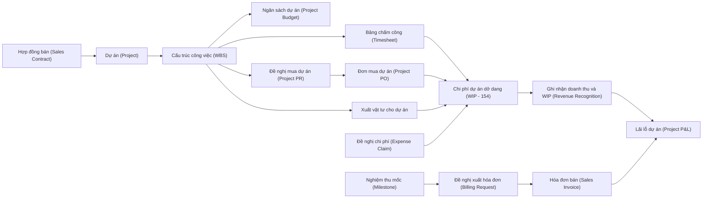
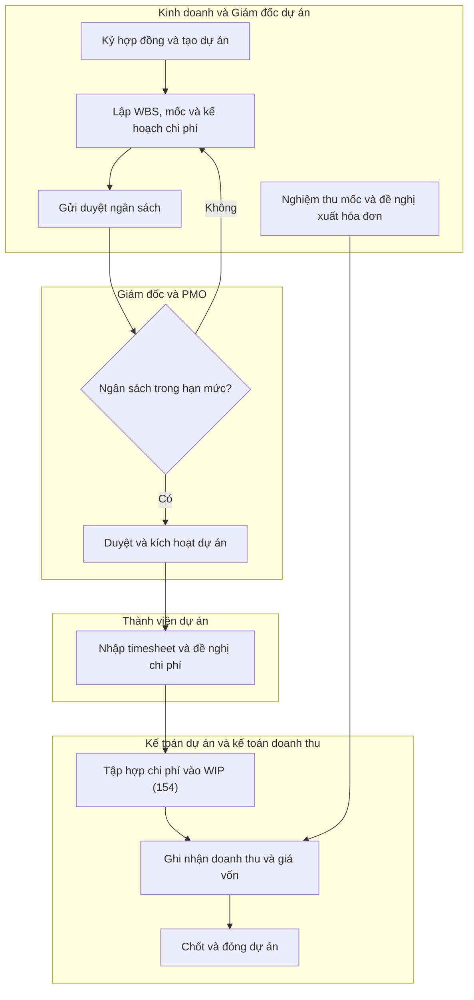
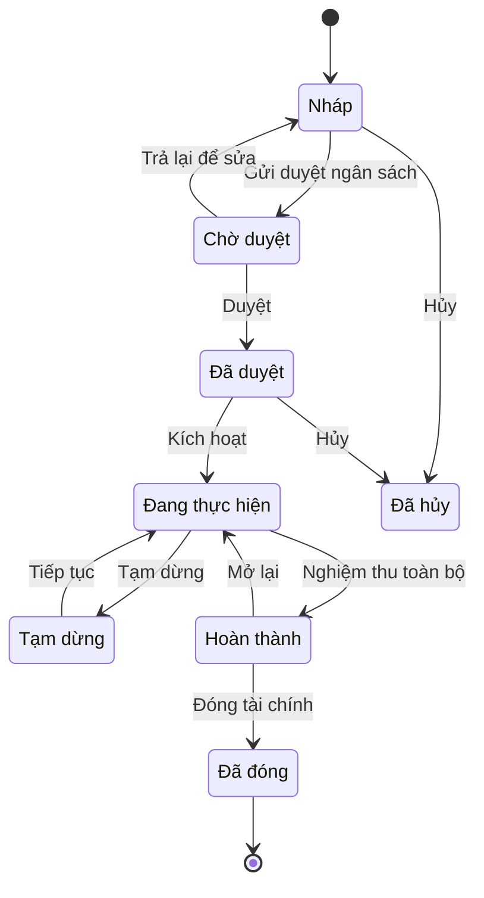

# PRJ — Quản lý dự án & kế toán dự án (Project Management & Project Accounting)

> **Phạm vi:** Quản lý dự án tổng quát và kế toán dự án cho doanh nghiệp dịch vụ (phần mềm, tư vấn, kỹ thuật, triển khai, agency) và dự án nội bộ — KHÔNG bao gồm đặc thù xây dựng/thi công (xem `references/industries/construction.md`). **Module liên quan:** PRJ (lõi), tích hợp O2C/SAL, P2P/PUR, INV, HR/PAY, GL, COST, BUD, FA, TAX. **Chuẩn tham chiếu:** SAP S/4HANA Project System (PS) / Project Control & Result Analysis [10]; Oracle Fusion Cloud Project Management (PPM) [11]; Odoo Project + Timesheets + Sales [12]; Microsoft Dynamics 365 Project Operations [13]; chế độ kế toán VN hiện hành (xem mục 8) và VAS 14 [7], VAS 15 [8].
>
> **Cập nhật đến: 2026-10-20 — quy định thay đổi thường xuyên; BA phải kiểm tra lại hiệu lực khi dùng cho dự án.**

## Mục lục
- [1. Mục đích & phạm vi](#1-mục-đích--phạm-vi)
- [2. Vai trò tham gia](#2-vai-trò-tham-gia)
- [3. Danh mục (master data) tiên quyết](#3-danh-mục-master-data-tiên-quyết)
- [4. Chứng từ & luồng chứng từ](#4-chứng-từ--luồng-chứng-từ-document-flow)
- [5. Các bước quy trình chuẩn](#5-các-bước-quy-trình-chuẩn)
- [6. Vòng đời trạng thái chứng từ chính](#6-vòng-đời-trạng-thái-chứng-từ-chính)
- [7. Quy tắc nghiệp vụ & kiểm tra](#7-quy-tắc-nghiệp-vụ--kiểm-tra-validation-điển-hình)
- [8. Hạch toán kế toán](#8-hạch-toán-kế-toán)
- [9. Tham số hệ thống](#9-tham-số-hệ-thống-điển-hình)
- [10. Kiểm soát nội bộ & phân quyền](#10-kiểm-soát-nội-bộ--phân-quyền-sod-hạn-mức-duyệt-audit)
- [11. Báo cáo chuẩn](#11-báo-cáo-chuẩn)
- [12. Tích hợp với module khác](#12-tích-hợp-với-module-khác-ảnh-hưởng-dữ-liệu-hai-chiều)
- [13. Biến thể & ngoại lệ](#13-biến-thể--ngoại-lệ)
- [14. Lỗi BA hay mắc & câu hỏi khảo sát](#14-lỗi-ba-hay-mắc--câu-hỏi-cần-hỏi-khách-hàng)
- [15. Nguồn tham khảo](#15-nguồn-tham-khảo)

---

## 1. Mục đích & phạm vi

Module Quản lý dự án (Project Management – PRJ) biến một cam kết với khách hàng hoặc một sáng kiến nội bộ thành một đối tượng chi phí/doanh thu có cấu trúc (dự án), để: lập kế hoạch công việc và ngân sách, tập hợp chi phí thực tế (nhân công, mua ngoài, vật tư), xuất hóa đơn theo mô hình thương mại, ghi nhận doanh thu đúng kỳ, và đo lường lợi nhuận từng dự án.

**Trong phạm vi:**
1. Thiết lập dự án: loại dự án, mẫu dự án, định nghĩa dự án, lịch dự án.
2. Cấu trúc phân rã công việc (Work Breakdown Structure – WBS) và công việc/nhiệm vụ (Task / Network Activity).
3. Kế hoạch chi phí & ngân sách dự án (Cost Plan & Project Budget); kiểm soát khả dụng ngân sách (Budget Availability Control).
4. Phân bổ & quản lý nguồn lực (Resource Assignment); công suất (capacity) ở mức cơ bản.
5. Bảng chấm công dự án (Timesheet) → chi phí nhân công.
6. Mua sắm & chi phí dự án (Project PR/PO, đề nghị thanh toán chi phí), xuất vật tư cho dự án.
7. Mốc dự án (Milestones).
8. Mô hình xuất hóa đơn: giá cố định theo mốc (Fixed Price by Milestone), theo thời gian & vật tư (Time & Materials – T&M), chi phí cộng phí (Cost-plus).
9. Ghi nhận doanh thu cơ bản theo tỷ lệ hoàn thành (Percentage of Completion – POC); chi phí dở dang (Work in Progress – WIP).
10. Lãi lỗ dự án (Project P&L), biên lợi nhuận, ước tính chi phí hoàn thành (Estimate at Completion – EAC).
11. Yêu cầu thay đổi (Change Request / Variation Order).
12. Đóng dự án (Project Closing / Settlement).

**Ngoài phạm vi (liên kết tới file khác):**
- Đặc thù hợp đồng xây dựng/thi công, TK 337, bảo lãnh, khối lượng nghiệm thu, hồ sơ dự thầu → `references/industries/construction.md`.
- Quy trình mua hàng chi tiết (PR → RFQ → PO → nhận → hóa đơn NCC) → `references/processes/p2p-procure-to-pay.md`.
- Quy trình bán & công nợ phải thu (hợp đồng bán, hóa đơn bán, thu tiền) → `references/processes/o2c-order-to-cash.md`, `references/processes/ar-accounts-receivable.md`.
- Tính giá thành & phân bổ chi phí chung → `references/processes/costing.md`.
- Lập & kiểm soát ngân sách toàn doanh nghiệp → `references/processes/budgeting.md`.
- Lương & tính công → `references/processes/hr-payroll.md`.
- Hóa đơn điện tử, thời điểm xuất hóa đơn, thuế GTGT → `references/processes/tax-einvoice.md`, `references/regulations/vn-tax-einvoice.md`.
- Dự án đầu tư TSCĐ (XDCB dở dang → TSCĐ) → `references/processes/fixed-assets.md`.

---

## 2. Vai trò tham gia

| Vai trò | Trách nhiệm | Quyền điển hình (theo hành động chuẩn) |
|---|---|---|
| Giám đốc dự án (Project Manager – ROLE-PRJ-PM) | Lập WBS, kế hoạch chi phí/tiến độ; quản lý thực hiện; đề nghị xuất hóa đơn theo mốc; theo dõi EAC | Tạo, Sửa (dự án mình phụ trách), Gửi duyệt, Xem, In, Xuất file |
| Thành viên dự án (Project Team Member – ROLE-PRJ-MEMBER) | Nhập timesheet, đề nghị chi phí/công tác, cập nhật % hoàn thành công việc | Tạo/Sửa/Xóa (timesheet & đề nghị ở trạng thái Nháp của mình), Gửi duyệt, Xem |
| Điều phối nguồn lực / PMO (Resource Manager / PMO – ROLE-PRJ-RM) | Phân bổ nguồn lực, kiểm soát công suất, chuẩn hóa mẫu & quy trình | Xem, Sửa (phân bổ), Duyệt (phân bổ), Xuất file |
| Quản lý phê duyệt (Approving Manager – ROLE-PRJ-APPR) | Duyệt timesheet, duyệt đề nghị chi phí, duyệt ngân sách trong hạn mức | Xem, Duyệt, Từ chối, Trả lại |
| Kế toán dự án (Project Accountant – ROLE-PRJ-ACC) | Tập hợp chi phí vào dự án, chạy ghi nhận doanh thu/WIP, đối soát unbilled/deferred | Xem, Ghi sổ, Bỏ ghi sổ, Đảo, In, Xuất file |
| Kế toán doanh thu (Revenue Accountant – ROLE-PRJ-REV) | Vận hành ghi nhận doanh thu theo POC/mốc, phối hợp xuất hóa đơn | Xem, Tạo (bút toán doanh thu), Ghi sổ |
| Kế toán trưởng (Chief Accountant – ROLE-PRJ-CA) | Duyệt bút toán doanh thu/dự phòng, chốt kỳ, phê duyệt đóng dự án | Xem, Duyệt, Ghi sổ, Đóng, Cấu hình (account determination) |
| Nhân viên kinh doanh / Account Manager (Sales/Account Manager – ROLE-PRJ-SALES) | Gắn hợp đồng bán với dự án, tạo đề nghị xuất hóa đơn, khởi tạo change request | Tạo (billing request, change request), Xem |
| Giám đốc (Director – ROLE-PRJ-DIR) | Duyệt ngân sách & change request vượt hạn mức; phê duyệt dự án lỗ | Xem, Duyệt (theo hạn mức), Từ chối |
| Quản trị hệ thống (System Administrator – ROLE-PRJ-ADMIN) | Cấu hình loại dự án, phương pháp doanh thu, tham số, phân quyền | Cấu hình, Xem |

> Quyền **Xóa** chỉ áp dụng cho chứng từ trạng thái Nháp. Quyền **Bỏ ghi sổ/Đảo** phải giới hạn ở kế toán và có audit log (xem mục 10).

---

## 3. Danh mục (master data) tiên quyết

| Danh mục | Trường quan trọng | Quy tắc chính |
|---|---|---|
| Loại dự án (Project Type – MD-PRJ-TYPE) | Mã, tên, nhóm (bán/billable – nội bộ/CAPEX – nghiên cứu), mô hình doanh thu mặc định, mô hình hóa đơn mặc định | Quyết định luồng doanh thu: dự án bán có doanh thu; dự án nội bộ không ghi doanh thu, có thể vốn hóa (xem 13) |
| Mẫu dự án (Project Template – MD-PRJ-TPL) | Cấu trúc WBS mẫu, công việc, mốc, cost plan khung, vai trò | Áp mẫu khi tạo dự án mới để giảm sai sót & chuẩn hóa |
| Định nghĩa dự án (Project / Project Definition – MD-PRJ) | Mã dự án, tên, khách hàng, hợp đồng bán, PM, đồng tiền, ngày bắt đầu/kết thúc, công ty/chi nhánh, trung tâm chi phí | Mã dự án duy nhất; đồng tiền dự án cố định sau khi có phát sinh; gắn đúng pháp nhân |
| Phần tử WBS (WBS Element – MD-PRJ-WBS) | Mã WBS phân cấp, loại (thu/chi/thống kê), gắn cost plan, cờ cho phép hạch toán/xuất hóa đơn | WBS cha tổng hợp (roll-up) từ WBS con; chỉ WBS được "Phát hành/Released" mới cho hạch toán [10] |
| Công việc / Nhiệm vụ (Task / Network Activity – MD-PRJ-TASK) | Mã, mô tả, WBS cha, ngày, người thực hiện, nỗ lực kế hoạch (giờ), phụ thuộc (dependency) | Dùng cho lập lịch & tính % hoàn thành theo nỗ lực |
| Mốc (Milestone – MD-PRJ-MS) | Mã, mô tả, ngày kế hoạch, % giá trị hợp đồng gắn mốc, cờ kích hoạt xuất hóa đơn/doanh thu | Tổng % các mốc = 100% giá trị hợp đồng; mốc là cơ sở billing cho mô hình giá cố định |
| Loại chi phí/doanh thu (Cost/Revenue Element / Category – MD-PRJ-CE) | Mã, nhóm (nhân công/mua ngoài/vật tư/công tác/thầu phụ/doanh thu), ánh xạ tài khoản GL | Bắt buộc ánh xạ sang GL để bút toán tự động (account determination) |
| Loại hoạt động & giá nội bộ (Activity Type & Cost Rate – MD-PRJ-RATE) | Mã, đơn vị (giờ/ngày), giá vốn nội bộ (cost rate) theo cấp bậc/vai trò, hiệu lực từ–đến | Cost rate = chi phí nội bộ 1 giờ công; khác với giá bán (bill rate) |
| Bảng giá bán / Đơn giá tính phí (Rate Schedule / Bill Rate / Price List – MD-PRJ-PL) | Giá bán theo vai trò/cấp bậc/loại dịch vụ, đồng tiền, hiệu lực | Dùng cho billing T&M và định giá hợp đồng; theo khách hàng/hợp đồng [13] |
| Nguồn lực (Resource – MD-PRJ-RES) | Nhân viên/vai trò, kỹ năng, công suất chuẩn (giờ/ngày), chi phí, lịch làm việc | Liên kết hồ sơ nhân sự (xem `hr-payroll.md`); cơ sở phân bổ & utilization |
| Vai trò dự án (Project Role – MD-PRJ-ROLE) | Mã vai trò, cấp bậc, cost rate & bill rate mặc định | Dùng để lập kế hoạch nguồn lực khi chưa gán người cụ thể |
| Khách hàng (Customer – MD-CUSTOMER) | Mã, điều khoản thanh toán, công nợ, đồng tiền | Dùng chung với O2C/AR — không trùng lặp, xem `ar-accounts-receivable.md` |
| Lịch dự án / lịch làm việc (Project / Factory Calendar – MD-PRJ-CAL) | Ngày làm việc, ngày nghỉ, công suất theo ngày | Cơ sở lập lịch và tính công suất |
| Phương pháp ghi nhận doanh thu (Revenue Recognition Method / Key – MD-PRJ-RRM) | POC theo chi phí (cost-to-cost), theo nỗ lực, theo khối lượng/nghiệm thu, theo mốc/sự kiện, as-billed | Gắn ở loại dự án hoặc từng dự án; quyết định bút toán ở mục 8 |

> Danh mục khách hàng, nhà cung cấp, nhân viên, trung tâm chi phí, tài khoản GL là **master data dùng chung** — tham chiếu chứ không tạo lại trong PRJ.

---

## 4. Chứng từ & luồng chứng từ (document flow)

| Chứng từ (VI / EN) | Mục đích | Tạo từ | Sinh ra | Ảnh hưởng (kho / công nợ / sổ cái) |
|---|---|---|---|---|
| Hợp đồng bán (Sales Contract / Sales Order) | Cam kết thương mại, giá trị & mô hình billing | Cơ hội CRM / báo giá | Dự án | Chưa ghi sổ (cơ sở cho billing & doanh thu) |
| Dự án (Project / Project Definition) | Đối tượng tập hợp chi phí & doanh thu | Hợp đồng bán / sáng kiến nội bộ | WBS, ngân sách | Không trực tiếp; là chiều phân tích (cost object) |
| Ngân sách dự án (Project Budget) | Trần chi phí được duyệt theo WBS/kỳ | Dự án + cost plan | Kiểm soát khả dụng (AVAC) | Không ghi sổ GL; kiểm soát cam kết/thực chi |
| Bảng chấm công (Timesheet) | Ghi giờ công theo WBS/công việc | Thành viên dự án | Chi phí nhân công, số liệu tính lương | Sổ cái: Nợ 154/622 – Có 334/338 (khi kết chuyển) |
| Đề nghị mua dự án (Project PR → PO) | Mua ngoài/thầu phụ gắn WBS | PM / mua hàng | Nhận hàng, hóa đơn NCC | Công nợ phải trả, chi phí dự án (xem `p2p`) |
| Phiếu xuất kho cho dự án (Material Issue to Project) | Xuất vật tư/CCDC dùng cho dự án | Yêu cầu vật tư | Giảm kho, tăng chi phí | Kho giảm; Nợ 621/154 – Có 152/153 |
| Đề nghị thanh toán chi phí (Expense Claim) | Chi phí đi lại, công tác, phụ cấp của thành viên | Thành viên dự án | Chi phí dự án | Nợ 627/642 – Có 141/111/331 |
| Nghiệm thu mốc (Milestone Acceptance) | Xác nhận hoàn thành mốc | PM + khách hàng | Đề nghị xuất hóa đơn, cơ sở doanh thu | Không ghi sổ; kích hoạt billing/doanh thu |
| Đề nghị xuất hóa đơn (Billing Request / Billing Plan line) | Yêu cầu lập hóa đơn theo mốc/kỳ/giờ công | Mốc, timesheet, kế hoạch billing | Hóa đơn bán | Không ghi sổ cho tới khi lập hóa đơn |
| Hóa đơn bán (Sales Invoice – hóa đơn GTGT điện tử) | Ghi nhận phải thu & thuế GTGT | Đề nghị xuất hóa đơn | Bút toán phải thu | Công nợ phải thu; Nợ 131 – Có 511/337/3387, 3331 (xem 8) |
| Bút toán ghi nhận doanh thu/WIP (Revenue Recognition Entry) | Ghi doanh thu theo POC & giá vốn tương ứng | Kết quả chạy ghi nhận doanh thu | — | Sổ cái: doanh thu, giá vốn, tài sản/nợ hợp đồng |
| Yêu cầu thay đổi (Change Request / Variation) | Điều chỉnh phạm vi, giá trị HĐ, ngân sách | Khách hàng / PM | Phụ lục HĐ, điều chỉnh ngân sách | Không ghi sổ trực tiếp; đổi giá trị billing/doanh thu |
| Chứng từ đóng/kết chuyển dự án (Settlement / Closing) | Kết chuyển chi phí còn lại, chốt lãi lỗ | Dự án hoàn thành | Bút toán kết chuyển | Nợ 632/911 – Có 154/… (xem 8) |

---

## 5. Các bước quy trình chuẩn

| # | Bước | Vai trò | Chứng từ | Hành động hệ thống | Trạng thái sau bước |
|---|---|---|---|---|---|
| 1 | Ký hợp đồng & khởi tạo dự án (áp mẫu) | ROLE-PRJ-SALES, ROLE-PRJ-PM | Hợp đồng bán → Dự án | Sinh mã dự án, kế thừa mẫu WBS/mốc | Dự án = DRAFT "Nháp" |
| 2 | Lập WBS, công việc, mốc, kế hoạch chi phí | ROLE-PRJ-PM | WBS, Cost Plan | Tính tổng chi phí dự toán, roll-up theo WBS | DRAFT |
| 3 | Gửi duyệt ngân sách | ROLE-PRJ-PM | Ngân sách dự án | Khóa chỉnh sửa, gửi luồng duyệt | PENDING "Chờ duyệt" |
| 4 | Duyệt ngân sách & kích hoạt dự án | ROLE-PRJ-APPR / ROLE-PRJ-DIR | Ngân sách dự án | Kiểm tra hạn mức; phát hành (Release) WBS | APPROVED "Đã duyệt" → IN_PROGRESS "Đang thực hiện" |
| 5 | Phân bổ nguồn lực | ROLE-PRJ-RM | Phân bổ nguồn lực | Kiểm tra công suất, cảnh báo quá tải | IN_PROGRESS |
| 6 | Nhập & duyệt timesheet | ROLE-PRJ-MEMBER → ROLE-PRJ-APPR | Timesheet | Kiểm tra WBS mở, kỳ mở; tính chi phí nhân công | Timesheet APPROVED |
| 7 | Mua ngoài/thầu phụ & chi phí | ROLE-PRJ-PM, ROLE-PRJ-ACC | PR/PO, Expense Claim | Gắn cam kết (commitment) vào ngân sách; kiểm soát AVAC | IN_PROGRESS |
| 8 | Tập hợp chi phí vào dự án (WIP) | ROLE-PRJ-ACC | Bút toán chi phí | Kết chuyển 621/622/627 → 154 theo WBS | POSTED "Đã ghi sổ" |
| 9 | Nghiệm thu mốc / xác định % hoàn thành | ROLE-PRJ-PM + khách hàng | Nghiệm thu mốc | Cập nhật % hoàn thành / mốc đạt | Mốc COMPLETED "Hoàn thành" |
| 10 | Đề nghị & xuất hóa đơn | ROLE-PRJ-SALES, ROLE-PRJ-ACC | Billing Request → Hóa đơn bán | Lập hóa đơn GTGT điện tử, ghi phải thu & thuế | Hóa đơn POSTED |
| 11 | Chạy ghi nhận doanh thu & giá vốn | ROLE-PRJ-REV, ROLE-PRJ-ACC | Bút toán doanh thu/WIP | Tính POC, ghi doanh thu, giá vốn, tài sản/nợ hợp đồng | POSTED |
| 12 | Theo dõi lãi lỗ, EAC, change request | ROLE-PRJ-PM, ROLE-PRJ-ACC | Báo cáo P&L, Change Request | Cập nhật EAC; dự phòng nếu lỗ | IN_PROGRESS |
| 13 | Hoàn thành kỹ thuật (nghiệm thu toàn bộ) | ROLE-PRJ-PM | Biên bản nghiệm thu | Chặn phát sinh mới (trừ bảo hành) | COMPLETED |
| 14 | Chốt & đóng dự án (kết chuyển, settlement) | ROLE-PRJ-ACC, ROLE-PRJ-CA | Chứng từ đóng dự án | Kết chuyển chi phí/doanh thu còn lại, chốt lãi lỗ | CLOSED "Đã đóng" |

---

## 6. Vòng đời trạng thái chứng từ chính

Chứng từ chính của module là **Dự án (Project)**. Vòng đời timesheet và hóa đơn theo chuẩn chung (Nháp → Chờ duyệt → Đã duyệt → Đã ghi sổ) — mô tả ở `o2c-order-to-cash.md` và `hr-payroll.md`.

| Từ | Hành động | Đến | Vai trò | Điều kiện |
|---|---|---|---|---|
| DRAFT | Gửi duyệt ngân sách | PENDING | PM | WBS & cost plan đầy đủ, tổng mốc = 100% |
| PENDING | Duyệt | APPROVED | Approving Manager / Director | Trong hạn mức duyệt theo cấp |
| PENDING | Trả lại để sửa | DRAFT | Approving Manager | Có lý do trả lại |
| APPROVED | Kích hoạt | IN_PROGRESS | PM / PMO | WBS được Phát hành (Released) |
| IN_PROGRESS | Tạm dừng | ONHOLD | PM / Director | Chặn timesheet & chi phí mới (tham số) |
| IN_PROGRESS | Nghiệm thu toàn bộ | COMPLETED | PM | Đã nghiệm thu mốc cuối, biên bản đầy đủ |
| COMPLETED | Mở lại | IN_PROGRESS | PM / CA | Còn công việc bảo hành/điều chỉnh, kỳ còn mở |
| COMPLETED | Đóng tài chính | CLOSED | Kế toán trưởng | Hết PO mở, timesheet duyệt hết, unbilled/deferred = 0 |
| DRAFT/APPROVED | Hủy | CANCELLED | Director | Chưa có phát sinh thực tế (nếu có phải xử lý theo 13) |

> "Tạm dừng" (On Hold) không thuộc bộ mã chuẩn tài liệu nhưng rất phổ biến ở hệ thống dự án (SAP trạng thái hệ thống, Odoo/D365) — ghi nhận như biến thể, không thay thế mã chuẩn.

---

## 7. Quy tắc nghiệp vụ & kiểm tra (validation) điển hình

Công thức dùng ký hiệu: `AC` = chi phí thực tế lũy kế (Actual Cost); `EAC` = tổng chi phí ước tính khi hoàn thành (Estimate at Completion); `ETC` = chi phí còn phải chi (Estimate to Complete); `CV` = giá trị hợp đồng (Contract Value).

1. **BR-PRJ-01 — Chặn hạch toán vào WBS chưa phát hành/đã đóng.** Không cho nhập timesheet, PO, chi phí vào WBS ở trạng thái DRAFT hoặc CLOSED. *Lý do:* chi phí phải vào đúng dự án, đúng kỳ; tránh "làm trước — mở dự án sau".
2. **BR-PRJ-02 — Roll-up ngân sách.** Tổng ngân sách các WBS con ≤ ngân sách WBS cha. *Lý do:* giữ tính nhất quán của trần chi phí phân cấp.
3. **BR-PRJ-03 — Kiểm soát khả dụng ngân sách (Budget Availability Control).** Khi `Cam kết (PO mở) + Thực chi > Ngân sách × (1 + dung sai)` → cảnh báo hoặc chặn theo tham số PRM-PRJ-003/004. *Lý do:* ngăn vượt chi ngoài kiểm soát.
4. **BR-PRJ-04 — Tính POC theo chi phí (cost-to-cost).** `POC = AC / EAC` (tỷ lệ 0–1; nhân 100 để hiển thị %). `Doanh thu lũy kế = POC × CV`. `Doanh thu ghi nhận kỳ = Doanh thu lũy kế − Doanh thu đã ghi các kỳ trước`. *Lý do:* chuẩn VAS 14 cho dịch vụ [7] và VAS 15 cho xây dựng [8] cho phép đo mức hoàn thành theo chi phí.
5. **BR-PRJ-05 — EAC & nhận diện hợp đồng lỗ.** `EAC = AC + ETC`. Nếu `EAC > CV` → dự kiến lỗ; phải trích ngay **toàn bộ** phần lỗ dự kiến vào chi phí (dự phòng 352), không phân bổ dần. *Lý do:* nguyên tắc thận trọng (onerous contract).
6. **BR-PRJ-06 — Chặn POC > 100% và xử lý đảo doanh thu.** POC tối đa 100%. Khi EAC tăng (chi phí vượt) làm POC giảm so với kỳ trước → doanh thu kỳ có thể âm (đảo bớt doanh thu đã ghi). *Lý do:* phản ánh đúng tiến độ thực.
7. **BR-PRJ-07 — Billing T&M.** `Giá trị hóa đơn T&M = Σ(giờ công đã duyệt × bill rate theo vai trò) + chi phí pass-through × (1 + markup%)`. Chỉ tính giờ đã duyệt. *Lý do:* chỉ xuất hóa đơn phần đã được phê duyệt & có thể thu.
8. **BR-PRJ-08 — Billing/doanh thu cost-plus.** `Doanh thu = Chi phí thực tế được chấp nhận × (1 + % phí quản lý)`. *Lý do:* mô hình chi phí cộng phí.
9. **BR-PRJ-09 — Điều kiện xuất hóa đơn theo mốc.** Chỉ cho lập hóa đơn mốc khi mốc ở trạng thái COMPLETED (đã nghiệm thu). *Lý do:* tránh xuất hóa đơn khống/sai tiến độ.
10. **BR-PRJ-10 — Điều kiện đóng dự án.** Không cho chuyển CLOSED khi còn: PO mở, timesheet chưa duyệt, chênh lệch tài sản/nợ hợp đồng (unbilled/deferred) chưa xử lý, hoặc WIP (154) còn số dư chưa kết chuyển. *Lý do:* chốt sạch lãi lỗ.
11. **BR-PRJ-11 — Giữ lại (Retention).** `Số giữ lại = Giá trị nghiệm thu × % giữ lại`. Phần giữ lại vẫn là phải thu nhưng hoãn thu đến khi hết bảo hành. *Lý do:* phản ánh đúng kỳ hạn thu.
12. **BR-PRJ-12 — Timesheet trong kỳ & trong khung thời gian.** Ngày công phải nằm trong kỳ kế toán đang mở và trong khoảng ngày của WBS/công việc. *Lý do:* đúng kỳ, đúng phạm vi.
13. **VAL-PRJ-13 — Công suất nguồn lực.** Không phân bổ nguồn lực vượt `Công suất × (1 + dung sai quá tải)` (PRM-PRJ-014); vượt thì cảnh báo. *Lý do:* kế hoạch khả thi.
14. **VAL-PRJ-14 — Change request phải duyệt trước.** Không cho điều chỉnh ngân sách hoặc giá trị hợp đồng khi chưa duyệt yêu cầu thay đổi. *Lý do:* kiểm soát phạm vi (scope creep) & doanh thu.
15. **VAL-PRJ-15 — Đồng tiền & tỷ giá.** Đồng tiền hóa đơn = đồng tiền hợp đồng; tỷ giá ghi nhận theo ngày phát sinh/ghi nhận; chênh lệch tỷ giá hạch toán 515/635 (xem 8 và `r2r-general-ledger.md`). *Lý do:* đúng chuẩn ngoại tệ.
16. **VAL-PRJ-16 — Doanh thu không phụ thuộc hóa đơn.** Theo VAS 14 (dịch vụ) [7] và VAS 15 (xây dựng – hợp đồng thanh toán theo tiến độ kế hoạch) [8][9], doanh thu/chi phí ghi theo phần công việc hoàn thành do đơn vị tự xác định, không phụ thuộc số tiền trên hóa đơn. *Lý do:* tách biệt ghi nhận doanh thu và lập hóa đơn.

---

## 8. Hạch toán kế toán

> **Chế độ kế toán áp dụng (xác định tại 2026-10-20):** **Thông tư 99/2025/TT-BTC** (ban hành 27/10/2025, hiệu lực **01/01/2026**, áp dụng cho năm tài chính bắt đầu từ/ sau 01/01/2026), **thay thế Thông tư 200/2014/TT-BTC** và Thông tư 75/2015/TT-BTC [1][2]. Doanh nghiệp nhỏ và vừa vẫn được áp dụng **Thông tư 133/2016/TT-BTC** hoặc tự nguyện chuyển sang TT99 [6]. Số hiệu tài khoản dưới đây theo **Phụ lục II TT99/2025** [3].
>
> **Khác biệt chính so với TT200 cần lưu ý:**
> - **TK 511** không còn tài khoản cấp 2 (5111/5112/5113…); doanh nghiệp tự mở chi tiết nội bộ, thuyết minh BCTC vẫn tách theo nhóm cũ [4].
> - **TK 3387** đổi tên thành **"Doanh thu chờ phân bổ"** (TT200 gọi "Doanh thu chưa thực hiện") [5].
> - "Bảng cân đối kế toán" đổi tên thành **"Báo cáo tình hình tài chính"** [5].
> - Các tài khoản tập hợp chi phí (621/622/623/627/154), giá vốn (632), chi phí quản lý (642), phải thu (131), phải trả (331), dự phòng phải trả (352), thuế GTGT (133/3331) **giữ nguyên số hiệu** [3].
>
> VAS hiện chưa có tài khoản riêng cho "tài sản hợp đồng" (contract asset – doanh thu đã ghi nhưng chưa xuất hóa đơn) ngoài TK 337 dành cho **hợp đồng xây dựng**. Với dự án dịch vụ phi xây dựng, thực hành phổ biến là theo dõi trên tài khoản chi tiết của 131 (vd 131x "Phải thu theo tiến độ chưa lập hóa đơn") hoặc 1388 — cần thống nhất với kế toán trưởng và thuyết minh rõ.

### 8.1 Tập hợp chi phí dự án (WIP – TK 154)

| Nghiệp vụ | Nợ | Có | Ghi chú |
|---|---|---|---|
| Chi phí nhân công trực tiếp theo timesheet | 622 | 334, 338 | Dịch vụ thuần có thể ghi thẳng 154; giá trị = giờ × cost rate |
| Xuất vật tư/CCDC cho dự án | 621 | 152, 153 | Giảm kho; xem `inventory-warehouse.md` |
| Chi phí máy/thiết bị thi công (nếu có) | 623 | 214, 331, 111 | Chủ yếu dự án xây dựng — xem `construction.md` |
| Chi phí thầu phụ/mua ngoài theo PO & hóa đơn NCC | 627 | 331 | Kèm thuế GTGT đầu vào Nợ 133; xem `p2p-procure-to-pay.md` |
| Chi phí đi lại, công tác (expense claim) | 627, 642 | 141, 111, 331 | 642 nếu là chi phí quản lý chung, không gắn giá vốn dự án |
| Kết chuyển chi phí sản xuất vào dở dang | 154 | 621, 622, 623, 627 | Theo từng WBS/dự án |

### 8.2 Ghi nhận doanh thu & giá vốn theo mô hình billing

**(a) Giá cố định theo mốc (Fixed Price by Milestone)** — ghi doanh thu khi mốc được nghiệm thu & đủ điều kiện VAS 14:

| Nghiệp vụ | Nợ | Có | Ghi chú |
|---|---|---|---|
| Xuất hóa đơn & ghi doanh thu mốc | 131 | 511, 3331 | Giá trị = % mốc × CV; thuế GTGT theo thuế suất |
| Ghi giá vốn tương ứng phần hoàn thành | 632 | 154 | Kết chuyển chi phí dở dang sang giá vốn |

**(b) Theo thời gian & vật tư (Time & Materials – T&M)** — doanh thu theo giờ đã duyệt:

| Nghiệp vụ | Nợ | Có | Ghi chú |
|---|---|---|---|
| Xuất hóa đơn T&M | 131 | 511, 3331 | Giá trị theo BR-PRJ-07 |
| Giá vốn | 632 | 154 | Chi phí nhân công/mua ngoài đã tập hợp |

**(c) Chi phí cộng phí (Cost-plus):**

| Nghiệp vụ | Nợ | Có | Ghi chú |
|---|---|---|---|
| Ghi doanh thu = chi phí được duyệt × (1 + phí%) | 131 | 511, 3331 | Theo BR-PRJ-08 |
| Giá vốn | 632 | 154 | — |

**(d) Doanh thu theo tỷ lệ hoàn thành khi doanh thu ghi nhận > số đã xuất hóa đơn (tài sản hợp đồng):**

| Nghiệp vụ | Nợ | Có | Ghi chú |
|---|---|---|---|
| Ghi doanh thu theo POC (chưa xuất hóa đơn) | 131x / 1388 (dịch vụ) hoặc 337 (xây dựng) | 511 | Theo BR-PRJ-04; chưa phát sinh thuế GTGT đầu ra nếu chưa đủ điều kiện xuất hóa đơn [8][9] |
| Giá vốn tương ứng | 632 | 154 | — |
| Khi lập hóa đơn theo tiến độ | 131 | 131x / 1388 / 337, 3331 | Tất toán phần tài sản hợp đồng, ghi thuế GTGT |

### 8.3 Tạm ứng của khách & doanh thu chờ phân bổ (nợ phải trả hợp đồng)

| Nghiệp vụ | Nợ | Có | Ghi chú |
|---|---|---|---|
| Nhận tạm ứng/đặt cọc của khách (chưa đủ điều kiện doanh thu) | 111, 112 | 131 (dư Có) | Khoản "người mua trả tiền trước"; hoàn lại được |
| Đã xuất hóa đơn/thu > doanh thu đã ghi (billings in excess) | 111, 112 / 131 | 3387 | 3387 "Doanh thu chờ phân bổ" — nợ phải trả hợp đồng |
| Khi đủ điều kiện ghi doanh thu | 3387 | 511 | Kết chuyển dần theo tiến độ |

### 8.4 Dự phòng hợp đồng lỗ & bảo hành (TK 352)

| Nghiệp vụ | Nợ | Có | Ghi chú |
|---|---|---|---|
| Trích dự phòng phần lỗ dự kiến (EAC > CV) | 632 | 352 | Theo BR-PRJ-05, trích ngay toàn bộ |
| Trích trước chi phí bảo hành dự án | 627, 641 | 352 | Theo tỷ lệ ước tính trên doanh thu |
| Chi phí bảo hành thực tế phát sinh | 352 | 111, 152, 334, 331 | Hoàn nhập phần thừa: Nợ 352 / Có 711 hoặc giảm chi phí |

### 8.5 Giữ lại (Retention)

| Nghiệp vụ | Nợ | Có | Ghi chú |
|---|---|---|---|
| Phần khách giữ lại theo HĐ | 131 (chi tiết "giữ lại") | 511, 3331 | Ghi nhận doanh thu/phải thu nhưng theo dõi riêng kỳ thu |
| Khi hết bảo hành, khách trả nốt | 111, 112 | 131 (giữ lại) | — |

### 8.6 Đa tiền tệ & kết chuyển kết quả

| Nghiệp vụ | Nợ | Có | Ghi chú |
|---|---|---|---|
| Chênh lệch tỷ giá khi thu phải thu ngoại tệ (lãi) | 111, 112 | 131, 515 | Lỗ tỷ giá ghi Nợ 635 |
| Kết chuyển doanh thu xác định kết quả | 511 | 911 | Cuối kỳ |
| Kết chuyển giá vốn & chi phí | 911 | 632, 641, 642 | Cuối kỳ |

> Dự án đầu tư nội bộ (mua sắm/hình thành TSCĐ) **không ghi doanh thu**: tập hợp vào **TK 241 "Xây dựng cơ bản dở dang"** rồi kết chuyển sang TSCĐ khi hoàn thành (Nợ 211/213 / Có 241) — xem `fixed-assets.md`.

---

## 9. Tham số hệ thống điển hình

| Tham số | Kiểu | Giá trị gợi ý | Phạm vi | Ảnh hưởng |
|---|---|---|---|---|
| PRM-PRJ-001 Phương pháp ghi nhận doanh thu mặc định | Lựa chọn | POC cost-to-cost / theo mốc / as-billed | Hệ thống/Công ty/Loại dự án | Quyết định bút toán mục 8 |
| PRM-PRJ-002 Cơ sở tính POC | Lựa chọn | Chi phí / Nỗ lực (giờ) / Khối lượng | Loại dự án/Dự án | Công thức POC (BR-PRJ-04) |
| PRM-PRJ-003 Mức kiểm soát ngân sách | Lựa chọn | Cảnh báo / Chặn / Không | Công ty/Dự án | Hành vi khi vượt ngân sách |
| PRM-PRJ-004 Dung sai vượt ngân sách | Số (%) | 5% | Công ty/Dự án | Ngưỡng cảnh báo/chặn (BR-PRJ-03) |
| PRM-PRJ-005 Bắt buộc duyệt timesheet | Boolean | Có | Công ty | Timesheet phải APPROVED mới thành chi phí/billing |
| PRM-PRJ-006 Cho nhập timesheet trên WBS đã đóng | Boolean | Không | Công ty | Kiểm soát đúng kỳ (BR-PRJ-01) |
| PRM-PRJ-007 Tỷ lệ chi phí chung/phụ phí (overhead/burden) | Số (%) | Theo COST | Công ty/Dự án | Cộng vào cost rate để tính giá vốn đầy đủ (xem `costing.md`) |
| PRM-PRJ-008 Nguồn cost rate | Lựa chọn | Đơn giá chuẩn / Lương thực tế | Công ty | Giá vốn nhân công |
| PRM-PRJ-009 Cho ghi nhận biên âm | Boolean | Có (cảnh báo) | Công ty | Dự án lỗ vẫn ghi nhận, kèm dự phòng |
| PRM-PRJ-010 Tự tạo bút toán unbilled/deferred | Boolean | Có | Công ty | Tự sinh tài sản/nợ hợp đồng khi chạy doanh thu |
| PRM-PRJ-011 Chu kỳ xuất hóa đơn mặc định | Lựa chọn | Theo mốc / Hàng tháng | Loại dự án | Kế hoạch billing |
| PRM-PRJ-012 Tỷ lệ giữ lại (retention) mặc định | Số (%) | 0–10% | Dự án | BR-PRJ-11 |
| PRM-PRJ-013 Vốn hóa dự án nội bộ vào 241 | Boolean | Theo loại dự án | Loại dự án | Phân luồng CAPEX vs chi phí |
| PRM-PRJ-014 Dung sai phân bổ vượt công suất | Số (%) | 10% | Công ty | Cảnh báo quá tải nguồn lực (VAL-PRJ-13) |
| PRM-PRJ-015 Đồng tiền & tỷ giá ghi nhận | Lựa chọn | Tỷ giá ngày giao dịch | Công ty | Xử lý ngoại tệ (VAL-PRJ-15) |
| PRM-PRJ-016 Quy tắc làm tròn | Lựa chọn | Làm tròn tới đồng | Công ty | Hóa đơn, phân bổ |
| PRM-PRJ-017 Ánh xạ tài khoản WIP/doanh thu/giá vốn | Bảng ánh xạ | 154/511/632 theo loại chi phí | Công ty | Account determination tự động |

---

## 10. Kiểm soát nội bộ & phân quyền (SoD, hạn mức duyệt, audit)

**Phân tách trách nhiệm (Segregation of Duties – SoD):**
1. Người **nhập timesheet** (thành viên) ≠ người **duyệt timesheet** (quản lý).
2. Người **lập ngân sách/cost plan** (PM) ≠ người **duyệt ngân sách** (PMO/Director).
3. Người **tạo đơn mua dự án** ≠ người **duyệt mua** (xem `p2p-procure-to-pay.md`).
4. Người **ghi nhận doanh thu/WIP** (kế toán doanh thu) ≠ người **duyệt bút toán & chốt kỳ** (kế toán trưởng).
5. Người **tạo khách hàng/đổi bill rate** ≠ người **lập hóa đơn**.

**Hạn mức duyệt (nhiều cấp):**
- Ngân sách & change request: PM đề xuất → quản lý duyệt tới hạn mức X → Giám đốc duyệt phần vượt X.
- Dự án có biên lợi nhuận âm hoặc EAC > CV: bắt buộc Giám đốc/Kế toán trưởng phê duyệt (BR-PRJ-05).

**Audit & kiểm soát khác:**
- Ghi log mọi thay đổi: ngân sách, phương pháp doanh thu (PRM-PRJ-001), bill/cost rate, trạng thái dự án, bỏ ghi sổ/đảo bút toán (ai, khi nào, giá trị cũ–mới).
- Khóa WBS đã có phát sinh thực tế: không cho xóa, chỉ cho điều chỉnh có kiểm soát.
- Chốt kỳ (period lock): sau khi chạy ghi nhận doanh thu & khóa kỳ, không cho sửa chứng từ kỳ đã chốt.
- Đối soát định kỳ: tài sản hợp đồng (unbilled) và nợ hợp đồng (deferred/3387) phải khớp với báo cáo WIP (xem mục 11).
- Kiểm soát xuất hóa đơn: hóa đơn GTGT điện tử phải tuân thủ quy định thuế (xem `tax-einvoice.md`).

---

## 11. Báo cáo chuẩn

| Báo cáo | Mục đích | Chiều phân tích / bộ lọc | Bắt buộc theo luật? |
|---|---|---|---|
| RPT-PRJ-01 Báo cáo chi phí dự án (kế hoạch/thực tế/cam kết) | So kế hoạch – thực chi – cam kết theo WBS | Dự án, WBS, loại chi phí, kỳ | Không (quản trị) |
| RPT-PRJ-02 Ngân sách vs thực tế (Budget vs Actual) | Kiểm soát vượt ngân sách | Dự án, WBS, kỳ, phòng ban | Không |
| RPT-PRJ-03 Báo cáo lãi lỗ dự án (Project P&L) | Doanh thu – giá vốn – chi phí – lợi nhuận | Dự án, khách hàng, PM, kỳ | Không (feed BCTC ở mức công ty) |
| RPT-PRJ-04 Báo cáo tiến độ & mốc (Project Status/Milestone) | Theo dõi % hoàn thành, mốc đạt/trễ | Dự án, mốc, PM | Không |
| RPT-PRJ-05 Báo cáo chấm công & hiệu suất (Timesheet/Utilization) | Giờ công, tỷ lệ billable, utilization | Nhân sự, dự án, kỳ | Không |
| RPT-PRJ-06 Báo cáo WIP & doanh thu dở dang (WIP/Revenue Recognition) | Chi phí dở dang (154), doanh thu POC, giá vốn | Dự án, WBS, kỳ | Không (cơ sở số liệu BCTC) |
| RPT-PRJ-07 Tình trạng xuất hóa đơn (Unbilled vs Deferred) | Tài sản hợp đồng vs nợ hợp đồng (3387) | Dự án, khách hàng, kỳ | Không |
| RPT-PRJ-08 Biên lợi nhuận & EAC (Margin / EAC) | Dự báo kết quả khi hoàn thành | Dự án, PM | Không |
| RPT-PRJ-09 Nguồn lực & công suất (Resource / Capacity) | Phân bổ vs công suất, quá tải | Nhân sự, nhóm, kỳ | Không |
| RPT-PRJ-10 Nhật ký yêu cầu thay đổi (Change Request Log) | Lịch sử thay đổi phạm vi/giá trị | Dự án, trạng thái | Không |
| RPT-PRJ-11 Dòng tiền dự án (Project Cash Flow) | Dòng thu (hóa đơn/thu) – chi (PO/lương) | Dự án, kỳ | Không |
| RPT-PRJ-12 Tuổi nợ phải thu theo dự án (AR Aging by Project) | Theo dõi thu hồi công nợ dự án | Dự án, khách hàng, tuổi nợ | Không (xem `ar-accounts-receivable.md`) |

> Báo cáo dự án chủ yếu phục vụ quản trị. Số liệu doanh thu, giá vốn, WIP (154), doanh thu chờ phân bổ (3387), dự phòng (352) **chảy vào Báo cáo tài chính bắt buộc** ở mức công ty (xem `r2r-general-ledger.md`).

---

## 12. Tích hợp với module khác (ảnh hưởng dữ liệu hai chiều)

| Module | Chiều dữ liệu | Nội dung tích hợp |
|---|---|---|
| O2C / Bán hàng (`o2c-order-to-cash.md`) | Hai chiều | Hợp đồng bán → dự án; đề nghị xuất hóa đơn → hóa đơn bán; giá trị HĐ ↔ kế hoạch billing |
| AR / Công nợ phải thu (`ar-accounts-receivable.md`) | PRJ → AR | Hóa đơn dự án tạo công nợ 131; thu tiền, tuổi nợ theo dự án |
| P2P / Mua hàng (`p2p-procure-to-pay.md`) | PRJ ↔ P2P | PR/PO gắn WBS; cam kết (commitment) vào ngân sách; hóa đơn NCC → chi phí dự án |
| INV / Kho (`inventory-warehouse.md`) | INV → PRJ | Xuất vật tư/CCDC cho dự án (Nợ 621/154 – Có 152/153) |
| HR / Payroll (`hr-payroll.md`) | Hai chiều | Timesheet → chi phí nhân công & tính lương; cost rate từ dữ liệu lương |
| COST / Giá thành (`costing.md`) | Hai chiều | Cost rate, overhead/burden, phân bổ chi phí chung vào dự án |
| BUD / Ngân sách (`budgeting.md`) | Hai chiều | Ngân sách dự án vs ngân sách phòng ban/công ty |
| GL / Sổ cái (`r2r-general-ledger.md`) | PRJ → GL | Mọi bút toán WIP, doanh thu, giá vốn, dự phòng; dự án là chiều phân tích |
| FA / TSCĐ (`fixed-assets.md`) | PRJ → FA | Dự án đầu tư nội bộ → 241 → TSCĐ (AUC → asset) |
| TAX / Hóa đơn điện tử (`tax-einvoice.md`) | PRJ → TAX | Thời điểm xuất hóa đơn, thuế GTGT theo tiến độ/mốc |
| CRM (`crm-service.md`) | CRM → PRJ | Cơ hội/đơn thắng → khởi tạo dự án |
| Xây dựng (`industries/construction.md`) | Chuyên ngành | TK 337, khối lượng nghiệm thu, bảo lãnh, hồ sơ thầu |

---

## 13. Biến thể & ngoại lệ

1. **Nghiệm thu/giao một phần (partial milestone).** Mốc chia nhỏ hoặc nghiệm thu từng phần → doanh thu theo phần đã nghiệm thu; phần còn lại giữ ở WIP.
2. **Hợp đồng lỗ (onerous contract).** EAC > CV → trích ngay toàn bộ phần lỗ dự kiến (Nợ 632 / Có 352), không chờ phát sinh (BR-PRJ-05).
3. **Yêu cầu thay đổi / phát sinh (Change Request / Variation).** Phải duyệt trước (VAL-PRJ-14); sau duyệt: cập nhật giá trị HĐ, ngân sách, mốc, kế hoạch billing; đánh version để truy vết.
4. **Hủy dự án giữa chừng.** Kết chuyển chi phí dở dang (154) sang giá vốn/chi phí; xuất hóa đơn phần đã thực hiện được chấp nhận; hoàn nhập cam kết PO; đóng WBS.
5. **Sửa sau duyệt / đảo doanh thu.** Khi điều chỉnh dự toán/POC làm doanh thu lũy kế giảm → ghi âm (đảo) doanh thu kỳ (BR-PRJ-06), có phê duyệt kế toán trưởng.
6. **Đa tiền tệ (hợp đồng ngoại tệ).** Ghi nhận theo tỷ giá ngày giao dịch; đánh giá lại số dư cuối kỳ; chênh lệch 515/635 (VAL-PRJ-15).
7. **Giữ lại (retention) & bảo hành.** Phần giữ lại hoãn thu đến hết bảo hành (BR-PRJ-11); trích trước chi phí bảo hành vào 352 (mục 8.4).
8. **Tạm ứng/ứng trước của khách.** Theo dõi 131 (dư Có) hoặc 3387; cấn trừ dần khi ghi doanh thu (mục 8.3).
9. **Dự án nội bộ (CAPEX/R&D).** Không ghi doanh thu; vốn hóa đủ điều kiện vào 241 (CAPEX) hoặc ghi chi phí kỳ (R&D không đủ điều kiện vốn hóa) — xem `fixed-assets.md`.
10. **Dự án khoán gọn nội bộ / liên công ty.** Giá chuyển giao nội bộ (transfer price), loại trừ hợp nhất — xem `r2r-general-ledger.md`.
11. **Hợp đồng hỗn hợp (mixed).** Một dự án có nhiều dòng với mô hình billing khác nhau (mốc + T&M) — hệ thống gắn nhiều dòng hợp đồng/sale order line vào một dự án [12].

---

## 14. Lỗi BA hay mắc & câu hỏi cần hỏi khách hàng

**Lỗi BA hay mắc:**
1. Không phân biệt **dự án bán (billable)** với **dự án nội bộ (CAPEX/R&D)** → thiết kế sai luồng doanh thu/vốn hóa.
2. Không xác định rõ **phương pháp ghi nhận doanh thu** → đội phát triển code mặc định sai (as-billed thay vì POC).
3. **Nhầm doanh thu = số tiền trên hóa đơn.** Thực tế POC (VAS 14 dịch vụ [7], VAS 15 xây dựng [8][9]) ghi doanh thu độc lập với hóa đơn (xem VAL-PRJ-16).
4. Bỏ qua **tài sản hợp đồng (unbilled)** và **nợ hợp đồng (deferred/3387)** → sai số dư, không đóng được dự án.
5. Không kiểm soát **timesheet trên WBS đã đóng/chưa phát hành** → chi phí sai kỳ/sai dự án.
6. Không gắn **PO/chi phí mua ngoài với WBS** → P&L dự án thiếu giá vốn.
7. **Lẫn lộn cost rate (giá vốn nội bộ) và bill rate (giá bán)** → sai cả giá vốn lẫn doanh thu/biên.
8. Không xử lý **giữ lại (retention), bảo hành, dự phòng hợp đồng lỗ**.
9. Thiết kế **kiểm soát ngân sách** mơ hồ (không rõ cảnh báo hay chặn, dung sai bao nhiêu).
10. Quên **đa tiền tệ & chênh lệch tỷ giá**; quên quy đổi khi báo cáo hợp nhất.
11. **WBS quá chi tiết** (khó nhập liệu) hoặc **quá thô** (không ra được P&L theo giai đoạn).
12. Không định nghĩa **điều kiện đóng dự án** → dự án "treo" vô thời hạn, số dư WIP tồn đọng.

**Câu hỏi khảo sát khách hàng:**
1. Doanh nghiệp dùng các **mô hình hợp đồng** nào? (giá cố định theo mốc / T&M / cost-plus / retainer gói giờ / hỗn hợp)
2. **Ghi nhận doanh thu** theo phương pháp nào: POC theo chi phí, theo nỗ lực (giờ), theo khối lượng nghiệm thu, theo mốc, hay chỉ khi xuất hóa đơn?
3. Thường **xuất hóa đơn trước hay sau** khi ghi doanh thu? Cách xử lý phần chưa xuất hóa đơn (unbilled) và đã thu trước (deferred)?
4. Mức **chi tiết WBS** mong muốn: theo giai đoạn, gói công việc, hay nhiệm vụ?
5. **Kiểm soát ngân sách**: cảnh báo hay chặn khi vượt? Dung sai bao nhiêu %? Kiểm soát ở mức dự án hay WBS?
6. **Timesheet**: ai nhập, ai duyệt, chu kỳ (ngày/tuần/tháng)? Có dùng để tính lương không?
7. **Cost rate** lấy từ đâu: lương thực tế hay đơn giá chuẩn theo cấp bậc? Có cộng chi phí chung (overhead/burden) không, tỷ lệ bao nhiêu?
8. Có **giữ lại (retention)** không? Tỷ lệ? Thời điểm trả? Có **bảo hành** và trích trước chi phí bảo hành?
9. Có hợp đồng **ngoại tệ** không? Ghi nhận theo tỷ giá nào? Có đánh giá lại cuối kỳ?
10. Quản lý **thầu phụ (subcontractor)** thế nào? Có kiểm soát theo gói/khối lượng?
11. **Change request**: quy trình duyệt ra sao? Ảnh hưởng thế nào tới giá trị hợp đồng, ngân sách, mốc?
12. Có quản lý **công suất & utilization** nguồn lực không? Ngưỡng quá tải cho phép?
13. Chỉ tiêu **lợi nhuận/biên dự án** theo dõi thế nào? Có dùng EAC/ETC?
14. **Dự án nội bộ** có vốn hóa vào TSCĐ (241 → TSCĐ) không? Điều kiện?
15. **Điều kiện & quy trình đóng dự án**? Ai phê duyệt đóng? Xử lý số dư WIP tồn?

---

## 15. Nguồn tham khảo

[1] LuatVietnam — "Đã có Thông tư 99/2025/TT-BTC thay thế Thông tư 200/2014/TT-BTC về chế độ kế toán doanh nghiệp" — https://luatvietnam.vn/tin-van-ban-moi/da-co-thong-tu-99-2025-tt-btc-thay-the-thong-tu-200-2014-tt-btc-ve-che-do-ke-toan-doanh-nghiep-186-105033-article.html (truy cập 2026-10-20)
[2] MISA AMIS — "Thông tư 99/2025/TT-BTC thay thế Thông tư 200/2014/TT-BTC" — https://amis.misa.vn/251383/thong-tu-99-2025-tt-btc-thay-the-thong-tu-200-2014-tt-btc/ (truy cập 2026-10-20)
[3] LuatVietnam — "Danh mục tài khoản kế toán theo Thông tư 99/2025/TT-BTC" (Phụ lục II) — https://luatvietnam.vn/thue-phi-le-phi/danh-muc-tai-khoan-ke-toan-theo-thong-tu-99-2025-tt-btc-565-105326-article.html (truy cập 2026-10-20)
[4] MISA AMIS — "Tài khoản 511 theo Thông tư 99/2025 — nguyên tắc ghi nhận & hạch toán" — https://amis.misa.vn/257141/tai-khoan-511-theo-thong-tu-99/ (truy cập 2026-10-20)
[5] MISA (trợ giúp) — "Những điểm thay đổi của Thông tư 99/2025/TT-BTC so với Thông tư 200/2014/TT-BTC" — https://helpasp.misa.vn/accounting/kb/nhung-diem-thay-doi-cua-thong-tu-99-2025-tt-btc-so-voi-thong-tu-200-2014-tt-btc/ (truy cập 2026-10-20)
[6] Thư viện Pháp luật — "Thông tư 133/2016/TT-BTC có bị thay thế bởi Thông tư 99/2025/TT-BTC không?" — https://thuvienphapluat.vn/chinh-sach-phap-luat-moi/vn/ho-tro-phap-luat/chinh-sach-moi/97431/thong-tu-133-2016-tt-btc-co-bi-thay-the-boi-thong-tu-99-2025-tt-btc-che-do-ke-toan-doanh-nghiep-khong (truy cập 2026-10-20)
[7] Chuẩn mực kế toán Việt Nam số 14 (VAS 14) — Doanh thu và thu nhập khác (QĐ 149/2001/QĐ-BTC) — https://www.ketoan.vn/chuan-muc-ke-toan/vas-14-doanh-thu-va-thu-nhap-khac/ (truy cập 2026-10-20)
[8] Chuẩn mực kế toán Việt Nam số 15 (VAS 15) — Hợp đồng xây dựng (QĐ 165/2002/QĐ-BTC) — https://docs.kreston.vn/vbpl/ke-toan/chuan-muc-ke-toan/vas-15/ (truy cập 2026-10-20)
[9] Kế toán Thiên Ưng — "Hạch toán TK 337 Thanh toán theo tiến độ hợp đồng xây dựng theo Thông tư 99" — https://ketoanthienung.net/hach-toan-tk-337-theo-thong-tu-99.htm (truy cập 2026-10-20)
[10] SAP Help Portal — SAP S/4HANA Project System (PS) / Project Control & Result Analysis — https://help.sap.com (truy cập 2026-10-20)
[11] Oracle — Oracle Fusion Cloud Project Management (PPM) documentation — https://docs.oracle.com/en/cloud/saas/project-management/ (truy cập 2026-10-20)
[12] Odoo 18.0 Documentation — Project (Services) — https://www.odoo.com/documentation/18.0/applications/services/project.html (truy cập 2026-10-20)
[13] Microsoft Learn — Dynamics 365 Project Operations documentation — https://learn.microsoft.com/en-us/dynamics365/project-operations/ (truy cập 2026-10-20)
