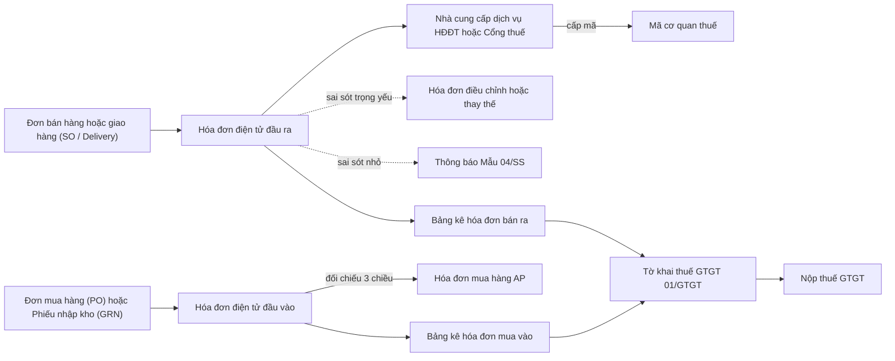
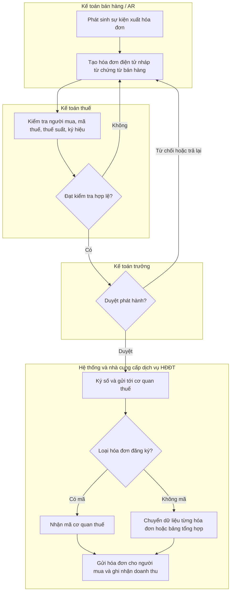
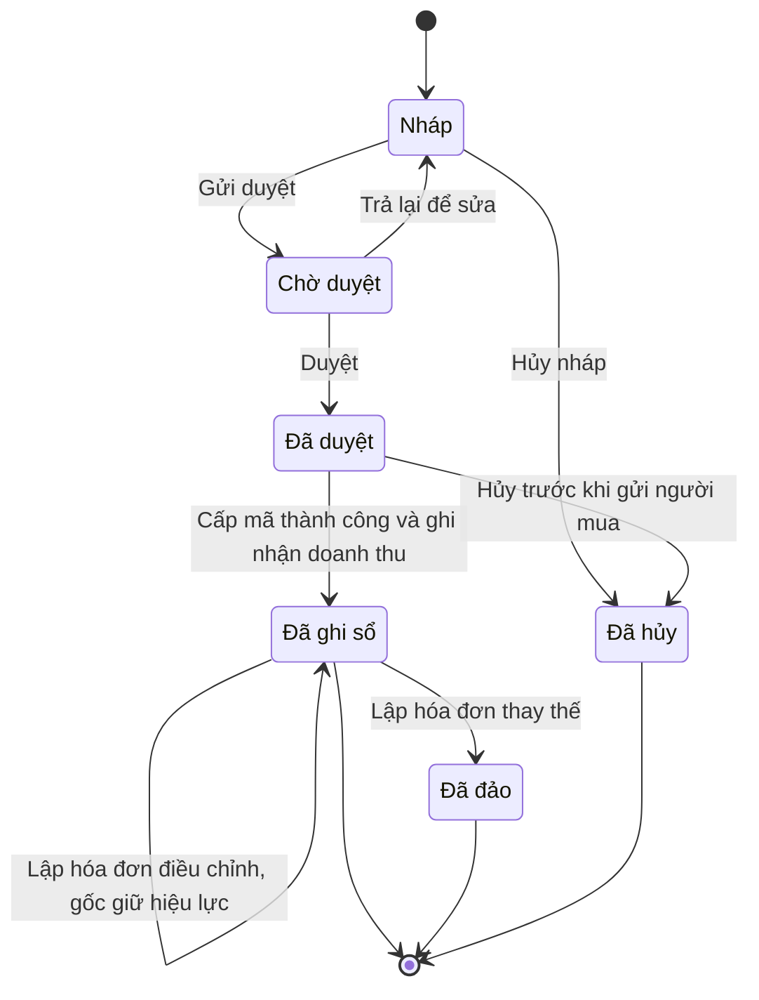

# TAX — Vận hành thuế & hóa đơn điện tử (Tax Operations & E-Invoicing)

> **Phạm vi:** Vận hành thuế end-to-end trong ERP: danh mục mã thuế GTGT (có ngày hiệu lực, gồm giảm 8% tạm thời); phát hành hóa đơn điện tử (HĐĐT) đầu ra từ bán hàng/công nợ phải thu qua nhà cung cấp dịch vụ HĐĐT (nháp → ký số → gửi → nhận mã cơ quan thuế; đồng bộ trạng thái; điều chỉnh/thay thế; hủy); quản lý mẫu số & ký hiệu hóa đơn; quản lý hóa đơn đầu vào (nhập XML từ cổng thuế/email, đối chiếu dữ liệu cơ quan thuế, khớp PO/GRN/hóa đơn AP, kiểm tra người bán rủi ro); lập tờ khai thuế GTGT (bảng kê, tờ khai); chuẩn bị dữ liệu thuế TNDN/TNCN; kiểm soát; tham số; báo cáo.
> **Module liên quan:** TAX (lõi); AR/O2C (hóa đơn đầu ra), AP/P2P (hóa đơn đầu vào), SAL & INV (sự kiện xuất hóa đơn), GL (sổ cái, khóa kỳ), CB (chứng từ thanh toán không dùng tiền mặt), HR/PAY (khấu trừ thuế TNCN), FA (thuế tài sản).
> **Chuẩn tham chiếu:** SAP S/4HANA Document and Reporting Compliance – DRC (eDocument cockpit, gửi HĐĐT VN qua SAP Integration Suite tới đối tác tích hợp) [6]; Oracle Fusion Tax / E-Business Tax (tax engine, khai báo thuế); Odoo (bản địa hóa `l10n_vn` phủ hệ thống tài khoản VAS + thuế GTGT, **hóa đơn điện tử không có sẵn trong lõi** — tích hợp qua middleware tới VNPT/Viettel/MISA/BKAV/FPT) [7]; Microsoft Dynamics 365 Finance (Electronic reporting – ER, Electronic invoicing; bản địa hóa HĐĐT VN qua ISV/nhà cung cấp dịch vụ). Chế độ kế toán doanh nghiệp Việt Nam (xem dòng dưới).
>
> **Cập nhật đến: 2026-10-20 — quy định thay đổi thường xuyên; BA phải kiểm tra lại hiệu lực khi dùng cho dự án.** Khung hóa đơn — chứng từ và quản lý thuế đã **thay mới toàn bộ từ 01/7/2026** (Luật Quản lý thuế 108/2025, Nghị định 254/2026, Thông tư 91/2026 — hóa đơn/chứng từ điện tử, hiệu lực 01/7/2026; Thông tư 89/2026 về kê khai/quản lý thuế ⚠️ **CHƯA XÁC MINH bản gốc**). Nhiều bài trên mạng vẫn mô tả khung cũ (NĐ 123/2020, NĐ 70/2025, TT 32/2025) — phải phân biệt khi tra cứu.
> **Chế độ kế toán áp dụng (2026-10-20):** Thông tư **99/2025/TT-BTC** (ban hành 27/10/2025, hiệu lực **01/01/2026**, áp dụng cho năm tài chính bắt đầu từ/sau 01/01/2026), thay thế Thông tư 200/2014/TT-BTC [1]. Doanh nghiệp nhỏ và vừa (SME) **vẫn được** áp dụng Thông tư 133/2016/TT-BTC (TT 99 **không** thay TT 133) [1]. Các tài khoản thuế cốt lõi (133, 3331, 3334, 3335, 821) **giữ nguyên** số hiệu so với TT 200. Hệ thống tài khoản đầy đủ: xem `references/regulations/vn-accounting.md`.
>
> **Sự thật pháp lý (số hiệu/ngày/hiệu lực văn bản, thuế suất, ngưỡng, mẫu biểu) KHÔNG lặp lại ở đây — tra cứu `references/regulations/vn-tax-einvoice.md`.** File này mô tả **quy trình & thiết kế chức năng ERP** cho module TAX.

## Mục lục
1. Mục đích & phạm vi — 2. Vai trò tham gia — 3. Danh mục (master data) tiên quyết — 4. Chứng từ & luồng chứng từ — 5. Các bước quy trình chuẩn — 6. Vòng đời trạng thái chứng từ — 7. Quy tắc nghiệp vụ & kiểm tra — 8. Hạch toán kế toán — 9. Tham số hệ thống — 10. Kiểm soát nội bộ & phân quyền — 11. Báo cáo chuẩn — 12. Tích hợp module — 13. Biến thể & ngoại lệ — 14. Lỗi BA hay mắc & câu hỏi khảo sát — 15. Nguồn tham khảo

---

## 1. Mục đích & phạm vi (trong/ngoài phạm vi)

**Mục đích:** Bảo đảm mọi hóa đơn đầu ra được lập **đúng thời điểm, đúng thuế suất, đúng mẫu số/ký hiệu**, ký số và truyền cơ quan thuế **đúng hạn**; mọi hóa đơn đầu vào được **xác thực với dữ liệu cơ quan thuế**, khớp với mua hàng và đủ điều kiện khấu trừ; số liệu thuế GTGT/TNDN/TNCN được **đối chiếu khớp giữa phân hệ nghiệp vụ, sổ cái và tờ khai**; giảm thiểu rủi ro phạt do sai sót hóa đơn và rủi ro nhận hóa đơn bất hợp pháp.

**Trong phạm vi:**
- Danh mục mã thuế GTGT có ngày hiệu lực (gồm 8% đến hết 31/12/2026); bảng thuế suất và nhóm loại trừ giảm thuế.
- Mẫu số & ký hiệu hóa đơn; dải số hóa đơn; mẫu hiển thị (template) theo chi nhánh/điểm bán.
- Phát hành HĐĐT đầu ra (có mã / không mã): tạo từ chứng từ bán hàng, ký số, gửi cơ quan thuế/nhà cung cấp dịch vụ, nhận mã, gửi người mua; đồng bộ trạng thái; retry khi lỗi.
- Xử lý hóa đơn sai sót: điều chỉnh, thay thế, thông báo Mẫu 04/SS; văn bản thỏa thuận; hủy (chỉ các trường hợp được phép).
- Quản lý hóa đơn đầu vào: nhập XML từ cổng thuế/email, xác thực với dữ liệu cơ quan thuế, khớp 3 chiều với PO/GRN/hóa đơn AP, kiểm tra người bán rủi ro, gắn cờ đủ điều kiện khấu trừ.
- Lập **bảng kê hóa đơn** bán ra/mua vào và **tờ khai thuế GTGT (01/GTGT)**; bảng tổng hợp dữ liệu HĐĐT cho ngành đặc thù.
- Chuẩn bị dữ liệu **quyết toán thuế TNDN** (chi phí được/không được trừ, lỗ chuyển) và **chứng từ khấu trừ thuế TNCN điện tử** (phần dữ liệu — số thuế đã khấu trừ).
- Đối chiếu thuế (133/3331/3334 với tờ khai); báo cáo thuế.

**Ngoài phạm vi (liên kết tới nơi khác):**
- Toàn bộ sự thật pháp lý (văn bản, thuế suất, ngưỡng, mẫu biểu, thời điểm lập hóa đơn theo loại giao dịch, điều kiện khấu trừ): `references/regulations/vn-tax-einvoice.md`.
- Hệ thống tài khoản, chế độ kế toán, báo cáo tài chính: `references/regulations/vn-accounting.md`.
- Ghi nhận doanh thu & công nợ phải thu chi tiết: `references/processes/ar-accounts-receivable.md`, `references/processes/o2c-order-to-cash.md`.
- Ghi nhận hóa đơn mua, công nợ phải trả, đối chiếu 2/3 chiều, thanh toán: `references/processes/ap-accounts-payable.md`, `references/processes/p2p-procure-to-pay.md`.
- Tính thuế TNCN từ lương, người phụ thuộc, quyết toán TNCN: `references/processes/hr-payroll.md`, `references/regulations/vn-labor-payroll.md`.
- Khóa sổ kỳ, kết chuyển xác định kết quả kinh doanh: `references/processes/r2r-general-ledger.md`.
- Chứng từ thanh toán không dùng tiền mặt (thực hiện tại ngân hàng/quỹ): `references/processes/cash-bank.md`.

## 2. Vai trò tham gia

| Vai trò | Trách nhiệm | Quyền điển hình (theo hành động chuẩn) |
|---|---|---|
| Kế toán thuế (Tax Accountant) — `ROLE-TAX-ACC` | Trung tâm module TAX: kiểm soát mã thuế & thuế suất, lập bảng kê & tờ khai, xử lý hóa đơn sai sót, đối chiếu thuế, chuẩn bị dữ liệu TNDN/TNCN | Xem, Tạo, Sửa, Gửi duyệt, In, Xuất file, Nhập file; Lập tờ khai |
| Kế toán bán hàng / công nợ phải thu (AR Accountant) — `ROLE-TAX-AR` | Lập và phát hành hóa đơn đầu ra, điều chỉnh/thay thế hóa đơn bán, ghi nhận doanh thu & thuế đầu ra | Xem, Tạo, Sửa, Xóa (Nháp), Gửi duyệt, Ghi sổ, In, Xuất file |
| Nhân viên bán hàng (Sales Staff) — `ROLE-TAX-SALES` | Khởi tạo yêu cầu xuất hóa đơn từ đơn bán/giao hàng; nhập thông tin người mua | Xem; Tạo hóa đơn nháp (giới hạn) |
| Kế toán công nợ phải trả (AP Accountant) — `ROLE-TAX-AP` | Nhập/đối chiếu hóa đơn đầu vào, khớp PO/GRN, gắn cờ khấu trừ, kiểm tra người bán | Xem, Tạo, Sửa, Nhập file, Ghi sổ (hóa đơn mua) |
| Kế toán trưởng (Chief Accountant) — `ROLE-TAX-CA` | Duyệt phát hành hóa đơn giá trị lớn, duyệt điều chỉnh/thay thế & văn bản thỏa thuận, duyệt & ký tờ khai, kiểm soát đối chiếu, bỏ ghi sổ/đảo | Xem, Duyệt, Từ chối, Trả lại, Bỏ ghi sổ, Đảo, Đóng |
| Giám đốc (Director) — `ROLE-TAX-DIR` | Đại diện pháp luật: ký số tờ khai/hồ sơ thuế, duyệt hồ sơ hoàn thuế | Xem, Duyệt (cấp cao) |
| Quản trị hệ thống (System Admin) — `ROLE-TAX-ADMIN` | Cấu hình nhà cung cấp dịch vụ HĐĐT, mẫu số/ký hiệu, mã thuế, tham số, phân quyền | Xem, Cấu hình, Nhập file |

> **SoD bắt buộc:** người **cấu hình mã thuế/mẫu số/ký hiệu & nhà cung cấp dịch vụ** ≠ người **phát hành hóa đơn** ≠ người **duyệt điều chỉnh/thay thế & văn bản thỏa thuận** ≠ người **lập & ký tờ khai**. Ký số của tổ chức (chữ ký số/CKS) phải được kiểm soát truy cập chặt (xem §10).

## 3. Danh mục (master data) tiên quyết

| Danh mục | Trường quan trọng | Quy tắc chính |
|---|---|---|
| Mã thuế GTGT (`MD-TAXCODE`) — xem REGREQ-01, `vn-tax-einvoice.md` §2.1 | Mã; thuế suất (0/5/8/10%, KCT = không chịu thuế, KKKNT = không phải kê khai); cờ `được_khấu_trừ`; nhóm kê khai; TK thuế đầu ra / đầu vào; **ngày hiệu lực từ/đến** | Mỗi dòng hàng gắn **đúng 1** mã thuế; "không chịu thuế" và "không phải kê khai" là **hai mã khác nhau** vì ngược nhau về khấu trừ đầu vào; thuế suất là tham số có ngày hiệu lực, không hard-code (§7-R2, R3) |
| Mẫu số & ký hiệu hóa đơn (`MD-INV-SYMBOL`) | Ký hiệu mẫu số (1 ký tự); ký hiệu hóa đơn (6 ký tự: C/K + 2 số năm + hình thức + 2 ký tự nội bộ); loại có mã/không mã; dải số được cấp; chi nhánh/điểm bán áp dụng; ngày hiệu lực | Cấu trúc & ý nghĩa ký hiệu: xem `vn-tax-einvoice.md` §4.2. Số hóa đơn **liên tục, không trùng, không ngắt quãng theo từng ký hiệu** (§7-R8); nhiều ký hiệu song song cho nhiều chi nhánh |
| Mẫu hiển thị hóa đơn (`MD-INV-TEMPLATE`) | Bố cục, logo, trường tùy chọn, ngôn ngữ (song ngữ), trường đặc thù ngành | Bản thể hiện (PDF) phải đủ nội dung bắt buộc (`vn-tax-einvoice.md` §4.3); gắn với mẫu số/ký hiệu |
| Nhà cung cấp dịch vụ HĐĐT (`MD-EINV-PROVIDER`) | Nhà cung cấp (VNPT/Viettel/MISA/FPT/BKAV…); endpoint API; chứng thư số; cơ chế xác thực; môi trường (test/live); giới hạn tốc độ | Lưu bí mật/khóa ngoài mã nguồn (xem `references/security-and-parameters.md`); hỗ trợ nhiều nhà cung cấp dự phòng |
| Đối tác thuế (`MD-PARTNER`) — xem REGREQ-15 | **Mã số thuế (MST) tổ chức** và **số định danh cá nhân**; loại NNT (tổ chức/hộ/cá nhân); địa chỉ & địa điểm kinh doanh; email nhận hóa đơn; **cờ người bán rủi ro**; cờ đã hợp nhất theo số định danh | MST hợp lệ 10/13 chữ số; cá nhân/hộ dùng **số định danh (12 số)** thay MST khi áp dụng (`vn-tax-einvoice.md` §6); đồng bộ cờ rủi ro từ dữ liệu cơ quan thuế (§7-R12) |
| Mẫu tờ khai & chỉ tiêu (`MD-TAX-DECL`) | Mã mẫu (01/GTGT, 03/TNDN…); phiên bản; ánh xạ chỉ tiêu → nguồn số liệu; kỳ áp dụng | Theo mẫu hiện hành — 01/GTGT hiện theo TT 80/2021 (⚠️ Thông tư thay thế "TT 89/2026" CHƯA XÁC MINH bản gốc) — `vn-tax-einvoice.md` §2.6; mã chỉ tiêu cấu hình được, không hard-code |
| Khoản mục điều chỉnh TNDN (`MD-CIT-ADJ`) | Mã; loại (cộng/trừ thu nhập chịu thuế); ánh xạ TK kế toán → chỉ tiêu quyết toán | Phục vụ chuyển lợi nhuận kế toán → thu nhập tính thuế (§5.4) |
| Tài khoản sổ cái thuế (`MD-GL-ACCOUNT`) | Số hiệu & tên TK theo TT 99/2025 | 133 (1331/1332), 3331 (33311/33312), 3334, 3335; đối chiếu `vn-accounting.md` [1] |

## 4. Chứng từ & luồng chứng từ (document flow)

| Chứng từ (VI/EN) | Mục đích | Tạo từ | Sinh ra | Ảnh hưởng (kho/công nợ/sổ cái) |
|---|---|---|---|---|
| Hóa đơn điện tử đầu ra (Output E-Invoice) | Ghi nhận bán hàng/dịch vụ + thuế GTGT đầu ra | Đơn bán hàng (SO)/Phiếu giao hàng (Delivery)/Biên bản nghiệm thu | Bút toán doanh thu + thuế đầu ra; bảng kê bán ra | Công nợ phải thu tăng (Nợ 131/111/112 / Có 511; 33311) |
| Hóa đơn điều chỉnh (Adjustment Invoice) | Điều chỉnh tăng/giảm hóa đơn gốc sai sót trọng yếu | Hóa đơn gốc đã phát hành | Bút toán điều chỉnh; cập nhật quan hệ cha–con | Điều chỉnh doanh thu & 33311 (§8) |
| Hóa đơn thay thế (Replacement Invoice) | Thay thế toàn bộ hóa đơn gốc sai | Hóa đơn gốc đã phát hành | Hóa đơn mới thay hóa đơn gốc | Đảo hóa đơn gốc + ghi hóa đơn mới (§8) |
| Thông báo hóa đơn sai sót Mẫu 04/SS (Error Notice 04/SS) | Báo cơ quan thuế sai sót nhỏ (tên/địa chỉ) hoặc hủy theo trường hợp cho phép | Hóa đơn đã phát hành | Gửi cơ quan thuế | Không ghi sổ (thông báo) |
| Văn bản thỏa thuận sai sót (Error Agreement Minute) | Thỏa thuận bằng văn bản với người mua là tổ chức trước khi điều chỉnh/thay thế | Phát hiện sai sót | Căn cứ lập điều chỉnh/thay thế | Không ghi sổ |
| Hóa đơn điện tử đầu vào (Input E-Invoice) | Nhận từ người bán; căn cứ khấu trừ GTGT & chi phí TNDN | Nhập XML (cổng thuế/email)/API nhà cung cấp | Hóa đơn mua AP; bảng kê mua vào | Thuế đầu vào 1331/1332 (khi đủ điều kiện) |
| Bảng kê hóa đơn bán ra / mua vào (Output/Input Invoice Listing) | Tổng hợp hóa đơn phục vụ kê khai & đối chiếu | Hóa đơn đầu ra/đầu vào kỳ | Tờ khai 01/GTGT | Không ghi sổ (bảng kê nội bộ) |
| Tờ khai thuế GTGT 01/GTGT (VAT Return) | Khai thuế GTGT theo kỳ tháng/quý | Bảng kê bán ra & mua vào | Chứng từ nộp thuế | Xác định số phải nộp 33311 / chuyển khấu trừ |
| Bảng tổng hợp dữ liệu HĐĐT (E-Invoice Summary Table) | Chuyển dữ liệu hóa đơn không mã theo kỳ (ngành đặc thù) | Hóa đơn không mã | Gửi cơ quan thuế | Không ghi sổ |
| Chứng từ khấu trừ thuế TNCN điện tử (PIT Withholding Voucher) | Xác nhận số thuế TNCN đã khấu trừ của người nhận thu nhập | Bảng lương/chi trả (HR/PAY) | Dữ liệu quyết toán TNCN | Nợ 334 / Có 3335 (xem `hr-payroll.md`) |
| Tờ khai quyết toán thuế TNDN 03/TNDN (CIT Finalization) | Quyết toán TNDN năm | Số liệu kế toán + điều chỉnh | Chứng từ nộp/quyết toán | Xác định 3334 (§8) |

## 5. Các bước quy trình chuẩn

Module TAX gồm nhiều luồng con. Dưới đây tách **5.1 phát hành hóa đơn đầu ra** (luồng giao dịch lõi, có swimlane), **5.2 quản lý hóa đơn đầu vào**, **5.3 lập & nộp tờ khai GTGT**, **5.4 chuẩn bị dữ liệu TNDN/TNCN**.

### 5.1. Phát hành hóa đơn điện tử đầu ra

| # | Bước | Vai trò | Chứng từ | Hành động hệ thống | Trạng thái sau bước |
|---|---|---|---|---|---|
| 1 | Phát sinh sự kiện xuất hóa đơn (giao hàng/nghiệm thu/thu tiền trước) | Nhân viên bán hàng / AR | — | Nhận sự kiện từ SAL/INV; suy ra **thời điểm lập hóa đơn** (§7-R5) | — |
| 2 | Tạo hóa đơn điện tử nháp | Kế toán AR | Hóa đơn đầu ra | Lấy dữ liệu từ chứng từ bán hàng; áp mã thuế & thuế suất theo ngày; tính tiền thuế | Hóa đơn `DRAFT` |
| 3 | Kiểm tra hợp lệ (người mua, MST/số định danh, thuế suất, mẫu số/ký hiệu) | Kế toán thuế / AR | Hóa đơn | Chạy bộ kiểm tra (§7); chặn nếu thiếu/không hợp lệ | `DRAFT` (hợp lệ) |
| 4 | Gửi duyệt (nếu cấu hình duyệt nội bộ theo giá trị) | Kế toán AR | Hóa đơn | Định tuyến phê duyệt theo hạn mức | Hóa đơn `PENDING` |
| 5 | Duyệt phát hành | Kế toán trưởng | Hóa đơn | Duyệt/Từ chối/Trả lại | `APPROVED` / `REJECTED` / `RETURNED` |
| 6 | Ký số & gửi cơ quan thuế/nhà cung cấp dịch vụ | Hệ thống (ROLE-TAX-AR kích hoạt) | Hóa đơn | Ký số bằng CKS tổ chức; gửi qua API; hàng đợi + idempotency (§7-R9) | Sub-status **Đã ký, Chờ cấp mã** |
| 7a | (Có mã) Nhận mã cơ quan thuế | Hệ thống | Hóa đơn | Lưu mã CQT; cập nhật trạng thái | Sub-status **Đã cấp mã** |
| 7b | (Không mã) Chuyển dữ liệu (đầy đủ/bảng tổng hợp) | Hệ thống | Hóa đơn / Bảng tổng hợp | Gửi từng hóa đơn **chậm nhất ngày làm việc tiếp theo** hoặc gộp bảng tổng hợp theo kỳ | Sub-status **Đã chuyển dữ liệu** |
| 8 | Gửi hóa đơn cho người mua & ghi nhận doanh thu | Hệ thống / Kế toán AR | Hóa đơn | Gửi bản thể hiện (PDF/link tra cứu)+XML; sinh bút toán doanh thu + thuế đầu ra | Hóa đơn `POSTED` |
| 9 | Đồng bộ & giám sát trạng thái | Kế toán thuế | Hóa đơn | Đối chiếu số hóa đơn ERP ↔ nhà cung cấp; retry khi lỗi; cảnh báo quá hạn | `POSTED` |

### 5.2. Quản lý hóa đơn điện tử đầu vào

| # | Bước | Vai trò | Hành động hệ thống | Trạng thái sau bước |
|---|---|---|---|---|
| 1 | Thu thập hóa đơn đầu vào | Kế toán AP | Nhập XML từ email/cổng thuế; đồng bộ API nhà cung cấp; nhận qua trục kết nối | Hóa đơn đầu vào `DRAFT` (đã nhập) |
| 2 | Xác thực với dữ liệu cơ quan thuế | Hệ thống | Tra cứu tính hợp lệ (mã CQT, trạng thái hóa đơn, khớp XML–bản thể hiện) [12] | `IN_PROGRESS` |
| 3 | Kiểm tra người bán rủi ro | Hệ thống / Kế toán AP | Đối chiếu MST với **danh sách doanh nghiệp rủi ro/bỏ trốn** của cơ quan thuế (§7-R12) [8] | `IN_PROGRESS` / **Treo** nếu rủi ro |
| 4 | Khớp 3 chiều với PO/GRN/hóa đơn AP | Kế toán AP | So khớp nhà cung cấp, số tiền, thuế suất, số lượng; dung sai (xem `ap-accounts-payable.md`) | `IN_PROGRESS` / **Treo** nếu lệch |
| 5 | Gắn cờ điều kiện khấu trừ | Kế toán AP | Kiểm tra ngưỡng 5 triệu + chứng từ không dùng tiền mặt (§7-R7) | `COMPLETED` (đã khớp) |
| 6 | Ghi nhận & kê khai | Kế toán thuế | Liên kết hóa đơn AP; đưa vào bảng kê mua vào; tổng hợp thuế đầu vào 133 | `POSTED` (đã kê khai) |

> Hóa đơn không xác thực được, của người bán rủi ro, hoặc không khớp → `REJECTED` hoặc treo chờ xử lý; **không** đưa vào khấu trừ cho đến khi làm rõ (§10).

### 5.3. Lập & nộp tờ khai thuế GTGT

| # | Bước | Vai trò | Hành động hệ thống | Trạng thái sau bước |
|---|---|---|---|---|
| 1 | Chốt dữ liệu hóa đơn kỳ | Kế toán thuế | Khóa phát hành hóa đơn kỳ; tổng hợp bảng kê bán ra & mua vào | Bảng kê `DRAFT` |
| 2 | Đối chiếu bảng kê ↔ sổ cái | Kế toán thuế | So 33311 (đầu ra) với doanh thu 511; so 133 (đầu vào) với bảng kê; truy chênh lệch (§7-R13) | Bảng kê `IN_PROGRESS` |
| 3 | Lập tờ khai 01/GTGT | Kế toán thuế | Ánh xạ số liệu → chỉ tiêu tờ khai; xác định số phải nộp hoặc chuyển khấu trừ | Tờ khai `DRAFT` |
| 4 | Duyệt & ký tờ khai | Kế toán trưởng / Giám đốc | Ký số đại diện pháp luật; kết xuất định dạng nộp (XML/HTKK/API) | Tờ khai `APPROVED` → nộp |
| 5 | Nộp & ghi nhận nghĩa vụ | Kế toán thuế | Gửi tờ khai; ghi nhận số phải nộp; lập chứng từ nộp thuế | Tờ khai `POSTED` |

### 5.4. Chuẩn bị dữ liệu thuế TNDN & TNCN (data preparation)

1. **TNDN tạm nộp quý:** hệ thống tổng hợp doanh thu – chi phí kế toán lũy kế, ước tính thu nhập tính thuế, áp thuế suất effective-dated (15/17/20% theo doanh thu — `vn-tax-einvoice.md` §3.1), trừ lỗ chuyển; tính số tạm nộp.
2. **TNDN quyết toán năm:** chuyển lợi nhuận kế toán → thu nhập tính thuế bằng các khoản điều chỉnh `MD-CIT-ADJ` (cộng chi phí **không được trừ**, trừ thu nhập miễn/ưu đãi); kết xuất dữ liệu tờ khai 03/TNDN; theo dõi lỗ chuyển tối đa 5 năm.
3. **Chi phí không được trừ:** lấy từ **cờ deductible** gắn ở cấp hóa đơn/bút toán (REGREQ-05) — dùng chung điều kiện 5 triệu + không dùng tiền mặt với khấu trừ GTGT.
4. **TNCN:** HR/PAY tính và khấu trừ thuế; module TAX tổng hợp số thuế đã khấu trừ theo người nhận thu nhập, phát hành **chứng từ khấu trừ thuế TNCN điện tử**, kết xuất dữ liệu quyết toán (chi tiết: `references/processes/hr-payroll.md`, `references/regulations/vn-labor-payroll.md`).

## 6. Vòng đời trạng thái chứng từ chính

Dùng **mã trạng thái chuẩn** cho chứng từ ERP. Quá trình kỹ thuật phát hành (ký số, cấp mã, gửi người mua) là **trạng thái phát hành (issuance sub-status)** — một chiều riêng, nêu ở bảng phụ bên dưới (biến thể nhà cung cấp chỉ là ghi chú).

### 6.1. Hóa đơn điện tử đầu ra — trạng thái chứng từ chuẩn

| Từ | Hành động | Đến | Vai trò | Điều kiện |
|---|---|---|---|---|
| (mới) | Tạo | DRAFT | Kế toán AR | Có chứng từ bán hàng/sự kiện xuất hóa đơn |
| DRAFT | Gửi duyệt | PENDING | Kế toán AR | Qua bộ kiểm tra hợp lệ (§7) |
| DRAFT | Hủy nháp | CANCELLED | Kế toán AR | Chưa ký số, chưa gửi cơ quan thuế |
| PENDING | Duyệt | APPROVED | Kế toán trưởng | Trong hạn mức được duyệt |
| PENDING | Trả lại | DRAFT | Kế toán trưởng | Sai sót cần sửa |
| APPROVED | Cấp mã & ghi nhận | POSTED | Hệ thống / Kế toán AR | (Có mã) nhận mã CQT; (không mã) ký số & chuyển dữ liệu đúng hạn |
| APPROVED | Hủy | CANCELLED | Kế toán trưởng | Trường hợp cho phép hủy trước khi gửi người mua; lập Mẫu 04/SS nếu đã gửi CQT (`vn-tax-einvoice.md` §4.6) |
| POSTED | Lập hóa đơn thay thế | REVERSED | Kế toán AR + duyệt KTT | Sai sót trọng yếu; hóa đơn gốc **bị thay thế** (hết giá trị sử dụng); có văn bản thỏa thuận nếu người mua là tổ chức |
| POSTED | Lập hóa đơn điều chỉnh | POSTED (giữ nguyên) | Kế toán AR + duyệt KTT | Hóa đơn gốc **vẫn còn hiệu lực**; hóa đơn điều chỉnh là chứng từ mới liên kết gốc; KHÔNG đảo trạng thái hóa đơn gốc |

> **Quy tắc then chốt:** hóa đơn **đã phát hành** (POSTED) sai sót trọng yếu **KHÔNG được hủy**, chỉ **điều chỉnh/thay thế**; cơ chế hủy đã bỏ từ 01/6/2025 (NĐ 70/2025) và tiếp tục trong khung hiện hành (`vn-tax-einvoice.md` §4.6) [2][3]. Hóa đơn từ máy tính tiền hoặc tài sản đăng ký quyền sở hữu: **chỉ thay thế**, không điều chỉnh. **Phân biệt trạng thái:** chỉ **thay thế** mới làm hóa đơn gốc hết hiệu lực (REVERSED/bị thay thế); **điều chỉnh** giữ hóa đơn gốc ở trạng thái POSTED và bổ sung một hóa đơn điều chỉnh liên kết — không đảo trạng thái hóa đơn gốc.

### 6.2. Trạng thái phát hành (issuance sub-status) — chiều kỹ thuật

| Sub-status | Ý nghĩa | Hành động hệ thống |
|---|---|---|
| CHƯA_KÝ | Hóa đơn đã duyệt, chờ ký số | Đưa vào hàng đợi ký |
| ĐÃ_KÝ | Đã ký CKS tổ chức, chờ gửi | Gửi tới cơ quan thuế/nhà cung cấp |
| CHỜ_CẤP_MÃ | (Có mã) đã gửi, chờ phản hồi | Theo dõi timeout, retry |
| ĐÃ_CẤP_MÃ | (Có mã) nhận mã CQT | Khóa chỉnh sửa; cho phép gửi người mua |
| ĐÃ_CHUYỂN_DỮ_LIỆU | (Không mã) đã chuyển đủ/bảng tổng hợp | Lưu biên nhận |
| ĐÃ_GỬI_NGƯỜI_MUA | Đã gửi bản thể hiện + XML | Ghi nhận doanh thu |
| LỖI | Lỗi ký/gửi/cấp mã | Cảnh báo, retry theo PRM-TAX-008 |

### 6.3. Hóa đơn đầu vào — trạng thái

`DRAFT` (đã nhập) → `IN_PROGRESS` (đang xác thực & khớp) → `COMPLETED` (đã khớp đủ điều kiện) → `POSTED` (đã kê khai). Nhánh lỗi: `REJECTED` (không hợp lệ / người bán rủi ro / không khớp) hoặc **Treo** chờ xử lý.

## 7. Quy tắc nghiệp vụ & kiểm tra (validation) điển hình

Mỗi quy tắc nêu lý do. Công thức viết rõ. Nguồn pháp lý: `references/regulations/vn-tax-einvoice.md` (mục tương ứng).

1. **BR-TAX-01 — Tính tiền thuế từng dòng.** Hệ thống PHẢI tính: `Tiền thuế dòng = ROUND(Thành tiền chưa thuế × Thuế suất, theo PRM-TAX-007)`; `Tổng thanh toán = Σ thành tiền chưa thuế + Σ tiền thuế`. *Lý do:* chống lệch làm tròn giữa hóa đơn và tờ khai.
2. **BR-TAX-02 — Mỗi dòng đúng một mã thuế.** Mỗi dòng hàng PHẢI gắn đúng một `MD-TAXCODE` xác định thuế suất, cờ khấu trừ, nhóm kê khai. *Lý do:* tách đúng "không chịu thuế" vs "không phải kê khai" — sai nhóm → sai số thuế (`vn-tax-einvoice.md` §2.1; Điều 5 Luật 48/2024) [5].
3. **BR-TAX-03 — Thuế suất theo ngày hiệu lực.** Hệ thống PHẢI áp thuế suất theo **ngày lập hóa đơn** (document date): 8% cho nhóm đủ điều kiện đến hết **31/12/2026**, tự động quay về **10% từ 01/01/2027** trừ khi có nghị quyết gia hạn; KHÔNG ĐƯỢC hard-code 8%. PHẢI hỗ trợ danh mục loại trừ giảm 8% theo nhóm hàng. *Lý do:* chính sách 8% có thời hạn (`vn-tax-einvoice.md` §2.2) [4].
4. **BR-TAX-04 — Đánh số hóa đơn liên tục.** Số hóa đơn PHẢI liên tục, không trùng, không ngắt quãng **theo từng ký hiệu**; hỗ trợ nhiều ký hiệu/mẫu số song song. *Lý do:* yêu cầu quản lý hóa đơn (`vn-tax-einvoice.md` §4.2) [3].
5. **BR-TAX-05 — Thời điểm lập hóa đơn suy từ sự kiện.** Hệ thống PHẢI suy thời điểm lập từ **sự kiện nghiệp vụ** (giao hàng → bán hàng hóa; hoàn thành/thu tiền → dịch vụ; nghiệm thu → xây lắp; thông quan → xuất khẩu), KHÔNG để người dùng nhập tùy ý. *Lý do:* đúng quy định thời điểm (`vn-tax-einvoice.md` §4.4).
6. **BR-TAX-06 — Ký số & gửi đúng hạn.** Hệ thống PHẢI cảnh báo nếu thời điểm **ký số và gửi dữ liệu** cơ quan thuế trễ hơn **ngày làm việc tiếp theo** kể từ thời điểm lập. *Lý do:* nghĩa vụ truyền dữ liệu đúng hạn (`vn-tax-einvoice.md` §4.4) [2].
7. **BR-TAX-07 — Điều kiện khấu trừ GTGT đầu vào (ngưỡng 5 triệu).** Với hóa đơn đầu vào **≥ 5.000.000đ (đã gồm thuế)**, nếu thanh toán **tiền mặt** → hệ thống PHẢI chặn/cảnh báo không khấu trừ và chuyển phần thuế vào chi phí/giá vốn; PHẢI gộp **nhiều lần mua cùng ngày của cùng người bán** để chống chia nhỏ hóa đơn. *Lý do:* điều kiện khấu trừ (`vn-tax-einvoice.md` §2.4) [10].
8. **BR-TAX-08 — Rà soát trả chậm đến hạn.** Hóa đơn mua trả chậm được khấu trừ khi **chưa đến hạn**; khi **đến hạn mà chưa có** chứng từ không dùng tiền mặt → hệ thống PHẢI đề xuất **điều chỉnh giảm** thuế đã khấu trừ. *Lý do:* `vn-tax-einvoice.md` §2.4 [10].
9. **BR-TAX-09 — Idempotency khi phát hành.** Hệ thống KHÔNG ĐƯỢC phát hành trùng khi retry; mỗi hóa đơn có khóa duy nhất (ký hiệu + số + kỳ) và trạng thái gửi; retry theo PRM-TAX-008. *Lý do:* tránh phát hành trùng gây sai doanh thu & thuế.
10. **BR-TAX-10 — Xác thực hóa đơn đầu vào với dữ liệu cơ quan thuế.** Hệ thống PHẢI đối chiếu hóa đơn đầu vào (mã CQT, trạng thái, nội dung XML ↔ bản thể hiện) với dữ liệu cơ quan thuế trước khi cho khấu trừ [12]. *Lý do:* loại hóa đơn giả/đã hủy/không tồn tại.
11. **BR-TAX-11 — Khớp 3 chiều hóa đơn đầu vào.** Hóa đơn đầu vào PHẢI khớp người bán/giá trị/thuế suất với **PO–GRN–hóa đơn AP** trong dung sai; vượt dung sai → treo. *Lý do:* chống hóa đơn khống/không có hàng thực (xem `ap-accounts-payable.md`).
12. **BR-TAX-12 — Chặn người bán rủi ro.** Khi MST người bán nằm trong **danh sách doanh nghiệp rủi ro/bỏ trốn** của cơ quan thuế, hệ thống PHẢI gắn cờ & treo hóa đơn đầu vào chờ kế toán trưởng quyết định; hóa đơn phát sinh **sau** ngày người bán bỏ trốn thì KHÔNG được khấu trừ GTGT và KHÔNG được tính chi phí TNDN [8][9]. *Lý do:* rủi ro pháp lý & bị loại chi phí.
13. **BR-TAX-13 — Đối chiếu tờ khai ↔ sổ cái.** Trước khi nộp, hệ thống PHẢI đối chiếu: tổng thuế đầu ra bảng kê = phát sinh Có 33311; tổng thuế đầu vào khấu trừ = phát sinh Nợ 133 hợp lệ; chênh lệch phải được giải trình. *Lý do:* khớp số liệu, tránh truy thu.
14. **BR-TAX-14 — Định danh người nộp thuế.** Với người mua/người bán là cá nhân/hộ, hệ thống PHẢI dùng **số định danh cá nhân (12 số)** thay MST khi áp dụng; MST tổ chức 10/13 số hợp lệ. *Lý do:* `vn-tax-einvoice.md` §6.
15. **BR-TAX-15 — Quan hệ cha–con hóa đơn.** Hóa đơn điều chỉnh/thay thế PHẢI tham chiếu rõ **số hóa đơn gốc**; hệ thống chặn điều chỉnh/thay thế một hóa đơn đã bị thay thế. *Lý do:* truy vết & đúng nghĩa vụ (`vn-tax-einvoice.md` §4.6).
16. **BR-TAX-16 — Khóa chỉnh sửa sau phát hành.** Sau khi `POSTED` (đã cấp mã/đã gửi), hệ thống KHÓA chỉnh sửa nội dung hóa đơn; mọi thay đổi qua điều chỉnh/thay thế. *Lý do:* tính toàn vẹn chứng từ đã ký số.
17. **BR-TAX-17 — Áp đúng mốc hiệu lực khi điều chỉnh kỳ cũ.** Khi điều chỉnh/thay thế hóa đơn thuộc kỳ áp thuế suất cũ (ví dụ 8% sau 01/01/2027), hệ thống PHẢI áp thuế suất **của hóa đơn gốc**. *Lý do:* `vn-tax-einvoice.md` §2.2 (điều chỉnh bắc cầu giai đoạn).

## 8. Hạch toán kế toán

> **Chế độ áp dụng: Thông tư 99/2025/TT-BTC** (SME: TT 133/2016). Số hiệu tài khoản đầy đủ & khác biệt so với TT 200: xem `references/regulations/vn-accounting.md` (nguồn chuẩn — không lặp lại). Bảng dưới chỉ nêu bút toán **đặc thù thuế**; bút toán doanh thu/công nợ đầy đủ xem `ar-accounts-receivable.md`, `ap-accounts-payable.md`.

| Nghiệp vụ | Nợ | Có | Ghi chú |
|---|---|---|---|
| Phát hành hóa đơn bán hàng/dịch vụ (thuế GTGT đầu ra) | 131 / 111 / 112 | 511; 33311 | Doanh thu chưa thuế + thuế đầu ra; thuế đầu ra luôn ghi **33311** (33312 là GTGT khâu nhập khẩu — thuộc đầu vào, không dùng cho bán ra) |
| Hóa đơn đầu vào, thuế GTGT **được khấu trừ** | 152/156/211/6xx; 1331 hoặc 1332 | 331 / 111 / 112 | Tách thuế vào 1331 (HHDV) / 1332 (TSCĐ) |
| Thuế GTGT đầu vào **không được khấu trừ** (không chịu thuế / vi phạm ngưỡng 5 triệu / người bán rủi ro) | 152/156/6xx (tính vào giá/chi phí) | 331 / 111 / 112 | Không qua 133 (BR-TAX-07, R12) |
| Kết chuyển khấu trừ GTGT cuối kỳ | 33311 | 1331 / 1332 | Phần còn lại ở 33311 là số phải nộp |
| Nộp thuế GTGT vào ngân sách | 33311 | 111 / 112 | Sau khi nộp tờ khai 01/GTGT |
| Hóa đơn điều chỉnh **giảm** doanh thu/thuế (hàng bán trả lại, giảm giá) | 511; 33311 | 131 | Hóa đơn điều chỉnh liên kết hóa đơn gốc; hóa đơn gốc giữ trạng thái POSTED (không đảo) |
| Hóa đơn điều chỉnh **tăng** | 131 | 511; 33311 | Khi hóa đơn gốc ghi thiếu |
| Hóa đơn thay thế | (đảo hóa đơn gốc rồi ghi hóa đơn mới) | | Bút toán theo chênh lệch; giữ truy vết cha–con |
| Chi phí thuế TNDN hiện hành (tạm nộp/quyết toán) | 8211 (82111) | 3334 | 82112 nếu thuế bổ sung tối thiểu toàn cầu |
| Nộp thuế TNDN | 3334 | 111 / 112 | |
| Kết chuyển chi phí thuế TNDN xác định KQKD | 911 | 8211 | Xem `r2r-general-ledger.md` |
| Khấu trừ thuế TNCN khi chi trả thu nhập | 334 | 3335 | Phát hành chứng từ khấu trừ TNCN; chi tiết `hr-payroll.md` |
| Nộp thuế TNCN đã khấu trừ | 3335 | 111 / 112 | |

> ⚠️ Số hiệu tài khoản cấp 2/cấp 3 (82111, 82112, 33311, 33312) lấy theo `vn-accounting.md` / Phụ lục TT 99/2025 — bảng này chỉ minh họa ảnh hưởng thuế [1].

## 9. Tham số hệ thống điển hình

| Tham số | Kiểu | Giá trị gợi ý | Phạm vi | Ảnh hưởng |
|---|---|---|---|---|
| `PRM-TAX-001` Nhà cung cấp dịch vụ HĐĐT & endpoint | Danh mục + chuỗi bí mật | VNPT/Viettel/MISA/FPT… (test/live) | Công ty | Kênh ký & gửi hóa đơn; dự phòng đa nhà cung cấp |
| `PRM-TAX-002` Loại hóa đơn mặc định | Lựa chọn | Có mã / Không mã | Công ty / Chi nhánh | Quyết định luồng cấp mã vs chuyển dữ liệu (§5.1) |
| `PRM-TAX-003` Phương thức chuyển dữ liệu (không mã) | Lựa chọn | Đầy đủ từng hóa đơn / Bảng tổng hợp | Công ty | Chỉ ngành đặc thù dùng bảng tổng hợp (`vn-tax-einvoice.md` §4.5) |
| `PRM-TAX-004` Ngưỡng thanh toán không dùng tiền mặt | Số tiền | 5.000.000đ (gồm thuế), hiệu lực 01/7/2025 | Hệ thống | Điều kiện khấu trừ GTGT & chi phí TNDN (BR-TAX-07) [10] |
| `PRM-TAX-005` Bảng thuế suất GTGT theo ngày hiệu lực | Bảng effective-dated | 0/5/8/10%; 8% đến 31/12/2026 | Hệ thống | Áp thuế suất theo ngày lập (BR-TAX-03) [4] |
| `PRM-TAX-006` Kỳ kê khai GTGT | Lựa chọn | Tháng (doanh thu > 50 tỷ) / Quý | Công ty | Chu kỳ lập bảng kê & tờ khai (`vn-tax-einvoice.md` §2.6) |
| `PRM-TAX-007` Quy tắc làm tròn tiền thuế | Lựa chọn | Làm tròn từng dòng (mặc định) / tổng | Hệ thống | Cách tính tiền thuế (BR-TAX-01) |
| `PRM-TAX-008` Số lần & khoảng retry gửi hóa đơn | Số | 3 lần, cách 5 phút | Công ty | Độ bền tích hợp; tránh trùng (BR-TAX-09) |
| `PRM-TAX-009` Cảnh báo ký/gửi trễ | Số ngày làm việc | 1 ngày làm việc | Hệ thống | Nhắc đúng hạn (BR-TAX-06) [2] |
| `PRM-TAX-010` Kiểm tra người bán rủi ro | Bật/Tắt + nguồn | Bật; đồng bộ danh sách CQT | Hệ thống | Treo hóa đơn đầu vào rủi ro (BR-TAX-12) [8] |
| `PRM-TAX-011` Dung sai đối chiếu đầu vào với dữ liệu CQT | Số/% | 0đ (khớp tuyệt đối) | Hệ thống | Mức chấp nhận lệch khi xác thực |
| `PRM-TAX-012` Dải ký hiệu/mẫu số theo chi nhánh | Bảng | Theo điểm bán | Chi nhánh | Đánh số liên tục theo ký hiệu (BR-TAX-04) |
| `PRM-TAX-013` Thuế suất TNDN theo doanh thu | Bảng effective-dated | 15% (<3 tỷ) / 17% (3–50 tỷ) / 20% | Công ty | Tính tạm nộp & quyết toán (`vn-tax-einvoice.md` §3.1) [11] |
| `PRM-TAX-014` Số năm chuyển lỗ TNDN | Số | 5 năm | Hệ thống | Trừ lỗ vào thu nhập năm sau (§5.4) |

## 10. Kiểm soát nội bộ & phân quyền (SoD, hạn mức, audit)

- **SoD (phân tách nhiệm vụ):** (a) cấu hình mã thuế/mẫu số/ký hiệu/nhà cung cấp (ADMIN) ≠ (b) phát hành hóa đơn (AR) ≠ (c) duyệt điều chỉnh/thay thế + văn bản thỏa thuận (KTT) ≠ (d) lập & ký tờ khai (Tax Accountant lập, KTT/Giám đốc ký). Người khớp & gắn cờ khấu trừ hóa đơn đầu vào (AP) ≠ người duyệt treo người bán rủi ro (KTT).
- **Kiểm soát chữ ký số (CKS):** khóa/USB token/HSM của tổ chức phải được quản lý truy cập theo vai trò; mọi lần ký ghi log (ai, hóa đơn nào, thời điểm). Không lưu PIN/khóa trong mã nguồn (xem `references/security-and-parameters.md`).
- **Hạn mức duyệt phát hành:** hóa đơn giá trị lớn (ngưỡng cấu hình) phải qua duyệt KTT trước khi ký số; điều chỉnh/thay thế **luôn** cần duyệt bất kể giá trị.
- **Kiểm soát hóa đơn đầu vào rủi ro:** treo mặc định; chỉ KTT được gỡ treo kèm lý do & chứng cứ (hợp đồng, giao nhận, thanh toán); ghi log quyết định.
- **Audit trail bắt buộc:** phát hành/điều chỉnh/thay thế/hủy; thay đổi mã thuế & dải ký hiệu; gỡ treo người bán rủi ro; chỉnh số liệu tờ khai trước nộp — đều lưu vết người, thời điểm, giá trị trước/sau.
- **Đối chiếu định kỳ (control):** cuối kỳ đối chiếu số hóa đơn phát hành ERP ↔ nhà cung cấp dịch vụ ↔ dữ liệu cơ quan thuế; đối chiếu 133/33311/3334/3335 với tờ khai (BR-TAX-13); rà soát hóa đơn ≥ 5 triệu chưa có chứng từ không dùng tiền mặt khi đến hạn (BR-TAX-08).
- **Chống bỏ sót/thừa:** báo cáo hóa đơn **chưa gửi cơ quan thuế quá hạn**, hóa đơn **lỗi phát hành**, khoảng trống số hóa đơn (gap) theo ký hiệu.

## 11. Báo cáo chuẩn

| Báo cáo | Mục đích | Chiều phân tích / bộ lọc | Bắt buộc theo luật? |
|---|---|---|---|
| `RPT-TAX-01` Bảng kê hóa đơn hàng hóa dịch vụ bán ra | Tổng hợp hóa đơn đầu ra, căn cứ tờ khai & đối chiếu | Kỳ, thuế suất, mã thuế, chi nhánh, người mua | Nội bộ/đối chiếu (không nộp kèm 01/GTGT theo khung hiện hành) ⚠️ |
| `RPT-TAX-02` Bảng kê hóa đơn hàng hóa dịch vụ mua vào | Tổng hợp hóa đơn đầu vào & thuế được khấu trừ | Kỳ, mã thuế, cờ khấu trừ, người bán, rủi ro | Nội bộ/đối chiếu ⚠️ |
| `RPT-TAX-03` Tờ khai thuế GTGT 01/GTGT | Khai thuế GTGT theo kỳ | Kỳ, công ty/chi nhánh hợp nhất | **Có** (nộp cơ quan thuế) |
| `RPT-TAX-04` Sổ theo dõi phát hành hóa đơn | Theo dõi số hóa đơn, phát hiện trùng/gap | Ký hiệu, mẫu số, kỳ, chi nhánh | Nội bộ |
| `RPT-TAX-05` Đối chiếu doanh thu 511 ↔ thuế đầu ra 33311 | Kiểm soát khớp doanh thu – thuế | Kỳ, mã thuế, nhóm doanh thu | Nội bộ (kiểm soát) |
| `RPT-TAX-06` Đối chiếu thuế đầu vào 133 ↔ bảng kê | Kiểm soát khớp khấu trừ | Kỳ, loại (HHDV/TSCĐ) | Nội bộ (kiểm soát) |
| `RPT-TAX-07` Danh sách hóa đơn sai sót & điều chỉnh/thay thế | Theo dõi xử lý sai sót | Loại xử lý, kỳ, người lập | Nội bộ |
| `RPT-TAX-08` Báo cáo hóa đơn từ người bán rủi ro | Cảnh báo rủi ro khấu trừ & chi phí | MST người bán, trạng thái treo | Nội bộ (kiểm soát) [8] |
| `RPT-TAX-09` Bảng kê chi phí không được trừ (TNDN) | Chuẩn bị quyết toán TNDN | Khoản mục, lý do loại, kỳ | Nội bộ (căn cứ 03/TNDN) |
| `RPT-TAX-10` Dữ liệu tờ khai quyết toán thuế TNDN 03/TNDN | Quyết toán TNDN năm | Năm, điều chỉnh, lỗ chuyển | **Có** (nộp cơ quan thuế) |
| `RPT-TAX-11` Bảng tổng hợp dữ liệu hóa đơn điện tử | Chuyển dữ liệu hóa đơn không mã theo kỳ | Kỳ, ký hiệu | **Có** (ngành đặc thù dùng không mã) |
| `RPT-TAX-12` Hóa đơn ≥ 5 triệu chưa có chứng từ không dùng tiền mặt | Kiểm soát điều kiện khấu trừ khi đến hạn | Người bán, ngày đến hạn | Nội bộ (kiểm soát) [10] |
| `RPT-TAX-13` Bảng kê chứng từ khấu trừ thuế TNCN đã cấp | Quản lý chứng từ TNCN điện tử | Người nhận, kỳ | Nội bộ (căn cứ quyết toán TNCN) |

> ⚠️ Việc nộp kèm **bảng kê** (phụ lục 01-1/01-2/GTGT) với tờ khai 01/GTGT đã bị bãi bỏ từ khung **TT 80/2021** (xác minh tại `vn-tax-einvoice.md` §2.6). Thông tư thay thế TT 80/2021 trong khung quản lý thuế mới ("TT 89/2026") ⚠️ **CHƯA XÁC MINH bản gốc** — nguồn [13] chỉ mô tả 01/GTGT theo TT 80/2021. Dù khung tờ khai thay đổi, bảng kê vẫn **bắt buộc lập nội bộ** để đối chiếu & xuất trình khi kiểm tra.

## 12. Tích hợp với module khác (ảnh hưởng dữ liệu hai chiều)

| Module | Dữ liệu TAX nhận vào | Dữ liệu TAX trả ra |
|---|---|---|
| AR / O2C | Chứng từ bán hàng, giao hàng, nghiệm thu, thu tiền trước → sinh hóa đơn đầu ra | Số hóa đơn, mã CQT, trạng thái phát hành; bút toán thuế đầu ra; cập nhật công nợ khi điều chỉnh/thay thế |
| AP / P2P | Hóa đơn đầu vào (XML), PO/GRN để khớp 3 chiều, điều khoản thanh toán | Cờ đủ điều kiện khấu trừ; phần thuế không khấu trừ chuyển chi phí; cảnh báo người bán rủi ro |
| SAL & INV | Sự kiện giao hàng/xuất kho → thời điểm lập hóa đơn hàng hóa | Ràng buộc không cho giao tiếp nếu thiếu thông tin thuế người mua |
| CB (Tiền – Ngân hàng) | Chứng từ thanh toán không dùng tiền mặt (đối chiếu ngưỡng 5 triệu) | Danh sách hóa đơn cần chứng từ thanh toán khi đến hạn |
| GL (Sổ cái) | Số dư 133/3331/3334/3335 để đối chiếu | Bút toán thuế; số phải nộp; kết chuyển khấu trừ cuối kỳ |
| HR / PAY | Số thuế TNCN đã khấu trừ theo người nhận | Chứng từ khấu trừ TNCN điện tử; dữ liệu quyết toán TNCN |
| FA (Tài sản) | Thuế GTGT đầu vào của TSCĐ (1332); thuế liên quan mua tài sản | Tách thuế TSCĐ phục vụ hoàn thuế dự án đầu tư |
| COST | Chi phí không được trừ ảnh hưởng giá thành/kết quả | Phân loại deductible/non-deductible |

## 13. Biến thể & ngoại lệ

1. **Hóa đơn khởi tạo từ máy tính tiền (POS / cash-register e-invoice):** bán lẻ/ăn uống; không bắt buộc CKS; dữ liệu gộp cuối ngày; sai sót **chỉ thay thế**. Tích hợp POS → hóa đơn máy tính tiền; đối soát doanh thu (`vn-tax-einvoice.md` §4.7).
2. **Ủy nhiệm lập hóa đơn (invoicing by authorization):** thể hiện thông tin **cả bên ủy nhiệm và bên nhận ủy nhiệm**; cấu hình quan hệ ủy nhiệm trong `MD-PARTNER` (`vn-tax-einvoice.md` §4.3).
3. **Hàng bán trả lại / chiết khấu thương mại:** xử lý bằng **hóa đơn điều chỉnh giảm** (không dùng cơ chế hủy); liên kết hóa đơn gốc; bút toán theo §8.
4. **Điều chỉnh bắc cầu giai đoạn thuế suất:** điều chỉnh/thay thế hóa đơn kỳ 8% sau 01/01/2027 → giữ thuế suất gốc (BR-TAX-17).
5. **Đa tiền tệ (foreign currency):** hóa đơn ngoại tệ ghi tỷ giá; tiền thuế GTGT quy đổi VND theo tỷ giá quy định; đối chiếu chênh lệch tỷ giá với GL/AR.
6. **Hóa đơn xuất khẩu:** hóa đơn thương mại điện tử/GTGT/bán hàng điện tử; thời điểm chậm nhất ngày làm việc tiếp theo sau thông quan; tách thuế đầu vào xuất khẩu phục vụ hoàn thuế (`vn-tax-einvoice.md` §2.5, §4.4).
7. **Bảng tổng hợp dữ liệu (ngành đặc thù):** viễn thông, bảo hiểm, tài chính – ngân hàng, hàng không, chứng khoán, điện/nước — chuyển theo bảng tổng hợp; sai sót xử lý trên bảng tổng hợp kỳ sau (`vn-tax-einvoice.md` §4.5–4.6).
8. **Hóa đơn từ người bán bỏ trốn/ngừng hoạt động:** hóa đơn phát sinh **sau** ngày bỏ trốn → loại khỏi khấu trừ & chi phí; trước ngày đó → cơ quan thuế xét có hàng thực hay không (BR-TAX-12) [9].
9. **Hóa đơn nhiều lần/kèm bảng kê (điện, nước, viễn thông):** lập theo kỳ, chậm nhất 7 ngày từ ngày chốt chỉ số; đính kèm bảng kê chi tiết.
10. **Điều chỉnh sau khi đã kê khai:** hóa đơn điều chỉnh/thay thế thuộc kỳ đã nộp tờ khai → điều chỉnh vào **kỳ hiện tại** hoặc khai bổ sung theo hướng dẫn; đồng bộ với GL (REVERSED).
11. **Hóa đơn giấy tồn (chuyển đổi):** doanh nghiệp còn hóa đơn đặt in/tự in tồn — xử lý chuyển đổi sang HĐĐT theo hướng dẫn hiện hành ⚠️ (`vn-tax-einvoice.md` §4).

## 14. Lỗi BA hay mắc & câu hỏi cần hỏi khách hàng

**Lỗi thường gặp (phải tránh):**
- Hard-code thuế suất 8% hoặc 10% → sai khi chính sách đổi mốc 31/12/2026 / 01/01/2027 (BR-TAX-03).
- Gộp "không chịu thuế" và "không phải kê khai" vào một mã → sai khấu trừ đầu vào & tờ khai (BR-TAX-02).
- Thiết kế cơ chế "hủy" hóa đơn sai thay vì điều chỉnh/thay thế → trái khung hiện hành (BR-TAX-16, §6.1).
- Cho người dùng nhập tùy ý thời điểm lập hóa đơn thay vì suy từ sự kiện nghiệp vụ (BR-TAX-05).
- Bỏ qua idempotency khi tích hợp nhà cung cấp → phát hành trùng khi retry (BR-TAX-09).
- Không xác thực hóa đơn đầu vào với dữ liệu cơ quan thuế & danh sách rủi ro → bị loại khấu trừ/chi phí (BR-TAX-10, R12).
- Nhầm khung cũ (NĐ 123/2020, NĐ 70/2025, TT 32/2025) với khung hiện hành (NĐ 254/2026, TT 91/2026) khi tra cứu.
- Dùng tài khoản TT 200 trong khi doanh nghiệp đã áp TT 99/2025.
- Quên dải ký hiệu riêng cho từng chi nhánh/điểm bán → trùng/ngắt số hóa đơn (BR-TAX-04).
- Không rà soát hóa đơn ≥ 5 triệu đến hạn chưa thanh toán không tiền mặt (BR-TAX-08).

**Câu hỏi khảo sát cụ thể (đặt cho Kế toán trưởng, Kế toán thuế, CNTT):**
1. Chế độ kế toán áp dụng: **TT 99/2025** (DN thường) hay **TT 133/2016** (SME)? Ảnh hưởng hệ thống tài khoản thuế.
2. Phương pháp tính GTGT: **khấu trừ** hay **trực tiếp**? Có đơn vị nào trong tập đoàn tính trực tiếp?
3. Kỳ kê khai GTGT **tháng** hay **quý**? Doanh thu năm trước có vượt 50 tỷ?
4. **Nhà cung cấp dịch vụ HĐĐT** đang dùng (VNPT/Viettel/MISA/FPT/BKAV…)? Có API/tài liệu tích hợp? Dùng hóa đơn **có mã** hay **không mã**? Có cần đa nhà cung cấp dự phòng?
5. Các **loại hóa đơn** cần phát hành (GTGT, bán hàng, máy tính tiền/POS, thương mại điện tử xuất khẩu, phiếu xuất kho kiêm vận chuyển)?
6. Bao nhiêu **chi nhánh/điểm bán**, mỗi nơi dùng **ký hiệu/mẫu số** riêng? Quy tắc đánh số?
7. Danh mục hàng/dịch vụ **được / không được** giảm 8% (đối chiếu Phụ lục NĐ 174/2025)? Kế hoạch khi hết hạn 31/12/2026?
8. Có mặt hàng **không chịu thuế** / **không phải kê khai** / **thuế suất 0%** / hoàn thuế không? Liệt kê để cấu hình mã thuế.
9. Quy trình nội bộ xử lý **hóa đơn sai sót**: ai lập văn bản thỏa thuận, ai duyệt điều chỉnh/thay thế? Áp vai trò nào?
10. Hóa đơn **đầu vào** nhận qua kênh nào (email/cổng thuế/API)? Có cần tự động nhập XML & khớp 3 chiều với PO/GRN?
11. Có kiểm tra **người bán rủi ro** từ danh sách cơ quan thuế không? Nguồn & tần suất cập nhật?
12. Có hoạt động **xuất khẩu / hoàn thuế / dự án đầu tư** cần tách thuế đầu vào?
13. Thuế suất **TNDN** (15/17/20% hoặc ưu đãi)? Có ưu đãi/miễn giảm theo địa bàn/lĩnh vực? Có thuộc **thuế tối thiểu toàn cầu** (82112)?
14. Có **hộ kinh doanh/chi nhánh** chịu tác động bỏ thuế khoán (Luật 108/2025, từ 01/01/2026)?
15. Yêu cầu **lưu trữ** HĐĐT (thời hạn, định dạng XML/PDF, nơi lưu, tra cứu) và kết nối kho dữ liệu/BI?
16. Ký số bằng **USB token / HSM / ký server**? Ai giữ CKS, quy trình kiểm soát?
17. Có nghiệp vụ **ủy nhiệm lập hóa đơn**, **bán đại lý**, **bán hàng cần đối soát** (lập hóa đơn trễ có kiểm soát)?

## 15. Nguồn tham khảo

> Sự thật pháp lý chi tiết (số điều/khoản, thuế suất, ngưỡng, mẫu biểu) đã được rà soát và trích dẫn trong `references/regulations/vn-tax-einvoice.md`. Danh sách dưới đây là nguồn trực tiếp dùng cho các khẳng định trong file quy trình này.

[1] Thông tư 99/2025/TT-BTC — chế độ kế toán doanh nghiệp (hiệu lực 01/01/2026, thay TT 200/2014); TT 133/2016 cho SME — https://thuvienphapluat.vn/van-ban/Doanh-nghiep/Thong-tu-99-2025-TT-BTC-huong-dan-Che-do-ke-toan-doanh-nghiep-565484.aspx (truy cập 2026-10-20)
[2] Nghị định 254/2026/NĐ-CP — hóa đơn điện tử, chứng từ điện tử (hiệu lực 01/7/2026, thay NĐ 123/2020 & NĐ 70/2025) — https://thuvienphapluat.vn/phap-luat-doanh-nghiep/bai-viet/chinh-thuc-da-co-nghi-dinh-thay-the-nghi-dinh-123-va-nghi-dinh-70-ve-hoa-don-dien-tu-nghi-dinh-254-2026-nd-cp-22136.html (truy cập 2026-10-20)
[3] Thông tư 91/2026/TT-BTC — hướng dẫn NĐ 254/2026 về hóa đơn, chứng từ điện tử (thay TT 32/2025) — https://thuvienphapluat.vn/phap-luat/ho-tro-phap-luat/toan-van-thong-tu-912026ttbtc-huong-dan-nghi-dinh-2542026ndcp-va-luat-quan-ly-thue-ve-hoa-don-dien--279049.html (truy cập 2026-10-20)
[4] Giảm thuế GTGT 10% → 8% đến hết 31/12/2026 — Nghị quyết 204/2025/QH15 & Nghị định 174/2025/NĐ-CP — https://thuvienphapluat.vn/phap-luat/chinh-thuc-giam-thue-gtgt-tu-10-xuong-8-tu-ngay-172025-den-het-31122026-mo-rong-doi-tuong-giam-thue-221915.html (truy cập 2026-10-20)
[5] Luật Thuế giá trị gia tăng số 48/2024/QH15 — https://thuvienphapluat.vn/van-ban/Thue-Phi-Le-Phi/Luat-Thue-gia-tri-gia-tang-2024-48-2024-QH15-531681.aspx (truy cập 2026-10-20)
[6] SAP Document and Reporting Compliance — Vietnam E-Invoice submission (eDocument cockpit, gửi qua SAP Integration Suite tới đối tác tích hợp; nhận mã cơ quan thuế) — https://www.sap.com/products/erp/partners/origen-technologies-inc-vietnam-document-and-reporting-compliance.html (truy cập 2026-10-20)
[7] Odoo Vietnam localization — `l10n_vn` phủ hệ thống tài khoản VAS + thuế GTGT; hóa đơn điện tử qua middleware tới VNPT/Viettel/MISA/BKAV/FPT — https://ecosire.com/blog/odoo-vietnam-localization-guide-2026 (truy cập 2026-10-20) ⚠️ nguồn tư vấn bên thứ ba, cần đối chiếu tài liệu Odoo chính thức
[8] Tra cứu danh sách doanh nghiệp rủi ro cao về thuế/hóa đơn trên cổng cơ quan thuế — https://luatvietnam.vn/thue-phi-le-phi/huong-dan-tra-cuu-danh-sach-doanh-nghiep-rui-ro-ve-thue-565-97440-article.html (truy cập 2026-10-20)
[9] Xử lý hóa đơn từ công ty bỏ trốn/ngừng hoạt động (sau ngày bỏ trốn: không khấu trừ GTGT, không tính chi phí TNDN) — https://ketoanleanh.edu.vn/kinh-nghiem-ke-toan/cach-xu-ly-hoa-don-tu-cong-ty-bo-tron-ngung-hoat-dong.html (truy cập 2026-10-20) ⚠️ nguồn tư vấn, đối chiếu quy định hiện hành
[10] Điều kiện khấu trừ GTGT đầu vào — thanh toán không dùng tiền mặt từ 5 triệu (từ 01/7/2025) — https://einvoice.vn/tin-tuc/tu-01-07-2025-hoa-don-tu-5-trieu-dong-tro-len-chi-duoc-khau-tru-thue-gtgt-khi-thanh-toan-khong-dung-tien-mat (truy cập 2026-10-20)
[11] Luật Thuế thu nhập doanh nghiệp số 67/2025/QH15 (thuế suất 15/17/20%, chi phí được trừ, lỗ chuyển) — https://congbao.chinhphu.vn/tai-ve-van-ban-so-67-2025-qh15-45557-57755?format=pdf (truy cập 2026-10-20)
[12] Cổng tra cứu hóa đơn điện tử của cơ quan thuế (hoadondientu.gdt.gov.vn) — kiểm tra tính hợp lệ hóa đơn & danh sách rủi ro — https://thuvienphapluat.vn/ma-so-thue/phap-luat-thue/huong-dan-cach-tra-cuu-doanh-nghiep-rui-ro-ve-thue-moi-nhat-2025-518535-205247.html (truy cập 2026-10-20)
[13] Tờ khai thuế GTGT mẫu 01/GTGT — ban hành kèm Thông tư 80/2021/TT-BTC (nguồn nêu được sửa đổi bởi Thông tư 40/2025/TT-BTC); kỳ kê khai tháng/quý — https://xcyber.vn/to-khai-01-gtgt/ (truy cập 2026-10-20). ⚠️ Nguồn KHÔNG đề cập việc bãi bỏ nộp kèm bảng kê hay "Thông tư 89/2026"; xác minh khung hiện hành tại vn-tax-einvoice.md §2.6
