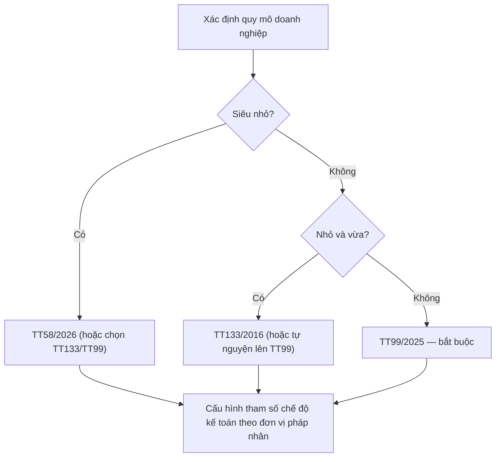
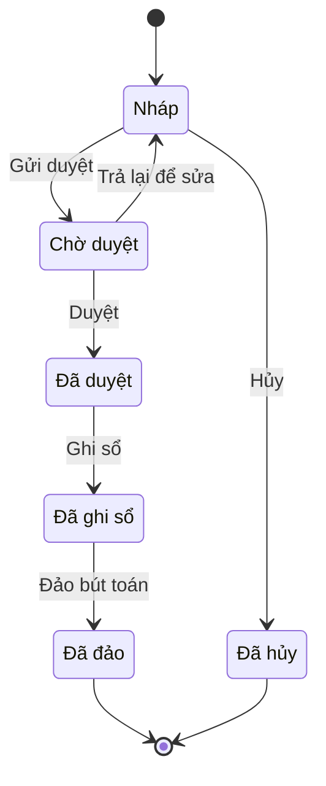
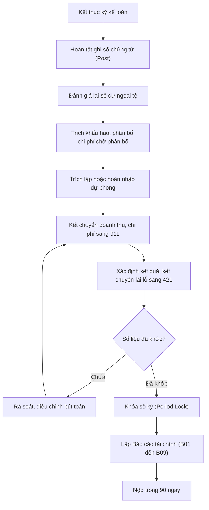

# Kế toán doanh nghiệp Việt Nam — cơ sở pháp lý cho thiết kế ERP

> Cập nhật đến: 2026-10-20 — quy định thay đổi thường xuyên; BA phải kiểm tra lại hiệu lực khi dùng cho dự án.
> File này là tài liệu tra cứu trong skill `erp-ba-core`. Mục tiêu: để mọi luồng kế toán trong ERP đúng chuẩn pháp lý VN và mọi spec đầy đủ (tài khoản, chứng từ, sổ, báo cáo, tham số, kiểm soát). Các khía cạnh thuế/hóa đơn điện tử xem `references/regulations/vn-tax-einvoice.md`; lao động/tiền lương xem `references/regulations/vn-labor-payroll.md`; quy trình hạch toán chi tiết xem `references/processes/r2r-general-ledger.md`, `ap-accounts-payable.md`, `ar-accounts-receivable.md`, `fixed-assets.md`, `costing.md`.

## Mục lục
1. [Bảng văn bản pháp lý](#1-bảng-văn-bản-pháp-lý)
2. [Chế độ kế toán đang áp dụng (regime in force)](#2-chế-độ-kế-toán-đang-áp-dụng-regime-in-force)
3. [Luật Kế toán — nguyên tắc nền chi phối ERP](#3-luật-kế-toán--nguyên-tắc-nền-chi-phối-erp)
4. [Hệ thống tài khoản (Chart of Accounts)](#4-hệ-thống-tài-khoản-chart-of-accounts)
5. [Chứng từ kế toán (Accounting Vouchers)](#5-chứng-từ-kế-toán-accounting-vouchers)
6. [Sổ kế toán & hình thức ghi sổ](#6-sổ-kế-toán--hình-thức-ghi-sổ)
7. [Báo cáo tài chính (Financial Statements)](#7-báo-cáo-tài-chính-financial-statements)
8. [Chuẩn mực kế toán VN (VAS) & lộ trình IFRS](#8-chuẩn-mực-kế-toán-vn-vas--lộ-trình-ifrs)
9. [Tài sản cố định (TT45/2013)](#9-tài-sản-cố-định-tt452013)
10. [Hàng tồn kho & phương pháp tính giá](#10-hàng-tồn-kho--phương-pháp-tính-giá)
11. [Dự phòng (TT48/2019)](#11-dự-phòng-tt482019)
12. [Tỷ giá hối đoái](#12-tỷ-giá-hối-đoái)
13. [Bút toán kết chuyển / khóa sổ cuối kỳ](#13-bút-toán-kết-chuyển--khóa-sổ-cuối-kỳ)
14. [Lưu trữ tài liệu kế toán (NĐ174/2016)](#14-lưu-trữ-tài-liệu-kế-toán-nđ1742016)
15. [Chuẩn phần mềm kế toán → yêu cầu hệ thống](#15-chuẩn-phần-mềm-kế-toán--yêu-cầu-hệ-thống)
- [Tham số cấu hình hiện hành](#tham-số-cấu-hình-hiện-hành)
- [Yêu cầu hệ thống rút ra (REGREQ)](#yêu-cầu-hệ-thống-rút-ra-regreq)
- [Câu hỏi cần xác nhận với khách hàng](#câu-hỏi-cần-xác-nhận-với-khách-hàng)
- [Nguồn tham khảo](#nguồn-tham-khảo)

---

## 1. Bảng văn bản pháp lý

| Số hiệu | Tên | Cơ quan | Ngày ban hành | Hiệu lực | Tình trạng |
|---|---|---|---|---|---|
| 88/2015/QH13 | Luật Kế toán | Quốc hội | 20/11/2015 | 01/01/2017 | Còn hiệu lực; sửa đổi bởi Luật 56/2024/QH15 [20][2] |
| 56/2024/QH15 | Luật sửa đổi 9 luật (có Luật Kế toán, Chứng khoán, Quản lý thuế…) | Quốc hội | 29/11/2024 | 01/01/2025 | Còn hiệu lực [2] |
| 20/2023/QH15 | Luật Giao dịch điện tử | Quốc hội | 22/06/2023 | 01/07/2024 | Còn hiệu lực; thay Luật GDĐT 2005 [12] |
| 174/2016/NĐ-CP | Quy định chi tiết Luật Kế toán | Chính phủ | 30/12/2016 | 01/01/2017 | Còn hiệu lực [14] |
| **99/2025/TT-BTC** | **Chế độ kế toán doanh nghiệp** | Bộ Tài chính | **27/10/2025** | **01/01/2026** | **Còn hiệu lực — chế độ chính cho DN từ 2026** [1][3] |
| 200/2014/TT-BTC | Chế độ kế toán doanh nghiệp (cũ) | Bộ Tài chính | 22/12/2014 | 01/01/2015 | **Đã bị thay thế bởi TT99/2025 từ 01/01/2026** (Điều 31 TT99) [1][4] |
| 133/2016/TT-BTC | Chế độ kế toán doanh nghiệp nhỏ và vừa (SME) | Bộ Tài chính | 26/08/2016 | năm TC từ 01/01/2017 | Còn hiệu lực; **không** bị TT99 thay thế; đang được rà soát sửa đổi [5][6] |
| 132/2018/TT-BTC | Chế độ kế toán doanh nghiệp siêu nhỏ | Bộ Tài chính | 28/12/2018 | 15/02/2019 | **Hết hiệu lực từ 01/07/2026**, thay bởi TT58/2026 [7][8] |
| 58/2026/TT-BTC | Chế độ kế toán doanh nghiệp siêu nhỏ (mới) | Bộ Tài chính | 25/05/2026 | 01/07/2026 | Còn hiệu lực [7][8] |
| 45/2013/TT-BTC | Quản lý, sử dụng & trích khấu hao TSCĐ | Bộ Tài chính | 25/04/2013 | 10/06/2013 | Còn hiệu lực đến **≤31/12/2026** theo QĐ 1760/QĐ-BTC; sửa bởi TT147/2016, TT28/2017, TT30/2025 [9][10] |
| 30/2025/TT-BTC | Sửa đổi TT45/2013 (TSCĐ) | Bộ Tài chính | ~06/2025 ⚠️CHƯA XÁC MINH ngày | 15/07/2025 | Còn hiệu lực [10] |
| 48/2019/TT-BTC | Trích lập & xử lý dự phòng | Bộ Tài chính | 08/08/2019 | 10/10/2019 | Còn hiệu lực đến **≤31/12/2026** theo QĐ 1760/QĐ-BTC [9][11] |
| 1760/QĐ-BTC | Công bố TT45/2013 & TT48/2019 tiếp tục hiệu lực | Bộ Tài chính | 01/07/2026 | 01/07/2026 | Còn hiệu lực [9] |
| 345/QĐ-BTC | Đề án áp dụng IFRS tại VN | Bộ Tài chính | 16/03/2020 | 16/03/2020 | Còn hiệu lực (lộ trình) [19] |
| 103/2005/TT-BTC | Tiêu chuẩn & điều kiện phần mềm kế toán | Bộ Tài chính | 24/11/2005 | 20/12/2005 | ⚠️ CHƯA XÁC MINH — nhiều nguồn ghi đã hết hiệu lực; nội dung kỹ thuật vẫn tham khảo được [15] |

> ⚠️ Nhiều thông tư của Bộ Tài chính được "công bố tiếp tục có hiệu lực đến ≤31/12/2026" (QĐ 1760/QĐ-BTC) do rà soát hệ thống văn bản. BA phải kiểm tra lại văn bản thay thế trước khi chốt thiết kế cho năm 2027 trở đi [9].

---

## 2. Chế độ kế toán đang áp dụng (regime in force)

**Tại 2026-10-20, chế độ kế toán doanh nghiệp (Enterprise Accounting Regime) phân theo quy mô:**

| Loại DN | Chế độ áp dụng | Căn cứ |
|---|---|---|
| Doanh nghiệp nói chung / lớn / niêm yết | **Thông tư 99/2025/TT-BTC** (áp dụng cho năm tài chính bắt đầu từ/sau 01/01/2026) | TT99 Điều 31 thay TT200/2014 [1][4] |
| Doanh nghiệp nhỏ và vừa (SME) | TT133/2016 (còn hiệu lực) **hoặc** tự nguyện chuyển sang TT99/2025 | [5][6] |
| Doanh nghiệp siêu nhỏ (micro) | TT58/2026 (từ 01/07/2026) hoặc chọn TT133 / TT99 | [7][8] |

**Điều 31 TT99/2025 thay thế:** TT200/2014/TT-BTC (chính), TT75/2015 (sửa Điều 128 TT200), TT53/2016 (sửa TT200), TT195/2012 (kế toán chủ đầu tư). **Không** thay thế TT133/2016 [4].

Toàn bộ các bút toán ví dụ trong file này dùng **số hiệu tài khoản theo TT99/2025** (gần như trùng TT200 ở cấp 1; khác biệt nêu tại §4). Khi dự án áp dụng TT133/TT58, BA phải ánh xạ lại số hiệu.

---

## 3. Luật Kế toán — nguyên tắc nền chi phối ERP

Luật Kế toán 88/2015/QH13 (sửa bởi Luật 56/2024/QH15 từ 01/01/2025) là nền tảng; TT99/133/58 chỉ hướng dẫn thi hành. Các điều chi phối trực tiếp thiết kế hệ thống:

| Nội dung | Căn cứ | Yêu cầu thiết kế hệ thống |
|---|---|---|
| Đơn vị tiền tệ kế toán (functional currency) là VND; DN thu chi chủ yếu bằng ngoại tệ có thể chọn 1 ngoại tệ làm đồng tiền ghi sổ, nhưng phải quy đổi ra VND khi lập BCTC | Luật KT Điều 10 [20] | Tham số "đồng tiền hạch toán" theo đơn vị; engine quy đổi BCTC ra VND |
| Kỳ kế toán (accounting period): năm, quý, tháng. Năm tài chính (fiscal year) 12 tháng dương lịch hoặc theo năm riêng của DN | Luật KT Điều 12 [20] | Tham số kỳ + năm tài chính (ngày bắt đầu/kết thúc) theo đơn vị |
| Chứng từ kế toán (accounting voucher) phải có đủ nội dung bắt buộc; mỗi nghiệp vụ lập 1 lần | Luật KT Điều 16, 18 [18][20] | Xem §5 |
| Chứng từ điện tử (electronic voucher) có giá trị như chứng từ giấy khi đủ điều kiện | Luật KT Điều 17; Luật GDĐT 20/2023 [12] | Hỗ trợ chứng từ điện tử + chữ ký số |
| Ký chứng từ: không được ký khi chưa ghi đủ nội dung; chữ ký điện tử theo pháp luật GDĐT | Luật KT Điều 19 [20] | Workflow duyệt/ký; khóa chỉnh sửa sau khi ký |
| Sổ kế toán (accounting book) mở theo kỳ, ghi liên tục, khóa sổ cuối kỳ | Luật KT Điều 24, 25, 26 [20] | Đánh số bút toán liên tục; chức năng khóa sổ |
| **Sửa chữa sổ kế toán** (Điều 27): KHÔNG được tẩy xóa làm mất dấu vết. 3 phương pháp: ghi cải chính, ghi số âm (ghi đỏ), ghi bổ sung. Khi ghi bằng máy: nếu phát hiện sai trước khi khóa sổ thì sửa trực tiếp; sau khi khóa sổ/nộp BCTC thì dùng ghi số âm hoặc ghi bổ sung + thuyết minh | Luật KT Điều 27 [20] | **Không cho xóa bút toán đã ghi sổ**; chỉ Đảo (REVERSE)/ghi điều chỉnh, có lưu vết |
| Hành vi bị cấm: giả mạo, để ngoài sổ, hủy tài liệu trước hạn, lập 2 hệ thống sổ | Luật KT Điều 13 [20] | Audit trail bắt buộc; 1 hệ sổ duy nhất |
| Đơn vị phải bố trí kế toán trưởng (Chief Accountant); chưa bố trí được thì bố trí phụ trách kế toán tối đa 12 tháng; DN siêu nhỏ chỉ cần phụ trách kế toán | NĐ174 Điều 20 [14] | Vai trò `ROLE-ACC-CHIEF`; cấu hình ngưỡng phê duyệt theo chức danh |
| Tiêu chuẩn kế toán trưởng: có chứng chỉ bồi dưỡng KTT; kinh nghiệm ≥2 năm (trình độ ĐH) / ≥3 năm (trung cấp, cao đẳng); DN vốn điều lệ ≥10 tỷ cần trình độ ĐH trở lên | NĐ174 Điều 21 [14] | Không hard-code; là dữ liệu nhân sự để kiểm soát |

> ⚠️ Luật 56/2024/QH15 (từ 01/01/2025) **bãi bỏ điểm d khoản 1 Điều 16** Luật KT — bỏ yêu cầu ghi "tên, địa chỉ của đơn vị/cá nhân **nhận** chứng từ" [18]. (Luật 56/2024 sửa Luật Kế toán — đã xác minh [2]; nội dung bỏ điểm d cụ thể **cần đối chiếu bản hợp nhất Luật Kế toán** vì nguồn [18] là trang khoa, không phải văn bản gốc.)

---

## 4. Hệ thống tài khoản (Chart of Accounts)

**Nguồn chuẩn: Phụ lục II của TT99/2025** [3]. Dưới đây là danh mục **tài khoản cấp 1** theo cấu trúc TT200 chuyển tiếp sang TT99, kèm thay đổi của TT99 đã xác minh.

> ⚠️ Danh mục cấp 1 dưới đây dựng theo cấu trúc TT200 + các thay đổi TT99 đã xác minh qua nguồn [3][4]; **chưa đối chiếu từng dòng với bản PDF Phụ lục II TT99**. Khi dựng COA cho dự án, phải khớp 100% với Phụ lục II bản gốc.

### 4.1. Danh mục tài khoản cấp 1 (theo TT99/2025)

| Loại | TK | Tên tài khoản (TT99) | Ghi chú thay đổi TT99 vs TT200 |
|---|---|---|---|
| **1 — Tài sản ngắn hạn** | 111 | Tiền mặt | Bỏ chi tiết 1111/1112/1113 (DN tự chi tiết) |
| | 112 | Tiền gửi ngân hàng | ⚠️ Nguồn thứ cấp [3][4] nêu TT99 đổi tên TK 112 thành "Tiền gửi không kỳ hạn" (tiền gửi có kỳ hạn theo dõi ở 128); bỏ chi tiết cố định — đối chiếu Phụ lục II |
| | 113 | Tiền đang chuyển | |
| | 121 | Chứng khoán kinh doanh | Bỏ chi tiết 1211/1212/1218 |
| | 128 | Đầu tư nắm giữ đến ngày đáo hạn | |
| | 131 | Phải thu của khách hàng (AR) | |
| | 133 | Thuế GTGT được khấu trừ | |
| | 136 | Phải thu nội bộ | |
| | 138 | Phải thu khác | Thêm 1383 "Thuế TTĐB hàng nhập khẩu"; bỏ 1385 |
| | 141 | Tạm ứng | |
| | 151 | Hàng mua đang đi đường | |
| | 152 | Nguyên liệu, vật liệu | |
| | 153 | Công cụ, dụng cụ | Bỏ chi tiết 1531–1534 |
| | 154 | Chi phí sản xuất, kinh doanh dở dang (WIP) | |
| | 155 | **Sản phẩm** | **Đổi tên** từ "Thành phẩm"; bỏ chi tiết 1557 |
| | 156 | Hàng hóa | Bỏ 1562 "Chi phí thu mua" (ghi thẳng vào 632) |
| | 157 | Hàng gửi đi bán | |
| | 158 | Hàng hóa kho bảo thuế | ⚠️ Nguồn thứ cấp [3][4] nêu TT99 đổi tên/mở rộng TK 158 (gồm cả nguyên vật liệu kho bảo thuế) — đối chiếu Phụ lục II |
| | 161 | Chi sự nghiệp | ⚠️ Không còn dùng cho DN; bỏ 1611/1612 |
| | 171 | Giao dịch mua bán lại trái phiếu Chính phủ | |
| **2 — Tài sản dài hạn** | 211 | Tài sản cố định hữu hình (Tangible FA) | |
| | 212 | Tài sản cố định thuê tài chính (Finance-lease FA) | Bỏ chi tiết 2121/2122 |
| | 213 | Tài sản cố định vô hình (Intangible FA) | Bỏ chi tiết 2131–2138 |
| | 214 | Hao mòn tài sản cố định (Accumulated depreciation) | |
| | **215** | **Tài sản sinh học (Biological assets)** | **Mới** (tách khỏi 211); có 2151/2152/2153 |
| | 217 | Bất động sản đầu tư (Investment property) | |
| | 221 | Đầu tư vào công ty con | |
| | 222 | Đầu tư vào công ty liên doanh, liên kết | |
| | 228 | Đầu tư khác | |
| | 229 | Dự phòng tổn thất tài sản | Thêm 2295 "Dự phòng tổn thất tài sản sinh học" |
| | 241 | Xây dựng cơ bản dở dang (CIP) | Thêm 2414 "Nâng cấp, cải tạo TSCĐ" |
| | 242 | **Chi phí chờ phân bổ** | **Đổi tên** từ "Chi phí trả trước" (Prepaid expenses) |
| | 243 | Tài sản thuế thu nhập hoãn lại (Deferred tax asset) | |
| | 244 | **Ký quỹ, ký cược** | **Đổi tên** (bỏ "cầm cố, thế chấp") |
| **3 — Nợ phải trả** | 331 | Phải trả cho người bán (AP) | |
| | **332** | **Phải trả cổ tức, lợi nhuận** | **Mới** |
| | 333 | Thuế và các khoản phải nộp Nhà nước | |
| | 334 | Phải trả người lao động | |
| | 335 | Chi phí phải trả (Accrued expenses) | |
| | 336 | Phải trả nội bộ | |
| | 337 | Thanh toán theo tiến độ hợp đồng xây dựng | Bỏ cụm "kế hoạch hợp đồng" trong tên |
| | 338 | Phải trả, phải nộp khác | |
| | 341 | Vay và nợ thuê tài chính | |
| | 343 | Trái phiếu phát hành | |
| | 344 | Nhận ký quỹ, ký cược | |
| | 347 | Thuế thu nhập hoãn lại phải trả (Deferred tax liability) | |
| | 352 | Dự phòng phải trả (Provisions — vd bảo hành) | |
| | 353 | Quỹ khen thưởng, phúc lợi | |
| | 356 | Quỹ phát triển khoa học và công nghệ | |
| | 357 | Quỹ bình ổn giá | |
| **4 — Vốn chủ sở hữu** | 411 | Vốn đầu tư của chủ sở hữu | 4112 đổi tên thành "Thặng dư vốn" |
| | 412 | Chênh lệch đánh giá lại tài sản | |
| | 413 | Chênh lệch tỷ giá hối đoái (FX differences) | |
| | 414 | Quỹ đầu tư phát triển | |
| | 418 | Các quỹ khác thuộc vốn chủ sở hữu | |
| | 419 | **Cổ phiếu mua lại của chính mình** | **Đổi tên** từ "Cổ phiếu quỹ" (Treasury shares) |
| | 421 | Lợi nhuận sau thuế chưa phân phối (Retained earnings) | |
| | ~~441/461/466~~ | Nguồn vốn XDCB / kinh phí sự nghiệp | ⚠️ **Không còn dùng** cho DN theo TT99 |
| **5 — Doanh thu** | 511 | Doanh thu bán hàng & cung cấp dịch vụ (Revenue) | |
| | 515 | Doanh thu hoạt động tài chính | |
| | 521 | Các khoản giảm trừ doanh thu | |
| **6 — Chi phí SXKD** | 611 | Mua hàng | ⚠️ Nguồn thứ cấp [3] nêu TT99 **bỏ TK 611** (cùng 631) → có thể TT99 không còn phương pháp kiểm kê định kỳ. Dưới TT200: chỉ dùng cho kiểm kê định kỳ (bỏ 6111/6112). **Đối chiếu Phụ lục II trước khi dùng** |
| | 621 | Chi phí nguyên liệu, vật liệu trực tiếp | |
| | 622 | Chi phí nhân công trực tiếp | |
| | 623 | Chi phí sử dụng máy thi công | (ngành xây dựng) |
| | 627 | Chi phí sản xuất chung | Thêm 6275 "Thuế, phí, lệ phí" |
| | 631 | Giá thành sản xuất | ⚠️ Nguồn thứ cấp [3] nêu TT99 **bỏ TK 631** (xem 611); dưới TT200 dùng cho kiểm kê định kỳ — đối chiếu Phụ lục II |
| | 632 | Giá vốn hàng bán (COGS) | |
| | 635 | Chi phí tài chính | |
| | 641 | Chi phí bán hàng (Selling expenses) | |
| | 642 | Chi phí quản lý doanh nghiệp (G&A) | |
| **7 — Thu nhập khác** | 711 | Thu nhập khác | |
| **8 — Chi phí khác** | 811 | Chi phí khác | |
| | 821 | Chi phí thuế thu nhập doanh nghiệp | Thêm 82112 "Chi phí thuế TNDN bổ sung theo thuế tối thiểu toàn cầu (Pillar 2)" |
| **9 — Xác định KQKD** | 911 | Xác định kết quả kinh doanh (P&L determination) | |

**Quy tắc chung:** DN **được** sửa tên, số hiệu, kết cấu tài khoản (TT99 Điều 11) miễn giữ đúng bản chất và nội dung cơ bản theo luật [3]. TT99 **bỏ hệ thống tài khoản ngoài bảng loại 0** (giống TT200), theo dõi trên thuyết minh.

### 4.2. Khác biệt chính so với TT133/2016 (SME)

| Khía cạnh | TT99 (chuẩn) | TT133/2016 (SME) |
|---|---|---|
| TSCĐ | Tách 211 / 212 / 213 | Gộp vào **211** (chi tiết theo loại) |
| Chi phí sản xuất | 621/622/623/627 riêng | Gộp hết vào **154** |
| Chi phí bán hàng + QLDN | 641 và 642 riêng | Gộp vào **642 "Chi phí quản lý kinh doanh"** (chi tiết 6421/6422) |
| Giảm trừ doanh thu | TK 521 riêng | Ghi giảm trực tiếp vào 511 |
| TK ngoài bảng (loại 0) | Không dùng | **Vẫn dùng** (001–007) |
| Số lượng tài khoản | Nhiều hơn | Ít hơn, đơn giản hóa |

> Khi dự án có nhiều pháp nhân khác chế độ, hệ thống phải map tài khoản TT99 ↔ TT133 để hợp nhất. Xem `references/processes/r2r-general-ledger.md`.

---

## 5. Chứng từ kế toán (Accounting Vouchers)

### 5.1. Nội dung bắt buộc (Luật KT Điều 16) [18][20]

Mọi chứng từ phải có: (a) tên + số hiệu chứng từ; (b) ngày, tháng, năm lập; (c) tên, địa chỉ đơn vị/cá nhân **lập** chứng từ; (đ) nội dung nghiệp vụ kinh tế; (e) số lượng, đơn giá, số tiền (chứng từ thu/chi tiền ghi số tiền **bằng số và bằng chữ**); (g) chữ ký, họ tên người lập, người duyệt và người liên quan.
⚠️ Điểm (d) "tên, địa chỉ bên **nhận**" đã **bị bãi bỏ** từ 01/01/2025 (Luật 56/2024) [18].

**Yêu cầu hệ thống:** validate đủ các trường bắt buộc trước khi cho ghi sổ; auto-generate số hiệu chứng từ liên tục theo loại/kỳ; sinh số tiền bằng chữ cho phiếu thu/chi.

### 5.2. Mẫu biểu & tự thiết kế

- TT99 **không bắt buộc** mẫu chứng từ cứng: DN **tham khảo** mẫu tại **Phụ lục I** và được **tự thiết kế / sửa đổi / bổ sung** biểu mẫu, miễn đủ nội dung Điều 16 và trung thực, rõ ràng (TT99 Điều 9, 10) [3][4].
- Khi tự thiết kế, DN phải ban hành **Quy chế hạch toán kế toán** nội bộ [4].
- Một số chứng từ vẫn bị ràng buộc bởi luật khác (vd hóa đơn GTGT — xem `vn-tax-einvoice.md`).

**Mẫu tham khảo hay dùng (theo chức năng, tên gọi truyền thống):**

| Nhóm | Mẫu (ký hiệu TT truyền thống) | Dùng cho |
|---|---|---|
| Tiền | Phiếu thu (01-TT), Phiếu chi (02-TT), Giấy đề nghị tạm ứng (03-TT), Giấy thanh toán tạm ứng (04-TT), Biên lai thu tiền (06-TT) | Thu/chi quỹ, tạm ứng |
| Vật tư | Phiếu nhập kho (01-VT), Phiếu xuất kho (02-VT), Biên bản kiểm nghiệm vật tư (03-VT), Phiếu xuất kho kiêm vận chuyển nội bộ, Biên bản kiểm kê vật tư | Nhập/xuất/kiểm kê kho |
| Bán hàng | Hóa đơn GTGT/bán hàng (theo pháp luật hóa đơn), Phiếu xuất kho hàng gửi bán | Doanh thu, xuất bán |
| Lao động — tiền lương | Bảng chấm công, Bảng thanh toán tiền lương, Bảng thanh toán BHXH | Xem `vn-labor-payroll.md` |
| TSCĐ | Biên bản giao nhận TSCĐ, Biên bản thanh lý TSCĐ, Bảng tính & phân bổ khấu hao | Ghi tăng/giảm/khấu hao TSCĐ |

> ⚠️ Ký hiệu như "01-TT", "01-VT" là mẫu từ TT200/TT133; TT99 chuyển sang danh mục Phụ lục I — BA cần đối chiếu ký hiệu mới với Phụ lục I khi làm mẫu in.

### 5.3. Chứng từ điện tử & chữ ký số [12]

- Chứng từ điện tử (electronic voucher) có giá trị như chứng từ giấy khi: thể hiện đầy đủ, truy cập được dạng hoàn chỉnh trong suốt thời hạn lưu trữ, được ký bằng **chữ ký điện tử** hợp lệ (Luật KT Điều 17; Luật GDĐT 20/2023).
- **Chữ ký số (digital signature)** dùng thuật toán khóa không đối xứng — bảo đảm xác thực, toàn vẹn, chống chối bỏ. **Chữ ký điện tử chuyên dùng bảo đảm an toàn** cũng được công nhận theo Luật GDĐT [12].
- Chuyển đổi chứng từ giấy ↔ điện tử phải bảo đảm toàn vẹn nội dung và có dấu/chữ ký của đơn vị thực hiện chuyển đổi.

### 5.4. Vòng đời chứng từ (document lifecycle)

Quy tắc: chỉ chứng từ **Nháp (DRAFT)** mới được Xóa (Delete); đã **Ghi sổ (POSTED)** chỉ được **Đảo (Reverse)** hoặc ghi điều chỉnh, luôn lưu vết (Luật KT Điều 27).

---

## 6. Sổ kế toán & hình thức ghi sổ

**Hình thức kế toán (bookkeeping form)** — DN chọn 1, khai báo trong chính sách kế toán:

| Hình thức | Tên tiếng Anh | Đặc điểm | Phù hợp ERP? |
|---|---|---|---|
| Nhật ký chung | General Journal | Mọi nghiệp vụ vào 1 sổ nhật ký chung, rồi vào Sổ Cái | **Chuẩn ERP** — mô hình journal → ledger |
| Nhật ký – Sổ Cái | Journal-Ledger | Nhật ký và Sổ Cái gộp 1 quyển | DN siêu nhỏ |
| Chứng từ ghi sổ | Voucher-to-book | Lập "Chứng từ ghi sổ" tổng hợp rồi vào Sổ Cái | Ít dùng trong ERP mới |
| Nhật ký – Chứng từ | Journal-Voucher | Hệ thống nhật ký theo bên Có tài khoản | Phức tạp, ít dùng |
| Kế toán trên máy vi tính | Computerized | Phần mềm tự sinh sổ theo 1 trong các hình thức trên | ERP thuộc nhóm này |

- TT99 giảm số mẫu sổ từ 45 (TT200) xuống **42 mẫu** (Phụ lục III); DN được tự thiết kế sổ miễn đủ thông tin [4].
- Sổ kế toán bắt buộc tối thiểu: **Sổ Nhật ký chung** (General Journal), **Sổ Cái** (General Ledger) từng tài khoản, **Sổ/thẻ kế toán chi tiết** (subledger), **Bảng cân đối số phát sinh** (Trial Balance).

**Yêu cầu hệ thống:** ERP triển khai "Kế toán trên máy vi tính" theo logic Nhật ký chung; mọi bút toán phải truy ngược về chứng từ gốc (drill-down); in được đầy đủ sổ theo mẫu Phụ lục III.

---

## 7. Báo cáo tài chính (Financial Statements)

### 7.1. Bộ BCTC năm theo TT99/2025 [3][4][16]

| Mã mẫu | Tên báo cáo (TT99) | English | Ghi chú vs TT200 |
|---|---|---|---|
| **B01-DN** | **Báo cáo tình hình tài chính** | Statement of Financial Position | **Đổi tên** từ "Bảng cân đối kế toán" |
| B02-DN | Báo cáo kết quả hoạt động kinh doanh | Income Statement | |
| B03-DN | Báo cáo lưu chuyển tiền tệ | Cash Flow Statement | trực tiếp hoặc gián tiếp |
| B09-DN | Bản thuyết minh báo cáo tài chính | Notes to the FS | |
| B01-DNKLT … B09-DNKLT | Bộ BCTC cho DN **không hoạt động liên tục** | Non-going-concern set | **Bổ sung mới** |

**Quy tắc trình bày:** DN được lược bỏ chỉ tiêu không phát sinh và đổi thứ tự chỉ tiêu, nhưng **không được đổi mã số chỉ tiêu** [4].

### 7.2. Thời hạn & nơi nộp [16]

| Nội dung | Quy định | Căn cứ |
|---|---|---|
| Hạn nộp BCTC năm | **90 ngày** kể từ ngày kết thúc năm tài chính (năm dương lịch → 31/3 năm sau) | TT99 Điều 25 |
| Nơi nhận | Cơ quan thuế quản lý trực tiếp + cơ quan đăng ký kinh doanh (và cơ quan khác nếu yêu cầu) | TT99 Điều 26 |
| DN bắt buộc kiểm toán | Nộp kèm **báo cáo kiểm toán** | TT99 Điều 26 |
| Công ty mẹ/tổng công ty | Được quy định hạn nộp của công ty con để hợp nhất | TT99 Điều 25 |

**Yêu cầu hệ thống:** engine sinh B01–B09 từ số dư tài khoản; cảnh báo hạn nộp 90 ngày; khóa số liệu BCTC đã phát hành (versioning khi nộp lại).

---

## 8. Chuẩn mực kế toán VN (VAS) & lộ trình IFRS

**Hệ thống VAS: 26 chuẩn mực**, ban hành 5 đợt (2001–2005), đánh số 01–30 (bỏ số 09, 12, 13, 20) [13]. Các chuẩn mực **chi phối logic ERP**:

| VAS | Tên | Chi phối thiết kế ERP |
|---|---|---|
| 01 | Chuẩn mực chung | Nguyên tắc: dồn tích, hoạt động liên tục, giá gốc, phù hợp, thận trọng, nhất quán |
| **02** | Hàng tồn kho (Inventories) | Phương pháp tính giá xuất kho; giá trị thuần có thể thực hiện; dự phòng giảm giá — xem §10, `inventory-warehouse.md`, `costing.md` |
| **03** | TSCĐ hữu hình (Tangible FA) | Tiêu chuẩn ghi nhận, nguyên giá, khấu hao — xem §9, `fixed-assets.md` |
| **04** | TSCĐ vô hình (Intangible FA) | Ghi nhận, phân bổ TSCĐ vô hình |
| 05 | Bất động sản đầu tư | TK 217; đo lường, khấu hao |
| 06 | Thuê tài sản (Leases) | Thuê tài chính vs thuê hoạt động; TK 212 |
| 07/08 | Đầu tư liên kết / liên doanh | TK 222, phương pháp vốn chủ sở hữu |
| **10** | Ảnh hưởng thay đổi tỷ giá hối đoái (FX) | Tỷ giá ghi nhận & đánh giá lại — xem §12 |
| 11 | Hợp nhất kinh doanh | Goodwill, hợp nhất |
| **14** | Doanh thu & thu nhập khác (Revenue) | Điều kiện & thời điểm ghi nhận doanh thu — xem `o2c-order-to-cash.md`, `ar-accounts-receivable.md` |
| **15** | Hợp đồng xây dựng (Construction contracts) | Ghi nhận doanh thu/chi phí theo tiến độ; TK 337 — xem `references/industries/construction.md` |
| **16** | Chi phí đi vay (Borrowing costs) | Vốn hóa lãi vay vào tài sản dở dang |
| **17** | Thuế TNDN (Income tax) | Thuế hoãn lại (TK 243, 347, 8212) |
| 18 | Dự phòng, tài sản & nợ tiềm tàng | TK 352 — xem §11 |
| 21 | Trình bày BCTC | Cấu trúc B01–B09 |
| 23 | Sự kiện sau ngày kết thúc kỳ | Điều chỉnh/không điều chỉnh BCTC |
| 24 | Báo cáo lưu chuyển tiền tệ | B03-DN |
| 25 | BCTC hợp nhất & đầu tư công ty con | Hợp nhất tập đoàn |
| 29 | Thay đổi chính sách, ước tính & sai sót | Hồi tố/phi hồi tố — ảnh hưởng cách sửa sổ |
| 30 | Lãi trên cổ phiếu (EPS) | Chỉ tiêu B02 cho công ty cổ phần |

**Lộ trình IFRS (QĐ 345/QĐ-BTC, 2020):** (1) chuẩn bị 2020–2021; (2) **áp dụng tự nguyện 2022–2025** (BCTC hợp nhất của DN có nhu cầu/đủ nguồn lực); (3) **bắt buộc sau 2025** theo lộ trình Bộ Tài chính cho DN niêm yết, DNNN lớn, DN FDI [19]. ⚠️ Phạm vi & thời điểm bắt buộc cần tra cứu văn bản mới nhất. Với đa số DN, **VAS + TT99 vẫn là chuẩn hạch toán nền** cho ERP; dự án lớn cần hỏi KTT về kế hoạch IFRS (song song 2 bộ sổ).

---

## 9. Tài sản cố định (TT45/2013)

TT45/2013 (sửa bởi TT147/2016, TT28/2017, **TT30/2025** từ 15/07/2025) còn hiệu lực đến **≤31/12/2026** (QĐ 1760/QĐ-BTC) [9][10]. VAS 03/04 là chuẩn mực; TT45 là quy định thuế/quản lý.

**Tiêu chuẩn ghi nhận TSCĐ hữu hình (đồng thời đủ):** (a) chắc chắn thu được lợi ích kinh tế tương lai; (b) thời gian sử dụng **> 1 năm**; (c) nguyên giá xác định tin cậy; (d) **nguyên giá ≥ 30.000.000 VND** [9][10].

**Phương pháp khấu hao (depreciation method):**

| Phương pháp | English | Ghi chú |
|---|---|---|
| Đường thẳng | Straight-line | Phổ biến nhất; mặc định |
| Số dư giảm dần có điều chỉnh | Declining balance | Áp dụng điều kiện nhất định |
| Theo số lượng, khối lượng sản phẩm | Units of production | Tài sản gắn sản lượng |

- **Khung thời gian trích khấu hao** (useful-life frames) quy định tại Phụ lục 1 TT45 (vd nhà cửa, máy móc, phương tiện… mỗi nhóm có khoảng min–max năm). ⚠️ Bảng khung đầy đủ chưa trích từng dòng — đối chiếu Phụ lục 1 TT45 (và sửa đổi TT30/2025) khi cấu hình. Xem `references/processes/fixed-assets.md`.

**Bút toán mẫu (TK theo TT99):**

| Nghiệp vụ | Nợ | Có | Ghi chú |
|---|---|---|---|
| Mua TSCĐ (chưa VAT) | 211 | 331/112 | Nguyên giá |
| Thuế GTGT đầu vào | 133 | 331/112 | Nếu được khấu trừ |
| Trích khấu hao kỳ | 627/641/642 | 214 | Phân bổ theo bộ phận sử dụng |
| Thanh lý TSCĐ — xóa sổ | 214 (hao mòn), 811 (giá trị còn lại) | 211 | |
| Thu thanh lý | 111/112/131 | 711, 3331 | Thu nhập khác + VAT |

---

## 10. Hàng tồn kho & phương pháp tính giá

**VAS 02** — phương pháp tính giá xuất kho (inventory costing), chọn 1 và áp dụng **nhất quán**:

| Phương pháp | English | Ghi chú |
|---|---|---|
| Thực tế đích danh | Specific identification | Hàng nhận diện riêng (lô, serial) |
| Bình quân gia quyền | Weighted average | Cả kỳ hoặc sau mỗi lần nhập (moving average) |
| Nhập trước – xuất trước | FIFO | |

⚠️ **LIFO (Nhập sau – xuất trước) KHÔNG còn được áp dụng** theo VAS 02 hiện hành.

**Phương pháp kế toán hàng tồn kho:** Kê khai thường xuyên (perpetual) — chuẩn cho ERP; hoặc Kiểm kê định kỳ (periodic, dùng TK 611/631 theo TT200). ⚠️ Nguồn thứ cấp [3] nêu TT99 đã **bỏ TK 611/631**; nếu đúng thì TT99 chỉ còn kê khai thường xuyên — đối chiếu Phụ lục II TT99 khi cấu hình. Dự phòng giảm giá hàng tồn kho: xem §11. Chi tiết luồng kho — `references/processes/inventory-warehouse.md`, giá thành — `costing.md`.

---

## 11. Dự phòng (TT48/2019)

TT48/2019 còn hiệu lực đến **≤31/12/2026** (QĐ 1760/QĐ-BTC) [9][11]. Bốn loại dự phòng: (1) giảm giá hàng tồn kho; (2) tổn thất các khoản đầu tư; (3) **nợ phải thu khó đòi** (doubtful debt); (4) bảo hành sản phẩm, hàng hóa, dịch vụ, công trình xây dựng.

**Mức trích dự phòng nợ phải thu khó đòi theo thời gian quá hạn (Điều 6)** [17]:

| Thời gian quá hạn | Mức trích |
|---|---|
| Từ 6 tháng đến < 1 năm | **30%** |
| Từ 1 năm đến < 2 năm | **50%** |
| Từ 2 năm đến < 3 năm | **70%** |
| Từ 3 năm trở lên | **100%** |

Điều kiện: có chứng từ gốc (hợp đồng, khế ước, đối chiếu công nợ); trích tại thời điểm **cuối kỳ kế toán năm** trước khi lập BCTC; mức trích tính trên số nợ còn phải thu sau khi bù trừ.

**Bút toán (TK theo TT99):**

| Nghiệp vụ | Nợ | Có | Ghi chú |
|---|---|---|---|
| Trích lập dự phòng nợ phải thu khó đòi | 642 | 2293 | Lần đầu / tăng thêm |
| Hoàn nhập dự phòng | 2293 | 642 | Khi mức cần trích < số đã trích |
| Xóa nợ không thu hồi được | 2293 (phần đã lập), 642 (phần thiếu) | 131/138 | Theo dõi ngoài sổ |
| Trích dự phòng giảm giá HTK | 632 | 2294 | |
| Trích dự phòng bảo hành sản phẩm | 641 | 352 | |

---

## 12. Tỷ giá hối đoái

**VAS 10 / TT99 (kế thừa TT200 Điều 69):**

- **Ghi nhận ban đầu:** quy đổi theo **tỷ giá giao dịch thực tế** (actual transaction rate) tại ngày phát sinh.
  - Nợ phải thu / doanh thu bằng ngoại tệ: dùng tỷ giá **mua** của NHTM nơi DN chỉ định khách thanh toán.
  - Nợ phải trả / mua tài sản, chi phí trả ngay: dùng tỷ giá **bán** (với nợ phải trả) / tỷ giá **mua** (với tài sản mua trả ngay) của NHTM.
  - Được dùng tỷ giá xấp xỉ (bình quân) nếu chênh lệch không trọng yếu (theo điều kiện TT).
- **Cuối kỳ — đánh giá lại số dư gốc ngoại tệ** (FX revaluation) của khoản mục tiền tệ (tiền, phải thu, phải trả gốc ngoại tệ):
  - Tài sản tiền tệ: tỷ giá **mua**; nợ phải trả tiền tệ: tỷ giá **bán** của NHTM DN thường xuyên giao dịch.
  - Chênh lệch ghi qua **TK 413** rồi kết chuyển vào **515** (lãi) / **635** (lỗ).

**Bút toán mẫu:**

| Nghiệp vụ | Nợ | Có | Ghi chú |
|---|---|---|---|
| Lãi tỷ giá khi đánh giá lại | 1112/1122/131… | 413 | Cuối kỳ |
| Lỗ tỷ giá khi đánh giá lại | 413 | 331/341… | Cuối kỳ |
| Kết chuyển lãi tỷ giá | 413 | 515 | |
| Kết chuyển lỗ tỷ giá | 635 | 413 | |

**Yêu cầu hệ thống:** tỷ giá là **tham số có ngày hiệu lực** (xem Tham số); hỗ trợ nhiều loại tỷ giá (mua/bán/bình quân); job đánh giá lại số dư ngoại tệ cuối kỳ tự động sinh bút toán.

---

## 13. Bút toán kết chuyển / khóa sổ cuối kỳ

Cuối kỳ, hệ thống thực hiện **kết chuyển (closing entries)** để xác định kết quả:

| Bước | Nghiệp vụ | Nợ | Có |
|---|---|---|---|
| 1 | Kết chuyển các khoản giảm trừ doanh thu | 511 | 521 |
| 2 | Kết chuyển doanh thu thuần & doanh thu tài chính | 511, 515 | 911 |
| 3 | Kết chuyển thu nhập khác | 711 | 911 |
| 4 | Kết chuyển giá vốn, chi phí tài chính, bán hàng, QLDN, chi phí khác | 911 | 632, 635, 641, 642, 811 |
| 5 | Kết chuyển chi phí thuế TNDN | 911 | 821 |
| 6 | Kết chuyển lãi | 911 | 421 |
| 6' | Kết chuyển lỗ | 421 | 911 |

**Quy trình khóa sổ cuối kỳ:**

Xem chi tiết chu trình Record-to-Report tại `references/processes/r2r-general-ledger.md`.

---

## 14. Lưu trữ tài liệu kế toán (NĐ174/2016)

Tính từ ngày kết thúc kỳ kế toán năm (hoặc theo quy định riêng) [14]:

| Thời hạn | Loại tài liệu | Căn cứ |
|---|---|---|
| **Tối thiểu 5 năm** | Tài liệu kế toán dùng cho quản lý, điều hành, **không** trực tiếp ghi sổ/lập BCTC (vd phiếu thu/chi/nhập/xuất không lưu ở tập chứng từ kế toán) | NĐ174 Điều 12 |
| **Tối thiểu 10 năm** | Chứng từ trực tiếp ghi sổ & lập BCTC, sổ kế toán, BCTC năm, báo cáo quyết toán, hồ sơ kiểm toán/thanh tra… (trừ khi luật khác yêu cầu dài hơn) | NĐ174 Điều 13 |
| **Vĩnh viễn** | Tài liệu có tính sử liệu, ý nghĩa KT-CT-ANQP; với DN: tài liệu liên quan thành lập, chia tách, hợp nhất, giải thể, phá sản | NĐ174 Điều 14 |

Lưu trữ điện tử phải bảo đảm an toàn, bảo mật, **tra cứu được trong suốt thời hạn**. **Cấm hủy tài liệu trước hạn** (Luật KT Điều 13).

**Yêu cầu hệ thống:** gắn "retention class" (5/10/vĩnh viễn) cho từng loại chứng từ; chặn xóa trước hạn; xuất lưu trữ điện tử kèm chữ ký số để chống sửa đổi.

---

## 15. Chuẩn phần mềm kế toán → yêu cầu hệ thống

TT103/2005 (⚠️ tình trạng hiệu lực chưa xác minh — nhiều nguồn ghi đã hết hiệu lực [15]) nêu tiêu chuẩn phần mềm kế toán; dù trạng thái văn bản ra sao, bản chất yêu cầu được **củng cố bởi Luật KT 2015** (Điều 13, 16, 24–27) và vẫn là chuẩn thiết kế:

- Phần mềm phải sinh được sổ kế toán và BCTC theo chế độ kế toán áp dụng, in ra giấy hoặc lưu điện tử đúng mẫu.
- Bảo đảm **không tẩy xóa dấu vết** số liệu đã ghi sổ; sửa sai theo 3 phương pháp hợp pháp (§3).
- Có **audit trail** (vết kiểm toán): ghi lại người, thời điểm, giá trị cũ/mới của mọi thay đổi.
- **Khóa kỳ (period lock)** sau khóa sổ; mở lại kỳ phải có phê duyệt và lưu vết.
- Đánh số chứng từ **liên tục, không trùng**; kiểm soát số nhảy cóc.
- Bảo mật, phân quyền, sao lưu phục hồi dữ liệu.

(Triển khai thành REGREQ bên dưới. Nguyên tắc bảo mật/tham số chung — xem `references/security-and-parameters.md`, `references/nfr-catalog.md`.)

---

## Tham số cấu hình hiện hành

> Luôn thiết kế là **tham số có ngày hiệu lực**, không hard-code.

| Tham số | Giá trị | Hiệu lực từ | Căn cứ |
|---|---|---|---|
| `PRM-ACC-REGIME` Chế độ kế toán áp dụng (theo pháp nhân) | TT99/2025 (DN) · TT133/2016 (SME) · TT58/2026 (micro) | 01/01/2026 / 01/07/2026 | [1][6][8] |
| `PRM-FA-THRESHOLD` Ngưỡng nguyên giá ghi nhận TSCĐ | ≥ 30.000.000 VND | (TT45, còn ≤31/12/2026) | [9][10] |
| `PRM-FA-MINLIFE` Thời gian sử dụng tối thiểu để ghi nhận TSCĐ | > 1 năm | TT45 | [9] |
| `PRM-PROV-AR-6M` Dự phòng nợ phải thu quá hạn 6–12 tháng | 30% | 10/10/2019 | TT48 Điều 6 [17] |
| `PRM-PROV-AR-1Y` Quá hạn 1–<2 năm | 50% | 10/10/2019 | TT48 [17] |
| `PRM-PROV-AR-2Y` Quá hạn 2–<3 năm | 70% | 10/10/2019 | TT48 [17] |
| `PRM-PROV-AR-3Y` Quá hạn ≥3 năm | 100% | 10/10/2019 | TT48 [17] |
| `PRM-FS-DEADLINE` Hạn nộp BCTC năm | 90 ngày sau cuối năm TC | 01/01/2026 | TT99 Điều 25 [16] |
| `PRM-RETENTION` Thời hạn lưu trữ | 5 / 10 / vĩnh viễn (năm) | 01/01/2017 | NĐ174 Điều 12–14 [14] |
| `PRM-INV-COSTING` Phương pháp tính giá xuất kho | Đích danh / BQGQ / FIFO | — | VAS 02 [13] |
| `PRM-FX-RATE` Tỷ giá (mua/bán/bình quân, theo ngày) | Nhập theo ngày hiệu lực | — | VAS 10 / TT99 |
| `PRM-ACC-STAFF-MAX` Thời gian bố trí phụ trách kế toán tối đa | 12 tháng | 01/01/2017 | NĐ174 Điều 20 [14] |

---

## Yêu cầu hệ thống rút ra (REGREQ)

| Mã | Yêu cầu | Căn cứ |
|---|---|---|
| **REGREQ-01** | Cho phép cấu hình **chế độ kế toán** (TT99/TT133/TT58) và **năm tài chính** theo từng pháp nhân, có ngày hiệu lực | §2 [1][6][8] |
| **REGREQ-02** | Hệ thống tài khoản mặc định theo **Phụ lục II TT99** cho năm TC ≥ 2026; cho DN tự mở tài khoản chi tiết nhưng không sai bản chất TK cấp 1 | TT99 Điều 11 [3] |
| **REGREQ-03** | **Cấm xóa chứng từ/bút toán đã Ghi sổ (POSTED)**; chỉ cho Đảo (Reverse) hoặc ghi điều chỉnh; mọi thao tác lưu vết | Luật KT Điều 27 [20] |
| **REGREQ-04** | **Khóa kỳ (period lock)** sau khóa sổ; chặn ghi/sửa vào kỳ đã khóa; mở lại kỳ phải có phê duyệt + lưu vết | Luật KT Điều 26; §15 |
| **REGREQ-05** | **Audit trail** đầy đủ: người, thời điểm, giá trị trước/sau cho mọi thay đổi dữ liệu kế toán | Luật KT Điều 13; TT103 §15 |
| **REGREQ-06** | Đánh số chứng từ **liên tục, không trùng** theo loại/kỳ; không cho sửa số sau khi ghi sổ; cảnh báo số nhảy cóc | Luật KT Điều 16 [20] |
| **REGREQ-07** | Validate đủ **nội dung bắt buộc của chứng từ** (Điều 16) trước khi ghi sổ; sinh số tiền bằng chữ cho phiếu thu/chi | Luật KT Điều 16 [18][20] |
| **REGREQ-08** | Hỗ trợ **chứng từ điện tử + chữ ký số/chữ ký điện tử chuyên dùng**; lưu bản điện tử toàn vẹn | Luật GDĐT 20/2023; Luật KT Điều 17 [12] |
| **REGREQ-09** | Sinh bộ **BCTC B01–B09 theo TT99** (gồm bộ KLT); không đổi mã số chỉ tiêu; cảnh báo **hạn nộp 90 ngày**; versioning khi nộp lại | TT99 Điều 25, 26 [16] |
| **REGREQ-10** | Gán **retention class (5/10/vĩnh viễn)** cho từng loại tài liệu; chặn hủy trước hạn | NĐ174 Điều 12–14 [14] |
| **REGREQ-11** | Tham số **dự phòng nợ phải thu** (30/50/70/100%) theo thời gian quá hạn, có ngày hiệu lực; job trích lập cuối kỳ | TT48 Điều 6 [17] |
| **REGREQ-12** | Quản lý TSCĐ: ngưỡng **≥30 triệu**, khung khấu hao TT45, 3 phương pháp khấu hao cấu hình được; job trích khấu hao kỳ | TT45 [9][10] |
| **REGREQ-13** | Phương pháp **tính giá xuất kho** (đích danh/BQGQ/FIFO) cấu hình theo kho/vật tư; áp dụng nhất quán; **không hỗ trợ LIFO** | VAS 02 [13] |
| **REGREQ-14** | Job **đánh giá lại số dư ngoại tệ** cuối kỳ theo tỷ giá mua/bán NHTM; tỷ giá là tham số theo ngày | VAS 10 / TT99 §12 |
| **REGREQ-15** | Job **kết chuyển/khóa sổ** tự động cuối kỳ (doanh thu, chi phí → 911 → 421) | §13 |
| **REGREQ-16** | Hỗ trợ **chuyển đổi số dư TT200 → TT99** đầu kỳ 2026 (ánh xạ tài khoản bị bãi bỏ/đổi tên, biên bản xác nhận số liệu) | TT99 §4 [4] |
| **REGREQ-17** | Quản lý **mẫu chứng từ/sổ tự thiết kế** + lưu "Quy chế hạch toán kế toán" của DN | TT99 Điều 9,10,12 [4] |
| **REGREQ-18** | **Phân tách nhiệm vụ (SoD):** tách quyền Tạo/Sửa khỏi Duyệt và Ghi sổ/Bỏ ghi sổ/Đảo | Luật KT Điều 13; `security-and-parameters.md` |

---

## Câu hỏi cần xác nhận với khách hàng

**Với Kế toán trưởng (Chief Accountant):**
1. Pháp nhân áp dụng chế độ kế toán nào (TT99 / TT133 / TT58)? Có kế hoạch chuyển từ TT200/TT133 lên TT99 trong năm 2026 không?
2. Năm tài chính theo dương lịch hay năm riêng (ngày bắt đầu/kết thúc)? Đồng tiền ghi sổ là VND hay ngoại tệ?
3. Phương pháp **kế toán hàng tồn kho**: kê khai thường xuyên hay kiểm kê định kỳ? Phương pháp **tính giá xuất kho**?
4. Phương pháp **khấu hao TSCĐ** mặc định? Có áp dụng ngưỡng 30 triệu? Khung thời gian khấu hao theo nhóm tài sản nào?
5. **Hình thức sổ kế toán** (Nhật ký chung / khác)? Yêu cầu in sổ theo mẫu nào?
6. Chính sách **tỷ giá**: dùng tỷ giá giao dịch thực tế hay tỷ giá xấp xỉ/bình quân? Ngân hàng tham chiếu? Loại tỷ giá đánh giá lại cuối kỳ?
7. DN có thuộc diện **bắt buộc kiểm toán** không? Có áp dụng/song song **IFRS** không?
8. Danh mục **chứng từ tự thiết kế**; đã ban hành **Quy chế hạch toán kế toán** chưa?
9. Chính sách **đánh số chứng từ** (theo loại, theo kỳ, reset đầu năm)?
10. **Kỳ khóa sổ** (tháng/quý)? Ai được quyền mở lại kỳ đã khóa?
11. Chính sách **dự phòng** (nợ phải thu theo TT48, giảm giá HTK, bảo hành)? Có khác biệt đặc thù ngành không?
12. **Thời hạn & hình thức lưu trữ** nội bộ (giấy/điện tử)? Yêu cầu chữ ký số cho chứng từ nào?

**Với pháp chế / CNTT:** hạ tầng chữ ký số (CA cung cấp)? Chính sách bảo mật & sao lưu đáp ứng NFR? (xem `references/nfr-catalog.md`).

---

## Nguồn tham khảo

[1] Thông tư 99/2025/TT-BTC hướng dẫn Chế độ kế toán doanh nghiệp — Công báo Chính phủ — https://congbao.chinhphu.vn/van-ban/thong-tu-so-99-2025-tt-btc-46529.htm (truy cập 2026-10-20)
[2] Luật số 56/2024/QH15 (sửa 9 luật, có Luật Kế toán) — Công báo Chính phủ — https://congbao.chinhphu.vn/van-ban/luat-so-56-2024-qh15-43561.htm (truy cập 2026-10-20)
[3] Thông tư 99/2025/TT-BTC: Hướng dẫn Chế độ kế toán doanh nghiệp — Russell Bedford KTC Audit — https://ktcvietnam.com/vi/goc-nhin-va-su-kien/cap-nhat-thue-va-phap-ly/thong-tu-99-2025-tt-btc-huong-dan-che-do-ke-toan-doanh-nghiep/ (truy cập 2026-10-20)
[4] Điểm mới Thông tư 99/2025/TT-BTC thay thế Thông tư 200 — elaw.com.vn — https://elaw.com.vn/diem-moi-thong-tu-99-2025-tt-btc/ (truy cập 2026-10-20)
[5] Thông tư 99/2025 có thay thế Thông tư 133/2016 không? — Thư viện Pháp luật — https://thuvienphapluat.vn/ma-so-thue/phap-luat-thue/thong-tu-992025-co-thay-the-thong-tu-1332016-che-do-ke-toan-doanh-nghiep-nho-va-vua-213873.html (truy cập 2026-10-20)
[6] Thông tư 133/2016/TT-BTC Chế độ kế toán DN nhỏ và vừa — LuatVietnam — https://luatvietnam.vn/doanh-nghiep/thong-tu-133-2016-tt-btc-bo-tai-chinh-108305-d1.html (truy cập 2026-10-20)
[7] Thông tư 133/2016 có bị thay thế bởi Thông tư 58/2026 không? — Thư viện Pháp luật — https://thuvienphapluat.vn/ma-so-thue/phap-luat-thue/thong-tu-1332016-co-bi-thay-the-boi-thong-tu-582026-khong-225798.html (truy cập 2026-10-20)
[8] Thông tư 58/2026/TT-BTC cho DN siêu nhỏ — MISA AMIS — https://amis.misa.vn/264117/thong-tu-58-2026-tt-btc-cho-dn-sieu-nho/ (truy cập 2026-10-20)
[9] Thông tư số 45/2013/TT-BTC và Thông tư số 48/2019/TT-BTC tiếp tục có hiệu lực (QĐ 1760/QĐ-BTC) — Thời báo Tài chính Việt Nam — https://thoibaotaichinhvietnam.vn/thong-tu-so-452013tt-btc-va-thong-tu-so-482019tt-btc-tiep-tuc-co-hieu-luc-200058.html (truy cập 2026-10-20)
[10] Thông tư 30/2025/TT-BTC sửa đổi Thông tư 45/2013/TT-BTC — Thư viện Pháp luật — https://thuvienphapluat.vn/van-ban/Tai-chinh-nha-nuoc/Thong-tu-30-2025-TT-BTC-sua-doi-Thong-tu-45-2013-TT-BTC-quan-ly-tai-san-co-dinh-659850.aspx (truy cập 2026-10-20)
[11] Thông tư 48/2019/TT-BTC về trích lập và xử lý dự phòng — Thư viện Pháp luật — https://thuvienphapluat.vn/van-ban/Ke-toan-Kiem-toan/Thong-tu-48-2019-TT-BTC-huong-dan-trich-lap-va-xu-ly-cac-khoan-du-phong-giam-gia-hang-ton-kho-346536.aspx (truy cập 2026-10-20)
[12] Luật Giao dịch điện tử số 20/2023/QH15 — Thư viện Pháp luật — https://thuvienphapluat.vn/van-ban/Cong-nghe-thong-tin/Luat-Giao-dich-dien-tu-2023-20-2023-QH15-513347.aspx (truy cập 2026-10-20)
[13] Hệ thống 26 chuẩn mực kế toán Việt Nam (VAS) — MISA AMIS — https://amis.misa.vn/39016/chuan-muc-ke-toan/ (truy cập 2026-10-20)
[14] Nghị định 174/2016/NĐ-CP hướng dẫn Luật Kế toán — LuatVietnam — https://luatvietnam.vn/ke-toan/nghi-dinh-174-2016-nd-cp-chinh-phu-111573-d1.html (truy cập 2026-10-20)
[15] Thông tư 103/2005/TT-BTC tiêu chuẩn & điều kiện phần mềm kế toán — Thư viện Pháp luật — https://thuvienphapluat.vn/van-ban/Ke-toan-Kiem-toan/Thong-tu-103-2005-TT-BTC-huong-dan-tieu-chuan-dieu-kien-phan-mem-ke-toan-5928.aspx (truy cập 2026-10-20)
[16] Thời hạn nộp, nơi nhận báo cáo tài chính doanh nghiệp từ 2026 (TT99 Điều 25, 26) — FastCA — https://fastca.vn/thoi-han-nop-noi-nhan-bao-cao-tai-chinh-doanh-nghiep-2026 (truy cập 2026-10-20)
[17] Quy định về mức trích lập dự phòng nợ phải thu khó đòi (TT48 Điều 6) — Luật Minh Khuê — https://luatminhkhue.vn/quy-dinh-ve-cac-muc-trich-lap-du-phong-no-phai-thu-kho-doi.aspx (truy cập 2026-10-20)
[18] Một số quy định mới về nội dung chứng từ kế toán từ 01/01/2025 (Luật 56/2024 bãi bỏ điểm d khoản 1 Điều 16) — Khoa Kế toán, ĐH Duy Tân — https://kketoan.duytan.edu.vn/ (truy cập 2026-10-20) — ⚠️ chỉ là trang chủ của khoa (không deep-link); đối chiếu bản hợp nhất Luật Kế toán trên thuvienphapluat.vn / vbpl.vn
[19] IFRS Việt Nam 2025 — lộ trình (Quyết định 345/QĐ-BTC 2020) — CADS — https://cads.com.vn/vi/ifrs-viet-nam-2025-lo-trinh-va-yeu-cau-cho-doanh-nghiep-niem-yet-nws223.html (truy cập 2026-10-20)
[20] Luật Kế toán số 88/2015/QH13 — hoatieu.vn (toàn văn) — https://hoatieu.vn/phap-luat/luat-ke-toan-so-88-2015-qh13-103755 (truy cập 2026-10-20)
