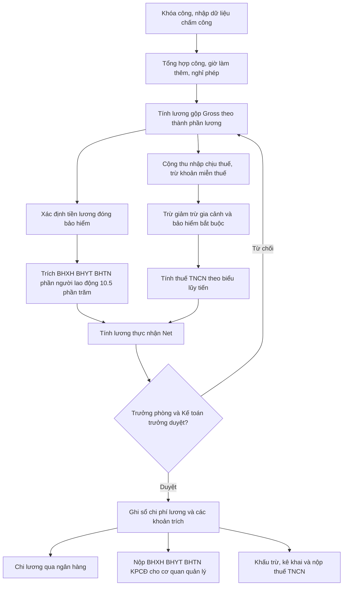
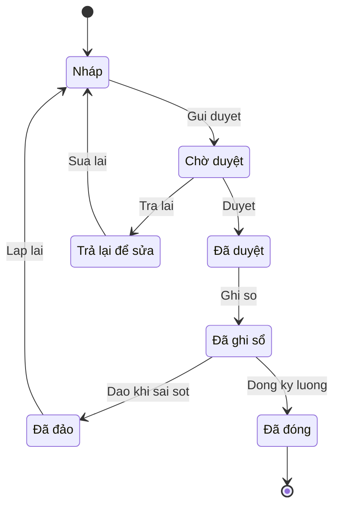

# Lao động – Tiền lương – Bảo hiểm – Thuế TNCN — cơ sở pháp lý Việt Nam cho thiết kế ERP

> Cập nhật đến: 2026-10-20 — quy định thay đổi thường xuyên; BA phải kiểm tra lại hiệu lực khi dùng cho dự án. Mọi tỷ lệ, ngưỡng, mức lương/ thuế trong file phải được thiết kế là **tham số có ngày hiệu lực** (effective-dated parameter), không hard-code trong mã nguồn.

File này là tài liệu tra cứu cho module nhân sự – tiền lương (HR & Payroll). Phạm vi: khung pháp lý về quan hệ lao động, thời giờ làm việc, tiền lương tối thiểu, bảo hiểm bắt buộc (BHXH/BHYT/BHTN/TNLĐ-BNN), kinh phí công đoàn, thuế thu nhập cá nhân (TNCN) từ tiền lương, và ảnh hưởng kế toán của chi phí lương. Quy trình nghiệp vụ chi tiết end-to-end xem `references/processes/hr-payroll.md`. Chi tiết hóa đơn/chứng từ điện tử và quản lý thuế xem `references/regulations/vn-tax-einvoice.md`. Chế độ kế toán và hệ thống tài khoản xem `references/regulations/vn-accounting.md`. Mẫu thiết kế tham số theo ngày hiệu lực xem `references/security-and-parameters.md`.

## Mục lục
- [1. Bảng văn bản pháp lý](#1-bảng-văn-bản-pháp-lý)
- [2. Hợp đồng lao động & vòng đời nhân sự](#2-hợp-đồng-lao-động--vòng-đời-nhân-sự)
- [3. Thời giờ làm việc, làm thêm giờ, nghỉ lễ/phép](#3-thời-giờ-làm-việc-làm-thêm-giờ-nghỉ-lễphép)
- [4. Tiền lương tối thiểu vùng & cơ cấu lương](#4-tiền-lương-tối-thiểu-vùng--cơ-cấu-lương)
- [5. Bảo hiểm bắt buộc & kinh phí công đoàn](#5-bảo-hiểm-bắt-buộc--kinh-phí-công-đoàn)
- [6. Thuế thu nhập cá nhân (PIT) từ tiền lương](#6-thuế-thu-nhập-cá-nhân-pit-từ-tiền-lương)
- [7. Hạch toán kế toán chi phí lương (chế độ TT 99/2025)](#7-hạch-toán-kế-toán-chi-phí-lương-chế-độ-tt-992025)
- [8. Quy trình & vòng đời bảng lương (sơ đồ)](#8-quy-trình--vòng-đời-bảng-lương-sơ-đồ)
- [Tham số cấu hình hiện hành](#tham-số-cấu-hình-hiện-hành)
- [Yêu cầu hệ thống rút ra (REGREQ)](#yêu-cầu-hệ-thống-rút-ra-regreq)
- [Câu hỏi cần xác nhận với khách hàng](#câu-hỏi-cần-xác-nhận-với-khách-hàng)
- [Nguồn tham khảo](#nguồn-tham-khảo)

---

## 1. Bảng văn bản pháp lý

| Số hiệu | Tên | Cơ quan | Ngày ban hành | Hiệu lực | Tình trạng |
|---|---|---|---|---|---|
| 45/2019/QH14 | Bộ luật Lao động (Labor Code) | Quốc hội | 20/11/2019 | 01/01/2021 | Còn hiệu lực [1] |
| 145/2020/NĐ-CP | Quy định chi tiết thi hành BLLĐ về điều kiện lao động và quan hệ lao động | Chính phủ | 14/12/2020 | 01/02/2021 | Còn hiệu lực [2] |
| 41/2024/QH15 | Luật Bảo hiểm xã hội (Social Insurance Law) | Quốc hội | 29/06/2024 | 01/07/2025 | Còn hiệu lực; thay Luật BHXH 58/2014/QH13 [3][4] |
| 158/2025/NĐ-CP | Quy định chi tiết Luật BHXH về BHXH bắt buộc | Chính phủ | 25/06/2025 | 01/07/2025 | Còn hiệu lực [5] |
| 74/2025/QH15 | Luật Việc làm (Employment Law) – điều chỉnh BHTN | Quốc hội | 16/06/2025 | 01/01/2026 | Còn hiệu lực; thay Luật Việc làm 38/2013/QH13 [6][7] |
| 50/2024/QH15 | Luật Công đoàn (Trade Union Law) | Quốc hội | 27/11/2024 | 01/07/2025 | Còn hiệu lực [8] |
| 25/2008/QH12 (sửa đổi 46/2014/QH13; luật sửa đổi 2024 – số hiệu 51/2024/QH15 ⚠️ CHƯA XÁC MINH) | Luật Bảo hiểm y tế (Health Insurance Law) | Quốc hội | 2008; sửa đổi 2014 & 2024 | bản sửa đổi 2024 áp dụng từ 01/07/2025 (⚠️ CHƯA XÁC MINH) | Còn hiệu lực; căn cứ tỷ lệ BHYT 4,5% (NLĐ 1,5% + NSDLĐ 3%) [4] |
| 293/2025/NĐ-CP | Mức lương tối thiểu vùng (regional minimum wage) | Chính phủ | 10/11/2025 | 01/01/2026 | Còn hiệu lực; thay NĐ 74/2024/NĐ-CP [9][10] |
| 73/2024/NĐ-CP | Mức lương cơ sở (statutory base salary) 2.340.000đ | Chính phủ | 30/06/2024 | 01/07/2024 | Áp dụng đến 30/06/2026 [26] |
| 161/2026/NĐ-CP | Mức lương cơ sở 2.530.000đ | Chính phủ | 15/05/2026 | 01/07/2026 | Còn hiệu lực (đã đối chiếu nguồn uy tín – báo Đại biểu Nhân dân; nên xem bản gốc Công báo) [24][25] |
| 04/2007/QH12 (sửa đổi 26/2012/QH13, 71/2014/QH13) | Thuế thu nhập cá nhân (Personal Income Tax) | Quốc hội | 2007–2014 | — | Bị thay bởi Luật TNCN 109/2025/QH15 (áp dụng với tiền lương từ kỳ tính thuế 2026); phần chưa thay vẫn áp dụng [17] |
| 109/2025/QH15 | Luật Thuế thu nhập cá nhân (sửa đổi) – biểu 5 bậc | Quốc hội | 10/12/2025 | 01/07/2026; riêng tiền lương/tiền công của cá nhân cư trú áp dụng từ kỳ tính thuế 2026 (01/01/2026) – Đ.29 k.2 | Còn hiệu lực; thay Luật TNCN 04/2007 [16][17] |
| 110/2025/UBTVQH15 | Nghị quyết điều chỉnh mức giảm trừ gia cảnh | UB Thường vụ QH | 17/10/2025 | kỳ tính thuế 2026 (01/01/2026) | Còn hiệu lực; thay NQ 954/2020/UBTVQH14 [15] |
| 111/2013/TT-BTC | Hướng dẫn Luật Thuế TNCN (khấu trừ, thu nhập miễn thuế) | Bộ Tài chính | 15/08/2013 | 01/10/2013 | Còn áp dụng phần chưa bị thay; đối chiếu Luật TNCN 2025 & TT 91/2026 ⚠️ [18][19] |
| 108/2025/QH15 | Luật Quản lý thuế (Tax Administration) – căn cứ của NĐ 254/2026 | Quốc hội | 2025 | 2026 | Còn hiệu lực; là căn cứ ban hành NĐ 254/2026 (⚠️ ngày ban hành/hiệu lực chính xác nên đối chiếu Công báo) [20][21] |
| 254/2026/NĐ-CP | Hóa đơn điện tử, chứng từ điện tử (gồm chứng từ khấu trừ thuế TNCN điện tử) | Chính phủ | 2026 | 01/07/2026 | Còn hiệu lực [20][21] |
| 99/2025/TT-BTC | Chế độ kế toán doanh nghiệp (enterprise accounting) | Bộ Tài chính | 27/10/2025 | 01/01/2026 | Còn hiệu lực; thay TT 200/2014/TT-BTC [11][12][13] |
| 133/2016/TT-BTC | Chế độ kế toán doanh nghiệp nhỏ và vừa (SME) | Bộ Tài chính | 26/08/2016 | 01/01/2017 | Còn hiệu lực (DNNVV được chọn áp dụng – TT 99 Điều 31 khoản 3) [14] |
| 58/2020/NĐ-CP | Mức đóng BHXH bắt buộc vào quỹ TNLĐ-BNN (0,3%–0,5%) | Chính phủ | 27/05/2020 | 15/07/2020 | Còn hiệu lực [22] |

**Lưu ý thời điểm (as-of 2026-10-20):** tất cả văn bản mốc 01/01/2026 và 01/07/2026 nêu trên **đã có hiệu lực**. Vì vậy giá trị "mới" (lương tối thiểu NĐ 293/2025, giảm trừ gia cảnh 15,5 triệu, biểu thuế 5 bậc, lương cơ sở 2,53 triệu, chứng từ khấu trừ điện tử NĐ 254/2026) là giá trị **đang áp dụng**; giá trị cũ chỉ dùng cho dữ liệu lịch sử và tính lại kỳ trước.

---

## 2. Hợp đồng lao động & vòng đời nhân sự

### 2.1 Loại hợp đồng lao động (HĐLĐ)
**Nội dung:** HĐLĐ (Labor Contract) chỉ còn 2 loại: (a) không xác định thời hạn (indefinite-term); (b) xác định thời hạn, tối đa 36 tháng (fixed-term ≤ 36 months). Chỉ được ký loại xác định thời hạn tối đa **2 lần liên tiếp**; lần thứ 3 phải chuyển sang không xác định thời hạn (trừ một số ngoại lệ như người cao tuổi, người quản lý doanh nghiệp, lao động nước ngoài). **Căn cứ:** Điều 20 BLLĐ 45/2019 [1].

**Yêu cầu thiết kế:** trường `loại HĐ`, `số lần gia hạn`; quy tắc cảnh báo khi ký lần 3 loại xác định thời hạn; theo dõi ngày hết hạn HĐ và nhắc tái ký (xem REGREQ-01).

### 2.2 Thử việc (Probation)
**Nội dung:** thời gian thử việc tối đa: 180 ngày (người quản lý doanh nghiệp), 60 ngày (chức danh cần trình độ cao đẳng trở lên), 30 ngày (trình độ trung cấp), 6 ngày làm việc (công việc khác). Lương thử việc **≥ 85%** lương công việc. Người thử việc theo pháp luật lao động **không** thuộc đối tượng BHXH bắt buộc (nếu thử việc ghi trong HĐLĐ thì đóng theo HĐLĐ). **Căn cứ:** Điều 24–27 BLLĐ [1]; Điều 2 & loại trừ tại NĐ 158/2025 [5].

### 2.3 Chấm dứt HĐLĐ, báo trước, trợ cấp
| Nội dung | Mức/Thời hạn | Căn cứ |
|---|---|---|
| Báo trước khi NLĐ/NSDLĐ đơn phương chấm dứt – HĐ không xác định thời hạn | ≥ 45 ngày | Điều 35, 36 BLLĐ [1] |
| Báo trước – HĐ xác định thời hạn 12–36 tháng | ≥ 30 ngày | Điều 35 BLLĐ [1] |
| Báo trước – HĐ < 12 tháng | ≥ 3 ngày làm việc | Điều 35 BLLĐ [1] |
| Trợ cấp thôi việc (severance) | ½ tháng lương/ năm làm việc (trừ thời gian đã tham gia BHTN) | Điều 46 BLLĐ [1] |
| Trợ cấp mất việc làm (job-loss allowance) | 1 tháng lương/ năm, tối thiểu 2 tháng | Điều 47 BLLĐ [1] |

**Yêu cầu thiết kế:** máy tính thâm niên tính trợ cấp phải **loại trừ** số năm đã đóng BHTN; tiền lương tính trợ cấp = bình quân 6 tháng liền kề trước khi chấm dứt (Điều 46/47). Khoản này ghi vào chi phí (TK 642/641…) chứ không qua quỹ BHXH.

> Vòng đời nhân sự chi tiết (tuyển dụng → thử việc → chính thức → điều chuyển → chấm dứt) thuộc `references/processes/hr-payroll.md`.

---

## 3. Thời giờ làm việc, làm thêm giờ, nghỉ lễ/phép

### 3.1 Giờ làm việc & làm thêm giờ
**Nội dung:**
- Giờ làm việc bình thường: ≤ **8 giờ/ngày** và ≤ **48 giờ/tuần**; Nhà nước khuyến khích tuần làm việc 40 giờ. **Căn cứ:** Điều 105 BLLĐ [1][23].
- Giờ làm việc ban đêm (night shift): từ **22:00 đến 06:00** sáng hôm sau. **Căn cứ:** Điều 106 BLLĐ [1].
- Giới hạn làm thêm giờ (overtime – OT): ≤ 50% số giờ làm việc bình thường/ngày; tổng giờ bình thường + làm thêm ≤ **12 giờ/ngày**; ≤ **40 giờ/tháng**; ≤ **200 giờ/năm**, hoặc ≤ **300 giờ/năm** với ngành nghề được liệt kê (dệt may, da giày, điện tử, chế biến nông–lâm–thủy sản, điện, viễn thông, lọc dầu, cấp thoát nước…). Phải thông báo bằng văn bản cho cơ quan quản lý lao động cấp tỉnh. **Căn cứ:** Điều 107 BLLĐ [1][23]; Điều 61–62 NĐ 145/2020 [2].

> Ghi chú lịch sử: NQ 17/2022/UBTVQH15 từng cho phép tạm thời tới 60 giờ/tháng và mở rộng 300 giờ/năm trong năm 2022; phần nới trần tháng đã hết hiệu lực. Cấu hình hệ thống nên lấy trần theo BLLĐ (40 giờ/tháng, 200/300 giờ/năm) và cho phép override bằng tham số có ngày hiệu lực.

### 3.2 Tiền lương làm thêm giờ & làm đêm (ma trận cấu hình)
Mức **tối thiểu** so với đơn giá/tiền lương giờ làm việc bình thường ban ngày. **Căn cứ:** Điều 98 BLLĐ [1][23]; Điều 55–57 NĐ 145/2020 [2].

| Trường hợp | % tối thiểu | Ghi chú |
|---|---|---|
| Làm thêm ngày thường (ban ngày) | ≥ 150% | |
| Làm thêm ngày nghỉ hằng tuần (ban ngày) | ≥ 200% | |
| Làm thêm ngày lễ, tết, ngày nghỉ hưởng lương (ban ngày) | ≥ 300% | Chưa kể tiền lương ngày lễ với người hưởng lương theo ngày |
| Làm việc vào ban đêm (giờ tiêu chuẩn) | ≥ 130% | Phụ trội đêm ≥ 30% |
| Làm thêm vào ban đêm – ngày thường | ≥ 210% | 150% + 30% + 20%×150% |
| Làm thêm vào ban đêm – ngày nghỉ tuần | ≥ 270% | 200% + 30% + 20%×200% |
| Làm thêm vào ban đêm – ngày lễ, tết | ≥ 390% | 300% + 30% + 20%×300%; chưa kể lương ngày lễ |

**Yêu cầu thiết kế:** bảng hệ số OT phải là **ma trận tham số** theo (loại ngày × ca ngày/đêm × có/không làm thêm) và có ngày hiệu lực; cho phép doanh nghiệp cấu hình mức **cao hơn** tối thiểu luật (xem REGREQ-04).

### 3.3 Nghỉ lễ, tết (paid public holidays)
**Nội dung:** 11 ngày/năm hưởng nguyên lương: Tết Dương lịch (1), Tết Âm lịch (5), Giỗ Tổ Hùng Vương 10/3 ÂL (1), Ngày Chiến thắng 30/4 (1), Quốc tế Lao động 1/5 (1), Quốc khánh 2/9 (2 ngày: 02/9 và 1 ngày liền kề). Lao động là người nước ngoài được nghỉ thêm 1 ngày Tết cổ truyền và 1 ngày Quốc khánh nước họ. Trùng ngày nghỉ hằng tuần thì nghỉ bù. **Căn cứ:** Điều 112, 111 BLLĐ [1][23].

### 3.4 Nghỉ hằng năm (annual leave) & nghỉ việc riêng
**Nội dung:**
- Nghỉ hằng năm hưởng nguyên lương: **12 ngày** (điều kiện bình thường), **14 ngày** (người chưa thành niên, người khuyết tật, nghề nặng nhọc–độc hại–nguy hiểm), **16 ngày** (nghề đặc biệt nặng nhọc–độc hại–nguy hiểm). Làm chưa đủ 12 tháng thì tính **tỷ lệ** theo số tháng. **Căn cứ:** Điều 113 BLLĐ [1][27].
- Thâm niên: cứ **5 năm** làm việc cho một người sử dụng lao động thì **+1 ngày** nghỉ hằng năm. **Căn cứ:** Điều 114 BLLĐ [1].
- Nghỉ việc riêng hưởng lương: kết hôn (3 ngày), con kết hôn (1 ngày), cha/mẹ/vợ/chồng/con mất (3 ngày). **Căn cứ:** Điều 115 BLLĐ [1].

**Yêu cầu thiết kế:** quỹ phép (leave balance) tự tính theo loại công việc + thâm niên; hỗ trợ chuyển/chi trả phép chưa nghỉ khi thôi việc; tính tỷ lệ phép cho người vào/ ra giữa năm (xem REGREQ-05).

---

## 4. Tiền lương tối thiểu vùng & cơ cấu lương

### 4.1 Mức lương tối thiểu vùng (regional minimum wage) từ 01/01/2026
**Căn cứ:** NĐ 293/2025/NĐ-CP [9][10].

| Vùng | Theo tháng (đồng) | Theo giờ (đồng) |
|---|---|---|
| Vùng I | 5.310.000 | 25.500 |
| Vùng II | 4.730.000 | 22.700 |
| Vùng III | 4.140.000 | 20.000 |
| Vùng IV | 3.700.000 | 17.800 |

Tăng bình quân ~7,2% so với NĐ 74/2024 (Vùng I–IV cũ: 4.960.000 / 4.410.000 / 3.860.000 / 3.450.000). Danh mục địa bàn áp dụng từng vùng nằm tại Phụ lục NĐ 293/2025.

**Nội dung bắt buộc:** tiền lương theo công việc/chức danh trong HĐLĐ **không được thấp hơn** mức tối thiểu vùng; mức tối thiểu là mức trả cho công việc giản đơn nhất trong điều kiện bình thường. **Căn cứ:** Điều 90–91 BLLĐ [1].

### 4.2 Lương cơ sở / mức tham chiếu
- **Lương cơ sở (statutory base salary):** 2.340.000đ từ 01/07/2024 (NĐ 73/2024) [26]; **2.530.000đ từ 01/07/2026** (NĐ 161/2026, +~8%) [24][25]. Dùng làm căn cứ **trần đóng** BHXH/BHYT.
- **Mức tham chiếu (reference level):** khái niệm mới của Luật BHXH 2024 thay dần cho "lương cơ sở". Khi **chưa bãi bỏ** lương cơ sở thì **mức tham chiếu = lương cơ sở**. **Căn cứ:** Luật BHXH 41/2024 [3][4].

**Yêu cầu thiết kế:** tách hai khái niệm "lương tối thiểu vùng" (sàn lương & sàn/trần đóng BHTN) và "mức tham chiếu/lương cơ sở" (trần đóng BHXH/BHYT) thành 2 bộ tham số riêng, mỗi bộ có ngày hiệu lực (xem REGREQ-06).

### 4.3 Thành phần lương (pay elements)
Cơ cấu thu nhập cần tách rõ để phục vụ đóng bảo hiểm và tính thuế: (a) **mức lương** theo công việc/chức danh; (b) **phụ cấp lương** (chức vụ, trách nhiệm, nặng nhọc, thâm niên…); (c) **các khoản bổ sung khác** xác định được bằng số tiền cụ thể; (d) các khoản khác (thưởng theo Điều 104, ăn ca, hỗ trợ xăng xe, điện thoại, chuyên cần biến động…). Chỉ (a)+(b)+(c) xác định được mới thuộc tiền lương đóng BHXH. **Căn cứ:** Điều 7 NĐ 158/2025 [5]; Thông tư 10/2020/TT-BLĐTBXH.

---

## 5. Bảo hiểm bắt buộc & kinh phí công đoàn

### 5.1 Tỷ lệ đóng (từ 01/07/2025)
**Căn cứ:** Điều 33–34 Luật BHXH 41/2024 [3][4]; Luật BHYT; Luật Việc làm 74/2025 [6]; NĐ 58/2020 [22]; Luật Công đoàn 50/2024 [8].

| Quỹ | NLĐ (employee) | NSDLĐ (employer) | Ghi chú & căn cứ |
|---|---|---|---|
| Hưu trí – tử tuất (retirement–survivorship) | 8% | 14% | Quỹ BHXH; Luật BHXH Đ.33–34 [3] |
| Ốm đau – thai sản (sickness–maternity) | 0% | 3% | Quỹ BHXH; do NSDLĐ đóng toàn bộ [3] |
| TNLĐ – BNN (occupational accident–disease) | 0% | 0,5% | Có thể 0,3% nếu đủ điều kiện – NĐ 58/2020 [22] |
| BHYT (health insurance) | 1,5% | 3% | Luật BHYT [4] |
| BHTN (unemployment insurance) | 1% | 1% | Luật Việc làm 2025 [6]; Chính phủ được giảm khi khủng hoảng/thiên tai |
| **Cộng bảo hiểm** | **10,5%** | **21,5%** (hoặc 21,3% nếu TNLĐ-BNN 0,3%) | Tổng 2 bên ~32% |
| Kinh phí công đoàn – KPCĐ (union fee) | 0% | **2%** | NSDLĐ đóng bất kể có công đoàn; Luật Công đoàn 50/2024 duy trì mức 2% (hiệu lực 01/7/2025) [8]; NĐ 191/2013 hướng dẫn thu (kiểm tra văn bản thay thế sau Luật 2024 ⚠️) |
| Đoàn phí công đoàn (member dues) | 1% | – | Chỉ đoàn viên; theo quy định Tổng LĐLĐ VN, có mức trần ⚠️ |

**Lưu ý phân biệt:** KPCĐ 2% là **chi phí của doanh nghiệp** (không trừ vào lương NLĐ). Đoàn phí 1% là khoản của **đoàn viên** (trừ vào lương, chỉ với người tham gia công đoàn), không phải chi phí doanh nghiệp.

### 5.2 Tiền lương làm căn cứ đóng & trần/sàn
| Khoản | Sàn (min) | Trần (max) | Căn cứ |
|---|---|---|---|
| BHXH, BHYT | = lương tối thiểu vùng (với NLĐ hưởng lương) | **20 × mức tham chiếu** = 46.800.000đ (đến 30/06/2026) → **50.600.000đ** (từ 01/07/2026) | Luật BHXH 2024 [3]; [24][28] |
| BHTN | = lương tối thiểu vùng | **20 × lương tối thiểu vùng** (Vùng I: 20×5.310.000 = 106.200.000đ) | Luật Việc làm 2025 [6] |
| Tiền lương đóng | Mức lương + phụ cấp lương + bổ sung khác xác định được | (áp dụng trần trên) | Đ.7 NĐ 158/2025 [5] |

**Không tính vào tiền lương đóng:** tiền thưởng (Đ.104 BLLĐ), ăn giữa ca, hỗ trợ xăng xe/điện thoại/đi lại/nhà ở/giữ trẻ, trợ cấp khi thân nhân mất/kết hôn/sinh nhật, và các khoản biến động theo năng suất/ KPI/ chuyên cần. **Căn cứ:** Đ.7 NĐ 158/2025 [5]; TT 10/2020/TT-BLĐTBXH.

**Yêu cầu thiết kế:** mỗi thành phần lương có cờ `tính đóng BH` (có/không) và `tính thuế TNCN` (có/không); engine áp **trần/sàn theo từng quỹ** (BHXH/BHYT dùng trần theo mức tham chiếu; BHTN dùng trần theo lương tối thiểu vùng) — đây là lỗi cấu hình phổ biến (xem REGREQ-07, REGREQ-08).

### 5.3 Hồ sơ & kỳ đóng
Đóng theo tháng, chậm nhất ngày cuối cùng của tháng. Doanh nghiệp lập hồ sơ **báo tăng/giảm lao động** và điều chỉnh mức đóng khi có biến động (vào/ra, tăng lương, nghỉ không lương, thai sản…). Mẫu hồ sơ theo quy định BHXH Việt Nam (ví dụ mẫu D02-LT) ⚠️ kiểm tra mẫu hiện hành. Chế độ ốm đau/thai sản/TNLĐ do quỹ BHXH chi trả, doanh nghiệp lập hồ sơ đề nghị thanh toán.

---

## 6. Thuế thu nhập cá nhân (PIT) từ tiền lương

### 6.1 Thu nhập chịu thuế & miễn thuế
Thu nhập từ tiền lương, tiền công là thu nhập chịu thuế. Một số khoản **không tính vào thu nhập chịu thuế** (căn cứ Đ.2 TT 111/2013 [18]; đối chiếu Luật TNCN 2025 & TT 91/2026 ⚠️):

| Khoản | Mức miễn | Ghi chú |
|---|---|---|
| Tiền ăn giữa ca bằng tiền | ≤ 730.000đ/tháng | Vượt mức tính thuế; nếu tổ chức nấu/mua suất ăn thì miễn toàn bộ. ⚠️ NĐ 44/2025 có thể đã bỏ mức trần — kiểm chứng |
| Trang phục bằng tiền | ≤ 5.000.000đ/năm | Bằng hiện vật: miễn toàn bộ |
| Phụ cấp điện thoại, công tác phí, xăng xe | Theo quy chế tài chính/HĐLĐ | Không có mức cố định trong luật |
| Phần phụ trội làm thêm giờ/ làm đêm | Phần **vượt** đơn giá giờ làm việc bình thường | Chỉ phần chênh được miễn |
| Trợ cấp thôi việc, mất việc theo BLLĐ | Theo mức luật định | |

### 6.2 Giảm trừ gia cảnh (family deduction)
| Đối tượng | Đến hết kỳ 2025 | Từ kỳ tính thuế 2026 | Căn cứ |
|---|---|---|---|
| Bản thân người nộp thuế | 11.000.000đ/tháng (132tr/năm) | **15.500.000đ/tháng (186tr/năm)** | NQ 110/2025/UBTVQH15 [15] (thay NQ 954/2020) |
| Mỗi người phụ thuộc | 4.400.000đ/tháng | **6.200.000đ/tháng** | NQ 110/2025 [15] |

Người phụ thuộc phải đăng ký và có mã số thuế; mỗi người phụ thuộc chỉ được tính giảm trừ cho **một** người nộp thuế.

### 6.3 Biểu thuế lũy tiến từng phần (progressive table)
**Biểu cũ 7 bậc** (thu nhập tính thuế/tháng – áp dụng đến hết kỳ tính thuế 2025; giữ lại trong hệ thống để tính lại/retro các kỳ ≤ 2025, từ kỳ 2026 dùng biểu 5 bậc) [17]:

| Bậc | Thu nhập tính thuế/tháng | Thuế suất |
|---|---|---|
| 1 | Đến 5 triệu | 5% |
| 2 | Trên 5 – 10 triệu | 10% |
| 3 | Trên 10 – 18 triệu | 15% |
| 4 | Trên 18 – 32 triệu | 20% |
| 5 | Trên 32 – 52 triệu | 25% |
| 6 | Trên 52 – 80 triệu | 30% |
| 7 | Trên 80 triệu | 35% |

**Biểu mới 5 bậc** (Luật Thuế TNCN 109/2025/QH15, thông qua 10/12/2025; hiệu lực chung 01/07/2026, nhưng **thu nhập từ tiền lương/tiền công của cá nhân cư trú áp dụng từ kỳ tính thuế 2026 – tức 01/01/2026** theo Đ.29 khoản 2 và hướng dẫn Cục Thuế. Cơ chế khấu trừ hằng tháng trong năm 2026 nên xác nhận với cơ quan thuế/khách hàng) [16][17]:

| Bậc | Thu nhập tính thuế/tháng | Thuế suất |
|---|---|---|
| 1 | Đến 10 triệu | 5% |
| 2 | Trên 10 – 30 triệu | 10% |
| 3 | Trên 30 – 60 triệu | 20% |
| 4 | Trên 60 – 100 triệu | 30% |
| 5 | Trên 100 triệu | 35% |

Công thức: **Thu nhập tính thuế = Thu nhập chịu thuế − các khoản bảo hiểm bắt buộc (10,5%) − giảm trừ gia cảnh − các khoản đóng góp từ thiện/ khuyến học/ hưu trí tự nguyện trong định mức**.

### 6.4 Khấu trừ thuế & chứng từ khấu trừ điện tử
- **Khấu trừ theo biểu lũy tiến:** với cá nhân cư trú ký HĐLĐ **≥ 3 tháng** (gồm cả làm nhiều nơi) — khấu trừ hằng tháng theo biểu lũy tiến.
- **Khấu trừ 10%:** với cá nhân cư trú **không ký HĐLĐ hoặc ký HĐ < 3 tháng**, mỗi lần trả thu nhập **≥ 2.000.000đ** thì khấu trừ 10% trước khi trả. **Căn cứ:** điểm i khoản 1 Đ.25 TT 111/2013 [18][19]. ⚠️ Có đề xuất nâng ngưỡng lên 3.000.000đ — chưa xác minh đã ban hành.
- **Bản cam kết (mẫu 08/CK-TNCN):** cá nhân chỉ có một nguồn thu nhập và ước tổng thu nhập sau giảm trừ chưa đến mức nộp thuế được làm cam kết để tạm không bị khấu trừ 10%; phải có MST. Ngưỡng tham chiếu cũ ~132tr/năm (theo giảm trừ cũ) — **cập nhật theo mức giảm trừ mới 186tr/năm** khi áp dụng biểu/giảm trừ 2026 ⚠️.
- **Chứng từ khấu trừ thuế TNCN điện tử (e-withholding certificate):** bắt buộc lập **điện tử**, giao cho người bị khấu trừ và **gửi cơ quan thuế ngay trong ngày lập** qua tổ chức cung cấp dịch vụ; phải **đăng ký sử dụng** trước. Người ký HĐ ≥ 3 tháng: lập **1 chứng từ/năm**. Người không ký HĐ/ < 3 tháng: mỗi lần khấu trừ một chứng từ (hoặc gộp khi cá nhân yêu cầu). Cá nhân **ủy quyền quyết toán** thì không phải lập chứng từ. **Căn cứ:** NĐ 254/2026/NĐ-CP (Đ.23 nội dung chứng từ khấu trừ điện tử), ban hành theo Luật Quản lý thuế 108/2025/QH15 [20][21]; mẫu chứng từ [19].

### 6.5 Quyết toán thuế TNCN năm (annual finalization)
- **Doanh nghiệp** quyết toán thay cho cá nhân có ủy quyền (chỉ có thu nhập tại một nơi); nộp tờ khai 05/QTT-TNCN + phụ lục 05-1/BK-QTT-TNCN (cá nhân ủy quyền), 05-2/BK-QTT-TNCN (cá nhân tự quyết toán). Hạn: **ngày cuối cùng tháng thứ 3** sau khi kết thúc năm.
- **Cá nhân** tự quyết toán (nhiều nguồn, không ủy quyền): hạn **ngày cuối cùng tháng thứ 4** sau khi kết thúc năm dương lịch. **Căn cứ:** Luật Quản lý thuế [21].

**Yêu cầu thiết kế:** xem REGREQ-11 → REGREQ-14 (kê khai tháng/quý 05/KK-TNCN, quyết toán năm, phát hành chứng từ khấu trừ điện tử, kết nối tổ chức dịch vụ hóa đơn/chứng từ điện tử). Chi tiết hệ thống hóa đơn – chứng từ điện tử xem `references/regulations/vn-tax-einvoice.md`.

---

## 7. Hạch toán kế toán chi phí lương (chế độ TT 99/2025)

### 7.1 Chế độ kế toán đang áp dụng (xác định tại 2026-10-20)
**Chế độ áp dụng: Thông tư 99/2025/TT-BTC**, ban hành 27/10/2025, **hiệu lực 01/01/2026**, thay thế Thông tư 200/2014/TT-BTC (và TT 75/2015, TT 53/2016, TT 195/2012) [11][12][13]. Doanh nghiệp nhỏ và vừa **được chọn** tiếp tục áp dụng **Thông tư 133/2016/TT-BTC** hoặc tự nguyện chuyển sang TT 99 (TT 99 Điều 31 khoản 3) [14]. Điểm mới liên quan: doanh nghiệp được **tự chủ** mở/sửa hệ thống tài khoản (phải ban hành quy chế nội bộ), không còn xin phép Bộ Tài chính [11][13].

> Chi tiết chế độ kế toán & toàn bộ hệ thống tài khoản xem `references/regulations/vn-accounting.md`.

### 7.2 Tài khoản dùng cho tiền lương (TT 99/2025)
| TK | Tên | Ghi chú |
|---|---|---|
| 334 | Phải trả người lao động | 3341 Phải trả công nhân viên; 3348 Phải trả người lao động khác [29] |
| 338 | Phải trả, phải nộp khác | 3382 KPCĐ; 3383 BHXH; 3384 BHYT; **3386 BHTN** [30] |
| 3335 | Thuế thu nhập cá nhân | Tiểu khoản của TK 333 – Thuế và các khoản phải nộp NN |
| 622 / 623 / 627 / 641 / 642 | Chi phí nhân công theo bộ phận | SX trực tiếp / máy thi công / SX chung / bán hàng / quản lý DN [29] |
| 241 / 154 | CP XDCB dở dang / CP SX kinh doanh dở dang | Lao động vốn hóa / tập hợp chi phí |
| 353 (3531) | Quỹ khen thưởng | Thưởng chi từ quỹ, không tính vào chi phí |

⚠️ **Lưu ý mã BHTN:** theo chế độ TT 99, BHTN được phản ánh ở **3386** [30]. Khác biệt cần lưu ý: TT 200/2014 **không** có tiểu khoản mặc định riêng cho BHTN (3385 = "phải trả về cổ phần hóa", 3386 = "nhận ký quỹ, ký cược"); nhiều đơn vị TT 200 tự mở 3385/3389 để theo dõi BHTN. TT 133/2016 (DNNVV) dùng **3385 = BHTN**. Vì TT 99 cho phép tự chủ tài khoản, BA phải **chốt mã tiểu khoản BHTN theo hệ thống tài khoản nội bộ của khách hàng** (xem REGREQ-16, câu hỏi KH).

### 7.3 Bút toán tiền lương & các khoản trích theo lương
**Căn cứ bút toán:** TT 99/2025 [29][30]; tỷ lệ trích theo mục 5.1.

| Nghiệp vụ | Nợ | Có | Ghi chú |
|---|---|---|---|
| Tính lương phải trả | 622 / 623 / 627 / 641 / 642 / 241 | 334 | Phân bổ theo bộ phận sử dụng lao động |
| Thưởng từ quỹ khen thưởng | 353 (3531) | 334 | Không vào chi phí |
| Trích BHXH–BHYT–BHTN–KPCĐ phần NSDLĐ (23,5%) | 622 / 623 / 627 / 641 / 642 / 154 / 241 | 3383 (17,5%) / 3384 (3%) / 3386 (1%) / 3382 (2%) | Tính vào chi phí doanh nghiệp |
| Trừ BHXH–BHYT–BHTN phần NLĐ (10,5%) | 334 | 3383 (8%) / 3384 (1,5%) / 3386 (1%) | Khấu trừ vào lương |
| Khấu trừ thuế TNCN | 334 | 3335 | Theo biểu lũy tiến hoặc 10% |
| Nộp BHXH, BHYT, BHTN, KPCĐ | 3382 / 3383 / 3384 / 3386 | 111 / 112 | Cả phần NLĐ + NSDLĐ |
| Nộp thuế TNCN | 3335 | 111 / 112 | |
| Chi lương thực nhận (Net) | 334 | 111 / 112 | = Gross − 10,5% BH − TNCN − tạm ứng |
| Trợ cấp thôi việc/ mất việc | 641 / 642 | 334 / 111 / 112 | Không qua quỹ BHXH |

> Lưu ý: phần NSDLĐ 23,5% = BHXH 17,5% + BHYT 3% + BHTN 1% + KPCĐ 2% (trong đó bảo hiểm 21,5%, KPCĐ 2%).

---

## 8. Quy trình & vòng đời bảng lương (sơ đồ)

### 8.1 Quy trình tính lương & nghĩa vụ hằng tháng

### 8.2 Vòng đời bảng lương (payroll run lifecycle)

**Phân quyền gợi ý (role × action):** Nhân viên C&B / Tiền lương (Payroll Staff): Xem, Tạo, Sửa, Gửi duyệt. Trưởng phòng Nhân sự (HR Manager): Duyệt, Từ chối, Trả lại. Kế toán trưởng (Chief Accountant): Duyệt, Ghi sổ, Bỏ ghi sổ, Đảo. Giám đốc (Director): Xem, Duyệt (hạn mức cao). Kế toán lương (Payroll Accountant): Ghi sổ, In, Xuất file. Chi tiết ma trận phân quyền theo `references/security-and-parameters.md`.

---

## Tham số cấu hình hiện hành

Tất cả thiết kế là **tham số có ngày hiệu lực**; giữ lịch sử để tính lại kỳ cũ. Mã tham số minh họa theo quy ước (PRM-PAY-xxx).

| Tham số | Giá trị | Hiệu lực từ | Căn cứ |
|---|---|---|---|
| Lương tối thiểu vùng I | 5.310.000đ/tháng · 25.500đ/giờ | 01/01/2026 | NĐ 293/2025 [9] |
| Lương tối thiểu vùng II | 4.730.000đ/tháng · 22.700đ/giờ | 01/01/2026 | NĐ 293/2025 [9] |
| Lương tối thiểu vùng III | 4.140.000đ/tháng · 20.000đ/giờ | 01/01/2026 | NĐ 293/2025 [9] |
| Lương tối thiểu vùng IV | 3.700.000đ/tháng · 17.800đ/giờ | 01/01/2026 | NĐ 293/2025 [9] |
| Lương cơ sở / mức tham chiếu | 2.340.000đ | 01/07/2024 | NĐ 73/2024 [26] |
| Lương cơ sở / mức tham chiếu | 2.530.000đ | 01/07/2026 | NĐ 161/2026 [24][25] |
| Trần đóng BHXH/BHYT (20× mức tham chiếu) | 46.800.000đ | 01/07/2024 | Luật BHXH 2024 [3] |
| Trần đóng BHXH/BHYT (20× mức tham chiếu) | 50.600.000đ | 01/07/2026 | [24][28] |
| Trần đóng BHTN (20× LTT vùng I) | 106.200.000đ | 01/01/2026 | Luật Việc làm 2025 [6] |
| Tỷ lệ BHXH – hưu trí/tử tuất | NLĐ 8% · NSDLĐ 14% | 01/07/2025 | Luật BHXH 2024 [3] |
| Tỷ lệ BHXH – ốm đau/thai sản | NSDLĐ 3% | 01/07/2025 | Luật BHXH 2024 [3] |
| Tỷ lệ TNLĐ-BNN | NSDLĐ 0,5% (0,3% nếu đủ ĐK) | 15/07/2020 | NĐ 58/2020 [22] |
| Tỷ lệ BHYT | NLĐ 1,5% · NSDLĐ 3% | — | Luật BHYT [4] |
| Tỷ lệ BHTN | NLĐ 1% · NSDLĐ 1% | 01/01/2026 | Luật Việc làm 2025 [6] |
| Kinh phí công đoàn (KPCĐ) | NSDLĐ 2% | 01/07/2025 | Luật Công đoàn 2024 [8] |
| Đoàn phí công đoàn | Đoàn viên 1% (có trần ⚠️) | — | Quy định Tổng LĐLĐ ⚠️ |
| Giảm trừ gia cảnh – bản thân | 11.000.000đ/tháng | 2020 | NQ 954/2020 |
| Giảm trừ gia cảnh – bản thân | 15.500.000đ/tháng | kỳ 2026 | NQ 110/2025 [15] |
| Giảm trừ gia cảnh – người phụ thuộc | 4.400.000đ → 6.200.000đ/tháng | kỳ 2026 | NQ 110/2025 [15] |
| Biểu thuế lũy tiến | 7 bậc (5%–35%) | ≤ kỳ 2025 | Luật TNCN cũ [17] |
| Biểu thuế lũy tiến | 5 bậc (5/10/20/30/35%) | tiền lương: kỳ tính thuế 2026 (01/01/2026) | Luật TNCN 109/2025/QH15 [16][17] |
| Ngưỡng khấu trừ 10% thu nhập vãng lai | ≥ 2.000.000đ/lần (đề xuất 3.000.000 ⚠️) | 2013 | TT 111/2013 [18] |
| Ăn ca miễn thuế TNCN | ≤ 730.000đ/tháng ⚠️ (NĐ 44/2025 có thể bỏ trần) | — | TT 26/2016/TT-BLĐTBXH [18] |
| Trang phục bằng tiền miễn thuế | ≤ 5.000.000đ/năm | 2013 | TT 111/2013 [18] |
| Giờ làm thêm tối đa | 40 giờ/tháng; 200 giờ/năm (300 giờ ngành đặc thù) | 01/01/2021 | Đ.107 BLLĐ [1] |
| Hệ số làm thêm giờ | 150% / 200% / 300%; đêm +30%; thêm đêm +20% | 01/01/2021 | Đ.98 BLLĐ [1] |
| Nghỉ lễ tết hưởng lương | 11 ngày/năm | 01/01/2021 | Đ.112 BLLĐ [1] |
| Nghỉ hằng năm | 12 / 14 / 16 ngày + 1 ngày/5 năm thâm niên | 01/01/2021 | Đ.113–114 BLLĐ [1] |

---

## Yêu cầu hệ thống rút ra (REGREQ)

| Mã | Yêu cầu | Căn cứ |
|---|---|---|
| REGREQ-01 | Quản lý HĐLĐ theo 2 loại (không/có xác định thời hạn ≤36 tháng); đếm số lần gia hạn, cảnh báo khi ký loại xác định thời hạn lần 3; nhắc hết hạn HĐ | Đ.20 BLLĐ [1] |
| REGREQ-02 | Cấu hình thời gian & lương thử việc (≥85%), loại thử việc khỏi đối tượng đóng BHXH bắt buộc khi đúng luật | Đ.24–27 BLLĐ [1]; NĐ 158/2025 [5] |
| REGREQ-03 | Tính trợ cấp thôi việc/ mất việc, **loại trừ** số năm đã tham gia BHTN; lương bình quân 6 tháng liền kề | Đ.46–47 BLLĐ [1] |
| REGREQ-04 | Ma trận hệ số làm thêm giờ & làm đêm theo (loại ngày × ca × OT), tham số hóa, cho phép mức cao hơn luật; kiểm soát trần 40h/tháng, 200/300h/năm | Đ.98, 107 BLLĐ [1]; NĐ 145/2020 [2] |
| REGREQ-05 | Engine quỹ phép năm (12/14/16) + thâm niên (+1 ngày/5 năm), tính tỷ lệ cho người vào/ra giữa năm, chi trả phép chưa nghỉ | Đ.113–114 BLLĐ [1] |
| REGREQ-06 | Tách tham số "lương tối thiểu vùng" (4 vùng, tháng+giờ) và "lương cơ sở/mức tham chiếu", mỗi mức có ngày hiệu lực; gán vùng theo địa bàn đơn vị | NĐ 293/2025 [9]; NĐ 73/2024 & 161/2026 [26][24] |
| REGREQ-07 | Mỗi thành phần lương có cờ `đóng BH` và `chịu thuế`; xác định tiền lương đóng = lương + phụ cấp + bổ sung khác xác định được | Đ.7 NĐ 158/2025 [5] |
| REGREQ-08 | Áp **trần/sàn riêng theo quỹ**: BHXH/BHYT trần 20× mức tham chiếu; BHTN trần 20× LTT vùng; sàn = LTT vùng | Luật BHXH 2024 [3]; Luật Việc làm 2025 [6] |
| REGREQ-09 | Bảng tỷ lệ đóng theo quỹ & theo bên (NLĐ/NSDLĐ) có ngày hiệu lực; hỗ trợ TNLĐ-BNN 0,5%/0,3%; KPCĐ 2%, đoàn phí 1% | Đ.33–34 Luật BHXH [3]; NĐ 58/2020 [22]; Luật Công đoàn [8] |
| REGREQ-10 | Hồ sơ báo tăng/giảm lao động & điều chỉnh mức đóng BHXH định kỳ; kết xuất theo mẫu BHXH VN | Luật BHXH 2024 [3]; NĐ 158/2025 [5] |
| REGREQ-11 | Engine thuế TNCN hỗ trợ **song song 2 biểu** (7 bậc, 5 bậc) theo ngày hiệu lực; cấu hình giảm trừ gia cảnh bản thân/người phụ thuộc theo kỳ | Luật TNCN 2025 [16][17]; NQ 110/2025 [15] |
| REGREQ-12 | Khấu trừ 10% cho thu nhập vãng lai ≥ ngưỡng; quản lý bản cam kết 08/CK-TNCN và điều kiện MST | Đ.25 TT 111/2013 [18] |
| REGREQ-13 | Phát hành **chứng từ khấu trừ thuế TNCN điện tử**, đăng ký sử dụng, gửi cơ quan thuế trong ngày lập; quy tắc 1 chứng từ/năm cho HĐ ≥3 tháng; bỏ qua khi ủy quyền quyết toán | NĐ 254/2026 [20][21] |
| REGREQ-14 | Kê khai 05/KK-TNCN tháng/quý và quyết toán năm 05/QTT-TNCN (+ 05-1, 05-2); hạn tháng 3 (DN)/ tháng 4 (cá nhân) | Luật Quản lý thuế [21] |
| REGREQ-15 | Quản lý người phụ thuộc: đăng ký, MST, chống trùng (một người phụ thuộc chỉ giảm trừ cho một người nộp thuế) | NQ 110/2025 [15]; TT 111/2013 [18] |
| REGREQ-16 | Hạch toán lương theo TT 99/2025: ánh xạ 334/338(3382–3386)/3335 và TK chi phí theo bộ phận; cấu hình được mã tiểu khoản BHTN theo hệ thống tài khoản khách hàng; hỗ trợ cả TT 133 cho DNNVV | TT 99/2025 [29][30]; TT 133/2016 [14] |
| REGREQ-17 | Vòng đời bảng lương với trạng thái chuẩn (DRAFT→PENDING→APPROVED→POSTED→CLOSED, REVERSED) + phân quyền theo vai trò; chỉ POSTED mới sinh bút toán | Thiết kế kiểm soát nội bộ |
| REGREQ-18 | Lưu toàn bộ tham số (tỷ lệ, trần/sàn, biểu thuế, giảm trừ) dạng effective-dated; tính lại (retro) kỳ cũ theo đúng tham số thời điểm đó | NĐ 158/2025 [5]; NQ 110/2025 [15] |

---

## Câu hỏi cần xác nhận với khách hàng (HR / C&B / Kế toán trưởng / pháp chế)

1. **Chế độ kế toán áp dụng từ 2026:** doanh nghiệp áp dụng **TT 99/2025** hay (nếu là DNNVV) tiếp tục **TT 133/2016**? Mã **tiểu khoản BHTN** trong hệ thống tài khoản nội bộ là **3386** (TT 99) hay 3385/khác? [11][14][30]
2. **Vùng lương tối thiểu:** mỗi đơn vị/chi nhánh thuộc **vùng I/II/III/IV** nào theo địa bàn hiện hành (NĐ 293/2025)? Có đơn vị nằm địa bàn thay đổi vùng không? [9]
3. **Tiền lương đóng BHXH:** những thành phần lương nào được tính vào "mức lương + phụ cấp + bổ sung khác"? Các khoản ăn ca, xăng xe, điện thoại, chuyên cần xử lý ra sao (đóng/không đóng)? [5]
4. **TNLĐ-BNN:** doanh nghiệp có được duyệt mức **0,3%** (NĐ 58/2020) hay áp 0,5%? [22]
5. **Công đoàn:** đã có tổ chức công đoàn cơ sở chưa? KPCĐ 2% nộp lên cấp trên theo phân cấp nào; có trừ **đoàn phí 1%** của đoàn viên trên bảng lương không? [8]
6. **Biểu thuế TNCN 2026:** tiền lương áp dụng **biểu 5 bậc từ kỳ tính thuế 2026 (01/01/2026)** theo Luật 109/2025/QH15 Đ.29 k.2 và hướng dẫn Cục Thuế; cần chốt với khách hàng cơ chế khấu trừ hằng tháng giai đoạn trong năm 2026 và cách true-up khi quyết toán. [16][17]
7. **Ăn ca miễn thuế:** còn áp trần 730.000đ hay đã bỏ theo NĐ 44/2025? Chính sách ăn ca chi bằng tiền hay suất ăn? [18]
8. **Chứng từ khấu trừ TNCN điện tử:** đã đăng ký sử dụng với cơ quan thuế chưa; dùng nhà cung cấp dịch vụ nào; quy trình gửi trong ngày? [20]
9. **Ngày công chuẩn & cách quy đổi lương ngày/giờ:** số ngày công chuẩn/tháng (26 ngày hay theo lịch) để tính đơn giá OT, lương ngày lễ? [1]
10. **Quyết toán ủy quyền:** tỷ lệ NLĐ ủy quyền doanh nghiệp quyết toán; xử lý NLĐ có thu nhập nhiều nơi.
11. **Lương cơ sở 2,53 triệu (NĐ 161/2026):** xác nhận văn bản gốc và mốc 01/07/2026 cho trần đóng 50.600.000đ. [24]

---

## Nguồn tham khảo

[1] Bộ luật Lao động 2019 (45/2019/QH14) — https://hethongphapluat.com/bo-luat-lao-dong-2019 (truy cập 2026-10-20)
[2] Nghị định 145/2020/NĐ-CP (làm thêm giờ, điều kiện lao động) — https://luatvietnam.vn/lao-dong-tien-luong/gio-lam-viec-tu-2021-562-27133-article.html (truy cập 2026-10-20)
[3] Luật Bảo hiểm xã hội 41/2024/QH15 (hiệu lực 01/7/2025) — https://tulieuvankien.dangcongsan.vn/he-thong-van-ban/van-ban-quy-pham-phap-luat/luat-bao-hiem-xa-hoi-so-412024qh15-hieu-luc-thi-hanh-tu-ngay-0172025-10742 (truy cập 2026-10-20)
[4] BHXH Việt Nam — Luật BHXH 2024: 14 nội dung mới & tỷ lệ đóng — https://baohiemxahoi.gov.vn/tintuc/Pages/linh-vuc-bao-hiem-xa-hoi.aspx?CateID=168&ItemID=23392 (truy cập 2026-10-20)
[5] Nghị định 158/2025/NĐ-CP (chi tiết BHXH bắt buộc; tiền lương đóng Đ.7) — https://www.crowe.com/vn/vi-vn/news/some-key-highlights-of-decree-1582025nd-cp-on-social-insurance-policies (truy cập 2026-10-20)
[6] Luật Việc làm 74/2025/QH15 (hiệu lực 01/01/2026, BHTN) — https://chinhphu.vn/?pageid=27160&docid=214560&classid=1&typegroupid=3 (truy cập 2026-10-20)
[7] Luật Việc làm 74/2025/QH15 — hiệu lực 01/01/2026 — https://tulieuvankien.dangcongsan.vn/he-thong-van-ban/van-ban-quy-pham-phap-luat/luat-viec-lam-so-742025qh15-hieu-luc-thi-hanh-tu-ngay-01012026-11768 (truy cập 2026-10-20)
[8] Luật Công đoàn 2024 (50/2024/QH15) — KPCĐ 2% (Đ.29) — https://hcc.nghean.gov.vn/tin-tong-hop/luat-cong-doan-2024-nhung-diem-moi-noi-bat-1824.html (truy cập 2026-10-20)
[9] Nghị định 293/2025/NĐ-CP — lương tối thiểu vùng từ 01/01/2026 — https://thuvienphapluat.vn/phap-luat-doanh-nghiep/bai-viet/cap-nhat-muc-luong-toi-thieu-vung-2026-chinh-thuc-theo-nghi-dinh-293-2025-nd-cp-15934.html (truy cập 2026-10-20)
[10] Báo Chính phủ — Tăng lương tối thiểu vùng từ 1/1/2026 — https://baochinhphu.vn/tang-luong-toi-thieu-vung-tu-1-1-2026-102251110175033018.htm (truy cập 2026-10-20)
[11] Thông tư 99/2025/TT-BTC thay thế TT 200/2014 (hiệu lực 01/01/2026) — https://dailythuetruonggia.vn/thong-tu-992025tt-btc-thay-the-thong-tu-2002014tt-btc-co-hieu-luc-tu-ngay-01012026 (truy cập 2026-10-20)
[12] TT 99/2025/TT-BTC — tổng quan — https://amis.misa.vn/251383/thong-tu-99-2025-tt-btc-thay-the-thong-tu-200-2014-tt-btc/ (truy cập 2026-10-20)
[13] Grant Thornton VN — cập nhật Thông tư 99 về chế độ kế toán DN — https://www.grantthornton.com.vn/contentassets/2453c36bf5094e8b82a9da0fb262b505/decree-99---vie-version.pdf (truy cập 2026-10-20)
[14] So sánh chế độ kế toán TT 133 và TT 99 (DNNVV được chọn áp dụng – Đ.31) — https://gonnapass.com/sanh-che-ke-toan-thong-tu-133-va-thong-tu-99/ (truy cập 2026-10-20)
[15] Nghị quyết 110/2025/UBTVQH15 — tăng giảm trừ gia cảnh 15,5tr/6,2tr từ 2026 — https://ttbc-hcm.gov.vn/chinh-sach-moi-tu-1-1-2026-tang-muc-giam-tru-gia-canh-va-nguoi-phu-thuoc-1020296.html (truy cập 2026-10-20)
[16] Chốt biểu thuế TNCN 5 bậc từ 2026 — https://www.meinvoice.vn/tin-tuc/37299/bieu-thue-thue-tncn-tu-7-bac-xuong-5-bac/ (truy cập 2026-10-20)
[17] VnExpress — Quốc hội chốt thuế suất TNCN cao nhất 35% (biểu 5 bậc) — https://vnexpress.net/quoc-hoi-chot-thue-suat-thu-nhap-ca-nhan-cao-nhat-35-4991877.html (truy cập 2026-10-20)
[18] Thông tư 111/2013/TT-BTC — khấu trừ 10% & thu nhập miễn thuế — https://thuvienphapluat.vn/phap-luat-doanh-nghiep/bai-viet/huong-dan-khau-tru-thue-thu-nhap-ca-nhan-theo-muc-10-623.html (truy cập 2026-10-20)
[19] Mẫu chứng từ khấu trừ thuế TNCN — https://thuvienphapluat.vn/lao-dong-tien-luong/mau-chung-tu-khau-tru-thue-tncn-moi-nhat-hien-nay-co-dang-ra-sao-62795.html (truy cập 2026-10-20)
[20] Toàn văn Nghị định 254/2026/NĐ-CP về hóa đơn điện tử, chứng từ điện tử — https://xaydungchinhsach.chinhphu.vn/toan-van-nghi-dinh-so-254-2026-nd-cp-ve-hoa-don-dien-tu-chung-tu-dien-tu-119260713164251972.htm (truy cập 2026-10-20)
[21] Quy định chứng từ khấu trừ thuế TNCN mới từ 1/7/2026 (NĐ 254/2026; Luật QLT 108/2025) — https://thuvienphapluat.vn/phap-luat/ho-tro-phap-luat/toan-bo-quy-dinh-ve-chung-tu-khau-tru-thue-tncn-moi-tu-172026-theo-nghi-dinh-2542026ndcp-281200.html (truy cập 2026-10-20)
[22] Tỷ lệ đóng BHXH bắt buộc từ 01/7/2025 (gồm TNLĐ-BNN 0,5%/0,3% – NĐ 58/2020) — https://luatvietnam.vn/bao-hiem/ty-le-dong-bhxh-bat-buoc-tu-ngay-01-7-2025-cap-nhat-moi-nhat-563-102894-article.html (truy cập 2026-10-20)
[23] Tiền lương làm thêm ngày lễ/tết & nghỉ lễ 11 ngày (Đ.98, 112 BLLĐ) — https://thuvienphapluat.vn/lao-dong-tien-luong/lam-tet-luong-nhan-may-55738.html (truy cập 2026-10-20)
[24] Mức đóng/hưởng BHXH, BHYT điều chỉnh theo lương cơ sở mới 2.530.000đ — https://daibieunhandan.vn/muc-dong-muc-huong-bhxh-bhyt-se-dieu-chinh-theo-luong-co-so-moi-10417707.html (truy cập 2026-10-20)
[25] Thời báo Tài chính VN — lương cơ sở mới & trần đóng từ 01/7/2026 — https://thoibaotaichinhvietnam.vn/muc-dong-va-huong-bao-hiem-xa-hoi-bao-hiem-y-te-dieu-chinh-theo-luong-co-so-moi-the-nao-197688.html (truy cập 2026-10-20)
[26] Mức lương đóng BHXH tối đa (46.800.000đ theo lương cơ sở 2.340.000đ) — https://thuvienphapluat.vn/lao-dong-tien-luong/muc-luong-dong-bhxh-toi-da-2026-la-bao-nhieu-56330.html (truy cập 2026-10-20)
[27] Bộ luật Lao động 2019 — Điều 113 Nghỉ hằng năm — https://hethongphapluat.com/bo-luat-lao-dong-2019/khoan-1-dieu-113 (truy cập 2026-10-20)
[28] Tiền lương đóng BHXH tối đa từ 1/7/2026 (50.600.000đ) — https://thuvienphapluat.vn/lao-dong-tien-luong/tu-172026-tien-luong-dong-bhxh-toi-da-la-bao-nhieu-60882.html (truy cập 2026-10-20)
[29] Tài khoản 334 theo Thông tư 99/2025/TT-BTC (3341, 3348; bút toán lương) — https://amis.misa.vn/26067/hach-toan-luong-va-cac-khoan-trich-theo-luong/ (truy cập 2026-10-20)
[30] Tài khoản 338 theo Thông tư 99/2025/TT-BTC (3382 KPCĐ, 3383 BHXH, 3384 BHYT, 3386 BHTN) — https://ketoanleanh.edu.vn/kinh-nghiem-ke-toan/tai-khoan-338-phai-tra-phai-nop-khac-theo-thong-tu-99-2025-tt-btc.html (truy cập 2026-10-20)
