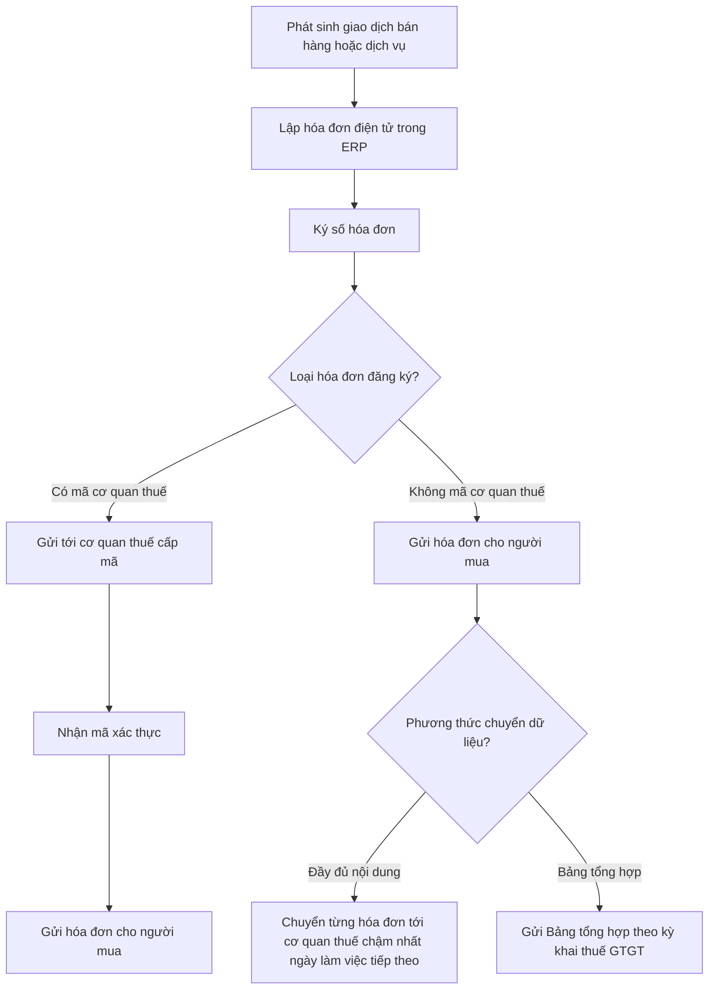
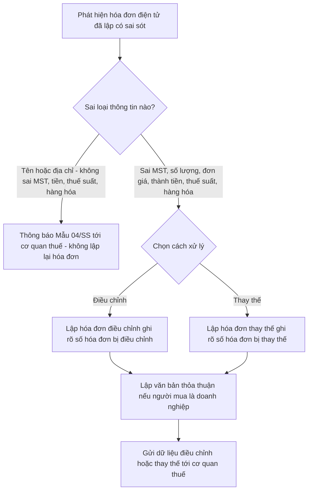

# Thuế & hóa đơn điện tử — cơ sở pháp lý Việt Nam cho thiết kế ERP

> Cập nhật đến: 2026-10-20 — quy định thay đổi thường xuyên; BA phải kiểm tra lại hiệu lực khi dùng cho dự án. **Cảnh báo riêng cho mảng này:** từ 01/7/2026 toàn bộ khung hóa đơn — chứng từ và quản lý thuế đã được thay mới (Luật Quản lý thuế 108/2025, Nghị định 254/2026, Thông tư 91/2026, Thông tư 89/2026). Nhiều bài viết trên mạng vẫn mô tả khung cũ (Nghị định 123/2020, Nghị định 70/2025, Thông tư 32/2025) — phải phân biệt rõ khi tra cứu.

## Mục lục
- [1. Bảng văn bản pháp lý](#1-bảng-văn-bản-pháp-lý)
- [2. Thuế giá trị gia tăng (VAT)](#2-thuế-giá-trị-gia-tăng-value-added-tax--vat)
- [3. Thuế thu nhập doanh nghiệp (CIT)](#3-thuế-thu-nhập-doanh-nghiệp-corporate-income-tax--cit)
- [4. Hóa đơn điện tử (e-invoice)](#4-hóa-đơn-điện-tử-e-invoice)
- [5. Chứng từ điện tử khấu trừ thuế TNCN](#5-chứng-từ-điện-tử-khấu-trừ-thuế-tncn)
- [6. Quản lý thuế & định danh người nộp thuế](#6-quản-lý-thuế--định-danh-người-nộp-thuế)
- [7. Ảnh hưởng kế toán của thuế](#7-ảnh-hưởng-kế-toán-của-thuế)
- [Tham số cấu hình hiện hành](#tham-số-cấu-hình-hiện-hành)
- [Yêu cầu hệ thống rút ra (REGREQ)](#yêu-cầu-hệ-thống-rút-ra-regreq)
- [Câu hỏi cần xác nhận với khách hàng](#câu-hỏi-cần-xác-nhận-với-khách-hàng)
- [Nguồn tham khảo](#nguồn-tham-khảo)

Phạm vi file: thuế GTGT, thuế TNDN, hóa đơn/chứng từ điện tử, quản lý thuế và định danh người nộp thuế — ở mức nền tảng (baseline) để thiết kế module thuế (TAX) và các điểm chạm với bán hàng (AR), mua hàng (AP), kế toán tổng hợp (GL), tiền mặt/ngân hàng (CB).
- Thuế thu nhập cá nhân (PIT) chi tiết và bảng lương: xem `references/regulations/vn-labor-payroll.md`.
- Hệ thống tài khoản, chế độ kế toán, báo cáo tài chính: xem `references/regulations/vn-accounting.md`.
- Quy trình nghiệp vụ thuế — hóa đơn end-to-end: xem `references/processes/tax-einvoice.md`.

---

## 1. Bảng văn bản pháp lý

| Số hiệu | Tên | Cơ quan | Ngày ban hành | Hiệu lực | Tình trạng |
|---|---|---|---|---|---|
| Luật 48/2024/QH15 | Luật Thuế giá trị gia tăng | Quốc hội | 26/11/2024 | 01/7/2025 | Còn hiệu lực; thay Luật GTGT 2008 và các luật sửa đổi [1] |
| NĐ 181/2025/NĐ-CP | Quy định chi tiết thi hành một số điều Luật Thuế GTGT | Chính phủ | 01/7/2025 | 01/7/2025 | Còn hiệu lực [2] |
| TT 69/2025/TT-BTC | Hướng dẫn Luật Thuế GTGT và NĐ 181/2025 | Bộ Tài chính | 01/7/2025 | 01/7/2025 | Còn hiệu lực [3] |
| NQ 204/2025/QH15 | Giảm thuế GTGT (10% → 8%) | Quốc hội | 2025 | 01/7/2025 – hết 31/12/2026 | Còn hiệu lực, hết hạn 31/12/2026 [4] |
| NĐ 174/2025/NĐ-CP | Quy định chi tiết việc giảm thuế GTGT theo NQ 204/2025 | Chính phủ | 2025 | 01/7/2025 – hết 31/12/2026 | Còn hiệu lực [4] |
| Luật 67/2025/QH15 | Luật Thuế thu nhập doanh nghiệp | Quốc hội | 14/6/2025 | 01/10/2025 (áp dụng từ kỳ tính thuế 2025) | Còn hiệu lực; thay Luật TNDN 2008 [5] |
| NĐ 320/2025/NĐ-CP | Quy định chi tiết thi hành Luật Thuế TNDN | Chính phủ | 15/12/2025 | 15/12/2025 (áp dụng từ kỳ tính thuế 2025) | Còn hiệu lực; thay NĐ 218/2013 [6] |
| Luật 108/2025/QH15 | Luật Quản lý thuế | Quốc hội | 10/12/2025 | 01/7/2026 (Điều 13, Điều 26 về hộ KD: từ 01/01/2026) | Còn hiệu lực; thay Luật QLT 38/2019 [7] |
| Luật 38/2019/QH14 | Luật Quản lý thuế (khung cũ) | Quốc hội | 13/6/2019 | 01/7/2020 | Hết hiệu lực 30/6/2026 (thay bởi Luật 108/2025); thuế khoán hộ KD (Điều 51) dừng áp dụng từ 01/01/2026; đã sửa bởi Luật 56/2024 [7][8] |
| NĐ 252/2026/NĐ-CP | Quy định chi tiết thi hành Luật Quản lý thuế 2025 (vai trò như NĐ 126/2020 cũ) | Chính phủ | 30/6/2026 | 01/7/2026 | Còn hiệu lực [9] — ⚠️ CHƯA XÁC MINH số hiệu qua nguồn chính thức (không nằm trong tóm tắt của người soạn); đối chiếu Công báo |
| TT 89/2026/TT-BTC | Hướng dẫn Luật QLT 2025 và NĐ 252/2026 (thông tư hợp nhất, dung lượng lớn) | Bộ Tài chính | 30/6/2026 | 01/7/2026 | Còn hiệu lực; thay TT 80/2021 và bãi bỏ nhiều TT thuế [9] |
| NĐ 254/2026/NĐ-CP | Hóa đơn điện tử, chứng từ điện tử | Chính phủ | 30/6/2026 | 01/7/2026 | **Khung hóa đơn hiện hành**; thay NĐ 123/2020, NĐ 70/2025, Điều 1 NĐ 41/2022 [10] |
| TT 91/2026/TT-BTC | Hướng dẫn NĐ 254/2026 về hóa đơn, chứng từ | Bộ Tài chính | 30/6/2026 | 01/7/2026 | **Khung hóa đơn hiện hành**; thay TT 32/2025 [11] |
| NĐ 123/2020/NĐ-CP | Hóa đơn, chứng từ (khung cũ) | Chính phủ | 19/10/2020 | 01/7/2022 | Hết hiệu lực 30/6/2026 (thay bởi NĐ 254/2026) [10][12] |
| NĐ 70/2025/NĐ-CP | Sửa đổi, bổ sung NĐ 123/2020 (khung cũ) | Chính phủ | 20/3/2025 | 01/6/2025 | Hết hiệu lực 30/6/2026 (gộp vào NĐ 254/2026) [10][12] |
| TT 32/2025/TT-BTC | Hóa đơn, chứng từ (thay TT 78/2021) | Bộ Tài chính | 31/5/2025 | 01/6/2025 | Hết hiệu lực 30/6/2026 (thay bởi TT 91/2026) [11][13] |
| TT 78/2021/TT-BTC | Hóa đơn điện tử (khung cũ) | Bộ Tài chính | 17/9/2021 | 01/7/2022 | Đã hết hiệu lực (TT 32/2025 → TT 91/2026) [13] |
| TT 86/2024/TT-BTC | Đăng ký thuế; dùng số định danh cá nhân thay mã số thuế | Bộ Tài chính | 2024 | 06/02/2025 | Còn hiệu lực (phần đăng ký thuế); kiểm tra tương tác với TT 89/2026 ⚠️ [14] |
| TT 99/2025/TT-BTC | Chế độ kế toán doanh nghiệp | Bộ Tài chính | 27/10/2025 | 01/01/2026 | Còn hiệu lực; thay TT 200/2014 (xem `vn-accounting.md`) [15] |
| TT 133/2016/TT-BTC | Chế độ kế toán doanh nghiệp nhỏ và vừa (SME) | Bộ Tài chính | 26/8/2016 | 01/01/2017 | Còn hiệu lực (SME) [16] |

> **Nguyên tắc tra cứu cho BA:** mỗi khi trích dẫn số điều/khoản cụ thể, đối chiếu bản gốc trên `congbao.chinhphu.vn` / `vanban.chinhphu.vn`. Các điều/khoản ghi trong file này đã được rà soát ở mức nội dung; chỗ chưa đối chiếu được bản gốc được đánh dấu ⚠️ CHƯA XÁC MINH.

---

## 2. Thuế giá trị gia tăng (Value-Added Tax – VAT)

### 2.1. Phân loại đối tượng thuế — nền tảng thiết kế mã thuế (tax code)

Đây là phần **quan trọng nhất cho ERP**: mỗi dòng hàng, mỗi hóa đơn phải gắn một mã thuế GTGT xác định (a) có thuế suất không, (b) thuế đầu vào có được khấu trừ không, (c) có lên tờ khai không. Bốn nhóm:

| Nhóm | Thuế đầu ra | Thuế đầu vào tương ứng | Lên tờ khai? | Ví dụ ERP cần cấu hình |
|---|---|---|---|---|
| Chịu thuế (taxable) | 0% / 5% / 8% / 10% | Được khấu trừ | Có | Phần lớn hàng hóa, dịch vụ |
| Thuế suất 0% (zero-rated) | 0% | Được khấu trừ + được hoàn | Có | Hàng xuất khẩu, dịch vụ xuất khẩu, vận tải quốc tế [1] |
| Không chịu thuế (exempt / non-taxable) | Không có | **KHÔNG** được khấu trừ (tính vào chi phí/giá vốn) | Có (chỉ tiêu riêng) | Dịch vụ tài chính — tín dụng, y tế, giáo dục, chuyển quyền sử dụng đất, sản phẩm nông nghiệp chưa chế biến ở khâu nhất định (Điều 5 Luật 48/2024) [1] |
| Không phải kê khai, tính nộp thuế (out-of-scope) | Không có | **Vẫn được** khấu trừ | Không (hoặc ghi nhận riêng) | Tiền bồi thường, tiền thưởng/hỗ trợ bằng tiền, góp vốn bằng tài sản, thu hộ — chi hộ, bán tài sản của tổ chức/cá nhân không kinh doanh (NĐ 181/2025) [2] |

- **Căn cứ:** Điều 5 Luật 48/2024 (không chịu thuế); Điều 9 (thuế suất 0%); Điều 12 (thuế suất); NĐ 181/2025 và TT 69/2025 (trường hợp không phải kê khai tính nộp) [1][2][3].
- **Khác biệt nghiệp vụ then chốt:** "không chịu thuế" vs "không phải kê khai" trông giống nhau (đều không có thuế đầu ra) nhưng ngược nhau về **khấu trừ đầu vào**. Sai nhóm → sai số thuế phải nộp → sai báo cáo. ERP phải tách bằng hai mã thuế khác nhau.
- **Yêu cầu thiết kế:** master data mã thuế GTGT (MD-TAXCODE) với các thuộc tính: `thuế_suất`, `được_khấu_trừ (Y/N)`, `nhóm_kê_khai`, `tài_khoản_thuế_đầu_ra`, `tài_khoản_thuế_đầu_vào`, `ngày_hiệu_lực_từ`, `ngày_hiệu_lực_đến`.

### 2.2. Thuế suất và chính sách giảm 8%

- **Ba mức luật định:** 0% (xuất khẩu, vận tải quốc tế…), 5% (nhóm thiết yếu: nước sạch, thiết bị/dụng cụ y tế, sản phẩm nông nghiệp ở khâu nhất định…), 10% (mức phổ thông). Căn cứ Điều 9, Điều 12 Luật 48/2024 [1].
- **Giảm 8% có thời hạn:** nhóm hàng hóa, dịch vụ đang chịu 10% được giảm còn **8%**, áp dụng **01/7/2025 đến hết 31/12/2026** theo NQ 204/2025/QH15 và NĐ 174/2025/NĐ-CP [4].
  - **Nhóm KHÔNG được giảm (giữ 10%):** viễn thông; hoạt động tài chính — ngân hàng — chứng khoán — bảo hiểm; kinh doanh bất động sản; sản phẩm kim loại, sản phẩm khai khoáng (trừ than); hàng hóa chịu thuế tiêu thụ đặc biệt (trừ xăng). Danh mục chi tiết tại các Phụ lục của NĐ 174/2025 [4]. ⚠️ CHƯA XÁC MINH danh mục: NQ 204/2025 được nhiều nguồn mô tả là **mở rộng phạm vi giảm** (thu hẹp nhóm loại trừ) so với các nghị định giảm thuế 2022–2024 (NĐ 15/2022, NĐ 44/2023, NĐ 72/2024…) — phải đối chiếu trực tiếp Phụ lục NĐ 174/2025 trước khi cấu hình danh mục loại trừ.
  - **Hộ/cá nhân kinh doanh tính thuế theo tỷ lệ %:** được giảm 20% mức tỷ lệ % để tính thuế GTGT (không ghi "8%" như doanh nghiệp khấu trừ) [4].
- **⚠️ Theo dõi chính sách:** chính sách 8% hết hạn 31/12/2026. Phải thiết kế thuế suất **có ngày hiệu lực** để tự động quay về 10% từ 01/01/2027 (trừ khi có nghị quyết gia hạn mới). Không hard-code 8%.
- **Yêu cầu thiết kế:** bảng thuế suất theo ngày hiệu lực + cờ loại trừ theo nhóm hàng (ví dụ theo nhóm/ngành hàng hoặc mã HS). Hệ thống phải xử lý đúng cả hóa đơn điều chỉnh bắc cầu giai đoạn (ví dụ điều chỉnh hóa đơn kỳ 8% sau 2026).

### 2.3. Phương pháp tính thuế

| Phương pháp | Áp dụng cho | Công thức | Ghi chú ERP |
|---|---|---|---|
| Khấu trừ (credit method) | Doanh nghiệp có đầy đủ sổ sách, hóa đơn | Thuế phải nộp = Thuế đầu ra − Thuế đầu vào được khấu trừ | Mặc định cho DN; cần theo dõi 133 và 3331 |
| Trực tiếp trên GTGT/doanh thu (direct method) | Hộ kinh doanh, một số ngành đặc thù, DN nhỏ không đủ điều kiện | Thuế = tỷ lệ % × doanh thu (hoặc GTGT × 10% với vàng bạc đá quý) | Cấu hình tỷ lệ % theo ngành |

Căn cứ Điều 10, Điều 11 Luật 48/2024 [1].

### 2.4. Điều kiện khấu trừ thuế GTGT đầu vào (quan trọng với AP)

Để được khấu trừ thuế đầu vào, cần đồng thời:
1. Có **hóa đơn GTGT hợp pháp** (hoặc chứng từ nộp thuế GTGT khâu nhập khẩu).
2. Có **chứng từ thanh toán không dùng tiền mặt (non-cash payment)** đối với hóa đơn **từ 5.000.000 đồng trở lên (đã bao gồm thuế GTGT)**.

- **Căn cứ:** Điều 14 Luật 48/2024; Điều 26 NĐ 181/2025 [1][2][20].
- **Thay đổi lớn so với luật cũ:** ngưỡng bắt buộc thanh toán không tiền mặt **giảm từ 20 triệu xuống 5 triệu đồng** từ 01/7/2025 [20].
- **Quy tắc nghiệp vụ (business rules) ERP phải cài:**
  - BR: hóa đơn đầu vào ≥ 5.000.000đ (gồm thuế) mà thanh toán tiền mặt → **không được khấu trừ**; hệ thống phải chặn/cảnh báo hoặc tự động chuyển phần thuế này vào chi phí.
  - BR: nhiều lần mua trong **cùng một ngày** của **cùng một người bán** (văn bản ghi "cùng một người nộp thuế"), mỗi lần dưới 5 triệu nhưng **tổng ≥ 5 triệu** → vẫn phải có chứng từ không dùng tiền mặt (chống "chia nhỏ hóa đơn") [20].
  - BR: tiền phải chuyển **từ tài khoản ngân hàng của người mua sang tài khoản người bán**; nộp tiền mặt vào tài khoản người bán không được coi là thanh toán không dùng tiền mặt. Khái niệm "thanh toán không dùng tiền mặt" áp dụng theo NĐ 52/2024/NĐ-CP [20].
  - BR (mua trả chậm/trả góp): được kê khai khấu trừ khi **chưa đến hạn thanh toán**; nếu đến hạn mà **chưa có** chứng từ không dùng tiền mặt → phải **điều chỉnh giảm** thuế đã khấu trừ [20].
- **Yêu cầu dữ liệu:** trên hóa đơn mua (AP invoice) cần trường `tổng_tiền_gồm_thuế`, `phương_thức_thanh_toán`, `trạng_thái_chứng_từ_không_tiền_mặt`, `ngày_đến_hạn`, liên kết tới chứng từ chi (CB). Cần job/báo cáo rà soát hóa đơn ≥ 5 triệu chưa có chứng từ thanh toán khi đến hạn.

### 2.5. Hoàn thuế GTGT (VAT refund)

- Trường hợp hoàn phổ biến cho ERP: xuất khẩu (thuế đầu vào lũy kế chưa khấu trừ hết đạt ngưỡng), dự án đầu tư, chấm dứt hoạt động. Căn cứ Luật 48/2024 và TT 69/2025 [1][3].
- **Yêu cầu dữ liệu:** phải tách và theo dõi riêng thuế đầu vào của **hàng/dịch vụ xuất khẩu** và của **dự án đầu tư** để lập hồ sơ hoàn; cần đối chiếu với tờ khai và bảng kê hóa đơn.

### 2.6. Kê khai thuế GTGT (periods & forms)

- **Kỳ kê khai:** theo **tháng** nếu tổng doanh thu bán hàng hóa, cung cấp dịch vụ năm trước liền kề **trên 50 tỷ đồng**; theo **quý** nếu **từ 50 tỷ trở xuống** hoặc doanh nghiệp mới thành lập [23].
- **Mẫu tờ khai:** tờ khai thuế GTGT mẫu **01/GTGT** (phương pháp khấu trừ). Trước 01/7/2026 theo TT 80/2021; từ 01/7/2026 theo **TT 89/2026** (thay TT 80/2021). Giai đoạn chuyển tiếp cho phép tiếp tục dùng mẫu 01/GTGT theo hướng dẫn chuyển tiếp của Bộ Tài chính [9][23]. ⚠️ Mã số các chỉ tiêu trên mẫu mới phải lấy theo phụ lục TT 89/2026 — CHƯA ĐỐI CHIẾU chi tiết bản gốc.
- **Yêu cầu thiết kế:** tham số `kỳ_kê_khai` (THÁNG/QUÝ) xác định theo doanh thu năm trước, cho phép chọn ổn định theo năm dương lịch; ERP kết xuất bảng kê hóa đơn đầu ra/đầu vào và số liệu đẩy sang phần mềm/HTKK hoặc dịch vụ kê khai.

---

## 3. Thuế thu nhập doanh nghiệp (Corporate Income Tax – CIT)

### 3.1. Thuế suất

| Thuế suất | Áp dụng | Căn cứ |
|---|---|---|
| 20% | Mức phổ thông | Luật 67/2025, NĐ 320/2025 [5][6] |
| 17% | Doanh nghiệp có tổng doanh thu năm **từ 3 tỷ đến 50 tỷ đồng** | Luật 67/2025 [5] |
| 15% | Doanh nghiệp có tổng doanh thu năm **dưới 3 tỷ đồng** | Luật 67/2025 [5] |
| Ưu đãi khác (10%, 17%, miễn/giảm có thời hạn) | Theo địa bàn/lĩnh vực ưu đãi | Luật 67/2025, NĐ 320/2025 [5][6] |

- **Hiệu lực:** Luật 67/2025 áp dụng **từ kỳ tính thuế TNDN năm 2025** [5][6].
- **⚠️ CHƯA XÁC MINH chi tiết:** điều kiện xác định mức 15%/17% theo doanh thu (cách tính ngưỡng, loại trừ công ty liên kết) cần đối chiếu Điều về thuế suất trong Luật 67/2025 và NĐ 320/2025.

### 3.2. Điều kiện chi phí được trừ (ảnh hưởng trực tiếp dữ liệu ERP)

Chi phí được trừ khi tính thu nhập chịu thuế phải đồng thời:
1. Thực tế phát sinh, liên quan hoạt động sản xuất kinh doanh;
2. Có **đủ hóa đơn, chứng từ hợp pháp**;
3. Có **chứng từ thanh toán không dùng tiền mặt** với hóa đơn mua từng lần có giá trị **từ 5.000.000 đồng trở lên (đã gồm thuế)** — thống nhất với ngưỡng khấu trừ GTGT đầu vào.

- **Căn cứ:** Điều 9 Luật 67/2025; NĐ 320/2025 [5][6]. Điểm mới: bổ sung các khoản được trừ dù chưa trực tiếp tạo doanh thu như chi nghiên cứu khoa học, phát triển công nghệ, chuyển đổi số, giảm phát thải [5].
- **Hệ quả ERP:** cùng một ngưỡng 5 triệu + chứng từ không dùng tiền mặt vừa chi phối khấu trừ GTGT (mục 2.4) vừa chi phối chi phí được trừ TNDN. ERP nên gắn cờ "đủ điều kiện khấu trừ/được trừ" ở cấp hóa đơn mua và dùng lại cho cả hai sắc thuế.
- **Yêu cầu dữ liệu:** phân loại chi phí theo "được trừ / không được trừ" (deductible flag) ở cấp bút toán/hóa đơn; báo cáo tổng hợp chi phí không được trừ phục vụ quyết toán.

### 3.3. Tạm nộp và quyết toán

- Doanh nghiệp **tạm nộp theo quý** và **quyết toán theo năm**; ERP cần hỗ trợ tính thu nhập tính thuế từ số liệu kế toán cộng/trừ các khoản điều chỉnh (chênh lệch kế toán — thuế).
- **Yêu cầu thiết kế:** bảng ánh xạ khoản mục chi phí → điều chỉnh quyết toán TNDN; theo dõi lỗ được chuyển (tối đa 5 năm) để tự động trừ vào thu nhập các năm sau.

---

## 4. Hóa đơn điện tử (e-invoice)

> **Khung hiện hành (từ 01/7/2026): NĐ 254/2026/NĐ-CP + TT 91/2026/TT-BTC** (hướng dẫn Luật Quản lý thuế 108/2025) [10][11]. Khung này **kế thừa phần lớn** cơ chế do NĐ 70/2025 (01/6/2025) đặt ra. Dưới đây nêu rõ căn cứ hiện hành; chỗ nào chưa đối chiếu được số điều trong NĐ 254/2026 / TT 91/2026 thì ghi căn cứ nền (NĐ 70/2025) kèm ⚠️.

### 4.1. Các loại hóa đơn (invoice types)

- **Hóa đơn giá trị gia tăng (VAT invoice):** cho tổ chức khai thuế theo phương pháp khấu trừ.
- **Hóa đơn bán hàng (sales invoice):** cho tổ chức, cá nhân khai theo phương pháp trực tiếp, trong khu phi thuế quan.
- **Hóa đơn điện tử khởi tạo từ máy tính tiền (cash-register e-invoice):** bán lẻ, ăn uống, dịch vụ trực tiếp tới người tiêu dùng (xem 4.7).
- **Hóa đơn thương mại điện tử (electronic commercial invoice):** cho xuất khẩu, khi đáp ứng yêu cầu truyền dữ liệu.
- **Các chứng từ khác:** tem, vé, thẻ điện tử; phiếu xuất kho kiêm vận chuyển nội bộ; phiếu xuất kho hàng gửi bán đại lý (điện tử).

Căn cứ NĐ 254/2026 (nền NĐ 123/2020 đã sửa bởi NĐ 70/2025) [10][12].

### 4.2. Ký hiệu mẫu số và ký hiệu hóa đơn (template number & invoice symbol)

Mã định danh một hóa đơn gồm **ký hiệu mẫu số (1 ký tự)** + **ký hiệu hóa đơn (6 ký tự)** + **số hóa đơn**.

- **Ký hiệu mẫu số (1 chữ số):** loại hóa đơn, ví dụ `1` = hóa đơn GTGT, `2` = hóa đơn bán hàng, `5` = các loại khác (tem/vé/thẻ), v.v.
- **Ký hiệu hóa đơn (6 ký tự):** đọc theo thứ tự:
  1. Ký tự 1 — **C** = hóa đơn **có mã** của cơ quan thuế (coded); **K** = **không mã** (uncoded).
  2. Ký tự 2–3 — **hai chữ số** của năm lập (ví dụ `25` = 2025, `26` = 2026).
  3. Ký tự 4 — hình thức: **T** = doanh nghiệp/tổ chức/hộ, cá nhân kinh doanh đăng ký sử dụng; **D** = loại đặc thù; **L** = cơ quan thuế cấp theo từng lần phát sinh; **M** = khởi tạo từ máy tính tiền; (TT 91/2026 bổ sung ký tự thể hiện loại hóa đơn điện tử đang dùng) ⚠️.
  4. Ký tự 5–6 — do người bán tự xác định để quản lý nội bộ.
- **Ví dụ:** `1C25TAA` = hóa đơn GTGT, **có mã** cơ quan thuế, lập năm 2025, do doanh nghiệp đăng ký sử dụng. `1K25TAA` = tương tự nhưng **không mã**.
- **Căn cứ:** TT 91/2026 (nền TT 32/2025, TT 78/2021) [11][13][15].
- **Yêu cầu thiết kế:** ERP phải cho cấu hình dải ký hiệu theo từng mẫu số và sinh số hóa đơn liên tục, không trùng, không ngắt quãng theo từng ký hiệu; hỗ trợ nhiều ký hiệu song song (ví dụ cho nhiều chi nhánh/điểm bán).

### 4.3. Nội dung bắt buộc của hóa đơn (mandatory content)

Tối thiểu: tên hóa đơn, ký hiệu mẫu số, ký hiệu hóa đơn, số hóa đơn; tên — địa chỉ — mã số thuế người bán; tên — địa chỉ — mã số thuế người mua (nếu có); tên hàng hóa/dịch vụ, đơn vị tính, số lượng, đơn giá, thành tiền chưa thuế, thuế suất, tiền thuế GTGT, tổng tiền thanh toán; chữ ký số người bán; thời điểm lập hóa đơn; mã của cơ quan thuế (với hóa đơn có mã).

- **Điểm mới NĐ 254/2026:** bắt buộc thể hiện **tên, mã và địa chỉ địa điểm kinh doanh**; với hóa đơn lập theo **ủy nhiệm**, phải thể hiện đồng thời thông tin (tên, địa chỉ, MST) của **cả bên ủy nhiệm và bên nhận ủy nhiệm** [10].
- **Căn cứ:** Điều 10 NĐ 254/2026 (nền Điều 10 NĐ 123/2020) [10][12].
- **Yêu cầu dữ liệu:** master data người bán/người mua phải đủ trường MST, địa chỉ, địa điểm kinh doanh; hỗ trợ trường hợp người mua không lấy hóa đơn (bán lẻ) và trường hợp ủy nhiệm lập hóa đơn.

### 4.4. Thời điểm lập hóa đơn theo loại giao dịch (timing of issuance)

| Loại giao dịch | Thời điểm lập hóa đơn | Ghi chú thiết kế |
|---|---|---|
| Bán hàng hóa (goods) | Thời điểm **chuyển giao quyền sở hữu/sử dụng** hàng cho người mua, không phân biệt đã thu tiền hay chưa | Gắn với sự kiện giao hàng (delivery/goods issue) trong INV/SAL |
| Cung cấp dịch vụ (services) | Thời điểm **hoàn thành** việc cung cấp dịch vụ; nếu **thu tiền trước/trong khi** cung cấp thì lập tại thời điểm thu tiền | Tiền **đặt cọc/tạm ứng** bảo đảm hợp đồng dịch vụ **chưa** phải lập hóa đơn [12] |
| Xây dựng, lắp đặt (construction/installation) | Thời điểm **nghiệm thu, bàn giao** công trình/hạng mục/khối lượng, không phân biệt đã thu tiền hay chưa | Gắn với biên bản nghiệm thu từng giai đoạn |
| Xuất khẩu (export) | Người bán tự xác định, **chậm nhất là ngày làm việc tiếp theo** kể từ ngày hàng hóa **thông quan** | Dùng hóa đơn thương mại điện tử/GTGT/bán hàng điện tử [12] |
| Cung cấp số lượng lớn, phát sinh thường xuyên (điện, nước, viễn thông, dịch vụ CNTT, vận tải, ...) | Chậm nhất **7 ngày** kể từ ngày ghi chỉ số hoặc theo kỳ đã thỏa thuận | Lập hóa đơn theo kỳ, kèm bảng kê |
| Bán hàng cần đối soát số liệu | Được lập **sau khi hoàn thành đối soát**, chậm nhất ngày cuối tháng phát sinh (theo TT 91/2026) | Hỗ trợ lập hóa đơn trễ có kiểm soát ⚠️ |

- **Căn cứ:** Điều 9 NĐ 254/2026 (nền Điều 9 NĐ 123/2020 sửa bởi NĐ 70/2025) [10][12].
- **Quy tắc then chốt:** **thời điểm ký số** và **thời điểm gửi dữ liệu** cho cơ quan thuế phải **chậm nhất là ngày làm việc tiếp theo** kể từ thời điểm lập hóa đơn [12].
- **Yêu cầu thiết kế:** ERP phải suy ra thời điểm lập hóa đơn từ **sự kiện nghiệp vụ** tương ứng (giao hàng, nghiệm thu, thông quan, thu tiền), không để người dùng tự nhập tùy ý; cảnh báo khi lập/ký/gửi trễ.

### 4.5. Hóa đơn có mã / không mã và chuyển dữ liệu (data transmission)

- **Hóa đơn có mã (coded):** gửi tới cơ quan thuế để **cấp mã** trước khi gửi người mua. Áp dụng cho phần lớn người nộp thuế không thuộc nhóm đủ điều kiện dùng hóa đơn không mã.
- **Hóa đơn không mã (uncoded):** doanh nghiệp đủ điều kiện tự phát hành rồi **chuyển dữ liệu** tới cơ quan thuế theo một trong hai cách:
  - **Chuyển đầy đủ nội dung từng hóa đơn** — mặc định cho phần lớn ngành [19].
  - **Chuyển theo Bảng tổng hợp dữ liệu hóa đơn điện tử** (mẫu tổng hợp theo kỳ) — chỉ cho bưu chính viễn thông, bảo hiểm, tài chính — ngân hàng, vận tải hàng không, chứng khoán; và bán điện, nước sạch (khi có mã/MST khách hàng) [19].
- **Kênh gửi:** trực tiếp qua Cổng thông tin điện tử của cơ quan thuế **hoặc** qua **tổ chức cung cấp dịch vụ hóa đơn điện tử (e-invoice service provider)** [19].
- **Căn cứ:** NĐ 254/2026, TT 91/2026 (nền NĐ 123/2020) [10][11][19].
- **Yêu cầu thiết kế:** ERP cần adapter tích hợp cổng thuế/nhà cung cấp dịch vụ; quản lý trạng thái gửi/cấp mã/lỗi; retry khi lỗi truyền; lưu phản hồi (mã CQT, thông báo tiếp nhận).

### 4.6. Xử lý hóa đơn sai sót (error handling: adjust / replace)

- **Bỏ cơ chế "hủy" hóa đơn sai:** từ NĐ 70/2025 (01/6/2025) và tiếp tục trong NĐ 254/2026/TT 91/2026, hóa đơn đã lập có sai sót **không còn được hủy** mà xử lý bằng **điều chỉnh (adjust)** hoặc **thay thế (replace)** [12][17].
- **Sai sót nhỏ** (tên, địa chỉ; không sai MST, số tiền, thuế suất, hàng hóa): chỉ **thông báo Mẫu 04/SS-HĐĐT** tới cơ quan thuế, **không lập lại** hóa đơn [17].
- **Sai sót trọng yếu** (MST, số lượng, đơn giá, thành tiền, thuế suất, tên hàng): lập **hóa đơn điều chỉnh** hoặc **hóa đơn thay thế**, ghi rõ số hóa đơn bị điều chỉnh/thay thế. Người bán và người mua là **doanh nghiệp** phải lập **văn bản thỏa thuận** ghi rõ nội dung sai; khách hàng cá nhân thì chỉ cần thông báo [17].
- **Trường hợp đặc thù:** hóa đơn từ **máy tính tiền** hoặc tài sản phải đăng ký quyền sở hữu — **chỉ được lập hóa đơn thay thế** (không điều chỉnh). Hóa đơn đã đưa vào **Bảng tổng hợp** thì điều chỉnh trực tiếp trên bảng tổng hợp kỳ sau, không gửi Mẫu 04/SS [17][19].
- **Thời hạn gửi Mẫu 04/SS:** chậm nhất ngày cuối cùng của kỳ kê khai GTGT phát sinh hóa đơn điều chỉnh/thay thế [17].
- **Căn cứ:** Điều 10 TT 91/2026 (nền Điều 19 NĐ 123/2020 sửa bởi NĐ 70/2025); Mẫu 04/SS-HĐĐT (Phụ lục III TT 91/2026); Mẫu 04/SS-CTĐT cho chứng từ điện tử [11][17]. Cơ quan thuế phản hồi bằng **Mẫu 01/TB-SSĐT** (thông báo tiếp nhận / kết quả xử lý hóa đơn có sai sót) [17].
- **Yêu cầu thiết kế:** quản lý **quan hệ cha — con** giữa hóa đơn gốc ↔ hóa đơn điều chỉnh/thay thế; chặn hủy; sinh và lưu văn bản thỏa thuận; tự sinh Mẫu 04/SS; phản ánh đúng bút toán đảo/điều chỉnh (REVERSED "Đã đảo") sang GL, AR/AP.

### 4.7. Hóa đơn điện tử khởi tạo từ máy tính tiền (cash-register e-invoice)

- **Đối tượng bắt buộc:** hộ kinh doanh, cá nhân kinh doanh có **doanh thu hằng năm từ 1 tỷ đồng trở lên** thuộc các ngành bán lẻ, ăn uống, nhà hàng, khách sạn, vận tải hành khách, dịch vụ giải trí… phải dùng hóa đơn điện tử **khởi tạo từ máy tính tiền có kết nối chuyển dữ liệu** với cơ quan thuế, áp dụng **từ 01/6/2025** [18].
- **Đặc điểm:** không bắt buộc chữ ký số trên loại hóa đơn này; dữ liệu chuyển theo bảng tổng hợp cuối ngày.
- **Căn cứ:** Điều 11 NĐ 254/2026 (nền Điều 11 NĐ 123/2020 sửa bởi NĐ 70/2025); khoản 1 Điều 51 Luật QLT [10][12][18].
- **Liên quan ERP:** nếu khách hàng có chuỗi bán lẻ/POS, ERP phải tích hợp dữ liệu POS → hóa đơn máy tính tiền và đối soát doanh thu.

### 4.8. Tích hợp nhà cung cấp dịch vụ hóa đơn điện tử — hệ quả hệ thống

- Phần lớn doanh nghiệp VN phát hành hóa đơn qua **nhà cung cấp dịch vụ hóa đơn điện tử** (VNPT, Viettel, MISA meInvoice, FPT, EasyInvoice, BKAV, M-Invoice…). ERP thường **không tự kết nối thẳng** cổng thuế mà qua API của nhà cung cấp.
- **Yêu cầu tích hợp (REGREQ-13):** chuẩn hóa dữ liệu hóa đơn đầu ra; hàng đợi gửi + cơ chế retry/idempotency (tránh phát hành trùng); đồng bộ trạng thái (đã ký, đã cấp mã, đã gửi người mua, lỗi); lưu bản thể hiện (PDF/XML) và mã tra cứu; đối chiếu số hóa đơn giữa ERP và nhà cung cấp.

---

## 5. Chứng từ điện tử khấu trừ thuế TNCN

- Từ 01/6/2025, tổ chức chi trả thu nhập bắt buộc dùng **chứng từ khấu trừ thuế thu nhập cá nhân điện tử (electronic PIT withholding voucher)**; chứng từ giấy/khuôn dạng cũ hết giá trị (trừ chứng từ đã cấp trước thời điểm đó). Đăng ký sử dụng qua Cổng thông tin điện tử cơ quan thuế [21].
- Khung hiện hành: **NĐ 254/2026 + TT 91/2026** (nền NĐ 70/2025). Mẫu chứng từ: tham chiếu phụ lục văn bản hiện hành ⚠️ (một số nguồn nêu Mẫu 03/TNCN theo NĐ 70/2025 — CHƯA ĐỐI CHIẾU bản gốc) [21].
- Chi tiết chính sách thuế TNCN, bảng lương, quyết toán, người phụ thuộc: **xem `references/regulations/vn-labor-payroll.md`** (file này chỉ nêu phần chứng từ liên quan hóa đơn — chứng từ điện tử).

---

## 6. Quản lý thuế & định danh người nộp thuế

- **Khung hiện hành:** Luật Quản lý thuế **108/2025/QH15** (hiệu lực chung 01/7/2026; Điều 13 và Điều 26 về hộ kinh doanh từ 01/01/2026), thay Luật 38/2019/QH14 (hết hiệu lực 30/6/2026) [7].
- **Số định danh cá nhân thay mã số thuế (personal ID number vs tax code):** từ 01/7/2025, cá nhân, hộ gia đình, hộ kinh doanh dùng **số định danh cá nhân (12 số trên CCCD)** thay cho mã số thuế do cơ quan thuế cấp (căn cứ khoản 7 Điều 35 Luật QLT 38/2019 và TT 86/2024/TT-BTC) [14][22].
  - Nếu thông tin đăng ký thuế **khớp** Cơ sở dữ liệu quốc gia về dân cư → dùng số định danh thay MST ngay.
  - Nếu **không khớp** → MST chuyển trạng thái "chờ cập nhật thông tin số định danh".
  - Hộ kinh doanh dùng số định danh của **người đại diện** làm MST để kê khai, nộp thuế [22].
- **Hộ kinh doanh — bỏ thuế khoán:** Luật 108/2025 (Điều 13, hiệu lực 01/01/2026) chuyển hộ kinh doanh sang cơ chế **kê khai** (bỏ dần thuế khoán). ⚠️ CHƯA ĐỐI CHIẾU chi tiết ngưỡng/lộ trình — kiểm tra bản gốc; nếu dự án phục vụ hộ KD cần làm rõ với khách hàng.
- **Yêu cầu dữ liệu:** master data đối tác (MD-PARTNER) phải chứa **cả MST tổ chức và số định danh cá nhân**, cờ loại người nộp thuế (tổ chức/hộ/cá nhân), và cờ "đã hợp nhất theo số định danh". Khi in hóa đơn/kê khai cho cá nhân/hộ, dùng số định danh thay MST nếu áp dụng.

---

## 7. Ảnh hưởng kế toán của thuế

> **Chế độ kế toán đang có hiệu lực (2026-10-20): Thông tư 99/2025/TT-BTC** (hiệu lực 01/01/2026, thay Thông tư 200/2014/TT-BTC). Doanh nghiệp nhỏ và vừa vẫn áp dụng **Thông tư 133/2016/TT-BTC** [15][16]. TT 99/2025 **tái cấu trúc hệ thống tài khoản** nhưng **giữ** các tài khoản thuế cốt lõi dưới đây. Hệ thống tài khoản đầy đủ và khác biệt so với TT 200: **xem `references/regulations/vn-accounting.md`** (nguồn chuẩn, không lặp lại ở đây).

Tài khoản thuế cốt lõi theo TT 99/2025 [15]:
- **133** Thuế GTGT được khấu trừ — 1331 (hàng hóa, dịch vụ), 1332 (tài sản cố định).
- **3331** Thuế GTGT phải nộp — 33311 (GTGT đầu ra), 33312 (GTGT hàng nhập khẩu).
- **3334** Thuế thu nhập doanh nghiệp.
- **821** Chi phí thuế TNDN — 8211/82111 (hiện hành), **82112** (thuế bổ sung theo thuế tối thiểu toàn cầu). 8212 (hoãn lại).

Bút toán tiêu biểu (dùng tài khoản của chế độ đang hiệu lực — TT 99/2025):

| Nghiệp vụ | Nợ | Có | Ghi chú |
|---|---|---|---|
| Bán hàng/dịch vụ, ghi thuế GTGT đầu ra | 111/112/131 | 511; 33311 | Doanh thu + thuế đầu ra |
| Mua hàng/dịch vụ, thuế GTGT đầu vào **được khấu trừ** | 152/156/211/6xx; 1331 hoặc 1332 | 111/112/331 | Tách thuế vào 133 |
| Thuế GTGT đầu vào **không được khấu trừ** (hàng không chịu thuế / vi phạm ngưỡng 5 triệu) | 152/156/6xx (tính vào giá/chi phí) | 111/112/331 | Không qua 133 |
| Kết chuyển khấu trừ GTGT cuối kỳ | 33311 | 1331/1332 | Phần còn lại ở 33311 là số phải nộp |
| Nộp thuế GTGT vào NSNN | 33311 | 111/112 | |
| Chi phí thuế TNDN hiện hành | 82111 | 3334 | Theo số tạm nộp/quyết toán |
| Nộp thuế TNDN | 3334 | 111/112 | |
| Kết chuyển chi phí thuế TNDN xác định KQKD | 911 | 8211 | |
| Hóa đơn bán hàng bị điều chỉnh giảm | 511; 33311 | 131 | Đối ứng với hóa đơn điều chỉnh (REVERSED/điều chỉnh) |

Số hiệu tài khoản cấp 2/cấp 3 (1331, 1332, 33311, 33312, 82111, 82112, 8212) đã đối chiếu danh mục tài khoản TT 99/2025 [15]; hệ thống tài khoản đầy đủ và khác biệt so với TT 200 lấy theo `vn-accounting.md` / Phụ lục II TT 99/2025 — file này chỉ nêu các tài khoản cốt lõi để minh họa ảnh hưởng thuế.

---

## Tham số cấu hình hiện hành

> Nguyên tắc: **mọi tỷ lệ/ngưỡng/mức là tham số có ngày hiệu lực (effective-dated parameter), không hard-code.** Mã tham số ví dụ theo quy ước PRM-TAX-xxx.

| Tham số | Giá trị | Hiệu lực từ | Căn cứ |
|---|---|---|---|
| Thuế suất GTGT phổ thông | 10% | 01/7/2025 | Luật 48/2024 Đ9/Đ12 [1] |
| Thuế suất GTGT ưu đãi | 5% | 01/7/2025 | Luật 48/2024 Đ9 [1] |
| Thuế suất GTGT xuất khẩu | 0% | 01/7/2025 | Luật 48/2024 Đ9 [1] |
| Thuế suất GTGT giảm (nhóm 10% đủ điều kiện) | 8% | 01/7/2025 – hết 31/12/2026 | NQ 204/2025, NĐ 174/2025 [4] |
| Ngưỡng bắt buộc thanh toán không dùng tiền mặt (khấu trừ GTGT đầu vào & chi phí TNDN) | 5.000.000đ (đã gồm thuế) | 01/7/2025 | Luật 48/2024 Đ14; NĐ 181/2025 Đ26; Luật 67/2025 Đ9 [1][2][5][20] |
| Ngưỡng doanh thu khai thuế GTGT theo tháng (trên mức này) / quý (từ mức này trở xuống) | 50.000.000.000đ/năm | — | TT 89/2026 (nền TT 80/2021) [9][23] |
| Thuế suất TNDN phổ thông | 20% | Kỳ tính thuế 2025 | Luật 67/2025 [5] |
| Thuế suất TNDN — doanh thu dưới 3 tỷ | 15% | Kỳ tính thuế 2025 | Luật 67/2025 [5] |
| Thuế suất TNDN — doanh thu 3 đến 50 tỷ | 17% | Kỳ tính thuế 2025 | Luật 67/2025 [5] |
| Ngưỡng hộ KD bắt buộc hóa đơn điện tử máy tính tiền | 1.000.000.000đ/năm | 01/6/2025 | NĐ 70/2025 → NĐ 254/2026; Đ51 Luật QLT [10][18] |
| Thời hạn ký số & gửi dữ liệu hóa đơn tới cơ quan thuế | Chậm nhất ngày làm việc tiếp theo | 01/6/2025 | NĐ 70/2025 → NĐ 254/2026 [12] |
| Số năm được chuyển lỗ TNDN | Tối đa 5 năm | Kỳ tính thuế 2025 | Luật 67/2025 ⚠️ đối chiếu điều khoản [5] |

---

## Yêu cầu hệ thống rút ra (REGREQ)

- **REGREQ-01** — Master data **mã thuế GTGT** (MD-TAXCODE) có ngày hiệu lực, cờ `được_khấu_trừ`, nhóm kê khai (chịu thuế / 0% / không chịu thuế / không phải kê khai), tài khoản thuế đầu ra — đầu vào. *Căn cứ:* mục 2.1 [1][2].
- **REGREQ-02** — Thuế suất GTGT là **tham số effective-dated**; hỗ trợ mức 8% đến 31/12/2026 và tự quay về 10% từ 01/01/2027; hỗ trợ danh mục loại trừ giảm 8% theo nhóm hàng. *Căn cứ:* mục 2.2 [4].
- **REGREQ-03** — Chặn/cảnh báo khấu trừ GTGT đầu vào với hóa đơn ≥ 5 triệu (gồm thuế) thanh toán bằng tiền mặt; gộp theo ngày — cùng người bán để chống chia nhỏ hóa đơn. *Căn cứ:* mục 2.4 [20].
- **REGREQ-04** — Theo dõi hóa đơn mua trả chậm/trả góp: tự rà soát khi **đến hạn thanh toán** mà chưa có chứng từ không dùng tiền mặt → đề xuất **điều chỉnh giảm** thuế đã khấu trừ. *Căn cứ:* mục 2.4 [20].
- **REGREQ-05** — Gắn cờ **chi phí được trừ / không được trừ** ở cấp hóa đơn — bút toán cho quyết toán TNDN; dùng chung điều kiện 5 triệu + không dùng tiền mặt với GTGT. *Căn cứ:* mục 3.2 [5][6].
- **REGREQ-06** — Tính thuế TNDN theo **thuế suất effective-dated** (20/17/15%) và theo doanh thu năm; theo dõi **lỗ chuyển** trong 5 năm. *Căn cứ:* mục 3.1, 3.3 [5].
- **REGREQ-07** — Sinh **số hóa đơn** liên tục, không trùng, không ngắt quãng theo từng **ký hiệu**; hỗ trợ nhiều ký hiệu/mẫu số song song theo chi nhánh/điểm bán. *Căn cứ:* mục 4.2 [11][15].
- **REGREQ-08** — Suy **thời điểm lập hóa đơn** từ sự kiện nghiệp vụ (giao hàng, nghiệm thu, thông quan, thu tiền); cảnh báo lập/ký/gửi **trễ** hơn ngày làm việc tiếp theo. *Căn cứ:* mục 4.4 [12].
- **REGREQ-09** — Quản lý **vòng đời hóa đơn** với hóa đơn có mã/không mã; lưu trạng thái cấp mã, tiếp nhận, lỗi; retry/idempotency khi truyền dữ liệu. *Căn cứ:* mục 4.5 [19].
- **REGREQ-10** — Hỗ trợ **hai phương thức chuyển dữ liệu** (đầy đủ nội dung / bảng tổng hợp) theo ngành; cấu hình theo loại hình doanh nghiệp. *Căn cứ:* mục 4.5 [19].
- **REGREQ-11** — Xử lý **sai sót theo điều chỉnh/thay thế** (bỏ hủy); quản lý quan hệ cha — con hóa đơn gốc ↔ điều chỉnh/thay thế; sinh **văn bản thỏa thuận** và **Mẫu 04/SS**; chặn thao tác hủy. *Căn cứ:* mục 4.6 [17].
- **REGREQ-12** — Hóa đơn từ máy tính tiền/tài sản đăng ký quyền sở hữu **chỉ cho thay thế** (không điều chỉnh); hóa đơn trong Bảng tổng hợp xử lý trên bảng tổng hợp kỳ sau. *Căn cứ:* mục 4.6 [17][19].
- **REGREQ-13** — Adapter tích hợp **nhà cung cấp dịch vụ hóa đơn điện tử**/cổng thuế: hàng đợi, retry, đồng bộ trạng thái, lưu XML/PDF + mã tra cứu, đối chiếu số hóa đơn. *Căn cứ:* mục 4.8 [10][11].
- **REGREQ-14** — Hỗ trợ **chứng từ khấu trừ thuế TNCN điện tử** (đăng ký, phát hành, thay thế khi sai). Chi tiết tại `vn-labor-payroll.md`. *Căn cứ:* mục 5 [21].
- **REGREQ-15** — Master data đối tác lưu **cả MST tổ chức và số định danh cá nhân**; chọn đúng định danh khi in hóa đơn/kê khai cho cá nhân/hộ. *Căn cứ:* mục 6 [14][22].
- **REGREQ-16** — Kết xuất tờ khai/bảng kê GTGT theo kỳ tháng/quý và theo mẫu hiện hành (TT 89/2026, chuyển tiếp 01/GTGT). *Căn cứ:* mục 2.6 [9][23].
- **REGREQ-17** — Hạch toán thuế dùng tài khoản của **chế độ đang hiệu lực (TT 99/2025)**; tách thuế đầu vào không khấu trừ; đối chiếu 133/3331/3334 với tờ khai. *Căn cứ:* mục 7 [15].
- **REGREQ-18** — Lưu **log hiệu lực văn bản**: khi tham số/quy tắc đổi theo mốc 01/7/2026, 01/01/2027… hệ thống áp dụng đúng theo ngày chứng từ (document date), kể cả khi điều chỉnh hóa đơn thuộc kỳ cũ. *Căn cứ:* toàn file.

---

## Câu hỏi cần xác nhận với khách hàng

Đặt cho **kế toán trưởng (Chief Accountant)**, **kế toán thuế (Tax Accountant)**, và bộ phận pháp chế/CNTT:

1. Doanh nghiệp áp dụng chế độ kế toán nào: **TT 99/2025** (DN thường) hay **TT 133/2016** (SME)? Ảnh hưởng hệ thống tài khoản thuế.
2. Phương pháp tính thuế GTGT: **khấu trừ** hay **trực tiếp**? Có đơn vị nào trong tập đoàn tính trực tiếp không?
3. Kỳ kê khai GTGT: **tháng** hay **quý**? Doanh thu năm trước có vượt 50 tỷ không?
4. Doanh nghiệp có hoạt động **xuất khẩu / hoàn thuế GTGT / dự án đầu tư** không? Cần tách thuế đầu vào theo nhóm nào?
5. Có mặt hàng/dịch vụ thuộc **không chịu thuế** hoặc **không phải kê khai** không? Liệt kê để cấu hình mã thuế và quy tắc khấu trừ đầu vào.
6. Danh mục hàng hóa/dịch vụ **được / không được** giảm 8% của doanh nghiệp (đối chiếu Phụ lục NĐ 174/2025)? Kế hoạch khi chính sách hết hạn 31/12/2026?
7. Thuế suất **TNDN** áp dụng (20/17/15% hoặc ưu đãi theo địa bàn/lĩnh vực)? Có đang hưởng ưu đãi/miễn giảm nào không?
8. **Nhà cung cấp dịch vụ hóa đơn điện tử** hiện dùng (VNPT, Viettel, MISA, FPT…)? Có sẵn API/tài liệu tích hợp không? Dùng hóa đơn **có mã** hay **không mã**?
9. Các **loại hóa đơn** cần phát hành (GTGT, bán hàng, máy tính tiền, thương mại điện tử xuất khẩu, phiếu xuất kho kiêm vận chuyển)? Có bán lẻ/POS không?
10. Có nghiệp vụ **ủy nhiệm lập hóa đơn**, **bán hàng đại lý**, hoặc **bán hàng cần đối soát** (lập hóa đơn trễ có kiểm soát) không?
11. Quy trình nội bộ khi xử lý **hóa đơn sai sót**: ai lập văn bản thỏa thuận, ai duyệt điều chỉnh/thay thế? Áp các vai trò (Kế toán công nợ phải thu — AR Accountant, Kế toán trưởng) thế nào?
12. Doanh nghiệp có **hộ kinh doanh/chi nhánh** chịu tác động cơ chế bỏ thuế khoán (Luật 108/2025, từ 01/01/2026) không?
13. Có thuộc diện **thuế tối thiểu toàn cầu** (tập đoàn đa quốc gia doanh thu lớn) cần hạch toán 82112 không?
14. Yêu cầu lưu trữ hóa đơn điện tử (thời hạn, định dạng XML/PDF, nơi lưu, tra cứu) và kết nối với kho dữ liệu/BI?

---

## Nguồn tham khảo

[1] Luật Thuế giá trị gia tăng số 48/2024/QH15 — https://thuvienphapluat.vn/van-ban/Thue-Phi-Le-Phi/Luat-Thue-gia-tri-gia-tang-2024-48-2024-QH15-531681.aspx (truy cập 2026-10-20)
[2] Nghị định 181/2025/NĐ-CP hướng dẫn Luật Thuế GTGT — https://thuvienphapluat.vn/van-ban/Thue-Phi-Le-Phi/Nghi-dinh-181-2025-ND-CP-huong-dan-Luat-Thue-gia-tri-gia-tang-646124.aspx (truy cập 2026-10-20)
[3] Thông tư 69/2025/TT-BTC (bản gốc Công báo) — https://congbao.chinhphu.vn/van-ban/thong-tu-so-69-2025-tt-btc-45440/57458.htm (truy cập 2026-10-20)
[4] Giảm thuế GTGT 8% 2026 — Nghị quyết 204/2025/QH15 & Nghị định 174/2025/NĐ-CP — https://thuvienphapluat.vn/phap-luat/chinh-thuc-giam-thue-gtgt-tu-10-xuong-8-tu-ngay-172025-den-het-31122026-mo-rong-doi-tuong-giam-thue-221915.html (truy cập 2026-10-20)
[5] Luật Thuế thu nhập doanh nghiệp số 67/2025/QH15 (bản gốc Công báo) — https://congbao.chinhphu.vn/tai-ve-van-ban-so-67-2025-qh15-45557-57755?format=pdf (truy cập 2026-10-20)
[6] Nghị định 320/2025/NĐ-CP hướng dẫn Luật Thuế TNDN — https://thuvienphapluat.vn/van-ban/Doanh-nghiep/Nghi-dinh-320-2025-ND-CP-huong-dan-Luat-Thue-thu-nhap-doanh-nghiep-665051.aspx (truy cập 2026-10-20)
[7] Luật Quản lý thuế số 108/2025/QH15 (bản gốc Công báo) — https://congbao.chinhphu.vn/van-ban/luat-so-108-2025-qh15-468670/61635.htm (truy cập 2026-10-20)
[8] Luật Quản lý thuế 108/2025/QH15 thay Luật 38/2019/QH14 — tổng hợp nội dung và tình trạng hiệu lực — https://baocaotaichinh.vn/thu-vien/luat-so-108-2025-qh15-cua-quoc-hoi-luat-quan-ly-thue-1178433928-141469 (truy cập 2026-10-20)
[9] Thông tư 89/2026/TT-BTC & Nghị định 252/2026/NĐ-CP hướng dẫn Luật Quản lý thuế — https://www.crowe.com/vn/vi-vn/news/circular-89-2026-consolidates-guidance-on-the-law-on-tax-administration (truy cập 2026-10-20)
[10] Nghị định 254/2026/NĐ-CP về hóa đơn, chứng từ điện tử (thay NĐ 123/2020, NĐ 70/2025) — https://thuvienphapluat.vn/phap-luat-doanh-nghiep/bai-viet/chinh-thuc-da-co-nghi-dinh-thay-the-nghi-dinh-123-va-nghi-dinh-70-ve-hoa-don-dien-tu-nghi-dinh-254-2026-nd-cp-22136.html (truy cập 2026-10-20)
[11] Thông tư 91/2026/TT-BTC hướng dẫn NĐ 254/2026 (thay TT 32/2025) — https://thuvienphapluat.vn/chinh-sach-phap-luat-moi/vn/ho-tro-phap-luat/chinh-sach-moi/117567/toan-bo-diem-moi-thong-tu-91-2026-tt-btc-ve-hoa-don-dien-tu-chung-tu-dien-tu (truy cập 2026-10-20)
[12] Nghị định 70/2025/NĐ-CP sửa đổi NĐ 123/2020 (khung nền) — https://thuvienphapluat.vn/van-ban/Thue-Phi-Le-Phi/Nghi-dinh-70-2025-ND-CP-sua-doi-Nghi-dinh-123-2020-ND-CP-hoa-don-chung-tu-577816.aspx; Cổng Chính phủ: https://xaydungchinhsach.chinhphu.vn/mot-so-noi-dung-moi-cua-nghi-dinh-so-70-2025-nd-cp-ve-hoa-don-chung-tu-119250403074719995.htm (truy cập 2026-10-20)
[13] Thông tư 32/2025/TT-BTC (thay TT 78/2021) — https://expertis.vn/van-ban/thong-tu-32-2025-tt-btc/ (truy cập 2026-10-20)
[14] Số định danh cá nhân thay mã số thuế — Thông tư 86/2024/TT-BTC (Cổng Chính phủ) — https://xaydungchinhsach.chinhphu.vn/su-dung-so-dinh-danh-ca-nhan-thay-cho-ma-so-thue-tu-01-7-2025-luu-y-voi-nguoi-nop-thue-11925053109240203.htm (truy cập 2026-10-20)
[15] Thông tư 99/2025/TT-BTC chế độ kế toán doanh nghiệp & hệ thống tài khoản — https://thuvienphapluat.vn/van-ban/Doanh-nghiep/Thong-tu-99-2025-TT-BTC-huong-dan-Che-do-ke-toan-doanh-nghiep-565484.aspx; danh mục tài khoản: https://luatvietnam.vn/thue-phi-le-phi/danh-muc-tai-khoan-ke-toan-theo-thong-tu-99-2025-tt-btc-565-105326-article.html (truy cập 2026-10-20)
[16] Thông tư 133/2016/TT-BTC chế độ kế toán SME (còn hiệu lực) — https://vcci.com.vn/legal-document/thong-tu-1332016tt-btc-cua-bo-tai-chinh-ve-viec-huong-dan-che-do-ke-toan-doanh-nghiep-nho-va-vua (truy cập 2026-10-20)
[17] Xử lý hóa đơn sai sót theo TT 91/2026 (Điều 10) & NĐ 70/2025, Mẫu 04/SS-HĐĐT — https://minvoice.vn/huong-dan-xu-ly-hoa-don-dien-tu-sai-sot-theo-dieu-10-thong-tu-91-2026-tt-btc/; https://thuvienphapluat.vn/ma-so-thue/phap-luat-thue/nguyen-tac-xu-ly-hoa-don-dien-tu-sai-sot-tu-0162025-theo-nghi-dinh-702025-205260.html (truy cập 2026-10-20)
[18] Hóa đơn điện tử khởi tạo từ máy tính tiền — hộ KD doanh thu từ 1 tỷ — https://thuvienphapluat.vn/phap-luat-doanh-nghiep/bai-viet/ho-kinh-doanh-co-doanh-thu-1-ty-dong-tro-len-phai-su-dung-hoa-don-dien-tu-2025-12694.html (truy cập 2026-10-20)
[19] Chuyển dữ liệu hóa đơn điện tử & Bảng tổng hợp dữ liệu — https://ketoananpha.vn/quy-dinh-ve-chuyen-du-lieu-hoa-don-dien-tu.html (truy cập 2026-10-20)
[20] Điều kiện khấu trừ GTGT đầu vào — thanh toán không dùng tiền mặt từ 5 triệu — https://einvoice.vn/tin-tuc/tu-01-07-2025-hoa-don-tu-5-trieu-dong-tro-len-chi-duoc-khau-tru-thue-gtgt-khi-thanh-toan-khong-dung-tien-mat (truy cập 2026-10-20)
[21] Chứng từ khấu trừ thuế TNCN điện tử (từ 01/6/2025) — https://thuvienphapluat.vn/phap-luat-doanh-nghiep/bai-viet/tu-01-6-2025-ap-dung-chung-tu-khau-tru-thue-tncn-dien-tu-theo-nghi-dinh-70-2025-12470.html (truy cập 2026-10-20)
[22] Số định danh cá nhân thay MST — lưu ý người nộp thuế (Cổng Chính phủ) — https://xaydungchinhsach.chinhphu.vn/su-dung-so-dinh-danh-ca-nhan-thay-cho-ma-so-thue-tu-01-7-2025-luu-y-voi-nguoi-nop-thue-11925053109240203.htm (truy cập 2026-10-20)
[23] Tờ khai thuế GTGT mẫu 01/GTGT — kỳ tháng/quý, ngưỡng 50 tỷ (TT 80/2021 → TT 89/2026) — https://xcyber.vn/to-khai-01-gtgt/ (truy cập 2026-10-20)
