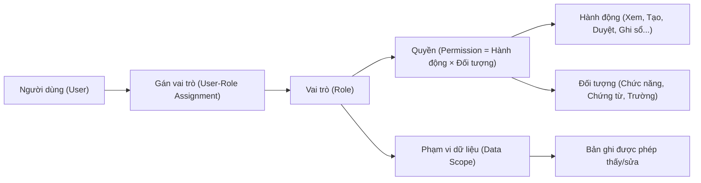
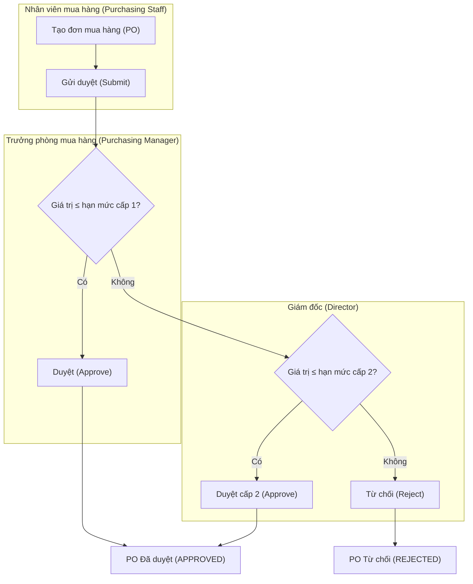
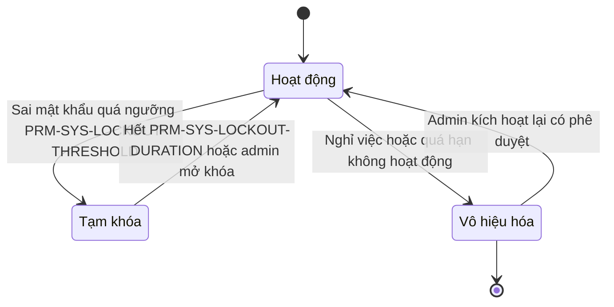
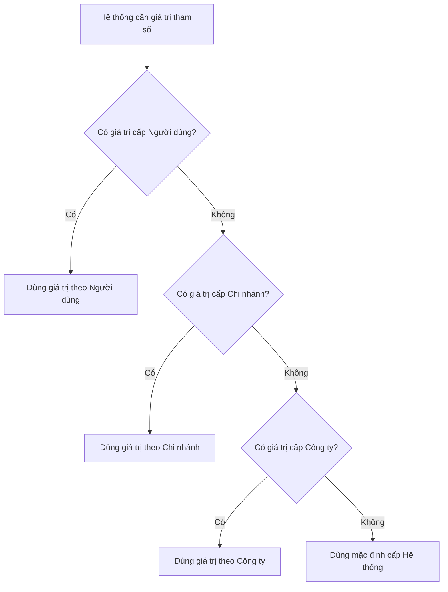

# An ninh, Phân quyền & Tham số hệ thống cho đặc tả ERP

> Cập nhật đến: 2026-10-20 — quy định thay đổi thường xuyên; BA phải kiểm tra lại hiệu lực khi dùng cho dự án.
> File tra cứu trong skill `erp-ba-docs`. Mục tiêu: để mọi spec mô tả **phân quyền** và **tham số** đầy đủ, nhất quán, code-ready. Đây là **kiến thức chuẩn**; nơi *định nghĩa* thực tế của dự án là các catalog `03-specification/catalogs/roles-permissions.md` (ROLE, ma trận quyền, SoD, hạn mức) và `03-specification/catalogs/system-parameters.md` (PRM). File này **không thay thế** chúng — nó hướng dẫn cách điền chúng cho đúng.
> Thuật ngữ trạng thái & hành động chuẩn: `references/conventions.md` §6. Bút toán/tài khoản: `references/regulations/vn-accounting.md`. Thuế: `references/regulations/vn-tax-einvoice.md`. Lương/BHXH: `references/regulations/vn-labor-payroll.md`. Yêu cầu phi chức năng an ninh: `references/nfr-catalog.md`.

**Chế độ kế toán áp dụng cho số hiệu tài khoản trong file:** **Thông tư 99/2025/TT-BTC** (Chế độ kế toán doanh nghiệp, hiệu lực 01/01/2026, thay Thông tư 200/2014/TT-BTC theo Điều 31) [10][11]. SME có thể dùng TT133/2016 (số hiệu khác — gộp 641+642, gộp chi phí SX vào 154); xem `references/regulations/vn-accounting.md` §4.

## Mục lục

- [Phần A — Phân quyền (Authorization / Access Control)](#phần-a--phân-quyền-authorization--access-control)
  - [A1. Mô hình RBAC & ánh xạ thuật ngữ nền tảng](#a1-mô-hình-rbac--ánh-xạ-thuật-ngữ-nền-tảng)
  - [A2. Định dạng ma trận phân quyền](#a2-định-dạng-ma-trận-phân-quyền)
  - [A3. Phạm vi dữ liệu (data scope)](#a3-phạm-vi-dữ-liệu-data-scope)
  - [A4. Bảo mật mức trường (field-level security)](#a4-bảo-mật-mức-trường-field-level-security)
  - [A5. Ma trận hạn mức phê duyệt (approval authority)](#a5-ma-trận-hạn-mức-phê-duyệt-approval-authority)
  - [A6. Phân tách nhiệm vụ (SoD) — nguyên tắc & catalog](#a6-phân-tách-nhiệm-vụ-sod--nguyên-tắc--catalog)
  - [A7. An ninh tài khoản & đăng nhập](#a7-an-ninh-tài-khoản--đăng-nhập)
  - [A8. Báo cáo an ninh & kiểm toán](#a8-báo-cáo-an-ninh--kiểm-toán)
  - [A9. Cách tài liệu hóa phân quyền trong đặc tả](#a9-cách-tài-liệu-hóa-phân-quyền-trong-đặc-tả)
- [Phần B — Tham số hệ thống (System Parameters)](#phần-b--tham-số-hệ-thống-system-parameters)
  - [B1. Định dạng định nghĩa tham số](#b1-định-dạng-định-nghĩa-tham-số)
  - [B2. Phạm vi & độ ưu tiên (precedence)](#b2-phạm-vi--độ-ưu-tiên-precedence)
  - [B3. Catalog tham số theo module](#b3-catalog-tham-số-theo-module)
  - [B4. Cách tài liệu hóa tham số trong function spec](#b4-cách-tài-liệu-hóa-tham-số-trong-function-spec)
- [Nguồn tham khảo](#nguồn-tham-khảo)

---

# Phần A — Phân quyền (Authorization / Access Control)

## A1. Mô hình RBAC & ánh xạ thuật ngữ nền tảng

ERP chuẩn dùng **phân quyền theo vai trò (Role-Based Access Control – RBAC)**: không gán quyền trực tiếp cho người dùng, chỉ gán **vai trò (role)**; vai trò gói các **quyền (permission) = hành động × đối tượng**, kèm **phạm vi dữ liệu (data scope)** [3]. Nguyên tắc nền: **đặc quyền tối thiểu (least privilege)** và **chỉ cấp khi cần biết (need-to-know)** — ISO/IEC 27001:2022 A.5.15, A.8.3 [9].

**Ánh xạ sang thuật ngữ nhà cung cấp** (để BA đọc tài liệu vendor và quy đổi khi chọn giải pháp):

| Khái niệm RBAC | Odoo | SAP (AS ABAP / ECC / S/4HANA) | Microsoft Dynamics 365 F&O | Oracle (NetSuite/Fusion) |
|---|---|---|---|---|
| Vai trò | Nhóm quyền `res.groups` [1] | Vai trò đơn (Single Role) / gộp (Composite Role) tạo bằng PFCG [6] | Security role [3] | Role |
| Gói quyền trung gian | `implied_ids` (kế thừa nhóm) [1] | Profile sinh tự động từ role [6] | Duty → Privilege → Permission (4 cấp) [3] | Duty role / Privilege |
| Quyền trên đối tượng | `ir.model.access` (perm_read/write/create/unlink) [1] | Authorization object (≤10 field; field ACTVT: 01 Tạo, 02 Sửa, 03 Xem, 06 Xóa) [6] | Permission trên entry point (menu item, service) [3] | Permission |
| Lọc theo bản ghi (data scope) | Record rule `ir.rule` + `domain_force` [1] | Authorization object có field tổ chức (BUKRS, WERKS...) [6] | Data security policy / Extensible Data Security (XDS) [3] | Data access set / segment |
| Kiểm tra lúc chạy | Theo nhóm người dùng | Lệnh `AUTHORITY-CHECK` (đạt khi **tất cả** field khớp) [6] | Kiểm tra role của user | — |

**Chi tiết cần nhớ khi thiết kế (đã kiểm chứng tài liệu vendor):**

- **Odoo** — quyền có 2 tầng: (1) *Access rights* `ir.model.access` cấp cho **cả model**, cộng dồn (union) từ mọi nhóm của user; không có dòng khớp = **không có quyền**; nhóm trống (`group_id` rỗng) = cấp cho mọi user kể cả portal [1]. (2) *Record rules* `ir.rule` lọc **từng bản ghi** sau access rights, mặc định cho phép nếu không có rule. **Rule toàn cục (không gắn nhóm) giao nhau (AND)**; **rule theo nhóm hợp nhất (OR)**; kết quả = `toàn_cục AND (nhóm1 OR nhóm2 ...)` [1]. Biến dùng trong `domain_force`: `user`, `company_id`, `company_ids`, `time` [1].
- **SAP** — *authorization field* là đơn vị nhỏ nhất (biểu diễn dữ liệu hoặc hoạt động); gán giá trị đơn/khoảng/`*` (toàn quyền)/rỗng. Role chuẩn SAP giao sẵn là **template**: ký tự `*` phải được siết lại thủ công khi triển khai [6]. Nên tạo *derived role* theo cấp tổ chức.
- **Dynamics 365 F&O** — phân cấp **Role ⊃ Duty ⊃ Privilege ⊃ Permission**; "permission" gom các *entry point* (menu item, web content item, service operation) + mức truy cập; role có thể xếp **phân cấp cha-con** (cha thừa kế duty/privilege của con); có **gán role tự động** theo dữ liệu nghiệp vụ (vd theo vị trí HR) [3].

> **Quy tắc cho BA:** mô tả quyền theo **nghiệp vụ** (hành động + phạm vi + điều kiện trạng thái), KHÔNG mô tả theo màn hình/menu của một sản phẩm cụ thể. Dev sẽ ánh xạ sang cơ chế nền tảng.

## A2. Định dạng ma trận phân quyền

Hai mức tài liệu, phải khớp nhau:

**(1) Ma trận tổng hợp Chức năng × Vai trò** — ở `catalogs/roles-permissions.md` §2. Mỗi ô dùng **một** mức:

| Mức | Ý nghĩa | Ghi chú |
|---|---|---|
| **Chính** | Thao tác đầy đủ theo FN (thường gồm Tạo/Sửa/Gửi duyệt của người thực hiện) | Chi tiết hành động nằm ở mục 2 của file FN |
| **Duyệt** | Chỉ Duyệt / Từ chối / Trả lại | Phải tách khỏi "Chính" (SoD) |
| **Một phần** | Chỉ một số hành động (ghi rõ ở FN) | vd chỉ Ghi sổ, hoặc chỉ In |
| **Xem** | Chỉ Xem/In/Xuất | Read-only |
| **—** | Không có quyền | |

**(2) Ma trận chi tiết Hành động × Phạm vi × Vai trò** — trong **mục 2 của từng file chức năng** `FN-<MOD>-NN`. Đây là bảng code-ready. Cột hành động dùng **đúng tên chuẩn** (`conventions.md` §6):
Xem · Tạo · Sửa · Xóa (chỉ chứng từ **Nháp/DRAFT**) · Gửi duyệt · Thu hồi · Duyệt · Từ chối · Trả lại · Ghi sổ · Bỏ ghi sổ · Hủy · Đảo · Đóng · In · Xuất file · Nhập file · Cấu hình.

Mẫu bảng chi tiết (ví dụ cho `FN-PUR-01` Quản lý đơn mua hàng):

| Hành động | ROLE-PUR-STAFF | ROLE-PUR-MGR | ROLE-ACC-AP | Điều kiện / Ràng buộc trạng thái |
|---|---|---|---|---|
| Xem | ✔ Của mình+Phòng | ✔ Phòng | ✔ Công ty | — |
| Tạo | ✔ | ✔ | — | Khởi tạo ở trạng thái DRAFT |
| Sửa | ✔ (DRAFT, RETURNED của mình) | ✔ (DRAFT phòng) | — | KHÔNG sửa khi PENDING/APPROVED |
| Xóa | ✔ (chỉ DRAFT của mình) | ✔ (DRAFT phòng) | — | Cấm xóa sau khi đã Gửi duyệt |
| Gửi duyệt | ✔ | ✔ | — | DRAFT/RETURNED → PENDING |
| Duyệt / Từ chối / Trả lại | — | ✔ (≤ `PRM-PUR-APPROVAL-L1`) | — | Người duyệt ≠ người tạo (SOD-03) |
| Hủy | — | ✔ | — | Chỉ trước khi phát sinh phiếu nhập |
| In / Xuất file | ✔ | ✔ | ✔ | APPROVED mới in bản chính thức |

**Quy ước ô:** `✔ <phạm vi>` = được phép trong phạm vi đó; `—` = không; thêm chú thích điều kiện ở cột cuối. Mỗi dòng là **một quyền kiểm thử được**. Không gộp hành động bằng "và/hoặc".

## A3. Phạm vi dữ liệu (data scope)

Mọi quyền **bắt buộc** đi kèm phạm vi. Các mức chuẩn (`conventions.md` §6), từ hẹp đến rộng:

| Mã phạm vi | Tên | Nghĩa | Ví dụ record rule (ý niệm) |
|---|---|---|---|
| OWN | Của mình | Chỉ bản ghi do chính user tạo/được gán | `create_uid = user` hoặc `salesperson = user` |
| DEPT | Phòng ban | Bản ghi thuộc phòng/bộ phận của user | `department_id IN user.departments` |
| BRANCH | Chi nhánh | Thuộc chi nhánh/đơn vị trực thuộc của user | `branch_id IN user.branches` |
| COMPANY | Công ty (pháp nhân) | Thuộc công ty của user (đa công ty) | `company_id IN user.company_ids` |
| ALL | Toàn hệ thống | Mọi pháp nhân (thường chỉ admin/ban TGĐ/kiểm toán nội bộ) | không giới hạn |

**Phạm vi bổ sung theo trục nghiệp vụ** (kết hợp với mức trên bằng AND): **theo Kho** (storekeeper chỉ thấy kho được gán), **theo Dự án** (PM chỉ thấy dự án của mình), theo Trung tâm chi phí, theo Nhóm khách hàng/kênh, theo Khu vực bán hàng.

**Quy tắc thiết kế:**
1. Phạm vi là thuộc tính của **cặp (vai trò, hành động)**, không phải của riêng vai trò: một vai trò có thể **Xem = COMPANY** nhưng **Sửa = OWN**.
2. Phạm vi xem (read scope) có thể rộng hơn phạm vi sửa (write scope). Ghi rõ cả hai.
3. Đa pháp nhân: mặc định **cô lập theo COMPANY**; chia sẻ xuyên công ty phải khai báo tường minh (ai, dữ liệu gì) — tránh rò rỉ số liệu giữa pháp nhân.
4. Trên nền tảng: Odoo = `ir.rule` với `domain_force` (nhớ quy tắc AND toàn cục / OR theo nhóm) [1]; Dynamics = XDS/data security policy [3]; SAP = field tổ chức trong authorization object (BUKRS công ty, WERKS nhà máy/kho) [6].

## A4. Bảo mật mức trường (field-level security)

Khi một **trường** nhạy cảm cần ẩn/khóa dù user vẫn được xem chứng từ: lương (334), giá vốn/biên lợi nhuận, số tài khoản ngân hàng, đơn giá mua, thông tin cá nhân (PII — CMND/CCCD, lương, sức khỏe), giá trần/sàn đàm phán.

| Mức bảo vệ trường | Hành vi | Dùng khi |
|---|---|---|
| Ẩn (hidden) | Không hiển thị, không xuất, không qua API | PII, lương với vai trò không phận sự |
| Chỉ đọc (read-only) | Thấy nhưng không sửa | Giá đã duyệt, số chứng từ đã ghi sổ |
| Che một phần (masked) | Hiện dạng `****1234` | Số tài khoản, CCCD trên màn hình chung |
| Bắt buộc nhập theo vai trò | Trường chỉ vai trò X được điền | Tài khoản hạch toán do kế toán điền |

**Ánh xạ nền tảng:** Odoo — thuộc tính `groups="..."` trên field (ẩn/khóa theo nhóm) [1]; SAP — authorization object chứa field dữ liệu, và kiểm soát bảng/field qua các object nhóm S_TABU_* (⚠️ CHƯA XÁC MINH tên object cụ thể trong phiên này — BA xác nhận trên help.sap.com); Dynamics 365 F&O — permission đặt mức truy cập **đọc/sửa theo từng field của bảng**; Dynamics CE dùng **Field Security Profile** (Read/Update/Create per field) [3].

> Trong spec, khai báo field-level security ở **mục dữ liệu của FN** (đánh dấu cột "Nhạy cảm/Phạm vi quyền" trong bảng trường) và liên kết vai trò được phép. Đừng để mặc định — PII và lương phải có chủ đích.

## A5. Ma trận hạn mức phê duyệt (approval authority)

Hạn mức phê duyệt (**Approval Authority / Delegation of Authority – DOA**) xác định **ai** được duyệt, **đến mức giá trị nào**, **mấy cấp**. Ngưỡng tiền **PHẢI** là tham số (PRM) để đổi không cần sửa code.

**Định dạng bảng** (ở `catalogs/roles-permissions.md` §4):

| Loại chứng từ | Điều kiện (giá trị/loại/đơn vị) | Cấp 1 | Cấp 2 | Cấp 3 | Tham số ngưỡng | Nguồn |
|---|---|---|---|---|---|---|
| Đơn mua hàng (PO) | ≤ `PRM-PUR-APPROVAL-L1` | ROLE-PUR-MGR | — | — | PRM-PUR-APPROVAL-L1 | REQ-… |
| Đơn mua hàng (PO) | > L1 và ≤ `PRM-PUR-APPROVAL-L2` | ROLE-PUR-MGR | ROLE-DIRECTOR | — | PRM-PUR-APPROVAL-L2 | REQ-… |
| Đơn mua hàng (PO) | > `PRM-PUR-APPROVAL-L2` | ROLE-PUR-MGR | ROLE-DIRECTOR | ROLE-CEO | — | REQ-… |
| Lệnh chi/UNC | ≤ `PRM-CB-PAY-APPROVAL-L1` | ROLE-ACC-CHIEF | — | — | PRM-CB-PAY-APPROVAL-L1 | REQ-… |
| Chiết khấu bán hàng | % > `PRM-SAL-APPROVAL-DISCOUNT` | ROLE-SAL-MGR | ROLE-DIRECTOR | — | PRM-SAL-APPROVAL-DISCOUNT | REQ-… |

**Quy tắc bắt buộc ghi rõ trong spec:**
1. **Quy đổi tiền tệ:** so sánh hạn mức trên **đồng tiền hạch toán gốc** (`PRM-SYS-BASE-CURRENCY`), quy đổi theo tỷ giá ngày chứng từ.
2. **Cơ sở so sánh:** tổng chứng từ hay từng dòng; đã gồm thuế hay chưa — ghi rõ.
3. **Tái duyệt (re-approval):** nếu sửa giá trị sau khi duyệt vượt ngưỡng cũ → quay lại DRAFT/PENDING, duyệt lại từ cấp phù hợp.
4. **Leo thang (escalation) & ủy quyền (delegation):** khi người duyệt vắng mặt, khai báo người được ủy quyền và thời hạn; quyền ủy quyền phải lưu vết.
5. **Người duyệt ≠ người tạo** (SOD-03/07) — cơ chế chặn, không chỉ quy định giấy.
6. **Hạn mức theo chiều tổ chức:** có thể khác theo phòng/chi nhánh/trung tâm chi phí — tham số hóa theo phạm vi.

**Ánh xạ nền tảng** (⚠️ CHƯA XÁC MINH câu chữ/field trong phiên này — BA xác nhận trên tài liệu vendor): Dynamics 365 F&O dùng **Signing limits / Spending limits** gắn workflow; SAP MM dùng **Release strategy** (release code/group theo đặc tính phân loại) cho PR/PO; Odoo Purchase có thiết lập **duyệt hai cấp theo giá trị** (double validation amount). Khái niệm hạn mức nhiều cấp là chuẩn chung, độc lập sản phẩm.

## A6. Phân tách nhiệm vụ (SoD) — nguyên tắc & catalog

**Phân tách nhiệm vụ (Segregation of Duties – SoD)** = không để **một người** nắm đủ các bước để tự hoàn tất một quy trình nhạy cảm (và che giấu) — nền tảng kiểm soát nội bộ (SOX, COSO) [4][7]. SAP GRC định nghĩa xung đột SoD là một user nắm các chức năng đủ để chạy một quy trình đầu-cuối mà không cần ai khác [7].

**4 họ nhiệm vụ cần tách** (khung kinh điển): **Cho phép/Phê duyệt (Authorize)** · **Ghi chép (Record)** · **Giữ tài sản (Custody)** · **Đối chiếu/Kiểm tra (Reconcile/Review)**. Hai bước thuộc hai họ khác nhau trong cùng chuỗi tiền/hàng thường không được do một người.

**Cơ chế hệ thống (3 cấp, ghi rõ chọn cấp nào trong spec):**
- **Chặn (prevent):** không cho gán 2 vai trò xung đột cho một user; hoặc chặn thao tác lúc chạy.
- **Cảnh báo + Kiểm soát bù (detect + compensating):** cho kiêm nhiệm (DN nhỏ ít người) nhưng bật phê duyệt cấp trên + **báo cáo ngoại lệ định kỳ** + log đầy đủ.
- **Rà soát định kỳ (review):** báo cáo xung đột SoD, người rà soát gán **kiểm soát giảm thiểu (mitigating control)** hoặc gỡ quyền — như SoD Review của SAP GRC [7] và trang *Segregation of duties unresolved conflicts* của Dynamics (deny hoặc override kèm lý do) [4][5].

> Lưu ý Dynamics: tạo quy tắc SoD **không** tự kiểm tra dữ liệu hiện có — phải chạy "Validate duties and roles" và "Verify compliance of user-role assignments"; xung đột với vai trò gán qua nhóm miền Active Directory (AD Domain groups) không được kiểm [4][5]. BA nên yêu cầu kiểm **cả khi gán quyền lẫn định kỳ**.

**Catalog xung đột SoD phổ biến trong ERP** (mẫu cho `roles-permissions.md` §3; DN chọn tập áp dụng theo quy mô):

| ID | Nhiệm vụ A | Nhiệm vụ B (không cùng người) | Rủi ro chính | Kiểm soát giảm thiểu |
|---|---|---|---|---|
| SOD-01 | Tạo/sửa danh mục Nhà cung cấp (vendor master) | Thực hiện/duyệt thanh toán | NCC ma → chi khống (đường gian lận phổ biến nhất) | Tách quyền; báo cáo thay đổi master; dò trùng số tài khoản NH; duyệt master độc lập |
| SOD-02 | Ghi nhận hóa đơn mua / công nợ phải trả | Thực hiện thanh toán | Tạo công nợ khống rồi tự chi | Tách AP ghi sổ khỏi thủ quỹ/lệnh chi; đối chiếu công nợ |
| SOD-03 | Tạo đơn mua hàng (PO) | Duyệt đơn mua hàng đó | Mua vượt nhu cầu / tư lợi | Người duyệt ≠ người tạo (chặn); hạn mức phê duyệt |
| SOD-04 | Tạo PO / đặt hàng | Nhận hàng (goods receipt) | Nhận khống, nhận về tư lợi | Tách mua và kho; đối chiếu 3 bên |
| SOD-05 | Nhận hàng (GR) | Đối chiếu & duyệt hóa đơn mua (invoice verification) | Khớp khống để trả tiền | Đối chiếu 3 bên hệ thống (`PRM-AP-3WAY-MATCH`); người khác duyệt lệch |
| SOD-06 | Tạo/sửa danh mục Khách hàng | Thu tiền & đối trừ công nợ (cash application) | Biển thủ tiền thu, gối đầu (lapping) | Tách quyền; đối chiếu sao kê; phân tích tuổi nợ bất thường |
| SOD-07 | Lập bút toán sổ cái (journal) | Duyệt & Ghi sổ (POST) bút toán | Bút toán khống, che số liệu | Người duyệt ≠ người lập; khóa kỳ; audit trail |
| SOD-08 | Thủ quỹ — giữ tiền mặt (custody) | Kế toán tiền — ghi sổ quỹ (record) | Biển thủ quỹ | Tách quỹ và kế toán; kiểm kê quỹ cuối ngày (`PRM-CB-CASHUP-REQUIRED`) |
| SOD-09 | Đối chiếu ngân hàng (bank reconciliation) | Ghi sổ/lệnh chi tiền | Che chênh lệch, chuyển tiền trái phép | Người đối chiếu độc lập với người chi |
| SOD-10 | Quản trị người dùng/phân quyền (security admin) | Thao tác nghiệp vụ tài chính | Tự cấp quyền rồi gian lận | Tách IT/security khỏi nghiệp vụ; log cấp quyền; rà soát định kỳ (A.5.18) [9] |
| SOD-11 | Nhập/điều chỉnh tồn kho | Kiểm kê & duyệt chênh lệch kiểm kê | Che hụt/thừa kho | Đội kiểm kê độc lập; duyệt điều chỉnh cấp trên; `PRM-INV-COUNT-TOLERANCE` |
| SOD-12 | Quản lý master nhân sự/lương (HR) | Chạy & duyệt bảng lương (payroll run) | Nhân viên ma, nâng lương khống | Tách HR và kế toán lương; duyệt bảng lương độc lập; khóa bảng lương |
| SOD-13 | Lập/sửa định mức & giá thành | Duyệt giá thành / COGS | Thao túng giá vốn, lãi gộp | Người duyệt độc lập; log thay đổi định mức |
| SOD-14 | Tạo/sửa tài khoản ngân hàng công ty (bank master) | Lập/duyệt lệnh chi | Đổi hướng dòng tiền ra tài khoản lạ | Duyệt bank master độc lập; thông báo thay đổi; xác thực 2 kênh |
| SOD-15 | Duyệt chiết khấu/điều chỉnh giá bán | Ghi nhận doanh thu & công nợ KH | Giấu nhượng giá, ghi doanh thu sai | Tách bán hàng và kế toán doanh thu; hạn mức chiết khấu |

## A7. An ninh tài khoản & đăng nhập

**Chính sách mật khẩu** — chuẩn tham chiếu **NIST SP 800-63B-4 (Digital Identity Guidelines: Authentication, 07/2025, thay bản 2020)** [8] và **ISO/IEC 27001:2022 A.5.17 Authentication information, A.8.5 Secure authentication** [9]:

| Hạng mục | Khuyến nghị chuẩn | Tham số |
|---|---|---|
| Độ dài tối thiểu | Yếu tố duy nhất: **SHALL ≥ 15 ký tự**; trong xác thực đa yếu tố (MFA): SHALL ≥ 8 ký tự [8] | `PRM-SYS-PWD-MINLEN` |
| Độ dài tối đa | Cho phép ≥ 64 ký tự; chấp nhận khoảng trắng & Unicode [8] | `PRM-SYS-PWD-MAXLEN` |
| Quy tắc tổ hợp ký tự | **KHÔNG được** bắt buộc (SHALL NOT — hoa/thường/số/ký tự đặc biệt) [8] | `PRM-SYS-PWD-COMPLEXITY` (mặc định Off) |
| Đổi mật khẩu định kỳ | **KHÔNG** bắt buộc đổi định kỳ; chỉ **ép đổi khi nghi ngờ lộ** [8] | `PRM-SYS-PWD-EXPIRY` (mặc định 0 = tắt) |
| Chống dùng lại | Cấm tái sử dụng N mật khẩu gần nhất | `PRM-SYS-PWD-HISTORY` |
| Lọc mật khẩu lộ/yếu | **Bắt buộc** đối chiếu blocklist mật khẩu đã lộ/thông dụng [8] | `PRM-SYS-PWD-BREACH-CHECK` (mặc định On) |

> Các ngưỡng trên đã đối chiếu trực tiếp với NIST SP 800-63B-4 §3.1.1 (bản chính thức 07/2025): đơn yếu tố SHALL ≥ 15, đa yếu tố SHALL ≥ 8; tối đa SHOULD cho phép ≥ 64; SHALL NOT bắt tổ hợp ký tự; SHALL NOT ép đổi định kỳ; SHALL lọc blocklist mật khẩu đã lộ/thông dụng [8].

**Đăng nhập một lần (Single Sign-On – SSO):** hỗ trợ **SAML 2.0 / OpenID Connect (OIDC) / LDAP-AD**; quản lý vòng đời tài khoản qua IdP; tắt tài khoản tại IdP là chặn được truy cập ERP (`PRM-SYS-SSO-MODE`).

**Xác thực đa yếu tố (Multi-Factor Authentication – MFA):** bật cho vai trò đặc quyền và truy cập từ ngoài; ưu tiên yếu tố chống lừa đảo (TOTP/khóa bảo mật hơn SMS) — A.8.5 [9] (`PRM-SYS-MFA-REQUIRED`).

**Phiên làm việc (session):** tự đăng xuất sau thời gian chờ không hoạt động; giới hạn phiên đồng thời; vô hiệu phiên khi đổi mật khẩu/nghi lộ (`PRM-SYS-SESSION-TIMEOUT`).

**Khóa tài khoản (lockout):** khóa sau N lần sai liên tiếp trong khoảng thời gian, tự mở sau khoảng khóa hoặc do admin mở; chống dò mật khẩu (`PRM-SYS-LOCKOUT-THRESHOLD`, `PRM-SYS-LOCKOUT-DURATION`).

**Truy cập đặc quyền (privileged access) — A.8.2 [9]:** tài khoản admin tách bạch, cấp theo thời hạn, mọi thao tác admin phải log; không dùng tài khoản dùng chung.

**Vòng đời tài khoản (joiner-mover-leaver) — A.5.16, A.5.18 [9]:** quy trình tạo/đổi/thu hồi quyền có phê duyệt & lưu vết; **rà soát quyền định kỳ** (A.5.18); tự động vô hiệu tài khoản không hoạt động quá hạn (`PRM-SYS-IDLE-DISABLE-DAYS`).

**Nhật ký & vết kiểm toán (audit trail) — A.8.15 Ghi nhật ký (Logging) [9]:** ghi người–thời điểm–giá trị trước/sau cho thay đổi dữ liệu nhạy cảm; **cấm xóa chứng từ đã Ghi sổ (POSTED)** — chỉ Đảo/điều chỉnh (Luật Kế toán Điều 13, 27; xem `references/regulations/vn-accounting.md` REGREQ-03, REGREQ-05) [10].

## A8. Báo cáo an ninh & kiểm toán

Danh mục báo cáo chuẩn hỗ trợ kiểm soát (mẫu cho `catalogs/reports.md`, module SYS):

| Mã gợi ý | Báo cáo | Mục đích | Bắt buộc luật? |
|---|---|---|---|
| RPT-SYS-01 | Ma trận phân quyền hiện hành (User × Role × Quyền) | Rà soát least-privilege; bằng chứng kiểm toán | Không |
| RPT-SYS-02 | Nhật ký đăng nhập (login audit) | Phát hiện truy cập bất thường | Không |
| RPT-SYS-03 | Vết kiểm toán thay đổi dữ liệu (audit trail) | Truy vết sửa/xóa; A.8.15 Logging [9]; Luật KT Điều 13 [10] | Có (kế toán) |
| RPT-SYS-04 | Xung đột SoD (SoD conflict) | Liệt kê user/role vi phạm & kiểm soát bù | Không (thông lệ SOX) |
| RPT-SYS-05 | Rà soát quyền định kỳ (access review) | A.5.18 rà soát & chứng thực quyền [9] | Không |
| RPT-SYS-06 | Nhật ký thay đổi tham số (parameter change log) | Ai đổi tham số gì, khi nào, giá trị cũ/mới | Không |
| RPT-SYS-07 | Nhật ký thao tác đặc quyền (admin activity) | Giám sát tài khoản đặc quyền; A.8.2 [9] | Không |

## A9. Cách tài liệu hóa phân quyền trong đặc tả

Quy trình chuẩn (chống mâu thuẫn — một khái niệm định nghĩa một lần, `conventions.md` §3):

1. **Định nghĩa ROLE** chỉ trong `catalogs/roles-permissions.md` §1 (ID, tên VN + EN, phòng ban, phạm vi mặc định). Dùng chức danh thật: Nhân viên mua hàng (Purchasing Staff), Thủ kho (Storekeeper), Kế toán công nợ phải trả (AP Accountant), Kế toán trưởng (Chief Accountant), Giám đốc (Director)... **Không bịa vai trò lạ.**
2. **Ma trận tổng hợp** (§2) dùng mức Chính/Duyệt/Một phần/Xem/— và **phải khớp** mục 2 của từng file FN.
3. **Chi tiết hành động × phạm vi** ở **mục 2 của file FN** — bảng code-ready (A2); mỗi ô có phạm vi (A3) và ràng buộc trạng thái chứng từ (DRAFT/PENDING/...).
4. **Ngưỡng tiền** → luôn là `PRM-…` (A5), không viết số cứng.
5. **SoD** → khai ở `roles-permissions.md` §3 bằng `SOD-NN` + cơ chế (chặn/cảnh báo/báo cáo).
6. **Quyền phủ định** (cấm) ghi tường minh; không để suy diễn.
7. **Field-level security** (A4) ghi tại bảng trường của FN.
8. File FN chỉ **tham chiếu** `ROLE-…`, không định nghĩa lại tên/ý nghĩa vai trò.

**Checklist "quyền đầy đủ" cho mỗi FN quản lý chứng từ:** đủ các hành động vòng đời (Tạo→Gửi duyệt→Duyệt/Từ chối/Trả lại→Ghi sổ→Hủy/Đảo/Đóng) × vai trò × phạm vi × điều kiện trạng thái; nêu rõ ai In/Xuất/Nhập; nêu SoD liên quan; nêu hạn mức.

---

# Phần B — Tham số hệ thống (System Parameters)

Tham số hệ thống = **giá trị cấu hình** điều khiển hành vi nghiệp vụ, đổi được **không cần sửa code**. Nguyên tắc vàng: **mọi "con số/chính sách/bật-tắt bước" thay đổi theo khách hàng hoặc theo thời gian PHẢI là tham số**, không hard-code trong FR/BR. Ánh xạ nền tảng: Odoo *System Parameters* (`ir.config_parameter`, dạng key/value tại Settings › Technical › Parameters; màn *Settings* `res.config.settings` là transient, lưu xuống `ir.config_parameter`) [2]; SAP *Customizing/IMG* (SPRO); Dynamics 365 *trang Parameters theo phân hệ* (General ledger parameters, Accounts payable parameters, ...) [3].

## B1. Định dạng định nghĩa tham số

Mỗi tham số định nghĩa **một lần** trong `catalogs/system-parameters.md`, với đủ các thuộc tính:

| Thuộc tính | Ý nghĩa | Lưu ý |
|---|---|---|
| **Mã** | `PRM-<MOD>-<tên-gợi-nhớ>` trong catalog tham chiếu này; khi vào dự án đánh lại `PRM-<MOD>-NNN` theo `conventions.md` §2, giữ tên | Mã không trùng, không tái dùng |
| **Tên** | Tên VN + thuật ngữ EN | vd "Ngưỡng duyệt cấp 2 đơn mua (PO approval level-2 threshold)" |
| **Module** | SYS/GL/AP/AR/CB/FA/TAX/PUR/SAL/INV/MFG/HR/PAY/PRJ | Theo tiêu đề nhóm |
| **Phạm vi** | Hệ thống / Công ty (pháp nhân) / Chi nhánh / Người dùng | Quyết định độ ưu tiên (B2) |
| **Kiểu dữ liệu** | Bool/Enum/Integer/Decimal/Money/Account(TK)/Date/List/Config | |
| **Giá trị cho phép** | Miền giá trị / danh sách enum | vd `≥0`, `{Off, Cảnh báo, Chặn}` |
| **Mặc định** | Giá trị khởi tạo; nếu KH chưa chốt → `[CẦN XÁC NHẬN: Q-…]` | Không tự đoán số |
| **Hiệu lực theo ngày?** | Có khi giá trị đổi theo luật/thời điểm (thuế suất, mức BHXH, tỷ giá): lưu **lịch sử** và áp theo **ngày chứng từ** | Bắt buộc cho tham số pháp lý |
| **Ai được sửa** | Vai trò được Cấu hình (thường ROLE-ADMIN/Kế toán trưởng) | Thao tác phải log (RPT-SYS-06) |
| **Ảnh hưởng** | Hành vi hệ thống **theo từng giá trị** | Mô tả per-value, không mơ hồ |
| **FN liên quan** | Các `FN-…` dùng tham số | Phục vụ truy vết |
| **Nguồn** | REQ/DEC/luật | Giá trị pháp lý trỏ file regulations |

## B2. Phạm vi & độ ưu tiên (precedence)

Khi một tham số có giá trị ở nhiều cấp, hệ thống lấy giá trị ở cấp **cụ thể nhất** có khai báo (override từ hẹp đến rộng). Thứ tự chuẩn: **Người dùng > Chi nhánh > Công ty > Hệ thống (mặc định)**. Spec phải nêu rõ tham số nào cho phép override ở cấp nào (đa số tham số kế toán **chỉ** ở cấp Công ty để đảm bảo nhất quán pháp nhân).

## B3. Catalog tham số theo module

> Mã dưới đây là **gợi nhớ** (reference). Giá trị mặc định là **gợi ý thông lệ** — phải được KH xác nhận (gắn `[CẦN XÁC NHẬN: Q-…]` khi chưa chốt). Tham số **pháp lý** (thuế suất, mức BHXH, dự phòng, ngưỡng TSCĐ...) **không định nghĩa lại ở đây** — trỏ sang file regulations để lấy giá trị đã kiểm chứng.

### SYS — Hệ thống & An ninh

| Mã | Tên (EN) | Phạm vi | Kiểu | Giá trị cho phép | Mặc định | Hiệu lực ngày? | Ai sửa | Ảnh hưởng |
|---|---|---|---|---|---|---|---|---|
| PRM-SYS-BASE-CURRENCY | Base currency | Công ty | Enum | VND/USD/... | VND | Không | KTT | Đồng tiền hạch toán & so sánh hạn mức |
| PRM-SYS-FY-START | Fiscal year start month | Công ty | Integer | 1..12 | 1 | Không | KTT | Mốc bắt đầu năm tài chính |
| PRM-SYS-TIMEZONE | Time zone | Hệ thống | Enum | Asia/Ho_Chi_Minh... | Asia/Ho_Chi_Minh | Không | Admin | Dấu thời gian chứng từ/log |
| PRM-SYS-PWD-MINLEN | Password min length | Hệ thống | Integer | ≥8 | 15 | Không | Admin | Chặn mật khẩu ngắn hơn (NIST: đơn yếu tố SHALL ≥15, có MFA ≥8) [8] |
| PRM-SYS-PWD-COMPLEXITY | Password composition rules | Hệ thống | Enum | Off/On | Off | Không | Admin | On=ép tổ hợp ký tự (NIST khuyến nghị Off) [8] |
| PRM-SYS-PWD-EXPIRY | Password expiry (days) | Hệ thống | Integer | 0..365 | 0 | Không | Admin | 0=không ép đổi định kỳ; >0=ép đổi sau N ngày [8] |
| PRM-SYS-PWD-HISTORY | Password reuse history | Hệ thống | Integer | 0..24 | 5 | Không | Admin | Cấm dùng lại N mật khẩu gần nhất |
| PRM-SYS-PWD-BREACH-CHECK | Breached-password screening | Hệ thống | Bool | On/Off | On | Không | Admin | On=chặn mật khẩu nằm trong blocklist lộ [8] |
| PRM-SYS-LOCKOUT-THRESHOLD | Lockout threshold | Hệ thống | Integer | ≥3 | 5 | Không | Admin | Khóa sau N lần đăng nhập sai |
| PRM-SYS-LOCKOUT-DURATION | Lockout duration (min) | Hệ thống | Integer | ≥1 | 30 | Không | Admin | Thời gian khóa trước khi tự mở |
| PRM-SYS-SESSION-TIMEOUT | Session idle timeout (min) | Hệ thống/Người dùng | Integer | 5..480 | 30 | Không | Admin | Tự đăng xuất khi không hoạt động |
| PRM-SYS-MFA-REQUIRED | MFA requirement | Hệ thống/Vai trò | Enum | Off/Theo vai trò/Tất cả | Theo vai trò | Không | Admin | Bắt buộc yếu tố thứ hai [9] |
| PRM-SYS-SSO-MODE | SSO mode | Hệ thống | Enum | Off/SAML/OIDC/LDAP | Off | Không | Admin | Chọn nguồn xác thực tập trung |
| PRM-SYS-IDLE-DISABLE-DAYS | Inactive account auto-disable | Hệ thống | Integer | 30..365 | 90 | Không | Admin | Vô hiệu tài khoản không hoạt động quá hạn [9] |
| PRM-SYS-AUDIT-RETENTION | Audit log retention (months) | Hệ thống | Integer | ≥12 | 60 | Không | Admin | Thời gian giữ nhật ký kiểm toán |
| PRM-SYS-DATE-FORMAT | Display date format | Hệ thống/Người dùng | Enum | dd/MM/yyyy... | dd/MM/yyyy | Không | Admin | Định dạng hiển thị ngày |

### GL — Sổ cái (General Ledger)

| Mã | Tên (EN) | Phạm vi | Kiểu | Giá trị cho phép | Mặc định | Hiệu lực ngày? | Ai sửa | Ảnh hưởng |
|---|---|---|---|---|---|---|---|---|
| PRM-GL-ACC-REGIME | Accounting regime | Công ty | Enum | TT99/TT133/TT58 | TT99/2025 | Có | KTT | Bộ TK & BCTC áp dụng — xem `vn-accounting.md` (`PRM-ACC-REGIME`) [10] |
| PRM-GL-PERIOD-LOCK | Period lock date | Công ty | Date | — | — | Có | KTT | Chặn ghi/sửa vào kỳ đã khóa (Luật KT Đ.26) [10] |
| PRM-GL-ALLOW-UNBALANCED | Allow unbalanced entry | Hệ thống | Bool | Off | Off | Không | — | Luôn Off: Tổng Nợ phải = Tổng Có |
| PRM-GL-RETAINED-ACC | Retained earnings account | Công ty | Account | — | 421 | Không | KTT | TK kết chuyển lãi/lỗ cuối kỳ |
| PRM-GL-PL-CLOSING-ACC | P&L determination account | Công ty | Account | — | 911 | Không | KTT | TK xác định kết quả kinh doanh |
| PRM-GL-ROUNDING-ACC | Rounding difference account | Công ty | Account | — | 642 (lãi:711/515) | Không | KTT | TK ghi chênh lệch làm tròn |
| PRM-GL-DOC-NUMBERING | Voucher numbering rule | Công ty | Config | theo loại/kỳ, reset đầu năm | theo loại+năm | Không | KTT | Đánh số liên tục, không trùng (Luật KT Đ.16) [10] |
| PRM-GL-REVERSAL-METHOD | Reversal method | Công ty | Enum | Ghi âm (ghi đỏ)/Bút toán đối ứng | Ghi âm | Không | KTT | Cách sinh bút toán Đảo (REVERSED) |
| PRM-GL-FX-REVAL-METHOD | FX revaluation method | Công ty | Enum | theo VAS 10/TT99 | — | Có | KTT | Đánh giá lại số dư ngoại tệ cuối kỳ — `vn-accounting.md` §12 |
| PRM-GL-INTERCOMPANY | Intercompany posting | Công ty | Bool | On/Off | Off | Không | KTT | Bật hạch toán đối ứng liên công ty (136/336) |

### AP — Công nợ phải trả (Accounts Payable)

| Mã | Tên (EN) | Phạm vi | Kiểu | Giá trị cho phép | Mặc định | Hiệu lực ngày? | Ai sửa | Ảnh hưởng |
|---|---|---|---|---|---|---|---|---|
| PRM-AP-DEFAULT-TERM | Default payment term | Công ty | Enum | Net 0/15/30/45/60 | Net 30 | Không | KT AP | Hạn thanh toán mặc định NCC |
| PRM-AP-3WAY-MATCH | Three-way match | Công ty | Bool | On/Off | On | Không | KTT | On=đối chiếu PO–Nhập kho–Hóa đơn trước khi trả |
| PRM-AP-MATCH-TOL-QTY | Match tolerance quantity (%) | Công ty | Decimal | 0..100 | 0 | Không | KTT | Mức lệch SL được tự khớp |
| PRM-AP-MATCH-TOL-PRICE | Match tolerance price (%) | Công ty | Decimal | 0..100 | 2 | Không | KTT | Mức lệch đơn giá được tự khớp |
| PRM-AP-HOLD-ON-MISMATCH | Hold payment on mismatch | Công ty | Bool | On/Off | On | Không | KTT | On=giữ thanh toán khi lệch ngoài dung sai |
| PRM-AP-DUP-INVOICE-CHECK | Duplicate invoice check | Công ty | Enum | Off/Cảnh báo/Chặn | Chặn | Không | KTT | Chống trùng số hóa đơn NCC (SOD-02 bù) |
| PRM-AP-PAYABLE-ACC | Default payable account | Công ty | Account | — | 331 | Không | KTT | TK phải trả người bán |
| PRM-AP-VAT-INPUT-ACC | Input VAT account | Công ty | Account | — | 133 | Không | KTT | TK thuế GTGT được khấu trừ |
| PRM-AP-ADVANCE-ACC | Vendor advance account | Công ty | Account | — | 331 (dư Nợ) | Không | KTT | TK trả trước người bán |
| PRM-AP-AGING-BUCKETS | Aging buckets (days) | Công ty | List | — | 30/60/90/>90 | Không | KT AP | Khung tuổi nợ cho báo cáo công nợ |

### AR — Công nợ phải thu (Accounts Receivable)

| Mã | Tên (EN) | Phạm vi | Kiểu | Giá trị cho phép | Mặc định | Hiệu lực ngày? | Ai sửa | Ảnh hưởng |
|---|---|---|---|---|---|---|---|---|
| PRM-AR-CREDIT-LIMIT-CHECK | Credit limit check | Công ty | Enum | Off/Cảnh báo/Chặn | Cảnh báo | Không | KTT | Kiểm soát hạn mức tín dụng KH |
| PRM-AR-CREDIT-HOLD-ACTION | Over-limit action | Công ty | Enum | Cảnh báo/Chặn đơn/Chặn giao | Chặn đơn | Không | KTT | Hành vi khi KH vượt hạn mức |
| PRM-AR-DEFAULT-TERM | Default payment term | Công ty | Enum | Net 0/15/30/45/60 | Net 30 | Không | KT AR | Hạn thu mặc định KH |
| PRM-AR-RECEIVABLE-ACC | Receivable account | Công ty | Account | — | 131 | Không | KTT | TK phải thu khách hàng |
| PRM-AR-VAT-OUTPUT-ACC | Output VAT account | Công ty | Account | — | 3331 | Không | KTT | TK thuế GTGT đầu ra |
| PRM-AR-DOUBTFUL-METHOD | Doubtful-debt provision | Công ty | Config | theo TT48/2019 | TT48 (30/50/70/100%) | Có | KTT | Trích dự phòng nợ khó đòi (TK 2293) — `vn-accounting.md` (`PRM-PROV-AR-*`) [10] |
| PRM-AR-AUTO-ALLOCATE | Receipt allocation | Công ty | Enum | FIFO/Chỉ định/Theo hạn | FIFO | Không | KT AR | Cách đối trừ tiền thu vào hóa đơn |
| PRM-AR-AGING-BUCKETS | Aging buckets (days) | Công ty | List | — | 30/60/90/>90 | Không | KT AR | Khung tuổi nợ phải thu |
| PRM-AR-ADVANCE-ACC | Customer advance account | Công ty | Account | — | 131 (dư Có) | Không | KTT | TK khách hàng trả trước |
| PRM-AR-LATE-INTEREST | Late payment interest (%/mo) | Công ty | Decimal | ≥0 | 0 | Có | KTT | Lãi phạt chậm trả (nếu hợp đồng quy định) |

### CB — Tiền mặt & Ngân hàng (Cash & Bank)

| Mã | Tên (EN) | Phạm vi | Kiểu | Giá trị cho phép | Mặc định | Hiệu lực ngày? | Ai sửa | Ảnh hưởng |
|---|---|---|---|---|---|---|---|---|
| PRM-CB-CASH-ACC | Cash account | Công ty | Account | — | 111 | Không | KTT | TK tiền mặt |
| PRM-CB-BANK-ACC | Bank account | Công ty | Account | — | 112 | Không | KTT | TK tiền gửi ngân hàng |
| PRM-CB-INTRANSIT-ACC | Cash-in-transit account | Công ty | Account | — | 113 | Không | KTT | TK tiền đang chuyển |
| PRM-CB-NEGATIVE-CASH | Allow negative cash | Hệ thống | Bool | Off | Off | Không | — | Luôn Off: quỹ không âm |
| PRM-CB-FX-RATE-SOURCE | FX rate source | Công ty | Enum | Nhập tay/NHTM/API | Nhập tay | Có | KTT | Nguồn tỷ giá — `vn-accounting.md` (`PRM-FX-RATE`) [10] |
| PRM-CB-ROUND-CASH | Cash rounding unit (VND) | Công ty | Integer | ≥0 | 0 | Không | KTT | Đơn vị làm tròn thu/chi tiền mặt |
| PRM-CB-RECON-AUTO-MATCH | Bank auto-reconciliation | Công ty | Bool | On/Off | On | Không | KTT | Tự khớp sao kê (độc lập người chi — SOD-09) |
| PRM-CB-CASHUP-REQUIRED | End-of-day cash count | Công ty | Bool | On/Off | On | Không | KTT | Bắt buộc kiểm kê quỹ cuối ngày (SOD-08 bù) |
| PRM-CB-PAY-APPROVAL-L1 | Payment approval L1 threshold | Công ty | Money | ≥0 | [CẦN XÁC NHẬN: Q-…] | Không | KTT | Ngưỡng duyệt lệnh chi cấp 1 |
| PRM-CB-DISCOUNT-INCOME-ACC | Early-payment discount account | Công ty | Account | — | 515 (chi:635) | Không | KTT | TK chiết khấu thanh toán |

### FA — Tài sản cố định (Fixed Assets)

| Mã | Tên (EN) | Phạm vi | Kiểu | Giá trị cho phép | Mặc định | Hiệu lực ngày? | Ai sửa | Ảnh hưởng |
|---|---|---|---|---|---|---|---|---|
| PRM-FA-THRESHOLD | FA recognition threshold | Công ty | Money | — | ≥30.000.000 | Có | KTT | Ngưỡng nguyên giá ghi nhận TSCĐ — `vn-accounting.md` (`PRM-FA-THRESHOLD`, TT45) [10] |
| PRM-FA-MINLIFE | FA minimum useful life | Công ty | Config | — | >1 năm | Có | KTT | Điều kiện thời gian ghi nhận TSCĐ (TT45) [10] |
| PRM-FA-DEPR-METHOD | Default depreciation method | Công ty | Enum | Đường thẳng/Số dư giảm dần/Theo sản lượng | Đường thẳng | Không | KTT | Phương pháp khấu hao mặc định (TT45) [10] |
| PRM-FA-DEPR-START | Depreciation start rule | Công ty | Enum | Ngày tăng/Tháng kế tiếp | Ngày tăng | Không | KTT | Thời điểm bắt đầu trích khấu hao |
| PRM-FA-COST-ACC | FA cost account | Công ty | Account | — | 211/213 | Không | KTT | TK nguyên giá TSCĐ hữu hình/vô hình |
| PRM-FA-DEPR-ACC | Accumulated depreciation account | Công ty | Account | — | 214 | Không | KTT | TK hao mòn lũy kế |
| PRM-FA-DEPR-EXP-ACC | Depreciation expense account | Công ty | Account | — | 627/641/642 | Không | KTT | TK chi phí khấu hao theo bộ phận |
| PRM-FA-CIP-ACC | Construction-in-progress account | Công ty | Account | — | 241 | Không | KTT | TK XDCB dở dang trước khi ghi tăng TSCĐ |
| PRM-FA-REVAL-ALLOWED | Allow FA revaluation | Công ty | Bool | On/Off | Off | Không | KTT | Cho phép đánh giá lại (chênh lệch ghi TK 412) |
| PRM-FA-TOOL-ALLOC-PERIODS | Tool allocation periods | Công ty | Integer | ≥1 | 24 | Không | KTT | Số kỳ phân bổ CCDC (242←153) |

### TAX — Thuế (Taxation)

> Thuế suất, chính sách HĐĐT, biểu thuế TNCN **lấy từ** `references/regulations/vn-tax-einvoice.md` và `vn-labor-payroll.md` (đã kiểm chứng). Dưới đây là **khung tham số**, không khẳng định số liệu.

| Mã | Tên (EN) | Phạm vi | Kiểu | Giá trị cho phép | Mặc định | Hiệu lực ngày? | Ai sửa | Ảnh hưởng |
|---|---|---|---|---|---|---|---|---|
| PRM-TAX-VAT-METHOD | VAT method | Công ty | Enum | Khấu trừ/Trực tiếp | Khấu trừ | Không | KTT | Cách tính & hạch toán GTGT — `vn-tax-einvoice.md` |
| PRM-TAX-VAT-RATES | VAT rate list | Hệ thống | List | theo luật hiện hành | xem file thuế | Có | KTT | Danh mục thuế suất GTGT (gồm chính sách giảm) — `vn-tax-einvoice.md` |
| PRM-TAX-VAT-INPUT-ACC | Input VAT account | Công ty | Account | — | 133 | Không | KTT | TK GTGT được khấu trừ |
| PRM-TAX-VAT-OUTPUT-ACC | Output VAT account | Công ty | Account | — | 3331 | Không | KTT | TK GTGT phải nộp |
| PRM-TAX-EINVOICE-MODE | E-invoice mode | Công ty | Enum | Có mã/Không mã CQT | xem file thuế | Có | KTT | Loại hóa đơn điện tử — `vn-tax-einvoice.md` |
| PRM-TAX-EINVOICE-PROVIDER | E-invoice provider / CQT link | Công ty | Config | — | — | Không | Admin | Kết nối phát hành HĐĐT (xem INT-…) |
| PRM-TAX-INVOICE-SYMBOL | Invoice form & symbol | Công ty | Config | theo TT78/NĐ123 | — | Có | KTT | Mẫu số/ký hiệu hóa đơn — `vn-tax-einvoice.md` |
| PRM-TAX-ROUND-RULE | Tax rounding rule | Công ty | Enum | Từng dòng/Tổng hóa đơn | Từng dòng | Không | KTT | Cách làm tròn tiền thuế |
| PRM-TAX-PIT-TABLE | PIT progressive table | Hệ thống | Config | theo luật TNCN | xem file lương | Có | KTT | Biểu thuế TNCN — `vn-labor-payroll.md` |
| PRM-TAX-CIT-RATE | CIT rate (%) | Công ty | Decimal | theo luật TNDN | ⚠️ CHƯA XÁC MINH — xem `vn-tax-einvoice.md` | Có | KTT | Thuế suất TNDN dùng ước tính 821 |

### PUR — Mua hàng (Purchasing / Procurement)

| Mã | Tên (EN) | Phạm vi | Kiểu | Giá trị cho phép | Mặc định | Hiệu lực ngày? | Ai sửa | Ảnh hưởng |
|---|---|---|---|---|---|---|---|---|
| PRM-PUR-APPROVAL-L1 | PO approval L1 threshold | Công ty | Money | ≥0 | [CẦN XÁC NHẬN: Q-…] | Không | Admin | Trên ngưỡng → thêm cấp duyệt (A5) |
| PRM-PUR-APPROVAL-L2 | PO approval L2 threshold | Công ty | Money | ≥ L1 | [CẦN XÁC NHẬN: Q-…] | Không | Admin | Trên ngưỡng → duyệt tới Giám đốc/CEO |
| PRM-PUR-PR-REQUIRED | Require PR before PO | Công ty | Bool | On/Off | On | Không | KTT | On=phải có đề nghị mua (PR) được duyệt |
| PRM-PUR-VENDOR-APPROVAL | New vendor approval | Công ty | Bool | On/Off | On | Không | KTT | On=NCC mới phải duyệt trước giao dịch (SOD-01 bù) |
| PRM-PUR-OVER-RECEIPT-TOL | Over-receipt tolerance (%) | Công ty | Decimal | 0..100 | 0 | Không | KTT | Mức nhận vượt SL đặt được chấp nhận |
| PRM-PUR-AUTO-CLOSE-TOL | Auto-close tolerance (%) | Công ty | Decimal | 0..100 | 5 | Không | KTT | Tự đóng PO khi nhận gần đủ |
| PRM-PUR-PRICE-SOURCE | Default price source | Công ty | Enum | Hợp đồng/Báo giá/Lần mua trước | Hợp đồng | Không | KTT | Nguồn đơn giá gợi ý trên PO |
| PRM-PUR-CURRENCY-ALLOWED | Allowed PO currencies | Công ty | List | — | VND | Không | KTT | Ngoại tệ được dùng trên PO |
| PRM-PUR-BUDGET-CHECK | Budget control on PO | Công ty | Enum | Off/Cảnh báo/Chặn | Cảnh báo | Không | KTT | Kiểm soát ngân sách khi tạo PO (xem PRJ/BUD) |

### SAL — Bán hàng (Sales / Order-to-Cash)

| Mã | Tên (EN) | Phạm vi | Kiểu | Giá trị cho phép | Mặc định | Hiệu lực ngày? | Ai sửa | Ảnh hưởng |
|---|---|---|---|---|---|---|---|---|
| PRM-SAL-APPROVAL-DISCOUNT | Discount approval threshold (%) | Công ty | Decimal | 0..100 | 10 | Không | KTT | Trên ngưỡng → cần duyệt (A5, SOD-15) |
| PRM-SAL-MIN-MARGIN | Minimum margin (%) | Công ty | Decimal | — | [CẦN XÁC NHẬN: Q-…] | Không | KTT | Dưới mức → cảnh báo/chặn đơn |
| PRM-SAL-CREDIT-CHECK | Credit check on order | Công ty | Enum | Off/Cảnh báo/Chặn | Cảnh báo | Không | KTT | Kiểm hạn mức khi tạo đơn (dùng AR) |
| PRM-SAL-BACKORDER-ALLOWED | Allow backorder/negative stock sale | Công ty | Bool | On/Off | Off | Không | KTT | Cho đặt khi thiếu tồn |
| PRM-SAL-PRICE-LIST-MODE | Price list mechanism | Công ty | Config | Theo nhóm KH/kênh/số lượng | Theo nhóm KH | Có | KTT | Cơ chế bảng giá áp dụng |
| PRM-SAL-RETURN-WINDOW | Return window (days) | Công ty | Integer | ≥0 | 30 | Không | KTT | Thời hạn cho phép trả hàng |
| PRM-SAL-REVENUE-ACC | Revenue account | Công ty | Account | — | 511 | Không | KTT | TK doanh thu bán hàng & dịch vụ |
| PRM-SAL-COGS-TIMING | COGS posting timing | Công ty | Enum | Khi xuất kho/Khi ghi doanh thu | Khi xuất kho | Không | KTT | Thời điểm ghi giá vốn (632) |
| PRM-SAL-AUTO-INVOICE | Auto-create invoice from delivery | Công ty | Bool | On/Off | Off | Không | KTT | Tự lập hóa đơn từ phiếu giao |

### INV — Kho (Inventory / Warehouse)

| Mã | Tên (EN) | Phạm vi | Kiểu | Giá trị cho phép | Mặc định | Hiệu lực ngày? | Ai sửa | Ảnh hưởng |
|---|---|---|---|---|---|---|---|---|
| PRM-INV-COSTING | Inventory costing method | Công ty/Kho | Enum | Đích danh/BQGQ/FIFO | BQGQ | Không | KTT | Giá xuất kho; **không hỗ trợ LIFO** — `vn-accounting.md` (`PRM-INV-COSTING`, VAS 02) [10] |
| PRM-INV-VALUATION-MODE | Valuation mode | Công ty | Enum | Kê khai thường xuyên/Kiểm kê định kỳ | Kê khai thường xuyên | Không | KTT | Perpetual→bút toán kho theo từng giao dịch (632); periodic→cuối kỳ (611/631) |
| PRM-INV-COSTING-LEVEL | Costing level | Công ty | Enum | Theo kho/Toàn công ty | Toàn công ty | Không | KTT | Phạm vi tính giá bình quân |
| PRM-INV-NEGATIVE-STOCK | Allow negative stock | Hệ thống | Bool | Off | Off | Không | — | Luôn Off: chặn xuất quá tồn |
| PRM-INV-LOT-TRACKING | Lot/expiry tracking | Công ty/Vật tư | Bool | On/Off | Off | Không | KTT | Bật quản lý lô & hạn dùng |
| PRM-INV-SERIAL-TRACKING | Serial tracking | Công ty/Vật tư | Bool | On/Off | Off | Không | KTT | Bật quản lý số serial |
| PRM-INV-COUNT-TOLERANCE | Stock-count auto-adjust tolerance | Công ty | Decimal | ≥0 | 0 | Không | KTT | Mức lệch kiểm kê được tự điều chỉnh (SOD-11) |
| PRM-INV-ADJUST-ACC | Inventory adjustment account | Công ty | Account | — | 632/811/711 | Không | KTT | TK ghi chênh lệch kiểm kê |
| PRM-INV-UOM-DECIMALS | Quantity decimals | Hệ thống | Integer | 0..3 | 3 | Không | Admin | Số thập phân số lượng |
| PRM-INV-RESERVE-POLICY | Reservation policy | Công ty | Enum | Không giữ/Giữ khi đặt/Giữ khi duyệt | Giữ khi duyệt | Không | KTT | Thời điểm giữ hàng cho đơn |

### MFG — Sản xuất (Manufacturing / MRP)

| Mã | Tên (EN) | Phạm vi | Kiểu | Giá trị cho phép | Mặc định | Hiệu lực ngày? | Ai sửa | Ảnh hưởng |
|---|---|---|---|---|---|---|---|---|
| PRM-MFG-COSTING-METHOD | Product costing method | Công ty | Enum | Giản đơn/Định mức/Hệ số/Phân bước | Phân bước | Không | KTT | Cách tập hợp & tính giá thành |
| PRM-MFG-STD-COST | Standard cost vs actual | Công ty | Enum | Thực tế/Định mức | Thực tế | Có | KTT | Định mức→sinh chênh lệch (variance) |
| PRM-MFG-OVERHEAD-RATE | Overhead allocation rate | Công ty | Decimal | ≥0 | [CẦN XÁC NHẬN: Q-…] | Có | KTT | Tỷ lệ phân bổ chi phí SX chung (627) |
| PRM-MFG-BACKFLUSH | Backflush materials | Công ty | Bool | On/Off | Off | Không | KTT | On=tự xuất NVL khi báo hoàn thành |
| PRM-MFG-WIP-ACC | Work-in-progress account | Công ty | Account | — | 154 | Không | KTT | TK chi phí SXKD dở dang |
| PRM-MFG-SCRAP-ACC | Scrap/loss account | Công ty | Account | — | 632/811 | Không | KTT | TK phế liệu/hao hụt sản xuất |
| PRM-MFG-ROUTING-REQUIRED | Require routing | Công ty | Bool | On/Off | Off | Không | KTT | Bắt buộc khai công đoạn |
| PRM-MFG-MRP-HORIZON | MRP planning horizon (days) | Công ty | Integer | ≥1 | 90 | Không | KTT | Kỳ chạy hoạch định nhu cầu |
| PRM-MFG-LOT-SIZE-RULE | Lot-sizing rule | Công ty/Vật tư | Enum | Lot-for-lot/EOQ/Min-max | Lot-for-lot | Không | KTT | Quy tắc gom khối lượng đề xuất |
| PRM-MFG-YIELD-TOLERANCE | Yield tolerance (%) | Công ty | Decimal | ≥0 | 0 | Không | KTT | Dung sai chênh lệch sản lượng |

### HR / PAY — Nhân sự & Tiền lương (HR & Payroll)

> Các mức pháp lý (BHXH/BHYT/BHTN, lương tối thiểu vùng, biểu thuế TNCN, giảm trừ gia cảnh, hệ số OT) **lấy từ** `references/regulations/vn-labor-payroll.md` — không khẳng định số ở đây.

| Mã | Tên (EN) | Phạm vi | Kiểu | Giá trị cho phép | Mặc định | Hiệu lực ngày? | Ai sửa | Ảnh hưởng |
|---|---|---|---|---|---|---|---|---|
| PRM-HR-WORKDAYS-STD | Standard workdays/month | Công ty | Decimal | — | 26 | Không | HR | Mẫu số tính lương theo ngày công |
| PRM-HR-PROBATION-PCT | Probation salary (%) | Công ty | Decimal | theo luật LĐ | xem file lương | Có | HR | % lương thử việc — `vn-labor-payroll.md` |
| PRM-HR-LEAVE-ANNUAL | Annual leave (days) | Công ty | Integer | theo luật LĐ | xem file lương | Có | HR | Số ngày phép năm — `vn-labor-payroll.md` |
| PRM-PAY-OT-RATES | Overtime multipliers | Hệ thống | Config | theo luật LĐ | xem file lương | Có | HR | Hệ số OT (thường/cuối tuần/lễ) — `vn-labor-payroll.md` |
| PRM-PAY-SI-RATES | Social-insurance rates | Hệ thống | Config | theo luật BHXH | xem file lương | Có | KT lương | Tỷ lệ trích BHXH/BHYT/BHTN — `vn-labor-payroll.md` |
| PRM-PAY-PIT-DEDUCTION | PIT personal/dependent deduction | Hệ thống | Config | theo luật TNCN | xem file lương | Có | KT lương | Giảm trừ gia cảnh — `vn-labor-payroll.md` |
| PRM-PAY-SALARY-ACC | Payroll payable account | Công ty | Account | — | 334 | Không | KTT | TK phải trả người lao động |
| PRM-PAY-PAYROLL-LOCK | Lock payroll after approval | Công ty | Bool | On/Off | On | Không | KTT | On=khóa bảng lương sau duyệt (SOD-12 bù) |
| PRM-PAY-ROUND-NET | Round net pay (VND) | Công ty | Integer | ≥0 | 1000 | Không | KT lương | Đơn vị làm tròn lương thực nhận |
| PRM-PAY-PAYSLIP-VISIBILITY | Payslip field visibility | Vai trò | Config | — | Chỉ người lao động + KT lương | Không | HR | Field-level security cho dữ liệu lương (A4) |

### PRJ — Quản lý dự án (Project Management & Accounting)

| Mã | Tên (EN) | Phạm vi | Kiểu | Giá trị cho phép | Mặc định | Hiệu lực ngày? | Ai sửa | Ảnh hưởng |
|---|---|---|---|---|---|---|---|---|
| PRM-PRJ-REVENUE-METHOD | Revenue recognition method | Công ty/Dự án | Enum | % hoàn thành (POC)/Khi nghiệm thu/Hợp đồng hoàn thành | % hoàn thành | Không | KTT | Cách ghi nhận doanh thu dự án (VAS 15) |
| PRM-PRJ-POC-BASIS | Percentage-of-completion basis | Dự án | Enum | Theo chi phí/Theo khối lượng/Theo mốc | Theo chi phí | Không | KTT | Cách đo % hoàn thành |
| PRM-PRJ-WIP-ACC | Project WIP account | Công ty | Account | — | 154 | Không | KTT | TK chi phí dở dang dự án |
| PRM-PRJ-COST-CONTROL | Budget cost control | Công ty/Dự án | Enum | Off/Cảnh báo/Chặn | Cảnh báo | Không | KTT | Kiểm soát chi so với dự toán |
| PRM-PRJ-TIMESHEET-APPROVAL | Timesheet approval | Công ty | Bool | On/Off | On | Không | PM | Bắt buộc duyệt bảng chấm công dự án |
| PRM-PRJ-BILL-RATE-SOURCE | Billing rate source | Dự án | Enum | Theo người/Theo vai trò/Theo hợp đồng | Theo vai trò | Có | PM | Nguồn đơn giá tính công khách hàng |
| PRM-PRJ-RETENTION-PCT | Contract retention (%) | Dự án | Decimal | 0..100 | 5 | Không | KTT | % giữ lại theo hợp đồng (ngành xây dựng) |
| PRM-PRJ-OVERHEAD-ALLOC | Overhead allocation to project | Công ty | Enum | Off/Theo chi phí/Theo giờ | Theo chi phí | Có | KTT | Phân bổ chi phí chung vào dự án |
| PRM-PRJ-CONTRACT-REQUIRED | Require linked contract | Công ty | Bool | On/Off | On | Không | PM | Bắt buộc gắn hợp đồng khi mở dự án |

## B4. Cách tài liệu hóa tham số trong function spec

Quy tắc (chống hard-code & mâu thuẫn):

1. **Định nghĩa PRM một lần** trong `catalogs/system-parameters.md`. File FN chỉ **tham chiếu** `PRM-…` và mô tả **hành vi theo từng giá trị**.
2. **Mọi "magic number"** trong FR/BR (ngưỡng, %, số ngày, bật/tắt bước, tài khoản mặc định) → thay bằng `PRM-…`. Ví dụ sai: "nếu tổng > 50.000.000 thì cần duyệt 2 cấp". Đúng: "nếu tổng > `PRM-PUR-APPROVAL-L1` thì cần duyệt cấp 2 (ROLE-DIRECTOR)".
3. **Giá trị pháp lý** (thuế, BHXH, dự phòng, khấu hao, ngưỡng TSCĐ) → tham số **hiệu lực theo ngày**, trỏ nguồn `references/regulations/…`; áp theo **ngày chứng từ**, lưu lịch sử.
4. **Mặc định chưa chốt** → `[CẦN XÁC NHẬN: Q-…]`; không tự đoán số (`conventions.md` §4).
5. **Ai được sửa** phải có vai trò cụ thể; thao tác đổi tham số ghi log (RPT-SYS-06).
6. **Ảnh hưởng mô tả per-value** (hành vi khác nhau cho mỗi giá trị enum), không viết chung chung.
7. **Liên kết ngược** FN↔PRM để `ba.py trace` kiểm tra tham chiếu.

**Ví dụ nhúng trong FR của `FN-PUR-01`:**
> **FR-PUR-01-07** — Khi người dùng Gửi duyệt đơn mua hàng, Hệ thống PHẢI định tuyến phê duyệt theo tổng giá trị (quy đổi về `PRM-SYS-BASE-CURRENCY`): ≤ `PRM-PUR-APPROVAL-L1` → 1 cấp (ROLE-PUR-MGR); > `PRM-PUR-APPROVAL-L1` và ≤ `PRM-PUR-APPROVAL-L2` → 2 cấp (thêm ROLE-DIRECTOR); > `PRM-PUR-APPROVAL-L2` → 3 cấp (thêm ROLE-CEO). *Nguồn: REQ-031; tham số PRM-PUR-APPROVAL-L1/L2.*
> **BR-PUR-01-04** — Người Duyệt PHẢI khác người Tạo (SOD-03). Hệ thống PHẢI chặn thao tác Duyệt nếu trùng.

---

## Nguồn tham khảo

[1] Odoo 18 — Security in Odoo (ir.model.access, ir.rule, res.groups; quy tắc toàn cục AND / nhóm OR) — https://www.odoo.com/documentation/18.0/developer/reference/backend/security.html (truy cập 2026-10-20)
[2] Odoo — System Parameters (ir.config_parameter: Settings › Technical › Parameters; res.config.settings lưu xuống ir.config_parameter) — https://www.odoo.com/forum/help-1/what-is-ir-configparameters-in-odoo-why-use-this-in-odoo-111130 (truy cập 2026-10-20)
[3] Microsoft Learn — Role-based security, Finance & Operations (Role ⊃ Duty ⊃ Privilege ⊃ Permission; entry points; data security policy) — https://learn.microsoft.com/en-us/dynamics365/fin-ops-core/dev-itpro/sysadmin/role-based-security (truy cập 2026-10-20)
[4] Microsoft Learn — Set up segregation of duties, Finance & Operations — https://learn.microsoft.com/en-us/dynamics365/fin-ops-core/fin-ops/sysadmin/set-up-segregation-duties (truy cập 2026-10-20)
[5] Microsoft Learn — Identify and resolve conflicts in segregation of duties (unresolved conflicts, deny/override, Validate/Verify) — https://learn.microsoft.com/en-us/dynamics365/fin-ops-core/fin-ops/sysadmin/identify-resolve-conflicts-segregation-duties (truy cập 2026-10-20)
[6] SAP Help Portal — Authorization Objects / AS ABAP Authorization Concept (authorization object ≤10 field; ACTVT 01/02/03/06; AUTHORITY-CHECK; single vs composite role) — https://help.sap.com/docs/SAP_ERP/da5ab0fa48b34143a25d0e08448f5219/9301c5536a51204be10000000a174cb4.html và ABAP keyword doc: https://help.sap.com/doc/abapdocu_750_index_htm/7.50/en-US/abenbc_authority_check.htm (truy cập 2026-10-20)
[7] SAP Help Portal — SAP Access Control: Access Risk Analysis (xung đột SoD = user chạy quy trình đầu-cuối; predefined ruleset; SoD Review + mitigating control) — https://help.sap.com/docs/SAP_ACCESS_CONTROL/5cae1bc9a72348389e91183714220e30/4e8cb94820ff0867e10000000a421bc1.html (truy cập 2026-10-20)
[8] NIST SP 800-63B-4 — Digital Identity Guidelines: Authentication and Authenticator Management (công bố 07/2025, thay bản 2020; min 8 nên 15, max ≥64, không bắt tổ hợp ký tự, không ép đổi định kỳ, bắt buộc lọc blocklist) — https://csrc.nist.gov/pubs/sp/800/63/b/4/final (truy cập 2026-10-20)
[9] ISO/IEC 27001:2022 — Information security, cybersecurity and privacy protection — Information security management systems — Requirements, Annex A (A.5.15 Access control, A.5.16 Identity management, A.5.17 Authentication information, A.5.18 Access rights, A.8.2 Privileged access rights, A.8.3 Information access restriction, A.8.5 Secure authentication, A.8.15 Logging) — https://www.iso.org/standard/27001 (truy cập 2026-10-20)
[10] Chế độ kế toán & tham số pháp lý kế toán (TK, dự phòng, TSCĐ, tỷ giá, costing) — xem `references/regulations/vn-accounting.md` (truy cập 2026-10-20)
[11] Thông tư 99/2025/TT-BTC — Chế độ kế toán doanh nghiệp (hiệu lực 01/01/2026, thay TT200/2014 theo Điều 31) — Công báo Chính phủ — https://congbao.chinhphu.vn/van-ban/thong-tu-so-99-2025-tt-btc-46529.htm (truy cập 2026-10-20)
