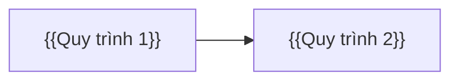

# Báo cáo research — {{Ngành / sản phẩm}} — {{PROJECT}}

<!-- HƯỚNG DẪN (xem skill `erp-ba-step1-research`)
- Mọi khẳng định về ngành, luật, đối thủ, số liệu PHẢI có trích dẫn [n] tới mục "Nguồn tham khảo". Không có nguồn → không viết, hoặc ghi "Không rõ".
- Research không tạo ra yêu cầu khách hàng. Mọi thứ đưa vào phạm vi từ research đều là ĐỀ XUẤT cho tới khi khách hàng xác nhận ở bước 2.
- Dùng kiến thức nền trong erp-ba-core/references/industries/, erp-ba-core/references/processes/, erp-ba-core/references/regulations/ trước, rồi bổ sung bằng tìm kiếm web có trích dẫn.
-->

## 0. Thông tin research

| Mục | Nội dung |
|---|---|
| Mục đích | {{Demo cho khách hàng <tên> / Tài liệu sản phẩm chính / Đánh giá cơ hội}} |
| Ngành – phân khúc | {{Ví dụ: Nhà thầu thi công xây dựng dân dụng, quy mô 200–1000 nhân sự}} |
| Đối tượng khách hàng mục tiêu | {{loại doanh nghiệp, quy mô, mô hình (đa chi nhánh/đa công ty)}} |
| Phạm vi module dự kiến | {{…}} |
| Hạn chót / mức độ sâu | {{…}} |
| Người yêu cầu | {{…}} |

## 1. Câu hỏi research

<!-- Liệt kê điều cần biết để quyết định phạm vi. Mỗi câu hỏi được trả lời ở các mục sau hoặc chuyển thành câu hỏi khảo sát ở mục 10. -->

| # | Câu hỏi | Trả lời ở mục |
|---|---|---|
| RQ1 | {{…}} | {{§…}} |

## 2. Tổng quan ngành

{{Mô hình kinh doanh, chuỗi giá trị, đặc thù vận hành, quy mô thị trường nếu liên quan — có trích dẫn [n].}}

## 3. Quy trình nghiệp vụ đặc thù của ngành

<!-- Đối chiếu với erp-ba-core/references/processes/*.md và erp-ba-core/references/industries/*.md. Đánh dấu quy trình nào là chuẩn ERP chung, quy trình nào đặc thù ngành. -->

| # | Quy trình | Chuẩn ERP / Đặc thù ngành | Tham chiếu chuẩn | Ghi chú đặc thù |
|---|---|---|---|---|
| 1 | {{…}} | {{…}} | {{erp-ba-core/references/processes/…md}} | {{…}} |

## 4. Quy định pháp lý liên quan

| Văn bản | Nội dung ảnh hưởng hệ thống | Hiệu lực | Tình trạng | Nguồn |
|---|---|---|---|---|
| {{Số hiệu}} | {{…}} | {{dd/MM/yyyy}} | {{Còn hiệu lực / Đã thay thế bởi …}} | [{{n}}] |

## 5. Vấn đề phổ biến của doanh nghiệp trong ngành (pain points)

| # | Vấn đề | Hệ quả | Tính năng giải quyết (FEAT) | Nguồn |
|---|---|---|---|---|
| 1 | {{…}} | {{…}} | {{FEAT-…}} | [{{n}}] |

## 6. Đối thủ & sản phẩm tham chiếu

<!-- Tối thiểu 5 sản phẩm liên quan (ưu tiên ≥2 Việt Nam, ≥2 quốc tế nếu tồn tại). Phương pháp: erp-ba-core/references/competitor-research.md -->

| # | Sản phẩm – Hãng | Phân khúc | Module/điểm mạnh nổi bật | Điểm yếu / khoảng trống | Giá/mô hình bán (nếu công khai) | Nguồn |
|---|---|---|---|---|---|---|
| 1 | {{…}} | {{…}} | {{…}} | {{…}} | {{…}} | [{{n}}] |

## 7. Tổng hợp tính năng

Chi tiết từng tính năng: `01-research/feature-catalog.md`. Tóm tắt độ phủ 5 thành phần ERP theo module:

| Module | Hệ thống / nền tảng | Danh mục | Nghiệp vụ | Phân quyền & tham số | Báo cáo |
|---|---|---|---|---|---|
| {{MOD}} | {{FEAT-…}} | {{FEAT-…}} | {{FEAT-…}} | {{FEAT-…}} | {{FEAT-…}} |

## 8. Đề xuất phạm vi

| Phương án | Module / FEAT đưa vào | Lý do | Rủi ro |
|---|---|---|---|
| Demo | {{…}} | {{…}} | {{…}} |
| MVP / Giai đoạn 1 | {{…}} | {{…}} | {{…}} |
| Đầy đủ | {{…}} | {{…}} | {{…}} |

Tất cả mục trên là **đề xuất** (chưa phải yêu cầu khách hàng) cho tới khi khách hàng xác nhận ở bước 2.

## 9. Thuật ngữ ngành phát hiện

| Thuật ngữ (VI) | Tiếng Anh | Giải thích | Nguồn |
|---|---|---|---|
| {{…}} | {{…}} | {{…}} | [{{n}}] |

## 10. Câu hỏi khảo sát khách hàng (agenda cho bước 2)

<!-- Nhóm theo quy trình/module. Lấy gợi ý từ erp-ba-core/references/question-bank.md và mục 14 của các file erp-ba-core/references/processes/*.md -->

| # | Nhóm | Câu hỏi | Vì sao cần hỏi (ảnh hưởng thiết kế) |
|---|---|---|---|
| 1 | {{…}} | {{…}} | {{…}} |

## 11. Giới hạn của research & mục chưa xác minh

- {{…}}

## Nguồn tham khảo

[1] {{Tiêu đề — URL (truy cập dd/MM/yyyy)}}
