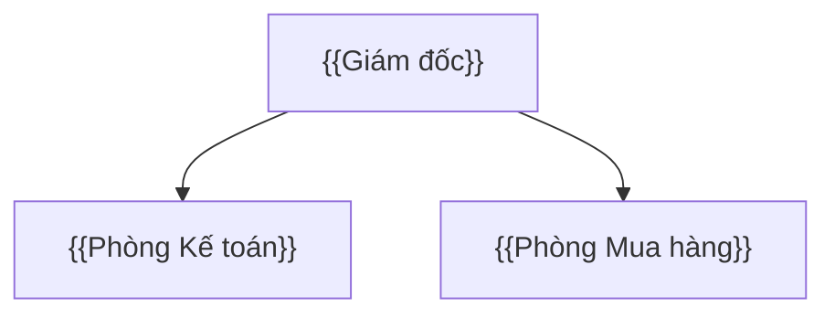
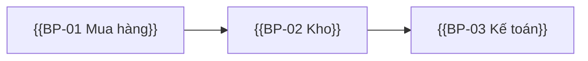
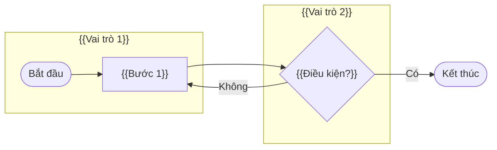

# Tài liệu tổng quan yêu cầu & quy trình tổng quan — {{PROJECT}}

<!-- HƯỚNG DẪN (xem skill `erp-ba-step2-requirements`)
- Tài liệu này mô tả "khách hàng cần gì" ở mức tổng quan và quy trình đầu-cuối TO-BE theo chuẩn ERP. Chi tiết chức năng để ở bước 3.
- Mọi phát biểu về khách hàng phải trỏ về REQ / MTG / SRC. Phần BA đề xuất phải mang [ĐỀ XUẤT → Q-…].
- Quy trình TO-BE lấy khung từ erp-ba-core/references/processes/*.md và erp-ba-core/references/industries/*.md, rồi điều chỉnh theo yêu cầu khách hàng. Ghi rõ điểm khác chuẩn và lý do.
-->

## 0. Thông tin tài liệu

| Mục | Nội dung |
|---|---|
| Khách hàng | {{tên, ngành, quy mô, số pháp nhân/chi nhánh/kho/công trường}} |
| Nguồn đã tổng hợp | {{MTG-…, SRC-…}} |
| Kết quả research dùng kèm | `01-research/research-report.md` (phiên bản {{…}}) |
| Phiên bản / ngày | {{0.1 – dd/MM/yyyy}} |

## 1. Bối cảnh & mục tiêu kinh doanh

| ID | Mục tiêu (đo được) | Chỉ số đo | Nguồn |
|---|---|---|---|
| BO-01 | {{Ví dụ: Giảm thời gian lập báo cáo công nợ từ 3 ngày xuống 1 giờ}} | {{…}} | {{REQ-…}} |

## 2. Phạm vi

### 2.1 Trong phạm vi
| Hạng mục | Chi tiết | Nguồn |
|---|---|---|
| Module | {{…}} | {{REQ-…}} |
| Đơn vị tổ chức áp dụng | {{công ty, chi nhánh, kho, công trường…}} | {{…}} |
| Người dùng | {{số lượng ước tính theo vai trò}} | {{…}} |

### 2.2 Ngoài phạm vi
| Hạng mục | Lý do | Nguồn |
|---|---|---|
| {{…}} | {{…}} | {{DEC-… / MTG-…}} |

### 2.3 Giai đoạn
| Giai đoạn | Nội dung | Mốc |
|---|---|---|
| {{GĐ1}} | {{…}} | {{…}} |

## 3. Các bên liên quan & cơ cấu tổ chức

| Bên liên quan | Phòng ban | Vai trò trong quy trình | Mức ảnh hưởng/quyền quyết định | Người đại diện |
|---|---|---|---|---|
| {{…}} | {{…}} | {{…}} | {{Duyệt phạm vi / Người dùng chính / Tham vấn}} | {{…}} |

## 4. Hiện trạng (AS-IS) & vấn đề

| # | Hiện trạng / hệ thống đang dùng | Vấn đề | Nguồn |
|---|---|---|---|
| 1 | {{Excel / phần mềm X}} | {{…}} | {{MTG-… L…}} |

## 5. Danh sách luồng tổng quan (TO-BE)

<!-- Luồng tổng quan (BP) = quy trình đầu-cuối. Mỗi BP gồm các luồng chi tiết (FL-<BP>-<NN>) liệt kê ở mục 6; bước 3 phân rã mỗi luồng chi tiết thành chức năng. -->

| ID | Luồng tổng quan | Module | Chuẩn tham chiếu | Luồng chi tiết | REQ được phủ |
|---|---|---|---|---|---|
| BP-01 | {{Mua hàng – thanh toán (P2P)}} | {{PUR, INV, AP}} | `erp-ba-core/references/processes/p2p-procure-to-pay.md` | {{FL-01-01 … FL-01-05}} | {{REQ-…}} |

## 6. Luồng tổng quan và các luồng chi tiết

<!-- Lặp lại mục 6.x cho mỗi BP. Mỗi luồng chi tiết là một chuỗi việc có điểm bắt đầu và kết thúc rõ ràng (ví dụ "Lập và duyệt đề xuất vật tư", "Nhận hàng giao thẳng công trường"). Mỗi nhánh nghiệp vụ khách hàng mô tả phải là một luồng chi tiết hoặc nằm trong một luồng chi tiết. Mỗi REQ chức năng thuộc ít nhất một luồng chi tiết. -->

### 6.1 BP-01 — {{Tên quy trình}}

| Mục | Nội dung |
|---|---|
| Mục đích | {{…}} |
| Sự kiện bắt đầu / kết thúc | {{…}} |
| Vai trò tham gia | {{…}} |
| Chứng từ chính | {{…}} |
| REQ được phủ | {{REQ-…}} |
| Khác biệt so với chuẩn ERP & lý do | {{… (nguồn: REQ/DEC) hoặc "Không khác chuẩn"}} |

**Các luồng chi tiết của BP-01:**

| ID | Luồng chi tiết | Vai trò thực hiện | Bắt đầu → Kết thúc | Chứng từ / dữ liệu | Module | REQ | Khác chuẩn (nguồn) |
|---|---|---|---|---|---|---|---|
| {{FL-01-01}} | {{…}} | {{…}} | {{…}} | {{…}} | {{…}} | {{REQ-…}} | {{Không / DEC-…}} |

## 7. Module & phạm vi chức năng sơ bộ

| Module | Mục đích | Danh mục chính | Nghiệp vụ chính | Báo cáo chính | REQ |
|---|---|---|---|---|---|
| {{PUR}} | {{…}} | {{…}} | {{…}} | {{…}} | {{REQ-…}} |

## 8. Tổng hợp theo 5 thành phần của sản phẩm ERP

<!-- Mỗi ô trỏ về REQ. Ô nào chưa có thông tin → ghi Q để hỏi; không để trống. -->

| Module | Hệ thống / nền tảng | Danh mục | Nghiệp vụ | Phân quyền & tham số | Báo cáo |
|---|---|---|---|---|---|
| {{PUR}} | {{REQ-… / Q-…}} | {{…}} | {{…}} | {{…}} | {{…}} |

## 9. Yêu cầu phi chức năng tổng quan

| Nhóm | Yêu cầu / thông tin đã biết | Nguồn |
|---|---|---|
| Quy mô người dùng & dữ liệu | {{…}} | {{…}} |
| Hạ tầng (cloud/on-prem), thiết bị | {{…}} | {{…}} |
| Bảo mật, phân quyền, kiểm toán | {{…}} | {{…}} |
| Khả dụng, sao lưu | {{…}} | {{…}} |
| Pháp lý (kế toán, hóa đơn, dữ liệu cá nhân) | {{…}} | {{…}} |

## 10. Tích hợp & chuyển đổi dữ liệu

| Hạng mục | Nội dung | Nguồn |
|---|---|---|
| Hệ thống cần tích hợp | {{hóa đơn điện tử, ngân hàng, chấm công, website…}} | {{…}} |
| Dữ liệu cần chuyển đổi | {{danh mục, số dư đầu kỳ, chứng từ dở dang…}} | {{…}} |

## 11. Ràng buộc, giả định, rủi ro

| Loại | Nội dung | Nguồn / ID |
|---|---|---|
| Ràng buộc | {{…}} | {{REQ-…}} |
| Giả định | {{…}} | {{ASM-…}} |
| Rủi ro | {{…}} | {{…}} |

## 12. Mâu thuẫn & câu hỏi mở

Xem `02-requirements/issue-log.md`. Tóm tắt các mục chặn:

| ID | Nội dung | Ảnh hưởng |
|---|---|---|
| {{Q-…/CFL-…}} | {{…}} | {{…}} |

## 13. Thuật ngữ

Xem `03-specification/catalogs/glossary.md`.

## Phụ lục A — Ma trận REQ → BP → Module

| REQ | BP | Module |
|---|---|---|
| {{REQ-001}} | {{BP-01}} | {{PUR}} |
