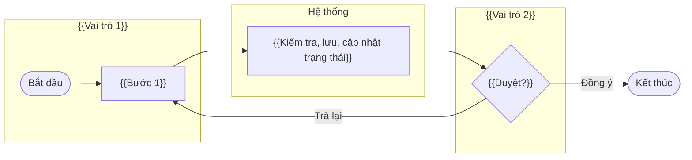
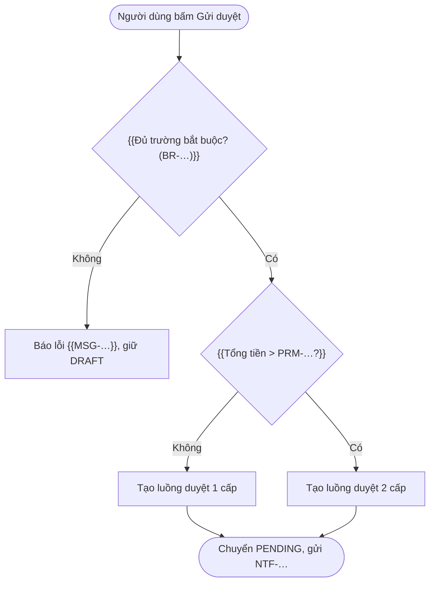
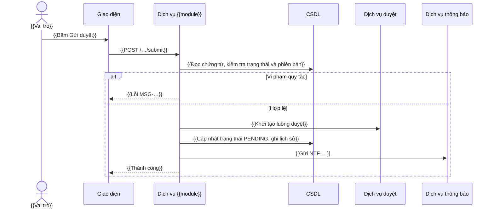
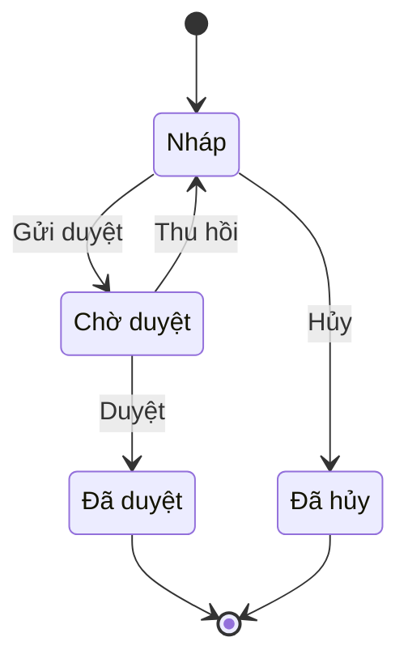
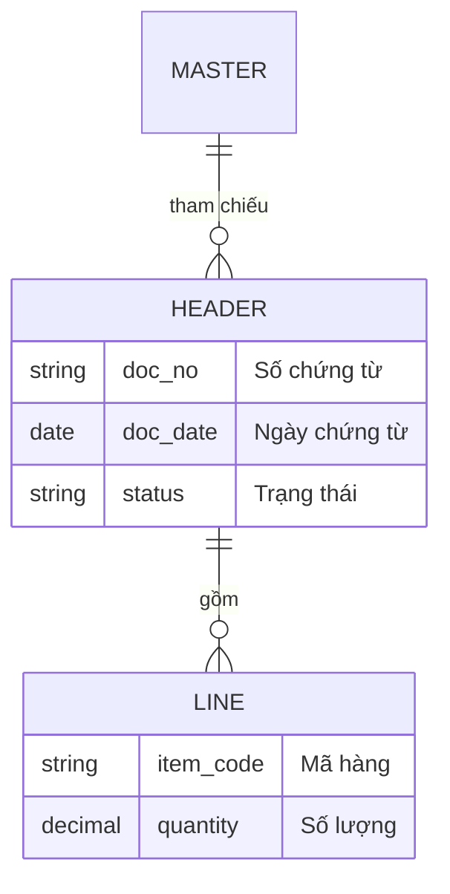

# {{FN_ID}} — {{FN_NAME}}

<!-- HƯỚNG DẪN CHUNG (xem skill `erp-ba-step3-specification`)
- Mục tiêu: dev lập trình và QA viết test case được NGAY, không cần hỏi lại BA. Gặp chỗ không biết → [CẦN XÁC NHẬN: Q-…], không đoán.
- Không xóa mục nào. Mục không áp dụng: "N/A – <lý do>".
- Vai trò, tham số, danh mục, loại chứng từ, trạng thái: chỉ tham chiếu ID đã định nghĩa trong catalogs/. Không định nghĩa lại ở đây.
- Mỗi FR/BR có cột Nguồn. Nội dung không có nguồn khách hàng → [ĐỀ XUẤT → Q-…].
- Đối chiếu chuẩn: erp-ba-core/references/design-patterns.md (pattern), erp-ba-core/references/processes/*.md (quy trình), erp-ba-core/references/industries/*.md (ngành).
-->

## 0. Thông tin & truy vết

| Mục | Giá trị |
|---|---|
| Nguồn yêu cầu | {{REQ-… — tóm tắt 1 dòng mỗi REQ}} |
| Quy trình đầu-cuối | {{BP-…}} |
| Pattern ERP áp dụng | {{P02 Chứng từ giao dịch, P03 Duyệt nhiều cấp, P04 Luồng chứng từ}} |
| Tham chiếu chuẩn | {{erp-ba-core/references/processes/p2p-procure-to-pay.md §5–§8}} |
| Chức năng đứng trước (upstream) | {{FN-… — tạo từ chứng từ nào}} |
| Chức năng đứng sau (downstream) | {{FN-… — sinh ra chứng từ nào}} |
| Loại chứng từ | {{DOC-…}} |
| Danh mục sử dụng | {{MD-…}} |
| Tham số sử dụng | {{PRM-…}} |
| Báo cáo liên quan | {{RPT-…}} |
| Tích hợp / thông báo | {{INT-…, NTF-…}} |

## 1. Mô tả & mục tiêu

- **Mục đích nghiệp vụ:** {{1–3 câu: chức năng giải quyết việc gì cho ai}}
- **Trong phạm vi:** {{…}}
- **Ngoài phạm vi:** {{… (và chức năng nào đảm nhận)}}
- **Sự kiện kích hoạt (trigger):** {{…}}
- **Tiền điều kiện:** {{dữ liệu/danh mục/tham số/quyền phải có trước}}
- **Hậu điều kiện:** {{trạng thái dữ liệu sau khi hoàn tất — kể cả ở module khác}}

## 2. Vai trò & phân quyền

### 2.1 Vai trò tham gia

<!-- Liệt kê CẢ vai trò chính lẫn vai trò chỉ thao tác một phần (ví dụ kế toán chỉ cập nhật tài khoản hạch toán, thủ kho chỉ xem) và vai trò hệ thống (job tự động). -->

| Vai trò | Mức tham gia | Được làm gì trong chức năng này |
|---|---|---|
| {{ROLE-…}} | {{Chính / Duyệt / Một phần / Chỉ xem / Hệ thống}} | {{…}} |

### 2.2 Ma trận quyền theo hành động

<!-- Hành động chuẩn: Xem, Tạo, Sửa, Xóa, Gửi duyệt, Thu hồi, Duyệt, Từ chối, Trả lại, Ghi sổ, Bỏ ghi sổ, Hủy, Đảo, Đóng, In, Xuất file, Nhập file, Cấu hình. Chỉ giữ hành động có nghĩa với chức năng này.
Ô: "✔ <phạm vi dữ liệu> [điều kiện]" hoặc "✖". Phạm vi: Của mình / Phòng ban / Chi nhánh / Công ty / Toàn hệ thống / theo kho / theo dự án. -->

| Hành động | {{ROLE-A}} | {{ROLE-B}} | {{ROLE-C}} |
|---|---|---|---|
| Xem | {{✔ Chi nhánh}} | {{✔ Công ty}} | {{✔ Công ty}} |
| Tạo | {{✔}} | {{✖}} | {{✖}} |
| Sửa | {{✔ Của mình, khi DRAFT/RETURNED}} | {{✖}} | {{✖}} |

### 2.3 Phân quyền trường dữ liệu & phạm vi dữ liệu đặc biệt

| Trường / nhóm dữ liệu | Vai trò | Quyền (ẩn / chỉ xem / sửa) | Điều kiện |
|---|---|---|---|
| {{Đơn giá}} | {{ROLE-…}} | {{Ẩn}} | {{…}} |

### 2.4 Phân tách nhiệm vụ & hạn mức

{{Tham chiếu SOD-…, hạn mức duyệt (PRM-…). Ví dụ: người duyệt KHÔNG ĐƯỢC là người tạo (SOD-01).}}

## 3. User stories & tiêu chí nghiệm thu

| ID | User story | Vai trò | Ưu tiên | Nguồn | AC |
|---|---|---|---|---|---|
| {{US-MOD-NN-01}} | Là {{vai trò}}, tôi muốn {{mục tiêu}}, để {{giá trị}} | {{ROLE-…}} | {{Must}} | {{REQ-…}} | {{AC-MOD-NN-01, AC-MOD-NN-02}} |

#### {{AC-MOD-NN-01}} — {{tên tình huống}} ({{US-MOD-NN-01}}, {{FR-MOD-NN-01}})
- **Cho trước** {{ngữ cảnh: dữ liệu, trạng thái, quyền — có giá trị cụ thể}}
- **Khi** {{hành động}}
- **Thì** {{kết quả đo được: dữ liệu, trạng thái, thông báo MSG-…}}

## 4. Luồng nghiệp vụ

### 4.1 Sơ đồ luồng nghiệp vụ (swimlane)

### 4.2 Luồng chính

| Bước | Vai trò | Hành động người dùng | Xử lý của hệ thống | Quy tắc áp dụng | Trạng thái sau bước |
|---|---|---|---|---|---|
| 1 | {{ROLE-…}} | {{…}} | {{…}} | {{BR-…}} | {{DRAFT}} |

### 4.3 Luồng thay thế

| ID | Tại bước | Điều kiện | Diễn biến | Quay lại bước |
|---|---|---|---|---|
| A1 | {{…}} | {{…}} | {{…}} | {{…}} |

### 4.4 Luồng ngoại lệ

| ID | Tại bước | Tình huống lỗi | Hệ thống xử lý | Thông báo |
|---|---|---|---|---|
| E1 | {{…}} | {{…}} | {{chặn lưu / cảnh báo / ghi log}} | {{MSG-…}} |

## 5. Sơ đồ quyết định (logic rẽ nhánh)

<!-- Mỗi điều kiện trong mục 9 (BR) có rẽ nhánh phải xuất hiện thành một hình thoi, mọi nhánh có nhãn và kết thúc ở một kết quả cụ thể (MSG/trạng thái). -->

## 6. Sơ đồ tuần tự (sequence)

## 7. Trạng thái chứng từ

<!-- N/A – <lý do> nếu chức năng không quản lý chứng từ có trạng thái. Bộ trạng thái phải khớp catalogs/document-types.md. -->

### 7.1 Sơ đồ trạng thái

### 7.2 Bảng chuyển trạng thái

| Từ | Hành động | Đến | Vai trò | Điều kiện (BR) | Tác động hệ thống (kho / công nợ / sổ cái / ngân sách / thông báo) |
|---|---|---|---|---|---|
| {{DRAFT}} | {{Gửi duyệt}} | {{PENDING}} | {{ROLE-…}} | {{BR-…}} | {{NTF-…}} |

### 7.3 Quyền sửa trường theo trạng thái

| Trường / nhóm trường | DRAFT | PENDING | APPROVED | {{…}} |
|---|---|---|---|---|
| {{Thông tin chung}} | {{Sửa}} | {{Khóa}} | {{Khóa}} | {{…}} |

## 8. Yêu cầu chức năng (FR)

| ID | Yêu cầu (Hệ thống PHẢI …) | Ưu tiên | Nguồn | AC kiểm chứng |
|---|---|---|---|---|
| {{FR-MOD-NN-01}} | {{…}} | {{Must}} | {{REQ-…}} | {{AC-…}} |

## 9. Quy tắc nghiệp vụ (BR)

<!-- Loại: Validation / Tính toán / Mặc định / Ràng buộc / Phân quyền / Luồng. Công thức viết đầy đủ, nêu làm tròn. Validation phải có MSG. -->

| ID | Quy tắc (điều kiện → kết quả) | Loại | Nguồn | Thông báo |
|---|---|---|---|---|
| {{BR-MOD-NN-01}} | {{Khi … thì …}} | {{Validation}} | {{REQ-… / chuẩn / luật}} | {{MSG-…}} |

**Công thức:**

| Đại lượng | Công thức | Làm tròn | Ghi chú |
|---|---|---|---|
| {{Thành tiền dòng}} | {{Số lượng × Đơn giá × (1 − Tỷ lệ chiết khấu)}} | {{0 chữ số thập phân với VND}} | {{BR-GEN-01}} |

## 10. Dữ liệu

### 10.1 Mô hình dữ liệu

### 10.2 Đặc tả trường dữ liệu

<!-- Mỗi bảng (header, lines, bảng phụ) một bảng đặc tả. "Sửa được ở trạng thái" phải khớp mục 7.3. -->

**Bảng: {{tên bảng nghiệp vụ}}**

| # | Tên trường | Tên kỹ thuật | Kiểu | Độ dài / độ chính xác | Bắt buộc | Mặc định | Nguồn dữ liệu / lookup | Kiểm tra (BR) | Sửa được ở trạng thái | Ghi chú |
|---|---|---|---|---|---|---|---|---|---|---|
| 1 | {{Số chứng từ}} | {{doc_no}} | {{Chuỗi}} | {{30}} | {{Có}} | {{Tự sinh theo DOC-…}} | {{—}} | {{Duy nhất (BR-…)}} | {{Không}} | {{…}} |

### 10.3 Dữ liệu sinh ra / ảnh hưởng ở module khác

| Thời điểm | Dữ liệu / sổ bị ảnh hưởng | Nội dung ghi | Hoàn tác khi hủy / đảo |
|---|---|---|---|
| {{Khi APPROVED}} | {{Cam kết ngân sách}} | {{…}} | {{…}} |

## 11. Giao diện

### 11.1 Màn hình danh sách

| Thành phần | Đặc tả |
|---|---|
| Cột hiển thị (thứ tự) | {{…}} |
| Bộ lọc mặc định | {{…}} |
| Tìm kiếm | {{theo trường nào, khớp đúng/gần đúng}} |
| Sắp xếp mặc định | {{…}} |
| Phân trang | {{số dòng/trang}} |
| Hành động trên dòng / hàng loạt | {{…}} |
| Xuất file | {{Excel: cột nào}} |

### 11.2 Màn hình chi tiết / biểu mẫu

| Vùng / tab | Trường (thứ tự) | Ghi chú hiển thị |
|---|---|---|
| {{Thông tin chung}} | {{…}} | {{…}} |

**Nút theo trạng thái và vai trò:**

| Nút | Hiển thị khi (trạng thái) | Vai trò | Hành vi |
|---|---|---|---|
| {{Gửi duyệt}} | {{DRAFT, RETURNED}} | {{ROLE-…}} | {{Chạy kiểm tra mục 5, chuyển PENDING}} |

### 11.3 Phác thảo màn hình

{{Wireframe ASCII hoặc link Figma; "N/A – theo khung giao diện chuẩn của dự án" nếu dự án có design system.}}

### 11.4 Mẫu in

{{Tên mẫu, trường in, căn cứ mẫu biểu (nếu theo luật) — hoặc N/A – lý do}}

## 12. Tham số hệ thống áp dụng

| Tham số | Giá trị mặc định | Hành vi của chức năng theo từng giá trị |
|---|---|---|
| {{PRM-…}} | {{…}} | {{Bật: … / Tắt: …}} |

## 13. Hạch toán & tác động sổ sách

<!-- Theo chế độ kế toán ghi ở srs-overview.md mục 12. Có cả bút toán khi hủy/đảo. N/A – <lý do> nếu không ảnh hưởng tài chính. -->

| Sự kiện | Nợ | Có | Số tiền | Đối tượng chi tiết (khách hàng / NCC / kho / dự án / phòng ban) | Ghi chú |
|---|---|---|---|---|---|
| {{Ghi sổ}} | {{TK …}} | {{TK …}} | {{…}} | {{…}} | {{…}} |

## 14. Tích hợp, API & thông báo

### 14.1 Tác động liên chức năng / sự kiện

| Sự kiện | Chức năng / module nhận | Dữ liệu truyền | Đồng bộ hay bất đồng bộ | Khi lỗi |
|---|---|---|---|---|
| {{…}} | {{FN-…}} | {{…}} | {{…}} | {{…}} |

### 14.2 Giao tiếp với hệ thống ngoài / API

{{Bảng endpoint/thông điệp (INT-…), hoặc "N/A – không trao đổi với hệ thống ngoài".}}

### 14.3 Thông báo

| Thông báo | Sự kiện | Người nhận | Kênh |
|---|---|---|---|
| {{NTF-…}} | {{…}} | {{…}} | {{…}} |

## 15. Báo cáo / truy vấn liên quan

{{RPT-… và cách dữ liệu của chức năng này xuất hiện trong báo cáo; hoặc N/A – lý do}}

## 16. Yêu cầu phi chức năng riêng

| ID | Nhóm | Yêu cầu đo được | Nguồn |
|---|---|---|---|
| {{NFR-MOD-NN-01}} | {{Đồng thời}} | {{Hai người cùng sửa một chứng từ: người lưu sau nhận MSG-… và phải tải lại (khóa lạc quan theo phiên bản)}} | {{NFR-… chung / REQ-…}} |

## 17. Thông báo & lỗi (MSG)

| ID | Điều kiện xuất hiện | Nội dung hiển thị | Loại | Hành vi |
|---|---|---|---|---|
| {{MSG-MOD-NN-01}} | {{…}} | "{{…}}" | {{Lỗi / Cảnh báo / Thông tin / Xác nhận}} | {{Chặn / Không chặn}} |

## 18. Tình huống biên & kịch bản kiểm thử

### 18.1 Tình huống biên

| # | Tình huống | Kết quả mong đợi | Quy tắc |
|---|---|---|---|
| 1 | {{Số lượng = 0 / âm}} | {{…}} | {{BR-…}} |
| 2 | {{Kỳ kế toán đã khóa}} | {{…}} | {{BR-GEN-…}} |
| 3 | {{Danh mục đã ngừng dùng}} | {{…}} | {{…}} |
| 4 | {{Hai người thao tác đồng thời}} | {{…}} | {{NFR-…}} |

### 18.2 Kịch bản kiểm thử chính

| # | Kịch bản | Dữ liệu vào | Kết quả mong đợi | AC |
|---|---|---|---|---|
| 1 | {{…}} | {{…}} | {{…}} | {{AC-…}} |

## 19. Câu hỏi mở, giả định, quyết định liên quan

| ID | Nội dung | Trạng thái |
|---|---|---|
| {{Q-… / ASM-… / DEC-…}} | {{…}} | {{Mở / Đã trả lời}} |

## 20. Lịch sử thay đổi

| Phiên bản | Ngày | Người sửa | Nội dung | CHG / vòng review |
|---|---|---|---|---|
| 0.1 | {{DATE}} | {{…}} | Tạo mới | — |
