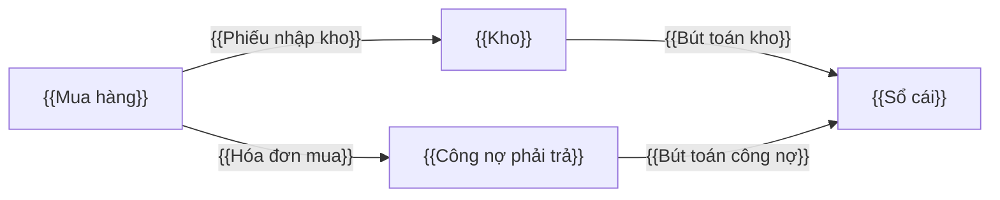

# Đặc tả yêu cầu phần mềm (SRS) — tổng quan — {{PROJECT}}

<!-- HƯỚNG DẪN (xem skill `erp-ba-step3-specification`)
- File này là "mục lục sống" của toàn bộ đặc tả: module, danh sách chức năng, quy tắc chung, NFR. Chi tiết từng chức năng nằm ở functions/<MOD>/FN-….md
- Danh sách chức năng (mục 3) phải khớp 1-1 với các file trong functions/ (ba.py trace kiểm tra).
-->

## 1. Giới thiệu

| Mục | Nội dung |
|---|---|
| Mục đích tài liệu | Đặc tả đủ chi tiết để đội phát triển lập trình và đội kiểm thử viết test case mà không cần hỏi lại BA |
| Phạm vi | {{module, giai đoạn}} |
| Đối tượng đọc | Dev, QA, PM, khách hàng (PO) |
| Tài liệu liên quan | `02-requirements/requirements-overview.md`, `02-requirements/requirement-register.md`, `02-requirements/issue-log.md` |
| Quy ước | ID, marker, trạng thái: theo `erp-ba-core/references/conventions.md` của skill erp-ba-core |

## 2. Kiến trúc nghiệp vụ

### 2.1 Danh sách module

| ID | Mã | Tên module | Mục đích | REQ chính |
|---|---|---|---|---|
| MOD-{{PUR}} | {{PUR}} | {{Mua hàng}} | {{…}} | {{REQ-…}} |

### 2.2 Bản đồ module & luồng chứng từ liên module

## 3. Danh sách chức năng (Function breakdown)

<!-- Mỗi module phải có đủ 5 thành phần: chức năng hệ thống/cấu hình, chức năng danh mục cho mọi MD dùng, chức năng nghiệp vụ cho mọi chứng từ, phân quyền & tham số, báo cáo. "Loại": Danh mục / Chứng từ / Phê duyệt / Báo cáo / Cấu hình / Tích hợp / Tác vụ nền / Tiện ích. -->

| FN | Tên chức năng | Module | Loại | Pattern ERP | Nguồn (REQ/FEAT/DEC) | Ưu tiên | Trạng thái đặc tả | File |
|---|---|---|---|---|---|---|---|---|
| {{FN-PUR-01}} | {{…}} | {{PUR}} | {{Chứng từ}} | {{P02, P03, P04}} | {{REQ-…}} | {{Must}} | {{Draft}} | `functions/{{PUR}}/{{FN-PUR-01-slug}}.md` |

### 3.1 Kiểm tra độ phủ 5 thành phần theo module

| Module | Hệ thống / cấu hình | Danh mục | Nghiệp vụ | Phân quyền & tham số | Báo cáo | Tiện ích / tích hợp |
|---|---|---|---|---|---|---|
| {{PUR}} | {{FN-…}} | {{FN-…}} | {{FN-…}} | {{FN-… / PRM-…}} | {{FN-… / RPT-…}} | {{FN-…}} |

## 4. Danh mục dùng chung

Định nghĩa: `catalogs/master-data.md`.

## 5. Loại chứng từ & trạng thái

Định nghĩa: `catalogs/document-types.md`.

## 6. Vai trò & phân quyền

Định nghĩa: `catalogs/roles-permissions.md`.

## 7. Tham số hệ thống

Định nghĩa: `catalogs/system-parameters.md`.

## 8. Báo cáo

Định nghĩa: `catalogs/reports.md`.

## 9. Tích hợp & thông báo

Định nghĩa: `catalogs/integrations-notifications.md`.

## 10. Quy tắc nghiệp vụ toàn hệ thống (BR-GEN)

<!-- Bắt buộc có tối thiểu các nhóm: làm tròn, tiền tệ & tỷ giá, đánh số chứng từ, ngày chứng từ vs ngày ghi sổ, khóa kỳ, xóa/hủy/đảo, lưu vết (audit), múi giờ & định dạng, đa công ty/chi nhánh, đính kèm. -->

| ID | Quy tắc | Nhóm | Nguồn |
|---|---|---|---|
| BR-GEN-01 | {{Số tiền VND làm tròn đến đơn vị đồng ở từng dòng; tổng chứng từ = tổng các dòng đã làm tròn}} | Làm tròn | {{DEC-… / chuẩn}} |
| BR-GEN-02 | {{Chứng từ đã ghi sổ KHÔNG ĐƯỢC xóa; chỉ được đảo (REVERSED) hoặc bỏ ghi sổ khi kỳ còn mở và người dùng có quyền}} | Xóa/hủy/đảo | {{erp-ba-core/references/regulations/vn-accounting.md}} |

## 11. Yêu cầu phi chức năng (NFR)

<!-- Đo được. Tham khảo erp-ba-core/references/nfr-catalog.md. Con số mặc định phải được khách hàng xác nhận (Q/DEC). -->

| ID | Nhóm | Yêu cầu | Chỉ số / ngưỡng | Cách kiểm chứng | Nguồn |
|---|---|---|---|---|---|
| NFR-PERF-01 | Hiệu năng | {{Màn hình danh sách chứng từ trả kết quả trang đầu}} | {{≤ 2 giây ở p95 với 1 triệu bản ghi, 100 người dùng đồng thời}} | {{Kiểm thử tải}} | {{REQ-… / DEC-…}} |

## 12. Chế độ kế toán & quy định áp dụng

| Hạng mục | Lựa chọn của dự án | Nguồn |
|---|---|---|
| Chế độ kế toán | {{TT99/2025/TT-BTC hoặc TT133/2016/TT-BTC}} | {{DEC-…}} |
| Phương pháp tính giá xuất kho | {{Bình quân gia quyền cuối kỳ / tức thời / FIFO / đích danh}} | {{DEC-…}} |
| Hóa đơn điện tử | {{nhà cung cấp, có/không mã CQT}} | {{DEC-…}} |
| Đồng tiền hạch toán | {{VND}} | {{…}} |

## 13. Chuyển đổi dữ liệu

| Dữ liệu | Nguồn hiện tại | Thời điểm chốt | Quy tắc chuyển đổi | FN nhập liệu |
|---|---|---|---|---|
| {{Danh mục vật tư}} | {{Excel}} | {{…}} | {{…}} | {{FN-…}} |

## 14. Thuật ngữ

Xem `catalogs/glossary.md`.

## 15. Truy vết

Ma trận truy vết sinh tự động: `traceability.md` (lệnh `python3 scripts/ba.py trace <root>`).
