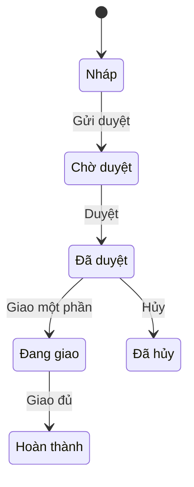

# FN-SAL-02 — Đơn bán hàng

## 0. Thông tin & truy vết

| Mục | Giá trị |
|---|---|
| Nguồn yêu cầu | REQ-101, REQ-102, REQ-103, REQ-105, REQ-107, REQ-108, REQ-109, REQ-110 |
| Loại chứng từ | DOC-SO |
| Danh mục sử dụng | MD-CUSTOMER, MD-ITEM, MD-PRICELIST |

## 1. Mô tả & mục tiêu

Nhân viên kinh doanh lập đơn bán hàng cho khách, đơn được duyệt theo giá trị, sau đó kho soạn và giao hàng nhiều lần đến khi đủ. Hệ thống đồng thời tích điểm cho khách hàng thân thiết để tăng doanh số.

## 2. Vai trò & phân quyền

| Vai trò | Mức tham gia | Được làm gì |
|---|---|---|
| ROLE-SAL-STAFF | Chính | Tạo, sửa, gửi duyệt đơn |
| ROLE-SAL-MGR | Duyệt | Duyệt đơn dưới ngưỡng |
| ROLE-SAL-DIRECTOR | Duyệt | Duyệt đơn từ ngưỡng |
| ROLE-ACC | Chỉ xem | Xem tất cả đơn |

| Hành động | ROLE-SAL-STAFF | ROLE-SAL-MGR | ROLE-SAL-DIRECTOR | ROLE-ACC |
|---|---|---|---|---|
| Xem | ✔ Của mình | ✔ Công ty | ✔ Công ty | ✔ Công ty |
| Tạo | ✔ | ✖ | ✖ | ✖ |
| Sửa | ✔ Của mình, khi DRAFT | ✖ | ✖ | ✖ |
| Duyệt | ✔ Của mình, khi PENDING | ✔ | ✔ | ✖ |
| Hủy | ✔ Của mình | ✔ | ✖ | ✖ |

## 3. User stories & tiêu chí nghiệm thu

| ID | User story | AC |
|---|---|---|
| US-SAL-02-01 | Là nhân viên kinh doanh, tôi muốn lập đơn cho khách, để giao hàng | AC-SAL-02-01 |
| US-SAL-02-02 | Là trưởng phòng kinh doanh, tôi muốn duyệt đơn, để kiểm soát bán hàng | AC-SAL-02-02 |

#### AC-SAL-02-01 — Lập đơn
- **Cho trước** khách hàng KH-001 thuộc nhóm "Đại lý cấp 1"
- **Khi** nhân viên lập đơn 10 thùng mã SP-01
- **Thì** đơn lưu ở DRAFT với giá theo bảng giá nhóm "Đại lý cấp 1"

#### AC-SAL-02-02 — Duyệt đơn
- **Cho trước** đơn PENDING 150 triệu
- **Khi** trưởng phòng duyệt
- **Thì** đơn chuyển APPROVED

## 4. Luồng nghiệp vụ

| Bước | Vai trò | Hành động | Hệ thống | Trạng thái sau |
|---|---|---|---|---|
| 1 | ROLE-SAL-STAFF | Lập đơn, chọn khách, hàng | Lấy giá theo bảng giá | DRAFT |
| 2 | ROLE-SAL-STAFF | Gửi duyệt | Xác định người duyệt theo ngưỡng | PENDING |
| 3 | ROLE-SAL-MGR / ROLE-SAL-DIRECTOR | Duyệt | Ghi nhận doanh thu | APPROVED |
| 4 | Hệ thống | — | Cập nhật số đã giao từ phiếu xuất kho | DELIVERING / COMPLETED |

## 5. Sơ đồ quyết định

```mermaid
flowchart TD
    S(["Gửi duyệt"]) --> C1{"Đủ thông tin?"}
    C1 -->|"Không"| M1["Báo lỗi MSG-SAL-02-01"]
    C1 -->|"Có"| C2{"Tổng tiền > 100 triệu?"}
    C2 -->|"Có"| D1[Giám đốc kinh doanh duyệt (cấp 2)]
    D1 --> E(["PENDING"])
```

## 7. Trạng thái chứng từ



| Từ | Hành động | Đến | Điều kiện |
|---|---|---|---|
| DRAFT | Gửi duyệt | PENDING | Đủ thông tin |
| PENDING | Duyệt | APPROVED | Đúng cấp |
| APPROVED | Giao một phần | DELIVERING | Có phiếu xuất |
| DELIVERING | Giao đủ | COMPLETED | Đã giao đủ |
| DRAFT, PENDING, APPROVED, DELIVERING | Hủy | CANCELLED | Mọi trạng thái trừ COMPLETED |

## 8. Yêu cầu chức năng (FR)

| ID | Yêu cầu | Nguồn | AC |
|---|---|---|---|
| FR-SAL-02-01 | Hệ thống phải cho nhân viên lập đơn chọn khách, hàng từ danh mục | REQ-101 | AC-SAL-02-01 |
| FR-SAL-02-02 | Hệ thống phải lấy giá theo bảng giá của nhóm khách hàng | REQ-102 | AC-SAL-02-01 |
| FR-SAL-02-03 | Hệ thống phải xác định người duyệt theo giá trị đơn | REQ-103 | AC-SAL-02-02 |
| FR-SAL-02-04 | Hệ thống phải cập nhật số lượng đã giao từ phiếu xuất kho | REQ-107 | AC-SAL-02-02 |
| FR-SAL-02-05 | Hệ thống phải in đơn bán hàng | REQ-101 | — |
| FR-SAL-02-06 | Hệ thống tự động cộng điểm tích lũy cho khách hàng thân thiết bằng 1% giá trị đơn khi đơn được duyệt | REQ-101 | AC-SAL-02-02 |

## 9. Quy tắc nghiệp vụ (BR)

| ID | Quy tắc | Loại | Nguồn | Thông báo |
|---|---|---|---|---|
| BR-SAL-02-01 | Đơn phải có khách hàng và ít nhất 1 dòng hàng | Validation | REQ-101 | MSG-SAL-02-01 |
| BR-SAL-02-02 | Đơn trên 100 triệu do Giám đốc kinh doanh duyệt, còn lại do Trưởng phòng kinh doanh duyệt | Luồng | REQ-103 | — |
| BR-SAL-02-03 | Chiết khấu mỗi dòng không quá 5% | Validation | REQ-110 | — |
| BR-SAL-02-04 | Giá bán phải phù hợp với chính sách công ty | Validation | REQ-102 | — |

## 10. Dữ liệu

| Trường | Kiểu | Bắt buộc | Sửa được ở trạng thái | Ghi chú |
|---|---|---|---|---|
| Số đơn | Chuỗi 30 | Có | Không | Tự sinh |
| Khách hàng | Khóa ngoại | Có | DRAFT | MD-CUSTOMER |
| Hàng hóa | Khóa ngoại | Có | DRAFT | MD-ITEM |
| Số lượng | Số 18,3 | Có | DRAFT | > 0 |
| Đơn giá | Số 18,4 | Có | DRAFT | Lấy từ bảng giá, nhân viên sửa được khi cần |
| Chiết khấu % | Số 5,2 | Không | DRAFT | |
| Số lượng đã giao | Số 18,3 | Có | Không | Cập nhật từ phiếu xuất |

## 13. Hạch toán

| Sự kiện | Nợ | Có | Ghi chú |
|---|---|---|---|
| Duyệt đơn | 131 | 511, 3331 | Ghi nhận doanh thu và thuế GTGT đầu ra khi đơn được duyệt |

## 16. Yêu cầu phi chức năng

| ID | Yêu cầu |
|---|---|
| NFR-SAL-02-01 | Hệ thống phải phản hồi nhanh khi tạo đơn |

## 17. Thông báo

| ID | Nội dung |
|---|---|
| MSG-SAL-02-01 | "Vui lòng nhập đủ khách hàng và hàng hóa." |
