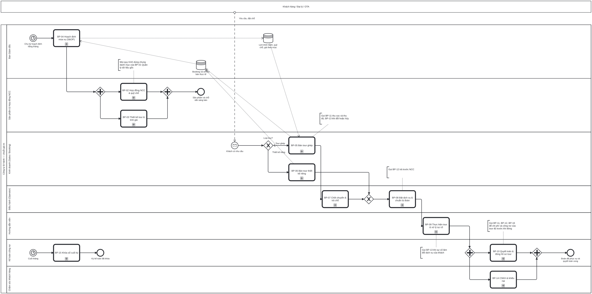

# Bộ quy trình BPMN chuẩn ERP cho doanh nghiệp điều hành tour

17 sơ đồ BPMN 2.0 (một sơ đồ tổng quan và 16 quy trình) mô tả các quy trình chuẩn ERP, áp vào một công ty lữ hành: thiết kế tour, ký hợp đồng NCC, bán, điều hành, thực hiện, quyết toán, công nợ, khóa sổ.

Mỗi quy trình gồm:

- `bpmn/BP-xx-*.bpmn`: BPMN 2.0 chuẩn có toạ độ, mở và sửa được bằng Camunda Modeler, bpmn.io, draw.io (Arrange → Insert → Advanced → BPMN) hoặc các công cụ BPMN khác.
- `svg/`, `png/`: ảnh để chèn vào tài liệu.
- `docs/BP-xx-*.md`: tài liệu đi kèm gồm thông tin chung, vai trò, bảng các bước, điểm quyết định, trao đổi với bên ngoài, kiểm soát nội bộ, chứng từ và trạng thái, bút toán, tham số, KPI, căn cứ từ sách, điểm cần doanh nghiệp xác nhận.

Sơ đồ và tài liệu sinh ra từ cùng một định nghĩa trong `defs/` bằng bộ công cụ dùng chung [`bpmn-kit`](../../bpmn-kit/README.md), nên bảng bước luôn khớp với sơ đồ. Bộ câu hỏi mang đi khảo sát: [`CAU-HOI-KHAO-SAT.md`](CAU-HOI-KHAO-SAT.md).



## Danh mục quy trình

| Mã | Quy trình | Quy trình chuẩn ERP tương ứng | Vai trò chính |
|---|---|---|---|
| [BP-00](docs/BP-00-tong-quan-chuoi-gia-tri.md) | Tổng quan chuỗi giá trị | Plan → Source → Make → Sell → Settle → Report | Toàn công ty |
| [BP-01](docs/BP-01-quan-ly-du-lieu-goc.md) | Quản lý dữ liệu gốc | Master Data Management | Bộ phận đề nghị, Quản trị dữ liệu, Kế toán trưởng |
| [BP-02](docs/BP-02-hop-dong-ncc-quy-cho.md) | Hợp đồng NCC & quỹ chỗ | Procure-to-Pay (nguồn cung), Supplier Scheduling | Sản phẩm, Ban Giám đốc |
| [BP-03](docs/BP-03-thiet-ke-tour-tinh-gia.md) | Thiết kế tour & tính giá | Định mức sản phẩm, giá thành dự toán, định giá | Sản phẩm, Ban Giám đốc |
| [BP-04](docs/BP-04-hoach-dinh-mua-vu-lich-khoi-hanh.md) | Hoạch định mùa vụ (S&OP) | Sales & Operations Planning | Ban Giám đốc, Kinh doanh, Sản phẩm, Điều hành, Kế toán |
| [BP-05](docs/BP-05-ban-tour-ghep.md) | Bán tour ghép | Order-to-Cash: ATP, kiểm tra tín dụng | Kinh doanh, Kế toán |
| [BP-06](docs/BP-06-ban-tour-thiet-ke-rieng.md) | Bán tour thiết kế riêng — hai luồng dựng chương trình: thủ công và xây bằng AI | Quote-to-Cash (thiết kế theo đơn) | Kinh doanh, Điều hành |
| [BP-07](docs/BP-07-chot-chuyen-tra-cho.md) | Chốt chuyến & trả chỗ | Master scheduling, time fence | Trưởng phòng KD, Ban Giám đốc |
| [BP-08](docs/BP-08-dat-dich-vu-chuan-bi-doan.md) | Đặt dịch vụ & chuẩn bị đoàn | Procure-to-Pay: đặt hàng từ định mức | Điều hành, HDV |
| [BP-09](docs/BP-09-thuc-hien-tour-xu-ly-su-co.md) | Thực hiện tour & xử lý sự cố | Thực thi & phản hồi; nghiệm thu dịch vụ | HDV, Điều hành |
| [BP-10](docs/BP-10-quyet-toan-dong-ho-so-tour.md) | Quyết toán & đóng hồ sơ tour | Giá thành theo đơn/dự án | Kế toán, Điều hành, Kế toán trưởng |
| [BP-11](docs/BP-11-thu-tien-cong-no-phai-thu.md) | Thu tiền & công nợ phải thu | Invoice-to-Cash, đối chiếu công nợ | Kế toán, Kinh doanh |
| [BP-12](docs/BP-12-thanh-toan-ncc-cong-no-phai-tra.md) | Thanh toán NCC & công nợ phải trả | Invoice verification, Pay | Kế toán, Kế toán trưởng, Thủ quỹ |
| [BP-13](docs/BP-13-thay-doi-huy-booking-hoan-tien.md) | Thay đổi, hủy booking & hoàn tiền | Change order, giảm trừ, hoàn tiền | Kinh doanh, Điều hành, Kế toán |
| [BP-14](docs/BP-14-cham-soc-khach-hang-khieu-nai.md) | CSKH & khiếu nại | CRM dịch vụ: ticket, SLA, CSAT | CSKH, Điều hành |
| [BP-15](docs/BP-15-khoa-so-cuoi-ky.md) | Khóa sổ cuối kỳ | Record-to-Report | Kế toán, Kế toán trưởng |
| [BP-16](docs/BP-16-hdv-cong-tac-chi-tra-thu-lao.md) | HDV cộng tác & chi trả thù lao | Quản lý cộng tác viên và chi trả | Nhân sự, Kế toán |

## Cách xem

- **Đọc nhanh:** mở `docs/*.md` (VS Code: Markdown Preview). Ảnh SVG nằm ở đầu mỗi tài liệu.
- **Xem tương tác:** chạy `python3 -m http.server 8000` ở **gốc repo** rồi mở <http://localhost:8000/examples/tour-operator/viewer.html>. Trang này cho chọn sơ đồ, cuộn để phóng to, kéo để di chuyển. Bấm biểu tượng ở góc ô quy trình con để mở bên trong (ví dụ "Thực hiện lịch trình từng ngày" ở BP-09).
- **Sửa sơ đồ:** mở file `.bpmn` bằng Camunda Modeler hoặc kéo thả vào <https://demo.bpmn.io>. Lưu ý: nếu sửa tay file `.bpmn` thì lần sinh lại sau sẽ ghi đè. Muốn giữ thay đổi lâu dài thì sửa trong `defs/` rồi sinh lại.

## Ký hiệu dùng trong bộ sơ đồ

| Ký hiệu | Ý nghĩa trong bộ này |
|---|---|
| Pool lớn có nhiều làn | Công ty lữ hành; mỗi làn là một vai trò (xem `defs/_common.py`). Làn **Hệ thống ERP** chứa mọi bước máy tự làm, để thấy rõ cái gì máy làm, cái gì người làm |
| Pool hộp đen (trên/dưới) | Bên ngoài: khách hàng/đại lý/OTA, nhà cung cấp, ngân hàng, cơ quan thuế, HDV cộng tác |
| Mũi tên nét đứt có vòng tròn | Luồng thông điệp với bên ngoài |
| Công việc có hình người | Người dùng thao tác trên hệ thống |
| Công việc có bánh răng | Hệ thống tự động (quy tắc, tính toán, chuyển trạng thái) |
| Công việc có phong bì | Gửi (đen) / nhận (trắng) thông điệp |
| Ô viền đậm có dấu + | Gọi sang quy trình khác (call activity), tên bắt đầu bằng mã BP-xx |
| Hình thoi X / + / ngũ giác | Rẽ nhánh một trong nhiều / song song / chờ sự kiện nào đến trước |
| Đồng hồ trên viền công việc | Hết hạn (ví dụ hết hạn giữ chỗ, quá hạn thanh toán) |
| Ngoặc vuông chữ nhỏ nối nét chấm | **Điểm kiểm soát**; mã `Cxx-nn` tra ở mục "Kiểm soát nội bộ" của tài liệu |
| Cổng X không tên | Chỉ để gộp nhánh (cú pháp BPMN), không phải bước nghiệp vụ |

## Nguyên tắc thiết kế rút từ 4 cuốn sách

1. **ERP là quy trình và con người, không chỉ phần mềm.** Mỗi bước có một vai trò chịu trách nhiệm, và các bước máy làm được tách riêng ở làn hệ thống — Wallace ch01, Parthasarathy ch12 (swimlane, tách actor ngoài và vai trò trong).
2. **Tích hợp, nhập một lần tại nguồn.** Giá NCC chỉ nhập ở hợp đồng (BP-02); thiết kế tour, đặt dịch vụ và đối chiếu hóa đơn đều đọc lại từ đó. Số lượng dịch vụ đã dùng do HDV nhập ở hiện trường (BP-09) và là căn cứ trả tiền NCC (BP-12) — Parthasarathy ch01, O'Leary ch04.
3. **Một bộ số.** "Mã tour" là chiều phân tích đi từ booking → đơn đặt dịch vụ → tạm ứng → hóa đơn → sổ cái (131, 331, 141, 154, 511, 632). Nhờ vậy lãi lỗ theo tour có ngay khi quyết toán, không chờ Excel cuối tháng — Wallace ch01, ch17 (Class A).
4. **Kiểm soát phòng ngừa nằm ngay trên luồng.** Maker-checker, tách nhiệm vụ (SoD), chặn theo quy tắc if/else, lưu vết, khóa kỳ. Mỗi kiểm soát được phân loại: Có sẵn / Cấu hình / Phân quyền / Báo cáo — Elbardan ch06–ch08, ch10.
5. **Vòng khép kín, xử lý theo ngoại lệ.** Hết hạn giữ chỗ, quá hạn thanh toán, quá hạn phản hồi NCC, sự cố leo thang đều là sự kiện có hẹn giờ trên sơ đồ, không dựa vào trí nhớ — Wallace ch11, ch17.
6. **Chuẩn hóa trước, tùy biến sau.** Quy trình tài chính (BP-11, BP-12, BP-15) bám sát chuẩn. Phần tạo khác biệt của nghề lữ hành dồn vào BP-03, BP-06, BP-08 — O'Leary ch09 (small-r / Big-R), Parthasarathy ch05.

### Ánh xạ khái niệm ERP chuẩn (vốn lấy ví dụ sản xuất) sang lữ hành

| Khái niệm trong sách | Tương ứng ở công ty lữ hành | Quy trình |
|---|---|---|
| BOM — định mức vật tư | Chương trình tour: danh sách dịch vụ và số lượng theo khách/đoàn | BP-03 |
| Routing — quy trình công nghệ | Lịch trình theo ngày | BP-03 |
| S&OP — khối lượng theo họ sản phẩm | Số khách theo dòng tour × tháng | BP-04 |
| Master schedule — cơ cấu chi tiết | Lịch khởi hành từng chuyến | BP-04, BP-07 |
| ATP — có thể hứa với khách | Chỗ khả dụng của chuyến và quỹ chỗ | BP-05 |
| Make-to-stock / Engineer-to-order | Tour ghép / tour thiết kế riêng | BP-05 / BP-06 |
| MRP sinh đơn mua từ BOM | Sinh "dịch vụ cần đặt" từ chương trình đã chốt | BP-08 |
| Supplier scheduling, hợp đồng dài hạn | Hợp đồng giá theo mùa + quỹ chỗ + hạn trả chỗ | BP-02, BP-07 |
| Nhập kho / nghiệm thu dịch vụ | HDV xác nhận số lượng dịch vụ đã dùng | BP-09 |
| Đối chiếu 3 chiều PO – nhận hàng – hóa đơn | Đơn đặt dịch vụ – xác nhận đã dùng – hóa đơn NCC | BP-12 |
| Giá thành theo đơn hàng | Giá thành theo tour (TK 154 gắn mã tour) | BP-10, BP-15 |
| Time fences | Hạn chốt chuyến, mốc phí hủy | BP-07, BP-13 |
| Engineering change | Phiên bản chương trình tour, yêu cầu thay đổi booking | BP-03, BP-06, BP-13 |
| Tồn kho | Không có tồn kho, chỉ có chỗ. Chỗ không bán được thì mất giá trị, nên phải trả đúng hạn | BP-07 |

## Nguồn đầu vào

- 4 cuốn sách trong [`books/`](../../books/) (Parthasarathy, Wallace & Kremzar, O'Leary, Elbardan & Kholeif). Mỗi tài liệu có mục "Căn cứ từ sách" kèm liên kết tới chương.
- Thư viện quy trình chuẩn `erp-ba-core` (bản nội bộ lúc vẽ, không kèm trong repo này) (O2C, P2P, AR, AP, tiền, R2R, HĐĐT, CRM, giá thành, dự án) cho bước, kiểm soát, bút toán theo chế độ Việt Nam. Thư viện này không có tài liệu riêng cho ngành lữ hành, nên phần áp vào lữ hành là suy luận và đã ghi rõ.
- Nghiệp vụ thực tế của ngành lấy từ hệ thống tham khảo `topas-crm` (không kèm trong repo này): quy trình 6 bước, checklist D-21…D+10, trạng thái chứng từ, ngưỡng mặc định. Các giá trị trong mục "Tham số" chỉ là **gợi ý**, doanh nghiệp phải xác nhận.

## Những điểm doanh nghiệp cần chốt trước khi cấu hình

Chi tiết nằm ở cuối mỗi tài liệu. Đây là những điểm ảnh hưởng nhiều quy trình:

1. **Khoản thu trước khởi hành là "đặt cọc bảo đảm hợp đồng" hay "thu trước tiền dịch vụ"?** Câu trả lời quyết định thời điểm phải lập hóa đơn điện tử và cách hạch toán (131 / 3387) — BP-05, BP-11.
2. **Thuế suất GTGT** cho tour nội địa, inbound và outbound (phần dịch vụ ở nước ngoài), và thời kỳ áp thuế suất giảm — BP-03.
3. **Chế độ kế toán áp dụng** (TT99 hay chế độ cho doanh nghiệp nhỏ và vừa). Đánh giá lại ngoại tệ ghi qua 413 hay thẳng vào 515/635: thư viện `erp-ba-core` đang ghi không thống nhất giữa các file — BP-10, BP-15.
4. **HDV cộng tác:** tạm ứng hạch toán 141 hay 1388; thù lao qua 334 hay 3388; ngưỡng khấu trừ TNCN đang áp dụng — BP-08, BP-16.
5. **Phí hủy:** dùng một bảng mốc duy nhất. Repo `topas-crm` đang có hai bộ mốc khác nhau (`addons/topas/models/tour_pricing_rule.py` và `addons/topas/data/tour_terms_data.xml`). Ngoài ra cần chốt phí hủy giữ lại ghi 711 hay 511 — BP-13.
6. **Các hạn mức duyệt:** ưu đãi, hợp đồng NCC, chi tiền, chi phát sinh tại hiện trường, đền bù khiếu nại.

## Sinh lại và kiểm tra

```bash
bpmn-kit/scripts/build.sh examples/tour-operator          # chạy từ gốc repo: sinh → render → bpmnlint, in "OK" khi sạch
bpmn-kit/scripts/build.sh examples/tour-operator BP-05    # chỉ một quy trình
```

Ba lớp kiểm tra đang qua với cả 17 sơ đồ:

- **Bước sinh** báo lỗi khi:
  - tham chiếu sai ID, hoặc mã kiểm soát chưa khai báo;
  - bước tự động không nằm ở làn hệ thống;
  - hai phần tử chồng nhau, hoặc đường nối cắt qua phần tử / chú thích;
  - hai luồng đi chồng lên cùng một đoạn.
- **Bước render** dừng khi bpmn-js báo lỗi hoặc cảnh báo lúc import.
- **bpmnlint** kiểm theo bộ luật chuẩn: không có nút cụt, cổng tách và cổng gộp tách riêng, nhánh rẽ có điều kiện, có sự kiện bắt đầu và kết thúc…

Cú pháp định nghĩa một quy trình (`defs/bpNN_*.py`) và cách sửa cảnh báo: [`bpmn-kit/README.md`](../../bpmn-kit/README.md). Prompt one-shot để làm bộ tương tự cho ngành khác: [`bpmn-kit/PROMPT.md`](../../bpmn-kit/PROMPT.md).

## Đưa vào tài liệu dự án

- Mã quy trình `BP-NN` có thể dùng làm khung TO-BE cho phần quy trình tổng quan của tài liệu yêu cầu.
- Mã kiểm soát `Cxx-nn` chỉ có nghĩa trong bộ sơ đồ này. Khi đưa vào tài liệu dự án, cấp lại ID theo quy ước của dự án và ghi nguồn.

## Giới hạn

Đây là mô hình tham chiếu TO-BE cho một công ty lữ hành điển hình, chưa phải quy trình đã khảo sát của một doanh nghiệp cụ thể. Bút toán và quy định thuế là đề xuất từ thư viện chuẩn, cần kế toán hoặc tư vấn thuế xác nhận trước khi cấu hình.
