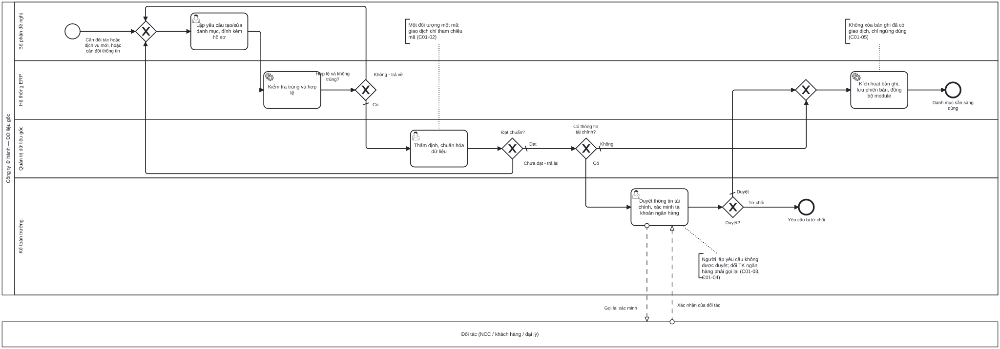

# BP-01 — Quản lý dữ liệu gốc: tạo và thay đổi danh mục có kiểm soát

> Sinh tự động từ `defs/bp01_du_lieu_goc.py` bằng bpmn-kit — sửa định nghĩa rồi chạy lại, không sửa tay file này.

File BPMN 2.0: [`bpmn/BP-01-quan-ly-du-lieu-goc.bpmn`](../bpmn/BP-01-quan-ly-du-lieu-goc.bpmn) · Ảnh: [`png/BP-01-quan-ly-du-lieu-goc.png`](../png/BP-01-quan-ly-du-lieu-goc.png)

## 1. Thông tin chung

| Mục | Nội dung |
|---|---|
| Mục tiêu | Mỗi đối tượng (khách hàng, đại lý, nhà cung cấp, dịch vụ, điểm đến, hướng dẫn viên) chỉ có một mã dùng chung toàn công ty, được nhập một lần tại nguồn, có người kiểm tra trước khi dùng cho giao dịch. |
| Sự kiện kích hoạt | Bộ phận nghiệp vụ cần một đối tác/dịch vụ mới, hoặc cần đổi thông tin của bản ghi đang dùng (đặc biệt tài khoản ngân hàng, điều khoản thanh toán, hạn mức công nợ). |
| Kết quả đầu ra | Bản ghi danh mục ở trạng thái Đang dùng, có lịch sử phiên bản, sẵn sàng cho mọi module; hoặc yêu cầu bị trả lại / từ chối có lý do. |
| Phạm vi | Khách hàng doanh nghiệp, đại lý, nhà cung cấp và tài khoản ngân hàng, dịch vụ, điểm đến, hướng dẫn viên, điều khoản thanh toán, hạn mức công nợ. Tạo mới, sửa, ngừng dùng, khóa. |
| Ngoài phạm vi | Bảng giá NCC theo mùa ([BP-02](BP-02-hop-dong-ncc-quy-cho.md)); khách lẻ tạo ngay khi đặt chỗ ([BP-05](BP-05-ban-tour-ghep.md), có kiểm tra trùng); thẻ và đơn giá hướng dẫn viên ([BP-16](BP-16-hdv-cong-tac-chi-tra-thu-lao.md)). |
| Module ERP | Dữ liệu gốc dùng chung (MDM); Công nợ phải thu / phải trả (AR, AP); Hệ thống (SYS) |
| Quy trình chuẩn ERP tương ứng | Master Data Management — chuẩn hóa danh mục dùng chung (MAPs) và kiểm soát đầu vào. |
| Quy trình đầu vào | Mọi bộ phận phát sinh nhu cầu |
| Quy trình tiếp theo | Tất cả quy trình giao dịch BP-02 → BP-16 chỉ tham chiếu mã đã kích hoạt ở đây |

## 2. Vai trò (làn)

| Làn | Vai trò | Trách nhiệm trong quy trình |
|---|---|---|
| `REQ` | Bộ phận đề nghị | Kinh doanh, Sản phẩm, Điều hành hoặc Kế toán: lập yêu cầu, đính kèm hồ sơ, sửa khi bị trả lại. |
| `SYS` | Hệ thống ERP | Kiểm tra trùng và định dạng, kích hoạt bản ghi, lưu phiên bản, đồng bộ sang các module. |
| `MDM` | Quản trị dữ liệu gốc | Thẩm định, chuẩn hóa tên/mã/phân loại theo quy ước; trả lại khi chưa đạt. |
| `CHIEF_ACC` | Kế toán trưởng | Duyệt thông tin tài chính; gọi lại xác minh khi đổi tài khoản ngân hàng NCC. |

Bên ngoài (pool hộp đen, trao đổi bằng luồng thông điệp): **Đối tác (NCC / khách hàng / đại lý)**.

## 3. Các bước

| # | ID | Bước | Làn | Loại | Mô tả | Chứng từ / trạng thái | Kiểm soát |
|---|---|---|---|---|---|---|---|
| 1 | `S1` | Cần đối tác hoặc dịch vụ mới, hoặc cần đổi thông tin | Bộ phận đề nghị | Sự kiện bắt đầu |  |  |  |
| 2 | `T1` | Lập yêu cầu tạo/sửa danh mục, đính kèm hồ sơ | Bộ phận đề nghị | Người dùng thao tác | Chọn loại danh mục; nhập trường bắt buộc theo loại; đính kèm giấy phép kinh doanh, mã số thuế, xác nhận tài khoản ngân hàng, hợp đồng (nếu có). | Yêu cầu danh mục: DRAFT → PENDING |  |
| 3 | `T2` | Kiểm tra trùng và hợp lệ | Hệ thống ERP | Hệ thống tự động | So khóa chống trùng (mã số thuế, CCCD/hộ chiếu, số điện thoại, email, số tài khoản); kiểm tra định dạng và trường bắt buộc; tra cứu trạng thái mã số thuế nếu có tích hợp. |  | C01-01 |
| 4 | `G1` | Hợp lệ và không trùng? | Hệ thống ERP | Rẽ nhánh (XOR) |  |  |  |
| 5 | `T4` | Thẩm định, chuẩn hóa dữ liệu | Quản trị dữ liệu gốc | Người dùng thao tác | Chuẩn hóa tên, phân loại, nhóm, khu vực, đơn vị tiền tệ; đối chiếu hồ sơ đính kèm. |  | C01-02, C01-03 |
| 6 | `G3` | Đạt chuẩn? | Quản trị dữ liệu gốc | Rẽ nhánh (XOR) |  |  |  |
| 7 | `G2` | Có thông tin tài chính? | Quản trị dữ liệu gốc | Rẽ nhánh (XOR) |  |  |  |
| 8 | `T5` | Duyệt thông tin tài chính, xác minh tài khoản ngân hàng | Kế toán trưởng | Người dùng thao tác | Tài khoản ngân hàng, điều khoản thanh toán, hạn mức công nợ. Đổi tài khoản ngân hàng NCC: gọi lại số điện thoại đã lưu trong hồ sơ (không dùng số trong email yêu cầu). |  | C01-04 |
| 9 | `G4` | Duyệt? | Kế toán trưởng | Rẽ nhánh (XOR) |  |  |  |
| 10 | `E2` | Yêu cầu bị từ chối | Kế toán trưởng | Sự kiện kết thúc |  | Yêu cầu danh mục: REJECTED |  |
| 11 | `T6` | Kích hoạt bản ghi, lưu phiên bản, đồng bộ module | Hệ thống ERP | Hệ thống tự động | Bản ghi chuyển Đang dùng; lưu giá trị cũ/mới, người duyệt, thời điểm; thông báo người yêu cầu. | Bản ghi: ACTIVE; Yêu cầu: APPROVED | C01-05, C01-06 |
| 12 | `E1` | Danh mục sẵn sàng dùng | Hệ thống ERP | Sự kiện kết thúc |  |  |  |

## 4. Điểm quyết định

| Cổng | Câu hỏi / điều kiện | Nhánh → bước tiếp theo |
|---|---|---|
| `G1` | Hợp lệ và không trùng? | Không - trả về → `T1` Lập yêu cầu tạo/sửa danh mục, đính kèm hồ sơ Có (mặc định) → `T4` Thẩm định, chuẩn hóa dữ liệu |
| `G3` | Đạt chuẩn? | Chưa đạt - trả lại → `T1` Lập yêu cầu tạo/sửa danh mục, đính kèm hồ sơ Đạt (mặc định) → `G2` Có thông tin tài chính? |
| `G2` | Có thông tin tài chính? | Có → `T5` Duyệt thông tin tài chính, xác minh tài khoản ngân hàng Không (mặc định) → `T6` Kích hoạt bản ghi, lưu phiên bản, đồng bộ module |
| `G4` | Duyệt? | Duyệt (mặc định) → `T6` Kích hoạt bản ghi, lưu phiên bản, đồng bộ module Từ chối → `E2` Yêu cầu bị từ chối |

## 5. Trao đổi với bên ngoài

| Từ | Đến | Thông điệp |
|---|---|---|
| `T5` Duyệt thông tin tài chính, xác minh tài khoản ngân hàng | Đối tác (NCC / khách hàng / đại lý) | Gọi lại xác minh |
| Đối tác (NCC / khách hàng / đại lý) | `T5` Duyệt thông tin tài chính, xác minh tài khoản ngân hàng | Xác nhận của đối tác |

## 6. Kiểm soát nội bộ

| Mã | Kiểm soát | Loại | Nguồn |
|---|---|---|---|
| C01-01 | Chặn tạo bản ghi trùng theo khóa: mã số thuế, CCCD/hộ chiếu, số điện thoại, email, số tài khoản. | Phòng ngừa · Cấu hình | O'Leary ch04 (input controls) |
| C01-02 | Một đối tượng có đúng một mã dùng chung toàn công ty; giao dịch chỉ lưu mã tham chiếu, không gõ lại tên/địa chỉ. | Có sẵn (chuẩn hóa) | O'Leary ch10; Elbardan ch07 (single data entry) |
| C01-03 | Maker-checker: người lập yêu cầu không được thẩm định/duyệt chính yêu cầu đó. | Phân quyền (SoD) | Elbardan ch08 |
| C01-04 | Thông tin tài chính phải được Kế toán trưởng duyệt; đổi tài khoản ngân hàng NCC bắt buộc gọi lại xác minh qua số đã lưu. | Phòng ngừa · Phân quyền | erp-ba-core ap §7 BR-AP-11 |
| C01-05 | Bản ghi đã phát sinh giao dịch không được xóa, chỉ chuyển Ngừng dùng hoặc Khóa. | Có sẵn | erp-ba-core conventions §6 |
| C01-06 | Lưu lịch sử phiên bản; báo cáo thay đổi danh mục (đặc biệt tài khoản ngân hàng) gửi Kế toán trưởng hằng tuần. | Báo cáo (giám sát liên tục) | Elbardan ch06, ch10 |

## 7. Chứng từ & trạng thái

| Chứng từ | Trạng thái chuẩn | Ghi chú |
|---|---|---|
| Yêu cầu danh mục | DRAFT → PENDING → RETURNED / REJECTED / APPROVED | Một yêu cầu cho một bản ghi; lưu hồ sơ đính kèm. |
| Bản ghi danh mục | ACTIVE / INACTIVE / LOCKED | Trạng thái bản ghi, không dùng bộ trạng thái chứng từ. |

## 8. Tham số hệ thống gợi ý

| Tham số | Ý nghĩa | Mặc định gợi ý |
|---|---|---|
| Khóa chống trùng theo loại danh mục | Trường dùng để so trùng | MST; CCCD/hộ chiếu; SĐT; email; số TK |
| Trường bắt buộc theo loại danh mục | Chặn gửi duyệt khi thiếu | Theo từng loại |
| Danh mục cần Kế toán trưởng duyệt | Trường tài chính kích hoạt bước duyệt | TK ngân hàng, điều khoản TT, hạn mức |

## 9. Chỉ số đo (KPI)

| Chỉ số | Cách tính | Mục tiêu gợi ý |
|---|---|---|
| Tỷ lệ bản ghi trùng | Bản ghi trùng phát hiện khi rà soát / tổng bản ghi | 0% |
| Thời gian xử lý yêu cầu | Từ gửi tới kích hoạt | ≤ 1 ngày làm việc |
| Độ chính xác danh mục | Kiểm mẫu định kỳ | ≥ 98% |

## 10. Căn cứ từ sách

- **O'Leary, ch10** ([nguồn](../../../books/oleary-erp-systems-lifecycle/chapters/ch10-choosing-standard-maps.md)) — Danh mục dùng chung (khách, NCC, sản phẩm, hệ thống tài khoản) là quyết định chuẩn hóa cấp doanh nghiệp; ghi rõ ai sở hữu, ai được cấu hình.
- **O'Leary, ch04** ([nguồn](../../../books/oleary-erp-systems-lifecycle/chapters/ch04-erp-data-input.md)) — Nhập một lần tại nguồn bắt buộc đi kèm kiểm soát đầu vào, vì hệ thống không còn bản sao để đối chiếu.
- **Elbardan & Kholeif, ch09** ([nguồn](../../../books/elbardan-erp-governance-audit/chapters/ch09-case-study-4-international-bank.md)) — Tiêu chí CAVAIR (Complete, Accurate, Valid, Restricted access) để nghiệm thu dữ liệu.
- **Elbardan & Kholeif, ch08** ([nguồn](../../../books/elbardan-erp-governance-audit/chapters/ch08-case-study-3-national-bank.md)) — Maker-checker: màn hình không đi tiếp khi chưa có kiểm tra và duyệt.
- **Wallace & Kremzar, ch10** ([nguồn](../../../books/wallace-erp-implementation/chapters/ch10-data-integrity.md)) — Dữ liệu dưới ngưỡng chính xác (≥ 98% với dữ liệu cấu trúc) thì chưa bật các chức năng hoạch định dựa trên nó.
- **Parthasarathy, ch03** ([nguồn](../../../books/parthasarathy-erp-fundamentals/chapters/ch03-erp-modules.md)) — Master Data Management là một thành phần bắt buộc của module bán hàng.
- **erp-ba-core `ap-accounts-payable.md` §7 BR-AP-11** — đổi tài khoản ngân hàng NCC phải gọi lại xác minh.

## 11. Điểm cần xác nhận với doanh nghiệp

- Chủ sở hữu từng danh mục: khách hàng/đại lý (Kinh doanh), NCC (Sản phẩm), HDV (Điều hành/Nhân sự), hệ thống tài khoản (Kế toán trưởng) — có đúng không?
- Có tích hợp tra cứu mã số thuế tự động không?
- Hộ chiếu, ngày sinh của khách là dữ liệu cá nhân: ai được xem, lưu bao lâu (Luật Bảo vệ dữ liệu cá nhân)?
