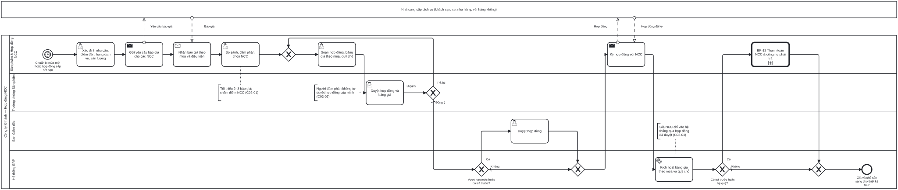

# BP-02 — Hợp đồng nhà cung cấp, bảng giá theo mùa và quỹ chỗ (allotment)

> Sinh tự động từ `defs/bp02_hop_dong_ncc.py` bằng bpmn-kit — sửa định nghĩa rồi chạy lại, không sửa tay file này.

File BPMN 2.0: [`bpmn/BP-02-hop-dong-ncc-quy-cho.bpmn`](../bpmn/BP-02-hop-dong-ncc-quy-cho.bpmn) · Ảnh: [`png/BP-02-hop-dong-ncc-quy-cho.png`](../png/BP-02-hop-dong-ncc-quy-cho.png)

## 1. Thông tin chung

| Mục | Nội dung |
|---|---|
| Mục tiêu | Có giá mua đã thỏa thuận và quỹ chỗ đã cam kết với NCC trước mùa bán, để giá thành tour và chỗ bán ra đều lấy từ một nguồn đã duyệt. |
| Sự kiện kích hoạt | Kế hoạch S&OP cần nguồn cung cho mùa tới, hoặc hợp đồng/bảng giá hiện tại sắp hết hiệu lực. |
| Kết quả đầu ra | Hợp đồng NCC hiệu lực; bảng giá theo mùa và quỹ chỗ (số phòng/ghế, hạn trả chỗ) đã kích hoạt trong hệ thống; khoản trả trước/ký quỹ (nếu có) đã chuyển sang thanh toán. |
| Phạm vi | Khách sạn, nhà xe, nhà hàng, điểm tham quan, hãng bay (block ghế), HDV địa phương. Gửi yêu cầu báo giá, so sánh, đàm phán, duyệt, ký, kích hoạt bảng giá và quỹ chỗ. |
| Ngoài phạm vi | Tạo NCC mới trong danh mục ([BP-01](BP-01-quan-ly-du-lieu-goc.md)); trả chỗ chưa bán theo hạn ([BP-07](BP-07-chot-chuyen-tra-cho.md)); đặt dịch vụ cho từng đoàn ([BP-08](BP-08-dat-dich-vu-chuan-bi-doan.md)); chi tiền trả trước ([BP-12](BP-12-thanh-toan-ncc-cong-no-phai-tra.md)). |
| Module ERP | Mua hàng – hợp đồng NCC (PUR); Kho dịch vụ & bảng giá; Công nợ phải trả (AP) |
| Quy trình chuẩn ERP tương ứng | Procure-to-Pay, phần nguồn cung: yêu cầu báo giá → so sánh, chọn NCC → hợp đồng khung → kích hoạt giá. Quỹ chỗ tương ứng Supplier Scheduling (hợp đồng dài hạn + lịch giao). |
| Quy trình đầu vào | [BP-04](BP-04-hoach-dinh-mua-vu-lich-khoi-hanh.md) kế hoạch nguồn cung đã duyệt; [BP-01](BP-01-quan-ly-du-lieu-goc.md) NCC đã có trong danh mục |
| Quy trình tiếp theo | [BP-03](BP-03-thiet-ke-tour-tinh-gia.md) giá thành tour; [BP-07](BP-07-chot-chuyen-tra-cho.md) trả chỗ; [BP-08](BP-08-dat-dich-vu-chuan-bi-doan.md) đặt dịch vụ; [BP-12](BP-12-thanh-toan-ncc-cong-no-phai-tra.md) trả trước NCC |

## 2. Vai trò (làn)

| Làn | Vai trò | Trách nhiệm trong quy trình |
|---|---|---|
| `PROD` | Sản phẩm & Hợp đồng NCC | Xác định nhu cầu, gửi yêu cầu báo giá, đàm phán, soạn và ký hợp đồng. |
| `PROD_MGR` | Trưởng phòng Sản phẩm | Duyệt hợp đồng và bảng giá trong hạn mức. |
| `DIR` | Ban Giám đốc | Duyệt hợp đồng vượt hạn mức hoặc có trả trước / quỹ chỗ cam kết cứng. |
| `SYS` | Hệ thống ERP | Định tuyến duyệt theo hạn mức; kích hoạt bảng giá theo mùa và quỹ chỗ. |

Bên ngoài (pool hộp đen, trao đổi bằng luồng thông điệp): **Nhà cung cấp dịch vụ (khách sạn, xe, nhà hàng, vé, hàng không)**.

## 3. Các bước

| # | ID | Bước | Làn | Loại | Mô tả | Chứng từ / trạng thái | Kiểm soát |
|---|---|---|---|---|---|---|---|
| 1 | `S1` | Chuẩn bị mùa mới hoặc hợp đồng sắp hết hạn | Sản phẩm & Hợp đồng NCC | Sự kiện bắt đầu (hẹn giờ) |  |  |  |
| 2 | `T1` | Xác định nhu cầu: điểm đến, hạng dịch vụ, sản lượng | Sản phẩm & Hợp đồng NCC | Người dùng thao tác | Lấy sản lượng dự kiến theo tuyến và tháng từ kế hoạch S&OP đã duyệt. |  |  |
| 3 | `T2` | Gửi yêu cầu báo giá cho các NCC | Sản phẩm & Hợp đồng NCC | Gửi thông điệp |  | Yêu cầu báo giá (RFQ) |  |
| 4 | `R1` | Nhận báo giá theo mùa và điều kiện | Sản phẩm & Hợp đồng NCC | Nhận thông điệp | Giá theo mùa và hạng phòng/loại xe, phụ thu, chính sách trẻ em, điều kiện hủy, hạn trả chỗ, điều khoản thanh toán. |  |  |
| 5 | `T3` | So sánh, đàm phán, chọn NCC | Sản phẩm & Hợp đồng NCC | Người dùng thao tác | Bảng so sánh tối thiểu 2–3 báo giá cho dịch vụ trọng yếu; tham chiếu điểm đánh giá NCC và lịch sử sự cố. |  | C02-01 |
| 6 | `T4` | Soạn hợp đồng, bảng giá theo mùa, quỹ chỗ | Sản phẩm & Hợp đồng NCC | Người dùng thao tác | Bảng giá theo mùa; quỹ chỗ (số phòng/ghế theo ngày), hạn trả chỗ (release), chính sách hủy NCC, điều khoản trả trước/ký quỹ. | Hợp đồng NCC: DRAFT → PENDING |  |
| 7 | `T5` | Duyệt hợp đồng và bảng giá | Trưởng phòng Sản phẩm | Người dùng thao tác |  |  | C02-02 |
| 8 | `G1` | Duyệt? | Trưởng phòng Sản phẩm | Rẽ nhánh (XOR) |  |  |  |
| 9 | `G2` | Vượt hạn mức hoặc có trả trước? | Hệ thống ERP | Rẽ nhánh (XOR) |  |  |  |
| 10 | `T6` | Duyệt hợp đồng | Ban Giám đốc | Người dùng thao tác |  |  | C02-03 |
| 11 | `T7` | Ký hợp đồng với NCC | Sản phẩm & Hợp đồng NCC | Gửi thông điệp |  | Hợp đồng NCC: APPROVED |  |
| 12 | `T8` | Kích hoạt bảng giá theo mùa và quỹ chỗ | Hệ thống ERP | Hệ thống tự động | Bảng giá chỉ đọc với Kinh doanh/Điều hành; quỹ chỗ ghi số lượng theo ngày và hạn trả chỗ; đặt cảnh báo hết hạn hợp đồng. | Hợp đồng: IN_PROGRESS (hiệu lực); Quỹ chỗ: APPROVED | C02-04, C02-05 |
| 13 | `G3` | Có trả trước hoặc ký quỹ? | Hệ thống ERP | Rẽ nhánh (XOR) |  |  |  |
| 14 | `C1` | BP-12 Thanh toán NCC & công nợ phải trả | Sản phẩm & Hợp đồng NCC | Gọi quy trình khác → BP-12 | Lập đề nghị thanh toán trước / ký quỹ theo hợp đồng. |  |  |
| 15 | `E1` | Giá và chỗ sẵn sàng cho thiết kế tour | Hệ thống ERP | Sự kiện kết thúc |  |  |  |

## 4. Điểm quyết định

| Cổng | Câu hỏi / điều kiện | Nhánh → bước tiếp theo |
|---|---|---|
| `G1` | Duyệt? | Trả lại → `T4` Soạn hợp đồng, bảng giá theo mùa, quỹ chỗ Đồng ý (mặc định) → `G2` Vượt hạn mức hoặc có trả trước? |
| `G2` | Vượt hạn mức hoặc có trả trước? | Có → `T6` Duyệt hợp đồng Không (mặc định) → `T7` Ký hợp đồng với NCC |
| `G3` | Có trả trước hoặc ký quỹ? | Có → `C1` BP-12 Thanh toán NCC & công nợ phải trả Không (mặc định) → `E1` Giá và chỗ sẵn sàng cho thiết kế tour |

## 5. Trao đổi với bên ngoài

| Từ | Đến | Thông điệp |
|---|---|---|
| `T2` Gửi yêu cầu báo giá cho các NCC | Nhà cung cấp dịch vụ (khách sạn, xe, nhà hàng, vé, hàng không) | Yêu cầu báo giá |
| Nhà cung cấp dịch vụ (khách sạn, xe, nhà hàng, vé, hàng không) | `R1` Nhận báo giá theo mùa và điều kiện | Báo giá |
| `T7` Ký hợp đồng với NCC | Nhà cung cấp dịch vụ (khách sạn, xe, nhà hàng, vé, hàng không) | Hợp đồng |
| Nhà cung cấp dịch vụ (khách sạn, xe, nhà hàng, vé, hàng không) | `T7` Ký hợp đồng với NCC | Hợp đồng đã ký |

## 6. Kiểm soát nội bộ

| Mã | Kiểm soát | Loại | Nguồn |
|---|---|---|---|
| C02-01 | Dịch vụ trọng yếu phải có tối thiểu 2–3 báo giá và bảng so sánh lưu kèm hợp đồng; NCC được chấm điểm định kỳ (chất lượng, sự cố, đúng hẹn), NCC bị khóa thì không chọn được. | Phòng ngừa · Báo cáo | Parthasarathy ch03 (vendor evaluation); erp-ba-core p2p §5 |
| C02-02 | Người đàm phán/soạn hợp đồng không được duyệt hợp đồng đó; duyệt theo hạn mức giá trị cam kết. | Phân quyền (SoD) | erp-ba-core p2p §7 BR-PUR-04 |
| C02-03 | Hợp đồng vượt hạn mức Trưởng phòng, có trả trước/ký quỹ, hoặc quỹ chỗ cam kết cứng (không được trả chỗ) phải Ban Giám đốc duyệt. | Phòng ngừa | Elbardan ch08 (approval hierarchy) |
| C02-04 | Bảng giá NCC chỉ được kích hoạt từ hợp đồng đã duyệt, có hiệu lực theo mùa; Kinh doanh và Điều hành chỉ đọc. | Phòng ngừa · Phân quyền | O'Leary ch04; Elbardan ch07 |
| C02-05 | Cảnh báo hợp đồng/bảng giá sắp hết hiệu lực và quỹ chỗ sắp tới hạn trả. | Báo cáo (giám sát liên tục) | Elbardan ch06 |

## 7. Chứng từ & trạng thái

| Chứng từ | Trạng thái chuẩn | Ghi chú |
|---|---|---|
| Yêu cầu báo giá & bảng so sánh | DRAFT → COMPLETED | Lưu kèm hợp đồng làm bằng chứng lựa chọn. |
| Hợp đồng NCC | DRAFT → PENDING → RETURNED / APPROVED → IN_PROGRESS (hiệu lực) → CLOSED (hết hạn) |  |
| Bảng giá NCC theo mùa | DRAFT → APPROVED (hiệu lực theo ngày) | Theo hạng phòng/loại xe × mùa; ngoại tệ nếu có. |
| Quỹ chỗ (allotment) | APPROVED → PARTIAL (đang bán) → COMPLETED (hết chỗ) / CLOSED (đã trả chỗ) | Số lượng theo ngày, hạn trả chỗ. |

## 8. Bút toán phát sinh

| Nghiệp vụ | Nợ | Có | Ghi chú |
|---|---|---|---|
| Trả trước tiền phòng/ghế cho NCC | 331 (chi tiết NCC) | 112 | Qua BP-12; cấn trừ khi ghi hóa đơn. |
| Ký quỹ đảm bảo quỹ chỗ dài hạn | 244 | 112 | Hoàn lại khi hết hợp đồng hoặc cấn trừ theo thỏa thuận. |

## 9. Tham số hệ thống gợi ý

| Tham số | Ý nghĩa | Mặc định gợi ý |
|---|---|---|
| Hạn mức duyệt hợp đồng | Trưởng phòng Sản phẩm / Ban Giám đốc theo giá trị cam kết năm | ≤ 500 triệu / > 500 triệu |
| Số báo giá tối thiểu | Cho dịch vụ trọng yếu | 3 |
| Cảnh báo hết hạn hợp đồng | Số ngày trước khi hết hiệu lực | 60 ngày |
| Hạn trả chỗ mặc định | Số ngày trước ngày sử dụng | 7 ngày |

## 10. Chỉ số đo (KPI)

| Chỉ số | Cách tính | Mục tiêu gợi ý |
|---|---|---|
| Tỷ lệ dịch vụ trọng yếu có hợp đồng giá | Số dịch vụ có hợp đồng / tổng dịch vụ trọng yếu | ≥ 90% |
| Tỷ lệ sử dụng quỹ chỗ | Chỗ đã bán / chỗ đã cam kết | Theo dõi theo NCC và mùa |
| Chênh lệch giá mua thực tế với hợp đồng | Từ BP-08 và BP-12 | Tiến tới 0 |

## 11. Căn cứ từ sách

- **Wallace & Kremzar, ch17** ([nguồn](../../../books/wallace-erp-implementation/chapters/ch17-appendix-a-fundamentals-of-erp.md)) — Supplier scheduling thay chu trình đơn mua lẻ bằng hợp đồng dài hạn (giá, điều khoản, tổng lượng) cộng lịch gửi NCC.
- **Wallace & Kremzar, ch12** ([nguồn](../../../books/wallace-erp-implementation/chapters/ch12-supply-chain-integration-phase-ii.md)) — Tích hợp chuỗi cung ứng: chia sẻ kế hoạch với NCC, phản hồi khi không đáp ứng được.
- **Parthasarathy, ch03** ([nguồn](../../../books/parthasarathy-erp-fundamentals/chapters/ch03-erp-modules.md)) — Module MM: Purchasing, Vendor evaluation, Invoice verification.
- **Parthasarathy, ch07** ([nguồn](../../../books/parthasarathy-erp-fundamentals/chapters/ch07-supply-chain-management.md)) — Ba cấp quyết định chuỗi cung ứng: chiến lược, chiến thuật, tác nghiệp.
- **Elbardan & Kholeif, ch07** ([nguồn](../../../books/elbardan-erp-governance-audit/chapters/ch07-case-study-2-national-company.md)) — Kiểm soát phòng ngừa: chặn đặt hàng NCC từng giao lỗi.
- **erp-ba-core `p2p-procure-to-pay.md` §5, §7** — yêu cầu báo giá → so sánh → hợp đồng khung; hạn mức duyệt BR-PUR-04.

## 12. Điểm cần xác nhận với doanh nghiệp

- Hạn mức duyệt hợp đồng theo giá trị cam kết là bao nhiêu? Có phân biệt NCC trong nước và nước ngoài?
- NCC nào có quỹ chỗ cam kết cứng (phải trả tiền dù không bán được)?
- Hợp đồng khách sạn quốc tế tính bằng ngoại tệ: dùng tỷ giá nào khi tính giá thành tour?
