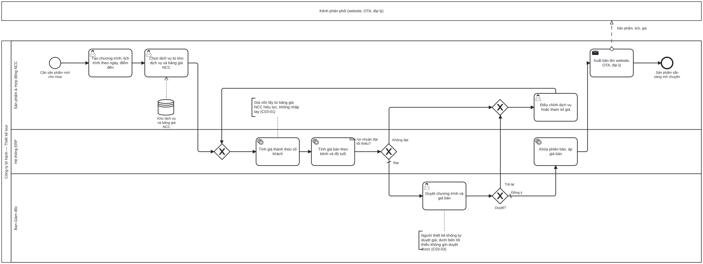

# BP-03 — Thiết kế sản phẩm tour và tính giá (chương trình tour mẫu)

> Sinh tự động từ `defs/bp03_thiet_ke_tour.py` bằng bpmn-kit — sửa định nghĩa rồi chạy lại, không sửa tay file này.

File BPMN 2.0: [`bpmn/BP-03-thiet-ke-tour-tinh-gia.bpmn`](../bpmn/BP-03-thiet-ke-tour-tinh-gia.bpmn) · Ảnh: [`png/BP-03-thiet-ke-tour-tinh-gia.png`](../png/BP-03-thiet-ke-tour-tinh-gia.png)

## 1. Thông tin chung

| Mục | Nội dung |
|---|---|
| Mục tiêu | Chương trình tour có lịch trình, danh sách dịch vụ và giá bán được tính từ giá NCC đã duyệt, đạt biên lợi nhuận tối thiểu và được khóa phiên bản trước khi mở bán. |
| Sự kiện kích hoạt | Kế hoạch S&OP cần sản phẩm mới cho mùa tới, hoặc cần làm mới chương trình đang bán. |
| Kết quả đầu ra | Chương trình tour Đã duyệt, có phiên bản; bảng giá bán theo kênh và độ tuổi; đã xuất bản lên website/OTA/đại lý. |
| Phạm vi | Tour mẫu bán theo lịch khởi hành (tour ghép). Lịch trình theo ngày, dịch vụ cấu thành, giá thành theo số khách, giá bán theo kênh, điểm hòa vốn, duyệt, xuất bản. |
| Ngoài phạm vi | Tour thiết kế riêng theo yêu cầu khách ([BP-06](BP-06-ban-tour-thiet-ke-rieng.md) — dùng lại các bước tính giá ở đây); mở lịch khởi hành ([BP-04](BP-04-hoach-dinh-mua-vu-lich-khoi-hanh.md)). |
| Module ERP | Sản phẩm tour; Giá thành (COST); Bán hàng – bảng giá (SAL) |
| Quy trình chuẩn ERP tương ứng | Thiết kế sản phẩm và định giá: chương trình tour đóng vai trò "định mức dịch vụ" (tương tự BOM), lịch trình tương tự quy trình công nghệ; giá thành dự toán → giá bán → duyệt → khóa phiên bản. |
| Quy trình đầu vào | [BP-02](BP-02-hop-dong-ncc-quy-cho.md) bảng giá NCC hiệu lực; [BP-04](BP-04-hoach-dinh-mua-vu-lich-khoi-hanh.md) danh mục sản phẩm cần cho mùa |
| Quy trình tiếp theo | [BP-04](BP-04-hoach-dinh-mua-vu-lich-khoi-hanh.md) mở lịch khởi hành; [BP-05](BP-05-ban-tour-ghep.md) bán theo bảng giá chuyến |

## 2. Vai trò (làn)

| Làn | Vai trò | Trách nhiệm trong quy trình |
|---|---|---|
| `PROD` | Sản phẩm & Hợp đồng NCC | Dựng lịch trình, chọn dịch vụ, điều chỉnh khi biên lợi nhuận thấp hoặc bị trả lại, xuất bản. |
| `SYS` | Hệ thống ERP | Tính giá thành, giá bán, điểm hòa vốn; khóa phiên bản đã duyệt. |
| `DIR` | Ban Giám đốc | Duyệt chương trình và giá bán. |

Bên ngoài (pool hộp đen, trao đổi bằng luồng thông điệp): **Kênh phân phối (website, OTA, đại lý)**.

## 3. Các bước

| # | ID | Bước | Làn | Loại | Mô tả | Chứng từ / trạng thái | Kiểm soát |
|---|---|---|---|---|---|---|---|
| 1 | `S1` | Cần sản phẩm mới cho mùa | Sản phẩm & Hợp đồng NCC | Sự kiện bắt đầu |  |  |  |
| 2 | `T1` | Tạo chương trình: lịch trình theo ngày, điểm đến | Sản phẩm & Hợp đồng NCC | Người dùng thao tác | Dựng từ đầu hoặc ghép module tour có sẵn; mỗi ngày gồm điểm đến, hoạt động, bữa ăn, lưu trú, di chuyển. | Chương trình tour: DRAFT |  |
| 3 | `T2` | Chọn dịch vụ từ kho dịch vụ và bảng giá NCC | Sản phẩm & Hợp đồng NCC | Người dùng thao tác | Chỉ chọn được dịch vụ có bảng giá đang hiệu lực cho mùa dự kiến khởi hành. |  | C03-01 |
| 4 | `T3` | Tính giá thành theo số khách | Hệ thống ERP | Hệ thống tự động | Chi phí theo khách + chi phí cố định theo đoàn (xe, HDV) chia theo số khách + dự phòng; tính cho nhiều mức số khách và điểm hòa vốn. |  |  |
| 5 | `T4` | Tính giá bán theo kênh và độ tuổi | Hệ thống ERP | Hệ thống tự động | Markup, thuế GTGT, hoa hồng kênh, làm tròn; giá người lớn / trẻ em / em bé, phụ thu phòng đơn. |  | C03-02 |
| 6 | `G1` | Biên lợi nhuận đạt tối thiểu? | Hệ thống ERP | Rẽ nhánh (XOR) |  |  |  |
| 7 | `T6` | Duyệt chương trình và giá bán | Ban Giám đốc | Người dùng thao tác |  | Chương trình tour: PENDING | C03-03 |
| 8 | `G2` | Duyệt? | Ban Giám đốc | Rẽ nhánh (XOR) |  |  |  |
| 9 | `T5` | Điều chỉnh dịch vụ hoặc tham số giá | Sản phẩm & Hợp đồng NCC | Người dùng thao tác |  | Chương trình tour: RETURNED |  |
| 10 | `T7` | Khóa phiên bản, áp giá bán | Hệ thống ERP | Hệ thống tự động | Chương trình đã duyệt chỉ đọc; mọi thay đổi sau đó tạo phiên bản mới và duyệt lại. | Chương trình tour: APPROVED (phiên bản n) | C03-04 |
| 11 | `T8` | Xuất bản lên website, OTA, đại lý | Sản phẩm & Hợp đồng NCC | Gửi thông điệp |  |  | C03-05 |
| 12 | `E1` | Sản phẩm sẵn sàng mở chuyến | Sản phẩm & Hợp đồng NCC | Sự kiện kết thúc |  |  |  |

## 4. Điểm quyết định

| Cổng | Câu hỏi / điều kiện | Nhánh → bước tiếp theo |
|---|---|---|
| `G1` | Biên lợi nhuận đạt tối thiểu? | Đạt (mặc định) → `T6` Duyệt chương trình và giá bán Không đạt → `T5` Điều chỉnh dịch vụ hoặc tham số giá |
| `G2` | Duyệt? | Trả lại → `T5` Điều chỉnh dịch vụ hoặc tham số giá Đồng ý (mặc định) → `T7` Khóa phiên bản, áp giá bán |

## 5. Trao đổi với bên ngoài

| Từ | Đến | Thông điệp |
|---|---|---|
| `T8` Xuất bản lên website, OTA, đại lý | Kênh phân phối (website, OTA, đại lý) | Sản phẩm, lịch, giá |

## 6. Kiểm soát nội bộ

| Mã | Kiểm soát | Loại | Nguồn |
|---|---|---|---|
| C03-01 | Giá vốn chỉ lấy từ bảng giá NCC đang hiệu lực theo ngày dự kiến sử dụng; không nhập tay giá vốn. | Phòng ngừa · Cấu hình | O'Leary ch04 (enter once) |
| C03-02 | Công thức giá bán tham số hóa (markup, hoa hồng kênh, thuế, làm tròn, giá trẻ em); chỉ Kế toán trưởng/Ban Giám đốc sửa tham số. | Cấu hình · Phân quyền | Parthasarathy ch03 (pricing) |
| C03-03 | Biên lợi nhuận dưới ngưỡng thì không gửi duyệt được; người thiết kế không được duyệt giá của mình. | Phòng ngừa · Phân quyền (SoD) | Elbardan ch07, ch08 |
| C03-04 | Chương trình đã duyệt bị khóa; thay đổi tạo phiên bản mới và duyệt lại; booking giữ tham chiếu phiên bản đã bán. | Có sẵn (audit trail) | Wallace ch09 (engineering change policy) |
| C03-05 | Chỉ chương trình đã duyệt mới được xuất bản ra kênh bán. | Phòng ngừa | Elbardan ch07 |

## 7. Chứng từ & trạng thái

| Chứng từ | Trạng thái chuẩn | Ghi chú |
|---|---|---|
| Chương trình tour | DRAFT → PENDING → RETURNED / APPROVED → CLOSED (ngừng bán); có phiên bản | Định mức dịch vụ của tour. |
| Bảng tính giá | DRAFT → APPROVED | Giá thành theo mức số khách, điểm hòa vốn, giá bán theo kênh. |

## 8. Tham số hệ thống gợi ý

| Tham số | Ý nghĩa | Mặc định gợi ý |
|---|---|---|
| Markup mặc định | % trên giá thành | 20% |
| Thuế GTGT dịch vụ lữ hành | Theo thời kỳ giảm thuế | 8% hoặc 10% — Kế toán xác nhận |
| Hoa hồng kênh | Theo kênh: đại lý, OTA | 10% |
| Dự phòng chi phí | % trên giá thành | 3% |
| Biên lợi nhuận tối thiểu | Dưới ngưỡng không gửi duyệt | 10% |
| Giá trẻ em / em bé | % giá người lớn | 75% / 25% |

## 9. Chỉ số đo (KPI)

| Chỉ số | Cách tính | Mục tiêu gợi ý |
|---|---|---|
| Thời gian dựng một chương trình | Từ tạo tới gửi duyệt | Giảm so với làm tay |
| Tỷ lệ chương trình bị trả lại | Bị trả lại / gửi duyệt | Theo dõi |
| Sai lệch giá thành dự toán và thực tế | Từ BP-10 theo chương trình | ≤ 5% |

## 10. Căn cứ từ sách

- **Parthasarathy, ch03** ([nguồn](../../../books/parthasarathy-erp-fundamentals/chapters/ch03-erp-modules.md)) — SD có thành phần Pricing; MM có Product costing; Finance có Cost controlling.
- **Wallace & Kremzar, ch09** ([nguồn](../../../books/wallace-erp-implementation/chapters/ch09-process-definition.md)) — Engineering change là một trong năm chính sách nền: thay đổi định mức phải có phiên bản và người duyệt.
- **Wallace & Kremzar, ch10** ([nguồn](../../../books/wallace-erp-implementation/chapters/ch10-data-integrity.md)) — Định mức (BOM) phải đầy đủ, có cấu trúc và chính xác ≥ 98% — áp cho danh sách dịch vụ của chương trình.
- **O'Leary, ch04** ([nguồn](../../../books/oleary-erp-systems-lifecycle/chapters/ch04-erp-data-input.md)) — Nhập một lần tại nguồn: giá NCC nhập ở hợp đồng, không gõ lại khi tính giá tour.
- **Elbardan & Kholeif, ch07** ([nguồn](../../../books/elbardan-erp-governance-audit/chapters/ch07-case-study-2-national-company.md)) — Kiểm soát phòng ngừa dạng if/else: không cho đi tiếp khi điều kiện chưa đạt.

## 11. Điểm cần xác nhận với doanh nghiệp

- Ai duyệt giá bán: Trưởng phòng Sản phẩm hay Ban Giám đốc? Có phân cấp theo biên lợi nhuận không?
- Thuế suất GTGT áp cho tour inbound/nội địa/outbound từng loại là bao nhiêu (phần dịch vụ ở nước ngoài)?
- Giá bán có khác nhau theo mùa/ngày khởi hành không, hay một giá cho cả chương trình?
