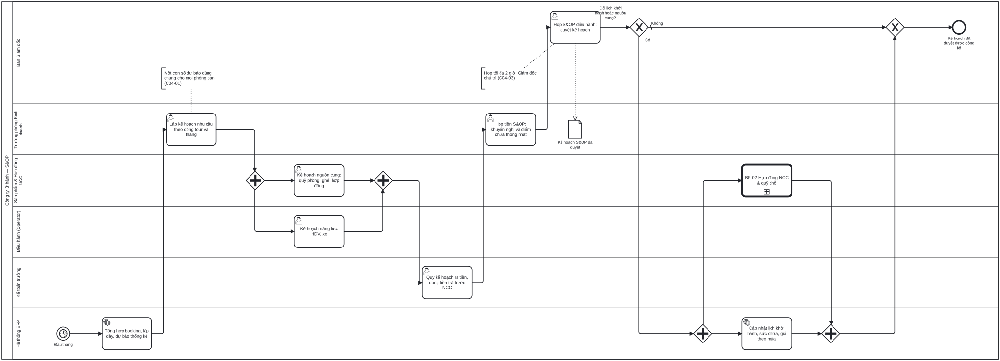

# BP-04 — Hoạch định mùa vụ và lịch khởi hành (S&OP hằng tháng)

> Sinh tự động từ `defs/bp04_sop.py` bằng bpmn-kit — sửa định nghĩa rồi chạy lại, không sửa tay file này.

File BPMN 2.0: [`bpmn/BP-04-hoach-dinh-mua-vu-lich-khoi-hanh.bpmn`](../bpmn/BP-04-hoach-dinh-mua-vu-lich-khoi-hanh.bpmn) · Ảnh: [`png/BP-04-hoach-dinh-mua-vu-lich-khoi-hanh.png`](../png/BP-04-hoach-dinh-mua-vu-lich-khoi-hanh.png)

## 1. Thông tin chung

| Mục | Nội dung |
|---|---|
| Mục tiêu | Mỗi tháng cân bằng nhu cầu (số khách theo dòng tour) với nguồn cung (quỹ phòng, ghế, HDV, xe) và tài chính, ra một kế hoạch duy nhất được Ban Giám đốc phê duyệt; lịch khởi hành và hợp đồng NCC điều chỉnh theo kế hoạch đó. |
| Sự kiện kích hoạt | Ngày làm việc đầu tiên của tháng (sau khi khóa số liệu bán hàng tháng trước). |
| Kết quả đầu ra | Kế hoạch S&OP đã duyệt theo dòng tour × tháng (số khách và tiền); lịch khởi hành, sức chứa, giá theo mùa và quỹ chỗ đã điều chỉnh tương ứng. |
| Phạm vi | Tầm nhìn 12–18 tháng, theo dòng tour (6–12 nhóm). Năm bước: số liệu → kế hoạch nhu cầu → kế hoạch cung → họp tiền S&OP → họp S&OP điều hành. |
| Ngoài phạm vi | Kế hoạch kinh doanh năm (ngân sách); ký hợp đồng NCC chi tiết ([BP-02](BP-02-hop-dong-ncc-quy-cho.md)); quyết định từng chuyến tại hạn chốt ([BP-07](BP-07-chot-chuyen-tra-cho.md)). |
| Module ERP | Hoạch định (S&OP); Sản phẩm & lịch khởi hành; Tài chính – ngân sách (BUD) |
| Quy trình chuẩn ERP tương ứng | Sales & Operations Planning: tầng "khối lượng" (volume) của hệ phân cấp hoạch định ERP; lịch khởi hành là tầng "cơ cấu" (mix) và tổng của nó phải khớp kế hoạch S&OP. |
| Quy trình đầu vào | Số liệu booking từ [BP-05](BP-05-ban-tour-ghep.md) và [BP-06](BP-06-ban-tour-thiet-ke-rieng.md) |
| Quy trình tiếp theo | [BP-02](BP-02-hop-dong-ncc-quy-cho.md) điều chỉnh nguồn cung; [BP-03](BP-03-thiet-ke-tour-tinh-gia.md) sản phẩm mới; [BP-05](BP-05-ban-tour-ghep.md) chuyến mở bán |

## 2. Vai trò (làn)

| Làn | Vai trò | Trách nhiệm trong quy trình |
|---|---|---|
| `DIR` | Ban Giám đốc | Chủ trì họp S&OP điều hành, phê duyệt kế hoạch (không có Giám đốc thì không phải S&OP). |
| `SALES_MGR` | Trưởng phòng Kinh doanh | Chủ sở hữu dự báo nhu cầu; chủ trì họp tiền S&OP. |
| `PROD` | Sản phẩm & Hợp đồng NCC | Kế hoạch nguồn cung: quỹ chỗ, hợp đồng NCC. |
| `OPS` | Điều hành (Operator) | Kế hoạch năng lực vận hành: HDV, xe, điều hành viên. |
| `CHIEF_ACC` | Kế toán trưởng | Quy kế hoạch ra tiền: doanh thu, giá vốn, dòng tiền trả trước NCC. |
| `SYS` | Hệ thống ERP | Tổng hợp số liệu; cập nhật lịch khởi hành và sức chứa sau khi duyệt. |

## 3. Các bước

| # | ID | Bước | Làn | Loại | Mô tả | Chứng từ / trạng thái | Kiểm soát |
|---|---|---|---|---|---|---|---|
| 1 | `S1` | Đầu tháng | Hệ thống ERP | Sự kiện bắt đầu (hẹn giờ) |  |  |  |
| 2 | `T1` | Tổng hợp booking, lấp đầy, dự báo thống kê | Hệ thống ERP | Hệ thống tự động | Bước 1: số khách thực tế so với kế hoạch, tỷ lệ lấp đầy từng chuyến, tốc độ đặt chỗ, dự báo thống kê theo dòng tour. |  |  |
| 3 | `T2` | Lập kế hoạch nhu cầu theo dòng tour và tháng | Trưởng phòng Kinh doanh | Người dùng thao tác | Bước 2: một con số dự báo chính thức (số khách và doanh thu) cho mỗi dòng tour × tháng; ghi giả định thị trường. |  | C04-01 |
| 4 | `T3a` | Kế hoạch nguồn cung: quỹ phòng, ghế, hợp đồng | Sản phẩm & Hợp đồng NCC | Người dùng thao tác | Bước 3: so nhu cầu với quỹ chỗ đã cam kết; xác định thiếu/thừa theo tháng và NCC. |  |  |
| 5 | `T3b` | Kế hoạch năng lực: HDV, xe | Điều hành (Operator) | Người dùng thao tác | Bước 3: kiểm tra năng lực sơ bộ (HDV theo ngôn ngữ, xe theo loại) cho số chuyến dự kiến. |  |  |
| 6 | `T4` | Quy kế hoạch ra tiền, dòng tiền trả trước NCC | Kế toán trưởng | Người dùng thao tác | Doanh thu, giá vốn, biên lợi nhuận theo dòng tour; nhu cầu tiền trả trước/ký quỹ NCC theo tháng. |  | C04-02 |
| 7 | `T5` | Họp tiền S&OP: khuyến nghị và điểm chưa thống nhất | Trưởng phòng Kinh doanh | Người dùng thao tác | Bước 4: Kinh doanh, Sản phẩm, Điều hành, Kế toán thống nhất phương án; ghi rõ điểm cần Ban Giám đốc quyết. |  |  |
| 8 | `T6` | Họp S&OP điều hành: duyệt kế hoạch | Ban Giám đốc | Người dùng thao tác | Bước 5: với từng dòng tour chọn giữ nguyên, đổi kế hoạch bán, hoặc đổi kế hoạch cung; biên bản quyết định. | Kế hoạch S&OP: APPROVED | C04-03 |
| 9 | `G1` | Đổi lịch khởi hành hoặc nguồn cung? | Ban Giám đốc | Rẽ nhánh (XOR) |  |  |  |
| 10 | `C1` | BP-02 Hợp đồng NCC & quỹ chỗ | Sản phẩm & Hợp đồng NCC | Gọi quy trình khác → BP-02 | Ký thêm, giảm hoặc trả bớt quỹ chỗ với NCC theo kế hoạch. |  |  |
| 11 | `T7` | Cập nhật lịch khởi hành, sức chứa, giá theo mùa | Hệ thống ERP | Hệ thống tự động | Mở/đóng chuyến, đổi sức chứa, cập nhật giá theo mùa; tổng sức chứa theo tháng phải khớp kế hoạch đã duyệt. |  |  |
| 12 | `E1` | Kế hoạch đã duyệt được công bố | Ban Giám đốc | Sự kiện kết thúc |  |  | C04-04 |

## 4. Điểm quyết định

| Cổng | Câu hỏi / điều kiện | Nhánh → bước tiếp theo |
|---|---|---|
| `G1` | Đổi lịch khởi hành hoặc nguồn cung? | Có → `P3`  Không (mặc định) → `E1` Kế hoạch đã duyệt được công bố |

## 6. Kiểm soát nội bộ

| Mã | Kiểm soát | Loại | Nguồn |
|---|---|---|---|
| C04-01 | Một dự báo chính thức duy nhất (single-number forecast) cho mỗi dòng tour × tháng, do Trưởng phòng Kinh doanh sở hữu. | Có sẵn (chuẩn hóa) | Wallace ch08 |
| C04-02 | Kế hoạch tính đồng thời bằng số khách và bằng tiền (một bộ số); tổng lịch khởi hành theo tháng phải khớp kế hoạch tổng. | Báo cáo (đối chiếu) | Wallace ch17 (volume vs mix) |
| C04-03 | Chỉ kế hoạch đã được họp S&OP điều hành phê duyệt mới được dùng để mở chuyến và ký/trả quỹ chỗ. | Phòng ngừa | Wallace ch08 |
| C04-04 | Đo thực tế so với kế hoạch (cả cầu lẫn cung) hằng tháng; sai lệch vượt ngưỡng phải giải trình ở kỳ sau. | Báo cáo (giám sát liên tục) | Wallace ch08, ch15 |

## 7. Chứng từ & trạng thái

| Chứng từ | Trạng thái chuẩn | Ghi chú |
|---|---|---|
| Kế hoạch S&OP | DRAFT → PENDING → APPROVED (theo kỳ tháng) | Theo dòng tour × tháng: số khách, doanh thu, giá vốn, sức chứa. |
| Biên bản họp S&OP | COMPLETED | Quyết định và người chịu trách nhiệm. |
| Lịch khởi hành | Mỗi chuyến: DRAFT → APPROVED (mở bán) | Sinh hoặc điều chỉnh theo kế hoạch. |

## 8. Tham số hệ thống gợi ý

| Tham số | Ý nghĩa | Mặc định gợi ý |
|---|---|---|
| Danh sách dòng tour | Nhóm sản phẩm để hoạch định | 6–12 nhóm |
| Tầm nhìn kế hoạch | Số tháng phía trước | 12–18 tháng |
| Ngưỡng sai lệch phải giải trình | Thực tế so với kế hoạch | ±10% |

## 9. Chỉ số đo (KPI)

| Chỉ số | Cách tính | Mục tiêu gợi ý |
|---|---|---|
| Độ chính xác dự báo | 1 − \|thực tế − dự báo\| / thực tế, theo dòng tour | Tăng dần |
| Tỷ lệ lấp đầy chuyến | Khách đã xác nhận / sức chứa | Theo mục tiêu từng dòng |
| Tỷ lệ sử dụng quỹ chỗ | Chỗ đã bán / chỗ đã cam kết | Theo dõi |
| Số chuyến hủy do thiếu khách | Từ BP-07 | Giảm dần |

## 10. Căn cứ từ sách

- **Wallace & Kremzar, ch08** ([nguồn](../../../books/wallace-erp-implementation/chapters/ch08-sales-and-operations-planning.md)) — Chu trình S&OP 5 bước hằng tháng; họp điều hành ≤ 2 giờ; một dự báo chính thức; không có Giám đốc thì không phải S&OP.
- **Wallace & Kremzar, ch17** ([nguồn](../../../books/wallace-erp-implementation/chapters/ch17-appendix-a-fundamentals-of-erp.md)) — Hệ phân cấp hoạch định: S&OP ở mức khối lượng theo nhóm sản phẩm; lịch chi tiết ở mức cơ cấu, tổng phải khớp S&OP.
- **Wallace & Kremzar, ch09** ([nguồn](../../../books/wallace-erp-implementation/chapters/ch09-process-definition.md)) — S&OP là một trong năm chính sách nền: nêu vai trò, tham số, phản hồi, chỉ số đo.
- **Parthasarathy, ch07** ([nguồn](../../../books/parthasarathy-erp-fundamentals/chapters/ch07-supply-chain-management.md)) — Ba cấp quyết định chuỗi cung ứng: chiến lược, chiến thuật, tác nghiệp.

## 11. Điểm cần xác nhận với doanh nghiệp

- Doanh nghiệp chia dòng tour thế nào (theo tuyến, theo thị trường khách, theo loại tour)?
- Ai là chủ trì S&OP (Giám đốc điều hành hay Phó Giám đốc kinh doanh)?
- Có dùng phần mềm dự báo không, hay bảng tính trong giai đoạn đầu?
