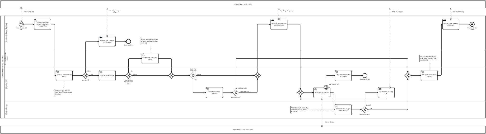

# BP-05 — Bán tour ghép: giữ chỗ, thu cọc, xác nhận booking

> Sinh tự động từ `defs/bp05_ban_tour_ghep.py` bằng bpmn-kit — sửa định nghĩa rồi chạy lại, không sửa tay file này.

File BPMN 2.0: [`bpmn/BP-05-ban-tour-ghep.bpmn`](../bpmn/BP-05-ban-tour-ghep.bpmn) · Ảnh: [`png/BP-05-ban-tour-ghep.png`](../png/BP-05-ban-tour-ghep.png)

## 1. Thông tin chung

| Mục | Nội dung |
|---|---|
| Mục tiêu | Nhận đặt chỗ cho chuyến khởi hành đang mở bán (tour ghép / series) mà không bán quá số chỗ, thu cọc đúng chính sách và xác nhận booking trên cùng một bộ số với Điều hành và Kế toán. |
| Sự kiện kích hoạt | Khách lẻ, doanh nghiệp, đại lý hoặc OTA (qua channel manager) gửi yêu cầu đặt chỗ cho một chuyến khởi hành. |
| Kết quả đầu ra | Booking ở trạng thái Đã xác nhận, gắn với chuyến; chỗ đã trừ khỏi quỹ; phiếu thu cọc đã ghi sổ; lịch thu phần còn lại đã lập. Hoặc booking hết hạn giữ chỗ và chỗ được trả về chuyến. |
| Phạm vi | Kênh B2C, đại lý B2B, OTA; kiểm tra chỗ khả dụng; tính giá và ưu đãi; kiểm tra hạn mức công nợ đại lý; giữ chỗ có thời hạn; thu và ghi nhận cọc; xác nhận booking. |
| Ngoài phạm vi | Thiết kế chương trình và giá chuyến ([BP-03](BP-03-thiet-ke-tour-tinh-gia.md)); lịch khởi hành ([BP-04](BP-04-hoach-dinh-mua-vu-lich-khoi-hanh.md)); chốt chuyến ([BP-07](BP-07-chot-chuyen-tra-cho.md)); đặt dịch vụ NCC ([BP-08](BP-08-dat-dich-vu-chuan-bi-doan.md)); thu phần còn lại và xuất hóa đơn ([BP-11](BP-11-thu-tien-cong-no-phai-thu.md)); đổi/hủy booking ([BP-13](BP-13-thay-doi-huy-booking-hoan-tien.md)). |
| Module ERP | CRM / Bán hàng (SAL); Công nợ phải thu (AR); Tiền – Ngân hàng (CB) |
| Quy trình chuẩn ERP tương ứng | Order-to-Cash (Quote-to-Cash): nhận đơn → kiểm tra khả dụng (ATP) → kiểm tra tín dụng → xác nhận đơn → thu tiền. |
| Quy trình đầu vào | [BP-04](BP-04-hoach-dinh-mua-vu-lich-khoi-hanh.md) chuyến đã mở bán; [BP-03](BP-03-thiet-ke-tour-tinh-gia.md) bảng giá chuyến đã duyệt |
| Quy trình tiếp theo | [BP-07](BP-07-chot-chuyen-tra-cho.md) chốt chuyến tại hạn chốt; [BP-11](BP-11-thu-tien-cong-no-phai-thu.md) thu phần còn lại; [BP-13](BP-13-thay-doi-huy-booking-hoan-tien.md) đổi/hủy |

## 2. Vai trò (làn)

| Làn | Vai trò | Trách nhiệm trong quy trình |
|---|---|---|
| `SALES` | Kinh doanh (Sales / Booking) | Tạo booking, giữ chỗ, gửi hợp đồng và xác nhận cho khách. |
| `SALES_MGR` | Trưởng phòng Kinh doanh | Duyệt ưu đãi vượt hạn mức nhân viên. |
| `SYS` | Hệ thống ERP | Kiểm tra chỗ khả dụng, tính giá, kiểm tra hạn mức công nợ, xác nhận booking theo quy tắc. |
| `ACC` | Kế toán công nợ | Nhận tiền cọc từ ngân hàng, ghi phiếu thu, kiểm tra đủ cọc. |

Bên ngoài (pool hộp đen, trao đổi bằng luồng thông điệp): **Khách hàng / Đại lý / OTA**; **Ngân hàng / Cổng thanh toán**.

## 3. Các bước

| # | ID | Bước | Làn | Loại | Mô tả | Chứng từ / trạng thái | Kiểm soát |
|---|---|---|---|---|---|---|---|
| 1 | `S1` | Nhận yêu cầu đặt chỗ | Kinh doanh (Sales / Booking) | Sự kiện bắt đầu (thông điệp) | Yêu cầu đến từ website, hotline, đại lý hoặc OTA. Booking từ OTA/website được tạo tự động qua tích hợp. |  |  |
| 2 | `T1` | Tạo booking nháp: chuyến, số khách, hạng phòng | Kinh doanh (Sales / Booking) | Người dùng thao tác | Chọn chuyến khởi hành, số khách theo độ tuổi (người lớn / trẻ em / em bé), số phòng và loại phòng, kênh bán, khách hàng (tra danh mục, không gõ tự do). | Booking: DRAFT |  |
| 3 | `T2` | Kiểm tra chỗ khả dụng (ATP) | Hệ thống ERP | Hệ thống tự động | Chỗ khả dụng = sức chứa chuyến − chỗ đã xác nhận − chỗ đang giữ; đồng thời kiểm tra quỹ phòng/ghế của chuyến (allotment). |  | C05-01 |
| 4 | `G1` | Còn đủ chỗ? | Hệ thống ERP | Rẽ nhánh (XOR) |  |  |  |
| 5 | `T3` | Báo hết chỗ, đề xuất chuyến khác | Kinh doanh (Sales / Booking) | Gửi thông điệp | Đề xuất ngày khởi hành khác hoặc đưa khách vào danh sách chờ của chuyến. |  |  |
| 6 | `T4` | Tính giá và áp ưu đãi | Hệ thống ERP | Hệ thống tự động | Giá theo bảng giá chuyến: người lớn / trẻ em / em bé, phụ thu phòng đơn, giá kênh (đại lý, OTA), chương trình khuyến mãi, ưu đãi đặt sớm. |  |  |
| 7 | `E1` | Chưa đặt được | Kinh doanh (Sales / Booking) | Sự kiện kết thúc |  |  |  |
| 8 | `G2` | Ưu đãi vượt hạn mức nhân viên? | Hệ thống ERP | Rẽ nhánh (XOR) |  |  |  |
| 9 | `T5` | Duyệt hoặc điều chỉnh ưu đãi | Trưởng phòng Kinh doanh | Người dùng thao tác | Trưởng phòng duyệt, hoặc hạ mức ưu đãi về trong thẩm quyền. Không duyệt thì áp mức tối đa của nhân viên. | Booking: PENDING → APPROVED | C05-02 |
| 10 | `G4` | Đại lý mua công nợ? | Hệ thống ERP | Rẽ nhánh (XOR) |  |  |  |
| 11 | `T6` | Kiểm tra hạn mức công nợ | Hệ thống ERP | Hệ thống tự động | Dư nợ + booking đã xác nhận chưa xuất hóa đơn + booking này ≤ hạn mức × (1 + dung sai). |  | C05-03 |
| 12 | `G5` | Trong hạn mức? | Hệ thống ERP | Rẽ nhánh (XOR) |  |  |  |
| 13 | `T8` | Giữ chỗ, gửi hợp đồng và đề nghị cọc | Kinh doanh (Sales / Booking) | Gửi thông điệp | Hệ thống giữ chỗ tới hạn giữ chỗ; gửi khách hợp đồng lữ hành (ký điện tử), số tiền cọc, hạn cọc và thông tin chuyển khoản / link thanh toán. | Booking: APPROVED (giữ chỗ, chờ cọc) | C05-04 |
| 14 | `R1` | Nhận báo có tiền cọc | Hệ thống ERP | Nhận thông điệp | Nhận báo có từ ngân hàng / cổng thanh toán qua tích hợp (hoặc nhập sao kê), nội dung chuyển khoản có mã booking. |  |  |
| 15 | `B1` | Hết hạn giữ chỗ | Hệ thống ERP | Sự kiện biên (hẹn giờ) trên R1 | Hết hạn giữ chỗ mà chưa nhận cọc. |  |  |
| 16 | `T13` | Hủy giữ chỗ, trả chỗ về chuyến | Hệ thống ERP | Hệ thống tự động | Hệ thống tự hủy booking, cộng lại chỗ khả dụng và báo nhân viên kinh doanh. | Booking: CANCELLED |  |
| 17 | `T9` | Đối chiếu tiền về, ghi phiếu thu cọc | Kế toán công nợ | Người dùng thao tác | Khớp giao dịch ngân hàng với booking; ghi phiếu thu và hạch toán vào công nợ khách (ứng trước). | Phiếu thu: POSTED | C05-05 |
| 18 | `E2` | Booking hết hạn | Hệ thống ERP | Sự kiện kết thúc |  |  |  |
| 19 | `G6` | Đủ cọc tối thiểu? | Kế toán công nợ | Rẽ nhánh (XOR) |  |  |  |
| 20 | `T10` | Nhắc khách bổ sung cọc | Hệ thống ERP | Gửi thông điệp | Gửi thông báo số còn thiếu; hạn giữ chỗ không đổi. |  |  |
| 21 | `T11` | Xác nhận booking, lập lịch thu | Hệ thống ERP | Hệ thống tự động | Chuyển booking sang Đã xác nhận, trừ chỗ chính thức, cập nhật số khách của chuyến, sinh lịch thu phần còn lại (hạn thanh toán đủ trước ngày khởi hành). | Booking: IN_PROGRESS (đã xác nhận) | C05-06, C05-07 |
| 22 | `T12` | Gửi xác nhận booking cho khách | Kinh doanh (Sales / Booking) | Gửi thông điệp | Gửi xác nhận kèm hợp đồng đã ký, lịch thanh toán và yêu cầu bổ sung thông tin khách (họ tên, giấy tờ). |  |  |
| 23 | `E3` | Booking đã xác nhận | Kinh doanh (Sales / Booking) | Sự kiện kết thúc (thông điệp) |  |  |  |

## 4. Điểm quyết định

| Cổng | Câu hỏi / điều kiện | Nhánh → bước tiếp theo |
|---|---|---|
| `G1` | Còn đủ chỗ? | Không → `T3` Báo hết chỗ, đề xuất chuyến khác Có (mặc định) → `T4` Tính giá và áp ưu đãi |
| `G2` | Ưu đãi vượt hạn mức nhân viên? | Có → `T5` Duyệt hoặc điều chỉnh ưu đãi Không (mặc định) → `G4` Đại lý mua công nợ? |
| `G4` | Đại lý mua công nợ? | Có → `T6` Kiểm tra hạn mức công nợ Không (mặc định) → `T8` Giữ chỗ, gửi hợp đồng và đề nghị cọc |
| `G5` | Trong hạn mức? | Vượt hạn mức → `T8` Giữ chỗ, gửi hợp đồng và đề nghị cọc Trong hạn mức (mặc định) → `T11` Xác nhận booking, lập lịch thu |
| `G6` | Đủ cọc tối thiểu? | Chưa đủ → `T10` Nhắc khách bổ sung cọc Đủ (mặc định) → `T11` Xác nhận booking, lập lịch thu |

## 5. Trao đổi với bên ngoài

| Từ | Đến | Thông điệp |
|---|---|---|
| Khách hàng / Đại lý / OTA | `S1` Nhận yêu cầu đặt chỗ | Yêu cầu đặt chỗ |
| `T3` Báo hết chỗ, đề xuất chuyến khác | Khách hàng / Đại lý / OTA | Hết chỗ, phương án khác |
| `T8` Giữ chỗ, gửi hợp đồng và đề nghị cọc | Khách hàng / Đại lý / OTA | Hợp đồng, đề nghị cọc |
| Ngân hàng / Cổng thanh toán | `R1` Nhận báo có tiền cọc | Báo có tiền cọc |
| `T10` Nhắc khách bổ sung cọc | Khách hàng / Đại lý / OTA | Nhắc bổ sung cọc |
| `T12` Gửi xác nhận booking cho khách | Khách hàng / Đại lý / OTA | Xác nhận booking |

## 6. Kiểm soát nội bộ

| Mã | Kiểm soát | Loại | Nguồn |
|---|---|---|---|
| C05-01 | Chặn bán quá chỗ: chỗ khả dụng = sức chứa − đã xác nhận − đang giữ; không cho xác nhận khi chỗ khả dụng nhỏ hơn số khách. | Phòng ngừa · Cấu hình | Wallace ch17 (ATP); O'Leary ch11 |
| C05-02 | Ưu đãi vượt hạn mức nhân viên phải được Trưởng phòng duyệt; người lập booking không được duyệt ưu đãi của chính mình (SoD). | Phòng ngừa · Phân quyền | Elbardan ch08 (maker-checker); erp-ba-core o2c §7 BR-SAL-05 |
| C05-03 | Đại lý mua công nợ: chặn xác nhận khi vượt hạn mức; vượt thì chuyển sang thu cọc như khách thường. | Phòng ngừa · Cấu hình | erp-ba-core o2c §7 BR-SAL-01, ar §7 BR-AR-01 |
| C05-04 | Giữ chỗ có hạn; hết hạn mà chưa có cọc thì hệ thống tự trả chỗ, không để chỗ "treo". | Phòng ngừa · Cấu hình | Wallace ch09 (time fences) |
| C05-05 | Phiếu thu chỉ do Kế toán ghi từ giao dịch ngân hàng; Sales không có quyền tạo/sửa phiếu thu (tách bán hàng và thu tiền). | Phân quyền (SoD) | Elbardan ch02, ch08; erp-ba-core o2c §10 |
| C05-06 | Booking chỉ chuyển Đã xác nhận theo quy tắc (đủ cọc tối thiểu hoặc trong hạn mức), không có nút xác nhận tay. | Phòng ngừa · Cấu hình | Elbardan ch07 (preventive if/else) |
| C05-07 | Lưu vết mọi thay đổi giá, ưu đãi, số khách trên booking: người sửa, thời điểm, giá trị cũ và mới. | Có sẵn (audit trail) | Elbardan ch06; Parthasarathy ch05 |

## 7. Chứng từ & trạng thái

| Chứng từ | Trạng thái chuẩn | Ghi chú |
|---|---|---|
| Booking (đơn đặt tour) | DRAFT → PENDING (chờ duyệt ưu đãi) → APPROVED (giữ chỗ, chờ cọc) → IN_PROGRESS (đã xác nhận) → COMPLETED; CANCELLED khi hết hạn giữ chỗ hoặc hủy | Một booking gắn đúng một chuyến khởi hành; số khách theo độ tuổi; mã kênh bán. |
| Hợp đồng lữ hành | Ký điện tử khi đặt cọc | Nội dung theo quy định về hợp đồng lữ hành; chính sách hủy theo mốc ngày. |
| Phiếu thu (cọc) | DRAFT → POSTED; REVERSED nếu ghi sai | Sinh từ giao dịch ngân hàng, tham chiếu mã booking. |

## 8. Bút toán phát sinh

| Nghiệp vụ | Nợ | Có | Ghi chú |
|---|---|---|---|
| Nhận tiền cọc của khách | 112 | 131 (chi tiết khách, mã booking) | Số dư Có 131 = khách trả trước. Nếu là thu trước tiền tour (không phải cọc bảo đảm hợp đồng) thì lập HĐĐT tại thời điểm thu — cần xác nhận với kế toán thuế. |
| Xác nhận booking | — | — | Không phát sinh bút toán; chỉ trừ chỗ và lập lịch thu. |

## 9. Tham số hệ thống gợi ý

| Tham số | Ý nghĩa | Mặc định gợi ý |
|---|---|---|
| Thời hạn giữ chỗ | Giữ chỗ chờ cọc, hết hạn tự hủy | 72 giờ |
| Tỷ lệ cọc tối thiểu | Theo % giá trị booking | 30% |
| Hạn thanh toán đủ | Số ngày trước khởi hành | D-15 |
| Hạn mức ưu đãi | Nhân viên / Trưởng phòng / Giám đốc | 5% / 15% / trên 15% |
| Dung sai hạn mức công nợ | Cho phép vượt hạn mức đại lý | 0–5% |
| Hạn chốt nhận booking | Số ngày trước khởi hành | D-7 |

## 10. Chỉ số đo (KPI)

| Chỉ số | Cách tính | Mục tiêu gợi ý |
|---|---|---|
| Số lần bán quá chỗ | Số booking xác nhận vượt chỗ khả dụng | 0 |
| Tỷ lệ giữ chỗ chuyển thành xác nhận | Booking xác nhận / booking giữ chỗ | Theo dõi theo kênh |
| Tỷ lệ hết hạn giữ chỗ | Booking hết hạn / booking giữ chỗ | Giảm dần |
| Thời gian phản hồi yêu cầu | Từ nhận yêu cầu tới gửi đề nghị cọc | ≤ 24 giờ |

## 11. Căn cứ từ sách

- **Wallace & Kremzar, ch17** ([nguồn](../../../books/wallace-erp-implementation/chapters/ch17-appendix-a-fundamentals-of-erp.md)) — ATP và nhận đơn, hứa với khách: chỗ đã hứa là cam kết; chỉ hứa trên phần chưa cam kết.
- **Wallace & Kremzar, ch09** ([nguồn](../../../books/wallace-erp-implementation/chapters/ch09-process-definition.md)) — Demand management policy: ai được hứa chỗ, quy tắc hứa đơn, time fences.
- **O'Leary, ch11** ([nguồn](../../../books/oleary-erp-systems-lifecycle/chapters/ch11-big-bang-versus-phased.md)) — ATP là giữ chỗ theo thời gian thực xuyên module — bán hàng và quỹ chỗ phải dùng chung một dữ liệu.
- **Parthasarathy, ch08** ([nguồn](../../../books/parthasarathy-erp-fundamentals/chapters/ch08-erp-and-crm.md)) — Quote-to-Cash: báo giá → đơn → hóa đơn → thu tiền.
- **Elbardan & Kholeif, ch08** ([nguồn](../../../books/elbardan-erp-governance-audit/chapters/ch08-case-study-3-national-bank.md)) — Maker-checker và luồng duyệt theo cấp; hệ thống kiểm tra trường bắt buộc trước khi gửi duyệt.
- **erp-ba-core `o2c-order-to-cash.md` §5, §7, §10** — bước nhận đơn, kiểm tra tín dụng, hạn mức chiết khấu, SoD bán hàng – thu tiền.
- **erp-ba-core `vn-tax-einvoice.md` §4.4** — thời điểm lập hóa đơn khi thu tiền trước với dịch vụ.

## 12. Điểm cần xác nhận với doanh nghiệp

- Thời hạn giữ chỗ và tỷ lệ cọc có khác nhau theo kênh (B2C, đại lý, OTA) và theo mùa không?
- Khoản cọc là "đặt cọc bảo đảm hợp đồng" hay "thu trước tiền tour"? Câu trả lời quyết định thời điểm xuất HĐĐT.
- Chỗ bán qua OTA trừ chung quỹ chỗ của chuyến hay có quỹ riêng cho từng kênh?
- Đại lý nào được mua công nợ, hạn mức và kỳ thanh toán bao nhiêu?
