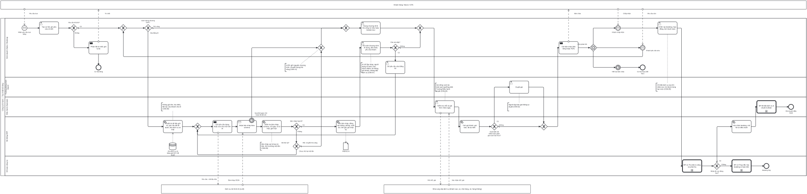

# BP-06 — Bán tour thiết kế riêng: yêu cầu → dựng chương trình (thủ công hoặc AI) → bản chào → chốt → cọc

> Sinh tự động từ `defs/bp06_tour_thiet_ke_rieng.py` bằng bpmn-kit — sửa định nghĩa rồi chạy lại, không sửa tay file này.

File BPMN 2.0: [`bpmn/BP-06-ban-tour-thiet-ke-rieng.bpmn`](../bpmn/BP-06-ban-tour-thiet-ke-rieng.bpmn) · Ảnh: [`png/BP-06-ban-tour-thiet-ke-rieng.png`](../png/BP-06-ban-tour-thiet-ke-rieng.png)

## 1. Thông tin chung

| Mục | Nội dung |
|---|---|
| Mục tiêu | Chuyển yêu cầu riêng của khách (đoàn gia đình, doanh nghiệp, MICE, inbound) thành chương trình có giá vốn thật theo ngày, được duyệt giá, khách chấp nhận một phiên bản cụ thể, ký hợp đồng và đặt cọc trước khi điều hành đặt dịch vụ. Chương trình được dựng theo một trong hai luồng song song: thủ công, hoặc xây bằng trợ lý AI — cả hai cùng đi qua các kiểm soát phía sau. |
| Sự kiện kích hoạt | Khách hoặc đại lý gửi yêu cầu tour riêng (web, hotline, email, đại lý nước ngoài). |
| Kết quả đầu ra | Booking đã xác nhận gắn với đúng phiên bản chương trình khách chấp nhận; hồ sơ điều hành đã mở. Hoặc cơ hội đóng (thua/hết hạn) có ghi lý do. |
| Phạm vi | Tiếp nhận và đánh giá yêu cầu; dựng chương trình theo luồng thủ công hoặc luồng AI (gọi mô hình, kiểm tra bản nháp, đồng bộ hậu cần và giá, rà soát, sửa bằng lời, đường lui về thủ công khi AI lỗi); kiểm tra chỗ và giá NCC theo ngày; tính giá và duyệt; gửi bản chào; vòng sửa với khách; chốt, ký hợp đồng, cọc, bàn giao điều hành. |
| Ngoài phạm vi | Chi tiết thu tiền ([BP-11](BP-11-thu-tien-cong-no-phai-thu.md)); đặt dịch vụ ([BP-08](BP-08-dat-dich-vu-chuan-bi-doan.md)); hủy sau khi đã xác nhận ([BP-13](BP-13-thay-doi-huy-booking-hoan-tien.md)). |
| Module ERP | CRM (cơ hội, bản chào); Sản phẩm tour – chương trình riêng; Tích hợp AI; Bán hàng (SAL) |
| Quy trình chuẩn ERP tương ứng | Quote-to-Cash với điểm gặp khách "thiết kế theo đơn" (design/engineer-to-order): Inquire → Quote → Order; tour ghép (BP-05) là "bán từ sẵn có". Luồng AI không có trong 4 cuốn sách: thiết kế coi AI là một nguồn nhập liệu mới (kiểm soát đầu vào, maker-checker, lưu vết). |
| Quy trình đầu vào | [BP-02](BP-02-hop-dong-ncc-quy-cho.md) bảng giá NCC; [BP-03](BP-03-thiet-ke-tour-tinh-gia.md) module tour mẫu để ghép |
| Quy trình tiếp theo | [BP-11](BP-11-thu-tien-cong-no-phai-thu.md) thu cọc; [BP-08](BP-08-dat-dich-vu-chuan-bi-doan.md) đặt dịch vụ; [BP-13](BP-13-thay-doi-huy-booking-hoan-tien.md) hủy nếu không cọc |

## 2. Vai trò (làn)

| Làn | Vai trò | Trách nhiệm trong quy trình |
|---|---|---|
| `SALES` | Kinh doanh (Sales / Booking) | Tiếp nhận, chọn cách dựng, dựng thủ công hoặc rà soát và sửa bản AI, gửi bản chào, theo dõi phản hồi, chốt và lập hợp đồng. |
| `SALES_MGR` | Trưởng phòng Kinh doanh | Duyệt giá khi biên lợi nhuận dưới ngưỡng hoặc giảm giá vượt hạn mức. |
| `OPS` | Điều hành (Operator) | Kiểm tra chỗ và giá NCC cho ngày cụ thể. |
| `SYS` | Hệ thống ERP | Luồng AI: chuẩn bị dữ liệu, gọi mô hình, kiểm tra và ghi bản nháp, đồng bộ hậu cần, tính giá, lưu vết. Sau đó: tính giá thành, giá bán, lãi dự kiến; xác nhận booking và mở hồ sơ điều hành. |
| `ACC` | Kế toán công nợ | Thu cọc theo lịch thanh toán. |

Bên ngoài (pool hộp đen, trao đổi bằng luồng thông điệp): **Khách hàng / Đại lý / OTA**; **Dịch vụ mô hình AI (LLM)**; **Nhà cung cấp dịch vụ (khách sạn, xe, nhà hàng, vé, hàng không)**.

## 3. Các bước

| # | ID | Bước | Làn | Loại | Mô tả | Chứng từ / trạng thái | Kiểm soát |
|---|---|---|---|---|---|---|---|
| 1 | `S1` | Nhận yêu cầu tour riêng | Kinh doanh (Sales / Booking) | Sự kiện bắt đầu (thông điệp) |  |  |  |
| 2 | `T1` | Tạo cơ hội, ghi yêu cầu chi tiết | Kinh doanh (Sales / Booking) | Người dùng thao tác | Ngày, số khách theo độ tuổi, điểm đến, hạng khách sạn, ngân sách, yêu cầu đặc biệt; bắt đầu tính hạn phản hồi. | Cơ hội: mới | C06-01 |
| 3 | `G1` | Yêu cầu khả thi? | Kinh doanh (Sales / Booking) | Rẽ nhánh (XOR) |  |  |  |
| 4 | `T2` | Phản hồi từ chối, ghi lý do | Kinh doanh (Sales / Booking) | Gửi thông điệp |  |  |  |
| 5 | `E1` | Cơ hội đóng | Kinh doanh (Sales / Booking) | Sự kiện kết thúc |  |  | C06-06 |
| 6 | `GM` | Cách dựng chương trình? | Kinh doanh (Sales / Booking) | Rẽ nhánh (XOR) | Người dựng chọn cho từng lần dựng/sửa. Nhánh AI chỉ hiện khi tính năng đang bật; tắt thì chỉ còn thủ công. |  |  |
| 7 | `A3` | Chuẩn bị dữ liệu gửi AI: yêu cầu đã ẩn danh, kho dịch vụ có thật | Hệ thống ERP | Hệ thống tự động | Gửi yêu cầu (không kèm dữ liệu cá nhân), chương trình hiện tại nếu đang sửa, và kho id có thật AI được phép dùng: điểm đến, khách sạn đang hoạt động kèm hạng và giá, vé, hoạt động, vận chuyển. Yêu cầu thiếu thông tin tối thiểu (ngày, số ngày, số khách, điểm đến) thì không gọi AI mà báo người dựng bổ sung. |  | C06-08, C06-10 |
| 8 | `A4` | Gửi yêu cầu dựng hoặc sửa cho mô hình AI | Hệ thống ERP | Gửi thông điệp | Lời nhắc hệ thống cố định, câu trả lời ép theo schema JSON; lần sửa gửi kèm câu yêu cầu bằng lời. |  |  |
| 9 | `AR1` | Nhận bản nháp theo schema | Hệ thống ERP | Nhận thông điệp |  |  |  |
| 10 | `B1` | Quá thời gian chờ hoặc lỗi kết nối | Hệ thống ERP | Sự kiện biên (hẹn giờ) trên AR1 |  |  |  |
| 11 | `A5` | Kiểm tra bản nháp: schema, số ngày, id có thật, giới hạn | Hệ thống ERP | Hệ thống tự động | Loại cả bản nếu: sai schema, số ngày khai không khớp số ngày đếm được (bị cắt cụt), id không có trong kho hoặc không thuộc chương trình, vượt trần số ngày / số hoạt động mỗi ngày. |  | C06-09 |
| 12 | `AG2` | Bản nháp hợp lệ? | Hệ thống ERP | Rẽ nhánh (XOR) |  |  |  |
| 13 | `AG3` | Đã thử lại? | Hệ thống ERP | Rẽ nhánh (XOR) |  |  |  |
| 14 | `A6` | Ghi bản nháp, đồng bộ chặng, phòng, suất ăn; tính giá; ghi nhật ký | Hệ thống ERP | Hệ thống tự động | Ghi trong một giao dịch (lỗi thì hoàn tác toàn bộ). Trường AI không nói tới thì giữ nguyên. Hệ thống tự dựng lại chặng bay, xe, HDV, bố trí phòng, định mức ăn; giá vốn và giá bán do hệ thống tính từ bảng giá, không lấy số AI viết. Lưu phiên bản và nhật ký AI. | Chương trình riêng: phiên bản n (nguồn: AI) | C06-10, C06-11 |
| 15 | `T3` | Dựng chương trình thủ công từ mẫu hoặc module tour | Kinh doanh (Sales / Booking) | Người dùng thao tác | Mỗi lần sửa tạo phiên bản mới của chương trình. Khi đến từ đường lui AI: chương trình hiện có giữ nguyên, hệ thống báo lý do lỗi và đưa gợi ý từ bộ luật để người dựng tự chọn áp dụng. | Chương trình riêng: phiên bản n (nguồn: thủ công) | C06-04, C06-12 |
| 16 | `A7` | Rà soát chương trình AI dựng, đối chiếu yêu cầu khách | Kinh doanh (Sales / Booking) | Người dùng thao tác | Kiểm tra lịch trình, khách sạn, lời văn, tổng giá so ngân sách; xem nhật ký từng thay đổi AI đã làm. |  | C06-07 |
| 17 | `AG4` | Cần sửa tiếp? | Kinh doanh (Sales / Booking) | Rẽ nhánh (XOR) |  |  |  |
| 18 | `A8` | Gõ yêu cầu sửa bằng lời | Kinh doanh (Sales / Booking) | Người dùng thao tác | Ví dụ: thêm 1 ngày ở Đà Nẵng, đổi sang khách sạn 5 sao, bỏ bữa tối ngày 3. |  |  |
| 19 | `T4` | Kiểm tra chỗ và giá NCC theo ngày | Điều hành (Operator) | Người dùng thao tác | Hỏi khách sạn, nhà xe chỗ trống cho ngày cụ thể; ghi giá NCC xác nhận nếu khác bảng giá. Áp như nhau cho chương trình dựng thủ công hay bằng AI. |  | C06-03 |
| 20 | `T5` | Tính giá thành, giá bán, lãi dự kiến | Hệ thống ERP | Hệ thống tự động | Như BP-03; so tổng giá với ngân sách khách. |  |  |
| 21 | `G2` | Dưới biên tối thiểu hoặc giảm giá vượt hạn mức? | Hệ thống ERP | Rẽ nhánh (XOR) |  |  |  |
| 22 | `T6` | Duyệt giá | Trưởng phòng Kinh doanh | Người dùng thao tác |  |  | C06-02 |
| 23 | `T7` | Gửi bản chào (link riêng hoặc PDF) | Kinh doanh (Sales / Booking) | Gửi thông điệp | Bản chào có lịch trình, giá trọn gói, dịch vụ bao gồm/không bao gồm, chính sách hủy, hạn hiệu lực. | Bản chào: đã gửi |  |
| 24 | `EG1` | Chờ phản hồi | Kinh doanh (Sales / Booking) | Rẽ nhánh theo sự kiện |  |  |  |
| 25 | `C1` | Khách chấp nhận | Kinh doanh (Sales / Booking) | Sự kiện chờ (thông điệp) |  |  |  |
| 26 | `C3` | Hết hạn bản chào | Kinh doanh (Sales / Booking) | Sự kiện chờ (hẹn giờ) |  |  |  |
| 27 | `C2` | Khách yêu cầu sửa | Kinh doanh (Sales / Booking) | Sự kiện chờ (thông điệp) |  |  |  |
| 28 | `E2` | Cơ hội thua (hết hạn) | Kinh doanh (Sales / Booking) | Sự kiện kết thúc |  |  |  |
| 29 | `T9` | Chốt: tạo booking, hợp đồng, lịch thanh toán | Kinh doanh (Sales / Booking) | Người dùng thao tác | Booking gắn đúng phiên bản chương trình khách chấp nhận; hợp đồng lữ hành có điều khoản hủy. | Cơ hội: thắng; Booking: APPROVED | C06-05 |
| 30 | `C4` | BP-11 Thu tiền & công nợ phải thu | Kế toán công nợ | Gọi quy trình khác → BP-11 | Thu cọc theo lịch thanh toán. |  |  |
| 31 | `G3` | Nhận đủ cọc đúng hạn? | Kế toán công nợ | Rẽ nhánh (XOR) |  |  |  |
| 32 | `T10` | Xác nhận booking, mở hồ sơ điều hành | Hệ thống ERP | Hệ thống tự động |  | Booking: IN_PROGRESS |  |
| 33 | `C6` | BP-13 Thay đổi, hủy booking & hoàn tiền | Kế toán công nợ | Gọi quy trình khác → BP-13 | Hủy booking theo chính sách khi không cọc. |  |  |
| 34 | `C5` | BP-08 Đặt dịch vụ & chuẩn bị đoàn | Điều hành (Operator) | Gọi quy trình khác → BP-08 |  |  |  |
| 35 | `E4` | Booking hủy | Kế toán công nợ | Sự kiện kết thúc |  |  |  |
| 36 | `E3` | Đã chuyển điều hành | Điều hành (Operator) | Sự kiện kết thúc |  |  |  |

## 4. Điểm quyết định

| Cổng | Câu hỏi / điều kiện | Nhánh → bước tiếp theo |
|---|---|---|
| `G1` | Yêu cầu khả thi? | Không → `T2` Phản hồi từ chối, ghi lý do Có (mặc định) → `GM` Cách dựng chương trình? |
| `GM` | Cách dựng chương trình? | Thủ công (mặc định) → `T3` Dựng chương trình thủ công từ mẫu hoặc module tour Xây bằng AI → `A3` Chuẩn bị dữ liệu gửi AI: yêu cầu đã ẩn danh, kho dịch vụ có thật |
| `AG2` | Bản nháp hợp lệ? | Có (mặc định) → `A6` Ghi bản nháp, đồng bộ chặng, phòng, suất ăn; tính giá; ghi nhật ký Không → `AG3` Đã thử lại? |
| `AG3` | Đã thử lại? | Chưa: thử lại một lần → `A4` Gửi yêu cầu dựng hoặc sửa cho mô hình AI Rồi: chuyển thủ công (mặc định) → `T3` Dựng chương trình thủ công từ mẫu hoặc module tour |
| `AG4` | Cần sửa tiếp? | Có → `A8` Gõ yêu cầu sửa bằng lời Không (mặc định) → `T4` Kiểm tra chỗ và giá NCC theo ngày |
| `G2` | Dưới biên tối thiểu hoặc giảm giá vượt hạn mức? | Có → `T6` Duyệt giá Không (mặc định) → `T7` Gửi bản chào (link riêng hoặc PDF) |
| `EG1` | Chờ phản hồi | (sự kiện) → `C1` Khách chấp nhận (sự kiện) → `C2` Khách yêu cầu sửa (sự kiện) → `C3` Hết hạn bản chào |
| `G3` | Nhận đủ cọc đúng hạn? | Có (mặc định) → `T10` Xác nhận booking, mở hồ sơ điều hành Không → `C6` BP-13 Thay đổi, hủy booking & hoàn tiền |

## 5. Trao đổi với bên ngoài

| Từ | Đến | Thông điệp |
|---|---|---|
| Khách hàng / Đại lý / OTA | `S1` Nhận yêu cầu tour riêng | Yêu cầu tour |
| `T2` Phản hồi từ chối, ghi lý do | Khách hàng / Đại lý / OTA | Từ chối |
| `A4` Gửi yêu cầu dựng hoặc sửa cho mô hình AI | Dịch vụ mô hình AI (LLM) | Yêu cầu + dữ liệu kho |
| Dịch vụ mô hình AI (LLM) | `AR1` Nhận bản nháp theo schema | Bản nháp JSON |
| `T7` Gửi bản chào (link riêng hoặc PDF) | Khách hàng / Đại lý / OTA | Bản chào |
| Khách hàng / Đại lý / OTA | `C1` Khách chấp nhận | Chấp nhận |
| Khách hàng / Đại lý / OTA | `C2` Khách yêu cầu sửa | Yêu cầu sửa |
| `T4` Kiểm tra chỗ và giá NCC theo ngày | Nhà cung cấp dịch vụ (khách sạn, xe, nhà hàng, vé, hàng không) | Hỏi chỗ, giá |
| Nhà cung cấp dịch vụ (khách sạn, xe, nhà hàng, vé, hàng không) | `T4` Kiểm tra chỗ và giá NCC theo ngày | Xác nhận chỗ, giá |

## 6. Kiểm soát nội bộ

| Mã | Kiểm soát | Loại | Nguồn |
|---|---|---|---|
| C06-01 | Hạn phản hồi yêu cầu (SLA) tính từ lúc tạo cơ hội; quá hạn cảnh báo Trưởng phòng. | Báo cáo (giám sát liên tục) | erp-ba-core crm-service §5A |
| C06-02 | Giá dưới biên tối thiểu hoặc giảm giá vượt hạn mức phải Trưởng phòng Kinh doanh duyệt; người lập báo giá không tự duyệt. | Phòng ngừa · Phân quyền (SoD) | Elbardan ch08; erp-ba-core crm-service PRM-CRM-005 |
| C06-03 | Giá NCC mặc định từ bảng giá hiệu lực; giá riêng theo ngày cao hơn dự toán quá ngưỡng phải Trưởng Điều hành duyệt. | Phòng ngừa | O'Leary ch04 |
| C06-04 | Mỗi lần dựng/sửa (thủ công hay AI) tạo phiên bản mới, ghi nguồn tạo; khách chỉ chốt được phiên bản đã gửi; booking giữ tham chiếu phiên bản. | Có sẵn (audit trail) | Wallace ch09 |
| C06-05 | Không xác nhận booking và không đặt dịch vụ NCC trước khi nhận đủ cọc (trừ đại lý trong hạn mức công nợ). | Phòng ngừa · Cấu hình | Elbardan ch07 |
| C06-06 | Đóng cơ hội bắt buộc chọn lý do (giá, lịch, đối thủ, không phản hồi) để phân tích. | Cấu hình · Báo cáo | Parthasarathy ch08 (analytical CRM) |
| C06-07 | Luồng AI — người trong vòng kiểm soát: AI chỉ lập bản nháp; người dựng rà soát và chịu trách nhiệm. AI không gửi bản chào, không đặt dịch vụ, không đổi trạng thái chứng từ. Sau khi gộp nhánh, chương trình qua đúng các kiểm soát như dựng thủ công. | Phân quyền (maker-checker) | Elbardan ch08; Wallace ch01 |
| C06-08 | Luồng AI — dữ liệu gửi cho dịch vụ AI tối thiểu và đã ẩn danh: không gửi họ tên, hộ chiếu, số điện thoại, email của khách. | Phòng ngừa · Cấu hình | Luật Bảo vệ dữ liệu cá nhân; Elbardan ch09 (Restricted access) |
| C06-09 | Luồng AI — cổng kiểm tra bản nháp độc lập với AI: đúng schema, chống cắt cụt, id phải có thật và thuộc chương trình, trong giới hạn; sai thì loại cả bản, thử lại đúng một lần. | Phòng ngừa · Cấu hình | Parthasarathy ch09 (tách quy tắc kiểm tra); O'Leary ch14 (configuration engine) |
| C06-10 | Luồng AI — chỉ dùng dịch vụ, khách sạn, giá có trong kho đã duyệt; giá vốn và giá bán luôn do hệ thống tính lại. | Phòng ngừa · Cấu hình | O'Leary ch04 (enter once, input controls) |
| C06-11 | Luồng AI — lưu vết mỗi lượt: ai yêu cầu, câu yêu cầu, mô hình, bản trả về, thay đổi đã áp, người rà soát. | Có sẵn (audit trail) | Elbardan ch06 |
| C06-12 | Luồng AI — lỗi hoặc quá thời gian: báo lý do, giữ nguyên chương trình, rẽ sang luồng thủ công; AI không bao giờ chặn quy trình bán. | Phòng ngừa (đường lui) | Wallace ch11 (phản hồi theo ngoại lệ) |
| C06-13 | Bật/tắt trợ lý AI, mô hình, thời gian chờ bằng tham số hệ thống; mặc định tắt; chỉ quản trị được đổi. | Cấu hình · Phân quyền | Elbardan ch06 (configurable controls) |

## 7. Chứng từ & trạng thái

| Chứng từ | Trạng thái chuẩn | Ghi chú |
|---|---|---|
| Cơ hội | Mới → đang xử lý → đã báo giá → thắng / thua | Trạng thái phễu bán hàng (không phải chứng từ). |
| Chương trình riêng | DRAFT → APPROVED theo từng phiên bản; ghi nguồn tạo (thủ công / AI) | Mỗi lần dựng/sửa một phiên bản. |
| Nhật ký AI | Chỉ ghi thêm, không sửa | Một dòng cho mỗi lượt gọi mô hình. |
| Bản chào | DRAFT → IN_PROGRESS (đã gửi) → COMPLETED (chấp nhận) / REJECTED / CLOSED (hết hạn) |  |
| Booking & hợp đồng lữ hành | APPROVED → IN_PROGRESS → COMPLETED / CANCELLED |  |

## 8. Tham số hệ thống gợi ý

| Tham số | Ý nghĩa | Mặc định gợi ý |
|---|---|---|
| Hạn phản hồi yêu cầu | Từ khi tạo cơ hội | 24 giờ |
| Hiệu lực bản chào | Sau đó bản chào hết hạn | 7 ngày |
| Biên lợi nhuận tối thiểu | Dưới ngưỡng phải duyệt | 10% |
| Ngưỡng giá NCC vượt dự toán | Phải Trưởng Điều hành duyệt | 10% |
| Bật trợ lý AI | Tắt / bật | Tắt |
| Thời gian chờ AI tối đa | Mỗi lượt dựng/sửa | 540 giây (theo topas-crm) |
| Số lần thử lại khi bản nháp sai |  | 1 |
| Trần kích thước chương trình AI dựng | Số ngày / số hoạt động mỗi ngày | 21 / 14 |

## 9. Chỉ số đo (KPI)

| Chỉ số | Cách tính | Mục tiêu gợi ý |
|---|---|---|
| Tỷ lệ chuyển đổi | Cơ hội thắng / cơ hội đủ điều kiện | Theo thị trường |
| Thời gian gửi bản chào đầu tiên | Từ tạo cơ hội; so sánh luồng AI với thủ công | ≤ 24 giờ |
| Số vòng sửa trung bình | Phiên bản / cơ hội thắng | Theo dõi |
| Biên dự kiến so với thực tế | So với BP-10 | ≤ 5 điểm % |
| Tỷ lệ lượt AI dùng được | Lượt qua cổng kiểm tra / tổng lượt gọi AI | ≥ 90% |
| Tỷ lệ AI phải chuyển thủ công | Lượt lỗi hoặc quá giờ / tổng lượt | Theo dõi |
| Chi phí AI trên mỗi chương trình | Tổng chi phí gọi mô hình / số chương trình | Doanh nghiệp đặt trần |

## 10. Căn cứ từ sách

- **Parthasarathy, ch12** ([nguồn](../../../books/parthasarathy-erp-fundamentals/chapters/ch12-business-modeling-uml.md)) — Use case bán hàng: Inquire → Quote → Order → Deliver → Invoicing.
- **Parthasarathy, ch08** ([nguồn](../../../books/parthasarathy-erp-fundamentals/chapters/ch08-erp-and-crm.md)) — CRM tác nghiệp – phân tích – cộng tác; Quote-to-Cash.
- **Wallace & Kremzar, ch09** ([nguồn](../../../books/wallace-erp-implementation/chapters/ch09-process-definition.md)) — Câu hỏi "điểm gặp khách": thiết kế theo đơn, làm theo đơn, hay bán từ sẵn có — quyết định bộ chức năng.
- **O'Leary, ch14** ([nguồn](../../../books/oleary-erp-systems-lifecycle/chapters/ch14-erp-electronic-commerce.md)) — Configuration engine: không cho đặt khi cấu hình còn lỗi — áp cho cổng kiểm tra bản nháp AI.
- **O'Leary, ch04** ([nguồn](../../../books/oleary-erp-systems-lifecycle/chapters/ch04-erp-data-input.md)) — Mỗi nguồn nhập liệu mới phải đi kèm kiểm soát đầu vào — AI là một nguồn nhập liệu.
- **Parthasarathy, ch09** ([nguồn](../../../books/parthasarathy-erp-fundamentals/chapters/ch09-erp-and-dotnet.md)) — Tách quy tắc kiểm tra (validation rules) khỏi quy tắc xử lý.
- **Elbardan & Kholeif, ch08** ([nguồn](../../../books/elbardan-erp-governance-audit/chapters/ch08-case-study-3-national-bank.md)) — Maker-checker: không đi tiếp khi chưa có kiểm tra và duyệt.
- **erp-ba-core `crm-service.md` §5A** — lead → cơ hội → báo giá → duyệt chiết khấu → thắng/thua có lý do.
- Hiện trạng trợ lý AI trong hệ thống tham khảo **topas-crm** (`addons/topas/ai/README.md`) — gửi chương trình kèm kho id có thật, câu trả lời theo schema, kiểm tra chống cắt cụt và id bịa, ghi trong một savepoint, thử lại một lần, lỗi thì giữ nguyên và báo lý do.

## 11. Điểm cần xác nhận với doanh nghiệp

- Ai dựng chương trình riêng: Kinh doanh hay phòng Sản phẩm?
- Bản chào gửi giá trọn gói một con số hay tách theo người lớn/trẻ em?
- Khi nào Điều hành được giữ chỗ tạm với NCC (trước hay sau khi khách chấp nhận)?
- Luồng AI được dựng chương trình từ đầu, hay chỉ sửa bản đã dựng sẵn? (topas-crm hiện dựng bản đầu bằng trợ lý 9 bước, AI dùng ở bước sửa)
- Dùng nhà cung cấp mô hình AI nào; hợp đồng xử lý dữ liệu có cho phép gửi yêu cầu của khách không? Có trần chi phí AI theo tháng không?
