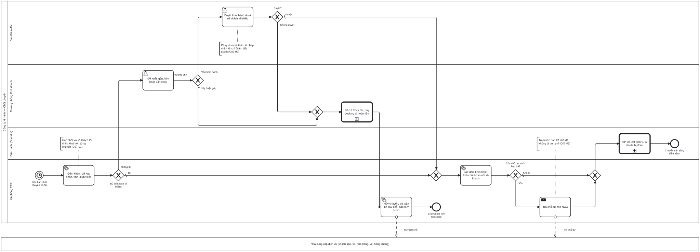

# BP-07 — Chốt chuyến khởi hành và trả chỗ cho nhà cung cấp

> Sinh tự động từ `defs/bp07_chot_chuyen.py` bằng bpmn-kit — sửa định nghĩa rồi chạy lại, không sửa tay file này.

File BPMN 2.0: [`bpmn/BP-07-chot-chuyen-tra-cho.bpmn`](../bpmn/BP-07-chot-chuyen-tra-cho.bpmn) · Ảnh: [`png/BP-07-chot-chuyen-tra-cho.png`](../png/BP-07-chot-chuyen-tra-cho.png)

## 1. Thông tin chung

| Mục | Nội dung |
|---|---|
| Mục tiêu | Tại hạn chốt của mỗi chuyến, quyết định khởi hành hay hủy/gộp dựa trên số khách thực tế và lãi dự kiến, rồi trả quỹ chỗ dư cho NCC trước hạn để không bị tính phí. |
| Sự kiện kích hoạt | Đến hạn chốt chuyến (D-N, khai báo trên từng chuyến khởi hành). |
| Kết quả đầu ra | Chuyến chuyển Bảo đảm khởi hành và đã trả chỗ dư, hoặc chuyến bị hủy/gộp, khách được xử lý theo BP-13 và toàn bộ quỹ chỗ đã trả. |
| Phạm vi | Tour ghép có lịch khởi hành. Đếm khách, so số tối thiểu, phương án khi thiếu khách, duyệt chạy lỗ, hủy/gộp chuyến, trả chỗ dư. |
| Ngoài phạm vi | Tour thiết kế riêng (đoàn riêng tự là một chuyến); thông báo và hoàn tiền cho khách ([BP-13](BP-13-thay-doi-huy-booking-hoan-tien.md)). |
| Module ERP | Lịch khởi hành & quỹ chỗ; Bán hàng (SAL); Mua hàng – NCC (PUR) |
| Quy trình chuẩn ERP tương ứng | Master scheduling ở mức từng chuyến (mix) với time fence: sau hạn chốt chỉ người có thẩm quyền được đổi; trả chỗ là phản hồi cho NCC theo supplier scheduling. |
| Quy trình đầu vào | [BP-04](BP-04-hoach-dinh-mua-vu-lich-khoi-hanh.md) lịch khởi hành; [BP-05](BP-05-ban-tour-ghep.md) booking đã xác nhận |
| Quy trình tiếp theo | [BP-08](BP-08-dat-dich-vu-chuan-bi-doan.md) đặt dịch vụ khi bảo đảm khởi hành; [BP-13](BP-13-thay-doi-huy-booking-hoan-tien.md) xử lý khách khi hủy/gộp |

## 2. Vai trò (làn)

| Làn | Vai trò | Trách nhiệm trong quy trình |
|---|---|---|
| `DIR` | Ban Giám đốc | Duyệt khởi hành dưới số khách tối thiểu (chấp nhận lỗ). |
| `SALES_MGR` | Trưởng phòng Kinh doanh | Đề xuất phương án khi thiếu khách; điều phối thông báo khách khi hủy/gộp. |
| `OPS` | Điều hành (Operator) | Nhận chuyến bảo đảm khởi hành để đặt dịch vụ. |
| `SYS` | Hệ thống ERP | Đếm khách, tính lãi dự kiến, chuyển trạng thái chuyến, tính và trả chỗ dư. |

Bên ngoài (pool hộp đen, trao đổi bằng luồng thông điệp): **Nhà cung cấp dịch vụ (khách sạn, xe, nhà hàng, vé, hàng không)**.

## 3. Các bước

| # | ID | Bước | Làn | Loại | Mô tả | Chứng từ / trạng thái | Kiểm soát |
|---|---|---|---|---|---|---|---|
| 1 | `S1` | Đến hạn chốt chuyến (D-N) | Hệ thống ERP | Sự kiện bắt đầu (hẹn giờ) |  |  | C07-01 |
| 2 | `T1` | Đếm khách đã xác nhận, tính lãi dự kiến | Hệ thống ERP | Hệ thống tự động | Chỉ đếm booking đã xác nhận (đã cọc hoặc trong hạn mức); lãi dự kiến theo số khách thực tế. |  |  |
| 3 | `G1` | Đủ số khách tối thiểu? | Hệ thống ERP | Rẽ nhánh (XOR) |  |  |  |
| 4 | `T2` | Đề xuất: gộp, hủy hoặc vẫn chạy | Trưởng phòng Kinh doanh | Người dùng thao tác | Gộp sang chuyến cùng tuyến gần ngày; hủy; hoặc vẫn chạy kèm lãi/lỗ dự kiến. |  |  |
| 5 | `G2` | Phương án? | Trưởng phòng Kinh doanh | Rẽ nhánh (XOR) |  |  |  |
| 6 | `T3` | Duyệt khởi hành dưới số khách tối thiểu | Ban Giám đốc | Người dùng thao tác |  |  | C07-02 |
| 7 | `G3` | Duyệt? | Ban Giám đốc | Rẽ nhánh (XOR) |  |  |  |
| 8 | `C1` | BP-13 Thay đổi, hủy booking & hoàn tiền | Trưởng phòng Kinh doanh | Gọi quy trình khác → BP-13 | Thông báo khách, chuyển sang chuyến khác hoặc hoàn tiền theo hợp đồng. |  | C07-04 |
| 9 | `T5` | Hủy chuyến, trả toàn bộ quỹ chỗ, báo hủy NCC | Hệ thống ERP | Hệ thống tự động |  | Chuyến: CANCELLED; Quỹ chỗ: CLOSED |  |
| 10 | `E2` | Chuyến đã hủy hoặc gộp | Hệ thống ERP | Sự kiện kết thúc |  |  |  |
| 11 | `T4` | Bảo đảm khởi hành, tính chỗ dư so với số khách | Hệ thống ERP | Hệ thống tự động | Chuyến chuyển Bảo đảm khởi hành; khóa nhận booking theo hạn; chỗ dư = quỹ chỗ − nhu cầu thực tế (phòng × đêm, ghế). | Chuyến: IN_PROGRESS (bảo đảm khởi hành) |  |
| 12 | `G4` | Còn chỗ dư trước hạn trả? | Hệ thống ERP | Rẽ nhánh (XOR) |  |  |  |
| 13 | `T8` | Trả chỗ dư cho NCC | Hệ thống ERP | Gửi thông điệp |  | Quỹ chỗ: phần dư CLOSED | C07-03 |
| 14 | `C2` | BP-08 Đặt dịch vụ & chuẩn bị đoàn | Điều hành (Operator) | Gọi quy trình khác → BP-08 |  |  |  |
| 15 | `E1` | Chuyến sẵn sàng điều hành | Điều hành (Operator) | Sự kiện kết thúc |  |  |  |

## 4. Điểm quyết định

| Cổng | Câu hỏi / điều kiện | Nhánh → bước tiếp theo |
|---|---|---|
| `G1` | Đủ số khách tối thiểu? | Đủ (mặc định) → `T4` Bảo đảm khởi hành, tính chỗ dư so với số khách Không đủ → `T2` Đề xuất: gộp, hủy hoặc vẫn chạy |
| `G2` | Phương án? | Vẫn khởi hành → `T3` Duyệt khởi hành dưới số khách tối thiểu Hủy hoặc gộp (mặc định) → `C1` BP-13 Thay đổi, hủy booking & hoàn tiền |
| `G3` | Duyệt? | Duyệt (mặc định) → `T4` Bảo đảm khởi hành, tính chỗ dư so với số khách Không duyệt → `C1` BP-13 Thay đổi, hủy booking & hoàn tiền |
| `G4` | Còn chỗ dư trước hạn trả? | Có → `T8` Trả chỗ dư cho NCC Không (mặc định) → `C2` BP-08 Đặt dịch vụ & chuẩn bị đoàn |

## 5. Trao đổi với bên ngoài

| Từ | Đến | Thông điệp |
|---|---|---|
| `T5` Hủy chuyến, trả toàn bộ quỹ chỗ, báo hủy NCC | Nhà cung cấp dịch vụ (khách sạn, xe, nhà hàng, vé, hàng không) | Hủy đặt chỗ |
| `T8` Trả chỗ dư cho NCC | Nhà cung cấp dịch vụ (khách sạn, xe, nhà hàng, vé, hàng không) | Trả chỗ dư |

## 6. Kiểm soát nội bộ

| Mã | Kiểm soát | Loại | Nguồn |
|---|---|---|---|
| C07-01 | Hạn chốt (D-N) và số khách tối thiểu khai báo trên từng chuyến; hệ thống tự kích hoạt kiểm tra đúng ngày. | Cấu hình | Wallace ch09 (time fences) |
| C07-02 | Khởi hành dưới số khách tối thiểu phải được Ban Giám đốc duyệt, kèm lãi/lỗ dự kiến. | Phòng ngừa | Elbardan ch08 (approval hierarchy) |
| C07-03 | Quỹ chỗ dư được trả trước hạn trả chỗ của hợp đồng; cảnh báo trước hạn N ngày. | Phòng ngừa · Báo cáo | Wallace ch12 (supplier scheduling) |
| C07-04 | Hủy/gộp chuyến bắt buộc kích hoạt xử lý khách (BP-13): không để booking nào gắn với chuyến đã hủy. | Phòng ngừa | Elbardan ch07 |

## 7. Chứng từ & trạng thái

| Chứng từ | Trạng thái chuẩn | Ghi chú |
|---|---|---|
| Chuyến khởi hành | APPROVED (mở bán) → IN_PROGRESS (bảo đảm khởi hành) → COMPLETED; CANCELLED khi hủy/gộp |  |
| Quỹ chỗ | PARTIAL → CLOSED (đã trả phần dư hoặc toàn bộ) |  |

## 8. Tham số hệ thống gợi ý

| Tham số | Ý nghĩa | Mặc định gợi ý |
|---|---|---|
| Hạn chốt chuyến | Số ngày trước khởi hành | D-10 |
| Số khách tối thiểu | Theo từng chuyến / dòng tour | 15 |
| Hạn trả chỗ | Theo hợp đồng NCC | D-7 |
| Cảnh báo sớm thiếu khách | Số ngày trước hạn chốt | 3 ngày |

## 9. Chỉ số đo (KPI)

| Chỉ số | Cách tính | Mục tiêu gợi ý |
|---|---|---|
| Tỷ lệ chuyến bảo đảm khởi hành | Chuyến khởi hành / chuyến mở bán | Theo dòng tour |
| Chi phí phạt do trả chỗ muộn | Tổng phí NCC tính do không trả đúng hạn | 0 |
| Số khách bị ảnh hưởng do hủy/gộp | Theo tháng | Giảm dần |

## 10. Căn cứ từ sách

- **Wallace & Kremzar, ch17** ([nguồn](../../../books/wallace-erp-implementation/chapters/ch17-appendix-a-fundamentals-of-erp.md)) — Master scheduling ở mức cơ cấu; phản hồi theo ngoại lệ; chỉ đổi lịch khi đã hết cách khác.
- **Wallace & Kremzar, ch09** ([nguồn](../../../books/wallace-erp-implementation/chapters/ch09-process-definition.md)) — Time fences: quy định ai được đổi lịch trong vùng thời gian nào.
- **Wallace & Kremzar, ch12** ([nguồn](../../../books/wallace-erp-implementation/chapters/ch12-supply-chain-integration-phase-ii.md)) — Supplier scheduling: báo NCC sớm khi nhu cầu thay đổi.
- **Elbardan & Kholeif, ch07** ([nguồn](../../../books/elbardan-erp-governance-audit/chapters/ch07-case-study-2-national-company.md)) — Không bước nào đi tiếp nếu bước trước chưa được duyệt.

## 11. Điểm cần xác nhận với doanh nghiệp

- Hạn chốt và số khách tối thiểu có khác nhau theo dòng tour/mùa không?
- Gộp chuyến: khách có quyền từ chối và được hoàn 100% không?
- NCC nào cho trả chỗ sát ngày hơn hạn chung?
