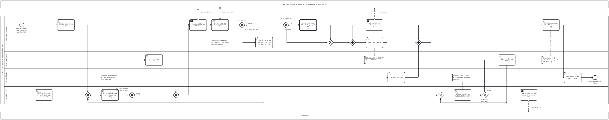

# BP-08 — Đặt dịch vụ nhà cung cấp và chuẩn bị đoàn

> Sinh tự động từ `defs/bp08_dat_dich_vu.py` bằng bpmn-kit — sửa định nghĩa rồi chạy lại, không sửa tay file này.

File BPMN 2.0: [`bpmn/BP-08-dat-dich-vu-chuan-bi-doan.bpmn`](../bpmn/BP-08-dat-dich-vu-chuan-bi-doan.bpmn) · Ảnh: [`png/BP-08-dat-dich-vu-chuan-bi-doan.png`](../png/BP-08-dat-dich-vu-chuan-bi-doan.png)

## 1. Thông tin chung

| Mục | Nội dung |
|---|---|
| Mục tiêu | Mọi dịch vụ trong chương trình được đặt với đúng NCC, đúng giá hợp đồng, có mã xác nhận; HDV và xe được phân công; hồ sơ đoàn đầy đủ và checklist bắt buộc hoàn tất trước ngày khởi hành. |
| Sự kiện kích hoạt | Booking tour riêng đã xác nhận (BP-06) hoặc chuyến ghép bảo đảm khởi hành (BP-07). |
| Kết quả đầu ra | Hồ sơ điều hành Đang chuẩn bị → sẵn sàng; tất cả đơn đặt dịch vụ đã được NCC xác nhận; HDV nhận hồ sơ đoàn và tạm ứng. |
| Phạm vi | Mở hồ sơ điều hành, sinh dịch vụ cần đặt và checklist theo mốc D-21…D-1, đặt dịch vụ, duyệt giá lệch hợp đồng, trả trước NCC, phân công HDV/xe, rooming list, kiểm tra điều kiện khởi hành, bàn giao HDV. |
| Ngoài phạm vi | Thanh toán NCC ([BP-12](BP-12-thanh-toan-ncc-cong-no-phai-tra.md)); thực hiện tour ([BP-09](BP-09-thuc-hien-tour-xu-ly-su-co.md)); đổi dịch vụ theo yêu cầu khách ([BP-13](BP-13-thay-doi-huy-booking-hoan-tien.md)); hồ sơ và thẻ HDV ([BP-16](BP-16-hdv-cong-tac-chi-tra-thu-lao.md)). |
| Module ERP | Điều hành tour (OPS); Mua hàng – đơn đặt dịch vụ (PUR); Tiền – tạm ứng (CB) |
| Quy trình chuẩn ERP tương ứng | Procure-to-Pay (Requisition-to-Pay) phần đặt hàng: nhu cầu sinh từ "định mức" chương trình → đơn đặt theo NCC → duyệt giá → gửi → xác nhận; tương đương MRP sinh đơn mua từ BOM. |
| Quy trình đầu vào | [BP-06](BP-06-ban-tour-thiet-ke-rieng.md); [BP-07](BP-07-chot-chuyen-tra-cho.md) |
| Quy trình tiếp theo | [BP-09](BP-09-thuc-hien-tour-xu-ly-su-co.md) thực hiện tour; [BP-12](BP-12-thanh-toan-ncc-cong-no-phai-tra.md) trả trước NCC |

## 2. Vai trò (làn)

| Làn | Vai trò | Trách nhiệm trong quy trình |
|---|---|---|
| `OPS` | Điều hành (Operator) | Kiểm tra bàn giao, gửi đơn đặt dịch vụ, ghi xác nhận, phân công, rooming list, bàn giao HDV. |
| `OPS_MGR` | Trưởng Điều hành | Duyệt giá NCC lệch hợp đồng/dự toán; xử lý việc tồn trước khởi hành. |
| `GUIDE` | Hướng dẫn viên | Xác nhận nhận tour; nhận hồ sơ đoàn và tạm ứng. |
| `SYS` | Hệ thống ERP | Sinh dịch vụ cần đặt và checklist; tạo đơn đặt theo NCC; kiểm tra điều kiện khởi hành; gửi lịch trình cuối. |

Bên ngoài (pool hộp đen, trao đổi bằng luồng thông điệp): **Nhà cung cấp dịch vụ (khách sạn, xe, nhà hàng, vé, hàng không)**; **Khách hàng**.

## 3. Các bước

| # | ID | Bước | Làn | Loại | Mô tả | Chứng từ / trạng thái | Kiểm soát |
|---|---|---|---|---|---|---|---|
| 1 | `S1` | Đoàn đã xác nhận hoặc chuyến bảo đảm khởi hành | Điều hành (Operator) | Sự kiện bắt đầu |  |  |  |
| 2 | `T1` | Mở hồ sơ điều hành, sinh dịch vụ cần đặt và checklist | Hệ thống ERP | Hệ thống tự động | Sinh từ chương trình đã chốt: mỗi khách sạn, mỗi NCC một dòng (số phòng × đêm, số suất, ngày dùng); checklist theo mốc D-21…D+10 có người phụ trách và hạn. | Hồ sơ điều hành: APPROVED (đang chuẩn bị) | C08-01 |
| 3 | `T2` | Kiểm tra thông tin bàn giao | Điều hành (Operator) | Người dùng thao tác | Số khách theo độ tuổi, rooming, yêu cầu đặc biệt (ăn chay, dị ứng, VIP), giấy tờ, điều khoản. |  |  |
| 4 | `T3` | Tạo đơn đặt dịch vụ theo NCC, giá hợp đồng | Hệ thống ERP | Hệ thống tự động | Gom dòng dịch vụ theo NCC; giá mặc định từ bảng giá hợp đồng theo ngày sử dụng. | Đơn đặt dịch vụ: DRAFT |  |
| 5 | `G1` | Giá khác hợp đồng hoặc vượt dự toán? | Hệ thống ERP | Rẽ nhánh (XOR) |  |  |  |
| 6 | `T4` | Duyệt giá NCC | Trưởng Điều hành | Người dùng thao tác |  | Đơn đặt dịch vụ: PENDING → APPROVED | C08-02 |
| 7 | `T5` | Gửi đơn đặt dịch vụ cho NCC | Điều hành (Operator) | Gửi thông điệp |  | Đơn đặt dịch vụ: IN_PROGRESS |  |
| 8 | `R1` | Ghi nhận phản hồi NCC | Điều hành (Operator) | Nhận thông điệp | Ghi mã xác nhận và giá NCC xác nhận; hệ thống cập nhật lãi dự kiến của tour. |  | C08-03 |
| 9 | `G2` | NCC xác nhận? | Điều hành (Operator) | Rẽ nhánh (XOR) |  |  |  |
| 10 | `T6` | Chọn NCC thay thế hoặc báo Kinh doanh đổi chương trình | Điều hành (Operator) | Người dùng thao tác |  | Đơn đặt dịch vụ cũ: CANCELLED |  |
| 11 | `G3` | NCC yêu cầu trả trước? | Điều hành (Operator) | Rẽ nhánh (XOR) |  |  |  |
| 12 | `C1` | BP-12 Thanh toán NCC & công nợ phải trả | Điều hành (Operator) | Gọi quy trình khác → BP-12 | Đề nghị thanh toán trước theo điều khoản của NCC. |  | C08-04 |
| 13 | `T9` | Gửi rooming list, danh sách đoàn cho NCC | Điều hành (Operator) | Gửi thông điệp | Mốc D-7; kèm yêu cầu đặc biệt. Mua bảo hiểm du lịch cho đoàn nếu thuộc phạm vi hợp đồng. |  |  |
| 14 | `T8` | Phân công HDV, xe | Điều hành (Operator) | Người dùng thao tác | Chọn HDV theo ngôn ngữ, tuyến; hệ thống chặn trùng lịch và thẻ HDV hết hạn; tỷ lệ HDV theo số khách. | Phân công: dự kiến → đã thông báo | C08-05 |
| 15 | `T8b` | Xác nhận nhận tour | Hướng dẫn viên | Người dùng thao tác |  | Phân công: đã nhận |  |
| 16 | `T11` | Kiểm tra checklist bắt buộc trước khởi hành | Hệ thống ERP | Hệ thống tự động | Tất cả dịch vụ đã xác nhận, rooming list đã gửi, HDV đã nhận, khách đã thanh toán đủ theo lịch. |  | C08-06 |
| 17 | `G4` | Đủ điều kiện khởi hành? | Hệ thống ERP | Rẽ nhánh (XOR) |  |  |  |
| 18 | `T12` | Xử lý việc tồn, leo thang | Trưởng Điều hành | Người dùng thao tác |  |  |  |
| 19 | `T10` | Gửi lịch trình cuối và thông tin HDV cho khách | Hệ thống ERP | Gửi thông điệp |  |  |  |
| 20 | `T13` | Bàn giao hồ sơ đoàn, lệnh điều tour, tạm ứng | Điều hành (Operator) | Người dùng thao tác | Hồ sơ đoàn, danh sách khách, mã xác nhận NCC, lệnh điều tour; đề nghị tạm ứng theo dự toán chi tại điểm. | Đề nghị tạm ứng: PENDING → APPROVED | C08-07 |
| 21 | `T14` | Nhận hồ sơ và tạm ứng, ký nhận | Hướng dẫn viên | Người dùng thao tác |  | Phiếu chi tạm ứng: POSTED |  |
| 22 | `E1` | Đoàn sẵn sàng khởi hành | Hướng dẫn viên | Sự kiện kết thúc |  |  |  |

## 4. Điểm quyết định

| Cổng | Câu hỏi / điều kiện | Nhánh → bước tiếp theo |
|---|---|---|
| `G1` | Giá khác hợp đồng hoặc vượt dự toán? | Có → `T4` Duyệt giá NCC Không (mặc định) → `T5` Gửi đơn đặt dịch vụ cho NCC |
| `G2` | NCC xác nhận? | Từ chối hoặc hết chỗ → `T6` Chọn NCC thay thế hoặc báo Kinh doanh đổi chương trình Xác nhận (mặc định) → `G3` NCC yêu cầu trả trước? |
| `G3` | NCC yêu cầu trả trước? | Có → `C1` BP-12 Thanh toán NCC & công nợ phải trả Không (mặc định) → `P1`  |
| `G4` | Đủ điều kiện khởi hành? | Chưa đủ → `T12` Xử lý việc tồn, leo thang Đủ (mặc định) → `T10` Gửi lịch trình cuối và thông tin HDV cho khách |

## 5. Trao đổi với bên ngoài

| Từ | Đến | Thông điệp |
|---|---|---|
| `T5` Gửi đơn đặt dịch vụ cho NCC | Nhà cung cấp dịch vụ (khách sạn, xe, nhà hàng, vé, hàng không) | Đơn đặt dịch vụ |
| Nhà cung cấp dịch vụ (khách sạn, xe, nhà hàng, vé, hàng không) | `R1` Ghi nhận phản hồi NCC | Xác nhận / từ chối |
| `T9` Gửi rooming list, danh sách đoàn cho NCC | Nhà cung cấp dịch vụ (khách sạn, xe, nhà hàng, vé, hàng không) | Rooming list |
| `T10` Gửi lịch trình cuối và thông tin HDV cho khách | Khách hàng | Lịch trình cuối |

## 6. Kiểm soát nội bộ

| Mã | Kiểm soát | Loại | Nguồn |
|---|---|---|---|
| C08-01 | Danh sách dịch vụ cần đặt và checklist sinh từ chương trình đã chốt (mỗi khách sạn/NCC một dòng), không lập tay. | Có sẵn · Cấu hình | Wallace ch17 (MRP sinh nhu cầu từ BOM) |
| C08-02 | Giá đặt mặc định từ hợp đồng; giá khác hợp đồng hoặc vượt dự toán quá ngưỡng phải Trưởng Điều hành duyệt (người đặt không tự duyệt). | Phòng ngừa · Phân quyền (SoD) | erp-ba-core p2p §7 BR-PUR-04 |
| C08-03 | Mỗi dòng dịch vụ phải có mã xác nhận của NCC; quá hạn phản hồi thì nhắc và leo thang theo mốc checklist. | Báo cáo (giám sát liên tục) | Wallace ch12 (phản hồi khi không đáp ứng được) |
| C08-04 | Trả trước cho NCC chỉ qua đề nghị thanh toán (BP-12); Điều hành không chi trực tiếp. | Phân quyền (SoD) | erp-ba-core p2p §10 |
| C08-05 | Chặn phân công trùng lịch HDV/xe; HDV phải có thẻ còn hạn đúng loại (nội địa, quốc tế, tại điểm). | Phòng ngừa · Cấu hình | Elbardan ch07 |
| C08-06 | Không chuyển sang khởi hành khi còn việc bắt buộc trong checklist chưa xong; ngoại lệ do Trưởng Điều hành ghi nhận. | Phòng ngừa (có override kiểm soát) | Elbardan ch07 |
| C08-07 | Tạm ứng HDV chỉ chi khi HDV không còn tạm ứng quá hạn chưa quyết toán; HDV ký nhận. | Phòng ngừa | erp-ba-core cash-bank §7 BR-CB-07 |

## 7. Chứng từ & trạng thái

| Chứng từ | Trạng thái chuẩn | Ghi chú |
|---|---|---|
| Hồ sơ điều hành | APPROVED (đang chuẩn bị) → IN_PROGRESS (đang diễn ra) → COMPLETED → CLOSED | Một hồ sơ cho một đoàn/chuyến. |
| Đơn đặt dịch vụ (PO dịch vụ) | DRAFT → PENDING → APPROVED → IN_PROGRESS (đã gửi) → COMPLETED (NCC xác nhận) / CANCELLED | Một đơn cho một NCC. |
| Phân công HDV/xe | Dự kiến → đã thông báo → đã nhận / từ chối → hoàn thành |  |
| Đề nghị tạm ứng | DRAFT → PENDING → APPROVED → POSTED | Theo dự toán chi tại điểm. |

## 8. Bút toán phát sinh

| Nghiệp vụ | Nợ | Có | Ghi chú |
|---|---|---|---|
| Trả trước NCC | 331 (chi tiết NCC, mã tour) | 112 | Qua BP-12. |
| Chi tạm ứng HDV | 141 (chi tiết HDV, mã tour) | 111 / 112 | HDV cộng tác không phải nhân viên: cần thống nhất dùng 141 hay 1388. |

## 9. Tham số hệ thống gợi ý

| Tham số | Ý nghĩa | Mặc định gợi ý |
|---|---|---|
| Ngưỡng lệch giá phải duyệt | So với hợp đồng / dự toán | 10% (cảnh báo từ 0,5%) |
| Hạn phản hồi của NCC | Từ khi gửi đơn | 48 giờ |
| Mốc checklist | Theo loại tour (inbound, nội địa) | D-21 … D+10 |
| Tỷ lệ HDV theo khách | Số khách tối đa / 1 HDV | 25 |

## 10. Chỉ số đo (KPI)

| Chỉ số | Cách tính | Mục tiêu gợi ý |
|---|---|---|
| Tỷ lệ dịch vụ xác nhận trước D-8 | Dòng có mã xác nhận / tổng dòng | 100% |
| Số lần phải đặt lại | Do NCC từ chối/hết chỗ | Giảm dần |
| Lệch giá đặt so với hợp đồng | Tổng chênh lệch / giá trị đặt | Tiến tới 0 |
| Tỷ lệ việc checklist đúng hạn | Việc xong đúng hạn / tổng việc | ≥ 95% |

## 11. Căn cứ từ sách

- **Parthasarathy, ch08** ([nguồn](../../../books/parthasarathy-erp-fundamentals/chapters/ch08-erp-and-crm.md)) — Requisition-to-Pay: yêu cầu → đơn mua → hóa đơn → thanh toán.
- **Wallace & Kremzar, ch17** ([nguồn](../../../books/wallace-erp-implementation/chapters/ch17-appendix-a-fundamentals-of-erp.md)) — MRP sinh nhu cầu chi tiết từ BOM và lịch; supplier scheduling gửi lịch cho NCC.
- **Wallace & Kremzar, ch11** ([nguồn](../../../books/wallace-erp-implementation/chapters/ch11-going-on-the-air-basic-erp.md)) — "Silence is approval": ai biết sẽ trễ phải báo ngay (anticipated delay report).
- **Elbardan & Kholeif, ch07** ([nguồn](../../../books/elbardan-erp-governance-audit/chapters/ch07-case-study-2-national-company.md)) — Không bước nào đi tiếp nếu bước trước chưa được duyệt.
- **erp-ba-core `p2p-procure-to-pay.md` §5, §7, §13.9** — mua dịch vụ: nghiệm thu dịch vụ thay cho nhập kho.
- **erp-ba-core `cash-bank.md` §7 BR-CB-07** — chặn tạm ứng mới khi còn tạm ứng quá hạn.

## 12. Điểm cần xác nhận với doanh nghiệp

- Ai được gửi đơn đặt dịch vụ trực tiếp cho NCC (mọi điều hành viên hay chỉ người phụ trách đoàn)?
- Bảo hiểm du lịch do công ty mua cho mọi đoàn hay chỉ khi hợp đồng có?
- Tạm ứng cho HDV cộng tác hạch toán 141 hay 1388?
