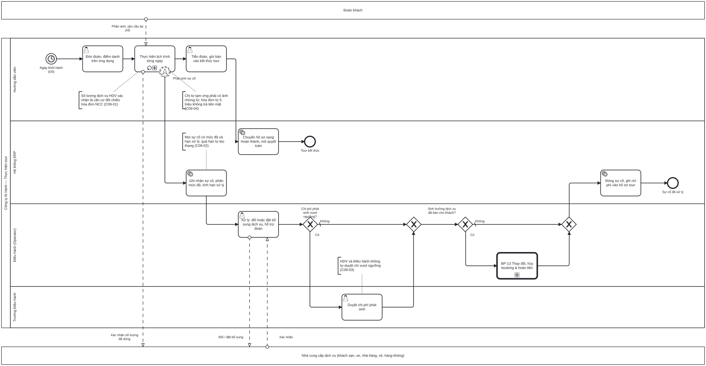

# BP-09 — Thực hiện tour và xử lý sự cố

> Sinh tự động từ `defs/bp09_thuc_hien_tour.py` bằng bpmn-kit — sửa định nghĩa rồi chạy lại, không sửa tay file này.

File BPMN 2.0: [`bpmn/BP-09-thuc-hien-tour-xu-ly-su-co.bpmn`](../bpmn/BP-09-thuc-hien-tour-xu-ly-su-co.bpmn) · Ảnh: [`png/BP-09-thuc-hien-tour-xu-ly-su-co.png`](../png/BP-09-thuc-hien-tour-xu-ly-su-co.png)

## 1. Thông tin chung

| Mục | Nội dung |
|---|---|
| Mục tiêu | Đoàn đi đúng lịch trình; HDV ghi nhận số lượng dịch vụ thực dùng và chi phí phát sinh ngay tại hiện trường; mọi sự cố có người xử lý, hạn xử lý và chi phí được duyệt. |
| Sự kiện kích hoạt | Ngày khởi hành (D0) của đoàn đã sẵn sàng (BP-08). |
| Kết quả đầu ra | Tour kết thúc; hồ sơ điều hành chuyển Hoàn thành với số lượng dịch vụ thực dùng, chi phí phát sinh và sự cố đã đóng — đủ dữ liệu cho quyết toán. |
| Phạm vi | Đón đoàn, điểm danh, thực hiện lịch trình từng ngày, xác nhận dịch vụ đã dùng, chi từ tạm ứng, báo và xử lý sự cố, duyệt chi phát sinh, đổi dịch vụ có ảnh hưởng tới khách, tiễn đoàn. |
| Ngoài phạm vi | Quyết toán tạm ứng và đóng hồ sơ ([BP-10](BP-10-quyet-toan-dong-ho-so-tour.md)); điều chỉnh booking và tiền với khách ([BP-13](BP-13-thay-doi-huy-booking-hoan-tien.md)); khiếu nại sau tour ([BP-14](BP-14-cham-soc-khach-hang-khieu-nai.md)). |
| Module ERP | Điều hành tour – ứng dụng HDV; Sự cố (SVC); Mua hàng – nghiệm thu dịch vụ |
| Quy trình chuẩn ERP tương ứng | Thực thi và phản hồi (execution & feedback) của hệ phân cấp hoạch định; xác nhận dịch vụ đã dùng là bước "nghiệm thu dịch vụ" (service entry) của Procure-to-Pay. |
| Quy trình đầu vào | [BP-08](BP-08-dat-dich-vu-chuan-bi-doan.md) |
| Quy trình tiếp theo | [BP-10](BP-10-quyet-toan-dong-ho-so-tour.md) quyết toán; [BP-14](BP-14-cham-soc-khach-hang-khieu-nai.md) khảo sát sau tour; [BP-13](BP-13-thay-doi-huy-booking-hoan-tien.md) khi đổi dịch vụ của khách |

## 2. Vai trò (làn)

| Làn | Vai trò | Trách nhiệm trong quy trình |
|---|---|---|
| `GUIDE` | Hướng dẫn viên | Đón đoàn, điểm danh, thực hiện lịch trình, xác nhận dịch vụ đã dùng, ghi chi phí kèm ảnh chứng từ, báo sự cố. |
| `SYS` | Hệ thống ERP | Ghi nhận sự cố, tính hạn xử lý theo mức độ, leo thang; đóng sự cố; chuyển trạng thái hồ sơ. |
| `OPS` | Điều hành (Operator) | Xử lý sự cố: đổi hoặc đặt bổ sung dịch vụ, hỗ trợ đoàn. |
| `OPS_MGR` | Trưởng Điều hành | Duyệt chi phí phát sinh vượt ngưỡng. |

Bên ngoài (pool hộp đen, trao đổi bằng luồng thông điệp): **Đoàn khách**; **Nhà cung cấp dịch vụ (khách sạn, xe, nhà hàng, vé, hàng không)**.

## 3. Các bước

| # | ID | Bước | Làn | Loại | Mô tả | Chứng từ / trạng thái | Kiểm soát |
|---|---|---|---|---|---|---|---|
| 1 | `S1` | Ngày khởi hành (D0) | Hướng dẫn viên | Sự kiện bắt đầu (hẹn giờ) |  |  |  |
| 2 | `T1` | Đón đoàn, điểm danh trên ứng dụng | Hướng dẫn viên | Người dùng thao tác |  | Hồ sơ điều hành: IN_PROGRESS (đang diễn ra) |  |
| 3 | `SUB1` | Thực hiện lịch trình từng ngày | Hướng dẫn viên | Quy trình con (lặp) | Mỗi ngày: check-in từng mốc; xác nhận số lượng dịch vụ đã dùng (phòng × đêm, suất ăn, vé, xe) với NCC; ghi chi tiêu từ tạm ứng kèm ảnh chứng từ; báo cáo ngày. |  | C09-01, C09-04 |
| 4 | `B1` | Phát sinh sự cố | Hướng dẫn viên | Sự kiện biên (leo thang) trên SUB1, không ngắt | HDV bấm báo sự cố trên ứng dụng (loại, mức độ, ảnh); tour vẫn tiếp tục. |  |  |
| 5 | `T7` | Tiễn đoàn, gửi báo cáo kết thúc tour | Hướng dẫn viên | Người dùng thao tác |  |  |  |
| 6 | `T3` | Ghi nhận sự cố, phân mức độ, tính hạn xử lý | Hệ thống ERP | Hệ thống tự động | Hạn xử lý theo mức độ; báo Điều hành phụ trách; quá hạn tự leo thang lên Trưởng Điều hành. | Sự cố: DRAFT (mới báo) | C09-02 |
| 7 | `T8` | Chuyển hồ sơ sang Hoàn thành, mở quyết toán | Hệ thống ERP | Hệ thống tự động | Khóa nhập nhật ký hiện trường; tạo việc quyết toán tạm ứng; lên lịch gửi khảo sát. | Hồ sơ điều hành: COMPLETED |  |
| 8 | `T4` | Xử lý: đổi hoặc đặt bổ sung dịch vụ, hỗ trợ đoàn | Điều hành (Operator) | Người dùng thao tác |  | Sự cố: IN_PROGRESS |  |
| 9 | `E1` | Tour kết thúc | Hệ thống ERP | Sự kiện kết thúc |  |  |  |
| 10 | `G1` | Chi phí phát sinh vượt ngưỡng? | Điều hành (Operator) | Rẽ nhánh (XOR) |  |  |  |
| 11 | `T5` | Duyệt chi phí phát sinh | Trưởng Điều hành | Người dùng thao tác |  |  | C09-03 |
| 12 | `G2` | Ảnh hưởng dịch vụ đã bán cho khách? | Điều hành (Operator) | Rẽ nhánh (XOR) |  |  |  |
| 13 | `C1` | BP-13 Thay đổi, hủy booking & hoàn tiền | Điều hành (Operator) | Gọi quy trình khác → BP-13 | Khách xác nhận thay đổi; phụ thu hoặc hoàn tiền. |  | C09-05 |
| 14 | `T6` | Đóng sự cố, ghi chi phí vào hồ sơ tour | Hệ thống ERP | Hệ thống tự động |  | Sự cố: COMPLETED |  |
| 15 | `E2` | Sự cố đã xử lý | Hệ thống ERP | Sự kiện kết thúc |  |  |  |

Bên trong quy trình con `SUB1` Thực hiện lịch trình từng ngày (mở bằng cách bấm vào ô trong công cụ BPMN):

| ID | Bước | Loại | Mô tả |
|---|---|---|---|
| `SUB1_S` | Bắt đầu ngày | Sự kiện bắt đầu |  |
| `SUB1_T1` | Check-in từng mốc lịch trình | Người dùng thao tác | Đến điểm, nhận phòng, bữa ăn, tham quan: bấm check-in theo mốc. |
| `SUB1_T2` | Xác nhận số lượng dịch vụ đã dùng với NCC | Người dùng thao tác | Phòng × đêm, suất ăn, vé, xe theo thực tế; ghi chênh lệch so với đặt chỗ. |
| `SUB1_T3` | Ghi chi tiêu từ tạm ứng kèm ảnh chứng từ | Người dùng thao tác |  |
| `SUB1_T4` | Gửi báo cáo ngày | Người dùng thao tác | Tình hình đoàn, phản ánh của khách, việc cần Điều hành hỗ trợ. |
| `SUB1_E` | Kết thúc ngày | Sự kiện kết thúc |  |

## 4. Điểm quyết định

| Cổng | Câu hỏi / điều kiện | Nhánh → bước tiếp theo |
|---|---|---|
| `G1` | Chi phí phát sinh vượt ngưỡng? | Có → `T5` Duyệt chi phí phát sinh Không (mặc định) → `G2` Ảnh hưởng dịch vụ đã bán cho khách? |
| `G2` | Ảnh hưởng dịch vụ đã bán cho khách? | Có → `C1` BP-13 Thay đổi, hủy booking & hoàn tiền Không (mặc định) → `T6` Đóng sự cố, ghi chi phí vào hồ sơ tour |

## 5. Trao đổi với bên ngoài

| Từ | Đến | Thông điệp |
|---|---|---|
| Đoàn khách | `SUB1` Thực hiện lịch trình từng ngày | Phản ánh, yêu cầu tại chỗ |
| `SUB1` Thực hiện lịch trình từng ngày | Nhà cung cấp dịch vụ (khách sạn, xe, nhà hàng, vé, hàng không) | Xác nhận số lượng đã dùng |
| `T4` Xử lý: đổi hoặc đặt bổ sung dịch vụ, hỗ trợ đoàn | Nhà cung cấp dịch vụ (khách sạn, xe, nhà hàng, vé, hàng không) | Đổi / đặt bổ sung |
| Nhà cung cấp dịch vụ (khách sạn, xe, nhà hàng, vé, hàng không) | `T4` Xử lý: đổi hoặc đặt bổ sung dịch vụ, hỗ trợ đoàn | Xác nhận |

## 6. Kiểm soát nội bộ

| Mã | Kiểm soát | Loại | Nguồn |
|---|---|---|---|
| C09-01 | HDV xác nhận số lượng dịch vụ thực dùng theo từng mốc trên ứng dụng; số này là căn cứ đối chiếu 3 chiều với hóa đơn NCC (BP-12). | Cấu hình | erp-ba-core p2p §13.9 (nghiệm thu dịch vụ) |
| C09-02 | Mọi sự cố ghi trên hệ thống với mức độ và hạn xử lý; quá hạn tự leo thang. | Báo cáo (giám sát liên tục) | Elbardan ch06; erp-ba-core crm-service §5B |
| C09-03 | Chi phí phát sinh vượt ngưỡng phải Trưởng Điều hành duyệt trước khi chi; trường hợp khẩn cấp được chi trước và phải duyệt bổ sung trong hạn. | Phòng ngừa (có override kiểm soát) | Elbardan ch08 |
| C09-04 | Mỗi khoản chi từ tạm ứng phải có ảnh chứng từ; cảnh báo khi hóa đơn từ 5 triệu thanh toán bằng tiền mặt. | Phòng ngừa | erp-ba-core cash-bank §7 BR-CB-03 |
| C09-05 | Thay đổi dịch vụ đã bán cho khách phải qua yêu cầu thay đổi có khách xác nhận (BP-13). | Phòng ngừa | Wallace ch09 (change control) |

## 7. Chứng từ & trạng thái

| Chứng từ | Trạng thái chuẩn | Ghi chú |
|---|---|---|
| Hồ sơ điều hành | IN_PROGRESS (đang diễn ra) → COMPLETED |  |
| Nhật ký hiện trường | Ghi theo mốc; khóa khi hồ sơ hoàn thành | Check-in, số lượng dịch vụ đã dùng, ảnh. |
| Sự cố | DRAFT (mới báo) → IN_PROGRESS → COMPLETED → CLOSED | Có mức độ và hạn xử lý. |
| Khoản chi từ tạm ứng | Ghi nhận, chờ quyết toán | Kèm ảnh chứng từ. |

## 8. Bút toán phát sinh

| Nghiệp vụ | Nợ | Có | Ghi chú |
|---|---|---|---|
| Chi phát sinh từ tạm ứng | — | — | Chưa ghi sổ tại hiện trường; ghi khi quyết toán (BP-10): Nợ 154 / Có 141. |

## 9. Tham số hệ thống gợi ý

| Tham số | Ý nghĩa | Mặc định gợi ý |
|---|---|---|
| Ngưỡng chi phát sinh phải duyệt | Mỗi khoản | 3.000.000 đ |
| Hạn xử lý sự cố theo mức độ | Nghiêm trọng / Cao / Trung bình / Thấp | 1 / 2 / 4 / 6 giờ |
| Hạn duyệt bổ sung cho chi khẩn cấp | Sau khi chi | 24 giờ |

## 10. Chỉ số đo (KPI)

| Chỉ số | Cách tính | Mục tiêu gợi ý |
|---|---|---|
| Số sự cố trên 100 khách | Theo tuyến và NCC | Giảm dần |
| Tỷ lệ sự cố xử lý đúng hạn | Đúng hạn / tổng sự cố | ≥ 95% |
| Chi phí phát sinh / doanh thu tour | Theo tour | Theo dõi |
| Tỷ lệ dịch vụ có xác nhận số lượng | Dòng có xác nhận / tổng dòng | 100% |

## 11. Căn cứ từ sách

- **Wallace & Kremzar, ch17** ([nguồn](../../../books/wallace-erp-implementation/chapters/ch17-appendix-a-fundamentals-of-erp.md)) — Thực thi và phản hồi theo ngoại lệ: báo khi không thực hiện được kế hoạch, kèm nguyên nhân.
- **Wallace & Kremzar, ch11** ([nguồn](../../../books/wallace-erp-implementation/chapters/ch11-going-on-the-air-basic-erp.md)) — "Silence is approval": biết sẽ trễ thì phải báo ngay.
- **Elbardan & Kholeif, ch06** ([nguồn](../../../books/elbardan-erp-governance-audit/chapters/ch06-findings-case-study-1-international-company.md)) — Báo cáo ngoại lệ và cảnh báo là kiểm soát giám sát liên tục.
- **Elbardan & Kholeif, ch08** ([nguồn](../../../books/elbardan-erp-governance-audit/chapters/ch08-case-study-3-national-bank.md)) — Duyệt theo cấp; thiết kế luồng ngoại lệ có kiểm soát.
- **erp-ba-core `crm-service.md` §5B** — phiếu sự cố, hạn xử lý, leo thang.
- **erp-ba-core `cash-bank.md` §7 BR-CB-03** — ngưỡng 5 triệu thanh toán không dùng tiền mặt.

## 12. Điểm cần xác nhận với doanh nghiệp

- Ngưỡng chi phát sinh HDV được tự quyết là bao nhiêu? Có khác theo loại tour?
- HDV có được trả tiền mặt cho NCC không, hay mọi khoản lớn phải để công ty chuyển khoản?
- Mức độ sự cố và hạn xử lý có cần khác nhau giữa tour inbound và nội địa?
