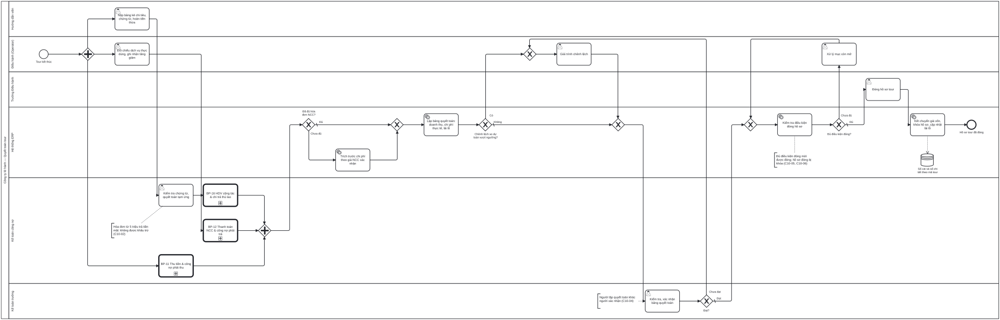

# BP-10 — Quyết toán và đóng hồ sơ tour

> Sinh tự động từ `defs/bp10_quyet_toan.py` bằng bpmn-kit — sửa định nghĩa rồi chạy lại, không sửa tay file này.

File BPMN 2.0: [`bpmn/BP-10-quyet-toan-dong-ho-so-tour.bpmn`](../bpmn/BP-10-quyet-toan-dong-ho-so-tour.bpmn) · Ảnh: [`png/BP-10-quyet-toan-dong-ho-so-tour.png`](../png/BP-10-quyet-toan-dong-ho-so-tour.png)

## 1. Thông tin chung

| Mục | Nội dung |
|---|---|
| Mục tiêu | Có lãi lỗ thực tế của từng tour trong vài ngày sau khi tour kết thúc (không chờ cuối tháng), với đủ chi phí: hóa đơn NCC, chi tại điểm, thù lao HDV, trích trước phần chưa có hóa đơn; rồi đóng hồ sơ khi không còn việc mở. |
| Sự kiện kích hoạt | Tour kết thúc (BP-09 chuyển hồ sơ sang Hoàn thành). |
| Kết quả đầu ra | Bảng quyết toán tour đã được Kế toán trưởng xác nhận; giá vốn đã kết chuyển; hồ sơ điều hành Đã đóng và bị khóa. |
| Phạm vi | Quyết toán tạm ứng HDV, thù lao HDV, đối chiếu dịch vụ thực dùng, nhận hóa đơn NCC, xuất hóa đơn và thu đủ của khách, trích trước, bảng quyết toán, giải trình chênh lệch, kiểm tra điều kiện đóng, kết chuyển giá vốn. |
| Ngoài phạm vi | Chi tiết thu tiền ([BP-11](BP-11-thu-tien-cong-no-phai-thu.md)), trả NCC ([BP-12](BP-12-thanh-toan-ncc-cong-no-phai-tra.md)), thù lao HDV ([BP-16](BP-16-hdv-cong-tac-chi-tra-thu-lao.md)); khóa sổ kỳ ([BP-15](BP-15-khoa-so-cuoi-ky.md)). |
| Module ERP | Điều hành tour; Giá thành theo tour (COST); Tiền – tạm ứng (CB); Sổ cái (GL) |
| Quy trình chuẩn ERP tương ứng | Giá thành theo đơn hàng / dự án: mỗi tour là một đối tượng tập hợp chi phí (TK 154 gắn mã tour), chỉ tính giá thành và kết chuyển khi hoàn thành; điều kiện đóng tương tự đóng dự án. |
| Quy trình đầu vào | [BP-09](BP-09-thuc-hien-tour-xu-ly-su-co.md) |
| Quy trình tiếp theo | [BP-15](BP-15-khoa-so-cuoi-ky.md) khóa sổ kỳ; [BP-14](BP-14-cham-soc-khach-hang-khieu-nai.md) chăm sóc khách hàng |

## 2. Vai trò (làn)

| Làn | Vai trò | Trách nhiệm trong quy trình |
|---|---|---|
| `GUIDE` | Hướng dẫn viên | Nộp bảng kê chi tiêu, chứng từ gốc, hoàn tiền thừa. |
| `OPS` | Điều hành (Operator) | Đối chiếu dịch vụ thực dùng với đặt chỗ; giải trình chênh lệch; xử lý mục còn mở. |
| `OPS_MGR` | Trưởng Điều hành | Đóng hồ sơ tour. |
| `SYS` | Hệ thống ERP | Trích trước chi phí; lập bảng quyết toán; kiểm tra điều kiện đóng; kết chuyển giá vốn. |
| `ACC` | Kế toán công nợ | Quyết toán tạm ứng; nhận hóa đơn NCC; xuất hóa đơn và thu đủ của khách; thù lao HDV. |
| `CHIEF_ACC` | Kế toán trưởng | Kiểm tra và xác nhận bảng quyết toán. |

## 3. Các bước

| # | ID | Bước | Làn | Loại | Mô tả | Chứng từ / trạng thái | Kiểm soát |
|---|---|---|---|---|---|---|---|
| 1 | `S1` | Tour kết thúc | Điều hành (Operator) | Sự kiện bắt đầu |  |  |  |
| 2 | `T1` | Nộp bảng kê chi tiêu, chứng từ, hoàn tiền thừa | Hướng dẫn viên | Người dùng thao tác |  |  |  |
| 3 | `T3` | Đối chiếu dịch vụ thực dùng, ghi nhận tăng giảm | Điều hành (Operator) | Người dùng thao tác | So số lượng HDV xác nhận với đơn đặt dịch vụ; ghi tăng/giảm với NCC. |  |  |
| 4 | `T2` | Kiểm tra chứng từ, quyết toán tạm ứng | Kế toán công nợ | Người dùng thao tác |  | Bảng quyết toán tạm ứng: POSTED | C10-01, C10-02 |
| 5 | `C2` | BP-11 Thu tiền & công nợ phải thu | Kế toán công nợ | Gọi quy trình khác → BP-11 | Xuất hóa đơn tại thời điểm hoàn thành dịch vụ (nếu chưa xuất) và thu đủ. |  |  |
| 6 | `C3` | BP-16 HDV cộng tác & chi trả thù lao | Kế toán công nợ | Gọi quy trình khác → BP-16 | Tính và ghi nhận thù lao HDV vào chi phí tour; cấn trừ tạm ứng còn lại. |  |  |
| 7 | `C1` | BP-12 Thanh toán NCC & công nợ phải trả | Kế toán công nợ | Gọi quy trình khác → BP-12 | Nhận và đối chiếu 3 chiều hóa đơn NCC, ghi chi phí vào tour. |  |  |
| 8 | `G1` | Đã đủ hóa đơn NCC? | Hệ thống ERP | Rẽ nhánh (XOR) |  |  |  |
| 9 | `T5` | Trích trước chi phí theo giá NCC xác nhận | Hệ thống ERP | Hệ thống tự động |  |  | C10-03 |
| 10 | `T6` | Lập bảng quyết toán: doanh thu, chi phí thực tế, lãi lỗ | Hệ thống ERP | Hệ thống tự động | So với dự toán theo từng hạng mục (lưu trú, vận chuyển, vé, ăn, HDV, phát sinh). | Bảng quyết toán tour: DRAFT |  |
| 11 | `G2` | Chênh lệch so dự toán vượt ngưỡng? | Hệ thống ERP | Rẽ nhánh (XOR) |  |  |  |
| 12 | `T7` | Giải trình chênh lệch | Điều hành (Operator) | Người dùng thao tác |  |  |  |
| 13 | `T8` | Kiểm tra, xác nhận bảng quyết toán | Kế toán trưởng | Người dùng thao tác |  | Bảng quyết toán tour: PENDING → APPROVED | C10-04 |
| 14 | `G3` | Đạt? | Kế toán trưởng | Rẽ nhánh (XOR) |  |  |  |
| 15 | `T9` | Kiểm tra điều kiện đóng hồ sơ | Hệ thống ERP | Hệ thống tự động |  |  | C10-05 |
| 16 | `T10` | Xử lý mục còn mở | Điều hành (Operator) | Người dùng thao tác |  |  |  |
| 17 | `G4` | Đủ điều kiện đóng? | Hệ thống ERP | Rẽ nhánh (XOR) |  |  |  |
| 18 | `T11` | Đóng hồ sơ tour | Trưởng Điều hành | Người dùng thao tác |  | Hồ sơ điều hành: CLOSED | C10-06 |
| 19 | `T12` | Kết chuyển giá vốn, khóa hồ sơ, cập nhật lãi lỗ | Hệ thống ERP | Hệ thống tự động |  |  |  |
| 20 | `E1` | Hồ sơ tour đã đóng | Hệ thống ERP | Sự kiện kết thúc |  |  |  |

## 4. Điểm quyết định

| Cổng | Câu hỏi / điều kiện | Nhánh → bước tiếp theo |
|---|---|---|
| `G1` | Đã đủ hóa đơn NCC? | Chưa đủ → `T5` Trích trước chi phí theo giá NCC xác nhận Đủ (mặc định) → `T6` Lập bảng quyết toán: doanh thu, chi phí thực tế, lãi lỗ |
| `G2` | Chênh lệch so dự toán vượt ngưỡng? | Có → `T7` Giải trình chênh lệch Không (mặc định) → `T8` Kiểm tra, xác nhận bảng quyết toán |
| `G3` | Đạt? | Chưa đạt → `T7` Giải trình chênh lệch Đạt (mặc định) → `T9` Kiểm tra điều kiện đóng hồ sơ |
| `G4` | Đủ điều kiện đóng? | Chưa đủ → `T10` Xử lý mục còn mở Đủ (mặc định) → `T11` Đóng hồ sơ tour |

## 6. Kiểm soát nội bộ

| Mã | Kiểm soát | Loại | Nguồn |
|---|---|---|---|
| C10-01 | Tạm ứng HDV phải quyết toán trong hạn sau khi tour kết thúc; quá hạn chặn tạm ứng mới. | Phòng ngừa | erp-ba-core cash-bank §7 BR-CB-07 |
| C10-02 | Chứng từ chi phải hợp lệ; cảnh báo hóa đơn từ 5 triệu trả tiền mặt (mất khấu trừ GTGT, chi phí không được trừ). | Phòng ngừa | erp-ba-core ap §7 BR-AP-04 |
| C10-03 | Dịch vụ đã dùng nhưng chưa có hóa đơn được trích trước theo giá NCC xác nhận, để lãi lỗ tour không bỏ sót chi phí. | Có sẵn · Cấu hình | erp-ba-core r2r §5 (trích trước 335) |
| C10-04 | Người lập bảng quyết toán không được xác nhận bảng đó. | Phân quyền (SoD) | Elbardan ch07 (kiểm soát nhiều lớp) |
| C10-05 | Chỉ đóng khi: mọi dịch vụ/booking NCC có kết quả cuối; việc bắt buộc đã xong; không còn yêu cầu thay đổi chờ; tạm ứng đã quyết toán; thù lao HDV đã ghi nhận; chênh lệch đã giải trình; công nợ khách đã thu đủ hoặc chuyển theo dõi. | Phòng ngừa | erp-ba-core project-management §7 BR-PRJ-10 |
| C10-06 | Hồ sơ đã đóng bị khóa; mở lại cần quyền Trưởng Điều hành và ghi lý do. | Phân quyền · Có sẵn (audit trail) | Elbardan ch08 (processing constraints) |

## 7. Chứng từ & trạng thái

| Chứng từ | Trạng thái chuẩn | Ghi chú |
|---|---|---|
| Bảng quyết toán tạm ứng | DRAFT → PENDING → APPROVED → POSTED | Theo HDV và mã tour. |
| Bảng quyết toán tour | DRAFT → PENDING → RETURNED / APPROVED | Doanh thu, chi phí thực tế, dự toán, chênh lệch. |
| Hồ sơ điều hành | COMPLETED → CLOSED | Khóa sau khi đóng. |

## 8. Bút toán phát sinh

| Nghiệp vụ | Nợ | Có | Ghi chú |
|---|---|---|---|
| Quyết toán tạm ứng | 154 (mã tour), 1331 | 141 | Hoàn ứng: Nợ 111 / Có 141. Chi bù: Nợ 141 / Có 111. |
| Trích trước dịch vụ chưa có hóa đơn | 154 (mã tour) | 335 | Đảo hoặc cấn trừ khi nhận hóa đơn. |
| Kết chuyển giá vốn tour | 632 (mã tour) | 154 (mã tour) | Sau khi chi phí đủ; 154 của tour về 0. |
| Doanh thu tour (qua BP-11) | 131 | 511, 33311 | Nếu đã xuất hóa đơn khi thu trước: Nợ 3387 / Có 511 khi hoàn thành. |

## 9. Tham số hệ thống gợi ý

| Tham số | Ý nghĩa | Mặc định gợi ý |
|---|---|---|
| Hạn quyết toán tạm ứng | Sau ngày kết thúc tour | 4 ngày làm việc |
| Ngưỡng chênh lệch phải giải trình | So với dự toán, theo hạng mục | 10% hoặc 2.000.000 đ |
| Hạn đóng hồ sơ | Sau ngày kết thúc tour | 10 ngày |

## 10. Chỉ số đo (KPI)

| Chỉ số | Cách tính | Mục tiêu gợi ý |
|---|---|---|
| Số ngày từ kết thúc tour tới có lãi lỗ thực tế | Theo tour | ≤ 7 ngày |
| Số ngày tới đóng hồ sơ | Theo tour | ≤ 10 ngày |
| Chênh lệch giá thành thực tế / dự toán | Theo tour và dòng tour | ≤ 5% |
| Số tạm ứng quá hạn | Tại thời điểm báo cáo | 0 |

## 11. Căn cứ từ sách

- **Wallace & Kremzar, ch01** ([nguồn](../../../books/wallace-erp-implementation/chapters/ch01-enterprise-resource-planning.md)) — Class A: một bộ số xuyên suốt từ hoạch định, thực thi đến tài chính.
- **Parthasarathy, ch03** ([nguồn](../../../books/parthasarathy-erp-fundamentals/chapters/ch03-erp-modules.md)) — Finance: Cost controlling; MM: Product costing.
- **Elbardan & Kholeif, ch06** ([nguồn](../../../books/elbardan-erp-governance-audit/chapters/ch06-findings-case-study-1-international-company.md)) — Quy trình phải kiểm toán được: để lại vết, truy ngược về sổ cái và sổ chi tiết.
- **Elbardan & Kholeif, ch08** ([nguồn](../../../books/elbardan-erp-governance-audit/chapters/ch08-case-study-3-national-bank.md)) — Ràng buộc xử lý: sau điểm kiểm soát thì chặn thêm/sửa/xóa.
- **erp-ba-core `project-management.md` §7 BR-PRJ-10, §8.3** — điều kiện đóng dự án; TK 3387 doanh thu chờ phân bổ.
- **erp-ba-core `costing.md` §7.3 BR-COST-13** — phương pháp theo đơn đặt hàng: mỗi đơn một đối tượng giá thành.
- **erp-ba-core `cash-bank.md` §8** — bút toán tạm ứng và quyết toán tạm ứng.

## 12. Điểm cần xác nhận với doanh nghiệp

- Doanh nghiệp áp dụng TT99 hay chế độ cho doanh nghiệp nhỏ và vừa? (ảnh hưởng tài khoản 154/632 và 642)
- Ngưỡng chênh lệch phải giải trình theo % hay theo số tiền?
- Công nợ khách chưa thu đủ có được đóng hồ sơ và theo dõi riêng không?
