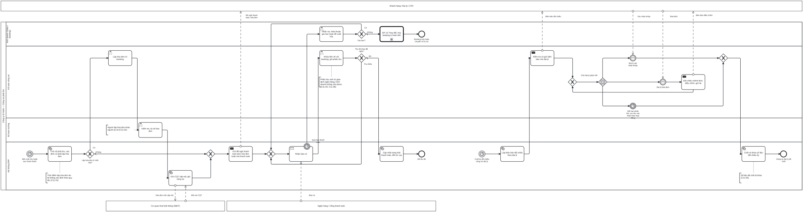

# BP-11 — Thu tiền khách hàng và công nợ phải thu (kèm đối chiếu công nợ đại lý)

> Sinh tự động từ `defs/bp11_cong_no_phai_thu.py` bằng bpmn-kit — sửa định nghĩa rồi chạy lại, không sửa tay file này.

File BPMN 2.0: [`bpmn/BP-11-thu-tien-cong-no-phai-thu.bpmn`](../bpmn/BP-11-thu-tien-cong-no-phai-thu.bpmn) · Ảnh: [`png/BP-11-thu-tien-cong-no-phai-thu.png`](../png/BP-11-thu-tien-cong-no-phai-thu.png)

## 1. Thông tin chung

| Mục | Nội dung |
|---|---|
| Mục tiêu | Thu đủ tiền theo lịch thanh toán của từng booking, xuất hóa đơn điện tử đúng thời điểm, ghi nhận tiền về đúng khách, nhắc nợ có cấp độ; đối chiếu công nợ với đại lý hằng kỳ và chốt số liệu. |
| Sự kiện kích hoạt | Luồng 1: đến mốc thu theo lịch thanh toán của booking hoặc tour hoàn thành. Luồng 2: cuối kỳ đối chiếu công nợ đại lý. |
| Kết quả đầu ra | Booking ở trạng thái Đã thu đủ; hóa đơn điện tử có mã đã gửi khách; phiếu thu đã ghi sổ. Biên bản đối chiếu công nợ đại lý đã chốt. |
| Phạm vi | Đề nghị thanh toán, hóa đơn điện tử (lập, ký số, cấp mã), nhận báo có, khớp tiền, nhắc nợ quá hạn, hủy booking khi không thanh toán, đối chiếu công nợ đại lý. |
| Ngoài phạm vi | Thu cọc lần đầu khi đặt chỗ ([BP-05](BP-05-ban-tour-ghep.md)); hóa đơn điều chỉnh do thay đổi booking ([BP-13](BP-13-thay-doi-huy-booking-hoan-tien.md)); khóa sổ ([BP-15](BP-15-khoa-so-cuoi-ky.md)). |
| Module ERP | Công nợ phải thu (AR); Thuế & hóa đơn điện tử (TAX); Tiền – Ngân hàng (CB) |
| Quy trình chuẩn ERP tương ứng | Order-to-Cash phần hóa đơn và thu tiền (Invoice-to-Cash): hóa đơn → ghi công nợ → thu tiền và phân bổ → nhắc nợ → đối chiếu. |
| Quy trình đầu vào | [BP-05](BP-05-ban-tour-ghep.md); [BP-06](BP-06-ban-tour-thiet-ke-rieng.md); [BP-10](BP-10-quyet-toan-dong-ho-so-tour.md) tour hoàn thành |
| Quy trình tiếp theo | [BP-13](BP-13-thay-doi-huy-booking-hoan-tien.md) hủy khi không thanh toán; [BP-15](BP-15-khoa-so-cuoi-ky.md) khóa sổ |

## 2. Vai trò (làn)

| Làn | Vai trò | Trách nhiệm trong quy trình |
|---|---|---|
| `SALES` | Kinh doanh (Sales / Booking) | Nhắc nợ khách, thỏa thuận gia hạn hoặc đề xuất hủy. |
| `ACC` | Kế toán công nợ | Lập hóa đơn; khớp tiền về và ghi phiếu thu; gửi và xử lý đối chiếu công nợ đại lý. |
| `CHIEF_ACC` | Kế toán trưởng | Kiểm tra và ký số hóa đơn. |
| `SYS` | Hệ thống ERP | Xác định số phải thu và thời điểm lập hóa đơn; gửi CQT; gửi đề nghị thanh toán; nhận báo có; lập biên bản đối chiếu. |

Bên ngoài (pool hộp đen, trao đổi bằng luồng thông điệp): **Khách hàng / Đại lý / OTA**; **Cơ quan thuế (hệ thống HĐĐT)**; **Ngân hàng / Cổng thanh toán**.

## 3. Các bước

| # | ID | Bước | Làn | Loại | Mô tả | Chứng từ / trạng thái | Kiểm soát |
|---|---|---|---|---|---|---|---|
| 1 | `S1` | Đến mốc thu hoặc tour hoàn thành | Hệ thống ERP | Sự kiện bắt đầu (hẹn giờ) |  |  |  |
| 2 | `T1` | Tính số phải thu, xác định có phải lập hóa đơn | Hệ thống ERP | Hệ thống tự động | Theo lịch thanh toán của booking; đã trừ cọc. Quy tắc thời điểm: hoàn thành dịch vụ, hoặc thu tiền trước (khoản đặt cọc bảo đảm hợp đồng chưa phải lập). |  | C11-01 |
| 3 | `G1` | Lập hóa đơn ở mốc này? | Hệ thống ERP | Rẽ nhánh (XOR) |  |  |  |
| 4 | `T2` | Lập hóa đơn từ booking | Kế toán công nợ | Người dùng thao tác |  | HĐĐT: DRAFT |  |
| 5 | `T3` | Kiểm tra, ký số hóa đơn | Kế toán trưởng | Người dùng thao tác |  | HĐĐT: PENDING → APPROVED | C11-02 |
| 6 | `T4` | Gửi CQT cấp mã, ghi công nợ | Hệ thống ERP | Hệ thống tự động |  | HĐĐT: POSTED |  |
| 7 | `T5` | Gửi đề nghị thanh toán kèm hóa đơn hoặc link thanh toán | Hệ thống ERP | Gửi thông điệp |  |  |  |
| 8 | `R1` | Nhận báo có | Hệ thống ERP | Nhận thông điệp |  |  |  |
| 9 | `B1` | Quá hạn thanh toán | Hệ thống ERP | Sự kiện biên (hẹn giờ) trên R1 |  |  |  |
| 10 | `T6` | Nhắc nợ, thỏa thuận gia hạn hoặc đề xuất hủy | Kinh doanh (Sales / Booking) | Người dùng thao tác |  |  | C11-04 |
| 11 | `T7` | Khớp tiền về với booking, ghi phiếu thu | Kế toán công nợ | Người dùng thao tác | Khớp theo mã booking trong nội dung chuyển khoản; phân bổ theo hóa đơn cũ trước; tiền chưa rõ của ai thì treo chờ xử lý. | Phiếu thu: POSTED | C11-03, C11-06 |
| 12 | `G3` | Gia hạn? | Kinh doanh (Sales / Booking) | Rẽ nhánh (XOR) |  |  |  |
| 13 | `G2` | Thu đủ theo đề nghị? | Kế toán công nợ | Rẽ nhánh (XOR) |  |  |  |
| 14 | `C1` | BP-13 Thay đổi, hủy booking & hoàn tiền | Kinh doanh (Sales / Booking) | Gọi quy trình khác → BP-13 | Hủy booking theo chính sách khi quá hạn trước khởi hành; sau tour thì chuyển xử lý nợ khó đòi. |  |  |
| 15 | `T8` | Cập nhật trạng thái thanh toán, đối trừ cọc | Hệ thống ERP | Hệ thống tự động |  |  |  |
| 16 | `E3` | Booking hủy hoặc chuyển xử lý nợ | Kinh doanh (Sales / Booking) | Sự kiện kết thúc |  |  |  |
| 17 | `E1` | Đã thu đủ | Hệ thống ERP | Sự kiện kết thúc |  |  |  |
| 18 | `S2` | Cuối kỳ đối chiếu công nợ đại lý | Hệ thống ERP | Sự kiện bắt đầu (hẹn giờ) |  |  |  |
| 19 | `T10` | Lập biên bản đối chiếu theo đại lý | Hệ thống ERP | Hệ thống tự động |  | Biên bản đối chiếu: DRAFT |  |
| 20 | `T11` | Kiểm tra và gửi biên bản cho đại lý | Kế toán công nợ | Gửi thông điệp |  | Biên bản: IN_PROGRESS |  |
| 21 | `EG1` | Chờ đại lý phản hồi | Kế toán công nợ | Rẽ nhánh theo sự kiện |  |  |  |
| 22 | `C2` | Đại lý xác nhận khớp | Kế toán công nợ | Sự kiện chờ (thông điệp) |  |  |  |
| 23 | `C4` | Hết hạn phản hồi: coi như xác nhận theo hợp đồng | Kế toán công nợ | Sự kiện chờ (hẹn giờ) |  |  |  |
| 24 | `C3` | Đại lý báo lệch | Kế toán công nợ | Sự kiện chờ (thông điệp) |  |  |  |
| 25 | `T12` | Đối chiếu chênh lệch, điều chỉnh, gửi lại | Kế toán công nợ | Gửi thông điệp |  |  |  |
| 26 | `T13` | Chốt và khóa số liệu đối chiếu kỳ | Hệ thống ERP | Hệ thống tự động |  | Biên bản: CLOSED | C11-05 |
| 27 | `E4` | Công nợ đại lý đã chốt | Hệ thống ERP | Sự kiện kết thúc |  |  |  |

## 4. Điểm quyết định

| Cổng | Câu hỏi / điều kiện | Nhánh → bước tiếp theo |
|---|---|---|
| `G1` | Lập hóa đơn ở mốc này? | Có → `T2` Lập hóa đơn từ booking Không (mặc định) → `T5` Gửi đề nghị thanh toán kèm hóa đơn hoặc link thanh toán |
| `G3` | Gia hạn? | Có → `R1` Nhận báo có Không (mặc định) → `C1` BP-13 Thay đổi, hủy booking & hoàn tiền |
| `G2` | Thu đủ theo đề nghị? | Thu thiếu → `R1` Nhận báo có Đủ (mặc định) → `T8` Cập nhật trạng thái thanh toán, đối trừ cọc |
| `EG1` | Chờ đại lý phản hồi | (sự kiện) → `C2` Đại lý xác nhận khớp (sự kiện) → `C3` Đại lý báo lệch (sự kiện) → `C4` Hết hạn phản hồi: coi như xác nhận theo hợp đồng |

## 5. Trao đổi với bên ngoài

| Từ | Đến | Thông điệp |
|---|---|---|
| `T4` Gửi CQT cấp mã, ghi công nợ | Cơ quan thuế (hệ thống HĐĐT) | Hóa đơn cần cấp mã |
| Cơ quan thuế (hệ thống HĐĐT) | `T4` Gửi CQT cấp mã, ghi công nợ | Mã của CQT |
| `T5` Gửi đề nghị thanh toán kèm hóa đơn hoặc link thanh toán | Khách hàng / Đại lý / OTA | Đề nghị thanh toán, hóa đơn |
| Ngân hàng / Cổng thanh toán | `R1` Nhận báo có | Báo có |
| `T11` Kiểm tra và gửi biên bản cho đại lý | Khách hàng / Đại lý / OTA | Biên bản đối chiếu |
| Khách hàng / Đại lý / OTA | `C2` Đại lý xác nhận khớp | Xác nhận khớp |
| Khách hàng / Đại lý / OTA | `C3` Đại lý báo lệch | Báo lệch |
| `T12` Đối chiếu chênh lệch, điều chỉnh, gửi lại | Khách hàng / Đại lý / OTA | Biên bản điều chỉnh |

## 6. Kiểm soát nội bộ

| Mã | Kiểm soát | Loại | Nguồn |
|---|---|---|---|
| C11-01 | Thời điểm lập hóa đơn điện tử do hệ thống xác định theo quy tắc: hoàn thành dịch vụ, hoặc khi thu tiền trước; khoản đặt cọc bảo đảm hợp đồng chưa lập. Người dùng không tự chọn ngày hóa đơn. | Cấu hình | erp-ba-core tax-einvoice §7 BR-TAX-05; regulations/vn-tax-einvoice §4.4 |
| C11-02 | Maker-checker hóa đơn: người lập khác người ký số; hóa đơn đã có mã không sửa, chỉ điều chỉnh/thay thế qua BP-13. | Phân quyền (SoD) | Elbardan ch08; erp-ba-core tax-einvoice §10 |
| C11-03 | Phiếu thu sinh từ giao dịch ngân hàng, khớp theo mã booking; tiền chưa xác định được khách thì treo tài khoản chờ, không ghi tạm vào khách bất kỳ. | Phòng ngừa · Cấu hình | erp-ba-core ar §7 BR-AR-05, §13 |
| C11-04 | Quá hạn thanh toán: nhắc tự động theo cấp; trước khởi hành mà chưa thu đủ thì không cho khởi hành (trừ đại lý trong hạn mức) — đề xuất hủy theo hợp đồng. | Phòng ngừa · Báo cáo | erp-ba-core ar §9 PRM-AR-007 |
| C11-05 | Đối chiếu công nợ đại lý mỗi kỳ; số liệu đã chốt bị khóa, điều chỉnh sau đó phải qua bút toán có duyệt. | Báo cáo (đối chiếu) · Có sẵn | Elbardan ch06, ch08 |
| C11-06 | Kinh doanh không có quyền tạo/sửa phiếu thu; người duyệt giảm trừ/xóa nợ khác người thu tiền. | Phân quyền (SoD) | erp-ba-core ar §10 |

## 7. Chứng từ & trạng thái

| Chứng từ | Trạng thái chuẩn | Ghi chú |
|---|---|---|
| Hóa đơn điện tử | DRAFT → PENDING → APPROVED → POSTED (có mã); REVERSED khi bị thay thế |  |
| Đề nghị thanh toán | Gửi theo mốc lịch thanh toán | Kèm link thanh toán / thông tin chuyển khoản. |
| Phiếu thu | DRAFT → POSTED; REVERSED khi ghi sai |  |
| Biên bản đối chiếu công nợ | DRAFT → IN_PROGRESS (đã gửi) → COMPLETED (đại lý xác nhận) → CLOSED (đã chốt) |  |

## 8. Bút toán phát sinh

| Nghiệp vụ | Nợ | Có | Ghi chú |
|---|---|---|---|
| Thu tiền trước khi xuất hóa đơn | 112 | 131 (ứng trước) |  |
| Xuất hóa đơn khi tour hoàn thành | 131 | 511, 33311 | Đối trừ với số dư ứng trước trên 131. |
| Xuất hóa đơn khi thu trước, tour chưa thực hiện | 131 | 3387, 33311 | Khi tour hoàn thành: Nợ 3387 / Có 511. Kế toán xác nhận cách hạch toán. |
| Hoa hồng đại lý được khấu trừ khi đại lý thanh toán | 641 | 131 hoặc 331 | Theo hợp đồng đại lý. |

## 9. Tham số hệ thống gợi ý

| Tham số | Ý nghĩa | Mặc định gợi ý |
|---|---|---|
| Lịch thanh toán mặc định | Cọc khi đặt / đủ trước khởi hành | 30% / D-15 |
| Cấp nhắc nợ | Số cấp và mốc ngày | 3 cấp: D-3, D0, D+3 so với hạn |
| Chênh lệch thu thừa/thiếu tự xử lý | Không cần duyệt | ≤ 50.000 đ |
| Kỳ đối chiếu đại lý | Tần suất | Hằng tháng |
| Hạn đại lý phản hồi | Sau hạn coi như xác nhận (nếu hợp đồng quy định) | 7 ngày |

## 10. Chỉ số đo (KPI)

| Chỉ số | Cách tính | Mục tiêu gợi ý |
|---|---|---|
| Tỷ lệ booking thu đủ trước khởi hành | Booking thu đủ đúng hạn / tổng booking khởi hành | 100% (trừ đại lý công nợ) |
| Số ngày thu tiền bình quân (DSO) | Công nợ phải thu / doanh thu bình quân ngày | Giảm dần |
| Tỷ lệ nợ quá hạn 30/60/90 ngày | Theo tuổi nợ | Theo dõi |
| Số ngày hoàn tất đối chiếu đại lý | Từ gửi tới chốt | ≤ 7 ngày |

## 11. Căn cứ từ sách

- **Parthasarathy, ch03** ([nguồn](../../../books/parthasarathy-erp-fundamentals/chapters/ch03-erp-modules.md)) — Luồng chuẩn Sales → Shipping → Billing: hóa đơn sinh từ nghiệp vụ, không nhập lại.
- **Parthasarathy, ch08** ([nguồn](../../../books/parthasarathy-erp-fundamentals/chapters/ch08-erp-and-crm.md)) — Quote-to-Cash: hóa đơn và thu tiền là đoạn cuối của chu trình bán hàng.
- **O'Leary, ch14** ([nguồn](../../../books/oleary-erp-systems-lifecycle/chapters/ch14-erp-electronic-commerce.md)) — Cổng đối tác/EDI cho trao đổi chứng từ số lượng lớn với đối tác (đại lý).
- **Elbardan & Kholeif, ch08** ([nguồn](../../../books/elbardan-erp-governance-audit/chapters/ch08-case-study-3-national-bank.md)) — Maker-checker; luồng duyệt; kiểm tra trước khi gửi.
- **Elbardan & Kholeif, ch06** ([nguồn](../../../books/elbardan-erp-governance-audit/chapters/ch06-findings-case-study-1-international-company.md)) — Báo cáo đối chiếu và báo cáo ngoại lệ là kiểm soát giám sát.
- **erp-ba-core `ar-accounts-receivable.md` §5, §7, §9, §10** — phân bổ tiền thu, nhắc nợ theo cấp, SoD công nợ phải thu.
- **erp-ba-core `tax-einvoice.md` §5.1, §7** — phát hành hóa đơn đầu ra, thời điểm lập.
- **erp-ba-core `vn-tax-einvoice.md` §4.4** — thời điểm lập hóa đơn dịch vụ khi thu tiền trước.

## 12. Điểm cần xác nhận với doanh nghiệp

- Khoản thu trước khởi hành của khách là "đặt cọc bảo đảm hợp đồng" hay "thu trước tiền dịch vụ"? Quyết định có phải lập hóa đơn khi thu không.
- Đại lý nào được công nợ, kỳ thanh toán bao nhiêu ngày?
- Hợp đồng đại lý có điều khoản "không phản hồi đối chiếu trong N ngày coi như xác nhận" không?
- Thu ngoại tệ (khách inbound): tỷ giá ghi nhận theo ngân hàng nào?
