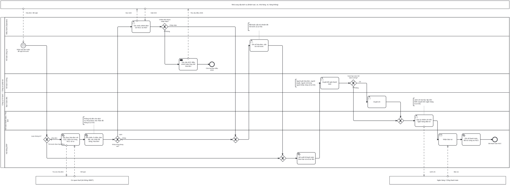

# BP-12 — Thanh toán nhà cung cấp và công nợ phải trả

> Sinh tự động từ `defs/bp12_cong_no_phai_tra.py` bằng bpmn-kit — sửa định nghĩa rồi chạy lại, không sửa tay file này.

File BPMN 2.0: [`bpmn/BP-12-thanh-toan-ncc-cong-no-phai-tra.bpmn`](../bpmn/BP-12-thanh-toan-ncc-cong-no-phai-tra.bpmn) · Ảnh: [`png/BP-12-thanh-toan-ncc-cong-no-phai-tra.png`](../png/BP-12-thanh-toan-ncc-cong-no-phai-tra.png)

## 1. Thông tin chung

| Mục | Nội dung |
|---|---|
| Mục tiêu | Chỉ trả tiền cho dịch vụ đã đặt, đã thực sự dùng và có hóa đơn hợp lệ; cấn trừ đủ các khoản đã trả trước; duyệt chi theo hạn mức; chi qua ngân hàng hai lớp. |
| Sự kiện kích hoạt | Nhận hóa đơn của NCC, hoặc đề nghị trả trước/ký quỹ theo hợp đồng (từ BP-02, BP-08). |
| Kết quả đầu ra | Hóa đơn NCC đã ghi sổ vào chi phí của đúng tour; khoản trả trước đã cấn trừ; NCC đã được thanh toán đúng hạn. |
| Phạm vi | Xác thực hóa đơn điện tử đầu vào, đối chiếu 3 chiều (đơn đặt – xác nhận đã dùng – hóa đơn), xử lý chênh lệch, ghi sổ, đề xuất thanh toán, duyệt theo hạn mức, ủy nhiệm chi, ghi nhận báo nợ. |
| Ngoài phạm vi | Đặt dịch vụ ([BP-08](BP-08-dat-dich-vu-chuan-bi-doan.md)); quản lý tài khoản ngân hàng NCC ([BP-01](BP-01-quan-ly-du-lieu-goc.md)); NCC nước ngoài và thuế nhà thầu (biến thể, xem ghi chú bút toán). |
| Module ERP | Công nợ phải trả (AP); Thuế – hóa đơn đầu vào (TAX); Tiền – Ngân hàng (CB) |
| Quy trình chuẩn ERP tương ứng | Procure-to-Pay phần hóa đơn và thanh toán: xác minh hóa đơn (invoice verification) → đối chiếu 3 chiều → ghi công nợ → duyệt thanh toán → chi → đối chiếu. |
| Quy trình đầu vào | [BP-02](BP-02-hop-dong-ncc-quy-cho.md) trả trước theo hợp đồng; [BP-08](BP-08-dat-dich-vu-chuan-bi-doan.md) đơn đặt dịch vụ; [BP-09](BP-09-thuc-hien-tour-xu-ly-su-co.md) xác nhận đã dùng |
| Quy trình tiếp theo | [BP-10](BP-10-quyet-toan-dong-ho-so-tour.md) chi phí tour đủ; [BP-15](BP-15-khoa-so-cuoi-ky.md) khóa sổ |

## 2. Vai trò (làn)

| Làn | Vai trò | Trách nhiệm trong quy trình |
|---|---|---|
| `OPS` | Điều hành (Operator) | Xác minh chênh lệch số lượng/giá với NCC và HDV. |
| `ACC` | Kế toán công nợ | Nhận hóa đơn; ghi sổ và cấn trừ trả trước; yêu cầu NCC điều chỉnh hóa đơn. |
| `CHIEF_ACC` | Kế toán trưởng | Duyệt đề nghị thanh toán trong hạn mức. |
| `DIR` | Ban Giám đốc | Duyệt chi vượt hạn mức Kế toán trưởng. |
| `CASH` | Kế toán thanh toán / Thủ quỹ | Lập ủy nhiệm chi trên ngân hàng điện tử. |
| `SYS` | Hệ thống ERP | Xác thực hóa đơn với CQT; đối chiếu 3 chiều; đề xuất lô thanh toán; nhận báo nợ và ghi sổ. |

Bên ngoài (pool hộp đen, trao đổi bằng luồng thông điệp): **Nhà cung cấp dịch vụ (khách sạn, xe, nhà hàng, vé, hàng không)**; **Cơ quan thuế (hệ thống HĐĐT)**; **Ngân hàng / Cổng thanh toán**.

## 3. Các bước

| # | ID | Bước | Làn | Loại | Mô tả | Chứng từ / trạng thái | Kiểm soát |
|---|---|---|---|---|---|---|---|
| 1 | `S1` | Nhận hóa đơn hoặc đề nghị trả trước | Kế toán công nợ | Sự kiện bắt đầu (thông điệp) |  |  |  |
| 2 | `G0` | Loại chứng từ? | Hệ thống ERP | Rẽ nhánh (XOR) |  |  |  |
| 3 | `T1` | Xác thực hóa đơn với CQT, kiểm tra trùng, NCC rủi ro | Hệ thống ERP | Hệ thống tự động |  |  | C12-01 |
| 4 | `T2` | Đối chiếu 3 chiều: đơn đặt, xác nhận đã dùng, hóa đơn | Hệ thống ERP | Hệ thống tự động | Số lượng hóa đơn ≤ số lượng HDV xác nhận đã dùng; đơn giá trong dung sai so với đơn đặt; đúng mã tour. |  | C12-02 |
| 5 | `G1` | Khớp trong dung sai? | Hệ thống ERP | Rẽ nhánh (XOR) |  |  |  |
| 6 | `T3` | Xác minh chênh lệch với NCC và HDV | Điều hành (Operator) | Người dùng thao tác |  |  |  |
| 7 | `G2` | Chênh lệch được chấp nhận? | Điều hành (Operator) | Rẽ nhánh (XOR) |  |  |  |
| 8 | `T4` | Yêu cầu NCC điều chỉnh hoặc thay thế hóa đơn | Kế toán công nợ | Gửi thông điệp |  | Hóa đơn mua: REJECTED |  |
| 9 | `E2` | Chờ hóa đơn điều chỉnh | Kế toán công nợ | Sự kiện kết thúc |  |  |  |
| 10 | `T5` | Ghi sổ hóa đơn, cấn trừ trả trước | Kế toán công nợ | Người dùng thao tác |  | Hóa đơn mua: POSTED | C12-03 |
| 11 | `T6` | Đề xuất lô thanh toán theo hạn và số dư tiền | Hệ thống ERP | Hệ thống tự động |  | Đề nghị thanh toán: PENDING |  |
| 12 | `T7` | Duyệt đề nghị thanh toán | Kế toán trưởng | Người dùng thao tác |  |  | C12-04, C12-06 |
| 13 | `G3` | Vượt hạn mức Kế toán trưởng? | Kế toán trưởng | Rẽ nhánh (XOR) |  |  |  |
| 14 | `T8` | Duyệt chi | Ban Giám đốc | Người dùng thao tác |  |  |  |
| 15 | `T9` | Lập ủy nhiệm chi trên ngân hàng điện tử | Kế toán thanh toán / Thủ quỹ | Người dùng thao tác |  | Ủy nhiệm chi: APPROVED → IN_PROGRESS | C12-05 |
| 16 | `R2` | Nhận báo nợ | Hệ thống ERP | Nhận thông điệp |  |  |  |
| 17 | `T11` | Ghi sổ thanh toán, đối trừ công nợ NCC | Hệ thống ERP | Hệ thống tự động |  | Ủy nhiệm chi: POSTED |  |
| 18 | `E1` | Đã thanh toán NCC | Hệ thống ERP | Sự kiện kết thúc |  |  |  |

## 4. Điểm quyết định

| Cổng | Câu hỏi / điều kiện | Nhánh → bước tiếp theo |
|---|---|---|
| `G0` | Loại chứng từ? | Hóa đơn (mặc định) → `T1` Xác thực hóa đơn với CQT, kiểm tra trùng, NCC rủi ro Trả trước theo hợp đồng → `T6` Đề xuất lô thanh toán theo hạn và số dư tiền |
| `G1` | Khớp trong dung sai? | Khớp (mặc định) → `T5` Ghi sổ hóa đơn, cấn trừ trả trước Lệch → `T3` Xác minh chênh lệch với NCC và HDV |
| `G2` | Chênh lệch được chấp nhận? | Chấp nhận → `T5` Ghi sổ hóa đơn, cấn trừ trả trước Không (mặc định) → `T4` Yêu cầu NCC điều chỉnh hoặc thay thế hóa đơn |
| `G3` | Vượt hạn mức Kế toán trưởng? | Có → `T8` Duyệt chi Không (mặc định) → `T9` Lập ủy nhiệm chi trên ngân hàng điện tử |

## 5. Trao đổi với bên ngoài

| Từ | Đến | Thông điệp |
|---|---|---|
| Nhà cung cấp dịch vụ (khách sạn, xe, nhà hàng, vé, hàng không) | `S1` Nhận hóa đơn hoặc đề nghị trả trước | Hóa đơn / đề nghị |
| `T1` Xác thực hóa đơn với CQT, kiểm tra trùng, NCC rủi ro | Cơ quan thuế (hệ thống HĐĐT) | Tra cứu hóa đơn |
| Cơ quan thuế (hệ thống HĐĐT) | `T1` Xác thực hóa đơn với CQT, kiểm tra trùng, NCC rủi ro | Kết quả |
| `T3` Xác minh chênh lệch với NCC và HDV | Nhà cung cấp dịch vụ (khách sạn, xe, nhà hàng, vé, hàng không) | Xác minh |
| Nhà cung cấp dịch vụ (khách sạn, xe, nhà hàng, vé, hàng không) | `T3` Xác minh chênh lệch với NCC và HDV | Giải trình |
| `T4` Yêu cầu NCC điều chỉnh hoặc thay thế hóa đơn | Nhà cung cấp dịch vụ (khách sạn, xe, nhà hàng, vé, hàng không) | Yêu cầu điều chỉnh |
| `T9` Lập ủy nhiệm chi trên ngân hàng điện tử | Ngân hàng / Cổng thanh toán | Lệnh chi |
| Ngân hàng / Cổng thanh toán | `R2` Nhận báo nợ | Báo nợ |

## 6. Kiểm soát nội bộ

| Mã | Kiểm soát | Loại | Nguồn |
|---|---|---|---|
| C12-01 | Hóa đơn điện tử đầu vào được xác thực với dữ liệu CQT; chặn trùng (mã số thuế NCC + ký hiệu + số hóa đơn); cảnh báo NCC rủi ro. | Phòng ngừa · Cấu hình | erp-ba-core ap §7 BR-AP-01; tax-einvoice §5.2 |
| C12-02 | Đối chiếu 3 chiều: đơn đặt dịch vụ ↔ số lượng HDV xác nhận đã dùng ↔ hóa đơn; dung sai giá và số lượng là tham số. | Phòng ngừa · Cấu hình | erp-ba-core ap §7 BR-AP-02; p2p §7 BR-PUR-09, BR-PUR-15 |
| C12-03 | Bắt buộc cấn trừ khoản trả trước/cọc NCC khi ghi hóa đơn. | Cấu hình | erp-ba-core ap §7 BR-AP-06 |
| C12-04 | Bốn vai trò tách biệt: quản lý danh mục NCC (tài khoản ngân hàng) / ghi hóa đơn / duyệt thanh toán / chi tiền. | Phân quyền (SoD) | erp-ba-core ap §10; Elbardan ch02 |
| C12-05 | Chi qua ngân hàng hai lớp: lập trên ERP, người khác duyệt trên ngân hàng điện tử; hóa đơn từ 5 triệu không chi tiền mặt. | Phòng ngừa · Phân quyền | erp-ba-core ap §9 PRM-AP-011, §7 BR-AP-04 |
| C12-06 | Duyệt chi theo hạn mức: Kế toán trưởng, vượt hạn mức thì Ban Giám đốc. | Phòng ngừa | erp-ba-core ap §9 PRM-AP-010 |

## 7. Chứng từ & trạng thái

| Chứng từ | Trạng thái chuẩn | Ghi chú |
|---|---|---|
| Hóa đơn mua (NCC) | DRAFT → PENDING → POSTED; REJECTED khi trả về NCC | Gắn mã tour và đơn đặt dịch vụ. |
| Đề nghị thanh toán | DRAFT → PENDING → APPROVED → COMPLETED | Theo lô, theo hạn thanh toán. |
| Ủy nhiệm chi | DRAFT → APPROVED → IN_PROGRESS (đã gửi ngân hàng) → POSTED |  |

## 8. Bút toán phát sinh

| Nghiệp vụ | Nợ | Có | Ghi chú |
|---|---|---|---|
| Trả trước NCC theo hợp đồng | 331 (chi tiết NCC, mã tour) | 112 | Số dư Nợ 331 trình bày bên tài sản. |
| Ghi hóa đơn dịch vụ của tour | 154 (mã tour), 1331 | 331 | Nếu đã trích trước: Nợ 335 / Có 331 cho phần đã trích. |
| Thanh toán NCC | 331 | 112 | Chênh lệch tỷ giá với NCC ngoại tệ: 515 / 635. |
| NCC nước ngoài (tour outbound) | 331 | 3338 (thuế nhà thầu) nếu thuộc diện | Kế toán xác nhận theo từng hợp đồng. |

## 9. Tham số hệ thống gợi ý

| Tham số | Ý nghĩa | Mặc định gợi ý |
|---|---|---|
| Dung sai giá đối chiếu | So với đơn đặt dịch vụ | ±2% hoặc 100.000 đ |
| Dung sai số lượng | Hóa đơn so với số lượng đã dùng | Không vượt số đã dùng |
| Hạn mức duyệt chi | Kế toán trưởng / Ban Giám đốc | ≤ 500 triệu / > 500 triệu |
| Kỳ chạy đề xuất thanh toán | Tần suất | Hằng tuần |

## 10. Chỉ số đo (KPI)

| Chỉ số | Cách tính | Mục tiêu gợi ý |
|---|---|---|
| Tỷ lệ hóa đơn khớp lần đầu | Hóa đơn khớp / tổng hóa đơn | ≥ 90% |
| Tỷ lệ thanh toán đúng hạn | Thanh toán đúng hạn / tổng thanh toán | ≥ 95% |
| Số ngày từ nhận hóa đơn tới ghi sổ | Bình quân | ≤ 3 ngày |

## 11. Căn cứ từ sách

- **Parthasarathy, ch03** ([nguồn](../../../books/parthasarathy-erp-fundamentals/chapters/ch03-erp-modules.md)) — Module MM có Invoice verification; hóa đơn được kiểm tra trước khi sang Finance.
- **Parthasarathy, ch08** ([nguồn](../../../books/parthasarathy-erp-fundamentals/chapters/ch08-erp-and-crm.md)) — Requisition-to-Pay: đơn mua → nhận hóa đơn → thanh toán.
- **Elbardan & Kholeif, ch07** ([nguồn](../../../books/elbardan-erp-governance-audit/chapters/ch07-case-study-2-national-company.md)) — Kiểm soát phòng ngừa: chặn hóa đơn sai, nhiều lớp duyệt cho mỗi bút toán.
- **Elbardan & Kholeif, ch08** ([nguồn](../../../books/elbardan-erp-governance-audit/chapters/ch08-case-study-3-national-bank.md)) — Duyệt theo cấp; người lập và người duyệt khác nhau.
- **O'Leary, ch14** ([nguồn](../../../books/oleary-erp-systems-lifecycle/chapters/ch14-erp-electronic-commerce.md)) — Trao đổi chứng từ với đối tác: một đơn – một hóa đơn giúp tự động đối chiếu.
- **erp-ba-core `ap-accounts-payable.md` §5, §7, §9, §10** — đối chiếu 3 chiều, chống trùng, hạn mức duyệt, SoD.
- **erp-ba-core `cash-bank.md` §5A** — luồng chi qua ngân hàng.

## 12. Điểm cần xác nhận với doanh nghiệp

- NCC thường xuất một hóa đơn cho mỗi đoàn hay gộp theo tháng? (ảnh hưởng đối chiếu theo mã tour)
- Hạn mức duyệt chi của Kế toán trưởng là bao nhiêu?
- Có NCC nước ngoài thuộc diện thuế nhà thầu không?
