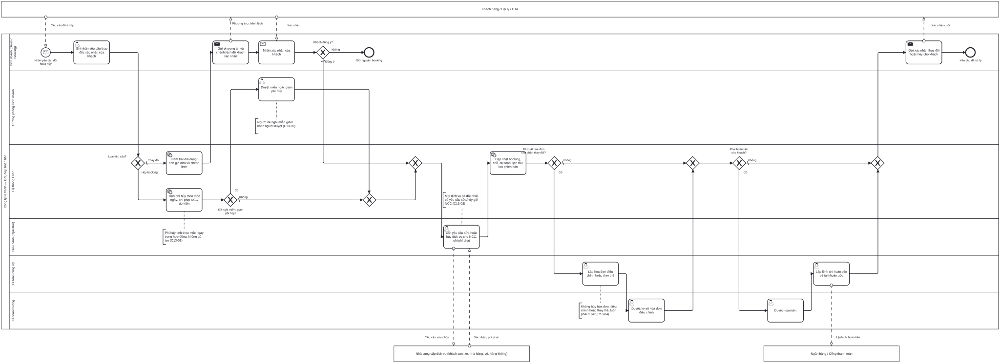

# BP-13 — Thay đổi, hủy booking và hoàn tiền

> Sinh tự động từ `defs/bp13_thay_doi_huy.py` bằng bpmn-kit — sửa định nghĩa rồi chạy lại, không sửa tay file này.

File BPMN 2.0: [`bpmn/BP-13-thay-doi-huy-booking-hoan-tien.bpmn`](../bpmn/BP-13-thay-doi-huy-booking-hoan-tien.bpmn) · Ảnh: [`png/BP-13-thay-doi-huy-booking-hoan-tien.png`](../png/BP-13-thay-doi-huy-booking-hoan-tien.png)

## 1. Thông tin chung

| Mục | Nội dung |
|---|---|
| Mục tiêu | Mọi thay đổi hoặc hủy booking đi qua một yêu cầu có khách xác nhận; phí hủy và chênh lệch giá do hệ thống tính theo hợp đồng; dịch vụ NCC được sửa/hủy kịp hạn; hóa đơn và tiền được điều chỉnh có duyệt. |
| Sự kiện kích hoạt | Khách yêu cầu đổi/hủy; hoặc được gọi từ quy trình khác: hủy/gộp chuyến (BP-07), sự cố làm đổi dịch vụ (BP-09), quá hạn thanh toán (BP-11), đền bù khiếu nại (BP-14). |
| Kết quả đầu ra | Booking đã cập nhật (phiên bản mới) hoặc đã hủy; dịch vụ NCC đã sửa/hủy; hóa đơn điều chỉnh/thay thế (nếu có); tiền đã hoàn hoặc lịch thu đã cập nhật; khách nhận xác nhận. |
| Phạm vi | Đổi ngày, số khách, hạng phòng, dịch vụ; hủy một phần hoặc toàn bộ; miễn/giảm phí hủy; sửa/hủy dịch vụ NCC; hóa đơn điều chỉnh/thay thế; hoàn tiền. |
| Ngoài phạm vi | Thu thêm tiền (lịch thu cập nhật và [BP-11](BP-11-thu-tien-cong-no-phai-thu.md) thu); khiếu nại chất lượng ([BP-14](BP-14-cham-soc-khach-hang-khieu-nai.md)). |
| Module ERP | Bán hàng – booking (SAL); Điều hành – đơn đặt dịch vụ; Công nợ phải thu (AR); Thuế – HĐĐT (TAX); Tiền (CB) |
| Quy trình chuẩn ERP tương ứng | Quản lý thay đổi đơn hàng (change order) và trả lại/giảm trừ trong Order-to-Cash; thay đổi có kiểm soát như chính sách engineering change. |
| Quy trình đầu vào | [BP-05](BP-05-ban-tour-ghep.md); [BP-06](BP-06-ban-tour-thiet-ke-rieng.md); [BP-07](BP-07-chot-chuyen-tra-cho.md); [BP-09](BP-09-thuc-hien-tour-xu-ly-su-co.md); [BP-11](BP-11-thu-tien-cong-no-phai-thu.md); [BP-14](BP-14-cham-soc-khach-hang-khieu-nai.md) |
| Quy trình tiếp theo | [BP-11](BP-11-thu-tien-cong-no-phai-thu.md) thu chênh lệch; [BP-10](BP-10-quyet-toan-dong-ho-so-tour.md) quyết toán |

## 2. Vai trò (làn)

| Làn | Vai trò | Trách nhiệm trong quy trình |
|---|---|---|
| `SALES` | Kinh doanh (Sales / Booking) | Ghi nhận yêu cầu, gửi phương án cho khách, nhận xác nhận, gửi xác nhận cuối. |
| `SALES_MGR` | Trưởng phòng Kinh doanh | Duyệt miễn/giảm phí hủy hoặc giá thay đổi ngoài chính sách. |
| `SYS` | Hệ thống ERP | Tính phí hủy và chênh lệch; cập nhật booking, chỗ, dự toán, lịch thu; lưu phiên bản. |
| `OPS` | Điều hành (Operator) | Gửi yêu cầu sửa/hủy dịch vụ cho NCC; ghi phí phạt NCC. |
| `ACC` | Kế toán công nợ | Lập hóa đơn điều chỉnh/thay thế; lập lệnh chi hoàn tiền. |
| `CHIEF_ACC` | Kế toán trưởng | Duyệt hóa đơn điều chỉnh và hoàn tiền. |

Bên ngoài (pool hộp đen, trao đổi bằng luồng thông điệp): **Khách hàng / Đại lý / OTA**; **Nhà cung cấp dịch vụ (khách sạn, xe, nhà hàng, vé, hàng không)**; **Ngân hàng / Cổng thanh toán**.

## 3. Các bước

| # | ID | Bước | Làn | Loại | Mô tả | Chứng từ / trạng thái | Kiểm soát |
|---|---|---|---|---|---|---|---|
| 1 | `S1` | Nhận yêu cầu đổi hoặc hủy | Kinh doanh (Sales / Booking) | Sự kiện bắt đầu (thông điệp) |  |  |  |
| 2 | `T1` | Ghi nhận yêu cầu thay đổi, xác nhận của khách | Kinh doanh (Sales / Booking) | Người dùng thao tác |  | Yêu cầu thay đổi: DRAFT | C13-06 |
| 3 | `G1` | Loại yêu cầu? | Hệ thống ERP | Rẽ nhánh (XOR) |  |  |  |
| 4 | `T3` | Kiểm tra khả dụng, tính giá mới và chênh lệch | Hệ thống ERP | Hệ thống tự động |  |  |  |
| 5 | `T2` | Tính phí hủy theo mốc ngày, phí phạt NCC dự kiến | Hệ thống ERP | Hệ thống tự động |  |  | C13-01 |
| 6 | `T5` | Gửi phương án và chênh lệch để khách xác nhận | Kinh doanh (Sales / Booking) | Gửi thông điệp |  |  |  |
| 7 | `G2` | Đề nghị miễn, giảm phí hủy? | Hệ thống ERP | Rẽ nhánh (XOR) |  |  |  |
| 8 | `R1` | Nhận xác nhận của khách | Kinh doanh (Sales / Booking) | Nhận thông điệp |  |  |  |
| 9 | `T4` | Duyệt miễn hoặc giảm phí hủy | Trưởng phòng Kinh doanh | Người dùng thao tác |  | Yêu cầu thay đổi: PENDING → APPROVED | C13-02 |
| 10 | `G3` | Khách đồng ý? | Kinh doanh (Sales / Booking) | Rẽ nhánh (XOR) |  |  |  |
| 11 | `E1` | Giữ nguyên booking | Kinh doanh (Sales / Booking) | Sự kiện kết thúc |  | Yêu cầu thay đổi: REJECTED |  |
| 12 | `T6` | Gửi yêu cầu sửa hoặc hủy dịch vụ cho NCC, ghi phí phạt | Điều hành (Operator) | Người dùng thao tác |  |  | C13-03 |
| 13 | `T7` | Cập nhật booking, chỗ, dự toán, lịch thu; lưu phiên bản | Hệ thống ERP | Hệ thống tự động | Tăng giá trị: cập nhật lịch thu để BP-11 thu. Giảm giá trị: tính số phải hoàn sau khi trừ phí hủy. | Booking: phiên bản mới hoặc CANCELLED; Yêu cầu: COMPLETED |  |
| 14 | `G4` | Đã xuất hóa đơn cho phần thay đổi? | Hệ thống ERP | Rẽ nhánh (XOR) |  |  |  |
| 15 | `T8` | Lập hóa đơn điều chỉnh hoặc thay thế | Kế toán công nợ | Người dùng thao tác |  |  | C13-04 |
| 16 | `T9` | Duyệt, ký số hóa đơn điều chỉnh | Kế toán trưởng | Người dùng thao tác |  |  |  |
| 17 | `G5` | Phải hoàn tiền cho khách? | Hệ thống ERP | Rẽ nhánh (XOR) |  |  |  |
| 18 | `T10` | Duyệt hoàn tiền | Kế toán trưởng | Người dùng thao tác |  |  | C13-05 |
| 19 | `T11` | Lập lệnh chi hoàn tiền về tài khoản gốc | Kế toán công nợ | Người dùng thao tác |  | Phiếu chi hoàn tiền: POSTED |  |
| 20 | `T12` | Gửi xác nhận thay đổi hoặc hủy cho khách | Kinh doanh (Sales / Booking) | Gửi thông điệp |  |  |  |
| 21 | `E2` | Yêu cầu đã xử lý | Kinh doanh (Sales / Booking) | Sự kiện kết thúc |  |  |  |

## 4. Điểm quyết định

| Cổng | Câu hỏi / điều kiện | Nhánh → bước tiếp theo |
|---|---|---|
| `G1` | Loại yêu cầu? | Thay đổi (mặc định) → `T3` Kiểm tra khả dụng, tính giá mới và chênh lệch Hủy booking → `T2` Tính phí hủy theo mốc ngày, phí phạt NCC dự kiến |
| `G2` | Đề nghị miễn, giảm phí hủy? | Có → `T4` Duyệt miễn hoặc giảm phí hủy Không (mặc định) → `T6` Gửi yêu cầu sửa hoặc hủy dịch vụ cho NCC, ghi phí phạt |
| `G3` | Khách đồng ý? | Không → `E1` Giữ nguyên booking Đồng ý (mặc định) → `T6` Gửi yêu cầu sửa hoặc hủy dịch vụ cho NCC, ghi phí phạt |
| `G4` | Đã xuất hóa đơn cho phần thay đổi? | Có → `T8` Lập hóa đơn điều chỉnh hoặc thay thế Không (mặc định) → `G5` Phải hoàn tiền cho khách? |
| `G5` | Phải hoàn tiền cho khách? | Có → `T10` Duyệt hoàn tiền Không (mặc định) → `T12` Gửi xác nhận thay đổi hoặc hủy cho khách |

## 5. Trao đổi với bên ngoài

| Từ | Đến | Thông điệp |
|---|---|---|
| Khách hàng / Đại lý / OTA | `S1` Nhận yêu cầu đổi hoặc hủy | Yêu cầu đổi / hủy |
| `T5` Gửi phương án và chênh lệch để khách xác nhận | Khách hàng / Đại lý / OTA | Phương án, chênh lệch |
| Khách hàng / Đại lý / OTA | `R1` Nhận xác nhận của khách | Xác nhận |
| `T6` Gửi yêu cầu sửa hoặc hủy dịch vụ cho NCC, ghi phí phạt | Nhà cung cấp dịch vụ (khách sạn, xe, nhà hàng, vé, hàng không) | Yêu cầu sửa / hủy |
| Nhà cung cấp dịch vụ (khách sạn, xe, nhà hàng, vé, hàng không) | `T6` Gửi yêu cầu sửa hoặc hủy dịch vụ cho NCC, ghi phí phạt | Xác nhận, phí phạt |
| `T11` Lập lệnh chi hoàn tiền về tài khoản gốc | Ngân hàng / Cổng thanh toán | Lệnh chi hoàn tiền |
| `T12` Gửi xác nhận thay đổi hoặc hủy cho khách | Khách hàng / Đại lý / OTA | Xác nhận cuối |

## 6. Kiểm soát nội bộ

| Mã | Kiểm soát | Loại | Nguồn |
|---|---|---|---|
| C13-01 | Phí hủy do hệ thống tính theo mốc ngày của chính sách đính kèm hợp đồng (khách) và hợp đồng NCC; không sửa tay công thức. | Phòng ngừa · Cấu hình | Elbardan ch07 |
| C13-02 | Miễn/giảm phí hủy hoặc giá ngoài chính sách phải được duyệt; người đề nghị không tự duyệt. | Phân quyền (SoD) | Elbardan ch08 |
| C13-03 | Mọi dịch vụ đã đặt của phần bị đổi/hủy phải có yêu cầu sửa/hủy gửi NCC và trạng thái cuối, để không bị NCC tính tiền. | Phòng ngừa · Báo cáo | erp-ba-core o2c §13 (hủy đơn) |
| C13-04 | Hóa đơn đã có mã chỉ xử lý bằng hóa đơn điều chỉnh hoặc thay thế (kèm văn bản thỏa thuận với khách là doanh nghiệp); luôn phải duyệt. | Phòng ngừa · Phân quyền | erp-ba-core tax-einvoice §10; regulations/vn-tax-einvoice §4.6 |
| C13-05 | Hoàn tiền chỉ về tài khoản/phương thức gốc của người đã trả; người tính phí, người duyệt, người chi là ba người khác nhau. | Phòng ngừa · Phân quyền (SoD) | erp-ba-core cash-bank §10 |
| C13-06 | Lưu phiên bản booking trước và sau thay đổi, kèm bằng chứng khách xác nhận. | Có sẵn (audit trail) | Wallace ch09; Elbardan ch06 |

## 7. Chứng từ & trạng thái

| Chứng từ | Trạng thái chuẩn | Ghi chú |
|---|---|---|
| Yêu cầu thay đổi | DRAFT → PENDING → APPROVED → COMPLETED; REJECTED khi khách không đồng ý | Loại: đổi ngày, số khách, dịch vụ, hủy. |
| Booking | Phiên bản mới; CANCELLED khi hủy toàn bộ |  |
| Hóa đơn điều chỉnh / thay thế | DRAFT → PENDING → APPROVED → POSTED; hóa đơn gốc REVERSED khi thay thế |  |
| Phiếu chi hoàn tiền | DRAFT → APPROVED → POSTED |  |

## 8. Bút toán phát sinh

| Nghiệp vụ | Nợ | Có | Ghi chú |
|---|---|---|---|
| Hoàn tiền cho khách | 131 | 112 |  |
| Phí hủy giữ lại của khách | 131 | 711 (hoặc 511) | Phụ thuộc bản chất "bồi thường hợp đồng" hay "doanh thu dịch vụ" — Kế toán/tư vấn thuế xác nhận. |
| Phí phạt phải trả NCC | 811 (hoặc 154 nếu tour vẫn chạy) | 331 | Kế toán xác nhận. |
| Hóa đơn điều chỉnh giảm | 511, 33311 | 131 | Theo hệ thống tài khoản doanh nghiệp áp dụng. |

## 9. Tham số hệ thống gợi ý

| Tham số | Ý nghĩa | Mặc định gợi ý |
|---|---|---|
| Bảng phí hủy theo mốc ngày | Trước ngày khởi hành | ≥30 ngày 10%; 15–29: 30%; 8–14: 50%; 0–7: 100% |
| Hạn mức miễn/giảm phí của Trưởng phòng | % hoặc số tiền | Doanh nghiệp quy định |
| Hạn hoàn tiền | Từ khi duyệt | 7 ngày làm việc |

## 10. Chỉ số đo (KPI)

| Chỉ số | Cách tính | Mục tiêu gợi ý |
|---|---|---|
| Thời gian xử lý yêu cầu đổi/hủy | Từ nhận tới gửi xác nhận cuối | ≤ 2 ngày làm việc |
| Phí phạt NCC do hủy trễ | Tổng theo tháng | Giảm dần |
| Thời gian hoàn tiền | Từ duyệt tới tiền về khách | ≤ 7 ngày |

## 11. Căn cứ từ sách

- **Wallace & Kremzar, ch09** ([nguồn](../../../books/wallace-erp-implementation/chapters/ch09-process-definition.md)) — Thay đổi phải có chính sách: ai được đổi gì, ở vùng thời gian nào (time fences).
- **Elbardan & Kholeif, ch07** ([nguồn](../../../books/elbardan-erp-governance-audit/chapters/ch07-case-study-2-national-company.md)) — Kiểm soát phòng ngừa bằng quy tắc; tránh workaround ngoài hệ thống.
- **Elbardan & Kholeif, ch08** ([nguồn](../../../books/elbardan-erp-governance-audit/chapters/ch08-case-study-3-national-bank.md)) — Duyệt theo cấp; ràng buộc xử lý sau điểm kiểm soát.
- **erp-ba-core `o2c-order-to-cash.md` §13** — hủy đơn, sửa đơn sau duyệt.
- **erp-ba-core `tax-einvoice.md` §6.1, §10** — hóa đơn điều chỉnh/thay thế luôn phải duyệt.
- **erp-ba-core `vn-tax-einvoice.md` §4.6** — xử lý hóa đơn sai sót: điều chỉnh hoặc thay thế, không còn hủy.

## 12. Điểm cần xác nhận với doanh nghiệp

- Doanh nghiệp dùng một bảng phí hủy duy nhất hay theo từng loại tour/kênh? Lưu ý: repo topas-crm đang có hai bộ mốc khác nhau (4 mốc trong addons/topas/models/tour_pricing_rule.py, 5 mốc có mức 75% trong addons/topas/data/tour_terms_data.xml) — cần thống nhất trước khi cấu hình.
- Phí hủy giữ lại hạch toán thu nhập khác hay doanh thu; có phải xuất hóa đơn không?
- Khách đổi người đi (đổi tên) có tính phí không?
