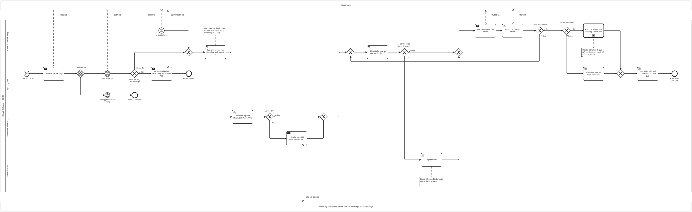

# BP-14 — Chăm sóc khách hàng sau tour và xử lý khiếu nại

> Sinh tự động từ `defs/bp14_cskh_khieu_nai.py` bằng bpmn-kit — sửa định nghĩa rồi chạy lại, không sửa tay file này.

File BPMN 2.0: [`bpmn/BP-14-cham-soc-khach-hang-khieu-nai.bpmn`](../bpmn/BP-14-cham-soc-khach-hang-khieu-nai.bpmn) · Ảnh: [`png/BP-14-cham-soc-khach-hang-khieu-nai.png`](../png/BP-14-cham-soc-khach-hang-khieu-nai.png)

## 1. Thông tin chung

| Mục | Nội dung |
|---|---|
| Mục tiêu | Đo mức hài lòng của mọi đoàn; biến mọi phản hồi tiêu cực thành phiếu khiếu nại có hạn xử lý; tìm nguyên nhân, đòi bồi hoàn NCC khi lỗi do NCC; đền bù có duyệt; cập nhật hồ sơ khách và điểm NCC. |
| Sự kiện kích hoạt | Luồng 1: tour kết thúc 24 giờ (gửi khảo sát). Luồng 2: khách khiếu nại qua hotline, email, HDV, cổng khách hàng. |
| Kết quả đầu ra | Khách hài lòng được mời đánh giá công khai và cộng điểm thành viên; khiếu nại được giải quyết, đóng phiếu, đền bù (nếu có) đã thực hiện qua hệ thống. |
| Phạm vi | Khảo sát hài lòng, đánh giá công khai, điểm thành viên, phiếu khiếu nại, xác minh nguyên nhân, bồi hoàn từ NCC, đề xuất và duyệt đền bù, phản hồi khách. |
| Ngoài phạm vi | Hoàn tiền ([BP-13](BP-13-thay-doi-huy-booking-hoan-tien.md)); sự cố trong khi tour đang chạy ([BP-09](BP-09-thuc-hien-tour-xu-ly-su-co.md)). |
| Module ERP | CRM – chăm sóc khách hàng (SVC); Khách hàng thân thiết; Đánh giá NCC |
| Quy trình chuẩn ERP tương ứng | CRM dịch vụ: phiếu yêu cầu → hạn xử lý → giải quyết → khảo sát CSAT/NPS; dữ liệu phản hồi đi vào CRM phân tích. |
| Quy trình đầu vào | [BP-09](BP-09-thuc-hien-tour-xu-ly-su-co.md); [BP-10](BP-10-quyet-toan-dong-ho-so-tour.md) |
| Quy trình tiếp theo | [BP-13](BP-13-thay-doi-huy-booking-hoan-tien.md) đền bù bằng tiền; [BP-02](BP-02-hop-dong-ncc-quy-cho.md) điểm đánh giá NCC |

## 2. Vai trò (làn)

| Làn | Vai trò | Trách nhiệm trong quy trình |
|---|---|---|
| `CS` | Chăm sóc khách hàng | Tiếp nhận khiếu nại, tạo phiếu, đề xuất phương án, phản hồi khách. |
| `SYS` | Hệ thống ERP | Gửi khảo sát, phân loại điểm hài lòng, mời đánh giá, phát hành voucher/điểm, đóng phiếu. |
| `OPS` | Điều hành (Operator) | Xác minh nguyên nhân với HDV và NCC; yêu cầu NCC bồi hoàn. |
| `DIR` | Ban Giám đốc | Duyệt đền bù vượt hạn mức CSKH. |

Bên ngoài (pool hộp đen, trao đổi bằng luồng thông điệp): **Khách hàng**; **Nhà cung cấp dịch vụ (khách sạn, xe, nhà hàng, vé, hàng không)**.

## 3. Các bước

| # | ID | Bước | Làn | Loại | Mô tả | Chứng từ / trạng thái | Kiểm soát |
|---|---|---|---|---|---|---|---|
| 1 | `S1` | Tour kết thúc 24 giờ | Hệ thống ERP | Sự kiện bắt đầu (hẹn giờ) |  |  |  |
| 2 | `T1` | Gửi khảo sát hài lòng | Hệ thống ERP | Gửi thông điệp |  |  |  |
| 3 | `EG1` | Chờ đánh giá | Hệ thống ERP | Rẽ nhánh theo sự kiện |  |  |  |
| 4 | `C1` | Nhận đánh giá | Hệ thống ERP | Sự kiện chờ (thông điệp) |  |  |  |
| 5 | `C2` | Không phản hồi sau N ngày | Hệ thống ERP | Sự kiện chờ (hẹn giờ) |  |  |  |
| 6 | `G1` | Điểm hài lòng đạt ngưỡng? | Hệ thống ERP | Rẽ nhánh (XOR) |  |  |  |
| 7 | `E1` | Kết thúc khảo sát | Hệ thống ERP | Sự kiện kết thúc |  |  |  |
| 8 | `S2` | Nhận khiếu nại | Chăm sóc khách hàng | Sự kiện bắt đầu (thông điệp) |  |  |  |
| 9 | `T2` | Mời đánh giá công khai, cộng điểm thành viên | Hệ thống ERP | Gửi thông điệp |  |  | C14-05 |
| 10 | `E2` | Khách hài lòng | Hệ thống ERP | Sự kiện kết thúc |  |  |  |
| 11 | `T3` | Tạo phiếu khiếu nại, phân loại, tính hạn xử lý | Chăm sóc khách hàng | Người dùng thao tác |  | Phiếu khiếu nại: DRAFT → IN_PROGRESS | C14-01 |
| 12 | `T4` | Xác minh nguyên nhân với HDV và NCC | Điều hành (Operator) | Người dùng thao tác |  |  |  |
| 13 | `G2` | Lỗi do NCC? | Điều hành (Operator) | Rẽ nhánh (XOR) |  |  |  |
| 14 | `T5` | Yêu cầu NCC bồi hoàn, trừ điểm NCC | Điều hành (Operator) | Gửi thông điệp |  |  | C14-04 |
| 15 | `T6` | Đề xuất phương án giải quyết, đền bù | Chăm sóc khách hàng | Người dùng thao tác |  |  |  |
| 16 | `G3` | Đền bù vượt hạn mức CSKH? | Chăm sóc khách hàng | Rẽ nhánh (XOR) |  |  |  |
| 17 | `T7` | Duyệt đền bù | Ban Giám đốc | Người dùng thao tác |  |  | C14-02 |
| 18 | `T8` | Gửi phương án cho khách | Chăm sóc khách hàng | Gửi thông điệp |  | Phiếu: PENDING (chờ khách) |  |
| 19 | `R1` | Nhận phản hồi của khách | Chăm sóc khách hàng | Nhận thông điệp |  |  |  |
| 20 | `G4` | Khách chấp nhận? | Chăm sóc khách hàng | Rẽ nhánh (XOR) |  |  |  |
| 21 | `G5` | Đền bù bằng tiền? | Chăm sóc khách hàng | Rẽ nhánh (XOR) |  |  |  |
| 22 | `C3` | BP-13 Thay đổi, hủy booking & hoàn tiền | Chăm sóc khách hàng | Gọi quy trình khác → BP-13 | Hoàn tiền một phần hoặc giảm trừ trên hóa đơn. |  | C14-03 |
| 23 | `T9` | Phát hành voucher hoặc cộng điểm | Hệ thống ERP | Hệ thống tự động |  |  |  |
| 24 | `T10` | Đóng phiếu, cập nhật hồ sơ khách và điểm NCC | Hệ thống ERP | Hệ thống tự động |  | Phiếu khiếu nại: COMPLETED → CLOSED |  |
| 25 | `E3` | Khiếu nại đã giải quyết | Hệ thống ERP | Sự kiện kết thúc |  |  |  |

## 4. Điểm quyết định

| Cổng | Câu hỏi / điều kiện | Nhánh → bước tiếp theo |
|---|---|---|
| `EG1` | Chờ đánh giá | (sự kiện) → `C1` Nhận đánh giá (sự kiện) → `C2` Không phản hồi sau N ngày |
| `G1` | Điểm hài lòng đạt ngưỡng? | Đạt (mặc định) → `T2` Mời đánh giá công khai, cộng điểm thành viên Không đạt → `T3` Tạo phiếu khiếu nại, phân loại, tính hạn xử lý |
| `G2` | Lỗi do NCC? | Có → `T5` Yêu cầu NCC bồi hoàn, trừ điểm NCC Không (mặc định) → `T6` Đề xuất phương án giải quyết, đền bù |
| `G3` | Đền bù vượt hạn mức CSKH? | Có → `T7` Duyệt đền bù Không (mặc định) → `T8` Gửi phương án cho khách |
| `G4` | Khách chấp nhận? | Không → `T6` Đề xuất phương án giải quyết, đền bù Có (mặc định) → `G5` Đền bù bằng tiền? |
| `G5` | Đền bù bằng tiền? | Có → `C3` BP-13 Thay đổi, hủy booking & hoàn tiền Không (mặc định) → `T9` Phát hành voucher hoặc cộng điểm |

## 5. Trao đổi với bên ngoài

| Từ | Đến | Thông điệp |
|---|---|---|
| `T1` Gửi khảo sát hài lòng | Khách hàng | Khảo sát |
| Khách hàng | `C1` Nhận đánh giá | Đánh giá |
| `T2` Mời đánh giá công khai, cộng điểm thành viên | Khách hàng | Lời mời đánh giá |
| Khách hàng | `S2` Nhận khiếu nại | Khiếu nại |
| `T5` Yêu cầu NCC bồi hoàn, trừ điểm NCC | Nhà cung cấp dịch vụ (khách sạn, xe, nhà hàng, vé, hàng không) | Yêu cầu bồi hoàn |
| `T8` Gửi phương án cho khách | Khách hàng | Phương án |
| Khách hàng | `R1` Nhận phản hồi của khách | Phản hồi |

## 6. Kiểm soát nội bộ

| Mã | Kiểm soát | Loại | Nguồn |
|---|---|---|---|
| C14-01 | Mọi khiếu nại (kể cả do HDV báo) phải thành phiếu trên hệ thống với mức độ và hạn xử lý; quá hạn tự leo thang. | Báo cáo (giám sát liên tục) | erp-ba-core crm-service §5B |
| C14-02 | Đền bù vượt hạn mức CSKH phải Ban Giám đốc duyệt; người đề xuất không tự duyệt. | Phòng ngừa · Phân quyền (SoD) | Elbardan ch08 |
| C14-03 | Đền bù bằng tiền chỉ qua quy trình hoàn tiền/giảm trừ (BP-13); voucher phát hành có mã, có hạn. | Phòng ngừa | Elbardan ch07 (tránh workaround) |
| C14-04 | Lỗi do NCC: yêu cầu bồi hoàn và trừ điểm NCC; điểm NCC dùng khi chọn NCC (BP-02). | Báo cáo | Parthasarathy ch03 (vendor evaluation) |
| C14-05 | Chỉ mời đánh giá công khai khi điểm đạt ngưỡng; gửi thông tin marketing theo sự đồng ý của khách. | Cấu hình | erp-ba-core crm-service BR-CRM-03 |

## 7. Chứng từ & trạng thái

| Chứng từ | Trạng thái chuẩn | Ghi chú |
|---|---|---|
| Khảo sát hài lòng | Đã gửi → đã trả lời / không phản hồi | Điểm CSAT/NPS theo đoàn, HDV, NCC. |
| Phiếu khiếu nại | DRAFT (mới) → IN_PROGRESS → PENDING (chờ khách) → COMPLETED → CLOSED; CANCELLED | Có mức độ, hạn xử lý, nguyên nhân gốc. |
| Voucher đền bù | Phát hành → đã dùng / hết hạn |  |

## 8. Bút toán phát sinh

| Nghiệp vụ | Nợ | Có | Ghi chú |
|---|---|---|---|
| Đền bù bằng tiền / giảm giá | Qua BP-13 |  | Giảm trừ doanh thu hoặc chi phí bán hàng — Kế toán xác nhận. |
| NCC bồi hoàn | 331 | 632 hoặc 711 | Theo bản chất khoản bồi hoàn — Kế toán xác nhận. |

## 9. Tham số hệ thống gợi ý

| Tham số | Ý nghĩa | Mặc định gợi ý |
|---|---|---|
| Thời điểm gửi khảo sát | Sau khi tour kết thúc | 24 giờ |
| Ngưỡng hài lòng | Để mời đánh giá công khai | 4/5 |
| Hạn xử lý khiếu nại | Theo mức độ | Doanh nghiệp quy định |
| Hạn mức đền bù của CSKH | Số tiền hoặc % giá trị booking | Doanh nghiệp quy định |

## 10. Chỉ số đo (KPI)

| Chỉ số | Cách tính | Mục tiêu gợi ý |
|---|---|---|
| CSAT / NPS | Theo tuyến, HDV, NCC | Tăng dần |
| Tỷ lệ khiếu nại xử lý đúng hạn | Đúng hạn / tổng phiếu | ≥ 95% |
| Tỷ lệ khách quay lại | Khách đặt lại trong 12 tháng | Tăng dần |
| Chi phí đền bù / doanh thu | Theo tháng | Giảm dần |

## 11. Căn cứ từ sách

- **Parthasarathy, ch08** ([nguồn](../../../books/parthasarathy-erp-fundamentals/chapters/ch08-erp-and-crm.md)) — CRM tác nghiệp, phân tích, cộng tác; phân loại nhu cầu khách Normal/Expected/Exciting.
- **O'Leary, ch05** ([nguồn](../../../books/oleary-erp-systems-lifecycle/chapters/ch05-erp-output-capabilities.md)) — Màn hình và báo cáo theo vai trò.
- **Elbardan & Kholeif, ch06** ([nguồn](../../../books/elbardan-erp-governance-audit/chapters/ch06-findings-case-study-1-international-company.md)) — Báo cáo ngoại lệ, cảnh báo quá hạn.
- **erp-ba-core `crm-service.md` §5B, §6C** — phiếu dịch vụ, hạn xử lý, khảo sát CSAT/NPS.

## 12. Điểm cần xác nhận với doanh nghiệp

- Hạn mức đền bù CSKH được tự quyết là bao nhiêu?
- Khảo sát gửi qua kênh nào (email, Zalo, cổng khách hàng)?
- Có chương trình khách hàng thân thiết (điểm, hạng) không?
